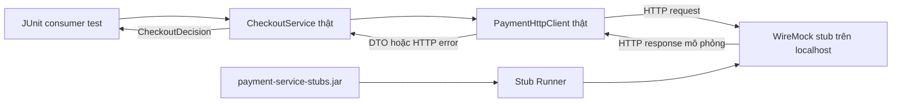
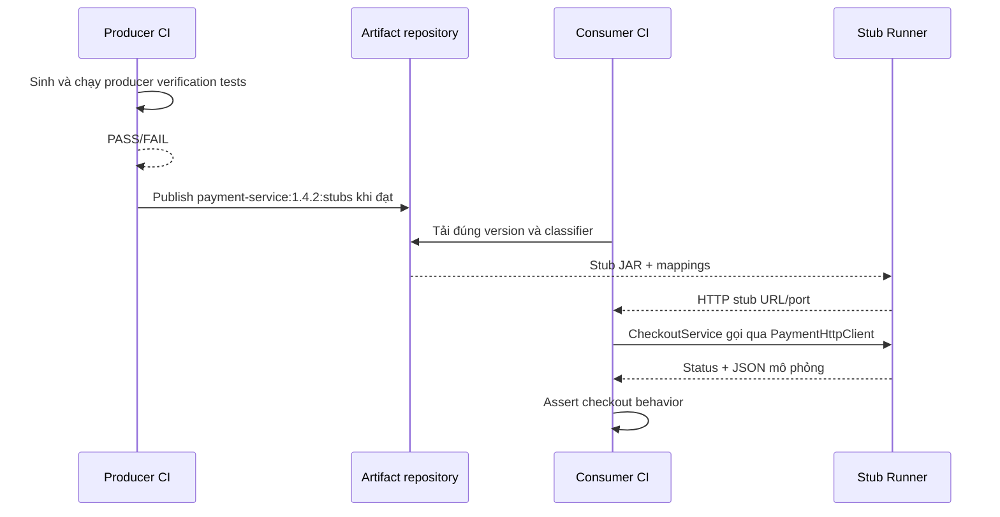

# Kiểm thử mã HTTP client của consumer với stub thật

## 1. “Stub thật” trong consumer test có nghĩa là gì?

Trong hệ thống sử dụng **Spring Cloud Contract (SCC)**, **producer** triển khai API HTTP (hoặc phát thông điệp), còn **consumer** gọi API hoặc nhận thông điệp ấy. Hai phía thống nhất hành vi bằng **Groovy/YAML DSL**, producer sinh **verification tests** và **stub artifacts**, phía consumer dùng **Stub Runner** để khởi chạy stub và kiểm tra mã gọi dịch vụ. CI có thể nối các bước này để phát hiện sớm thay đổi API không tương thích.

Ở đây, **“stub thật” không phải producer production**. Nó là một **HTTP stub server thực sự lắng nghe trên cổng mạng** (thường là WireMock do Stub Runner quản lý), nạp request/response mapping từ gói stub đã phát hành. Consumer test sẽ gửi request HTTP qua **mã HTTP client của chính ứng dụng consumer** tới stub, nhận status/header/body rồi kiểm tra cách consumer xử lý.

Giả sử `checkout-service` gọi `payment-service` để xác định thanh toán đã hoàn tất chưa. Chỉ mock phương thức client bằng Mockito:

```java
when(paymentHttpClient.loadPayment("PAY-42"))
    .thenReturn(new PaymentDto("PAY-42", "CAPTURED", 150000L, "VND"));
```

có thể giúp unit test logic checkout. Nhưng nó **không kiểm tra** client có dùng đúng method, URL, header, JSON decoder và error handling hay không. Kiểm thử HTTP client với stub cần **chạy code consumer thật** và thay **producer dependency** bằng HTTP stub, không thay luôn HTTP client bằng một object mock.

### Mục tiêu học tập

- Phân biệt mock client, HTTP stub, producer thật và vai trò từng lớp kiểm thử.
- Hiểu Stub Runner tải artifact theo `groupId:artifactId:version:classifier` từ `CLASSPATH`, `LOCAL` hoặc `REMOTE`.
- Viết test Spring Boot + Stub Runner gọi **PaymentHttpClient** và **CheckoutService** thật.
- Cấu hình base URL, cổng cố định/động, tránh gọi nhầm production hoặc chỉ gọi thử WireMock.
- Kiểm tra nhánh `200`, `404`, trạng thái nghiệp vụ và các lỗi cần thiết.
- Chẩn đoán thiếu artifact, request không khớp mapping, kết nối sai port và test xanh giả.
- Đưa producer verification, version stub và consumer tests vào CI.

> **Phạm vi bằng chứng:** Consumer test xanh với stub chỉ cho biết **consumer tương tác đúng với hành vi mô phỏng đã nạp**. Muốn xác minh producer implementation, phải chạy **generated producer verification tests trên đúng producer build**.

## 2. Bốn cấp kiểm thử và ranh giới của chúng

| Cách kiểm thử | Mã consumer chạy | Có HTTP qua socket? | Producer thực? | Bằng chứng |
|---|---|---|---|---|
| Mockito mock `PaymentHttpClient` | CheckoutService, không qua HTTP client thật | Không | Không | Logic consumer phản ứng đúng với object mock |
| Mock transport / unit test client | HTTP client class, transport giả | Không | Không | Dựng request/parse/error mapping ở cấp client |
| **Stub Runner + HTTP client thật** | Client + CheckoutService | **Có**, tới WireMock stub | Không | Consumer gọi đúng giao diện mô phỏng |
| Consumer + producer cùng chạy trong test | Cả hai implementation | Có | Có, trong test environment | Tích hợp implementation theo kịch bản đã kiểm tra |

Một bài test không cần kiểm tra mọi thứ cùng lúc. Unit test có thể nhanh và chính xác cho thuật toán checkout; **consumer HTTP integration test với Stub Runner** bổ sung bằng chứng ở ranh giới gọi collaborator; producer verification bảo vệ mã producer.



Điểm khác với “mock mọi thứ” là **client thật tạo và gửi HTTP request**, parser thật xử lý JSON, còn business logic thật quyết định kết quả. Điểm khác với end-to-end test là **producer thực không tham gia đường gọi**.

## 3. Chuẩn bị stub artifact từ producer

Giả sử producer phát hành:

```text
groupId    = com.acme.billing
artifactId = payment-service
version    = 1.4.2
classifier = stubs
```

Stub ID:

```text
com.acme.billing:payment-service:1.4.2:stubs
```

Gói có thể được đóng tên `payment-service-1.4.2-stubs.jar` chứa WireMock mappings. Tùy hạ tầng, Stub Runner tìm artifact theo:

| Mode | Nguồn | Khi dùng |
|---|---|---|
| `CLASSPATH` | Stub artifact ở test classpath | Dự án đưa stubs vào test dependencies |
| `LOCAL` | Maven local repo như `~/.m2` | Producer đã `install` stub JAR trên máy |
| `REMOTE` | Artifact repository từ xa | CI dùng Nexus/Artifactory hoặc kho được phép |

Ba chế độ có **ý nghĩa khác nhau**. Nếu artifact chỉ tồn tại ở repository từ xa, `LOCAL` không tự tải về khi local repo chưa có bản đó. Nếu chỉ có `payment-service-1.4.1-stubs.jar`, yêu cầu `1.4.2` không tự được đáp ứng.

Ở producer, quy trình đáng tin cậy là **sinh verification tests → chạy tests → đóng gói & phát hành stub artifact**. Nếu một contract được phát hành sớm để unblock consumer trước khi producer có implementation (ví dụ contract in-progress), phải ghi nhận rằng stub **chưa được producer xác minh**.

### 3.1. Stub ID khác URL HTTP stub

```text
Stub ID:
  com.acme.billing:payment-service:1.4.2:stubs:18081

Stub URL lúc chạy test:
  http://localhost:18081/api/payments/PAY-42

Producer URL trong một môi trường thực:
  https://payments.example.internal/api/payments/PAY-42
```

Cổng `18081` là cổng **HTTP stub server**, không nằm trong GAV Maven artifact. Test không được âm thầm dùng URL producer thật khi Stub Runner không khởi động.

## 4. Thiết kế ba tình huống HTTP trước khi viết test

Giả sử hai phía thống nhất API minh họa:

| Tình huống | Request | Response stub | Hành vi checkout |
|---|---|---|---|
| Thanh toán đã hoàn tất | `GET /api/payments/PAY-42` | `200`, `state: CAPTURED` | Cho phép checkout |
| Thanh toán còn chờ | `GET /api/payments/PAY-17` | `200`, `state: PENDING` | Chưa cho phép checkout |
| Thanh toán không tồn tại | `GET /api/payments/PAY-404` | `404`, `code: PAYMENT_NOT_FOUND` | Báo không tìm thấy |

**Đây là quy tắc API giả định của bài**, không phải hành vi mặc định của SCC.

### 4.1. Hợp đồng YAML cho `200 CAPTURED`

```yaml
name: payment_captured
description: "Consumer tra cứu thanh toán đã capture"
request:
  method: GET
  url: /api/payments/PAY-42
  headers:
    Accept: application/json
response:
  status: 200
  headers:
    Content-Type: application/json
  body:
    paymentId: "PAY-42"
    state: "CAPTURED"
    amount: 150000
    currency: "VND"
```

### 4.2. Hợp đồng YAML cho `200 PENDING`

```yaml
name: payment_pending
description: "Thanh toán còn chờ"
request:
  method: GET
  url: /api/payments/PAY-17
response:
  status: 200
  headers:
    Content-Type: application/json
  body:
    paymentId: "PAY-17"
    state: "PENDING"
    amount: 150000
    currency: "VND"
```

### 4.3. Hợp đồng YAML cho `404`

```yaml
name: payment_missing
description: "Thanh toán PAY-404 không tồn tại"
request:
  method: GET
  url: /api/payments/PAY-404
response:
  status: 404
  headers:
    Content-Type: application/json
  body:
    code: "PAYMENT_NOT_FOUND"
    message: "Payment not found"
```

**Đặc biệt chú ý `404`:** nếu request không khớp bất kỳ WireMock mapping nào, stub cũng có thể trả `404`. Một test chỉ assert status `404` có nguy cơ xanh giả. Nên kiểm tra error body/code (nếu HTTP client expose), request matching, và outcome consumer rõ ràng.

### 4.4. Một cách viết Groovy DSL tương đương

Ví dụ cho riêng tình huống CAPTURED:

```groovy
import org.springframework.cloud.contract.spec.Contract

Contract.make {
    name('payment_captured')
    request {
        method GET()
        url '/api/payments/PAY-42'
        headers {
            accept(applicationJson())
        }
    }
    response {
        status OK()
        headers {
            contentType(applicationJson())
        }
        body(
            paymentId: 'PAY-42',
            state: 'CAPTURED',
            amount: 150000,
            currency: 'VND'
        )
    }
}
```

Cùng một tình huống có thể viết Groovy **hoặc** YAML; không cần tạo hai definitions trùng request trừ khi dự án có lý do rõ ràng. Stub Runner sử dụng mappings sau khi build, nên code consumer test không cần biết contract gốc viết bằng DSL nào.

## 5. Code HTTP client phải là code production của consumer

Ví dụ dùng **Spring Boot 3.2+ / Spring Framework 6.1+** với `RestClient`. Dự án dùng `RestTemplate` hoặc `WebClient` vẫn áp dụng cùng nguyên tắc: **test class HTTP client thật mà ứng dụng dùng**, không thay bằng client tự tạo riêng trong test.

### 5.1. DTO trong consumer

```java
package com.acme.checkout.payment;

public record PaymentDto(
    String paymentId,
    String state,
    long amount,
    String currency
) {}
```

Ví dụ `long amount` chỉ phù hợp khi API thỏa thuận đơn vị nguyên. Nếu API dùng tiền có thập phân, hai bên phải thống nhất định dạng và kiểu (ví dụ `BigDecimal`) thay vì tự suy đoán.

### 5.2. PaymentHttpClient: cấu hình base URL, gọi thật

```java
package com.acme.checkout.payment;

import org.springframework.beans.factory.annotation.Value;
import org.springframework.stereotype.Component;
import org.springframework.web.client.RestClient;

@Component
public class PaymentHttpClient {
    private final RestClient client;

    public PaymentHttpClient(
            RestClient.Builder builder,
            @Value("${payment.api.base-url}") String baseUrl) {
        this.client = builder.baseUrl(baseUrl).build();
    }

    public PaymentDto loadPayment(String paymentId) {
        return client.get()
            .uri("/api/payments/{id}", paymentId)
            .header("Accept", "application/json")
            .retrieve()
            .body(PaymentDto.class);
    }
}
```

Ở đây, `@Value("${payment.api.base-url}")` lấy **base URL từ Spring configuration**. Trong bài test, thuộc tính `payment.api.base-url` được trỏ tới stub HTTP thay vì URL producer; mã `PaymentHttpClient` giữ nguyên giữa môi trường chạy thật và môi trường kiểm thử.

**Điểm quan trọng:** `PaymentHttpClient` dựng `RestClient` và parse `PaymentDto` thật, nên test qua stub có thể phát hiện lỗi HTTP method, URL, header và serialization/decoder. Không hard-code host production trong code, không fallback âm thầm về production khi cấu hình test thiếu.

### 5.3. CheckoutService: quyết định nghiệp vụ

```java
package com.acme.checkout;

import com.acme.checkout.payment.PaymentDto;
import com.acme.checkout.payment.PaymentHttpClient;
import org.springframework.stereotype.Service;
import org.springframework.web.client.HttpClientErrorException;

@Service
public class CheckoutService {
    private final PaymentHttpClient payments;

    public CheckoutService(PaymentHttpClient payments) {
        this.payments = payments;
    }

    public CheckoutDecision evaluate(String paymentId) {
        try {
            PaymentDto payment = payments.loadPayment(paymentId);
            if (payment != null
                    && paymentId.equals(payment.paymentId())
                    && "CAPTURED".equals(payment.state())) {
                return new CheckoutDecision(true, "READY");
            }
            return new CheckoutDecision(false, "PAYMENT_PENDING");
        } catch (HttpClientErrorException.NotFound exception) {
            return new CheckoutDecision(false, "PAYMENT_NOT_FOUND");
        }
    }

    public record CheckoutDecision(boolean accepted, String reason) {}
}
```

Ví dụ xử lý ba nhánh đã thỏa thuận, không bắt mọi HTTP error rồi gán thành `404`. Khi dùng `RestClient.retrieve()` mặc định, response HTTP lỗi thường được chuyển thành `RestClientResponseException` với các subclass tương ứng. Nếu dự án có `onStatus(...)` hoặc error handler tùy chỉnh, test phải assert **hành vi code thực** thay vì mặc định giống đoạn minh họa.

## 6. Thêm dependency Stub Runner ở **consumer test scope**

Maven dependencies (trích đoạn):

```xml
<dependencies>
    <dependency>
        <groupId>org.springframework.boot</groupId>
        <artifactId>spring-boot-starter-web</artifactId>
    </dependency>

    <dependency>
        <groupId>org.springframework.boot</groupId>
        <artifactId>spring-boot-starter-test</artifactId>
        <scope>test</scope>
    </dependency>

    <dependency>
        <groupId>org.springframework.cloud</groupId>
        <artifactId>spring-cloud-starter-contract-stub-runner</artifactId>
        <scope>test</scope>
    </dependency>
</dependencies>
```

Gradle Groovy DSL:

```groovy
dependencies {
    implementation 'org.springframework.boot:spring-boot-starter-web'
    testImplementation 'org.springframework.boot:spring-boot-starter-test'
    testImplementation 'org.springframework.cloud:spring-cloud-starter-contract-stub-runner'
}
```

Đây là **các đoạn minh họa**, chưa gồm BOM và version management. Kiểm tra tính tương thích Boot/Cloud/SCC trước khi chạy.

Producer cần **Contract Verifier + SCC plugin** để sinh producer tests và stub artifact; consumer test cần **Stub Runner** để tải/chạy artifact. Không đưa Stub Runner vào production runtime chỉ vì muốn chạy consumer tests, và không cài SCC generator plugin trên consumer rồi kỳ vọng plugin tự sửa URL HTTP client.

## 7. Test consumer thật với Stub Runner trên cổng cố định

Để dễ hiểu cơ chế wiring, ví dụ đầu tiên dùng cổng **18081**. Cách này phù hợp test chạy riêng, nhưng cần chuyển sang cổng động hoặc cô lập môi trường khi nhiều CI jobs chạy đồng thời.

Giả sử đã `install` `payment-service-1.4.2-stubs.jar` vào Maven local repo và gói có ba mappings ở mục 4.

```java
package com.acme.checkout;

import org.junit.jupiter.api.Test;
import org.springframework.beans.factory.annotation.Autowired;
import org.springframework.boot.test.context.SpringBootTest;
import org.springframework.cloud.contract.stubrunner.spring.AutoConfigureStubRunner;
import org.springframework.cloud.contract.stubrunner.spring.StubRunnerProperties;

import static org.junit.jupiter.api.Assertions.*;

@SpringBootTest(
    webEnvironment = SpringBootTest.WebEnvironment.NONE,
    properties = "payment.api.base-url=http://localhost:18081"
)
@AutoConfigureStubRunner(
    ids = "com.acme.billing:payment-service:1.4.2:stubs:18081",
    stubsMode = StubRunnerProperties.StubsMode.LOCAL
)
class CheckoutConsumerContractTest {
    @Autowired CheckoutService checkoutService;

    @Test
    void capturedPaymentAllowsCheckout() {
        var result = checkoutService.evaluate("PAY-42");
        assertTrue(result.accepted());
        assertEquals("READY", result.reason());
    }

    @Test
    void pendingPaymentDoesNotAllowCheckout() {
        var result = checkoutService.evaluate("PAY-17");
        assertFalse(result.accepted());
        assertEquals("PAYMENT_PENDING", result.reason());
    }

    @Test
    void missingPaymentIsHandled() {
        var result = checkoutService.evaluate("PAY-404");
        assertFalse(result.accepted());
        assertEquals("PAYMENT_NOT_FOUND", result.reason());
    }
}
```

**Vì sao bài test này có giá trị:**

1. `@SpringBootTest` tạo application context với `CheckoutService`, `PaymentHttpClient` thật.
2. Stub Runner lấy stub artifact `LOCAL`, khởi chạy HTTP stub trên `18081`.
3. `payment.api.base-url` được inject vào client khi tạo Spring bean, trỏ tới stub.
4. `checkoutService.evaluate(...)` gọi client production thực và nhận HTTP response mô phỏng.
5. Assertions kiểm tra **quyết định checkout**, không chỉ kiểm tra stub trả `200`.

Nếu Stub Runner không tải được artifact, test phải fail rõ ràng. Nếu các mappings `PAY-42`, `PAY-17` hoặc `PAY-404` không có, kết quả có thể thất bại; việc này giúp phát hiện khác biệt giữa dữ liệu thử và artifact thực tế.

### 7.1. Phản ví dụ: tự tạo một client khác chỉ để gọi stub

```java
@Test
void onlyTestsStubMapping() {
    var dto = RestClient.create("http://localhost:18081")
        .get()
        .uri("/api/payments/PAY-42")
        .retrieve()
        .body(PaymentDto.class);

    assertEquals("CAPTURED", dto.state());
}
```

Bài test này chỉ chứng minh **stub chạy và một client ad hoc đọc response được**. Nó không kiểm tra cấu hình, error handler, retry, timeout và logic của `PaymentHttpClient` hoặc `CheckoutService` trong ứng dụng. Trong consumer contract testing, hãy gọi **đường sản phẩm đang dùng**, không né nó.

### 7.2. Nhược điểm của cổng cố định

Hai test JVM cùng dùng `18081` có thể xung đột. Một service khác có thể đã chiếm cổng và test gọi nhầm server. Cổng cố định là **lựa chọn để minh họa wiring**, không phải mặc định nên dùng cho CI song song. Đường dùng cổng động sẽ được trình bày ở phần tiếp theo.

## 8. Cổng động với `@StubRunnerPort` và `StubFinder`

Trong CI, cổng động giảm xung đột. Khi **không ghi cổng** trong Stub ID, Stub Runner chọn một cổng khả dụng trong dải cấu hình. Bạn có thể lấy cổng thật sau khi stub khởi động bằng:

```java
@StubRunnerPort("com.acme.billing:payment-service")
int paymentStubPort;
```

hoặc tìm cả URL bằng `StubFinder`:

```java
@Autowired
StubFinder stubFinder;

URL paymentStubUrl = stubFinder.findStubUrl(
    "com.acme.billing", "payment-service");
```

Đây là **URL của stub**, không phải URL producer thật. Dùng `groupId:artifactId` khi có nhiều producer cùng `artifactId`; chỉ dùng artifactId nếu không gây mơ hồ.

### 8.1. Một ví dụ test dùng cổng động mà vẫn chạy code consumer thật

Khi consumer client được thiết kế để nhận base URL qua constructor, có thể khởi tạo **chính production class** `PaymentHttpClient` và `CheckoutService` trong test để tránh hard-code port:

```java
@SpringBootTest(webEnvironment = SpringBootTest.WebEnvironment.NONE)
@AutoConfigureStubRunner(
    ids = "com.acme.billing:payment-service:1.4.2:stubs",
    stubsMode = StubRunnerProperties.StubsMode.LOCAL
)
class CheckoutDynamicPortTest {

    @StubRunnerPort("com.acme.billing:payment-service")
    int paymentPort;

    @Autowired
    RestClient.Builder restClientBuilder;

    @Test
    void checkoutCallsStubOnAssignedPort() {
        String stubUrl = "http://localhost:" + paymentPort;

        // Hai class này là mã production của consumer, không phải mock.
        PaymentHttpClient client =
            new PaymentHttpClient(restClientBuilder, stubUrl);
        CheckoutService checkout = new CheckoutService(client);

        var result = checkout.evaluate("PAY-42");

        assertTrue(result.accepted());
        assertEquals("READY", result.reason());
    }
}
```

Đoạn này **thực sự chạy code HTTP client và business logic của consumer** qua cổng động. Tuy nhiên, nó **không kiểm tra việc Spring tự wire `payment.api.base-url` vào bean** vì test chủ động gọi constructor. Nếu cấu hình dependency injection là một phần rủi ro cần bảo vệ, hãy dùng phương án:

- Test cố định port như mục 7 để kiểm tra cấu hình Spring ứng dụng từ lúc khởi động; hoặc
- Tạo một **test configuration**/client factory nhận URL stub khi Stub Runner đã sẵn sàng và inject các production classes thật, kiểm tra thứ tự khởi tạo bean; hoặc
- Với HTTP client dùng service discovery, cấu hình **Stub Runner Spring Cloud integration** để discovery trỏ tới stub, theo phiên bản đang dùng.

Tránh giải pháp `@DynamicPropertySource` đọc `@StubRunnerPort` trong một **static method**: field stub port chỉ được inject vào test instance sau khi Stub Runner khởi động, trong khi dynamic properties phục vụ dựng application context. Nếu tính sai lifecycle, test có thể trỏ tới port 0 hoặc port cũ.

### 8.2. Lấy URL trực tiếp qua StubFinder

```java
@Autowired StubFinder stubFinder;

@Test
void checkoutWithFoundStubUrl() {
    String url = stubFinder
        .findStubUrl("com.acme.billing", "payment-service")
        .toString();

    PaymentHttpClient realClient =
        new PaymentHttpClient(restClientBuilder, url);
    CheckoutService service = new CheckoutService(realClient);

    assertTrue(service.evaluate("PAY-42").accepted());
}
```

Phần này là **trích đoạn** cần `restClientBuilder` và import phù hợp. `StubFinder` có lợi vì tự phản ánh host/port mà stub đã khởi chạy; nó có thể báo không tìm thấy nếu ID sai hoặc server chưa được tạo. Không bắt lỗi rồi fallback sang production URL.

### 8.3. Environment properties và thời điểm Spring khởi tạo beans

Stub Runner có thể đăng ký properties cổng cho các stubs đang chạy, ví dụ dạng `stubrunner.runningstubs.payment-service.port` hoặc dạng đầy đủ chứa group ID; tên prefix cụ thể nên kiểm tra theo **phiên bản Spring Cloud Contract**. Đặc biệt, **không giả định** property do Stub Runner đăng ký sẽ sẵn sàng tại mọi giai đoạn cấu hình bean tùy ý.

Nếu client cần base URL ngay khi application context khởi tạo, hãy dùng giải pháp có lifecycle được xác minh, không đặt một placeholder cổng chưa tồn tại rồi chấp nhận test chập chờn. Xem generated runtime logs và thử một case cố ý thay URL để xác nhận test không vô tình trỏ production.

## 9. Tránh test xanh giả khi Stub Runner trả `404`

Một lỗi tinh vi: **WireMock cũng có thể trả `404` cho request không khớp mapping**. Nếu consumer chỉ bắt mọi HTTP `404` và trả lý do `PAYMENT_NOT_FOUND`, bài test `missingPaymentIsHandled` ở mục 7 có thể xanh ngay cả khi không nạp đúng contract `payment_missing`.

### 9.1. Kiểm tra error body đúng contract

Giữ bài test ở đầu ra CheckoutService, đồng thời bổ sung một assertion cấp HTTP client cho nhánh lỗi:

```java
@Autowired PaymentHttpClient paymentHttpClient;
@Autowired ObjectMapper objectMapper;

@Test
void notFoundResponseHasDomainErrorCode() throws Exception {
    var exception = assertThrows(
        HttpClientErrorException.NotFound.class,
        () -> paymentHttpClient.loadPayment("PAY-404")
    );

    JsonNode errorBody =
        objectMapper.readTree(exception.getResponseBodyAsString());

    assertEquals(
        "PAYMENT_NOT_FOUND",
        errorBody.path("code").asText()
    );
}
```

Đoạn này là **phần bổ sung** cho test class ở mục 7, cần import Jackson/JUnit phù hợp. Nó kiểm chứng **client thật** nhận đúng error envelope. Nếu Stub Runner trả `404` mặc định không có body `PAYMENT_NOT_FOUND`, assertion sẽ không đạt.

Trong ứng dụng tốt hơn, `PaymentHttpClient` có thể chuyển `404` với mã `PAYMENT_NOT_FOUND` thành một **domain exception có cấu trúc**; `CheckoutService` kiểm tra loại lỗi nghiệp vụ rõ ràng, không bắt mọi `404` thành một nghĩa duy nhất. Thiết kế này cần được thống nhất với producer, vì một số API có nhiều mã lỗi cùng HTTP status.

### 9.2. Kiểm tra đúng mapping được gọi

Có thể kiểm tra các request đã nhận bằng **WireMock request journal/admin API** khi cần, hoặc dùng integration test có assertion về lỗi cụ thể và payload/headers. Chỉ kiểm tra “stub server chạy” hoặc gọi `/__admin/mappings` mà không kiểm tra code consumer **không thay thế** kiểm thử client.

Nếu Stub Runner hỗ trợ xuất mappings theo cấu hình, dùng bản xuất đó để debug. Không mặc định có thể truy cập cổng WireMock khác hoặc sửa mappings ở test rồi coi chúng là mappings của artifact producer đã phát hành.

## 10. Test những chi tiết HTTP consumer thường dễ sai

| Điều consumer thực sự phụ thuộc | Ví dụ | Nên kiểm tra ra sao |
|---|---|---|
| Method và path | `GET /api/payments/PAY-42` | Stub request matcher không khớp nếu client đổi thành POST hoặc sai path |
| Query parameter | `?includeHistory=true` | Contract có matcher/query tương ứng; test gọi đường thật |
| Header | `Accept: application/json` | Stub yêu cầu header nếu đó là giao diện đã cam kết |
| Request body | JSON với số, boolean, array | Contract body/matchers và client serializer thực |
| Status code | `200`, `404`, `409` | Test cả nhánh thành công và lỗi quan trọng |
| Content-Type | `application/json` | Đảm bảo decoder hoạt động và stub trả đúng media type |
| Kiểu JSON | `amount: 150000` (number) | DTO thực parse đúng, không biến thành string |
| Trường bắt buộc | `paymentId`, `state` | Test đầu ra consumer hoặc validation rõ ràng |
| Field động | paymentId/token/timestamp | Regex/matcher phù hợp trong contract, tránh hard-code vô ích |
| Authentication | `Authorization`/API key | Fixture test an toàn; stub xác minh header nếu consumer phụ thuộc |
| Redirect/HTTP cache | `Location`, `ETag` | Test riêng nếu consumer dựa vào |
| Timeout/retry | `503` hoặc delayed response | Test policy có giới hạn và idempotency/side effect |

Một stub tĩnh không nhất thiết được thiết kế để kiểm tra *mọi* trường hợp. Dùng các **contract scenarios** có ý nghĩa với consumer và bổ sung unit/integration tests cho retry, timeouts, authentication, response validation khi cần.

### 10.1. Ví dụ query và header

Nếu consumer phải gửi header `X-Client-Version` và query `includeDetails`, contract YAML có thể mô tả:

```yaml
name: payment_details
request:
  method: GET
  urlPath: /api/payments/PAY-42
  queryParameters:
    includeDetails: "true"
  headers:
    Accept: application/json
    X-Client-Version: "3"
response:
  status: 200
  headers:
    Content-Type: application/json
  body:
    paymentId: "PAY-42"
    state: "CAPTURED"
```

Đây là **tình huống bổ sung** cần được producer/consumer thống nhất. Nó không tự trở thành mapping của artifact `1.4.2` đã có; phải được đưa vào contract và build/publish lại đúng version. Tùy phiên bản DSL, cú pháp URL/query cần đối chiếu tài liệu. Khi test client sai header hoặc thiếu query, stub không nên khớp mapping ràng buộc chúng.

### 10.2. Lỗi business khác lỗi kết nối

HTTP `409 Conflict` nghĩa là server/stub đã trả **một response hợp lệ** nhưng từ chối thao tác theo giao diện. `Connection refused`/DNS failure xảy ra **trước khi có HTTP response**. Không nên bắt mọi exception rồi biến thành `PAYMENT_NOT_FOUND`; đó là cách làm sai lệch semantics lỗi cho consumer.

Nếu API quy định `429` hoặc `503` có `Retry-After`, cần kiểm tra chính sách client riêng; không nên retry vô hạn, đặc biệt với thao tác có side effect. Một contract `200` đơn lẻ không chứng minh timeout/retry đã được thiết kế.

## 11. Với WebClient reactive, vẫn phải gọi mã consumer thật

Consumer WebFlux có thể dùng `WebClient` thay cho `RestClient`:

```java
@Component
class PaymentWebClient {
    private final WebClient webClient;

    PaymentWebClient(
            WebClient.Builder builder,
            @Value("${payment.api.base-url}") String baseUrl) {
        this.webClient = builder.baseUrl(baseUrl).build();
    }

    Mono<PaymentDto> loadPayment(String id) {
        return webClient.get()
            .uri("/api/payments/{id}", id)
            .accept(MediaType.APPLICATION_JSON)
            .retrieve()
            .bodyToMono(PaymentDto.class);
    }
}
```

Nếu `ReactiveCheckoutService` trả `Mono<CheckoutDecision>`, consumer test nên dùng `StepVerifier` trên **chuỗi thật của service**:

```java
StepVerifier.create(reactiveCheckout.evaluate("PAY-42"))
    .assertNext(decision -> {
        assertTrue(decision.accepted());
        assertEquals("READY", decision.reason());
    })
    .verifyComplete();
```

**Điều kiện:** `PaymentWebClient` phải được cấu hình base URL tới Stub Runner, và `ReactiveCheckoutService` là implementation thực. Đừng viết một `Mono.just(new PaymentDto(...))` trong test rồi coi là đã kiểm tra HTTP client.

StepVerifier xác minh tín hiệu reactive trong test; Stub Runner bảo vệ response HTTP mô phỏng. Nó không tự chứng minh backpressure của hệ thống mạng hoặc producer thật. Nếu client dùng retry/cancellation, viết các test reactive chuyên biệt với timeout/virtual time khi phù hợp.

## 12. Feign, service discovery và URL cố định

Không phải consumer nào cũng cấu hình một property `payment.api.base-url`. Một số ứng dụng dùng **Spring Cloud OpenFeign** hoặc `@LoadBalanced RestTemplate/WebClient` để gọi service theo **service ID** thay vì URL cụ thể.

Stub Runner Spring Cloud có thể tích hợp với `DiscoveryClient` và `ReactorServiceInstanceLoadBalancer` để chuyển tên dependency sang các stub servers do Stub Runner chạy. Điều này hữu ích khi không muốn thay URL thủ công trong từng client.

Tuy nhiên:

- **Maven artifactId** không nhất thiết bằng `spring.application.name` hay service discovery ID.
- `ids-to-service-ids` có thể dùng khi cần ánh xạ artifact ID với service ID theo phiên bản SCC.
- Nếu Feign client có cấu hình `url` cụ thể, nó có thể **bỏ qua discovery**, nên Stub Runner discovery integration không tự thay URL đó.
- Trong test, cần vô hiệu hóa/bọc các discovery/config server thực không cần thiết để tránh gọi ra môi trường ngoài.
- Phải kiểm tra request thật có tới **stub URL**, không chỉ tin rằng annotation đã cấu hình đúng.

Với hệ thống dùng nhiều collaborators, ghi rõ ID và cổng/URL từng stub; không để client thanh toán gọi nhầm stub kho hàng.

## 13. Tổ chức fixture để consumer test độc lập và tái lập

Stub Runner không tự chuẩn bị database của consumer. Nếu CheckoutService đọc/ghi trạng thái nội bộ, consumer test cần fixture riêng trước mỗi test.

Những tiêu chí quan trọng:

- **Không phụ thuộc thứ tự:** test A không tạo dữ liệu cho test B.
- **Không phụ thuộc production:** không gọi nhầm cổng hay địa chỉ thật khi Stub Runner lỗi.
- **Không phụ thuộc version động:** release gate ưu tiên pin stub version.
- **Không phụ thuộc cache cũ:** nếu có cache HTTP/domain, reset nó hoặc thiết kế test đúng phạm vi.
- **Không gọi external payment gateway thật:** thay đúng collaborator cần cô lập bằng stub, giữ các dependency khác ở chế độ test phù hợp.
- **Có timeout hữu hạn:** test lỗi kết nối/retry không được treo CI vô hạn.
- **Chú ý test song song:** không dùng cổng cố định chung nếu nhiều JVM chạy cùng host.

### 13.1. Stub state không bằng producer database state

WireMock stub trả response theo request mappings, không tự tra database producer. Với hai hợp đồng có **request giống hệt** nhưng response khác nhau do trạng thái producer, cần có request discriminator hoặc cơ chế scenario/stateful stub phù hợp. Trong bài cơ bản, dùng các ID `PAY-42`, `PAY-17` và `PAY-404` để tạo request khác nhau giúp test ổn định.

### 13.2. Tránh test xanh do cache

Nếu CheckoutService cache payment response, bài test thứ hai có thể không gọi stub thật. Một test chỉ assert kết quả trả về chưa chắc chứng minh mọi lần gọi đều đi qua HTTP. Khi đường mạng quan trọng, có thể dọn cache hoặc xác minh request journal/count của WireMock stub, với fixture và mapping phù hợp. Chỉ assert số lần gọi khi đó là behavior thực sự được cam kết, vì retry và cache có thể làm số lần gọi thay đổi có chủ đích.

## 14. Tránh dàn trải test: lớp nào chịu trách nhiệm gì?

| Nhóm test | Trách nhiệm nên ưu tiên |
|---|---|
| **Consumer unit tests** | Checkout logic với mock PaymentClient, các tổ hợp trạng thái nội bộ |
| **Consumer HTTP tests với Stub Runner** | URL/method/header/JSON, status/error handling, behavior khi dùng response từ collaborator stub |
| **Producer verification tests** | Producer implementation đáp ứng từng contract DSL trên đúng build |
| **Integration/E2E tests** | Client và producer chạy thật, auth/network/database/gateway theo môi trường kiểm thử |
| **Resilience tests** | Timeout, retry, circuit breaker, fallback, idempotency |
| **Load/security tests** | Tải lớn, TLS, authorization, giới hạn và leakage |

Cùng một test không cần kiểm tra mọi khía cạnh. Nhưng không được dùng **kết quả của tầng này** để tuyên bố tầng khác đã được xác minh.

## 15. Stub Runner so với tự viết WireMock mapping

Trong một test đơn lẻ, bạn có thể dùng **WireMock trực tiếp**, tự tạo mapping cho `GET /api/payments/PAY-42` và chạy `PaymentHttpClient`. Việc này có giá trị khi cần kiểm soát các tình huống khó như connection reset, response delay hoặc response malformed mà producer contract chưa mô tả.

Nhưng có một khác biệt lớn:

| Cách dựng stub | Mapping đến từ đâu? | Rủi ro |
|---|---|---|
| WireMock tự viết trong consumer test | Do consumer team tạo và bảo trì | Có thể **khác contract mà producer đã xác minh** |
| **Stub Runner từ artifact của producer** | Từ gói mappings/contract producer phát hành | Có thể dùng version cũ hoặc chưa qua producer verification |
| Producer server thật trong test | Implementation producer đang chạy | Setup phức tạp; môi trường test có thể khác production |

Với mục tiêu **consumer-driven contract**, Stub Runner từ gói producer cung cấp sự liên kết rõ giữa hai nhóm. Với mục tiêu **fault injection**, WireMock tự viết hoặc công cụ resilience test có thể bổ sung. Đừng vô tình thay mapping đã phát hành bằng một mapping consumer tự tạo rồi tuyên bố đã kiểm tra tương thích với producer contract.

### 15.1. Test lỗi kỹ thuật cần mục tiêu cụ thể

Một số tình huống nên tách riêng khỏi ví dụ ba contract chính:

- **503 Service Unavailable:** consumer trả fallback hay fail fast? Có retry không?
- **Timeout:** client có connect/read timeout đủ ngắn và phản ứng phù hợp không?
- **Connection reset:** cần test retry/circuit breaker/cancellation khi có rủi ro.
- **Malformed JSON:** client từ chối hoặc xử lý thế nào; không silently chuyển dữ liệu sai thành “pending”.
- **401/403:** client có gửi token và phân biệt authentication/authorization không?
- **409 Conflict:** nếu endpoint thực hiện thay đổi trạng thái như capture payment, client có giải mã error code đúng không?

Đối với thao tác **POST tạo/capture thanh toán**, retry có thể tạo side effect trùng. Cần kiểm thử idempotency ở tầng nghiệp vụ/integration; **Stub Runner không tự chứng minh** producer không thực hiện hai giao dịch.

### 15.2. Không bắt tất cả exception thành success hay not-found

Một phản ví dụ:

```java
try {
    return paymentClient.loadPayment(id);
} catch (Exception ignored) {
    return new PaymentDto(id, "CAPTURED", 0, "VND");
}
```

Cách này có thể che lỗi DNS/HTTP 500/malformed JSON và trả trạng thái thành công sai. Tương tự, bắt mọi lỗi thành `PAYMENT_NOT_FOUND` cũng đánh đồng lỗi business với lỗi hạ tầng.

Trong consumer HTTP tests, nên có **ít nhất một ca lỗi cụ thể** để xác minh chính sách thất bại của client, không chỉ happy path `200`.

## 16. Quản lý phiên bản stub trong CI

Một pipeline đáng tin cậy gồm hai luồng độc lập có liên kết bằng artifact:



### 16.1. Phía producer

1. Viết hoặc nhận contract theo yêu cầu consumer.
2. Chạy SCC Maven/Gradle plugin sinh producer tests và mappings.
3. Dựng test context/fixtures để generated tests thực sự kiểm tra implementation.
4. Fail CI khi producer trả khác status/header/body hoặc không chạy được test.
5. Phát hành stub artifact có version và classifier rõ ràng sau khi đạt gate theo chính sách.
6. Lưu commit/contract revision/test report tương ứng.

### 16.2. Phía consumer

1. Chọn stub ID và **version cố định** cho release gate.
2. Chọn `CLASSPATH`, `LOCAL` hoặc `REMOTE` đúng nơi artifact được lưu.
3. Khởi động Stub Runner và xác minh **có mappings cần thiết**, không chỉ application context khởi động.
4. Cấu hình HTTP client thật trỏ tới stub URL/port.
5. Chạy assertions cho cả happy path và lỗi quan trọng.
6. Để thiếu artifact/mapping hoặc consumer logic fail khiến CI fail; không tự bỏ qua.
7. Ghi version stub được tải trong build/test report để điều tra regression.

Tài liệu Stub Runner có tùy chọn `failOnNoStubs`; trong những tình huống cần stub, **không** tùy tiện đổi thành `false` để CI xanh khi gói stub thiếu. Phải giải quyết nguyên nhân tại repository/version/classifier hoặc build producer.

### 16.3. Version cố định so với `+`

```text
com.acme.billing:payment-service:1.4.2:stubs
com.acme.billing:payment-service:+:stubs
```

Version cố định giúp test tái lập và so sánh các lần chạy. Dấu `+` phục vụ thử bản mới nhất được resolver tìm thấy nhưng có thể thay đổi theo repository tại thời điểm test. Một chiến lược thực tế là:

- **Release compatibility gate:** pin version cụ thể.
- **Forward compatibility monitoring:** một job riêng có thể dùng `+`, nhưng phải ghi rõ version đã phân giải.

Nếu producer và consumer có nhiều phiên bản đang chạy song song, hãy lập **ma trận kiểm thử** theo các version thực sự được hỗ trợ, không suy diễn khả năng tương thích chỉ từ “latest”.

### 16.4. Cấu hình `REMOTE`

Ví dụ (chỉ là URL repository minh họa):

```java
@AutoConfigureStubRunner(
    ids = "com.acme.billing:payment-service:1.4.2:stubs",
    stubsMode = StubRunnerProperties.StubsMode.REMOTE,
    repositoryRoot =
        "https://repo.example.org/repository/maven-releases/"
)
```

Phải cấp quyền repository bằng secret/config phù hợp; không commit password/token. `repositoryRoot` là **nơi tải artifact**, không phải base URL của payment HTTP API. Với môi trường CI không có mạng, dùng dependency `CLASSPATH` hoặc cache có version đã được chuẩn bị, tránh fallback sang producer production.

## 17. Bảng chẩn đoán: test đỏ ở đâu?

| Dấu hiệu | Lớp lỗi có thể | Kiểm tra và cách xử lý |
|---|---|---|
| Không tìm thấy `-stubs.jar` | GAV/classifier/version sai, chưa publish | Đối chiếu artifact producer và repository |
| `LOCAL` không thấy gói | Chưa `install` hoặc dùng repo local khác | Kiểm tra Maven settings/local repo |
| `REMOTE` 401/403 | Thiếu quyền/credentials | Cấu hình secrets test an toàn |
| Stub Runner lên nhưng không có mapping | Stub JAR sai layout/không chứa mappings | Kiểm tra nội dung artifact và logs |
| `Connection refused` | Stub port sai hoặc HTTP server chưa bind | Xem `@StubRunnerPort`, `StubFinder`, start logs |
| HTTP `404` | Không có mapping hoặc contract thực quy định `404` | Xem request matching **và error code** |
| `415` hoặc lỗi decoder | Content-Type/serialization sai | Kiểm tra response headers, DTO và HTTP client |
| `401/403` | Auth header/test security khác cam kết | Kiểm tra token fixture và headers |
| `200` nhưng consumer báo pending | State/field names/typing/logic khác | Kiểm tra JSON, DTO và business assertions |
| Test xanh khi URL stub bị sai | Mock HTTP client hoặc cache/fallback | Xác minh code consumer thật và outgoing request |
| Local xanh, CI đỏ | Port/version/cache/profile khác | Pin artifact và cấu hình test cố định |
| Chạy song song thất bại | Tranh chấp port/cache/fixture | Dùng cổng động hoặc cô lập runner |
| Consumer test xanh, producer mới vỡ | Stub cũ hoặc thiếu producer gate | Chạy generated producer tests đúng build |
| `0 tests` trong CI | Test discovery/task bị skip | Kiểm tra JUnit engine, report và build lifecycle |

### 17.1. Một quy trình debug ngắn

**Bước A: Artifact.** Stub Runner có tải đúng `groupId:artifactId:version:classifier` không? Nếu không, chưa cần sửa HTTP matcher.

**Bước B: Stub server.** WireMock có khởi động và có mapping không? Stub URL/port thật là gì? Nếu chưa có socket, lỗi nằm ở setup.

**Bước C: HTTP request.** Consumer gửi method, path, headers và body nào? Có khớp contract không? Nếu không, điều tra client/serialization.

**Bước D: HTTP response và consumer behavior.** Status/error code/JSON đúng nhưng app phản ứng sai? Điều tra DTO, error handler và business logic.

**Bước E: Producer implementation.** Stub đúng không có nghĩa producer hiện tại đúng; cần producer verification độc lập.

Khi log debug, có thể ghi stub artifact ID, resolved version và URL `localhost`; **không ghi credentials, access tokens hoặc thông tin thanh toán nhạy cảm**.

## 18. Bài tập: bảo vệ mã gọi inventory của consumer

### 18.1. Bối cảnh

Consumer `order-orchestrator` gọi producer `inventory-service` khi đặt hàng. Producer đã phát hành stub:

```text
com.acme.catalog:inventory-service:2.1.0:stubs
```

API thỏa thuận:

- `GET /api/stock/SKU-100` → `200` với JSON `sku: SKU-100`, `available: true`, `quantity: 8`.
- `GET /api/stock/SKU-200` → `200` với `available: false`, `quantity: 0`.
- `GET /api/stock/SKU-404` → `404` với `code: SKU_NOT_FOUND`.

OrderOrchestrator cần trả `ACCEPTED` cho SKU còn hàng, `OUT_OF_STOCK` cho SKU hết hàng và `UNKNOWN_SKU` cho mã không tồn tại.

### 18.2. Nhiệm vụ thực hành

1. Viết **ba YAML contracts** cho các tình huống trên, giữ đúng kiểu JSON boolean và number.
2. Tạo `InventoryDto` và `InventoryHttpClient` dùng `RestClient` hoặc `WebClient`; base URL cấu hình được.
3. Viết `OrderOrchestrator` gọi **client thật** để quyết định kết quả.
4. Cấu hình Stub Runner `LOCAL` với ID `com.acme.catalog:inventory-service:2.1.0:stubs` và chọn một cổng động.
5. Viết ba tests gọi **OrderOrchestrator** (không mock InventoryHttpClient) và assert `ACCEPTED/OUT_OF_STOCK/UNKNOWN_SKU`.
6. Bổ sung một test cho error body `SKU_NOT_FOUND` để tránh xanh giả khi WireMock không khớp mapping.
7. Nếu Spring tạo HTTP client trước khi cổng động được inject, giải thích cách bạn sẽ wire base URL an toàn.
8. Đề xuất pipeline producer verification → publish stub → consumer test có version cố định.

### 18.3. Gợi ý YAML cho tình huống còn hàng

```yaml
name: stock_available
request:
  method: GET
  url: /api/stock/SKU-100
  headers:
    Accept: application/json
response:
  status: 200
  headers:
    Content-Type: application/json
  body:
    sku: "SKU-100"
    available: true
    quantity: 8
```

### 18.4. Gợi ý test với production classes

```java
@StubRunnerPort("com.acme.catalog:inventory-service")
int inventoryPort;

@Autowired RestClient.Builder builder;

@Test
void availableStockAllowsOrder() {
    InventoryHttpClient client = new InventoryHttpClient(
        builder, "http://localhost:" + inventoryPort);

    OrderOrchestrator orchestrator = new OrderOrchestrator(client);

    assertEquals(
        "ACCEPTED",
        orchestrator.check("SKU-100").status()
    );
}
```

Đây là ví dụ khung; `InventoryHttpClient`, `OrderOrchestrator` và `check(...)` là class/method người học phải triển khai. Nếu muốn kiểm tra **Spring bean wiring**, thay cách dựng thủ công bằng một test configuration inject các production classes đúng lifecycle hoặc test với cổng cố định và property rõ ràng.

### 18.5. Tiêu chí đạt

- Stub artifact và version được chỉ định rõ, không dùng nhầm service production.
- Consumer **HTTP client thật** gửi request qua socket tới stub.
- Test assert **hành vi của OrderOrchestrator** thay vì chỉ gọi `curl` vào WireMock.
- Response có boolean/number đúng JSON type; client DTO giải mã được.
- Cả nhánh 404 có error body/correlation được xác minh rõ.
- Cổng động lấy được từ Stub Runner trước khi gọi HTTP.
- CI có producer verification, artifact publishing và consumer test báo cáo riêng.

## 19. Checklist trước khi merge

- [ ] Đã thống nhất request/response/headers/JSON schema với producer.
- [ ] Các contract cần dùng đã nằm trong stub artifact được publish.
- [ ] Producer verification tests thực sự chạy trên đúng build (hoặc stub được ghi nhận chưa xác minh).
- [ ] Stub ID có group/artifact/version/classifier đúng.
- [ ] `CLASSPATH`, `LOCAL` hoặc `REMOTE` khớp nơi artifact tồn tại.
- [ ] Stub Runner đã tải mappings và khởi động HTTP stub; không chỉ load context.
- [ ] Cổng/URL của stub được wire vào **HTTP client production code**.
- [ ] Test không mock HTTP client đang cần kiểm tra.
- [ ] Test gọi qua use case/service thật của consumer khi có thể.
- [ ] Có assertion nghiệp vụ cho happy path và nhánh lỗi quan trọng.
- [ ] Không coi `404` chung là bằng chứng mapping lỗi nghiệp vụ đã khớp.
- [ ] Có kiểm tra Content-Type, kiểu dữ liệu và error handler khi consumer phụ thuộc.
- [ ] Khi dùng cổng động, không đọc `@StubRunnerPort` trước thời điểm được inject.
- [ ] Feign/load balancer/service discovery trỏ đúng stub, không đi ra môi trường thật.
- [ ] Tests có timeout, fixture cô lập, xử lý cổng trùng trong CI.
- [ ] `failOnNoStubs` không bị tắt ngoài chủ đích làm mất ý nghĩa test.
- [ ] Stub version được pin cho release gate, dùng `+` ở job có mục đích riêng nếu cần.
- [ ] Consumer tests và producer verification có test reports, không báo `0 tests`.
- [ ] Bài test fail khi cố ý đổi URL/mapping/field bắt buộc trong môi trường an toàn.

## 20. Ghi nhớ và tài liệu tham khảo

**Kiểm thử mã HTTP client của consumer với stub thật** là chạy **client HTTP và use case của consumer như production**, nhưng thay **dịch vụ producer** bằng WireMock stub do **Spring Cloud Contract Stub Runner** khởi động. Đây là một tầng kiểm thử quan trọng giữa unit test mock client và full end-to-end test.

Để kết quả có ý nghĩa, không chỉ nạp một stub artifact: cần chọn đúng version, cấu hình URL/port thật sự đi vào HTTP client, bao phủ các nhánh lỗi và assert hành vi consumer. **Stub Runner kiểm tra consumer**, còn **generated producer verification tests kiểm tra producer**; CI phải nối hai phía qua artifact version có thể truy vết.

**Tài liệu chính thức cần đối chiếu theo phiên bản Spring Cloud Contract/Boot:**

- [Spring Cloud Contract — Step-by-step Guide to Consumer Driven Contracts](https://docs.spring.io/spring-cloud-contract/reference/getting-started/cdc.html).
- [Spring Cloud Contract — Stub Runner Core: tải stubs, WireMock mappings và modes](https://docs.spring.io/spring-cloud-contract/reference/project-features-stubrunner/stub-runner-core.html).
- [Spring Cloud Contract — Stub Runner JUnit / StubFinder / @StubRunnerPort](https://docs.spring.io/spring-cloud-contract/reference/project-features-stubrunner/stub-runner-junit.html).
- [Spring Cloud Contract — Stub Runner Spring Cloud: discovery/load balancer](https://docs.spring.io/spring-cloud-contract/reference/project-features-stubrunner/stub-runner-cloud.html).
- [Spring Cloud Contract — Stub Runner failOnNoStubs](https://docs.spring.io/spring-cloud-contract/reference/project-features-stubrunner/stub-runner-fail-on-no-stubs.html).
- [Spring Framework — REST Clients: RestClient](https://docs.spring.io/spring-framework/reference/integration/rest-clients.html).
- [Spring Framework — WebClient](https://docs.spring.io/spring-framework/reference/web/webflux-webclient.html).


