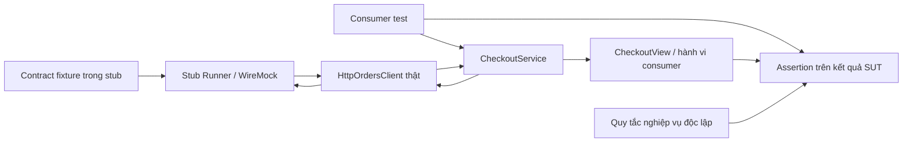
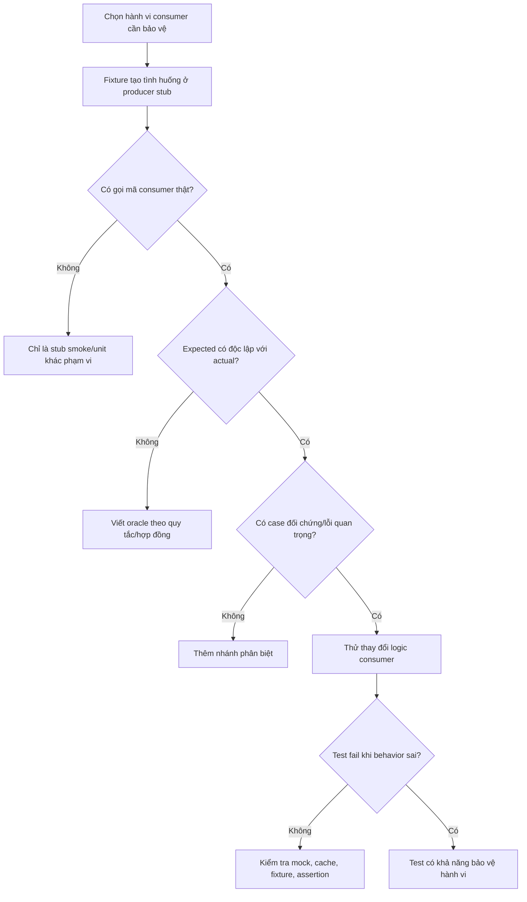

# Tránh assertion chỉ kiểm tra chính dữ liệu fixture

## 1. Kiểm thử consumer phải chứng minh điều gì?

Trong module **SPRING_CLOUD_CONTRACT**, Spring Cloud Contract giúp **producer** và **consumer** thống nhất hành vi tích hợp bằng **Groovy/YAML DSL** cho HTTP hoặc thông điệp. Producer dùng hợp đồng để sinh kiểm thử xác minh ứng dụng thật; sau đó stub được đóng gói, phát hành theo phiên bản. Consumer sử dụng **Stub Runner** để chạy thử với phản hồi hoặc thông điệp mẫu trong CI, qua đó phát hiện sớm các thay đổi API không tương thích.

Tuy nhiên, một consumer test có thể **đạt mà không thực sự kiểm tra consumer**. Ví dụ, test tải HTTP stub, gọi trực tiếp endpoint trên WireMock, nhận JSON `{"id":"ord-1001","status":"CREATED"}` rồi khẳng định JSON vừa nhận bằng chính dữ liệu đã viết trong fixture. Bài test đó xác nhận một phần việc **stub được nạp và phản hồi**; nó chưa chứng minh HTTP client, bộ giải mã, quy tắc xử lý lỗi hoặc service của consumer có hoạt động đúng.

Đó là vấn đề của bài học: **assertion tự xác nhận dữ liệu fixture** (*tautological assertion*, hay “test xanh giả”). Một số ví dụ còn nguy hiểm hơn: test không gọi mã production nào, hoặc dùng cùng một object fixture làm cả **actual** lẫn **expected**.

**Nguyên tắc cốt lõi:** fixture là **đầu vào/điều kiện thử nghiệm**; assertion phải quan sát **hành vi của hệ thống đang được kiểm thử** (*system under test – SUT*) và so sánh với **kỳ vọng độc lập có ý nghĩa** (*test oracle*).

Sau bài này, bạn có thể:

1. Phân biệt **fixture**, **stub**, **SUT** và **oracle** trong consumer contract test.
2. Nhận diện những assertion chỉ so sánh dữ liệu đã thiết lập sẵn.
3. Thiết kế bài test đi qua **mã client và logic consumer thật**, không chỉ gọi WireMock trực tiếp.
4. Kiểm tra nhánh thành công, lỗi HTTP, chuyển đổi dữ liệu và kết quả nghiệp vụ.
5. Viết kiểm thử message bất đồng bộ mà không đạt nhờ read model đã được seed từ trước.
6. Dùng kiểm tra độ nhạy/mutation để phát hiện bài test không thực sự bảo vệ hành vi consumer.
7. Tích hợp producer verification, artifact stub theo phiên bản và consumer assertions vào CI.

## 2. Bốn đối tượng khác nhau trong một consumer test

Giả sử ứng dụng Checkout cần đọc một đơn hàng từ Orders API.

| Đối tượng | Vai trò | Ví dụ |
| --- | --- | --- |
| **Fixture** | Dữ liệu được sắp đặt để tạo một tình huống xác định | Đơn `ord-1001` có trạng thái `CREATED`, tổng tiền `125000` |
| **Stub** | Thực thể mô phỏng ranh giới phụ thuộc ngoài, trả dữ liệu theo hợp đồng | Stub Runner/WireMock mô phỏng Orders API |
| **SUT** | Mã **consumer thật** đang được kiểm tra | `HttpOrdersClient` + `CheckoutService` |
| **Oracle** | Điều kiện mà kết quả của SUT phải đáp ứng | Checkout cho phép thanh toán khi đơn ở trạng thái `CREATED` |

Một test có giá trị cần có đường đi rõ ràng:



Trong hình, Stub Runner **không thay thế SUT**. Nó chỉ thay thế **producer bên ngoài**. Chính `CheckoutService` và `HttpOrdersClient` của consumer phải được chạy để bài test kiểm tra tương thích tích hợp.

### 2.1. “Expected” phải đến từ đâu?

Không bắt buộc expected phải lấy từ một nguồn dữ liệu hoàn toàn khác file fixture. Với field truyền thẳng, so sánh `id == "ord-1001"` vẫn hữu ích nếu giá trị **actual** được consumer thật giải mã và trả ra. Nhưng test không nên **chỉ** so sánh bản sao của payload với chính payload, đặc biệt khi mã consumer có quy tắc xử lý bổ sung.

Một oracle tốt có thể là:

- Quy tắc nghiệp vụ: đơn `CREATED` có thể được thanh toán, đơn `PAID` không thể.
- Kết quả chuyển đổi: số tiền và đơn vị được consumer giữ đúng kiểu/giá trị.
- Phân loại lỗi: `404 ORDER_NOT_FOUND` thành trạng thái “không tìm thấy”, không bị xem là đơn rỗng hợp lệ.
- Tác động trạng thái: sau khi nhận event, read model thực sự được cập nhật.
- Giao diện hàm: consumer trả đúng DTO/domain object với những trường ứng dụng thật cần.

**Oracle phải độc lập về mặt logic**, kể cả khi dữ liệu đầu vào được cố định. Nếu expected chỉ được tính bằng cách gọi lại chính hàm đang được kiểm tra với cùng đầu vào, một bug có thể xuất hiện ở cả hai vế mà assertion vẫn đạt.

## 3. Bốn kiểu test xanh giả thường gặp

### 3.1. So sánh một fixture với chính nó

```java
OrderDto expected = OrderFixtures.createdOrder();
OrderDto actual = expected; // Không gọi bất kỳ consumer code nào.

assertThat(actual).isEqualTo(expected);
```

Test sẽ đạt bất kể `HttpOrdersClient` hay `CheckoutService` có bị xóa, đổi logic hay gọi sai endpoint. Đây gần như là một assertion **đồng nhất thức**.

Phiên bản tương tự:

```java
String json = """
    {"id":"ord-1001","status":"CREATED"}
    """;

assertThat(json).contains("ord-1001");
```

Đây là kiểm tra hằng chuỗi, không phải kiểm tra consumer.

### 3.2. Gọi thẳng stub và khẳng định stub trả fixture

```java
String body = RestClient.create("http://localhost:8090")
    .get()
    .uri("/api/orders/ord-1001")
    .retrieve()
    .body(String.class);

assertThat(body).contains("ord-1001");
assertThat(body).contains("CREATED");
```

Đoạn này **có một mục đích hợp lệ**: smoke test xác nhận WireMock có mapping, URL đúng và stub trả payload dự kiến. Nhưng nếu mục tiêu là **kiểm thử consumer**, nó chưa gọi `OrdersClient` của ứng dụng và chưa kiểm tra xử lý nghiệp vụ.

Nên đặt tên đúng phạm vi, chẳng hạn `stubMappingIsAvailable`, và có **test riêng** đi qua mã consumer thật. Không đánh đồng “stub hoạt động” với “consumer tương thích”.

### 3.3. Mock chính lớp client mà bạn muốn kiểm tra

```java
// Đây có thể là UNIT TEST của CheckoutService,
// nhưng không xác minh HTTP client hay Stub Runner.
when(ordersClient.getOrder("ord-1001"))
    .thenReturn(OrderFixtures.createdOrder());

CheckoutView result = checkoutService.load("ord-1001");
assertThat(result.canPay()).isTrue();
```

Đây **không nhất thiết là test vô ích**: nếu mục tiêu chỉ là unit test quy tắc của `CheckoutService`, mock `OrdersClient` là hợp lý. Nhưng nếu báo cáo bài này là **consumer contract test qua stub**, thì test phải sử dụng **HTTP client thật** và thay producer ngoài bằng Stub Runner, thay vì mock ở giữa ranh giới bạn muốn xác minh.

### 3.4. Tái sử dụng cùng logic để tính expected

```java
CheckoutView actual = checkoutService.load("ord-1001");
boolean expectedCanPay = checkoutService.load("ord-1001").canPay();

assertThat(actual.canPay()).isEqualTo(expectedCanPay);
```

Nếu `CheckoutService` luôn trả sai `true`, hai vế vẫn bằng nhau. Nó còn gọi mạng hai lần, khiến test khó chẩn đoán. Expected nên dựa trên **quy tắc độc lập**: với trạng thái `PAID`, `canPay` phải là `false`, không phải kết quả lần gọi thứ hai của cùng service.

### 3.5. Bảng phân biệt nhanh

| Test đang làm gì? | Có ích ở cấp nào? | Có đủ bảo vệ consumer contract không? |
| --- | --- | --- |
| `assertThat(fixture).isEqualTo(fixture)` | Hầu như không có giá trị | **Không** |
| HTTP GET trực tiếp tới WireMock rồi assert status/body | Stub smoke test | **Chưa đủ** |
| Mock `OrdersClient` rồi assert `CheckoutService` | Unit test nghiệp vụ | **Chưa bảo vệ HTTP boundary** |
| Gọi `CheckoutService` dùng client thật và Stub Runner | Consumer integration/contract test | **Có**, nếu assertion phù hợp |
| Gọi `StubTrigger.trigger(label)` và chỉ assert `true` | Kiểm tra nhãn stub messaging | **Chưa đủ** |
| Trigger event rồi assert handler cập nhật trạng thái mới | Consumer messaging test | **Có**, nếu fixture được cô lập |

## 4. Ví dụ xuyên suốt: consumer Checkout đọc Orders API

Ta chọn một thỏa thuận API giả định:

```http
GET /api/orders/ord-1001 HTTP/1.1
Accept: application/json
```

Response thành công:

```json
{
  "id": "ord-1001",
  "status": "CREATED",
  "totalAmount": 125000,
  "currency": "VND"
}
```

Checkout cần tạo `CheckoutView` cho giao diện thanh toán:

- Giữ `orderId`, `totalAmount` và `currency` từ đơn hàng.
- Đặt `canPay = true` nếu trạng thái đơn là `CREATED`.
- Đặt `canPay = false` nếu đơn đã `PAID`.
- Khi Orders API trả `404 ORDER_NOT_FOUND`, consumer không được coi đó là một đơn có thể thanh toán.

Các ID, trạng thái và số tiền là **fixture minh họa**. Những quy tắc cụ thể phải được xác nhận với API và logic của dự án thật.

### 4.1. Hợp đồng Groovy phía producer: nhánh CREATED

Ví dụ file `get_order_created.groovy`:

```groovy
import org.springframework.cloud.contract.spec.Contract

Contract.make {
    name 'get_order_created'
    description 'Đọc đơn hàng chưa thanh toán'

    request {
        method GET()
        url '/api/orders/ord-1001'
        headers {
            header 'Accept': 'application/json'
        }
    }

    response {
        status 200
        headers {
            contentType(applicationJson())
        }
        body([
            id         : 'ord-1001',
            status     : 'CREATED',
            totalAmount: 125000,
            currency   : 'VND'
        ])
    }
}
```

Producer verification cần fixture `ord-1001` tồn tại và trả các giá trị này. Stub Runner sau đó có thể phục vụ cùng kịch bản cho consumer.

### 4.2. Hợp đồng cho trạng thái PAID

Consumer không thể chứng minh phân nhánh bằng một mẫu `CREATED` duy nhất. Một lỗi như `return true` sẽ qua test thành công ở trên. Cần kịch bản đối chứng:

```groovy
import org.springframework.cloud.contract.spec.Contract

Contract.make {
    name 'get_order_paid'

    request {
        method GET()
        url '/api/orders/ord-2002'
        headers {
            header 'Accept': 'application/json'
        }
    }

    response {
        status 200
        headers {
            contentType(applicationJson())
        }
        body([
            id         : 'ord-2002',
            status     : 'PAID',
            totalAmount: 89000,
            currency   : 'VND'
        ])
    }
}
```

Nhánh này giúp test bắt lỗi consumer **luôn cho phép thanh toán**. Hai ID và hai tổng tiền khác nhau cũng giúp phát hiện lỗi hard-code ID/amount.

### 4.3. Hợp đồng cho nhánh không tìm thấy

```groovy
import org.springframework.cloud.contract.spec.Contract

Contract.make {
    name 'get_order_not_found'

    request {
        method GET()
        url '/api/orders/ord-missing'
        headers {
            header 'Accept': 'application/json'
        }
    }

    response {
        status 404
        headers {
            contentType(applicationJson())
        }
        body([code: 'ORDER_NOT_FOUND'])
    }
}
```

Một consumer test tốt phải xác minh lỗi này **được consumer nhận diện**. Đừng chỉ assert HTTP `404` từ WireMock: một request không khớp mapping cũng có thể trả `404` nhưng không có body nghiệp vụ `ORDER_NOT_FOUND`.

### 4.4. YAML DSL tương đương cho nhánh CREATED

Nếu dự án dùng YAML thay Groovy:

```yaml
name: get_order_created
description: Đọc đơn hàng chưa thanh toán
request:
  method: GET
  url: /api/orders/ord-1001
  headers:
    Accept: application/json
response:
  status: 200
  headers:
    Content-Type: application/json
  body:
    id: ord-1001
    status: CREATED
    totalAmount: 125000
    currency: VND
```

Đây là **biểu diễn thay thế**, không đăng ký đồng thời hai hợp đồng trùng request/response vào cùng build. Cách viết DSL không thay đổi nguyên tắc assertion của consumer: phải đi qua mã consumer, không chỉ kiểm tra dữ liệu bên trong mapping.

## 5. Mã consumer thật mà test cần đi qua

Giả sử consumer dùng **Spring Boot với Spring Framework hỗ trợ `RestClient`** (ví dụ Spring Framework 6.1+, Java 17+ để dùng `record`). Một số dự án cũ có thể dùng `RestTemplate`, `WebClient` hoặc OpenFeign; ý tưởng kiểm thử vẫn như nhau.

### 5.1. DTO giải mã response

```java
// OrderDto.java
public record OrderDto(
    String id,
    String status,
    long totalAmount,
    String currency
) {}

// CheckoutView.java
public record CheckoutView(
    String orderId,
    long totalAmount,
    String currency,
    boolean canPay
) {}
```

`OrderDto` là cấu trúc consumer dùng để đọc JSON. `CheckoutView` là kết quả **nghiệp vụ của consumer**, không phải chính payload stub.

### 5.2. HTTP client dùng địa chỉ cấu hình

```java
import org.springframework.beans.factory.annotation.Value;
import org.springframework.stereotype.Component;
import org.springframework.web.client.HttpClientErrorException;
import org.springframework.web.client.RestClient;

@Component
public class HttpOrdersClient {

    private final RestClient restClient;

    public HttpOrdersClient(
            RestClient.Builder builder,
            @Value("${clients.orders.base-url}") String baseUrl) {
        this.restClient = builder.baseUrl(baseUrl).build();
    }

    public OrderDto getOrder(String orderId) {
        try {
            return restClient.get()
                .uri("/api/orders/{id}", orderId)
                .header("Accept", "application/json")
                .retrieve()
                .body(OrderDto.class);
        } catch (HttpClientErrorException.NotFound exception) {
            throw new OrderNotFoundException(orderId, exception);
        }
    }
}
```

`OrderNotFoundException` là **exception do consumer tự định nghĩa**, ví dụ:

```java
public class OrderNotFoundException extends RuntimeException {
    public OrderNotFoundException(String orderId, Throwable cause) {
        super("Order not found: " + orderId, cause);
    }
}
```

Đoạn này minh họa ánh xạ HTTP `404` sang lỗi domain. Trong ứng dụng thực, nếu consumer phân biệt các mã lỗi khác nhau bên trong response `404`, client cần **đọc error body theo thỏa thuận**, không chỉ catch mọi `404` như nhau.

### 5.3. Service thực hiện quy tắc nghiệp vụ

```java
import org.springframework.stereotype.Service;

@Service
public class CheckoutService {

    private final HttpOrdersClient ordersClient;

    public CheckoutService(HttpOrdersClient ordersClient) {
        this.ordersClient = ordersClient;
    }

    public CheckoutView load(String orderId) {
        OrderDto order = ordersClient.getOrder(orderId);
        if (order == null) {
            throw new IllegalStateException("Empty response from Orders");
        }
        return new CheckoutView(
            order.id(),
            order.totalAmount(),
            order.currency(),
            "CREATED".equals(order.status())
        );
    }
}
```

Phương thức `load` là **điểm gọi của SUT** mà test consumer phải quan sát. Với `CREATED`, kết quả có `canPay = true`; với `PAID`, kết quả có `canPay = false`. Nếu code sai ở phần giải mã JSON, xây URL, chọn header, phân loại `404` hoặc tính `canPay`, test phải có khả năng thất bại.

### 5.4. Đường đi của dữ liệu trong test

```text
Test -> CheckoutService.load("ord-1001")
     -> HttpOrdersClient.getOrder("ord-1001")
     -> GET http://localhost:8090/api/orders/ord-1001
     <- Stub Runner trả JSON CREATED
     <- HttpOrdersClient deserialize thành OrderDto
     <- CheckoutService áp dụng quy tắc canPay
Test <- CheckoutView
Assertion: canPay == true, id/amount/currency đúng
```

Trong sơ đồ, stub chỉ là **phụ thuộc ngoài**. Test quan sát đối tượng `CheckoutView` của consumer, nên khác với cách tự gọi WireMock trong mục 3.

## 6. Consumer integration test với Stub Runner

Trong ví dụ, ta dùng **cổng cố định `8090`** để code dễ hiểu. Stub artifact đã được producer tạo và cài vào local Maven repository:

```text
com.example:orders-producer:1.4.2:stubs
```

Consumer test:

```java
import org.junit.jupiter.api.Test;
import org.springframework.beans.factory.annotation.Autowired;
import org.springframework.boot.test.context.SpringBootTest;
import org.springframework.cloud.contract.stubrunner.StubRunnerProperties;
import org.springframework.cloud.contract.stubrunner.spring.AutoConfigureStubRunner;

import static org.assertj.core.api.Assertions.assertThat;
import static org.assertj.core.api.Assertions.assertThatThrownBy;

@SpringBootTest(properties = {
    "clients.orders.base-url=http://localhost:8090"
})
@AutoConfigureStubRunner(
    ids = "com.example:orders-producer:1.4.2:stubs:8090",
    stubsMode = StubRunnerProperties.StubsMode.LOCAL
)
class CheckoutConsumerContractTest {

    @Autowired
    private CheckoutService checkoutService;

    @Test
    void createdOrderCanBePaid() {
        CheckoutView actual = checkoutService.load("ord-1001");

        assertThat(actual.orderId()).isEqualTo("ord-1001");
        assertThat(actual.totalAmount()).isEqualTo(125000L);
        assertThat(actual.currency()).isEqualTo("VND");
        assertThat(actual.canPay()).isTrue();
    }

    @Test
    void paidOrderCannotBePaidAgain() {
        CheckoutView actual = checkoutService.load("ord-2002");

        assertThat(actual.orderId()).isEqualTo("ord-2002");
        assertThat(actual.totalAmount()).isEqualTo(89000L);
        assertThat(actual.canPay()).isFalse();
    }

    @Test
    void missingOrderBecomesDomainError() {
        assertThatThrownBy(() -> checkoutService.load("ord-missing"))
            .isInstanceOf(OrderNotFoundException.class)
            .hasMessageContaining("ord-missing");
    }
}
```

**Điều kiện chạy:** mã trên giả định ứng dụng Spring Boot thực sự đăng ký `HttpOrdersClient`, `CheckoutService` và các record/exception đã minh họa; cần dependencies JUnit 5, AssertJ, Spring Web, Stub Runner và artifact `1.4.2` ở Maven local repository. Các code snippets là **mảnh mã minh họa**, cần đặt vào file/package tương ứng của dự án.

Đây là **consumer contract test có ý nghĩa**, vì:

1. Không mock `HttpOrdersClient`. Client xây request thật tới stub.
2. Response JSON được deserialize thành `OrderDto`.
3. `CheckoutService` chạy quy tắc nghiệp vụ trên dữ liệu nhận được.
4. Assertions kiểm tra **kết quả consumer**, không chỉ chuỗi JSON trong stub.
5. Có **kịch bản đối chứng `PAID`** nên lỗi “luôn `canPay = true`” bị phát hiện.
6. Có **nhánh lỗi `404`**, kiểm chứng cách consumer diễn giải sự cố.

### 6.1. Vì sao dùng port cố định chỉ cho ví dụ?

Cổng `8090` có thể bị chiếm khi chạy test song song; consumer cũng có thể vô tình gọi một server khác đang nghe ở cổng đó. Trong dự án lớn nên dùng **cổng động** và lấy URL từ `StubFinder` hoặc cơ chế cấu hình động được phiên bản Spring Cloud Contract hỗ trợ, rồi truyền URL tới client **trước khi client được sử dụng**.

Nếu không muốn phức tạp hóa ví dụ, có thể giữ cổng cố định nhưng phải **cô lập job/test suite** và xác nhận Stub Runner thực sự bind thành công. Đừng hardcode URL staging hoặc production trong consumer contract tests.

### 6.2. Smoke test vẫn cần nhưng tách tên và phạm vi

Một bài test riêng có thể gọi HTTP stub và assert `200`/JSON để giúp chẩn đoán mapping. Nó trả lời:

> Stub có được nạp đúng, khởi động đúng và phục vụ payload đã khai báo không?

Consumer test ở trên trả lời câu khác:

> Mã Checkout **thực sự sử dụng** dữ liệu từ API đó và xử lý theo quy tắc đã cam kết không?

Cả hai đều hữu ích, nhưng **không dùng kết quả smoke test thay thế bằng chứng của consumer behavior test**.

## 7. Thiết kế assertion từ hành vi consumer, không chép nguyên JSON

Một phản xạ thường gặp là mở stub JSON rồi sao chép tất cả field thành các assertions. Việc kiểm tra dữ liệu truyền qua client là cần thiết ở mức phù hợp, nhưng nếu consumer còn thực hiện **chuyển đổi và quyết định nghiệp vụ**, test nên quan sát những kết quả đó.

| Giá trị stub | Hành vi consumer cần bảo vệ | Assertion nên có |
| --- | --- | --- |
| `status = CREATED` | Cho phép thanh toán | `canPay == true` |
| `status = PAID` | Không cho thanh toán lần nữa | `canPay == false` |
| `totalAmount = 125000` | Không đổi số tiền khi parse/map | `totalAmount == 125000L` |
| `currency = VND` | Giữ đúng đơn vị tiền | `currency == "VND"` |
| `404 ORDER_NOT_FOUND` | Báo không tìm thấy thay vì trả đơn rỗng | `OrderNotFoundException` hoặc domain result cụ thể |
| `401 UNAUTHORIZED` | Khởi tạo lại đăng nhập/phiên theo thiết kế | Trạng thái/yêu cầu xác thực của consumer |
| `409 OUT_OF_STOCK` | Hiển thị lỗi hết hàng, không xác nhận đặt đơn | Domain error và hành vi UI/service tương ứng |

Đừng để test đoán một **biểu hiện UI** không thuộc mục tiêu integration. Ví dụ, nếu `CheckoutService` chỉ trả `canPay` còn định dạng nút bấm là trách nhiệm frontend, consumer contract test của service nên assert `canPay`; UI rendering được kiểm tra ở cấp riêng.

### 7.1. Expected phải là hằng nghiệp vụ hoặc tính theo quy tắc độc lập

Trong test:

```java
CheckoutView actual = checkoutService.load("ord-2002");

// Expected theo quy tắc: đơn PAID không thể thanh toán lại.
assertThat(actual.canPay()).isFalse();
```

Không viết:

```java
CheckoutView actual = checkoutService.load("ord-2002");
boolean expected = actual.canPay(); // Lấy expected từ actual.
assertThat(actual.canPay()).isEqualTo(expected);
```

Nếu tính expected bằng chính dữ liệu actual, test có thể không phát hiện bug. Expected cần được xác lập **trước** hoặc độc lập với lời gọi đang kiểm tra.

### 7.2. Chọn fixture phân biệt được các lỗi phổ biến

Fixture `CREATED` và `PAID` giúp phát hiện điều kiện boolean bị hardcode. Hai ID `ord-1001` và `ord-2002` giúp phát hiện client bỏ qua tham số orderId. Hai tổng tiền `125000` và `89000` giúp phát hiện mapper trả hằng số.

Đó là tiêu chí chọn dữ liệu có tính **phân biệt**, không phải chọn số ngẫu nhiên:

| Bug giả định | Một fixture có thể che lỗi? | Fixture đối chứng |
| --- | --- | --- |
| `canPay` luôn true | Có, nếu chỉ test `CREATED` | Thêm `PAID` |
| Client luôn gọi `ord-1001` | Có, nếu chỉ test `ord-1001` | Thêm `ord-2002` |
| Amount luôn `125000` | Có, nếu chỉ dùng một đơn | Thêm đơn `89000` |
| Client coi `404` như response rỗng | Có, nếu chỉ test `200` | Thêm contract `404` |
| Client bỏ qua `currency` | Có, nếu chỉ assert ID | Assert currency và sử dụng nó trong nghiệp vụ cần thiết |

Không cần tạo vô hạn fixture. Chọn **những giá trị tách được các nhánh mà consumer thật sự phụ thuộc**.

## 8. Kiểm thử lỗi HTTP mà không bị đánh lừa bởi stub no-match

Một request không khớp mapping của WireMock thường có thể nhận HTTP `404`. Vì vậy, bài test:

```java
assertThatThrownBy(() -> checkoutService.load("ord-does-not-exist"))
    .isInstanceOf(OrderNotFoundException.class);
```

**không đủ mạnh** nếu `ord-does-not-exist` không có hợp đồng và client bắt mọi HTTP `404`. Test có thể đạt vì WireMock không tìm thấy mapping, không phải vì producer đã định nghĩa nhánh `ORDER_NOT_FOUND`.

Cách đúng:

1. Viết **hợp đồng riêng** cho `GET /api/orders/ord-missing -> 404` có body `{"code":"ORDER_NOT_FOUND"}`.
2. Producer verification kiểm chứng nhánh lỗi thật với fixture không có đơn.
3. Consumer test dùng ID đúng với nhánh `404` được công bố.
4. Nếu client phân loại theo `code`, assert **lỗi domain tương ứng với `ORDER_NOT_FOUND`**, không gộp mọi `404` thành một trường hợp.
5. Có thể thêm smoke test hoặc inspect mappings để chắc nhánh lỗi được nạp, đặc biệt khi CI cần phân biệt no-match với business `404`.

### 8.1. Mô hình hóa nhiều lỗi khác nhau

Ví dụ API đặt hàng có thể trả:

| HTTP | Error code | Consumer phải làm gì? |
| --- | --- | --- |
| `400` | `INVALID_QUANTITY` | Yêu cầu sửa số lượng |
| `401` | `AUTHENTICATION_REQUIRED` | Yêu cầu đăng nhập |
| `404` | `ORDER_NOT_FOUND` | Hiển thị không tìm thấy |
| `409` | `OUT_OF_STOCK` | Gợi ý chỉnh giỏ hàng |
| `500` | `INTERNAL_ERROR` | Hiển thị lỗi tạm thời hoặc retry theo chính sách |

Các mã lỗi trên là **thỏa thuận minh họa**. Một test chỉ assert “có exception” không xác minh consumer chọn đúng hành vi cho `400` và `409`. Cần phân loại đúng theo status/body nếu đây là một phần public API.

### 8.2. Không nới rộng mapping chỉ để test xanh

Giả sử consumer gửi `quantity` dạng chuỗi `"2"` trong khi hợp đồng yêu cầu số `2`. Nếu stub không khớp, không nên đổi JSON matcher thành `.*`. Hãy xem request thật, kiểm tra lỗi serialization của client, và sửa phần gửi request nếu consumer đang vi phạm hợp đồng.

Contract test phải **bắt được sự khác biệt có ý nghĩa**, chứ không chỉ làm cho mọi request “có response”.

## 9. Fixture của consumer test phải độc lập với actual

Độc lập không nhất thiết có nghĩa hai file fixture khác nhau. Nó có nghĩa **test không lấy kết luận từ chính kết quả đang kiểm tra** và không để setup tạo sẵn kết quả cuối cùng.

### 9.1. Fixture tạo đầu vào, không tạo sẵn đầu ra của SUT

Với consumer xử lý HTTP:

- **Đầu vào:** stub được cấu hình trả đơn `CREATED`.
- **Đầu ra cần assert:** `CheckoutService.load` trả `canPay = true` sau khi gọi client và áp dụng quy tắc.

Không nên set trực tiếp `CheckoutView(canPay=true)` trong test rồi assert nó bằng chính giá trị đó.

Với consumer xử lý message:

- **Đầu vào:** stub phát event `ORDER_CREATED`.
- **Đầu ra cần assert:** read model của consumer xuất hiện một bản ghi mới từ handler.

Không nên seed sẵn bản ghi vào read model rồi assert “đã có bản ghi” sau khi kích hoạt event.

### 9.2. Không lấy expected bằng cách deserialize cùng một payload bằng cùng mapper

Ví dụ kém:

```java
OrderDto expected = objectMapper.readValue(stubJson, OrderDto.class);
OrderDto actual = objectMapper.readValue(stubJson, OrderDto.class);

assertThat(actual).isEqualTo(expected);
```

Hai biến đi qua **cùng đường xử lý, cùng input và cùng mapper**; không có call đến consumer HTTP client hoặc logic nghiệp vụ. Nếu mapper sai kiểu dữ liệu một cách nhất quán, hai vế có thể vẫn bằng nhau.

Tốt hơn là:

```java
CheckoutView actual = checkoutService.load("ord-1001");

assertThat(actual.canPay()).isTrue();
assertThat(actual.totalAmount()).isEqualTo(125000L);
```

Điều kiện kỳ vọng ở đây phản ánh hành vi mà consumer phải cung cấp, còn actual đến từ mã consumer chạy với stub.

### 9.3. Không dùng chính hàm đang kiểm tra để tính oracle

Ví dụ khi consumer tính phí giao hàng theo quy tắc: đơn `125000 VND` được miễn phí với ngưỡng `100000 VND`.

Nếu `shippingFeeService` là SUT, không nên tính `expectedFee = shippingFeeService.calculateFee(125000)` rồi so với `actualFee` từ cùng hàm. Hãy xác lập quy tắc độc lập: `expectedFee = 0`. Với đơn dưới ngưỡng, thêm fixture cho phí khác 0.

Đây là nguyên tắc chung cho mọi consumer transformation: **expected dựa trên specification**, không dựa trên việc chạy lại production code.

## 10. Consumer messaging: chống test đạt do dữ liệu đã tồn tại

Với hợp đồng thông điệp, anti-pattern thường tinh vi hơn. Giả sử Orders Producer phát event:

```groovy
import org.springframework.cloud.contract.spec.Contract

Contract.make {
    name 'order_created_event'
    label 'order_created'

    input {
        triggeredBy('publishOrderCreated()')
    }

    outputMessage {
        sentTo('orders.events')
        body([
            eventType: 'ORDER_CREATED',
            orderId  : 'ord-1001',
            productId: 'SKU-001',
            quantity : 2
        ])
        headers {
            header('eventType', 'ORDER_CREATED')
            messagingContentType(applicationJson())
        }
    }
}
```

### 10.1. Test kém: assert chỉ bằng dữ liệu fixture

```java
// Test đã seed sẵn read model trước khi trigger.
readModel.save("ord-1001", "SKU-001", 2);

assertThat(stubTrigger.trigger("order_created")).isTrue();
assertThat(readModel.hasOrder("ord-1001")).isTrue();
```

Ngay cả khi consumer handler không chạy, dòng cuối vẫn đúng vì `readModel.save` đã tạo trước dữ liệu. Test cũng có thể đạt nếu Stub Runner phát message nhưng consumer không kết nối vào destination.

### 10.2. Test tốt hơn: xác minh chuyển trạng thái

```java
// Setup: bảo đảm chưa có đơn trong read model.
readModel.deleteByOrderId("ord-1001");
assertThat(readModel.hasOrder("ord-1001")).isFalse();

// Action: phát event mẫu bằng Stub Runner.
assertThat(stubTrigger.trigger("order_created")).isTrue();

// Assertion: handler thật xử lý event rồi tạo dữ liệu.
await().atMost(Duration.ofSeconds(5))
       .untilAsserted(() -> {
           var saved = readModel.findByOrderId("ord-1001");
           assertThat(saved).isPresent();
           assertThat(saved.get().productId()).isEqualTo("SKU-001");
           assertThat(saved.get().quantity()).isEqualTo(2);
       });
```

Đây là snippet trong **consumer messaging test đã có Stub Runner, Awaitility và message binder phù hợp**. `readModel` cùng các phương thức là API giả định của dự án, không phải API mặc định của framework.

Test có hai bằng chứng:

1. **Trước trigger:** read model không có `ord-1001`.
2. **Sau trigger:** consumer handler xử lý message và tạo bản ghi đúng.

Vì điều kiện trước và sau khác nhau, test nhạy với lỗi handler bị vô hiệu hóa. Hãy kiểm tra thêm event type/header, trạng thái nghiệp vụ hoặc tác động cần thiết nếu consumer thực sự phụ thuộc những phần đó.

### 10.3. Tại sao chờ bất đồng bộ phải có timeout?

Message có thể đến sau một khoảng trễ. Dùng `Thread.sleep(1000)` có thể khiến test lúc pass lúc fail. **Chờ đến khi điều kiện nghiệp vụ đúng**, với thời hạn giới hạn, giúp giảm flakiness và trả về assertion rõ ràng.

Tuy vậy, nếu read model đã được seed đúng trước khi trigger, dùng Awaitility cũng **không cứu được test**: điều kiện có thể đúng ngay lập tức. Cần thiết kế **precondition** trước, rồi mới chọn cách chờ.

### 10.4. Idempotency cũng cần oracle riêng

Với message có thể giao lặp, consumer có thể cần tránh tạo hai bản ghi hoặc trừ kho hai lần. Một bài test có thể trigger cùng label hai lần và assert:

- Số bản ghi chỉ bằng 1.
- Stock chỉ giảm một lần, nếu đây là quy tắc consumer.
- Event ID được ghi nhận xử lý để tránh lặp.

Không chỉ assert cả hai lần `trigger(...)` đều trả `true`. Điều đó chỉ chứng minh có thể **yêu cầu phát mẫu message** hai lần, chưa chứng minh logic idempotency.

## 11. Đừng nhầm ba cấp kiểm thử

| Cấp | Thành phần thật đang chạy | Thành phần được mô phỏng | Assertion đúng phạm vi |
| --- | --- | --- | --- |
| **Unit test consumer** | Một service/mapper | OrdersClient được mock | Quy tắc chuyển đổi, phân nhánh domain |
| **Consumer contract test** | Consumer HTTP client/handler và logic liên quan | Producer qua Stub Runner | Tương tác hợp đồng và hành vi consumer sau khi nhận dữ liệu |
| **End-to-end/integration với producer thật** | Producer và consumer/hạ tầng cần thiết | Có thể chỉ mock phụ thuộc ngoài phạm vi | Giao tiếp, serialization, network, broker, dữ liệu xuyên dịch vụ |

**Không có nghĩa unit test với mock là xấu.** Sai lầm là gọi một unit test chỉ dùng `when(ordersClient...)` là bằng chứng rằng consumer đã tương thích với API producer thật. Mỗi cấp kiểm thử nên có tên, phạm vi và oracle đúng với điều nó có thể chứng minh.

### 11.1. Khi nào assert raw JSON là cần thiết?

Nếu chính consumer là một **gateway chuyển nguyên payload** mà không xử lý nghiệp vụ, việc kiểm tra body/header đúng từ đầu vào tới đầu ra **có thể là assertion chính đáng**. Nhưng vẫn phải đi qua gateway thật, không chỉ đọc trực tiếp fixture. Nên kiểm tra những ràng buộc mà gateway công bố: Content-Type, status propagation, xử lý lỗi, bảo toàn payload hoặc chuyển đổi header.

Nói cách khác, **không cấm so sánh dữ liệu**; cần bảo đảm so sánh đó quan sát **một hành vi thực** và có khả năng thất bại khi hành vi bị phá vỡ.

## 12. Kiểm tra độ nhạy của bài test bằng thay đổi có chủ đích

Một cách đánh giá test rất hữu ích là hỏi:

> Nếu tôi cố tình tạo ra một bug trong consumer mà hợp đồng lẽ ra phải phát hiện, test có thất bại không?

Đây là tư duy của **mutation testing** và **test sensitivity**, ngay cả khi chưa dùng một framework mutation testing cụ thể.

### 12.1. Những lỗi thử nghiệm có thể cài tạm

| Thay đổi thử nghiệm trong consumer | Bài test nào nên fail? |
| --- | --- |
| `"CREATED".equals(status)` thành `true` | Test `paidOrderCannotBePaidAgain` |
| Đổi URL thành `/api/orders/ord-1001` bất kể input | Test `paidOrderCannotBePaidAgain` |
| Bỏ mapping `currency` và trả chuỗi rỗng | Test `createdOrderCanBePaid` |
| Bỏ chuyển `404` thành lỗi domain | Test `missingOrderBecomesDomainError` |
| Không subscribe `orders.events` | Messaging test có precondition rồi chờ read model thay đổi |
| Đặt `quantity = 0` bất kể event | Messaging test assert `quantity = 2` |

Đây là **thay đổi tạm trong nhánh thử nghiệm**, không đưa bug vào production. Khi làm xong, hoàn tác mọi thay đổi và chạy lại tests. Trong quy trình này, worker của bài học **không** chạy build hay sửa mã consumer thật; bảng là hướng dẫn học tập.

### 12.2. Nếu test vẫn xanh sau khi thay đổi code?

Kiểm tra:

1. Test có thật sự gọi lớp/phương thức vừa sửa không?
2. Có mock ở giữa khiến nhánh code sửa không được chạy không?
3. Test có dùng stub artifact đúng version không?
4. Kỳ vọng có lấy từ actual hoặc chạy lại cùng logic không?
5. Fixture có đủ hai giá trị phân biệt thành công/thất bại không?
6. Có đang assert một field không liên quan đến hành vi vừa sửa không?
7. Test runner có thật sự chạy test đó, hay nó bị skip/filter?

Đặc biệt, nếu thay `canPay` thành `true` mà test chỉ dùng `CREATED`, test vẫn đạt là điều **có thể dự đoán**; cần thêm kịch bản `PAID`. Nếu test không fail ngay cả khi bỏ hoàn toàn lời gọi HTTP, có thể nó chỉ đang assert fixture.

## 13. Những bẫy liên quan Stub Runner và fixture

### 13.1. Stub version cũ che thay đổi API

Consumer đang kiểm thử `orders-producer:1.4.1:stubs` trong khi producer đã chuẩn bị phát hành `1.4.2` đổi trường `status`. Test có thể xanh với stub cũ nhưng không nói gì về tương thích bản mới.

Trong CI, phải chạy consumer test trên **artifact ứng viên** và ghim version. Nếu cần kiểm tra rolling upgrade, có thể chạy ma trận consumer mới/cũ với các phiên bản producer còn phải hỗ trợ.

### 13.2. Stub không có mapping nhưng test vẫn xanh

Nếu client gọi sai URL và test chỉ assert “nhận 404”, WireMock có thể trả `404` do không tìm thấy mapping. Bài test sẽ đạt dù artifact thiếu hợp đồng lỗi cần thiết.

Khắc phục:

- Assert **business error code/body** trong nhánh lỗi.
- Tách stub smoke test để xác minh mapping kỳ vọng có mặt.
- Dùng `StubFinder`/request journal khi chẩn đoán lỗi URL/port.
- Không dùng matcher quá rộng để biến mọi request thành “thành công”.

### 13.3. Fixture đặt sẵn kết quả cuối

Nếu consumer test seed `CheckoutView(canPay = true)` vào cache trước khi gọi service, service có thể đọc cache mà không gọi Orders API. Điều này có thể là đúng theo thiết kế cache, nhưng test đó **không xác minh đường đi đến producer** như mong muốn.

Khi cần kiểm tra nhánh gọi API, hãy làm trống cache hoặc thiết lập cache miss có chủ đích. Khi cần kiểm tra cache hit, hãy đặt tên khác và assert rằng consumer hoạt động đúng với cache. Không dùng cùng một test để chứng minh cả hai hành vi khi nó chỉ đi qua một nhánh.

### 13.4. Fixture lặp lại có thể che lỗi hard-code

Nếu mọi contract đều trả `ord-1001` và `125000 VND`, một client hard-code các giá trị đó có thể vượt qua nhiều bài test. Thay đổi có chủ đích **giữa các nhánh** giúp phân biệt dữ liệu thực sự được đọc với dữ liệu hard-code.

### 13.5. Thay producer bằng mock ở sai tầng

Trong consumer contract test, thay thế HTTP producer bằng **Stub Runner** là hợp lý. Nhưng nếu bạn mock luôn `HttpOrdersClient`, bạn đã bỏ qua URL, headers, deserialization và xử lý status HTTP. Bài test khi đó có thể là unit test hợp lệ, song **không phải bằng chứng tương thích API**.

## 14. Chẩn đoán khi consumer test báo xanh bất thường

Một test “quá dễ xanh” cần được điều tra như một tín hiệu chất lượng kiểm thử.

| Dấu hiệu | Nghi vấn | Cách kiểm chứng |
| --- | --- | --- |
| Comment “verify stub data” nhưng không gọi service | Chỉ có stub smoke test | Tìm lời gọi SUT và assertion trên kết quả consumer |
| Expected được khởi tạo bằng biến actual | Assertion đồng nhất thức | Tách expected từ quy tắc/hợp đồng |
| `@MockBean`/Mockito thay chính HTTP client | Bỏ qua integration boundary | Dùng client thật với producer stub |
| Chỉ có case `CREATED` | Không phát hiện `canPay` luôn true | Thêm case `PAID` |
| Chỉ assert `404` | Có thể đạt do WireMock no-match | Assert business error code và mapping phù hợp |
| Đã seed read model trước khi trigger | Handler hỏng vẫn pass | Assert trạng thái trống trước event, rồi thay đổi sau |
| Test pass dù xóa lời gọi HTTP | Không chạy đường đi tích hợp | Kiểm tra mock, cache, fixture và coverage thực tế |
| Test pass mọi version stub | Có thể đang gọi server khác/fixture tĩnh | Kiểm tra URL, version và request journal |
| Một test nhiều assertion nhưng không có branch khác | Nhiều assertion trên cùng dữ liệu không tăng phân nhánh | Thêm dữ liệu phản ví dụ, không chỉ thêm field |
| CI report 0 tests | Build xanh nhưng không thực thi test | Kiểm tra test discovery/engine/filter |

### 14.1. Quy trình đánh giá một consumer test



## 15. CI: bảo vệ tính tương thích thay vì chỉ bảo vệ dữ liệu mẫu

Một pipeline tích hợp Spring Cloud Contract nên kiểm tra **hai phía thật của lời cam kết**:

```text
Producer:
  - Đọc Groovy/YAML contracts
  - Sinh producer tests
  - Chuẩn bị fixture của producer và chạy tests
  - Chỉ đóng gói/publish stub khi producer verification đạt

Consumer:
  - Tải đúng stub artifact version
  - Khởi động stub và cấu hình client của consumer trỏ tới nó
  - Gọi mã client/service/handler thật
  - Assert kết quả nghiệp vụ và các nhánh lỗi/đối chứng
  - Báo fail nếu mã consumer đổi hành vi sai
```

### 15.1. Cổng kiểm tra nên có

| Stage CI | Bằng chứng cần thu thập | Rủi ro nếu bỏ |
| --- | --- | --- |
| Contract parsing | Có contracts cho các nhánh cần thiết | Build xanh vì không đọc file |
| Producer verification | Test được sinh và chạy với fixture đúng | Stub không còn phản ánh producer |
| Stub packaging | Artifact có version và mappings/definitions đúng | Consumer đang dùng stub cũ/rỗng |
| Consumer smoke test | Stub đúng địa chỉ và trả mẫu mong đợi | Khó phân biệt lỗi hạ tầng với consumer |
| Consumer behavior tests | Mã consumer thật chạy và assertion có ý nghĩa | Test chỉ kiểm tra fixture |
| Negative/counterexample tests | `PAID`, `404`, lỗi nghiệp vụ được xử lý đúng | Bug hard-code hoặc bỏ nhánh không bị phát hiện |
| Test discovery report | Số test pass/fail/skip rõ ràng | CI xanh với 0 tests |

Nên giữ lại **tọa độ stub artifact**, commit/version producer, danh sách hợp đồng đã được quét và số generated tests thực sự chạy. Khi thất bại, log request/response đã ẩn bí mật giúp xác định lỗi do stub, client hay logic consumer.

### 15.2. Một cách review assertion trong pull request

Với mỗi consumer test, người review có thể hỏi:

1. **SUT thực sự là gì?** Có thể chỉ ra method/class consumer được gọi không?
2. **Fixture được dùng để tạo điều kiện gì?** Nó có tạo sẵn kết quả đang assert không?
3. **Expected đến từ thỏa thuận nào?** Có phải lấy từ actual hoặc gọi cùng hàm hai lần?
4. **Bug nào test phải bắt được?** Có một ví dụ thay đổi code làm test fail không?
5. **Có kịch bản phản ví dụ không?** Nếu logic có hai nhánh, cả hai đã được kiểm tra chưa?
6. **Đúng artifact không?** Test có thể vô tình dùng version cũ hoặc client trỏ tới service thật không?

Đây là cách tránh những bài test dài nhưng chỉ có nhiều assertion trên cùng một fixture mà không tăng khả năng phát hiện lỗi.

## 16. Bài thực hành: từ fixture sang assertion nghiệp vụ

### 16.1. Bối cảnh

Consumer `Shipping Checkout` đọc giá vận chuyển từ Pricing API:

```http
GET /api/shipping/quotes/q-1001 HTTP/1.1
Accept: application/json
```

Response:

```json
{
  "quoteId": "q-1001",
  "baseFee": 30000,
  "discount": 5000,
  "currency": "VND",
  "status": "AVAILABLE"
}
```

Consumer công bố kết quả:

```text
ShippingSummary(
  quoteId = "q-1001",
  finalFee = 25000,
  currency = "VND",
  canConfirm = true
)
```

Quy tắc do bài tập đặt ra:

- `finalFee = max(0, baseFee - discount)`.
- `canConfirm = true` chỉ khi `status = AVAILABLE`.
- Nếu quote `EXPIRED` thì `canConfirm = false`.
- Nếu API trả `404 QUOTE_NOT_FOUND`, consumer trả domain error tương ứng.

### 16.2. Test kém cần sửa

```java
String fixtureJson = """
    {"quoteId":"q-1001","baseFee":30000,
     "discount":5000,"currency":"VND","status":"AVAILABLE"}
    """;

assertThat(fixtureJson).contains("q-1001");
assertThat(fixtureJson).contains("AVAILABLE");
```

Đây là tự kiểm tra một chuỗi tĩnh, không gọi mã consumer.

### 16.3. Yêu cầu thực hành

1. Viết hợp đồng Groovy/YAML cho `GET /api/shipping/quotes/q-1001 -> 200` với body như trên.
2. Viết hợp đồng đối chứng cho `q-2002` có `baseFee = 12000`, `discount = 0` và `status = EXPIRED`.
3. Viết hợp đồng lỗi `GET /api/shipping/quotes/q-missing -> 404` với `code = QUOTE_NOT_FOUND`.
4. Viết `ShippingQuotesClient` thật gọi Pricing stub do Stub Runner khởi động; tránh mock chính client.
5. Viết `ShippingCheckoutService` tính `finalFee` và `canConfirm` từ DTO.
6. Trong consumer test, assert kết quả `ShippingSummary` chứ không assert lại chuỗi fixture.
7. Chọn expected **độc lập theo quy tắc**: `25000`, `true` với `q-1001`; `12000`, `false` với `q-2002`.
8. Thử cố ý sửa consumer thành `finalFee = baseFee`; test nào phải thất bại?
9. Với nhánh `404`, xác minh domain error thực sự đến từ **hợp đồng lỗi** chứ không phải WireMock no-match.
10. Giải thích vì sao một smoke test của stub có ích nhưng không thay thế consumer behavior test.

### 16.4. Lời giải định hướng cho assertions

```java
@Test
void appliesDiscountToAvailableQuote() {
    ShippingSummary actual = shippingCheckoutService.load("q-1001");

    assertThat(actual.quoteId()).isEqualTo("q-1001");
    assertThat(actual.finalFee()).isEqualTo(25000L);
    assertThat(actual.currency()).isEqualTo("VND");
    assertThat(actual.canConfirm()).isTrue();
}

@Test
void expiredQuoteCannotBeConfirmed() {
    ShippingSummary actual = shippingCheckoutService.load("q-2002");

    assertThat(actual.finalFee()).isEqualTo(12000L);
    assertThat(actual.canConfirm()).isFalse();
}

@Test
void missingQuoteIsReportedAsDomainError() {
    assertThatThrownBy(() -> shippingCheckoutService.load("q-missing"))
        .isInstanceOf(QuoteNotFoundException.class);
}
```

Đây là những **test methods minh họa**, phải nằm trong test class đã cấu hình `@AutoConfigureStubRunner`, các bean của consumer và dependencies phù hợp. `ShippingSummary`, `shippingCheckoutService` và `QuoteNotFoundException` là các thành phần giả định của bài tập, không phải API mặc định của Spring Cloud Contract.

### 16.5. Câu hỏi tự kiểm tra

**Câu 1.** Test gọi trực tiếp `http://localhost:8090/api/shipping/quotes/q-1001` và assert JSON có `baseFee = 30000` đã kiểm chứng `ShippingCheckoutService` chưa?

**Đáp án:** Chưa. Nó là smoke test của stub. Cần gọi service/client consumer thật và assert `finalFee`, `canConfirm`.

**Câu 2.** Vì sao test `AVAILABLE` duy nhất không bắt được bug `canConfirm` luôn true?

**Đáp án:** Vì giá trị sai `true` vẫn trùng expected của nhánh `AVAILABLE`. Thêm fixture `EXPIRED` giúp phân biệt.

**Câu 3.** Tại sao không tính expected fee bằng `shippingCheckoutService.load("q-1001").finalFee()`?

**Đáp án:** Vì đó là cùng logic đang được kiểm tra. Một lỗi tính toán sẽ xuất hiện ở cả actual và expected.

**Câu 4.** Consumer test assert read model có `ord-1001` ngay sau khi seed sẵn bản ghi đó trước khi trigger event có đủ không?

**Đáp án:** Không. Test cần xác nhận ban đầu chưa có bản ghi, sau đó handler xử lý event và tạo đúng bản ghi.

**Câu 5.** Có thể dùng mock `ShippingQuotesClient` trong unit test không?

**Đáp án:** Có. Nó hợp lệ khi muốn kiểm tra độc lập quy tắc của `ShippingCheckoutService`. Nhưng cần consumer contract test khác chạy `ShippingQuotesClient` thật với Stub Runner để bảo vệ giao tiếp API.

## 17. Checklist để assertion không chỉ kiểm tra fixture

- [ ] Đã xác định rõ **SUT** và phương thức consumer thật được gọi.
- [ ] Stub chỉ thay **producer/phụ thuộc ngoài**, không thay luôn client hoặc handler đang cần kiểm chứng.
- [ ] Fixture dùng để tạo đầu vào, không tạo sẵn kết quả cuối cùng mà test sẽ assert.
- [ ] Actual được lấy từ **hành vi đã chạy của consumer**, không phải từ hằng chuỗi/fixture.
- [ ] Expected độc lập về logic với actual và gắn với thỏa thuận API/quy tắc nghiệp vụ.
- [ ] Không so sánh một object với chính nó hoặc hai kết quả do cùng hàm tạo ra.
- [ ] Có các fixture phân biệt nhánh, ví dụ `CREATED` và `PAID`.
- [ ] Có kiểm tra lỗi domain, không chỉ HTTP status do WireMock có thể no-match.
- [ ] Response fields được kiểm tra trong phạm vi mà consumer thật sự phụ thuộc.
- [ ] Với messaging, đã xác minh trạng thái **trước** và **sau** khi trigger.
- [ ] Với async, chờ theo điều kiện có timeout; không để read model được seed sẵn che lỗi.
- [ ] Đã thử suy nghĩ về một mutation đáng lẽ làm test thất bại.
- [ ] Stub artifact/version đúng với bản producer cần kiểm tra.
- [ ] Producer verification và consumer behavior tests thực sự chạy trong CI.
- [ ] Stub smoke test được đặt tên đúng phạm vi và không được tính là bằng chứng duy nhất.

### Tài liệu tham khảo

- [Spring Cloud Contract — Stub Runner](https://docs.spring.io/spring-cloud-contract/reference/project-features-stubrunner/stub-runner-core.html): cơ chế chạy và tải stub đã phát hành.
- [Spring Cloud Contract — HTTP Contracts](https://docs.spring.io/spring-cloud-contract/reference/project-features-contract/http.html): mô tả request/response và ánh xạ HTTP.
- [Spring Cloud Contract — Messaging](https://docs.spring.io/spring-cloud-contract/reference/project-features-messaging.html): hợp đồng message, producer verification và kích hoạt stub theo nhãn.
- [Martin Fowler — Test Double](https://martinfowler.com/bliki/TestDouble.html): phân biệt test double và đối tượng thật trong kiểm thử.

**Ghi nhớ:** một assertion có nhiều dòng chưa chắc có giá trị nếu nó chỉ xác nhận **chính dữ liệu đã seed**. Consumer contract test đúng phải chạy **mã consumer thật**, đưa dữ liệu từ stub qua ranh giới tích hợp, rồi kiểm tra kết quả bằng **oracle nghiệp vụ độc lập và các nhánh đối chứng**. Kết hợp producer verification, stub theo phiên bản, negative tests và kiểm tra độ nhạy giúp bộ kiểm thử thực sự phát hiện khi API hoặc mã consumer thay đổi không tương thích.
