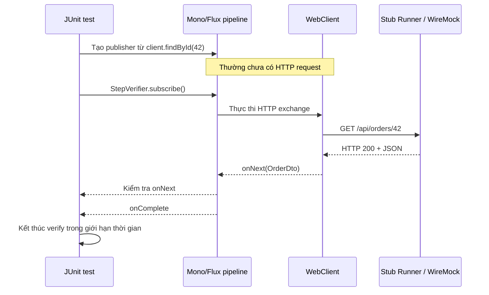
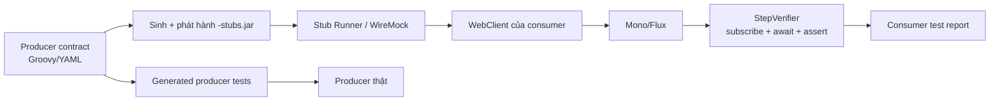
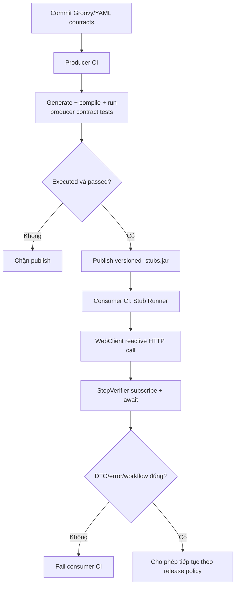

# Consumer reactive và thời điểm chờ lời gọi hoàn tất

## 1. Vấn đề: consumer test có thể kết thúc trước khi HTTP request được gửi

Trong **Spring Cloud Contract**, producer và consumer thống nhất hành vi qua **Groovy DSL** hoặc **YAML DSL**. Verifier sinh test xác minh producer thật và sinh stub; consumer có thể sử dụng **Stub Runner** để chạy stub từ artifact đã phát hành, rồi kiểm tra HTTP client của chính ứng dụng. CI chạy cả hai phía nhằm phát hiện các thay đổi API không tương thích.

Khi consumer dùng **Spring WebFlux WebClient** và Project Reactor, lời gọi HTTP thường trả về **`Mono<T>`** hoặc **`Flux<T>`** thay vì trả đối tượng ngay lập tức. Điều này tạo ra một bẫy:

```java
@Test
void testSai() {
    Mono<OrderDto> result = orderClient.findById(42L);
    // Chưa subscribe, nên rất có thể chưa gửi request.
    // Method test kết thúc mà không có assertion nào về kết quả.
}
```

Test trên có thể “xanh”, dù stub không chạy, client gọi sai URL hoặc response có schema không tương thích. Ngay cả khi viết:

```java
@Test
void testVanChuaOn() {
    orderClient.findById(42L).subscribe(order -> {
        assertThat(order.state()).isEqualTo("PAID");
    });
    // subscribe() trả về ngay; JUnit không chờ callback này.
}
```

vẫn chưa bảo đảm kiểm thử đáng tin: assertion nằm trong callback bất đồng bộ có thể chạy **sau khi phương thức test đã kết thúc**, thậm chí exception trong callback không được JUnit ghi nhận như mong muốn.

**Mục tiêu của bài:** biết **khi nào request thật sự bắt đầu**, **khi nào một luồng reactive được coi là đã hoàn tất**, **cách đợi có timeout** trong test mà không làm sai thiết kế reactive, và **khi nào cần đợi thêm side effect sau HTTP response**.

## 2. Mô hình thực thi reactive: lắp pipeline, subscribe, nhận tín hiệu

Với Reactor, một publisher thông thường có vòng đời:



Ba tín hiệu quan trọng của Reactive Streams:

| Tín hiệu | Ý nghĩa | Điều test cần làm |
|---|---|---|
| `onNext(value)` | Có giá trị được phát | Kiểm tra trường DTO, thứ tự hoặc số phần tử theo hợp đồng |
| `onComplete()` | Publisher kết thúc thành công | Xác minh không còn giá trị/lỗi ngoài kỳ vọng |
| `onError(error)` | Publisher kết thúc bằng lỗi | Kiểm tra loại lỗi, HTTP status, mã lỗi nghiệp vụ |

**`Mono<T>`** phát tối đa một giá trị rồi hoàn tất, hoặc hoàn tất rỗng, hoặc lỗi. **`Flux<T>`** có thể phát nhiều giá trị và có thể hữu hạn hoặc chạy vô thời hạn (ví dụ Server-Sent Events). Không có `onComplete` không nhất thiết là lỗi đối với stream được thiết kế chạy liên tục.

### 2.1. Cold publisher và việc subscribe nhiều lần

Phần lớn pipeline `WebClient` là **cold**: mỗi lần subscribe có thể khởi động **một HTTP request mới**. Ví dụ:

```java
Mono<OrderDto> call = orderClient.findById(42L);

// Mỗi lần block/subscribe có thể gửi lại một request.
OrderDto first = call.block();
OrderDto second = call.block();
```

Với `GET` có thể chỉ làm tăng request count. Với `POST` tạo đơn hàng, **hai lần subscribe có thể tạo hai side effect** nếu không có idempotency. Không dùng `block()` để “xem kết quả” rồi lại `StepVerifier.create(call)` trên cùng cold publisher mà không xét chuyện gọi API lặp lại.

Các operator như `map`, `filter`, `doOnNext` chỉ **khai báo pipeline**, không mặc nhiên subscribe:

```java
Mono<OrderDto> observed = orderClient.findById(42L)
    .doOnNext(order -> log.debug("order={}", order.id()));

// Chưa có terminal subscription: chưa đủ để kiểm tra HTTP.
```

## 3. Ba điều kiện để một consumer reactive test thực sự có ý nghĩa

Một test nên chứng minh đủ ba yếu tố:

1. **Publisher đã được subscribe**: HTTP exchange thực sự xảy ra.
2. **Các tín hiệu được chờ và kiểm tra**: nhận đúng dữ liệu và `onComplete`, hoặc lỗi mong đợi, trong thời hạn rõ ràng.
3. **Hành vi consumer được bảo vệ**: client deserialize JSON, xử lý status/error và thực hiện logic mà ứng dụng dựa vào; không chỉ xác nhận WireMock trả đúng dữ liệu mẫu.



**Lưu ý:** nhánh consumer không thay thế nhánh producer. Stub có thể trả response đã mô tả ngay cả khi producer thật đã thay đổi không tương thích; generated producer tests vẫn phải **được thực thi và đạt** trước khi stub được coi là đáng tin.

## 4. Ví dụ hợp đồng HTTP làm nguồn stub

Giả sử `order-service` có endpoint:

```http
GET /api/orders/42
Accept: application/json
```

Response:

```http
HTTP/1.1 200 OK
Content-Type: application/json

{"id":42,"state":"PAID","currency":"VND"}
```

### 4.1. Groovy DSL

```groovy
import org.springframework.cloud.contract.spec.Contract

Contract.make {
    description 'Đọc đơn hàng đã thanh toán'

    request {
        method GET()
        url '/api/orders/42'
        headers {
            header 'Accept', 'application/json'
        }
    }

    response {
        status OK()
        headers {
            contentType(applicationJson())
        }
        body(
            id: 42,
            state: 'PAID',
            currency: 'VND'
        )
    }
}
```

### 4.2. YAML DSL tương đương

```yaml
description: Đọc đơn hàng đã thanh toán
request:
  method: GET
  url: /api/orders/42
  headers:
    Accept: application/json
response:
  status: 200
  headers:
    Content-Type: application/json
  body:
    id: 42
    state: PAID
    currency: VND
```

Hai đoạn là **hai cách viết cho cùng một tình huống**, không nhất thiết cùng lưu trong thư mục contract của producer. Khi generator tạo stub, WireMock sẽ có mapping khớp request và trả response mẫu. **Trong consumer test, cần gọi WebClient thật** và chờ publisher hoàn tất thay vì giả định có mapping tức là client đã được kiểm tra.

## 5. Xây consumer reactive client từ WebClient

Ví dụ Java dùng Spring WebFlux; các lớp bên dưới là **mã minh họa do dự án consumer sở hữu**, không phải API của Spring Cloud Contract:

```java
package com.example.checkout.client;

public record OrderDto(long id, String state, String currency) {}
```

```java
package com.example.checkout.client;

import org.springframework.http.MediaType;
import org.springframework.web.reactive.function.client.WebClient;
import reactor.core.publisher.Mono;

public final class OrderReactiveClient {

    private final WebClient webClient;

    public OrderReactiveClient(String baseUrl) {
        this.webClient = WebClient.builder()
                .baseUrl(baseUrl)
                .build();
    }

    public Mono<OrderDto> findById(long id) {
        return webClient.get()
                .uri("/api/orders/{id}", id)
                .accept(MediaType.APPLICATION_JSON)
                .retrieve()
                .bodyToMono(OrderDto.class);
    }
}
```

Những điều cần lưu ý:

- `findById` trả **`Mono<OrderDto>`**, không trả `OrderDto` ngay lập tức.
- `retrieve().bodyToMono(OrderDto.class)` dùng decoder của WebClient; với Jackson JSON decoder và cấu hình tương thích, body JSON được parse thành DTO.
- Một HTTP response `4xx/5xx` từ `retrieve()` thông thường được chuyển thành một tín hiệu `onError`, ví dụ `WebClientResponseException`, nếu không có `onStatus(...)` tùy chỉnh.
- Base URL được truyền qua constructor để test có thể dùng **cổng stub thực tế**. Với ứng dụng dùng Spring DI, có thể đưa URL qua property; nhưng property phải có giá trị trước khi bean WebClient/client được khởi tạo.
- `OrderDto` dùng kiểu `long` cho `id`. Nếu producer đổi từ JSON number sang string hoặc bỏ trường, khả năng deserialize/logic của consumer cần được kiểm chứng bằng test.

Để thử tác động của phản hồi lỗi, phần sau sẽ mở rộng client bằng xử lý `404` theo error schema của consumer.

## 6. Dùng StepVerifier để subscribe, đợi và kiểm tra

Thư viện **`reactor-test`** cung cấp `StepVerifier`. Một khai báo dependency Maven trong source set test:

```xml
<dependency>
    <groupId>io.projectreactor</groupId>
    <artifactId>reactor-test</artifactId>
    <scope>test</scope>
</dependency>
```

Dự án có thể dùng Gradle với dependency `testImplementation("io.projectreactor:reactor-test")`. Phiên bản nên được quản lý tương thích với Reactor/Spring Boot BOM của ứng dụng.

### 6.1. Test đúng: kiểm tra giá trị, completion và timeout

```java
import java.time.Duration;
import org.junit.jupiter.api.Test;
import reactor.test.StepVerifier;

import static org.assertj.core.api.Assertions.assertThat;

@Test
void shouldReadPaidOrder() {
    OrderReactiveClient client = new OrderReactiveClient(stubBaseUrl);

    StepVerifier.create(client.findById(42L))
        .assertNext(order -> {
            assertThat(order.id()).isEqualTo(42L);
            assertThat(order.state()).isEqualTo("PAID");
            assertThat(order.currency()).isEqualTo("VND");
        })
        .expectComplete()
        .verify(Duration.ofSeconds(5));
}
```

`stubBaseUrl` là biến **do test lấy từ WireMock/Stub Runner**, không phải giá trị có sẵn trong thư viện. Kết quả quan trọng:

1. `StepVerifier.create(...)` chuẩn bị kịch bản kiểm thử.
2. `verify(Duration.ofSeconds(5))` bắt đầu subscription, **chặn luồng JUnit test** để chờ terminal signal hoặc hết hạn.
3. `assertNext(...)` kiểm tra giá trị đã được deserialize.
4. `expectComplete()` yêu cầu publisher kết thúc **thành công**, không phải tiếp tục phát thêm giá trị hay lỗi.
5. Nếu response sai schema, status lỗi hoặc pipeline không hoàn tất trước thời hạn, test phải **thất bại**, thay vì xanh vì chưa kịp gọi HTTP.

**Đây là việc chờ ở tầng test**, không phải biến WebClient của production thành blocking client. Pipeline consumer vẫn có thể non-blocking; chỉ **JUnit thread** chờ kết quả bằng StepVerifier.

### 6.2. Timeout của test khác với timeout trong pipeline

Hai giới hạn có vai trò khác nhau:

```java
Mono<OrderDto> result = client.findById(42L)
    .timeout(Duration.ofSeconds(2));

StepVerifier.create(result)
    .assertNext(order -> assertThat(order.state()).isEqualTo("PAID"))
    .expectComplete()
    .verify(Duration.ofSeconds(5));
```

- `timeout(Duration.ofSeconds(2))` là **Reactor operator**: nếu upstream không phát tín hiệu đúng hạn, pipeline kết thúc bằng `TimeoutException`.
- `verify(Duration.ofSeconds(5))` là **giới hạn chờ của StepVerifier**: test không đợi mãi nếu pipeline chưa phát terminal event.

Hai con số **không phải SLA của production**. Chúng là giá trị minh họa cần điều chỉnh theo môi trường và chính sách kiểm thử, tránh quá ngắn gây flakiness hoặc quá dài khiến CI mất khả năng phản hồi kịp thời.

### 6.3. Đừng dùng `subscribe(...)` rồi coi test đã hoàn tất

```java
@Test
void testKhongDangTin() {
    client.findById(42L).subscribe(order -> {
        assertThat(order.state()).isEqualTo("PAID");
    });

    // Test có thể return trước callback và bỏ lọt lỗi.
}
```

Trong test HTTP reactive, nên **trả về/đợi một pipeline duy nhất** bằng StepVerifier, WebTestClient hoặc cơ chế test tương thích. Không dùng `Thread.sleep(500)` để hy vọng callback đã chạy: tốc độ máy CI và lịch scheduler không ổn định.

## 7. Consumer test hoàn chỉnh với Stub Runner và cổng động

Giả sử producer đã publish artifact:

```text
groupId    = com.example
artifactId = order-service
version    = 1.4.0
classifier = stubs
```

Stub Runner có thể lấy JAR chứa WireMock mapping rồi mở HTTP stub server. Với cấu hình dùng cổng động, test cần **tra cứu cổng sau khi Stub Runner khởi động**:

```java
package com.example.checkout.contract;

import com.example.checkout.client.OrderDto;
import com.example.checkout.client.OrderReactiveClient;
import java.time.Duration;
import org.junit.jupiter.api.Test;
import org.springframework.boot.test.context.SpringBootTest;
import org.springframework.cloud.contract.stubrunner.StubRunnerProperties;
import org.springframework.cloud.contract.stubrunner.spring.AutoConfigureStubRunner;
import org.springframework.cloud.contract.stubrunner.spring.StubRunnerPort;
import reactor.test.StepVerifier;

import static org.assertj.core.api.Assertions.assertThat;

@SpringBootTest
@AutoConfigureStubRunner(
    ids = "com.example:order-service:1.4.0:stubs",
    stubsMode = StubRunnerProperties.StubsMode.LOCAL
)
class OrderReactiveConsumerContractTest {

    @StubRunnerPort("com.example:order-service")
    int stubPort;

    @Test
    void shouldDeserializePaidOrder() {
        // Tạo client SAU khi Stub Runner đã khởi động,
        // sử dụng đúng port của order-service stub.
        String stubBaseUrl = "http://localhost:" + stubPort;
        OrderReactiveClient client =
            new OrderReactiveClient(stubBaseUrl);

        StepVerifier.create(client.findById(42L))
            .assertNext(order -> {
                assertThat(order.id()).isEqualTo(42L);
                assertThat(order.state()).isEqualTo("PAID");
                assertThat(order.currency()).isEqualTo("VND");
            })
            .expectComplete()
            .verify(Duration.ofSeconds(5));
    }
}
```

**Giải thích rõ phạm vi:**

- `@AutoConfigureStubRunner` cần dependency Stub Runner tương thích và artifact `com.example:order-service:1.4.0:stubs` đã được cài trong **Maven local repository** khi dùng `LOCAL`. Với `REMOTE`, phải cấu hình repository và quyền truy cập.
- `@StubRunnerPort` tra cứu cổng của **đúng producer stub**, không phải cổng ứng dụng consumer.
- `OrderReactiveClient` là HTTP client của consumer theo ví dụ mục 5. Trong ứng dụng thật, nên dùng **chính bean/client sản phẩm**; constructor đơn giản chỉ minh họa cách cấp URL lúc test.
- Test xác minh **dữ liệu đã deserialize và completion**. Nó không tự chứng minh producer thật đã được kiểm thử; phía producer vẫn cần chạy generated tests trước khi publish stub.
- Nếu consumer đã tạo `WebClient` bean với base URL từ cấu hình ngay lúc context khởi động, không thể mặc nhiên thay base URL bằng field `stubPort` sau đó. Cần cơ chế **đăng ký URL trước khi bean được tạo**, hoặc thiết kế client có thể nhận endpoint/test customization phù hợp.

### 7.1. Stub Runner không cần startup trên port cố định

Không cấu hình ngầm `http://localhost:8080` trong test khi Stub Runner cấp random port. Một build CI có nhiều tests chạy song song sẽ dễ tranh cổng nếu tất cả cố định `8080`; lấy cổng runtime giúp giảm rủi ro.

**Không sử dụng cổng của stub khác.** Nếu ứng dụng có cả `order-service` và `payment-service`, cần tra cứu theo group/artifact tương ứng, chẳng hạn `@StubRunnerPort("com.example:order-service")`, thay vì đoán thứ tự server trong danh sách.

## 8. Khi client là Spring bean: thời điểm đưa URL vào cấu hình

Trong ứng dụng Spring Boot, `OrderReactiveClient` có thể là bean được cấu hình bằng property:

```yaml
clients:
  orders:
    base-url: https://orders.example.internal
```

Với test dùng **WireMock trực tiếp**, có thể cho WireMock khởi động trên cổng `0` rồi thay property:

```java
@SpringBootTest
@AutoConfigureWireMock(port = 0)
@TestPropertySource(properties = {
    "clients.orders.base-url=http://localhost:${wiremock.server.port}"
})
class CheckoutReactiveIntegrationTest {
    // @Autowired bean OrderReactiveClient đã đọc URL test.
}
```

`@AutoConfigureWireMock` là phần tích hợp của Spring Cloud Contract WireMock, không phải annotation của Stub Runner. Property `wiremock.server.port` được dùng với server do `@AutoConfigureWireMock` quản lý.

Với **Stub Runner**, các phiên bản hỗ trợ có thể công bố property runtime kiểu `stubrunner.runningstubs.order-service.port`. Nếu dùng cách này, phải xác minh **tên key và thời điểm property được đăng ký** trong stack hiện tại. Không dùng nhầm `wiremock.server.port` để đoán port của Stub Runner.

### 8.1. Tại sao `@BeforeEach` có thể quá muộn?

`@BeforeEach` được JUnit gọi **sau khi Spring application context đã được dựng**. Nếu `WebClient` bean đã chốt `baseUrl` lúc khởi tạo, việc đổi biến `stubBaseUrl` trong `@BeforeEach` **không đổi** địa chỉ client đã có.

Hai phương án thực tế:

- Đưa property test vào **quá trình dựng context**, khi tích hợp Stub Runner/WireMock hỗ trợ.
- Tạo hoặc cấu hình client **sau khi lấy URL runtime**, nhưng vẫn dùng cùng code HTTP client mà consumer sử dụng trong production.

Không tạo một client test khác hoàn toàn, với logic deserialize/error mapping khác bản production, rồi coi đó là consumer contract test đầy đủ.

### 8.2. Tự quản lý WireMock với `@DynamicPropertySource`

Một phương án khác là tự tạo server với cổng động:

```java
import com.github.tomakehurst.wiremock.WireMockServer;
import org.springframework.test.context.DynamicPropertyRegistry;
import org.springframework.test.context.DynamicPropertySource;

import static com.github.tomakehurst.wiremock.core.WireMockConfiguration.wireMockConfig;

static final WireMockServer WIREMOCK =
    new WireMockServer(wireMockConfig().dynamicPort());

static {
    // Phải start trước khi Spring resolve clients.orders.base-url.
    WIREMOCK.start();
}

@DynamicPropertySource
static void dynamicOrdersUrl(DynamicPropertyRegistry registry) {
    registry.add("clients.orders.base-url", WIREMOCK::baseUrl);
}
```

Đây là **trích đoạn thành viên static của một test class**, không phải một class độc lập. Phải có teardown `WIREMOCK.stop()` và quản lý Spring context cache/lifecycle cẩn thận. Khi dùng cách này, test tự sở hữu mapping, **không tự động dùng stub artifact do producer publish** như Stub Runner. Không bật đồng thời các WireMock servers không cần thiết và trỏ consumer vào nhầm server.

## 9. Lời gọi đã hoàn tất khi nào?

Câu trả lời phụ thuộc **publisher đang đại diện cho công việc nào**.

| Publisher/luồng | Tín hiệu hoàn tất có nghĩa gì? | Điều không tự được bảo đảm |
|---|---|---|
| `Mono<OrderDto>` từ `bodyToMono` | Đã nhận và decode response, phát DTO rồi complete | Side effect bất đồng bộ khác không thuộc pipeline |
| `Mono<Void>` từ HTTP `204` | Request/response đã hoàn tất theo pipeline | Không có JSON value cần assert |
| `Flux<OrderDto>` từ JSON array hữu hạn | Đã phát các phần tử và complete | Thứ tự chỉ được bảo đảm nếu API có cam kết |
| `Flux<ServerSentEvent<?>>` | Có thể không bao giờ complete | Không thể đợi `onComplete` nếu stream được thiết kế liên tục |
| Publisher sau `retryWhen` | Hoàn tất khi attempt cuối thành công hoặc hết retry và lỗi | Không đảm bảo chỉ gửi một HTTP request |
| Pipeline dùng `flatMap` với công việc khác | Complete sau các publisher con được compose hoàn tất | Side effect được `subscribe()` riêng có thể vẫn chạy |

**Nguyên tắc:** xác định công việc cần kiểm chứng và **đưa nó vào cùng reactive chain**. Đừng xem việc nhận HTTP response là bằng chứng rằng mọi asynchronous workflow liên quan đã hoàn tất nếu ứng dụng thực hiện chúng theo kiểu *fire-and-forget*.

### 9.1. Ví dụ với `Mono<Void>`

Nếu consumer gọi API `DELETE /api/orders/42`, producer cam kết `204 No Content`:

```java
public Mono<Void> deleteOrder(long id) {
    return webClient.delete()
        .uri("/api/orders/{id}", id)
        .retrieve()
        .bodyToMono(Void.class);
}
```

Test:

```java
StepVerifier.create(client.deleteOrder(42L))
    .expectComplete()
    .verify(Duration.ofSeconds(5));
```

Không dùng `expectNext(null)` cho `Mono<Void>`: publisher chỉ **complete**, không phát giá trị `null`. Nếu consumer cần phân biệt `204` với một status khác, code client/test cần kiểm tra status phù hợp (chẳng hạn dùng `exchangeToMono`), thay vì chỉ đoán theo `Mono<Void>` complete.

### 9.2. Khi cần đợi một side effect khác

Giả sử consumer nhận order response, sau đó ghi một record vào database bằng một publisher:

```java
Mono<Void> workflow = client.findById(42L)
    .flatMap(order -> repository.save(
        CheckoutRecord.from(order)))
    .then();
```

Nếu `repository.save(...)` là reactive publisher và được **compose bằng `flatMap`**, `workflow` chỉ hoàn tất khi save hoàn tất theo reactive contract. Test có thể:

```java
StepVerifier.create(workflow)
    .expectComplete()
    .verify(Duration.ofSeconds(5));

// Sau đó có thể đọc/kiểm tra dữ liệu theo cơ chế test phù hợp.
```

Ngược lại, nếu code viết `repository.save(...).subscribe()` bên trong `doOnNext`, việc lưu có thể còn chạy **sau khi publisher chính complete**. Cách đó khiến cả lỗi và thứ tự khó kiểm soát. Nên sửa **thiết kế pipeline** thay vì kéo dài `Thread.sleep(...)` trong test để che việc không compose công việc.

## 10. Kiểm thử `Flux` hữu hạn: số lượng, thứ tự và completion

Nếu API `GET /api/orders?state=PAID` trả JSON array:

```json
[
  {"id": 42, "state": "PAID", "currency": "VND"},
  {"id": 43, "state": "PAID", "currency": "VND"}
]
```

Consumer có thể cung cấp:

```java
public Flux<OrderDto> findPaidOrders() {
    return webClient.get()
        .uri("/api/orders?state=PAID")
        .retrieve()
        .bodyToFlux(OrderDto.class);
}
```

Test với StepVerifier:

```java
StepVerifier.create(client.findPaidOrders())
    .expectNextMatches(order ->
        order.id() == 42L && "PAID".equals(order.state()))
    .expectNextMatches(order ->
        order.id() == 43L && "PAID".equals(order.state()))
    .expectComplete()
    .verify(Duration.ofSeconds(5));
```

Kịch bản này **khóa thứ tự** `42` trước `43`. Chỉ làm vậy nếu API có cam kết thứ tự (ví dụ `sort=id,asc`). Nếu thứ tự **không** là contract, có thể kiểm tra tập dữ liệu sau khi gom:

```java
StepVerifier.create(client.findPaidOrders().collectList())
    .assertNext(orders -> {
        assertThat(orders).hasSize(2);
        assertThat(orders)
            .extracting(OrderDto::id)
            .containsExactlyInAnyOrder(42L, 43L);
    })
    .expectComplete()
    .verify(Duration.ofSeconds(5));
```

Lưu ý: `collectList()` đợi **Flux hoàn tất** mới phát ra list. Không dùng nó trên stream vô hạn nếu bạn mong test kết thúc bình thường.

## 11. Stream không kết thúc: SSE và trường hợp phải cancel

`WebClient` có thể đọc **Server-Sent Events (SSE)** hoặc nguồn dữ liệu dài hạn. Một `Flux` dạng này được thiết kế **không tự phát `onComplete`**.

Ví dụ:

```java
public Flux<ServerSentEvent<OrderDto>> watchOrders() {
    return webClient.get()
        .uri("/api/orders/events")
        .accept(MediaType.TEXT_EVENT_STREAM)
        .retrieve()
        .bodyToFlux(new ParameterizedTypeReference<
            ServerSentEvent<OrderDto>>() {});
}
```

Nếu cần kiểm tra **sự kiện đầu tiên**, có thể:

```java
StepVerifier.create(client.watchOrders())
    .assertNext(event -> {
        assertThat(event.data()).isNotNull();
        assertThat(event.data().state()).isEqualTo("PAID");
    })
    .thenCancel()
    .verify(Duration.ofSeconds(5));
```

Ở đây `thenCancel()` kết thúc subscription của test sau khi nhận đủ dữ liệu cần kiểm chứng. **Nó không khẳng định server đã hoàn tất stream**. Đừng dùng `expectComplete()` trên một stream được thiết kế giữ kết nối mở mãi.

Một phương án khác là `take(2)`: operator sẽ kết thúc publisher phía consumer sau hai phần tử, nhưng điều đó không chứng minh upstream tự đóng kết nối. Mỗi test phải diễn đạt rõ **ngữ nghĩa hoàn tất** mà consumer thực sự phụ thuộc.

## 12. Kiểm thử lỗi HTTP và error mapping của reactive client

Một consumer không chỉ xử lý `200`. Nếu producer trả `404` với body nghiệp vụ:

```json
{
  "code": "ORDER_NOT_FOUND",
  "message": "Order does not exist"
}
```

thì client nên chuyển thành lỗi mà ứng dụng consumer hiểu, không chỉ nhận một exception HTTP không rõ ngữ cảnh.

### 12.1. Ánh xạ `404` thành exception nghiệp vụ

Ví dụ:

```java
public record ApiError(String code, String message) {}

public final class OrderNotFoundException extends RuntimeException {
    private final String code;

    public OrderNotFoundException(String code, String message) {
        super(message);
        this.code = code;
    }

    public String code() {
        return code;
    }
}
```

Thay phương thức client bằng:

```java
public Mono<OrderDto> findById(long id) {
    return webClient.get()
        .uri("/api/orders/{id}", id)
        .retrieve()
        .onStatus(
            status -> status.value() == 404,
            response -> response.bodyToMono(ApiError.class)
                .defaultIfEmpty(new ApiError(
                    "UNKNOWN_ERROR", "Empty error response"))
                .map(error -> new OrderNotFoundException(
                    error.code(), error.message()))
        )
        .bodyToMono(OrderDto.class);
}
```

Nếu stub trả đúng `404` và error body, phương thức phát `onError(OrderNotFoundException)`. Test:

```java
StepVerifier.create(client.findById(9999L))
    .expectErrorSatisfies(error -> {
        assertThat(error).isInstanceOf(OrderNotFoundException.class);
        OrderNotFoundException notFound =
            (OrderNotFoundException) error;
        assertThat(notFound.code()).isEqualTo("ORDER_NOT_FOUND");
    })
    .verify(Duration.ofSeconds(5));
```

**Quan trọng:** request gửi sai URL đến WireMock cũng có thể nhận `404` **không khớp mapping**, nhưng không phải business error `ORDER_NOT_FOUND`. Assertion vào `code` giúp phân biệt. Nếu error body không parse được, test phải hiển thị lỗi thay vì chấp nhận một `404` bất kỳ như thành công.

### 12.2. Test nhánh `503` và lỗi mạng

Với `retrieve()` và không tùy chỉnh status handler cho `503`, WebClient thường phát `WebClientResponseException`:

```java
StepVerifier.create(client.findById(42L))
    .expectErrorSatisfies(error -> {
        assertThat(error)
            .isInstanceOf(WebClientResponseException.class);
        var httpError = (WebClientResponseException) error;
        assertThat(httpError.getStatusCode().value())
            .isEqualTo(503);
    })
    .verify(Duration.ofSeconds(5));
```

Đoạn này giả định stub đang được cấu hình **trả HTTP 503** và method client vẫn dùng `retrieve()`. Nếu không kết nối được, lỗi có thể là `WebClientRequestException` thay vì `WebClientResponseException`, vì **chưa có HTTP response**. Consumer có thể có chính sách retry khác nhau với `503` và lỗi mạng.

### 12.3. Không “nuốt” lỗi bằng `onErrorResume` quá rộng

Ví dụ nguy hiểm:

```java
return webClient.get()
    .uri("/api/orders/42")
    .retrieve()
    .bodyToMono(OrderDto.class)
    .onErrorResume(error ->
        Mono.just(new OrderDto(42L, "PAID", "VND")));
```

Nếu stub trả `404` hoặc JSON sai, client vẫn phát DTO `PAID` giả và test có thể xanh. Fallback có thể là **chính sách nghiệp vụ hợp lệ**, nhưng phải được định nghĩa rõ và kiểm tra cả **lỗi gốc** lẫn **hành vi fallback**. Đừng dùng fallback mặc định để che sai khác hợp đồng.

## 13. Retry: một subscription không có nghĩa chỉ một request

Một pipeline dùng Reactor retry có thể **subscribe lại** vào nguồn WebClient:

```java
Mono<OrderDto> result = client.findById(42L)
    .retryWhen(
        Retry.fixedDelay(1, Duration.ofMillis(100))
            .filter(error ->
                error instanceof WebClientResponseException.ServiceUnavailable)
    );
```

Trong ví dụ, nếu lần đầu gặp `503` rồi lần thứ hai thành công, một lần StepVerifier subscribe vào `result` có thể dẫn tới **hai request HTTP**. Do đó:

- Đừng luôn assert WireMock nhận đúng một request nếu consumer có retry theo hợp đồng.
- Tránh retry mọi `4xx`; đặc biệt các lỗi validation/không tìm thấy thường không cải thiện khi gửi lại cùng request.
- Với `POST` hoặc hành động thay đổi trạng thái, cần cân nhắc **idempotency** trước khi retry để tránh tạo side effect lặp.
- Giới hạn số lần retry và tổng thời gian; tránh pipeline chờ vô hạn.
- Nếu dùng scenario của WireMock để giả lập `503 → 200`, test phải reset scenario state giữa các test.

### 13.1. Thời điểm xác minh số request

Với một stub HTTP độc lập, có thể kiểm tra request journal:

```java
StepVerifier.create(result)
    .assertNext(order ->
        assertThat(order.state()).isEqualTo("PAID"))
    .expectComplete()
    .verify(Duration.ofSeconds(5));

// Chỉ sau khi pipeline hoàn tất mới kiểm tra request count.
wireMockServer.verify(
    2, getRequestedFor(urlEqualTo("/api/orders/42")));
```

**Điều kiện:** ví dụ này giả định WireMock đã có scenario trả `503` ở lần đầu và `200` ở lần tiếp theo, đồng thời request journal được làm sạch trước test. Nếu dùng Stub Runner, cần dùng API/harness phù hợp để quan sát WireMock instance mà Stub Runner quản lý; không mặc định bạn có biến `wireMockServer` trỏ đúng stub server.

## 14. StepVerifier virtual time: dùng đúng phạm vi

Reactor Test có `StepVerifier.withVirtualTime(...)` để mô phỏng thời gian của **Reactor operators/schedulers**. Nó hữu ích cho logic retry/delay được dựng hoàn toàn bằng Reactor, ví dụ:

```java
import java.time.Duration;
import java.util.concurrent.TimeoutException;
import reactor.core.publisher.Mono;
import reactor.test.StepVerifier;

StepVerifier.withVirtualTime(
        () -> Mono.never().timeout(Duration.ofSeconds(3)))
    .thenAwait(Duration.ofSeconds(3))
    .expectError(TimeoutException.class)
    .verify();
```

Thời gian trong ví dụ có thể được tiến nhanh bằng virtual scheduler, không cần đợi ba giây thật.

**Không mặc định virtual time điều khiển socket của WebClient, WireMock server, Reactor Netty hoặc toàn bộ network I/O.** Một HTTP call thật qua Stub Runner vẫn dùng tài nguyên và thời gian thực của server, OS và network. Vì thế:

- Dùng `withVirtualTime` cho **logic thuần Reactor** có thể điều khiển scheduler.
- Dùng `verify(Duration)` và timeout thực tế để kiểm chứng **HTTP exchange thật với stub**.
- Không kết hợp các test virtual time và test socket song song một cách tùy tiện nếu scheduler toàn cục bị can thiệp; cần tuân thủ vòng đời Reactor Test.

## 15. Hoàn tất HTTP response chưa chắc là hoàn tất side effect nền

Giả sử `checkout-service` gọi `order-service` để lấy đơn hàng, rồi đẩy một message vào outbox hoặc gửi notification. Có hai cách tổ chức:

### 15.1. Side effect nằm trong cùng reactive chain

```java
Mono<Void> processPaidOrder(long orderId) {
    return orderClient.findById(orderId)
        .flatMap(order -> outboxRepository.save(
            OutboxMessage.forPaidOrder(order)))
        .then();
}
```

Nếu `outboxRepository.save(...)` là một reactive publisher đúng nghĩa, `processPaidOrder` complete sau khi bước save được compose hoàn tất. StepVerifier có thể đợi toàn workflow.

### 15.2. Side effect bị tách bằng `subscribe()` nội bộ

```java
Mono<OrderDto> processPaidOrder(long orderId) {
    return orderClient.findById(orderId)
        .doOnNext(order -> {
            // Anti-pattern: side effect chạy riêng, lỗi khó quay về caller.
            outboxRepository.save(
                OutboxMessage.forPaidOrder(order))
                .subscribe();
        });
}
```

Pipeline bên ngoài có thể `onComplete` **trước khi** outbox ghi xong. Test gọi `StepVerifier.verify(...)` chỉ xác minh **publisher bên ngoài**, không tự đợi publisher đã bị subscribe riêng. Cần sửa thiết kế bằng composition (`flatMap`/`then`...) hoặc, với một tác vụ background thực sự, dùng cơ chế đợi **điều kiện quan sát được** (ví dụ Awaitility) có timeout và cleanup phù hợp.

Không dùng `Thread.sleep(...)` làm bằng chứng side effect đã hoàn tất. Nếu cần test một workflow dài hạn có queue/worker riêng, nên xác định rõ điểm cuối nghiệp vụ và cách quan sát nó.

## 16. Đọc kết quả test khi consumer reactive thất bại

| Triệu chứng | Nguyên nhân có thể | Hướng điều tra |
|---|---|---|
| Test xanh nhưng WireMock không nhận request | Chưa subscribe; test chỉ tạo `Mono` | Dùng StepVerifier và xem request journal |
| Assertion callback chạy sau khi JUnit kết thúc | Gọi `subscribe(...)` fire-and-forget | Chờ terminal signal bằng `verify(Duration)` |
| `StepVerifier` timeout | Stub không startup, URL sai, upstream không phát signal | Kiểm tra port/URL, logs và reactor chain |
| `WebClientRequestException` | Không kết nối được, DNS/TLS/port sai | Kiểm tra base URL và stub lifecycle |
| `WebClientResponseException.NotFound` | Stub/producer đã trả 404 | Phân biệt business error và unmatched mapping |
| `onNext` không có giá trị | Response không có body hoặc `Mono.empty()` | Kiểm tra status, `204`, decoder, client policy |
| Test mong `onComplete` nhưng nhận `onError` | Status lỗi, decode failure, timeout hoặc business mapping | Đọc exception nguyên nhân |
| Test mong một request nhưng thấy hai | Retry hoặc cold publisher bị subscribe lại | Xem `retryWhen`, `block` và subscription count |
| Test treo với `Flux` SSE | Stream được thiết kế không hoàn tất | Dùng `thenCancel()` hoặc `take(n)` |
| Test pass local, fail CI | Timeout quá ngắn, port tranh chấp, artifact version khác | Ghi resolved stub version, dùng port động |
| Kết quả thay đổi theo thứ tự test | Mapping/journal/scenario state bị chia sẻ | Reset đúng phạm vi, cô lập server |
| DTO đọc được nhưng nghiệp vụ consumer vẫn sai | Chỉ assert HTTP/DTO, chưa assert logic downstream | Test workflow consumer và side effects |

### 16.1. Các bước kiểm tra có thứ tự

1. **Publisher có được subscribe chưa?** Đảm bảo test gọi `verify(...)` hoặc một terminal operation có kiểm soát.
2. **Test đang đợi tín hiệu nào?** `onNext`, `onComplete`, `onError` hay việc **cancel** stream.
3. **Có timeout không?** Tránh chờ vô hạn; xem timeout thuộc Reactor pipeline hay StepVerifier.
4. **Client gọi host/port nào?** Lấy cổng WireMock/Stub Runner runtime, không dùng URL mặc định của production.
5. **Stub nào đang phục vụ?** Kiểm tra group/artifact/version/classifier nếu dùng Stub Runner.
6. **Response thật là gì?** HTTP status, content type, JSON body/error schema.
7. **Pipeline có retry hoặc subscribe nhiều lần không?** Xem request journal và side effect.
8. **Có công việc tách khỏi publisher không?** Nếu có, kiểm chứng bằng điểm quan sát riêng; đừng coi `onComplete` là hoàn tất tất cả.
9. **Producer verification đã chạy chưa?** Stub test xanh chỉ là nửa phần của contract testing.

## 17. CI cho consumer reactive với Spring Cloud Contract

Một pipeline tương thích đáng tin nên phân biệt:



**Các cổng kiểm soát nên có:**

- Producer CI **thực sự chạy** generated contract tests; không chỉ sinh source/stubs hoặc trả `BUILD SUCCESS` khi test bị skip.
- Stub JAR có version/classifier rõ ràng; consumer test dùng đúng artifact vừa được chọn cho release.
- Consumer dùng **WebClient thật của ứng dụng**, trỏ tới cổng/URL runtime của stub.
- Test **subscribe và chờ terminal signal** bằng StepVerifier (hoặc một phương thức testing reactive tương đương).
- Các phép thử có timeout hợp lý, không dựa vào `Thread.sleep`.
- Test bao phủ thành công, deserialization, nhánh lỗi quan trọng và retry nếu consumer có chính sách này.
- Khi kiểm tra count/order, test xác minh đúng tính chất được API cam kết, không khóa một chi tiết không ổn định.
- Bảo đảm mapping, request journal và scenario state không bị rò rỉ giữa test methods hoặc các jobs song song.
- Lưu báo cáo JUnit, resolved artifact coordinates và log lỗi không chứa credentials.

### 17.1. Checklist bằng chứng sau một lần chạy

```text
Producer stub: com.example:order-service:1.4.0:stubs
Consumer base URL: http://localhost:<dynamic-port>
Reactive type: Mono<OrderDto>
Subscription: StepVerifier đã khởi động
Observed signal: onNext(OrderDto) → onComplete
Assertions: id=42, state=PAID, currency=VND
Verification timeout: có giới hạn
Producer generated tests: executed + passed
Consumer tests: executed + passed
```

Đây là **mẫu báo cáo nên ghi nhận**, không phải output mặc định của mọi phiên bản Spring Cloud Contract hoặc Reactor Test.

## 18. Bài thực hành: sửa consumer test “xanh giả”

**Bối cảnh:** `checkout-service` dùng WebClient gọi `order-service`. Developer viết:

```java
@Test
void shouldReadOrder() {
    client.findById(42L).subscribe(order ->
        assertThat(order.state()).isEqualTo("PAID"));
}
```

Test đôi khi xanh ngay cả khi stub đã trả `404`; lúc khác CI có log lỗi bất đồng bộ nhưng báo cáo không chỉ ra assertion thất bại rõ ràng.

### 18.1. Nhiệm vụ

1. Xác nhận producer có hợp đồng `GET /api/orders/42` trả `200` và JSON `id=42`, `state=PAID`, `currency=VND`.
2. Đảm bảo producer generated tests được thực thi và đạt rồi publish artifact classifier `stubs`.
3. Trong consumer, dùng `@AutoConfigureStubRunner` với version cố định; tra cứu cổng qua `@StubRunnerPort`.
4. Cấu hình **OrderReactiveClient thật** dùng `http://localhost:<port thực tế>`.
5. Thay `subscribe(...)` bằng `StepVerifier.create(...).assertNext(...).expectComplete().verify(Duration.ofSeconds(5))`.
6. Thử cố ý đổi field `state` trong stub thành `PENDING` ở môi trường test và xác nhận assertion fail.
7. Thêm kịch bản `GET /api/orders/9999` trả `404 + ORDER_NOT_FOUND`; dùng `expectErrorSatisfies` kiểm tra exception/mã lỗi consumer hiểu.
8. Nếu client có retry, dùng WireMock scenario mô phỏng `503 → 200` và xác minh **số HTTP requests sau khi publisher hoàn tất**.
9. Nếu endpoint trả JSON array, dùng `Flux` và kiểm tra số phần tử/kết thúc; nếu stream SSE không kết thúc, xác định điều kiện cancel thay vì đợi complete vô hạn.
10. Chạy cả suite và CI, xác minh không rò rỉ mappings/journal hoặc tranh chấp cổng; lưu report có bằng chứng test đã chạy.

### 18.2. Câu hỏi tự đánh giá

| Câu hỏi | Trả lời |
|---|---|
| Gọi `findById` tạo `Mono` có chắc đã gửi HTTP chưa? | **Chưa**; cần subscription |
| `subscribe(...)` trong JUnit test có tự chờ callback không? | **Không** |
| `StepVerifier.verify(Duration)` làm gì? | Subscribe và chờ assertion/terminal signal trong thời hạn |
| `Mono<Void>` có phát một giá trị `null` không? | **Không**; thường hoàn tất không có `onNext` |
| `onComplete` của WebClient có chứng minh mọi background job đã xong không? | **Không**, nếu job nằm ngoài pipeline |
| `retryWhen` có thể tạo nhiều HTTP requests không? | **Có**, vì resubscription |
| `withVirtualTime` có làm network WireMock chạy “ảo” không? | **Không mặc nhiên** |
| Với SSE vô hạn, có nên `expectComplete()` không? | **Không** nếu stream không có cam kết kết thúc |
| HTTP 404 do unmatched mapping có giống business `ORDER_NOT_FOUND` không? | **Không**; nên kiểm tra error code/body |
| Consumer test pass có chứng minh producer thật đúng không? | **Không**; cần generated producer verification riêng |

## 19. Checklist review consumer reactive contract test

- [ ] Test dùng WebClient/client của consumer thật, không chỉ gọi trực tiếp stub bằng client thử nghiệm khác.
- [ ] `Mono`/`Flux` đã được subscribe một cách có kiểm soát.
- [ ] Đã dùng StepVerifier/WebTestClient hoặc công cụ tương đương để **đợi kết quả**, không bỏ test về sớm.
- [ ] Có giới hạn timeout; phân biệt pipeline timeout và timeout của test verifier.
- [ ] Assert đúng `onNext`, `onComplete` hoặc `onError` theo từng kịch bản.
- [ ] Với `Mono<Void>`, kiểm tra completion, không mong chờ `null`.
- [ ] Với `Flux` hữu hạn, kiểm tra số phần tử, kiểu và thứ tự chỉ khi API cam kết.
- [ ] Với SSE/stream liên tục, test có cơ chế cancel hoặc điểm dừng rõ ràng.
- [ ] Nhánh lỗi kiểm tra status/error code và không nhầm `404` unmatched mapping với lỗi nghiệp vụ.
- [ ] Retry có giới hạn và số request được kiểm tra sau khi publisher hoàn tất.
- [ ] Không dùng `Thread.sleep` hoặc callback `subscribe` fire-and-forget làm bằng chứng test đã chạy xong.
- [ ] Những side effect cần kiểm chứng nằm trong reactive chain hoặc có điểm chờ/quan sát riêng.
- [ ] Base URL trỏ đúng stub runtime; không hardcode cổng producer hoặc stub server khác.
- [ ] Stub Runner dùng đúng group/artifact/version/classifier; stub artifact đã được producer xác minh trước khi phát hành.
- [ ] Request journal, mappings, scenario state và dữ liệu test được reset/cô lập phù hợp khi chạy song song.
- [ ] CI lưu report và xác nhận cả producer generated tests lẫn consumer reactive tests đã thực thi và đạt.

**Kết luận:** Với consumer reactive, **tạo ra một `Mono` hoặc `Flux` chưa phải là thực hiện lời gọi**, và **gọi `subscribe()` chưa phải là đợi kiểm thử hoàn tất**. Một consumer contract test đáng tin phải subscribe, xác minh dữ liệu hoặc lỗi và đợi đúng điểm kết thúc với timeout. Khi điều đó được kết hợp với Stub Runner, artifact có phiên bản và generated producer verification trong CI, kết quả mới thực sự giúp phát hiện thay đổi API không tương thích thay vì tạo ra các bài test “xanh giả”.
