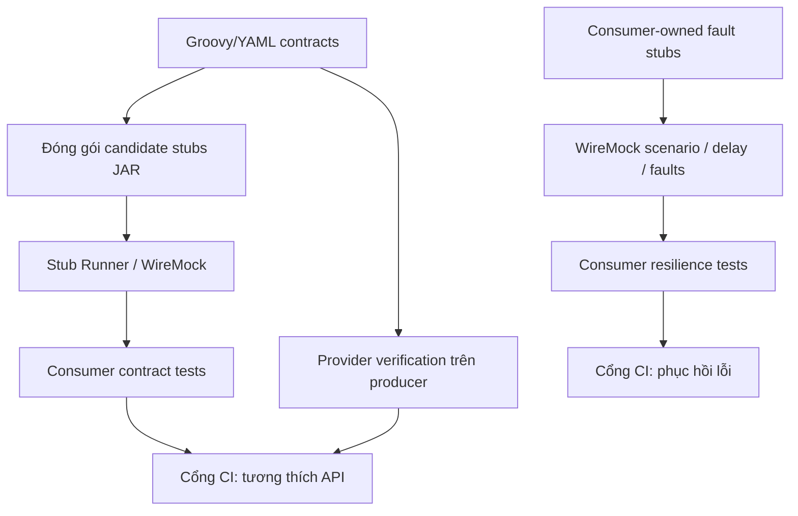
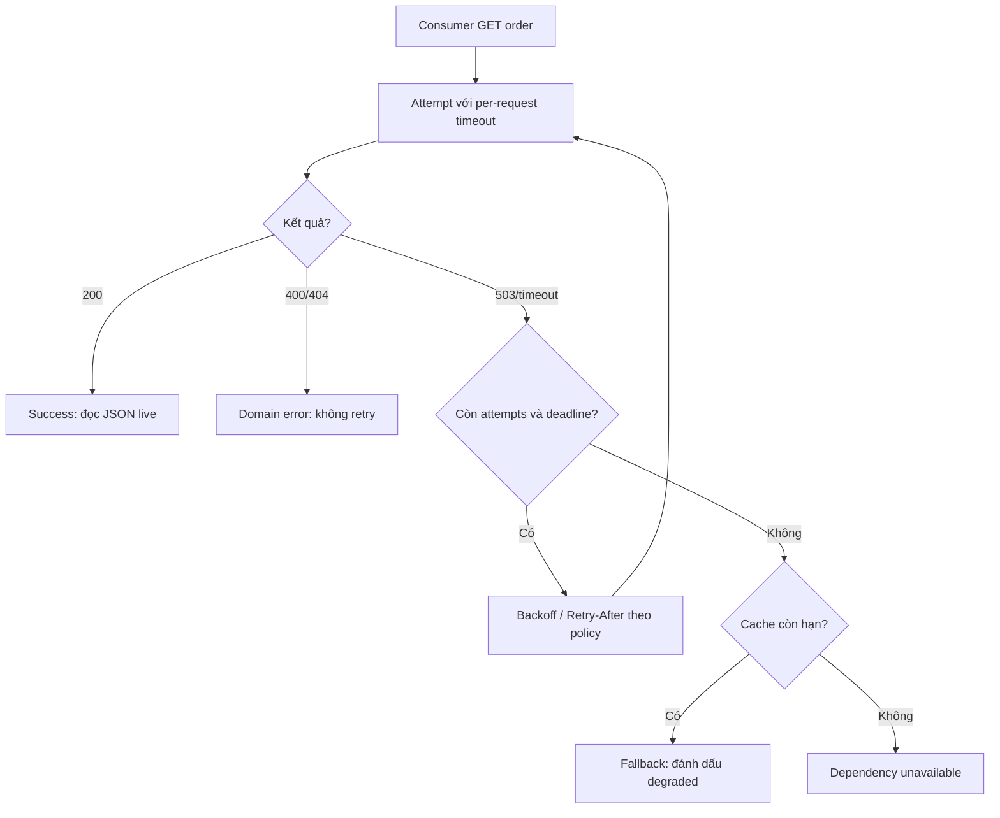
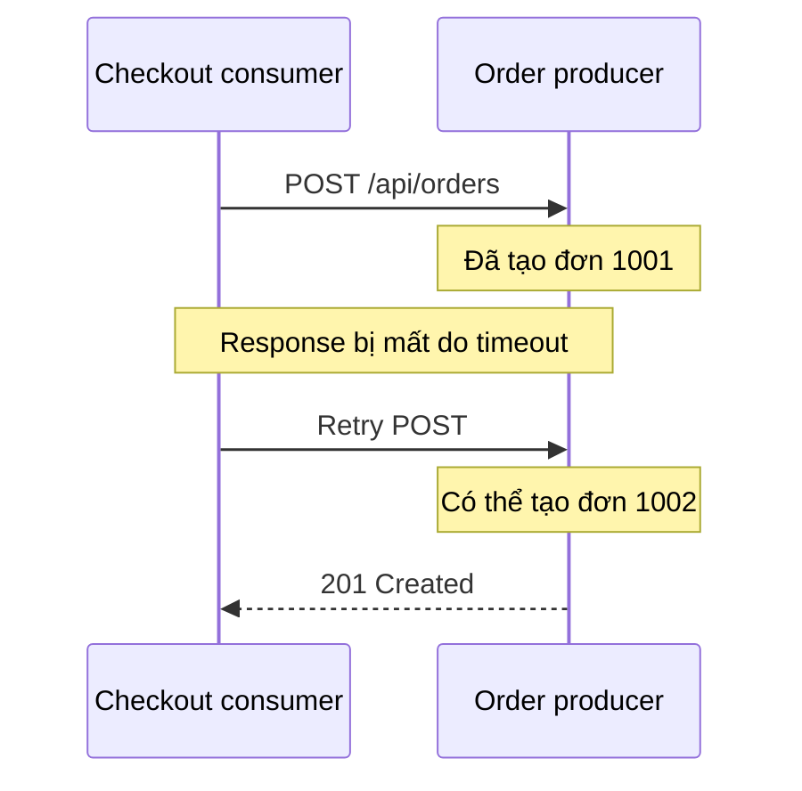
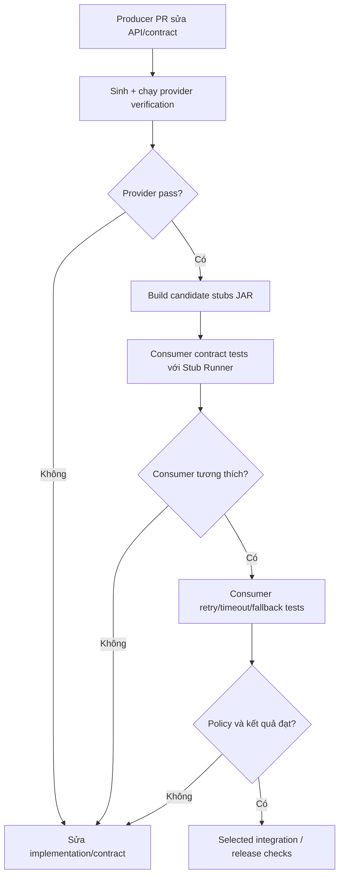

# Kiểm thử timeout, retry và fallback bằng stub bổ sung trong Spring Cloud Contract

Một consumer có thể vượt qua mọi bài kiểm thử giao tiếp với phản hồi **200 OK** nhưng vẫn thất bại khi producer phản hồi chậm, trả lỗi tạm thời hoặc mất kết nối. Trong thực tế, những tình huống đó ảnh hưởng trực tiếp đến **độ trễ, số lần gọi, tải lên dependency và trải nghiệm người dùng**. Vì thế, kiểm thử consumer không chỉ dừng lại ở việc đọc đúng JSON: cần xác minh cả **timeout, retry và fallback**.

Trong **Spring Cloud Contract (SCC)**, producer mô tả hợp đồng HTTP hoặc thông điệp bằng **Groovy/YAML DSL**, chạy **provider verification tests** và phát hành **stubs JAR**. Consumer dùng **Stub Runner** để chạy các stub đã thỏa thuận, thường qua **WireMock** cho HTTP. Để kiểm tra những tình huống hạ tầng mà contract tĩnh không mô tả đầy đủ, nhóm có thể bổ sung **stub gây trễ, ngắt kết nối hoặc trả response theo trình tự** trong bộ test consumer.

Bài thuộc chương **Kiểm thử consumer** này tập trung vào cách tạo **stub bổ sung** mà không làm sai nguồn hợp đồng, cách kiểm chứng chính sách thử lại hữu hạn và fallback, cùng chiến lược CI để phát hiện lỗi trước khi triển khai. Ví dụ xuyên suốt dùng `checkout-consumer` gọi `order-producer` qua `GET /api/orders/{id}`.

## 1. Phân biệt ba cơ chế cần kiểm thử

**Timeout** giới hạn thời gian chờ. Khi request hoặc thao tác tổng thể vượt ngưỡng, consumer phải kết thúc phù hợp thay vì chờ vô hạn.

**Retry** thực hiện lại một thao tác **sau một lỗi được phân loại là có thể phục hồi**, với số lần và khoảng chờ có giới hạn. Retry không phải hành vi mặc định của Spring Cloud Contract.

**Fallback** là cách xử lý khi dependency không đáp ứng hoặc không có kết quả phù hợp: ví dụ dùng bản cache còn hạn, trả trạng thái “tạm không khả dụng” hoặc đưa công việc vào hàng đợi. Fallback phải bảo vệ ý nghĩa nghiệp vụ, không chỉ che exception.

| Cơ chế | Câu hỏi kiểm thử | Lỗi thường gặp |
| --- | --- | --- |
| Timeout mỗi request | Client ngừng chờ khi một attempt quá lâu không? | Read timeout không cấu hình, thread bị giữ lâu |
| Tổng deadline | Cả chuỗi retry có dừng trong ngân sách không? | Mỗi attempt có timeout nhưng tổng thời gian quá dài |
| Retry | Chỉ thử lại lỗi được phép, đúng số attempts không? | Retry cả 400, 404 hoặc mọi 500 |
| Backoff | Có chờ giữa các lần thử lại không? | Retry dồn dập gây thêm tải |
| `Retry-After` | Có tôn trọng tín hiệu thời gian của server không? | Retry sớm hơn khi producer đang quá tải |
| Fallback | Khi hết khả năng phục hồi, consumer làm gì? | Trả dữ liệu sai hoặc coi lỗi là thành công |
| Idempotency | Gửi lại request có tác dụng phụ có tạo dữ liệu trùng không? | POST timeout rồi tạo hai đơn hàng |

### 1.1. Một request chậm không nhất thiết phải retry

Nếu consumer có SLA tổng cộng 800 ms, request đầu tiên đã dùng 700 ms thì một retry với delay 500 ms chắc chắn không thể hoàn tất trong SLA. Chính sách hợp lý có thể là **dừng và trả fallback**, không cố gửi lần thứ hai.

### 1.2. Một response 503 không tự kích hoạt retry

Một HTTP client như `RestClient` hoặc `RestTemplate` không phải lúc nào cũng có chính sách retry ứng dụng được bật. Quy tắc retry thường nằm trong thư viện resilience, decorator, interceptor hoặc mã điều phối do nhóm định nghĩa. **Spring Cloud Contract/Stub Runner mô phỏng response; chúng không tự triển khai policy của consumer.**

## 2. Phạm vi của contract stub và stub bổ sung

Cần phân biệt hai nguồn stub:

| Nguồn stub | Ai sở hữu? | Mục đích | Có nên coi là cam kết API? |
| --- | --- | --- | --- |
| **Contract-derived stub** | Producer hoặc nhóm sở hữu contract | Mô phỏng HTTP status/body/headers mà producer cam kết | Có, nếu contract được xác minh và phát hành đúng phiên bản |
| **Supplemental fault stub** | Consumer test | Gây timeout, reset connection, chuỗi lỗi/khôi phục | Chỉ khi behavior ấy đã được thỏa thuận riêng; bản thân stub không chứng minh producer thật |
| **Stateful scenario stub** | Consumer resilience test | Trả 503 rồi 200 hoặc nhiều response theo thứ tự | Mô phỏng kịch bản kiểm thử, không mặc nhiên là contract |
| **Integration environment** | Nhóm triển khai/test | Chạy producer, gateway, broker hoặc dependency thật | Kiểm tra behavior tại ranh giới rộng hơn |

Ví dụ contract chỉ quy định:

```text
GET /api/orders/1001 -> HTTP 200 + JSON hợp lệ
GET /api/orders/9999 -> HTTP 404 + mã ORDER_NOT_FOUND
```

Để kiểm tra consumer chịu được response chậm 2 giây, bạn **không cần tuyên bố producer bắt buộc luôn chậm 2 giây** trong public contract. Bạn có thể tạo một WireMock stub bổ sung **trong test của consumer** trả response giống schema nhưng có delay có chủ đích.

**Nguyên tắc sở hữu:** hành vi API công khai, nhất là error status và `Retry-After` mà consumer phụ thuộc, nên được thỏa thuận trong contract khi thực sự thuộc giao diện producer. Lỗi mạng giả lập và lịch retry trong consumer thuộc bài test resilience bổ sung.

### 2.1. Hai đường kiểm thử nên tồn tại song song



Nếu một suite dùng **WireMock server riêng** cho supplemental stubs, đừng nhầm server đó với WireMock do Stub Runner khởi động. Hai server có lifecycle, cổng và nguồn mappings khác nhau; client consumer cần được trỏ tới đúng server cho từng bài test.

## 3. Hợp đồng nền tảng: trường hợp thành công và lỗi đã thỏa thuận

Ví dụ contract thành công do `order-producer` sở hữu:

```groovy
import org.springframework.cloud.contract.spec.Contract

Contract.make {
    description 'Đọc đơn hàng tồn tại trả JSON 200'

    request {
        method GET()
        url '/api/orders/1001'
        headers {
            header('Accept', 'application/json')
        }
    }

    response {
        status OK()
        headers {
            contentType(applicationJson())
        }
        body(
            id: 1001,
            status: 'CREATED',
            currency: 'VND'
        )
    }
}
```

YAML tương đương, chỉ chọn **một** DSL trong bộ contract build:

```yaml
description: "Đọc đơn hàng tồn tại trả JSON 200"
request:
  method: GET
  url: /api/orders/1001
  headers:
    Accept: application/json
response:
  status: 200
  headers:
    Content-Type: application/json
  body:
    id: 1001
    status: CREATED
    currency: VND
```

Nếu API công khai cam kết 503 khi dependency tạm thời mất khả năng phục vụ, nên có **contract riêng** cho kịch bản có fixture tái lập được:

```groovy
import org.springframework.cloud.contract.spec.Contract

Contract.make {
    description 'Nguồn dữ liệu đơn hàng tạm lỗi, trả 503 với Retry-After'

    request {
        method GET()
        url '/api/orders/9001'
    }

    response {
        status 503
        headers {
            contentType(applicationJson())
            header('Retry-After', '2')
        }
        body(
            code: 'ORDER_SOURCE_UNAVAILABLE',
            retryable: true
        )
    }
}
```

Contract này kiểm chứng **một phản hồi 503 cụ thể của producer**. Nó **không xác minh** consumer đã chờ 2 giây, thử lại đúng hai lần hay dùng fallback; đó là phần việc của consumer tests.

### 3.1. Không tạo hai contract chồng khớp rồi mong nhận chuỗi response

Giả sử bạn tạo đồng thời:

```text
Contract A: GET /api/orders/1001 -> 503
Contract B: GET /api/orders/1001 -> 200
```

Nếu cả hai match **cùng request**, WireMock có thể chọn một mapping theo priority/thứ tự đăng ký, chứ **không tự đổi** từ 503 sang 200 sau lần gọi đầu tiên. Hãy dùng **WireMock scenarios** cho trình tự nhiều lần gọi hoặc phân biệt request của các contract độc lập bằng fixture/điều kiện rõ ràng.

## 4. Stub Runner dùng ở bài test hợp đồng consumer

Giả sử producer đã chạy provider verification và cài stubs artifact vào Maven local repository. Một consumer Spring Boot test:

```java
import org.springframework.boot.test.context.SpringBootTest;
import org.springframework.cloud.contract.stubrunner.spring.AutoConfigureStubRunner;
import org.springframework.cloud.contract.stubrunner.spring.StubRunnerProperties;

@SpringBootTest(properties = {
    "order.api.base-url=http://localhost:8085"
})
@AutoConfigureStubRunner(
    ids = "com.example:order-producer:1.0.0:stubs:8085",
    stubsMode = StubRunnerProperties.StubsMode.LOCAL
)
class OrderConsumerContractTest {
    // Inject client thật của ứng dụng.
    // Gọi GET /api/orders/1001, assert DTO và nhánh business.
}
```

`com.example:order-producer:1.0.0:stubs:8085` chỉ là tọa độ ví dụ. `LOCAL` yêu cầu JAR đã được cài vào Maven local repository; CI đa repository có thể dùng `REMOTE` với artifact repository và candidate version được pin.

Trong một suite chạy song song, cổng cố định có thể xung đột; cân nhắc dynamic port theo khả năng Stub Runner và cấu hình injection phù hợp.

**Đừng dùng Stub Runner để chứng minh producer thật đã xử lý đúng timeout.** Nó chạy stubs được sinh từ contract, không chạy implementation producer.

### 4.1. Khi nào nên dùng WireMock riêng cho stub bổ sung?

Dùng WireMock độc lập ở consumer test khi cần:

- Gây delay lớn hơn timeout dự kiến.
- Reset connection hoặc tạo response lỗi tạm thời có kiểm soát.
- Trả chuỗi `503 → 503 → 200`.
- Quan sát số lần request qua `verify(n, getRequestedFor(...))`.
- Reset state và fixture giữa các bài test.
- Điều chỉnh các kịch bản chỉ phục vụ resilience mà không thay đổi contract producer.

Không có nghĩa bạn phải bỏ Stub Runner. Hãy **giữ suite contract dùng stubs JAR** và tạo **suite fault-injection dùng WireMock riêng** nếu đó là cách dễ tái lập, rõ ownership nhất.

## 5. Chuẩn bị WireMock server cho các tình huống bổ sung

Ví dụ JUnit Jupiter, WireMock Java DSL:

```java
import static com.github.tomakehurst.wiremock.client.WireMock.*;

import com.github.tomakehurst.wiremock.WireMockServer;
import org.junit.jupiter.api.AfterEach;
import org.junit.jupiter.api.BeforeEach;

class OrderResilienceTest {

    private WireMockServer wireMock;

    @BeforeEach
    void startStub() {
        wireMock = new WireMockServer(
            options().dynamicPort()
        );
        wireMock.start();
    }

    @AfterEach
    void stopStub() {
        if (wireMock != null) {
            wireMock.stop();
        }
    }

    // Các bài test sẽ gọi client consumer với wireMock.baseUrl().
}
```

Lớp này minh họa **lifecycle của server** và chưa gồm các test methods. Một cách khác là dùng JUnit WireMock extension, nếu phiên bản/dependency của dự án hỗ trợ.

Điểm quan trọng:

1. **Mỗi test có trạng thái độc lập.** Tạo server mới hoặc reset mappings/request journal/scenarios giữa các test.
2. **Dùng dynamic port** để tránh va chạm trong CI.
3. **Client thực của consumer** phải đọc base URL của WireMock test, không gọi nhầm producer thật.
4. **Stub request matcher đủ chặt.** Đừng trả 200 cho mọi URL hoặc mọi body.
5. **Test phải assert kết quả và interactions**, không chỉ xác minh server khởi động.

Nếu dùng Spring application context tạo singleton HTTP client, hãy cấu hình URL test **trước lúc bean được tạo**. Ví dụ, dùng test property injection/test configuration thích hợp; không đổi URL sau khi bean đã giữ giá trị bất biến.

## 6. Kiểm thử timeout bằng response delay

### 6.1. Delay cố định ở WireMock

Một HTTP stub có thể cố ý chậm hơn giới hạn của consumer:

```java
wireMock.stubFor(
    get(urlEqualTo("/api/orders/1001"))
        .willReturn(
            okJson("{\"id\":1001,\"status\":\"CREATED\"}")
                .withFixedDelay(1500)
        )
);
```

`withFixedDelay(1500)` mô phỏng độ trễ response **1.500 ms** tại stub, theo API WireMock tương ứng. Nếu consumer đặt timeout mỗi request là **250 ms**, request này phải được xử lý như một timeout (hoặc lỗi tương đương theo client library).

**Lưu ý:** không giả định mọi client và môi trường đo thời gian chính xác đến từng mili giây. Timeout có thể liên quan đến kết nối, nhận header, đọc body hoặc toàn bộ request; bài test phải dùng **đúng timeout mà ứng dụng định nghĩa**.

### 6.2. Minh họa timeout HTTP với JDK HttpClient

Một bài test thuần HTTP cho thấy timeout thật tại socket/client boundary:

```java
import static org.junit.jupiter.api.Assertions.assertThrows;

import java.net.URI;
import java.net.http.HttpClient;
import java.net.http.HttpRequest;
import java.net.http.HttpResponse;
import java.net.http.HttpTimeoutException;
import java.time.Duration;
import org.junit.jupiter.api.Test;

@Test
void clientTimesOutWhenStubResponseIsTooSlow() {
    wireMock.stubFor(
        get(urlEqualTo("/api/orders/1001"))
            .willReturn(
                okJson("{\"id\":1001}")
                    .withFixedDelay(1500)
            )
    );

    HttpClient http = HttpClient.newHttpClient();
    HttpRequest request = HttpRequest.newBuilder()
        .uri(URI.create(
            wireMock.baseUrl() + "/api/orders/1001"))
        .timeout(Duration.ofMillis(250))
        .GET()
        .build();

    assertThrows(HttpTimeoutException.class, () ->
        http.send(request, HttpResponse.BodyHandlers.ofString())
    );
}
```

Test trên chỉ kiểm tra **JDK HttpClient trực tiếp**, không chứng minh timeout trong `OrderClient` của ứng dụng nếu nó dùng một HTTP client khác. Khi test `checkout-consumer` thật, hãy **gọi client có cấu hình timeout và error mapping của production** rồi assert exception/domain result mà client đó công bố.

### 6.3. Phân biệt các loại timeout

| Giới hạn | Điều xảy ra | Vì sao cần test đúng loại |
| --- | --- | --- |
| Connect timeout | Không thiết lập được kết nối đúng hạn | WireMock delay sau khi nhận request không mô phỏng chuẩn connect timeout |
| Response/read timeout | Kết nối có nhưng chờ response hoặc dữ liệu quá lâu | `withFixedDelay` thích hợp cho tình huống response chậm |
| Connection pool acquisition timeout | Chờ lấy kết nối từ pool quá lâu | Cần test pool/concurrency, không chỉ một request WireMock |
| Per-attempt timeout | Một lần gọi bị chặn tối đa một khoảng | Retry sau timeout có thể kéo dài tổng thời gian |
| Overall deadline | Toàn bộ thao tác gồm attempt, backoff và fallback bị giới hạn | Không thể suy ra từ per-attempt timeout |

**Không dùng `withFixedDelay` để tuyên bố đã test connect timeout**, vì WireMock đã nhận request và chỉ chậm trả response. Muốn gây lỗi thiết lập kết nối, cần bài test transport/network phù hợp.

## 7. Mô phỏng lỗi kết nối và phân biệt với 503

Một lỗi HTTP 503 nghĩa là **đã nhận được HTTP response**. Lỗi connection reset nghĩa là transport bị lỗi, **có thể không có HTTP status code**.

WireMock hỗ trợ fault injection, ví dụ:

```java
import static com.github.tomakehurst.wiremock.http.Fault.CONNECTION_RESET_BY_PEER;

wireMock.stubFor(
    get(urlEqualTo("/api/orders/1001"))
        .willReturn(
            aResponse()
                .withFault(CONNECTION_RESET_BY_PEER)
        )
);
```

Tùy phiên bản WireMock, HTTP client và nền tảng, exception cụ thể có thể khác nhau. Đừng viết assertion buộc mọi client phải ném cùng một exception class. Hãy kiểm tra loại lỗi **mà adapter của ứng dụng chuẩn hóa**, ví dụ `DependencyConnectionFailure`, và đối chiếu exception root cause trong bài test thấp hơn nếu cần.

Phân biệt:

| Hiện tượng | Mô phỏng | Consumer quan sát |
| --- | --- | --- |
| 503 Service Unavailable | `withStatus(503)` | Có HTTP status, headers, body |
| 429 Too Many Requests | `withStatus(429)` + `Retry-After` | Tín hiệu quota và lịch chờ |
| Response chậm | `withFixedDelay(1500)` | Timeout nếu vượt giới hạn client |
| Connection reset | `withFault(...)` | Lỗi IO/transport |
| Không có server lắng nghe | Kết nối tới port không phục vụ | Connection refused/timeout tùy mạng |
| JSON hỏng | `withBody("not-json")` với content type JSON | Deserialization error, thường không retry mặc định |

**Lỗi parse JSON khác lỗi 503.** Không tự xếp tất cả exception vào cùng một nhóm retry; lỗi schema vĩnh viễn có thể không tự phục hồi sau vài trăm mili giây.

## 8. Kiểm thử retry thành công bằng WireMock scenario

Một contract/stub tĩnh chỉ trả một response cho một điều kiện request. Để tạo chuỗi **lần đầu 503, lần tiếp theo 200**, dùng **WireMock scenario**.

```java
import static com.github.tomakehurst.wiremock.client.WireMock.*;
import static com.github.tomakehurst.wiremock.stubbing.Scenario.STARTED;

wireMock.stubFor(
    get(urlEqualTo("/api/orders/1001"))
        .inScenario("order-service-recovers")
        .whenScenarioStateIs(STARTED)
        .willReturn(
            aResponse()
                .withStatus(503)
                .withHeader("Retry-After", "0")
        )
        .willSetStateTo("RECOVERED")
);

wireMock.stubFor(
    get(urlEqualTo("/api/orders/1001"))
        .inScenario("order-service-recovers")
        .whenScenarioStateIs("RECOVERED")
        .willReturn(
            okJson("{\"id\":1001,\"status\":\"CREATED\"}")
        )
);
```

Diễn giải:

1. Scenario ban đầu ở trạng thái `STARTED`.
2. Request đầu match stub 503; WireMock chuyển scenario sang `RECOVERED`.
3. Request tiếp theo cùng URL match stub 200.
4. **WireMock không tự gửi request lần thứ hai.** Consumer chỉ nhận 200 nếu **chính client của consumer** quyết định retry.
5. Trong `@AfterEach` hoặc `@BeforeEach`, reset scenario/mappings hoặc tạo server mới để không làm bài test sau phụ thuộc trạng thái trước.

### 8.1. Assertion của consumer quan trọng hơn số response được khai báo

Giả sử ứng dụng có `OrderGateway` tự định nghĩa với phương thức `getOrder(1001L)` và chính sách retry 503. Trong consumer test:

```java
// Pseudocode: OrderGateway là client do ứng dụng cung cấp.
// Tạo gateway từ wireMock.baseUrl() trước khi gọi.
OrderDto order = orderGateway.getOrder(1001L);

assertEquals(1001L, order.id());
assertEquals("CREATED", order.status());

wireMock.verify(2, getRequestedFor(
    urlEqualTo("/api/orders/1001")
));
```

Đoạn này là **pseudocode kiểm thử tích hợp**; `OrderGateway` và `OrderDto` không phải class có sẵn trong SCC. Nó cho thấy ba điều phải chứng minh:

- Consumer thật tự gửi request lần hai.
- Response cuối cùng được parse/xử lý đúng.
- Không phát sinh request thừa sau khi thành công.

Nếu test chỉ trực tiếp gọi hai lần bằng `HttpClient` trong chính code test, bạn đang chứng minh WireMock đổi response theo trạng thái, **chưa chứng minh policy retry của `OrderGateway`**.

### 8.2. Scenario và priority là hai khái niệm khác nhau

- **Scenario state:** quyết định stub nào đủ điều kiện ở một thời điểm trong chuỗi request.
- **Priority:** quyết định stub nào được chọn nếu nhiều mapping **đang phù hợp đồng thời**.
- Đặt một stub 503 priority 1 và một stub 200 priority 2 **không** tự tạo chuỗi `503 → 200`; stub 503 có thể thắng mọi lần.
- Nếu server còn một catch-all mapping, nó có thể che scenario; kiểm tra toàn bộ tập mappings và request journal.

## 9. Kiểm thử retry hết giới hạn: đừng để vòng lặp vô hạn

Tình huống `503` liên tục:

```java
wireMock.stubFor(
    get(urlEqualTo("/api/orders/1001"))
        .willReturn(
            aResponse()
                .withStatus(503)
                .withHeader("Content-Type", "application/json")
                .withBody(
                    "{\"code\":\"ORDER_SOURCE_UNAVAILABLE\"}"
                )
        )
);
```

Giả sử policy được nhóm thống nhất là **tối đa 3 attempts tổng cộng**, gồm **1 lần đầu + tối đa 2 lần retry**. Test consumer cần assert:

```text
Given: GET luôn trả 503
When: OrderGateway.getOrder(1001)
Then:
  - HTTP client gửi tổng cộng đúng 3 requests.
  - Không có lần gửi thứ 4.
  - Consumer trả domain error hoặc fallback đúng policy.
  - Tổng thao tác không vượt deadline đã định.
  - Log/metrics biểu thị retry exhausted, không che nguyên nhân.
```

Ví dụ kiểm tra số lượng request:

```java
wireMock.verify(3, getRequestedFor(
    urlEqualTo("/api/orders/1001")
));
```

**Không nhầm `maxAttempts = 3` với “retry ba lần sau lần đầu”.** Cách đếm có thể khác giữa các thư viện; tài liệu của ứng dụng và test phải quy định rõ.

### 9.1. Vì sao kiểm tra số attempts chưa đủ?

Một consumer có thể gửi ba request đúng như test đếm, nhưng gửi chúng **liên tiếp không chờ**, khiến producer đang quá tải càng khó phục hồi. Phải kiểm tra thêm backoff, jitter, deadline và phân loại lỗi.

## 10. Kiểm thử backoff bằng fake clock hoặc scheduler

Một chính sách exponential backoff minh họa:

```text
delayRetry(n) = min(baseDelay * 2^(n-1), maxDelay)
```

Với `baseDelay = 200 ms`, `maxDelay = 2 s` và tổng tối đa ba attempts:

| Attempt | Điều kiện | Delay trước khi gửi |
| --- | --- | --- |
| 1 | Lần đầu | 0 ms |
| 2 | Sau lỗi attempt 1 | 200 ms |
| 3 | Sau lỗi attempt 2 | 400 ms |

**Jitter** giúp tránh hiện tượng nhiều consumer đồng thời retry đúng một thời điểm. Nếu policy có jitter, delay thực có thể nằm trong khoảng cho phép thay vì chính xác 200/400 ms.

### 10.1. Không dùng Thread.sleep dài trong mỗi unit test

Ví dụ test thường gây vấn đề:

```java
Thread.sleep(2000);
assertEquals(3, attemptCount);
```

Nó khiến CI chậm, chịu ảnh hưởng scheduler và không chứng minh policy đã yêu cầu chờ đúng lúc. Cách ổn định hơn là **inject bộ hẹn giờ/sleeper**, hoặc dùng **virtual time** nếu client reactive.

Ví dụ interface nhỏ trong code ứng dụng:

```java
@FunctionalInterface
interface Sleeper {
    void sleep(java.time.Duration delay)
        throws InterruptedException;
}
```

Bản fake cho unit test:

```java
import java.time.Duration;
import java.util.ArrayList;
import java.util.List;

final class RecordingSleeper implements Sleeper {

    final List<Duration> requestedDelays = new ArrayList<>();

    @Override
    public void sleep(Duration delay) {
        requestedDelays.add(delay);
    }
}
```

Policy test có thể assert:

```java
// Pseudocode: RetryingOrderGateway nhận Sleeper và fake transport.
RecordingSleeper sleeper = new RecordingSleeper();
RetryingOrderGateway gateway = createGateway(
    responses(503, 503, 200),
    sleeper,
    3
);

gateway.getOrder(1001L);

assertEquals(
    List.of(Duration.ofMillis(200), Duration.ofMillis(400)),
    sleeper.requestedDelays
);
```

`RetryingOrderGateway`, `createGateway` và `responses(...)` là **test fixtures tự xây**, không phải API SCC/WireMock. Đoạn này minh họa cách kiểm tra **lịch chờ được yêu cầu** mà không phải chờ thời gian thật.

### 10.2. Test giới hạn deadline

Một policy đúng nên có **tổng deadline**, ngoài per-attempt timeout. Giả sử mỗi attempt có timeout 1 giây, ba attempts và delay 200 + 400 ms; tổng thời gian xấu nhất có thể đạt nhiều giây. Nếu use case chỉ chấp nhận 2 giây, policy phải dừng sớm theo deadline.

Sử dụng fake clock hoặc scheduler để thử các mốc:

- Deadline còn đủ cho attempt tiếp theo.
- Deadline vừa hết trước khi bắt đầu retry.
- Deadline hết trong một attempt.
- Backoff cần chờ lâu hơn phần deadline còn lại.
- Fallback hoàn thành hay cũng phải tuân thủ deadline.

Không suy ra “đã cấu hình timeout 1 giây” nghĩa là toàn bộ use case chậm tối đa 1 giây.

## 11. Retry-After: contract cho header, test riêng cho hành vi chờ

Khi producer trả:

```http
HTTP/1.1 429 Too Many Requests
Retry-After: 2
Content-Type: application/json

{"code":"RATE_LIMITED"}
```

header `Retry-After` là **thời gian server đề nghị chờ** trước request kế tiếp. Nó có thể ở dạng **số giây** hoặc **HTTP-date**.

Nếu `429` cùng `Retry-After` thuộc API công khai, khai báo trong producer contract. Sau đó consumer test cần kiểm tra **policy xử lý header**, không chỉ việc header tồn tại.

### 11.1. Supplemental stub cho thử nghiệm Retry-After

```java
wireMock.stubFor(
    get(urlEqualTo("/api/orders/1001"))
        .willReturn(
            aResponse()
                .withStatus(429)
                .withHeader("Retry-After", "2")
                .withHeader("Content-Type", "application/json")
                .withBody("{\"code\":\"RATE_LIMITED\"}")
        )
);
```

Consumer policy test cần xác minh:

1. Response 429 được phân loại theo rule đã thỏa thuận.
2. Client có thể parse `Retry-After: 2` thành khoảng chờ.
3. Không retry sớm hơn lịch server yêu cầu nếu policy quyết định retry.
4. Nếu chờ hai giây vượt **overall deadline**, client dừng hoặc lên lịch xử lý khác.
5. Giá trị header thiếu, âm, quá lớn hoặc sai định dạng được xử lý có giới hạn.
6. Số attempts vẫn không vượt maximum.

Một thử nghiệm chỉ assert `response.headers().firstValue("Retry-After")` đọc ra `"2"` chưa chứng minh client đã **thật sự áp dụng** thời gian chờ.

### 11.2. Retry-After không phải giấy phép retry vô hạn

Nếu producer đang quá tải, consumer retry liên tục dù đã nhận `Retry-After` có thể làm tình hình xấu hơn. Khi deadline hoặc attempt budget hết, consumer nên dừng/fallback theo chính sách, không tự rút ngắn thời gian server đã yêu cầu chỉ để cố lấy response 200.

## 12. Phân loại lỗi trước khi quyết định retry

Không phải status nào cũng nên thử lại.

| Kết quả | Retry mặc định? | Lý do |
| --- | --- | --- |
| `200/201` | Không | Đã thành công, phải dừng |
| `400` / `422` | Thông thường không | Input sai sẽ không tự đổi sau khi gửi lại |
| `401` / `403` | Không retry y nguyên | Cần thay đổi xác thực/quyền, nếu có một quy trình hợp lệ |
| `404` | Thông thường không | Resource có thể thực sự không tồn tại |
| `409` | Phụ thuộc nghiệp vụ | Conflict có thể tự hết hoặc cần xử lý |
| `429` | Có điều kiện | Rate limit, phải xét `Retry-After` và deadline |
| `502` / `503` / `504` | Có điều kiện | Lỗi tạm thời nhưng phải xét tính an toàn của thao tác |
| `500` | Không coi mọi 500 là retryable | Có thể là lỗi logic không phục hồi |
| Timeout / lỗi kết nối | Có điều kiện | Request trước có thể đã được server xử lý |
| JSON deserialize failure | Thường không | Schema sai không tự phục hồi bằng retry ngay |

### 12.1. Test âm quan trọng ngang test dương

Bộ test tối thiểu cần có:

```text
GET trả 400 -> 1 request, domain validation error
GET trả 401 -> 1 request, auth handling
GET trả 404 -> 1 request, not found
GET trả 503 rồi 200 -> 2 requests, success
GET trả 503 mãi -> tối đa 3 requests, fallback/error
GET trả chậm -> timeout, policy xử lý đúng
GET trả JSON hỏng -> không retry mù quáng
```

Một retry policy chỉ được test với `503 → 200` có thể vẫn retry sai với `400` và tạo tải vô ích.

### 12.2. Khác nhau giữa lỗi HTTP và lỗi trong decoder

Nhiều Java HTTP client trả exception riêng cho 4xx/5xx khi sử dụng API convenience như `retrieve()`, trong khi lỗi deserialize có thể xảy ra khi đọc body. Chính sách retry phải phân loại dựa trên **loại lỗi mà adapter thực tế tạo ra**, không chỉ kiểm tra chuỗi message của exception.

## 13. Kiểm thử fallback: thế nào là suy giảm chức năng đúng?

Khi retry hết hạn hoặc không phù hợp, consumer cần xử lý có chủ đích. Ví dụ ứng dụng checkout có một bản sao đọc đơn hàng từ cache, chỉ dùng để **hiển thị trạng thái gần nhất**.

Fallback có thể là:

- **Stale cache có kiểm soát:** trả snapshot cũ, kèm nguồn dữ liệu và thời điểm cập nhật.
- **Domain error rõ ràng:** báo “tạm không thể tải đơn hàng”, không giả vờ là 200 thành công.
- **Deferred processing:** đưa việc ít khẩn cấp vào hàng đợi, nếu có cơ chế lưu bền và idempotency.
- **Default value giới hạn:** chỉ dùng khi business chấp nhận và ghi rõ phần thông tin không đáng tin.

Một fallback **không nên** tự biến `404` của resource không tồn tại thành “đơn hàng CREATED” từ cache mà không có chính sách rõ, hoặc cho phép thanh toán tiếp khi trạng thái đơn hàng chưa được xác minh.

### 13.1. Quy tắc fallback theo loại lỗi

| Tình huống | Fallback có thể phù hợp | Điều phải kiểm tra |
| --- | --- | --- |
| GET timeout + cache còn hạn | Dùng snapshot cache | Có đánh dấu `stale` và giới hạn tuổi cache |
| 503 liên tục | Trả trạng thái tạm không khả dụng | Không trả dữ liệu bịa đặt |
| 429 + Retry-After dài | Dừng/đưa vào xử lý sau | Không retry sớm phá quota |
| 404 resource thực sự không tồn tại | Không dùng cache cũ tùy tiện | Trả not found theo nghiệp vụ |
| 400 input sai | Không che lỗi bằng fallback | Thông báo validation |
| POST tạo đơn bị timeout | Không gửi lại tùy tiện | Idempotency và trạng thái kết quả chưa chắc chắn |

### 13.2. Thiết kế kết quả có nguồn gốc dữ liệu

Một DTO nội bộ minh họa:

```java
record OrderView(
    long id,
    String status,
    String currency,
    boolean degraded,
    java.time.Instant cachedAt
) {}
```

Khi lấy dữ liệu live, `degraded=false`; khi trả snapshot cache vì 503, `degraded=true` và `cachedAt` phải có ý nghĩa. Consumer test nên assert **nguồn dữ liệu** thay vì chỉ kiểm tra status `CREATED`, bởi cùng giá trị status có thể đến từ live producer hoặc cache quá hạn.

### 13.3. Test fallback khi không có cache

Trường hợp thường bị bỏ sót: **cache rỗng hoặc quá cũ**. Khi producer không khả dụng, consumer không thể tự tạo một `OrderView` hợp lệ. Test phải xác minh kết quả domain error hoặc trạng thái “unknown”, tùy thiết kế.

Đừng viết fallback “trả object mặc định id=0/status=CREATED” chỉ để tránh exception; nó có thể khiến downstream thực hiện nghiệp vụ trên dữ liệu sai.

## 14. Kết hợp timeout, retry và fallback trong một kịch bản

Giả sử chính sách `OrderGateway` như sau:

- HTTP GET timeout mỗi attempt: **300 ms**.
- Tổng tối đa **3 attempts**, bao gồm lần đầu.
- Backoff: **100 ms** rồi **200 ms**.
- Retry khi HTTP `503` hoặc transport timeout, nhưng **không** retry `400`/`404`.
- Khi hết attempts hoặc deadline: lấy cache còn hạn nếu có; nếu không thì trả domain error.
- Tổng deadline của use case: ví dụ **1,5 giây**.

Những con số là **giả định để thiết kế test**, không phải mặc định của SCC hoặc một thư viện resilience cụ thể.



### 14.1. Ma trận kết quả

| Chuỗi phản hồi/điều kiện | Số request dự kiến | Kết quả dự kiến |
| --- | ---: | --- |
| `200` ngay | 1 | Live success |
| `503 → 200` | 2 | Live success sau retry |
| `503 → 503 → 200` | 3 | Live success ở attempt cuối |
| `503 → 503 → 503`, cache hợp lệ | 3 | Fallback cache, `degraded=true` |
| `503 → 503 → 503`, cache rỗng | 3 | Domain dependency unavailable |
| `400` | 1 | Validation/domain error |
| `404` | 1 | Not found |
| Timeout trước deadline, sau đó 200 | Theo policy | Thành công nếu còn ngân sách |
| Timeout mà deadline đã hết | Không vượt budget | Fallback hoặc error |

Đây là **ma trận kỳ vọng của một chính sách giả định**, không phải hành vi SCC/WireMock mặc định. Nếu đội áp dụng policy khác, hãy thay các kỳ vọng bằng contract vận hành đã được thống nhất.

### 14.2. Assert đầy đủ ba chiều

Một test retry/fallback chỉ đáng tin khi đồng thời kiểm tra:

1. **Kết quả nghiệp vụ:** live response, degraded cache hay domain error.
2. **Số lần và loại request:** không gọi quá số attempts và không retry lỗi vĩnh viễn.
3. **Lịch chờ/giới hạn thời gian:** backoff, `Retry-After` và deadline phù hợp.

Dùng WireMock `verify(...)` cho số request và fake sleeper/clock cho lịch chờ. Đừng chỉ assert một trong ba rồi kết luận policy hoàn chỉnh.

## 15. POST và tính idempotent: rủi ro khi retry sau timeout

`GET` thường an toàn hơn để retry vì không phải thao tác tạo tài nguyên theo ngữ nghĩa HTTP. Với `POST /api/orders`, timeout không có nghĩa producer chưa xử lý request.



Consumer có thể vô tình tạo hai đơn. Vì vậy:

- Không áp dụng chính sách retry GET một cách máy móc cho POST.
- Nếu API hỗ trợ `Idempotency-Key`, gửi lại **cùng key cho cùng yêu cầu logic**.
- Producer phải có cơ chế chống trùng bền vững và test kiểm tra replay/concurrency.
- Khi không biết attempt đầu đã commit hay chưa, consumer nên có chiến lược query trạng thái hoặc báo kết quả chưa xác định, thay vì giả vờ yêu cầu chưa từng được xử lý.

Ví dụ:

```http
POST /api/orders HTTP/1.1
Content-Type: application/json
Idempotency-Key: create-order-cus42-001

{"customerId":"CUS-42","sku":"BOOK-01","quantity":2}
```

Một contract có thể kiểm tra request header `Idempotency-Key` và response mẫu. Nhưng **không thể từ một request/response tĩnh suy ra producer không tạo duplicate sau hai POST**. Cần integration test gửi lặp, có thể gây mất response sau database commit và kiểm tra số tài nguyên thực sự được tạo.

## 16. Thêm stub bổ sung vào đâu để không phá tính tin cậy?

Một cách tổ chức rõ ràng trong consumer project:

```text
checkout-consumer/
  src/test/java/
    .../contract/OrderConsumerContractTest.java
    .../resilience/OrderTimeoutTest.java
    .../resilience/OrderRetryTest.java
    .../resilience/OrderFallbackTest.java
  src/test/resources/
    resilience/
      expected-scenarios.md   # tài liệu test nội bộ (tùy chọn)
```

Đường dẫn trên là **gợi ý tổ chức test**, không phải yêu cầu cấu trúc thư mục của SCC. Stub lỗi bổ sung có thể đặt trong Java test setup hoặc WireMock mappings được quản lý bằng source tùy framework.

### 16.1. Không âm thầm sửa stubs JAR của producer

Nếu bạn sửa mapping trong candidate stubs JAR để luôn trả 503 khi trước đó contract trả 200, consumer test sẽ không còn mô phỏng đúng hành vi producer đã xác minh. Nên:

1. Giữ nguyên **contract-derived stubs** cho compatibility tests.
2. Dùng một bộ **fault-injection stubs** riêng cho resilience tests.
3. Nếu behavior lỗi thuộc API public, yêu cầu producer bổ sung contract và provider verification tương ứng.
4. Pin version artifact cho compatibility tests và ghi nhận version/build nguồn.
5. Cố định response/error format ở nơi consumer phụ thuộc, không dùng body khác hoàn toàn contract rồi coi là compatibility check.

### 16.2. Khi cần test với cùng WireMock server

Một số dự án muốn thêm mapping trong WireMock do Stub Runner quản lý. Điều này có thể thực hiện **nếu phiên bản/cấu hình hỗ trợ truy cập server hoặc WireMock Admin API**, nhưng phải quản lý chặt:

- Mapping mới chỉ có hiệu lực trong test phù hợp.
- Priority và request matchers không che mapping contract chính.
- Reset mappings/request journal/scenario state giữa các test.
- Không thay đổi artifact phát hành bất ngờ.
- Test sau không phụ thuộc test trước.
- Cổng và quyền truy cập Admin API chỉ nằm trong test environment.

Với người học, **WireMockServer riêng** thường dễ hiểu và ít gây xung đột hơn. Không giả định mọi bản Stub Runner có cùng API để thêm stub runtime.

## 17. Tính ổn định của consumer resilience tests

Bài test mạng và thời gian dễ flaky nếu cấu hình không được kiểm soát. Các thực hành nên có:

| Vấn đề | Cách giảm rủi ro |
| --- | --- |
| Cổng trùng khi chạy song song | Dùng dynamic port |
| Scenario còn trạng thái cũ | Reset giữa các test |
| Thời gian chờ chính xác dễ lệch | Fake clock/sleeper cho policy unit tests |
| Async result chưa kịp xuất hiện | Await có deadline thay vì ngủ tùy ý |
| Jitter khiến delay không ổn định | Seed ngẫu nhiên hoặc kiểm tra biên độ |
| HTTP client dùng URL khác stub | Inject base URL trước khi tạo client |
| WireMock catch-all che kịch bản | Request matchers cụ thể, priority rõ |
| Artifact stub cũ trong `~/.m2` | Pin candidate version, kiểm tra nguồn |
| Cache state bẩn | Tạo/reset cache fixtures theo test |
| Đếm request từ ca khác | Reset request journal hoặc tạo server riêng |
| Timeout quá ngắn so với CI tải cao | Chọn ngưỡng đủ phân biệt và test policy bằng fake clock |

**Một bài test timeout qua mạng thật vẫn có giá trị** để chứng minh HTTP client được cấu hình đúng, nhưng không nên bắt toàn bộ ma trận backoff chờ thật theo đồng hồ để kiểm tra policy.

### 17.1. Chú ý về WireMock unmatched requests

Nếu WireMock trả HTTP 404, đó có thể là:

- **Contract 404** đã được match.
- **Mapping fallback** trả 404.
- **Unmatched response mặc định** vì request sai method/URL/header/body.

Dùng request journal/Admin API và kiểm tra mapping được chọn; đừng diễn giải mọi HTTP 404 là producer cam kết “đơn hàng không tồn tại”.

## 18. Chiến lược CI: tách cổng compatibility và resilience



Nếu consumer policy thay đổi độc lập với contract, vẫn cần chạy resilience tests trong consumer PR. Với nhiều repository, pipeline phải xác định đúng **candidate artifact version** và source commit của stubs JAR.

### 18.1. Bộ kiểm tra tối thiểu ở CI

- Producer generated tests thực sự được sinh và chạy cho những contract mới.
- Candidate stubs JAR chứa mappings đúng version.
- Consumer contract tests gọi HTTP client thật vào Stub Runner.
- Supplemental fault stubs không vô tình thay thế behavior contract.
- Timeout per-attempt được kiểm tra ở client boundary.
- Retry policy có test `503 → 200` và `503` liên tục.
- Có test **không retry** `400`/`404`.
- Backoff, jitter và overall deadline được kiểm chứng bằng fake time hoặc hook phù hợp.
- Fallback trả dữ liệu có nguồn gốc/giới hạn, không che lỗi nghiệp vụ.
- POST retry có điều kiện và có bài test idempotency ở producer khi cần.
- Metrics/logs có thể phân biệt retry exhausted, timeout và fallback.
- CI không chấp nhận kết quả chỉ vì WireMock process khởi động thành công.

### 18.2. Mutation tests đơn giản

| Thay đổi cố ý | Test nên fail |
| --- | --- |
| Bỏ timeout khỏi HTTP client | Timeout integration test |
| Đổi `maxAttempts` từ 3 thành 10 | Retry exhaustion count |
| Retry cả 400 | Test non-retryable 400 |
| Bỏ backoff | Fake sleeper delay assertions |
| Phớt lờ `Retry-After` | Policy header/clock test |
| Fallback dùng cache quá hạn | Cache expiry test |
| Fallback biến 404 thành 200 | Domain error test |
| Trả object mặc định khi không có cache | Fallback unavailable test |
| Consumer gọi sai URL/version stub | Contract test với candidate artifact |
| Gửi POST lại với key mới | Idempotency/duplicate integration test |

Nếu một thay đổi nguy hiểm mà pipeline vẫn xanh, hãy xem test đang gọi **client nào**, server nào được dùng, generated mappings nào đang match và thư viện resilience có thực sự bật trong test context không.

## 19. Debug khi test resilience thất bại

Thứ tự chẩn đoán:

1. **Xác định server:** đây là Stub Runner server hay supplemental WireMock server?
2. **Xác định URL:** client của consumer đang gọi hostname, path và port nào?
3. **Xem mapping:** request có match mapping đúng không?
4. **Kiểm tra response:** status, header, body hoặc delay/fault thực tế được trả ra.
5. **Kiểm tra client timeout:** connect, read/response hay overall deadline?
6. **Kiểm tra retry decorator:** policy có được gắn vào client đang test không?
7. **Xem request journal:** số attempts có đúng không? Có request thừa sau success không?
8. **Xem scheduler:** các delay có được yêu cầu? `Retry-After` có ảnh hưởng không?
9. **Kiểm tra fallback:** kết quả từ cache hay dữ liệu live, có còn hạn không?
10. **Kiểm tra artifact:** compatibility tests có dùng candidate stubs đúng revision không?

Một số triệu chứng:

| Triệu chứng | Nguyên nhân thường gặp |
| --- | --- |
| Timeout test không timeout | Test gọi sai server hoặc timeout client chưa được cấu hình |
| Retry test chỉ gửi 1 lần | Retry decorator không áp dụng, status không được phân loại retryable |
| Retry test gửi liên tục | Backoff thiếu hoặc bị bỏ qua |
| Test kỳ vọng 503 rồi 200 nhưng luôn nhận 503 | Scenario không chuyển trạng thái hoặc mapping khác che |
| Test kỳ vọng đúng 3 attempts nhưng có 4 | Nhầm attempts với số retry |
| Fallback xảy ra cho HTTP 400 | Cơ chế catch-all exception quá rộng |
| Fallback nhận dữ liệu cache cũ ngoài giới hạn | Thiếu kiểm tra cache age |
| Test pass local nhưng fail CI | Port collision, time-based assertion hoặc shared state |
| Consumer contract test xanh dù API đổi | Stub version cũ hoặc provider tests chưa chạy |

### 19.1. Không biến lỗi resilience thành thay đổi hợp đồng tùy tiện

Nếu consumer test retry fail vì policy gửi bốn lần thay vì ba, hãy sửa policy/test hoặc cập nhật quy tắc đã được thống nhất. **Không đổi Groovy/YAML contract producer để “hợp thức hóa” lỗi đó**, trừ khi chính giao diện producer thật sự cần thay đổi và được các bên đồng ý.

## 20. Bài thực hành đầy đủ

Chuẩn bị ứng dụng `order-producer`, `checkout-consumer` và dependency Spring Cloud Contract/Stub Runner/WireMock phù hợp. Thực hiện:

1. **Hợp đồng nền:** Viết contract GET đơn hàng 1001 trả 200, JSON có `id`, `status`, `currency`.
2. **Producer verification:** Chạy generated tests, cố tình đổi `status` thành giá trị sai để kiểm tra test fail.
3. **Stubs JAR:** Build candidate artifact với classifier `stubs`, dùng Stub Runner cho consumer contract test.
4. **Client thật:** Cho `OrderGateway` nhận base URL và timeout bằng cấu hình ứng dụng, không tạo client thử nghiệm khác hoàn toàn.
5. **Timeout:** Tạo supplemental WireMock stub có `withFixedDelay(1500)`, client timeout 250 ms; xác minh lỗi được map đúng.
6. **Retry thành công:** Dùng scenario `503 → 200`; xác minh hai requests và trả kết quả live.
7. **Retry exhaustion:** Stub luôn 503; cấu hình tối đa ba attempts rồi assert đúng số request.
8. **Backoff:** Inject fake sleeper và kiểm tra delay `200ms`, `400ms` cho policy minh họa.
9. **Retry-After:** Stub trả 429 kèm `Retry-After: 2`, kiểm tra parse và deadline.
10. **Không retry sai:** Cho 400 và 404; xác minh chỉ một request cho mỗi ca.
11. **Fallback cache:** Với 503 liên tục và cache hợp lệ, trả result có `degraded=true`.
12. **Cache không hợp lệ:** Khi cache quá hạn/rỗng, trả domain error thay vì tạo object giả.
13. **POST:** Mô phỏng timeout sau commit, dùng `Idempotency-Key` và integration test producer để không tạo đơn trùng.
14. **Tính độc lập:** Reset WireMock scenario/request journal và cache fixtures giữa mỗi test.
15. **CI:** Chạy compatibility suite với candidate stubs và resilience suite với fault stubs; thử các mutation để xác minh cổng chặn lỗi.

Bảng tự đánh giá:

| Năng lực | Bằng chứng |
| --- | --- |
| Phân biệt hai nguồn stub | Biết contract-derived và supplemental fault stubs khác nhau |
| Timeout | Test được response delay và biết giới hạn của connect/read timeout |
| Retry | Kiểm tra đúng attempts, backoff và điều kiện dừng |
| Scenario | Mô phỏng được `503 → 200` trên cùng request |
| Phân loại lỗi | Không retry 400/404 vô cớ |
| Retry-After | Có test tuân thủ thời gian chờ và deadline |
| Fallback | Không dùng dữ liệu giả hoặc cache quá hạn |
| Idempotency | Hiểu nguy cơ POST lặp sau timeout |
| CI | Candidate stubs, consumer tests và resilience tests có nguồn rõ ràng |

## 21. Ghi nhớ: stub bổ sung phải làm tăng niềm tin, không che lỗi API

**Stub Runner và Spring Cloud Contract** rất phù hợp để trả lời câu hỏi: *consumer có tương thích với giao diện producer đã cam kết không?* Còn **stub bổ sung để gây lỗi** giúp trả lời: *consumer có hành xử an toàn khi phụ thuộc chậm, tạm lỗi hoặc mất kết nối không?*

Hãy giữ hai mục tiêu tách biệt nhưng phối hợp:

- **Contract-derived stubs** có nguồn từ producer và được xác minh bằng generated provider tests.
- **Supplemental WireMock stubs** phục vụ delay, lỗi mạng, chuỗi response và các tình huống resilience có kiểm soát.
- **Assertions của consumer** kiểm tra kết quả nghiệp vụ, số requests, backoff, deadline và fallback, không chỉ status code.
- **Integration tests** bổ sung khi cần chứng minh idempotency, gateway, broker, giao dịch hoặc hành vi producer thật.
- **CI** phải dùng đúng candidate artifact và tránh state/clock/port gây flaky tests.

Khi những tầng kiểm thử này cùng hoạt động, nhóm vừa phát hiện sớm thay đổi API không tương thích, vừa chứng minh consumer **không retry vô hạn, không che lỗi nghiệp vụ và vẫn suy giảm chức năng có kiểm soát** khi dependency gặp sự cố.
