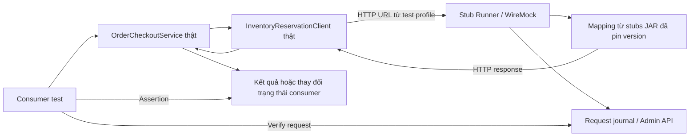
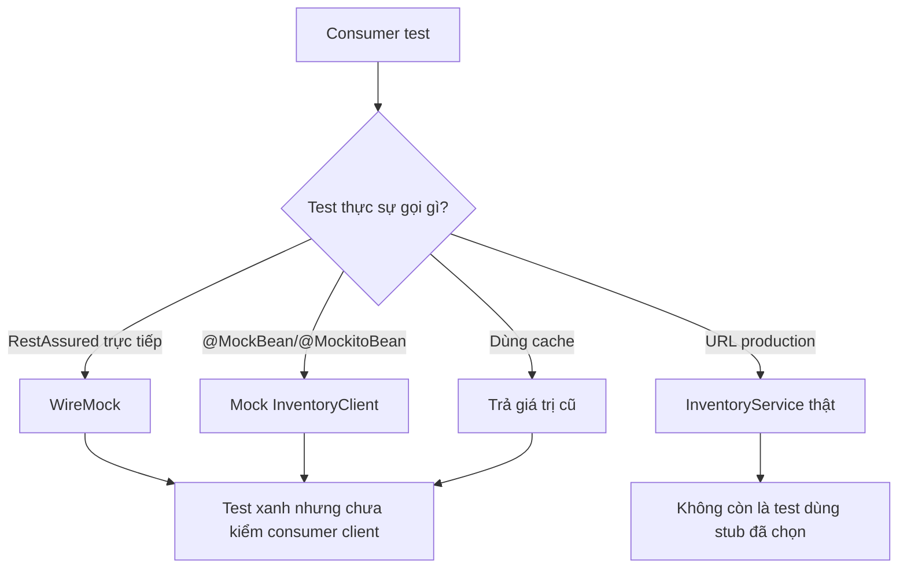
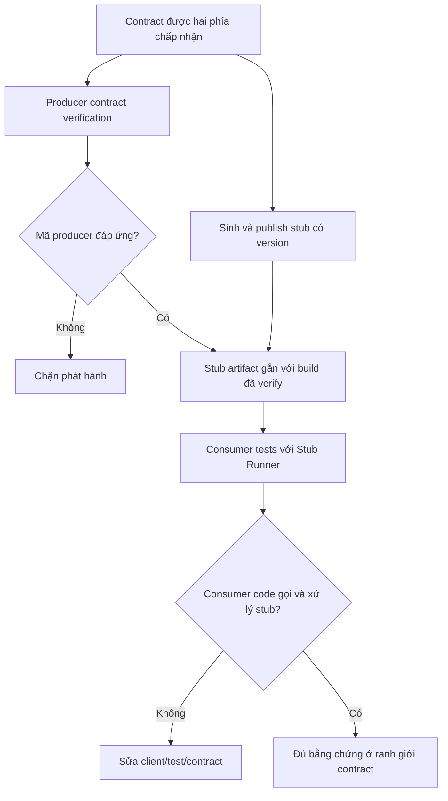
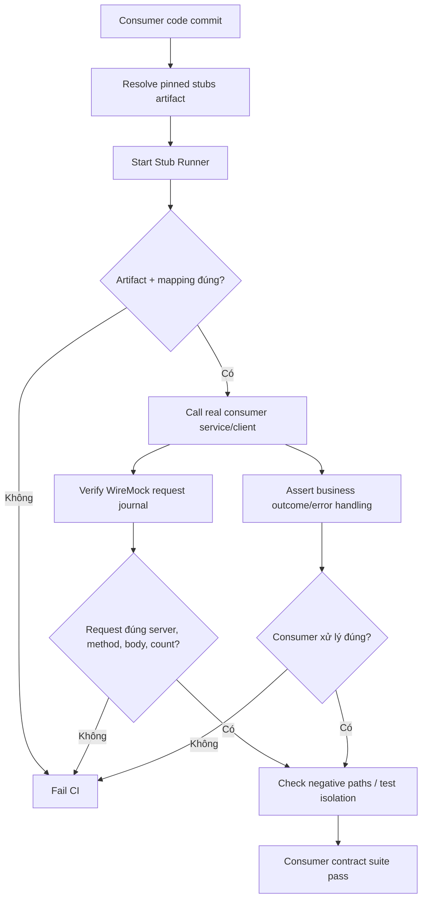

# Xác nhận mã consumer thực sự đi qua stub mong đợi

Trong **Spring Cloud Contract**, producer và consumer thống nhất hành vi HTTP hoặc message bằng **Groovy/YAML DSL**. Từ contract, phía producer sinh test để kiểm implementation, còn phía consumer dùng stub — thường qua **Stub Runner** và **WireMock** — để kiểm code tích hợp khi không cần chạy producer thật. Nhưng có một câu hỏi dễ bị bỏ qua: **test xanh có thực sự đi qua mã consumer cần kiểm và gọi đúng stub đã phát hành không?**

Giả sử test khởi động Stub Runner thành công rồi trực tiếp gửi `curl` hoặc RestAssured tới WireMock và nhận `201 Created`. Điều đó mới chứng minh **stub phục vụ một request phù hợp**, chứ chưa chứng minh `OrderService` đã dùng đúng `InventoryReservationClient`, truyền đúng header/body, đọc đúng JSON, xử lý lỗi hay thậm chí đã gọi HTTP. Consumer code có thể vẫn trỏ tới URL thật, dùng một response hardcode, bị mock thay thế hoặc bỏ qua bước gọi do cache.

Bài thuộc chương **Kiểm thử consumer** của module **SPRING_CLOUD_CONTRACT**. Ta sẽ xây một phép kiểm có bằng chứng ở **ba lớp**: (1) test thực thi **đường code consumer thật**, (2) request phát sinh được WireMock của **đúng Stub Runner instance** ghi nhận, và (3) response từ **đúng artifact/mapping** làm thay đổi hành vi consumer như mong đợi. Sau đó đưa các lớp kiểm vào CI để phát hiện API không tương thích mà không tạo cảm giác an toàn giả.

Sau bài học, bạn có thể:

- Nhận diện các kiểu “test pass nhưng consumer không gọi stub”.
- Cấu hình `@AutoConfigureStubRunner` với stub artifact/version và HTTP base URL rõ ràng.
- Viết test khởi động bean consumer thật, gọi một chức năng nghiệp vụ thay vì chỉ gọi WireMock trực tiếp.
- Kiểm **request journal**, số lượt gọi, URL, method, header, body và mapping active.
- Tách **đúng server/port** khỏi **đúng mapping** và **đúng version**.
- Sử dụng negative control để chứng minh consumer không âm thầm bypass stub hoặc dùng dữ liệu giả.
- Tránh lỗi do cache, fallback, mock, test isolation, async/retry và nhiều Stub Runner instances.
- Kết hợp producer verification và consumer tests trong CI với bằng chứng cụ thể.

## 1. “Stub đang chạy” không có nghĩa “consumer đã sử dụng stub”

Giả sử `OrderService` cần giữ hàng qua `InventoryService`:

```http
POST /api/v1/reservations HTTP/1.1
Content-Type: application/json

{"sku":"SKU-001","quantity":2}
```

Contract giả định trả:

```http
HTTP/1.1 201 Created
Content-Type: application/json

{"reservationId":"RES-701","status":"HELD"}
```

Một phép kiểm ngây thơ:

```bash
curl -i -X POST http://127.0.0.1:8090/api/v1/reservations \
  -H "Content-Type: application/json" \
  -d '{"sku":"SKU-001","quantity":2}'
```

Nếu lệnh trả `201`, ta biết **có một HTTP server** tại `8090` phục vụ request đó. Nhưng:

- Server có thể là WireMock khác, không phải instance do Stub Runner test khởi động.
- Response có thể đến từ một mapping viết tay hoặc fallback, không phải mapping sinh từ contract.
- Consumer code chưa hề được gọi; chính lệnh `curl` gửi request.
- Không biết consumer serialize `quantity` thành JSON number hay chuỗi `"2"`.
- Không biết consumer xử lý `404`, `409` hoặc lỗi deserialize như thế nào.

Vì thế **kiểm thử stub trực tiếp chỉ là smoke test của stub**, hữu ích nhưng không thay thế **consumer contract test**.

### Ba mức bằng chứng

| Mức | Bằng chứng | Điều chưa chứng minh |
| --- | --- | --- |
| **A. Stub tồn tại** | Artifact được resolve, WireMock khởi động | Consumer có gọi không |
| **B. Stub nhận request** | Request journal có method/path/body từ bài test | Request có đi qua component consumer thực sự không, nếu test cũng gọi trực tiếp |
| **C. Consumer xử lý response** | Test gọi service/client bean thật, kiểm kết quả và side effect; stub ghi request | Producer thật đáp ứng contract, nếu producer verification chưa chạy |

Đối với bài này, mục tiêu là **B và C đồng thời**. Cần thêm producer verification để có bảo đảm hai phía của Spring Cloud Contract.

## 2. Vẽ đường đi cần quan sát



Muốn khẳng định đường đi này đã xảy ra, phải kiểm **cả đầu ra của consumer** lẫn **dấu vết request phía stub**. Đặc biệt, đừng để test trực tiếp gửi chính request mà mình dùng làm bằng chứng consumer đã gửi.

Ví dụ những đường đi **sai mục tiêu**:



Trong một bài test tốt, consumer HTTP adapter phải là **bean thật** (hoặc lớp thật cần kiểm), còn những dependency khác không thuộc ranh giới tích hợp mới có thể dùng test doubles có chủ đích.

## 3. Bắt đầu từ contract nguồn và stub đã xác minh

Một contract Groovy DSL cho producer `InventoryService`:

```groovy
import org.springframework.cloud.contract.spec.Contract

Contract.make {
    name 'create_reservation_for_checkout'
    description 'OrderService cần reservation ID và trạng thái HELD'

    request {
        method 'POST'
        url '/api/v1/reservations'
        headers {
            contentType(applicationJson())
        }
        body([
            sku     : 'SKU-001',
            quantity: 2
        ])
    }

    response {
        status 201
        headers {
            contentType(applicationJson())
        }
        body([
            reservationId: $(consumer('RES-701'),
                             producer(regex('RES-[0-9]+'))),
            status       : 'HELD'
        ])
    }
}
```

Với contract này:

- **Producer test** gửi request mẫu tới mã producer thật, kiểm `201` và `reservationId` đúng định dạng, `status = HELD`.
- **Stub response** trả `RES-701` để consumer test dùng dữ liệu xác định.
- Test consumer không nên giả định producer production **luôn** trả `RES-701`; nó chỉ là giá trị mẫu phía stub.

Contract có thể được viết bằng YAML DSL thay cho Groovy; cơ chế sinh producer tests và stub tương tự về mục tiêu, nhưng cú pháp matcher YAML không phải cú pháp Groovy chép nguyên văn.

### Xác định artifact stub mà consumer sẽ dùng

Giả sử sau khi producer verification pass, nhóm phát hành:

```text
groupId    = com.example
artifactId = inventory-service
version    = 1.4.2
classifier = stubs
type       = jar
```

Artifact ví dụ `inventory-service-1.4.2-stubs.jar` cần chứa mapping có request/response vừa thỏa thuận. Chỉ có file JAR **không chứng minh** producer đã được verify: pipeline producer phải sinh **và chạy** generated tests trước khi publish.

Trong dự án Maven đã cấu hình Contract Verifier, một bước kiểm tiêu biểu:

```bash
mvn -B -ntp clean verify
```

Nhóm producer cần kiểm test report: không có `0 tests` hoặc skip không chủ đích. Nhóm consumer nên biết tọa độ version artifact đã xác minh, tránh tự lấy `latest` không cố định.

## 4. Cấu hình Stub Runner dùng phiên bản và cổng xác định

Trong môi trường test Spring Boot, `@AutoConfigureStubRunner` có thể khởi động HTTP stubs dựa trên artifact đã resolve.

Ví dụ:

```java
import org.springframework.boot.test.context.SpringBootTest;
import org.springframework.cloud.contract.stubrunner.spring.AutoConfigureStubRunner;
import org.springframework.cloud.contract.stubrunner.spring.StubRunnerProperties;

@SpringBootTest(properties = {
    "inventory.base-url=http://localhost:8090"
})
@AutoConfigureStubRunner(
    ids = "com.example:inventory-service:1.4.2:stubs:8090",
    stubsMode = StubRunnerProperties.StubsMode.LOCAL
)
class CheckoutWithInventoryStubTest {
    // Nội dung test sẽ gọi bean consumer, không gọi stub trực tiếp.
}
```

**Ý nghĩa các phần:**

| Cấu hình | Tác dụng |
| --- | --- |
| `com.example:inventory-service` | Định danh artifact stub của producer |
| `1.4.2` | Phiên bản cố định cần kiểm |
| `stubs` | Classifier của JAR stub |
| `8090` cuối chuỗi `ids` | Cổng mà Stub Runner sẽ dùng để phục vụ stub HTTP |
| `StubsMode.LOCAL` | Resolve artifact trong Maven local repository |
| `inventory.base-url` | URL mà **mã consumer thật** phải gọi khi chạy test |

Trong CI dùng kho artifact từ xa, cần dùng mode/configuration phù hợp và cung cấp repository, credentials theo cơ chế của Spring Cloud Contract version đang chạy. Không nhầm `repositoryRoot` (nguồn tải JAR) với **base URL HTTP** mà consumer gọi.

### Điểm hạn chế của fixed port

Cổng `8090` giúp ví dụ dễ theo dõi, nhưng có thể bị chiếm khi các test chạy song song. Trong dự án thực, có thể dùng cổng ngẫu nhiên do Stub Runner chọn và lấy địa chỉ qua `StubFinder`, `@StubRunnerPort` hoặc cấu hình test tương ứng. Khi chọn cổng động, phải đảm bảo **client consumer được tạo sau khi URL stub đã biết** hoặc có cơ chế cập nhật endpoint đúng vòng đời Spring context.

Không được chỉ chuyển Stub Runner sang cổng ngẫu nhiên mà vẫn để `inventory.base-url=http://localhost:8090`. Khi đó consumer sẽ gọi nhầm server cũ hoặc không kết nối được.

## 5. Mã consumer cần được kiểm là mã nào?

Để ví dụ cụ thể, `OrderService` có hai lớp:

1. `InventoryReservationClient` chịu trách nhiệm tạo request HTTP, gửi đi và deserialize response.
2. `OrderCheckoutService` gọi client, kiểm trạng thái `HELD` rồi quyết định có được tiếp tục checkout hay không.

Ví dụ sử dụng `RestClient` của Spring Framework 6.1+ (thường gặp ở Spring Boot 3.2+). Với các phiên bản cũ hơn, dùng client tương ứng của dự án và giữ nguyên nguyên tắc test.

```java
package com.example.order;

import org.springframework.beans.factory.annotation.Value;
import org.springframework.http.MediaType;
import org.springframework.stereotype.Component;
import org.springframework.web.client.RestClient;

record ReserveRequest(String sku, int quantity) {}

record ReservationResponse(String reservationId, String status) {}

@Component
class InventoryReservationClient {

    private final RestClient http;

    InventoryReservationClient(
            RestClient.Builder builder,
            @Value("${inventory.base-url}") String baseUrl) {
        this.http = builder.baseUrl(baseUrl).build();
    }

    ReservationResponse reserve(String sku, int quantity) {
        return http.post()
            .uri("/api/v1/reservations")
            .contentType(MediaType.APPLICATION_JSON)
            .body(new ReserveRequest(sku, quantity))
            .retrieve()
            .body(ReservationResponse.class);
    }
}
```

Lớp service nghiệp vụ:

```java
package com.example.order;

import org.springframework.stereotype.Service;

@Service
class OrderCheckoutService {

    private final InventoryReservationClient inventoryClient;

    OrderCheckoutService(InventoryReservationClient inventoryClient) {
        this.inventoryClient = inventoryClient;
    }

    ReservationResponse prepareCheckout(String sku, int quantity) {
        ReservationResponse reservation =
            inventoryClient.reserve(sku, quantity);

        if (reservation == null || !"HELD".equals(reservation.status())) {
            throw new IllegalStateException(
                "Cannot continue checkout without a held reservation"
            );
        }
        return reservation;
    }
}
```

Đây là ví dụ tối giản nhằm chỉ ra **đường đi thật của consumer**. Trong một ứng dụng production, service có thể cập nhật order aggregate, phát event hoặc gọi payment; khi đó nên assert các tác dụng quan trọng ấy thay vì chỉ assert DTO trả về.

### Vì sao không mock `InventoryReservationClient`?

Nếu test thay client trên bằng Mockito mock và quy định:

```java
// Anti-pattern cho mục tiêu bài này:
when(inventoryReservationClient.reserve("SKU-001", 2))
    .thenReturn(new ReservationResponse("RES-701", "HELD"));
```

thì `OrderCheckoutService` có thể pass dù HTTP URL, JSON serialization, headers, deserialization của consumer đều sai. Mocking có thể phù hợp với **unit test của business service**, nhưng nó **không** chứng minh client đã gọi đúng Stub Runner/WireMock.

## 6. Test tích hợp gọi service thật và kiểm dấu vết tại stub

Một test JUnit 5 kết hợp các bước:

- Khởi động consumer Spring context và Stub Runner.
- Gọi `OrderCheckoutService.prepareCheckout(...)` — không gọi `RestAssured.post(...)` trực tiếp.
- Kiểm kết quả do service trả.
- Dùng WireMock verification để xác nhận request **đã tới đúng cổng stub** với method/path/body cần thiết.

```java
package com.example.order;

import org.junit.jupiter.api.Test;
import org.springframework.beans.factory.annotation.Autowired;
import org.springframework.boot.test.context.SpringBootTest;
import org.springframework.cloud.contract.stubrunner.spring.AutoConfigureStubRunner;
import org.springframework.cloud.contract.stubrunner.spring.StubRunnerProperties;

import static com.github.tomakehurst.wiremock.client.WireMock.*;
import static org.assertj.core.api.Assertions.assertThat;

@SpringBootTest(properties = {
    "inventory.base-url=http://localhost:8090"
})
@AutoConfigureStubRunner(
    ids = "com.example:inventory-service:1.4.2:stubs:8090",
    stubsMode = StubRunnerProperties.StubsMode.LOCAL
)
class CheckoutWithInventoryStubTest {

    @Autowired
    OrderCheckoutService checkoutService;

    @Test
    void shouldCallExpectedStubThroughRealConsumer() {
        WireMock.configureFor("localhost", 8090);
        WireMock.resetAllRequests();

        ReservationResponse reservation =
            checkoutService.prepareCheckout("SKU-001", 2);

        assertThat(reservation.reservationId()).isEqualTo("RES-701");
        assertThat(reservation.status()).isEqualTo("HELD");

        WireMock.verify(1, postRequestedFor(
                urlPathEqualTo("/api/v1/reservations"))
            .withHeader("Content-Type", containing("application/json"))
            .withRequestBody(matchingJsonPath(
                "$.sku", equalTo("SKU-001")))
            .withRequestBody(matchingJsonPath(
                "$.quantity", equalTo("2"))));
    }
}
```

Đây là **ví dụ học tập**; phải có dependency WireMock/Stub Runner, RestClient và bean Spring phù hợp, cũng như JAR stub phiên bản `1.4.2` trong Maven local. Các API dùng cho request verification cần phù hợp WireMock version đi kèm Stub Runner trong dự án.

**Vì sao hai assertion cùng cần thiết?**

- `reservation.status()` và `reservation.reservationId()` chứng minh consumer đã deserialize và dùng response mẫu theo đường service đang thử.
- `WireMock.verify(1, ...)` chứng minh một request với method, path, header và body phù hợp **đã đi tới WireMock ở cổng 8090**.
- Việc chính test **không gửi request HTTP trực tiếp** giúp phép kiểm request journal là bằng chứng có ý nghĩa về mã consumer.

Lưu ý `WireMock.configureFor(...)` thay đổi cấu hình của WireMock client API dạng static, nên không phù hợp nếu nhiều test chạy song song trên các stub ports khác nhau. Khi có nhiều instance, hãy dùng WireMock client được cấu hình **riêng cho từng instance** hoặc dùng Admin API với đúng port; giữ test isolation rõ ràng.

### Vì sao reset request journal trước khi gọi?

Nếu test trước đã gửi `POST /api/v1/reservations`, request journal có thể chứa request cũ. Một assertion “đã từng có một POST” sẽ pass dù đường code hiện tại không gửi gì. Reset **request journal** hoặc khởi tạo stub instance riêng trước hành động cần kiểm giúp loại bằng chứng cũ.

**Đừng nhầm reset request journal với reset tất cả stub mappings.** Nếu xóa mappings do Stub Runner nạp, consumer sẽ không còn response phù hợp. Chọn đúng API reset theo WireMock version và phạm vi cần cô lập.

## 7. “Đúng cổng” chưa đủ: phải là đúng artifact và mapping

Giả sử consumer thực sự gọi `localhost:8090` và nhận `201`, nhưng WireMock đang chạy mapping viết tay:

```json
{
  "request": {
    "method": "POST",
    "url": "/api/v1/reservations"
  },
  "response": {
    "status": 201,
    "jsonBody": {
      "reservationId": "RES-701",
      "status": "HELD"
    }
  }
}
```

Mapping này có thể cho kết quả đúng **dù artifact `inventory-service:1.4.2:stubs` không được nạp**. Vì thế cần kiểm tiếp:

1. Stub Runner log xác nhận artifact coordinates và **resolved version**.
2. JAR stubs thực sự có mapping từ contract kỳ vọng.
3. WireMock runtime hiển thị **mapping active** tương ứng.
4. Mapping không bị mapping manual/fallback khác shadow hoặc override.
5. Request test match đúng điều kiện tạo ra từ contract, không chỉ một fallback rộng.

Có thể xem thông tin runtime qua WireMock Admin API:

```bash
curl http://127.0.0.1:8090/__admin/mappings
curl http://127.0.0.1:8090/__admin/requests
```

Đây là lệnh kiểm tra **test-local instance**; chỉ sử dụng khi Admin API được phép truy cập và không mở nó ra môi trường công cộng. Với Windows PowerShell, có thể dùng `curl.exe` hoặc `Invoke-RestMethod` thay cho cú pháp curl shell.

Một mapping active có thể chứa tên, `id`, `request`, `response` và `priority`. Nếu nhiều mapping cùng match, WireMock có thể chọn mapping khác dự định dựa trên ưu tiên. Khi cần điều tra, hãy đối chiếu **mappings active, request journal và response**, không kết luận chỉ từ HTTP status.

## 8. Xác định chính xác mapping nào đã phục vụ request

Một phép kiểm request journal cho biết **request đã đến WireMock**, nhưng không phải bằng chứng tuyệt đối mapping nào tạo response. Với nhiều mapping:

| Mapping | Điều kiện | Response | Mức ưu tiên |
| --- | --- | --- | --- |
| Mapping được sinh từ `create_reservation_for_checkout` | `POST`, `SKU-001`, quantity `2` | `201 HELD` | Theo generator |
| Manual fallback | Mọi `POST /api/v1/reservations` | `201 HELD` | Có thể bằng hoặc khác |
| Manual error | `POST` với `SKU-EMPTY` | `409 INSUFFICIENT_STOCK` | Theo cấu hình |

Consumer nhận `201 HELD` ở dòng đầu **chưa đủ để phân biệt hai mapping success/fallback** khi cả hai trả response giống nhau. Để kiểm đúng mapping:

1. Xem danh sách mapping của **WireMock instance đang được test** bằng `/__admin/mappings`.
2. Tìm mapping từ contract kỳ vọng theo `name`, URL, body matcher, metadata/ID nếu generator có cung cấp.
3. Kiểm WireMock request journal hoặc serve-event information về matched stub mapping nếu phiên bản đang chạy có trường đó.
4. Gửi thêm một request không thỏa contract success để chứng minh fallback không che lỗi.
5. Loại bỏ/thu hẹp mapping viết tay trùng lặp, đặc biệt mapping có priority quá cao.

**Đừng dựa hoàn toàn vào thứ tự file JSON.** WireMock có cơ chế chọn mapping theo matching và `priority`; số priority **nhỏ hơn** có ưu tiên cao hơn. Khi một mapping manual broad match nằm trên generated mapping, test consumer có thể xanh do response giả khác với lời hứa được producer xác minh.

### Request khác nhưng cùng HTTP status

Giả sử service gửi:

```json
{"sku":"SKU-001","quantity":"2"}
```

thay vì:

```json
{"sku":"SKU-001","quantity":2}
```

Hai body nhìn tương tự, nhưng một bên `quantity` là **string**, bên kia là **number**. Nếu fallback mapping quá rộng trả `201` trong cả hai trường hợp, consumer test có thể pass dù request sai schema.

Vì vậy nên có:

- Request matcher đủ chặt trong contract.
- Request verification trên JSONPath/kiểu dữ liệu phù hợp.
- Negative test với kiểu sai hoặc SKU không khớp.
- Kiểm response đến từ **mapping đúng hợp đồng**, không phải response mặc định hoặc fallback.

Đối với wire format, đừng chỉ kiểm giá trị chuỗi của JSONPath khi consumer phải gửi JSON number. Có thể xem raw request body hoặc dùng matcher JSON structure/JSON equality tùy yêu cầu.

## 9. Chứng minh consumer không bỏ qua HTTP: phép thử đối chứng

Một bài test tốt phải có khả năng **thất bại có chủ đích** khi đường tích hợp bị phá. Đây là kiểm chứng giá trị của test, không phải thay đổi mã production.

### Đối chứng A: consumer không được dùng response hardcode

Giả sử ai đó vô tình sửa `InventoryReservationClient.reserve` thành:

```java
// Mã sai: bypass hoàn toàn HTTP.
return new ReservationResponse("RES-701", "HELD");
```

Nếu test chỉ kiểm `reservation.status() == HELD`, nó vẫn pass. Nhưng phép kiểm:

```java
WireMock.verify(1, postRequestedFor(
    urlPathEqualTo("/api/v1/reservations")));
```

sẽ fail vì stub không nhận request **trong cửa sổ quan sát của test**. Đây là lý do cần request journal và reset journal trước khi gọi.

### Đối chứng B: giả lập một response lỗi cụ thể

Trong một **test độc lập với fixture WireMock có kiểm soát**, có thể đăng ký một mapping tạm cho SKU chỉ dùng trong bài test:

```java
// Mảnh code chạy sau WireMock.configureFor("localhost", 8090).
WireMock.stubFor(post(urlEqualTo("/api/v1/reservations"))
    .atPriority(1)
    .withRequestBody(matchingJsonPath(
        "$.sku", equalTo("SKU-FAIL")))
    .willReturn(aResponse()
        .withStatus(503)
        .withHeader("Content-Type", "application/json")
        .withBody("{\"code\":\"STUB_SENTINEL_UNAVAILABLE\"}")));
```

Khi gọi:

```java
// Đoạn minh họa; import assertThatThrownBy từ AssertJ.
assertThatThrownBy(
    () -> checkoutService.prepareCheckout("SKU-FAIL", 2)
).isInstanceOf(org.springframework.web.client.RestClientResponseException.class);

WireMock.verify(1, postRequestedFor(
    urlPathEqualTo("/api/v1/reservations"))
    .withRequestBody(matchingJsonPath(
        "$.sku", equalTo("SKU-FAIL"))));
```

Nếu mã consumer âm thầm trả hardcode `HELD`, test kỳ vọng lỗi sẽ fail. Nếu consumer gọi đúng stub, nó phải xử lý response `503` theo chính sách đã thiết kế. Với ví dụ `RestClient.retrieve()` ở mục trước, `5xx` thường dẫn tới một `RestClientResponseException` nếu không cấu hình error handler khác.

**Đừng hiểu đây là contract chính thức producer luôn trả `503` cho `SKU-FAIL`.** Đây là **fault-injection simulation của consumer**. Mapping được thêm qua runtime API có thể tồn tại đến khi reset; hãy dùng server instance/test setup riêng hoặc xóa mapping tạm sau bài test, tránh ảnh hưởng các test khác.

### Đối chứng C: nếu stub không khả dụng thì test phải phản ánh

Trong môi trường có kiểm soát, cấu hình client trỏ đến cổng không có stub hoặc dừng instance tạm thời. Nếu consumer service vẫn báo thành công trong khi chính sách không cho phép fallback, đây là dấu hiệu:

- Response bị cache từ lần gọi trước.
- Code có fallback trả dữ liệu giả hoặc đánh dấu thành công.
- Test đang gọi mock client.
- Test không thực sự thực hiện nhánh HTTP.
- Ngoại lệ bị nuốt rồi chuyển thành kết quả mặc định.

Không nên dừng một shared Stub Runner mà nhiều test đang sử dụng song song. Với phép thử kiểu này, hãy cô lập test instance hoặc dùng fault mapping riêng để kiểm đúng đường lỗi.

### Đối chứng chỉ có ý nghĩa khi kiểm hành vi

Phép thử “đổi stub rồi thấy test đỏ” là một phép kiểm **độ nhạy** (sensitivity), không phải cách tăng coverage bằng mọi giá. Nếu consumer có chính sách fallback hợp lệ (ví dụ báo `PENDING` để retry), test phải assert **fallback đúng**, không nhất thiết phải ném exception. Mục tiêu là chứng minh response từ stub **thực sự ảnh hưởng kết quả tiêu thụ**.

## 10. Các nguyên nhân khiến consumer đi vòng qua stub

| Nguyên nhân | Hiện tượng | Cách xác nhận và xử lý |
| --- | --- | --- |
| URL hardcode trong mã | Test profile trỏ `8090` nhưng client vẫn gọi production URL | Inject base URL qua cấu hình; kiểm request journal |
| Property sai tên hoặc bị profile khác override | Stub chạy nhưng journal rỗng | In/kiểm resolved property trong test, không in secret |
| Client bean bị thay bằng `@MockBean` hoặc `@MockitoBean` | Test nhận response mẫu mà không có HTTP | Bỏ mock ở boundary đang cần kiểm |
| Service trả giá trị fixture tĩnh | Test đầu ra xanh, request count 0 | Assert số lượt gọi và dùng negative control |
| Cache đã có kết quả từ test trước | Lần này không phát request | Dọn cache hoặc dùng khóa dữ liệu độc lập |
| Feature flag vô hiệu hóa đường gọi | Consumer không vào nhánh cần kiểm | Đặt flag theo kịch bản và assert branch |
| Circuit breaker/fallback đang mở | HTTP bị bỏ qua, consumer trả fallback | Reset trạng thái circuit breaker; test riêng nhánh fallback |
| Stub port khác cấu hình client | Test gọi sai instance hoặc connection fail | Kiểm Stub Runner port và resolved base URL |
| Có nhiều Stub Runner cùng producer | Request tới artifact/version khác | Pin artifact, port, kiểm log và mapping active |
| Client dùng hostname từ service discovery | `inventory-service` được resolve tới container/server khác | Override discovery/routing trong test có chủ đích |
| HTTP proxy/environment variable | Client gửi qua proxy ngoài ý muốn | Cô lập proxy config, kiểm WireMock journal |
| Request đã được gửi trong setup test | Verify “ít nhất một request” pass trước khi gọi consumer | Reset request journal ngay trước hành động |
| Test tự gọi HTTP rồi verify HTTP | Journal chứng minh request của test, không phải của consumer | Chỉ gọi đường code consumer trong test chính |

### Thứ tự kiểm khi request journal rỗng

1. Kiểm Stub Runner thực sự resolve đúng coordinates/version.
2. Kiểm cổng và URL của Stub Runner sau startup.
3. Kiểm `inventory.base-url`/client configuration **thực tế** trong Spring context.
4. Kiểm có bean consumer HTTP client thật chứ không phải mock.
5. Kiểm nhánh code đang thử có gọi client, không bị cache/fallback/feature flag chặn.
6. Kiểm request journal được bật và reset đúng lúc.
7. Nếu vẫn rỗng, đặt log/trace có kiểm soát quanh client adapter và xác minh connection attempt.

Khi test có thể chạm dịch vụ thật, nên dùng **môi trường test cô lập** và cấu hình không có đường outbound tới production. Không cố “xác minh stub” bằng cách cho test vô tình gửi dữ liệu giả tới API thật.

## 11. Cấu hình một consumer có nhiều producer stubs

Một `OrderService` có thể đồng thời dùng `InventoryService` và `PricingService`. Nếu hai stubs cùng được khởi động, phải biết **request nào đi tới instance nào**:

```java
@SpringBootTest(properties = {
    "inventory.base-url=http://localhost:8090",
    "pricing.base-url=http://localhost:8091"
})
@AutoConfigureStubRunner(
    ids = {
        "com.example:inventory-service:1.4.2:stubs:8090",
        "com.example:pricing-service:2.1.0:stubs:8091"
    },
    stubsMode = StubRunnerProperties.StubsMode.LOCAL
)
class CheckoutWithTwoStubsTest {
    // Gọi OrderCheckoutService thật, kiểm request trên từng port.
}
```

Hai cổng ở đây chỉ là ví dụ, cần tránh va chạm khi CI chạy song song. Với hai stub instances:

- Kiểm `InventoryReservationClient` dùng URL `8090`.
- Kiểm `PricingClient` dùng URL `8091`.
- Kiểm journal của **cả hai**, không chỉ một.
- Không khẳng định PricingService đã được gọi chỉ vì test nhận giá trả về từ một mock.
- Pin **cả hai** artifact versions; tránh một dịch vụ lấy bản `latest` trong khi dịch vụ còn lại đã khóa version.

Nếu một luồng nghiệp vụ không cần gọi PricingService ở kịch bản đang test, journal của Pricing stub **nên rỗng** sau khi reset. Có thể viết assertion về **sự vắng mặt của request không mong đợi** khi đó là bất biến quan trọng.

## 12. Retry, async, reactive: “chính xác một request” không phải luôn đúng

Ví dụ `WireMock.verify(1, ...)` ở mục 6 phù hợp với đường gọi đồng bộ, không retry. Nhưng consumer thật có thể:

- Retry một lần khi gặp HTTP `503`.
- Gửi request bất đồng bộ qua `@Async`.
- Dùng `WebClient` trả `Mono` nhưng không subscribe.
- Đặt request vào hàng đợi rồi worker thực hiện sau.
- Gọi nhiều lần do fallback hoặc duplicate event.

Trong các trường hợp này, phải định nghĩa **số lần gọi mong đợi và thời điểm kiểm** đúng:

| Mô hình | Kết quả mong đợi | Điều dễ sai |
| --- | --- | --- |
| Đồng bộ, không retry | Một request, response được xử lý | Verify count trước/sau không cô lập |
| Retry tối đa 3 lần với lỗi tạm thời | Có thể nhiều request, cuối cùng pass/fail theo chính sách | Cố định count = 1 gây fail hợp lệ |
| Reactive `Mono` | Request xảy ra khi publisher được subscribe | Test chỉ tạo Mono rồi không subscribe |
| Async event handler | Request xuất hiện sau khi handler chạy | Verify quá sớm tạo flaky |
| Cached response | Không phát request khi cache hit | Cần test riêng cache hit/miss |

Với `WebClient` reactive, nếu method chỉ xây:

```java
Mono<ReservationResponse> result =
    webClient.post()
        .uri("/api/v1/reservations")
        .bodyValue(new ReserveRequest("SKU-001", 2))
        .retrieve()
        .bodyToMono(ReservationResponse.class);
```

thì chưa thể mặc định HTTP đã được gửi. Cần subscribe hoặc dùng `StepVerifier` để thực thi publisher:

```java
StepVerifier.create(result)
    .assertNext(reservation ->
        assertThat(reservation.status()).isEqualTo("HELD"))
    .verifyComplete();
```

Sau đó mới xác minh request journal. Với request bất đồng bộ, dùng bounded polling/wait (ví dụ Awaitility nếu dự án có dependency) hoặc kiểm trên completion signal, **không dùng `Thread.sleep` cố định để che race condition**. Cần test riêng số retry và tránh nhầm journal của những kịch bản khác.

## 13. Message stub: “trigger được” không đồng nghĩa consumer đã nhận

Spring Cloud Contract cũng hỗ trợ **messaging contracts**, không chỉ HTTP/WireMock. Với message, Stub Runner có thể kích hoạt một message theo `label` bằng `StubTrigger`, nhưng **WireMock HTTP request journal không phải nơi kiểm message delivery**.

Ý tưởng test:

```java
@SpringBootTest
@AutoConfigureStubRunner(
    ids = "com.example:inventory-service:1.4.2:stubs",
    stubsMode = StubRunnerProperties.StubsMode.LOCAL
)
class ReservationMessageConsumerTest {

    @Autowired
    StubTrigger stubTrigger;

    @Autowired
    OrderProjection orderProjection;

    @Test
    void shouldConsumeReservationCreatedEvent() {
        assertThat(stubTrigger.trigger("reservation_created")).isTrue();

        // Nếu listener xử lý async: chờ có giới hạn,
        // sau đó assert trạng thái thật của OrderProjection.
        assertThat(orderProjection.statusOf("ORD-1001"))
            .isEqualTo("HELD");
    }
}
```

Đây là **mảnh test minh họa**. `OrderProjection` là lớp của ứng dụng, imports/dependencies và adapter Integration/Stream/AMQP cần phù hợp version Spring Cloud Contract. Nếu listener xử lý bất đồng bộ, cần bounded wait trước assertion.

Điều cần chứng minh:

1. Stub Runner tìm được **label đúng** trong artifact version mong muốn.
2. Message được phát vào **destination/channel/broker adapter đúng**.
3. Listener của consumer thật nhận và xử lý.
4. State/side effect của consumer phản ánh payload mong đợi.

`StubTrigger.trigger(...) == true` có thể mới chứng minh cơ chế trigger đã được chấp nhận. Nó **không tự chứng minh consumer đã nhận/deserialize thành công**, nhất là khi adapter/transport chưa cấu hình đúng hoặc handler xử lý async. Với messaging, cần dùng quan sát channel/listener/event store tương ứng, không cố dùng `/__admin/requests` của WireMock để suy delivery.

## 14. Không nhầm stub test với producer verification

Một bài test `OrderCheckoutService` dùng stub có thể phát hiện:

- Client gọi sai method/URL, gửi sai header hoặc JSON.
- Client không đọc được response schema.
- Consumer bỏ qua hoặc xử lý sai status/error code.
- Service chọn nhánh nghiệp vụ sai khi nhận data.

Nó **không tự chứng minh**:

- `InventoryService` thật đã trả `201` với contract đó.
- Producer tạo reservation trong database thành công.
- Kafka/RabbitMQ broker đã định tuyến event đúng.
- Producer xử lý concurrent requests, idempotency hoặc timeout thực tế.
- Deployment đang chạy cùng version producer đã được verify.

Vì vậy cần **hai chiều kiểm chứng**:



Ngay cả khi cả hai chiều pass, những nghiệp vụ vượt phạm vi hợp đồng — ví dụ create → confirm → get, transaction hoặc network faults — vẫn cần integration/E2E tests theo rủi ro.

## 15. Kiểm business outcome, không chỉ DTO

Trong ví dụ mục 5, `prepareCheckout` chỉ trả lại `ReservationResponse` nếu trạng thái là `HELD`. Điều này đủ minh họa đường client, nhưng không đủ để bảo vệ một workflow checkout thực tế.

Ví dụ consumer còn phải:

- Gắn `reservationId` vào `Order` đang xử lý.
- Đổi `Order` sang `AWAITING_PAYMENT` khi `status = HELD`.
- Không tạo payment request khi producer trả `409 INSUFFICIENT_STOCK`.
- Lưu correlation giữa `orderId` và `reservationId`.
- Không làm rò dữ liệu reservation của đơn khác.

Trong test consumer, nên assert **kết quả quan sát được** thay vì chỉ nhìn một DTO:

```text
Given:
  Order ORD-1001 đang ở trạng thái CREATED
  Stub inventory-service:1.4.2 có mapping POST thành công
When:
  Gọi OrderCheckoutService.startCheckout("ORD-1001", "SKU-001", 2)
Then:
  Có đúng 1 POST /api/v1/reservations tại inventory stub
  Request body chứa sku và quantity đúng kiểu
  Order ORD-1001 lưu reservationId = RES-701
  Order chuyển sang AWAITING_PAYMENT
  Không gọi nhánh xử lý lỗi thiếu hàng
```

Đây là **kịch bản minh họa**, không phải API cụ thể trong code ví dụ trước. Nếu repository của consumer thật được test bằng database test hoặc fake có quan sát, hãy xác minh trạng thái sau lời gọi. Nếu test chỉ so `RES-701` mà code không hề lưu ID, hệ thống vẫn có thể fail ở bước thanh toán.

### Cần quan sát ở hai ranh giới

| Ranh giới | Điều kiểm | Công cụ phù hợp |
| --- | --- | --- |
| **Ra khỏi consumer** | HTTP method, URL, headers, JSON body, số request | WireMock request journal / verify |
| **Quay về consumer** | Deserialize, trạng thái nghiệp vụ, mã lỗi, retry hoặc side effect | Assert trên service/repository/event consumer |

Hai nhóm assertion này bổ sung nhau. Chỉ nhìn request journal không chứng minh code xử lý response. Chỉ nhìn trạng thái business không chứng minh kết quả ấy đến từ đúng stub.

## 16. Kịch bản lỗi phải kiểm được response **và** đường rẽ của consumer

Giả sử producer có contract lỗi khi `SKU-EMPTY` không đủ tồn kho:

```groovy
import org.springframework.cloud.contract.spec.Contract

Contract.make {
    name 'create_reservation_insufficient_stock'
    description 'OrderService không được thanh toán khi thiếu tồn kho'

    request {
        method 'POST'
        url '/api/v1/reservations'
        headers {
            contentType(applicationJson())
        }
        body([
            sku     : 'SKU-EMPTY',
            quantity: 2
        ])
    }

    response {
        status 409
        headers {
            contentType(applicationJson())
        }
        body([
            code: 'INSUFFICIENT_STOCK'
        ])
    }
}
```

Một consumer test đầy đủ cho nhánh lỗi cần ít nhất:

1. Gọi **service thật** với SKU `SKU-EMPTY`.
2. Stub Runner phục vụ mapping `409` từ artifact đã pin.
3. WireMock journal có request đúng SKU và quantity.
4. Consumer map `409`/error code theo quy tắc: trả domain exception, hiển thị lỗi hoặc trạng thái không đủ tồn kho.
5. Consumer **không** tiếp tục payment/confirm, không tạo side effect thành công ngoài ý muốn.

Nếu code consumer chỉ catch mọi HTTP exception rồi trả `ReservationResponse("RES-701","HELD")`, test chỉ kiểm response success sẽ không phát hiện. Nhánh lỗi phải có expectation riêng.

### Khi một request không match stub vẫn trả `404`

WireMock HTTP server có thể trả response `404` mặc định khi không có mapping nào khớp. Nếu contract `404` chỉ được test bằng assertion status `404`, bài test có thể pass **dù mapping lỗi không được nạp**.

Để tránh false positive:

- Assert error code/body đặc trưng, ví dụ `RESERVATION_NOT_FOUND`.
- Kiểm request journal và active mapping đã phục vụ request.
- Đảm bảo khác biệt giữa **WireMock unmatched 404** và **business 404** của contract được ghi nhận.
- Không coi mọi `404` là bằng chứng producer có contract lỗi tương ứng.

Một số phiên bản WireMock cung cấp thông tin unmatched request và near-miss để gỡ lỗi; dùng các API đó khi request phù hợp về path nhưng sai header/body.

## 17. Phản chứng bằng mapping đặc trưng và không làm bẩn artifact release

Một cách tăng độ tin cậy của test là dùng **giá trị sentinel chỉ tồn tại trong stub** ở một kịch bản độc lập:

```json
{
  "name": "consumer-only-sentinel",
  "priority": 1,
  "request": {
    "method": "POST",
    "url": "/api/v1/reservations",
    "bodyPatterns": [
      { "matchesJsonPath": "$[?(@.sku == 'SKU-SENTINEL')]" }
    ]
  },
  "response": {
    "status": 201,
    "headers": {
      "Content-Type": "application/json"
    },
    "jsonBody": {
      "reservationId": "RES-TEST-ONLY",
      "status": "HELD"
    }
  }
}
```

**Mục đích:** một consumer test riêng gọi với `SKU-SENTINEL` và kiểm giá trị `RES-TEST-ONLY` đi qua adapter rồi đến business layer. Nếu response vẫn là `RES-701` từ một cache/mock, test sẽ fail.

**Giới hạn quan trọng:**

- Đây là **mapping viết tay để kiểm đường đi**, không phải cam kết producer thật phải trả `RES-TEST-ONLY`.
- Cần đăng ký tại runtime test hoặc fake server riêng; không âm thầm đưa mapping sentinel vào stub artifact release nếu nó làm thay đổi giao diện chính thức.
- Nếu mapping sinh từ contract có request matcher quá rộng, phải kiểm overlap và `priority`; không dùng override để che lỗi trong consumer contract test chính.
- Sau test phải xóa/reset mapping runtime-only hoặc khởi tạo instance riêng.
- Một sentinel response chỉ chứng minh luồng qua **runtime đã nạp mapping sentinel**, không thay thế việc kiểm artifact producer release.

Để chứng minh đầy đủ, hãy có **một test dùng chính stub artifact đã xác minh** và **một test fault/sentinel độc lập** cho độ nhạy của đường consumer.

## 18. Quản lý resolved URL, cổng và phiên bản thật

Khi dùng cổng cố định như `8090`, test đơn giản nhưng dễ va chạm. Trong môi trường nhiều job hoặc nhiều nhà phát triển, Stub Runner có thể cấp cổng động; lúc đó consumer cần biết **địa chỉ thực** trước khi tạo client.

Một số cách phổ biến, tùy version:

- Lấy địa chỉ stub bằng `StubFinder` hoặc inject cổng qua `@StubRunnerPort`.
- Cấu hình service URL test từ kết quả đó trước khi khởi tạo bean HTTP client.
- Dùng một cấu hình test có cơ chế lazy URL resolution nếu client cần lookup khi gọi.
- Dành một cố định port **chỉ trong job/test instance cô lập** nếu ưu tiên tính dễ đọc.

Điều nên log/kiểm trong CI:

| Giá trị | Cần biết |
| --- | --- |
| Stub artifact coordinates | `groupId:artifactId:version:stubs` |
| Stub Runner mode | LOCAL/REMOTE/classpath theo test |
| Resolved artifact version | Đúng version pin, không lẫn snapshot/latest |
| HTTP port/URL | Trùng endpoint mà consumer client thật dùng |
| Contract/mapping name | Mapping cho hành vi mong đợi đã được nạp |
| Test request count | Phản ánh nhánh code và retry policy |
| Consumer result | Service state/response/error phù hợp |

Không ghi token, secret hoặc dữ liệu người dùng thật trong log để xác minh URL. Với request journal WireMock, có thể giới hạn hoặc làm sạch dữ liệu thử nghiệm, đặc biệt khi tests gửi header `Authorization`.

### Version pinning và cache

Consumer test dùng `inventory-service:1.4.2:stubs` đáng tin hơn version `+` trong một cổng release tái lập. Nhưng nếu release repository cho phép overwrite artifact, **cùng version vẫn có thể khác nội dung**. Một quy trình release nên:

1. Cố định version producer/stub.
2. Lưu producer commit và contract revision đã dùng để tạo artifact.
3. Kiểm/checksum artifact đã resolve khi cần truy vết.
4. Không ghi đè artifact release đã phát hành.
5. Đảm bảo build producer test pass trước publish stubs.

Với SNAPSHOT, metadata và resolved timestamp cần được ghi lại nếu tổ chức muốn tái hiện chính xác một lần CI cũ.

## 19. CI: chứng minh test không chỉ khởi động Stub Runner

Một pipeline consumer thường có các bước:



Với dự án Maven đã có Stub Runner và test runner, lệnh kiểm thông dụng:

```bash
mvn -B -ntp clean verify
```

**Lệnh không tự làm các assertion trong sơ đồ**. Những assertion đó phải do các test do nhóm viết và CI configuration thực thi; build xanh khi có 0 tests hoặc test bị skip là lỗi quy trình.

Ví dụ GitHub Actions cho consumer:

```yaml
name: Verify consumer against pinned stubs

on:
  pull_request:
  push:
    branches: [main]

jobs:
  verify-consumer:
    runs-on: ubuntu-latest
    steps:
      - uses: actions/checkout@v4
      - uses: actions/setup-java@v4
        with:
          distribution: temurin
          java-version: '21'
          cache: maven

      - name: Execute consumer integration tests
        run: mvn -B -ntp clean verify

      - name: Upload JUnit reports
        if: always()
        uses: actions/upload-artifact@v4
        with:
          name: consumer-test-reports
          path: target/surefire-reports/
```

Workflow minh họa này giả định test dùng Maven, Java 21 tương thích với project và cấu hình Stub Runner đã được thêm vào test sources. Khi chạy ở multi-module project, cần đặt đúng working directory và thu thập cả báo cáo Failsafe nếu integration tests chạy ở phase `verify` qua Failsafe.

Để trở thành **cổng CI đáng tin**, cần bổ sung kiểm tra:

- Test suite có **test thực sự chạy**, không bị exclude hoặc skip.
- Stub Runner resolve **đúng artifact version**, không dùng artifact trôi nổi trong local repository của máy CI.
- Consumer đã **gọi service/client thật**, không mock chính boundary HTTP/messaging đang kiểm.
- Request journal được reset/đọc đúng cổng.
- Assertions về request và business response đều pass.
- Test nhánh lỗi, request không hợp lệ và retry theo nhu cầu consumer.
- Job không phụ thuộc service production hoặc network ngoài dự kiến.

### CI consumer và CI producer phải phối hợp

| Pipeline | Cần chứng minh | Kết quả |
| --- | --- | --- |
| **Producer CI** | Contract nguồn sinh tests; mã producer thật đáp ứng; stub gắn với build đã verify | Phát hành stub version tin cậy |
| **Consumer CI** | Code consumer thật gọi đúng stub version và xử lý các response đã thỏa thuận | Phát hiện regression ở client/integration logic |
| **Deployment smoke/integration** | Runtime producer thực đang triển khai tương thích với consumer dự kiến | Phát hiện sai version/config/runtime ngoài contract |

Một test consumer xanh với stub cũ **không chứng minh** consumer tương thích với phiên bản producer mới. Cần nâng stub có kiểm soát hoặc có job đánh giá tương thích khi producer phát hành version mới.

## 20. Khi nào nên thêm kiểm thử với producer thật?

Stub Runner rất hữu ích vì consumer không phải khởi chạy database hoặc broker của producer. Nhưng với các chuỗi nghiệp vụ nhiều bước, một tập mapping tĩnh có thể không mô phỏng đúng trạng thái.

Ví dụ:

```text
POST /reservations -> 201 HELD, reservationId=RES-701
POST /reservations/RES-701/confirm -> 200 CONFIRMED
GET /reservations/RES-701 -> 200 CONFIRMED
```

Nếu ba mapping độc lập đều trả đúng mẫu, consumer test có thể pass dù producer thật không cập nhật trạng thái khi confirm. Nên:

- Giữ consumer tests để bảo vệ cách client gọi và xử lý từng response.
- Viết producer integration test nhiều bước, dùng ID thật từ bước create cho confirm và get.
- Dùng WireMock Scenario hoặc fake có state khi **consumer logic** phụ thuộc vào chuỗi, và reset state giữa test.
- Kiểm transaction, authorization, idempotency, timeout hoặc broker delivery bằng bài test phù hợp.

**Không thêm một mapping viết tay để “sửa” producer thật đang sai contract.** Nếu endpoint là cam kết chính thức, hãy bổ sung hoặc sửa hợp đồng nguồn và producer verification.

## 21. Bảng chẩn đoán khi test xanh giả hoặc fail khó hiểu

| Hiện tượng | Nguyên nhân có thể | Bước xác minh |
| --- | --- | --- |
| Test pass dù client không có HTTP code | Test gọi stub trực tiếp hoặc dùng response hardcode | Gọi service thật, verify request journal sau reset |
| Stub Runner khởi động nhưng request count = 0 | URL sai, client mock, cache, feature flag, fallback | Kiểm bean thật, resolved URL, nhánh gọi |
| HTTP response đúng nhưng mapping không phải từ artifact | Fallback/manual mapping che generated mapping | Kiểm `/__admin/mappings`, matched mapping, priority |
| Test trả `404` đúng kỳ vọng dù không có contract 404 | WireMock unmatched request cũng trả 404 | Assert code/body lỗi đặc trưng |
| Test pass lần đầu, fail lần sau | Journal/state/cache chưa reset | Cô lập server, reset request journal/scenario |
| Request count lớn hơn 1 | Retry, double invocation hoặc test trước để lại request | Kiểm chính sách retry và reset journal |
| Request count = 0 với WebClient | Publisher chưa subscribe | Dùng StepVerifier/subscribe |
| Test fail khi chạy song song | Cổng cố định bị chiếm, WireMock static client đổi port | Dùng isolated instances/ports và client riêng |
| Local pass, CI thiếu stub | Artifact không được cài vào local repository CI | Publish/fetch đúng version; kiểm mode/repository |
| Consumer đang gọi production API | Base URL bị profile/env override | Chặn outbound trong môi trường test, kiểm cấu hình |
| Test kiểm đúng status nhưng JSON deserializer lỗi | Chỉ dùng smoke test HTTP, không gọi client thật | Gọi consumer client/service và kiểm DTO |
| Consumer trả dữ liệu cũ dù stub đổi | Cache/fallback/hardcode | Xóa cache hoặc dùng sentinel/test riêng |
| Stub version đúng nhưng nội dung khác | Release bị overwrite, cache stale | So SHA/manifest, resolved coordinates |
| Message trigger thành công nhưng listener không chạy | Sai channel/broker adapter, xử lý async | Kiểm destination và state/side effect consumer |
| Build xanh nhưng integration tests bị skip | Cấu hình Surefire/Failsafe/Gradle sai | Kiểm báo cáo test, skip count và test discovery |
| Consumer không xử lý `409` | Không có contract/test lỗi, catch-all sai | Thêm test gọi service thật và assert nhánh lỗi |

## 22. Checklist xác nhận mã consumer thực sự đi qua stub

- [ ] Producer contract Groovy/YAML mô tả đúng những request/response consumer đang cần.
- [ ] Producer verification đã sinh và chạy tests thành công trước khi publish stub.
- [ ] Stub JAR có coordinates/version cụ thể, được truy vết về producer build.
- [ ] Stub Runner giải đúng artifact, khởi động HTTP runtime/adapter cần thiết.
- [ ] URL của **bean consumer thật** trỏ đúng Stub Runner instance và port.
- [ ] Test gọi **service/client của consumer**, không chỉ gọi RestAssured/curl trực tiếp tới stub.
- [ ] Không mock chính HTTP/messaging client boundary đang kiểm.
- [ ] Cache, feature flags, fallback, circuit breaker không âm thầm bỏ qua request.
- [ ] Request journal được reset hoặc test instance được cô lập trước hành động cần đo.
- [ ] Có assertion method, path, headers, JSON body và số lượt gọi phù hợp.
- [ ] Có assertion về deserialize, trạng thái nghiệp vụ, error handling hoặc side effect consumer.
- [ ] Đã kiểm **mapping active** và loại trừ fallback/manual mapping shadowing.
- [ ] Có negative control chứng minh test fail khi request/response khác hợp đồng.
- [ ] Với async/retry, có bounded wait và assertion đúng số request mong đợi.
- [ ] Với messaging, kiểm listener/side effect sau `StubTrigger`, không chỉ trigger trả true.
- [ ] Test không truy cập hệ thống production ngoài ý muốn và không để lộ secret trong journal.
- [ ] CI ghi nhận số test chạy và resolved stub coordinates/version.
- [ ] Consumer dùng stub version phù hợp producer sẽ được deploy, không tùy tiện dùng `latest`.

### Bài tập thực hành

Bạn phát triển `OrderService` gọi `InventoryService` qua `POST /api/v1/reservations`. Producer đã phát hành artifact `com.example:inventory-service:1.4.2:stubs`; contract success nhận `SKU-001`, quantity `2` và trả `201` với `reservationId=RES-701`, `status=HELD`.

Hãy làm:

1. Vẽ đường đi từ `OrderCheckoutService` → `InventoryReservationClient` → Stub Runner/WireMock → xử lý response trong consumer.
2. Viết contract Groovy/YAML cho request thành công và một contract lỗi `409 INSUFFICIENT_STOCK`.
3. Cấu hình `@AutoConfigureStubRunner` với **version cụ thể**, dùng cổng 8090 trong một test cô lập; đặt `inventory.base-url` của bean consumer.
4. Viết test gọi `OrderCheckoutService.prepareCheckout("SKU-001", 2)` thay vì gọi RestAssured trực tiếp.
5. Assert response đã deserialize; dùng WireMock request journal kiểm đúng `POST`, URL, JSON body và count.
6. Cố tình sửa `InventoryReservationClient.reserve` trả hardcode `RES-701/HELD` mà không gọi HTTP. Chứng minh assertion business có thể xanh nhưng request verification phải fail.
7. Cố tình cho client gửi `quantity` dưới dạng JSON string. Kiểm rằng test phát hiện sai wire format, không bị fallback mapping che.
8. Viết test `SKU-EMPTY` nhận `409`; kiểm consumer **không** đi tiếp bước thanh toán.
9. Thêm fault mapping trả `503` cho `SKU-FAIL`, chứng minh consumer xử lý nhánh lỗi đúng rồi dọn/reset mapping.
10. Đổi Stub Runner sang cổng động hoặc thêm `PricingService` stub; bảo đảm client dùng đúng URL của từng instance.
11. Nếu dùng WebClient, kiểm publisher được subscribe; nếu retry, kiểm request count theo chính sách thay vì mặc định bằng một.
12. Mô phỏng một test gọi stub trực tiếp rồi assert `201`. Giải thích vì sao đây chỉ là stub smoke test.
13. Kiểm artifact JAR và runtime mappings để chứng minh test sử dụng mapping sinh từ **đúng producer version**, không phải manual fallback.
14. Đưa các test vào CI, kiểm số test executed, stub artifact version, isolation và các điều kiện chặn publish/deploy.

**Tiêu chí hoàn thành:** bạn chứng minh được đồng thời rằng **consumer code thật đã chạy**, **đúng HTTP request/message đã tới đúng stub version/destination**, và **consumer thực sự xử lý response/event**. Nếu thiếu một trong các bằng chứng này, kết quả xanh chưa đủ để khẳng định consumer đã được kiểm đúng qua stub mong đợi.

## Tài liệu tham khảo

- [Spring Cloud Contract — Reference](https://docs.spring.io/spring-cloud-contract/reference/): Contract Verifier, producer verification, Stub Runner và integration.
- [Spring Cloud Contract — HTTP Contracts](https://docs.spring.io/spring-cloud-contract/reference/project-features-contract/http.html): định nghĩa HTTP DSL và request/response matchers.
- [WireMock — Verifying Requests](https://wiremock.org/docs/verifying/): request journal và kiểm số request được nhận.
- [WireMock — Request Matching](https://wiremock.org/docs/request-matching/): URL, header, JSON body và điều kiện request.
- [WireMock — Stubbing](https://wiremock.org/docs/stubbing/): mapping priority, response và admin API.
- [Spring Framework — REST Clients](https://docs.spring.io/spring-framework/reference/integration/rest-clients.html): `RestClient`/`WebClient` và các chiến lược HTTP client.
- [Project Reactor — Testing](https://projectreactor.io/docs/core/release/reference/testing.html): `StepVerifier` để kiểm publisher reactive.
