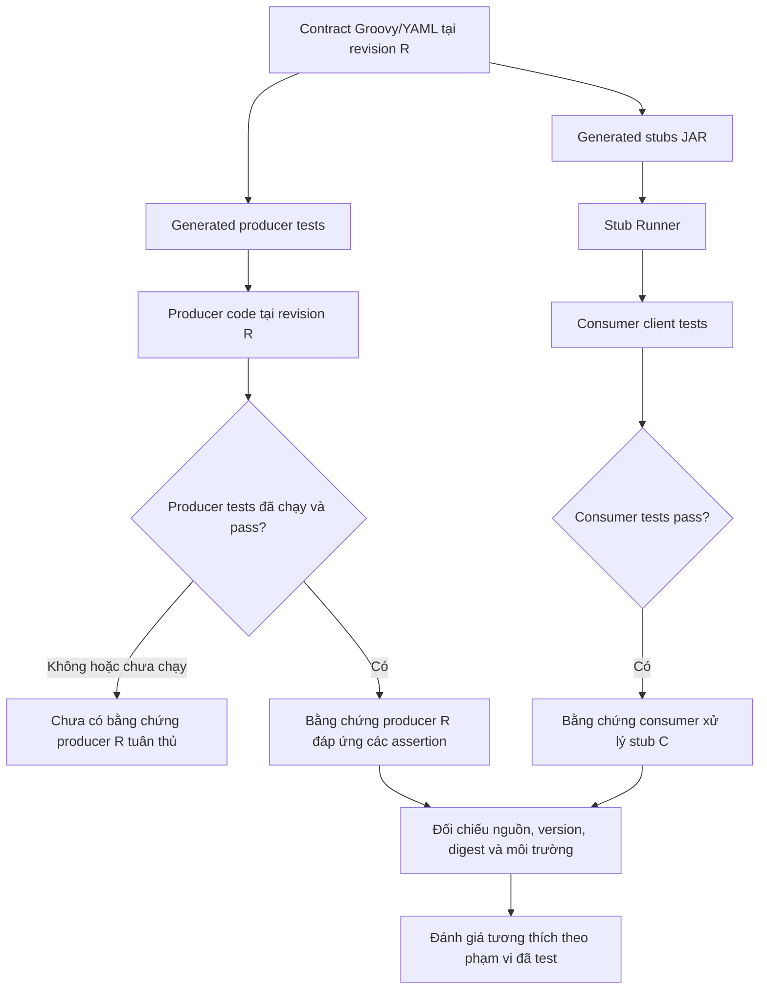
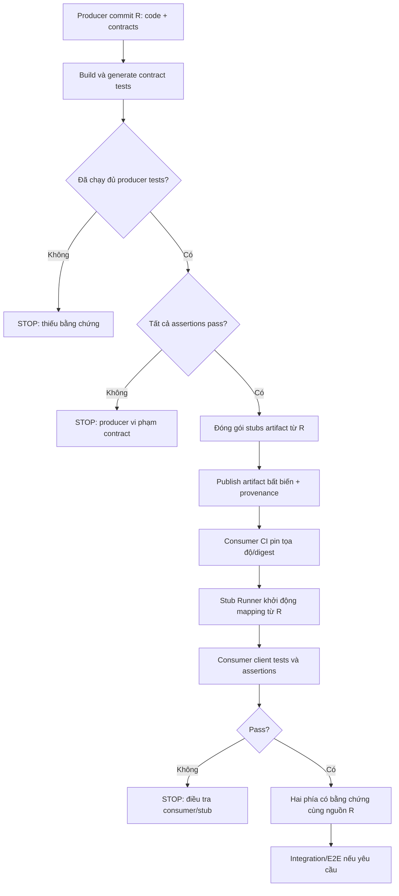
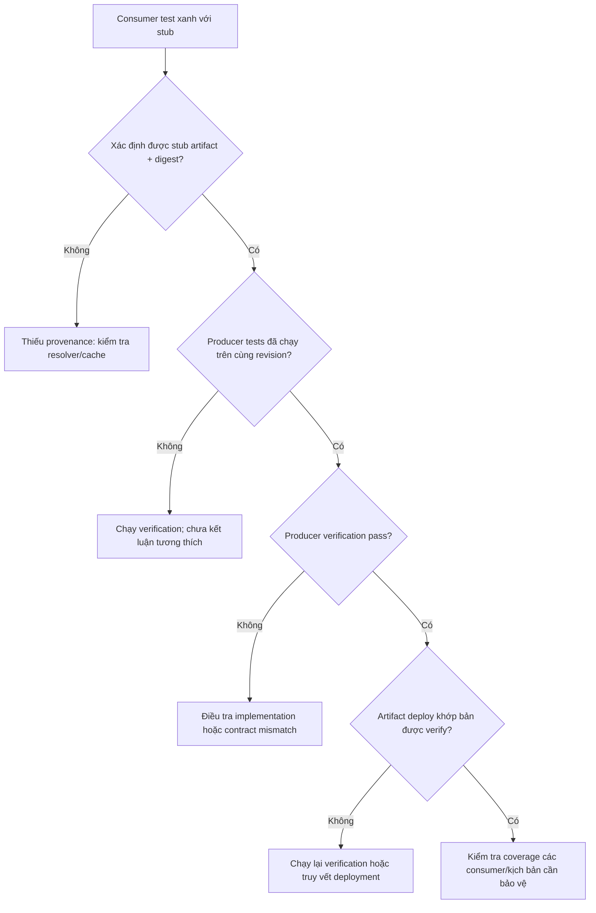

# Giới hạn bằng chứng khi chưa chạy producer test cùng phiên bản

## 1. Consumer test xanh không tự chứng minh producer hiện tại tương thích

Trong **Spring Cloud Contract**, producer và consumer dùng hợp đồng **Groovy/YAML DSL** để thống nhất hành vi HTTP hoặc thông điệp. Từ hợp đồng, **Contract Verifier** có thể sinh test kiểm tra **producer thật**; cùng nguồn đó còn có thể tạo **stub** cho consumer chạy bằng **Stub Runner**. Tích hợp cả hai phía vào CI giúp phát hiện thay đổi API không tương thích trước khi đưa hệ thống vào sử dụng.

Xét một tình huống quen thuộc:

- `checkout-service` gọi `order-service` để lấy trạng thái đơn hàng.
- Consumer integration test dùng Stub Runner tải `order-service:1.4.0:stubs`.
- Stub trả JSON có `orderId` và `status`; consumer xử lý tốt, mọi test xanh.
- Trong nhánh phát triển mới, `order-service` đổi field `status` thành `state`, nhưng **producer verification chưa chạy với mã nguồn mới**.

Khi đó, **consumer test xanh là kết quả có thật nhưng phạm vi bằng chứng hẹp**: nó chứng minh consumer xử lý được một thông điệp HTTP mẫu từ **stub đã nạp**, chứ không chứng minh phiên bản producer mới sẽ gửi đúng nội dung ấy.

> **Nguyên tắc trung tâm:** Muốn nói “producer phiên bản X đáp ứng hợp đồng C”, cần bằng chứng **producer tests sinh từ đúng C đã thực sự chạy và pass trên đúng mã/artefact X**, trong phạm vi môi trường kiểm thử đã được mô tả. Consumer test dùng stub của C là một bằng chứng khác, bổ sung chứ không thay thế.

Bài này hướng dẫn người học nhận diện các cấp độ bằng chứng, xác định sự liên hệ giữa contract — stub — producer commit — artifact version — consumer test, và xây quality gate CI để không nhầm `BUILD SUCCESS` với khả năng tương thích đã được xác minh.

## 2. Hai câu hỏi khác nhau cần hai lớp kiểm thử

| Câu hỏi | Ai trả lời đáng tin cậy hơn? | Test cần thực thi |
| --- | --- | --- |
| Consumer gửi đúng method, path, query, header, body không? | **Consumer test** với stub matcher phù hợp | HTTP client thật của consumer → Stub Runner/WireMock |
| Consumer đọc đúng JSON và xử lý lỗi không? | **Consumer test** | Stub trả các tình huống thành công và lỗi, assert logic client |
| Producer đang trả status/header/body đúng hợp đồng không? | **Producer verification** | Generated contract test → producer implementation thật |
| Producer phát đúng message destination/header/payload không? | **Producer messaging verification** | Trigger/input → message test adapter → output thực của producer |
| Hợp đồng và stub được sinh cùng một nguồn chưa? | **Build/publish provenance** | Xác minh source revision, test report, stubs artifact |
| Producer đã deploy ở production có cùng nội dung bản được test không? | **Release/deployment traceability** | Đối chiếu artifact digest, image tag, deployment record |
| Giao dịch DB, broker delivery hoặc idempotency có đúng không? | **Integration/E2E tests** | Chạy những dependency phù hợp với phạm vi nghiệp vụ |

Consumer test không phải “test giả”: nó rất quan trọng cho request construction, deserialization và client error handling. Nhưng **mô phỏng không phải thực thi producer**. Một response từ WireMock chỉ cho thấy *mapping đã nạp* trả gì, kể cả khi producer thật đã thay đổi hoàn toàn.



Để kết luận khả năng tương thích, phải nối hai nhánh bằng **nguồn hợp đồng và phiên bản có thể truy vết**, thay vì chỉ quan sát hai dấu tích xanh ở những pipeline không liên quan.

## 3. “Cùng phiên bản” nghĩa là gì?

Từ “version” trong dự án có thể chỉ nhiều thứ:

| Ký hiệu | Ví dụ | Vai trò |
| --- | --- | --- |
| **Contract revision** | Git commit `c7e90d1` | Nội dung DSL được dùng làm lời hứa |
| **Producer source revision** | Git commit `c7e90d1` | Code producer mà verification test thực thi |
| **Producer artifact version** | `1.5.0` | Phiên bản JAR/image được build |
| **Stubs artifact coordinates** | `com.example:order-service:1.5.0:stubs` | Stub mà consumer CI có thể tải |
| **Artifact digest** | SHA-256 của JAR/image | Phân biệt hai bộ byte dù cùng version/tag |
| **Spring Cloud Contract version** | Ví dụ bản 4.x của công cụ | Phiên bản plugin/DSL/test generator, không phải API version |
| **Deployed version** | Image digest hiện chạy | Code thực tế sau khi triển khai |

**Tên version giống nhau chưa đủ chứng minh bytes giống nhau.** Một snapshot có thể bị build/publish lại; thậm chí một release repository cấu hình sai cũng có thể cho phép ghi đè artifact. Ngược lại, hai tên version khác nhau có thể cùng chứa một schema nhưng chưa có bằng chứng implementation tương ứng đã pass.

Đối với một kết luận đáng tin, cần **liên kết bất biến** giữa: nguồn contract, source/build revision của producer, test report, stubs JAR và artifact được deploy. Git commit, build ID, digest và chính sách repository không cho ghi đè giúp tạo liên kết đó.

### Những trường hợp thường bị gắn nhãn “cùng version” sai

1. Consumer tải `1.5.0:stubs` nhưng producer deployment là `1.6.0`.
2. Producer test đã pass ở commit A; developer sửa controller ở commit B và chỉ chạy lại consumer tests với stub từ A.
3. CI dùng `1.5.0-SNAPSHOT`, nhưng consumer và producer lấy artifact tại hai thời điểm khác nhau.
4. Hai pipeline cùng in `1.5.0` nhưng một pipeline lấy cache artifact cũ.
5. Plugin sinh stubs từ contract revision mới, còn producer verification dùng contract hoặc code khác do source root, cache hoặc filter sai.

Đừng cố giải quyết bằng cách so tên version trong log rồi bỏ qua lịch sử build. Hãy biết **test nào đã chạy trên chính những bytes nào**.

## 4. Ví dụ xuyên suốt: stub cũ vẫn xanh khi producer đổi field

Hợp đồng của `order-service` v1:

```http
GET /api/orders/42 HTTP/1.1
Accept: application/json
```

Response được cam kết:

```json
{
  "orderId": "ord-42",
  "status": "CONFIRMED"
}
```

Consumer `checkout-service` deserialize vào DTO có field `status`. Giả sử bản producer `1.4.0` đã thực sự pass verification, rồi publish `1.4.0:stubs`. Khi consumer chạy test với stub này, kết quả xanh là chính xác cho **giao diện mô phỏng của 1.4.0**.

Sau đó developer sửa producer thành:

```json
{
  "orderId": "ord-42",
  "state": "CONFIRMED"
}
```

Nếu producer bản mới chưa chạy tests từ contract gốc, consumer test dùng `1.4.0:stubs` **vẫn trả field `status`**. Nó không thể tự phát hiện `state` trong code mới vì không gọi code mới.

| Quan sát | Điều kết luận được | Điều **chưa** kết luận được |
| --- | --- | --- |
| Consumer + stub `1.4.0` pass | Client xử lý stub 1.4.0 đúng kịch bản đã test | Producer 1.5.0 vẫn trả `status` |
| Build producer 1.5.0 pass nhưng không có contract tests | Build có thể biên dịch/qua test khác | Đã giữ contract tương thích |
| Producer 1.5.0 generated test từ contract cũ fail | Có sai khác với cam kết | Consumer nên tự đổi DTO ngay |
| Producer 1.5.0 verification pass với contract phù hợp | Producer đáp ứng các assertion ở môi trường test | Mọi behavior production, DB/broker đều đúng |
| Consumer 1.5.0 dùng stubs từ cùng revision đã verify và pass | Có hai bằng chứng bổ sung về giao diện | Mọi trường hợp chưa có trong contract đều được bảo vệ |

**Cách sửa tương thích:** Nếu các consumer vẫn cần `status`, producer nên giữ `status` hoặc cung cấp giai đoạn chuyển tiếp được đồng thuận. Không sửa contract sang `state` chỉ để làm producer CI xanh mà bỏ qua những consumer đang chạy ngoài thực tế.

## 5. Ba loại “xanh” khác nhau

| Tín hiệu xanh | Phạm vi thật |
| --- | --- |
| **Consumer CI xanh với stub** | Logic consumer xử lý những request/response hoặc message mẫu đã được mô tả |
| **Producer unit/build xanh** | Những test/task thực sự đã chạy trong pipeline ấy, có thể hoàn toàn không gồm contract tests |
| **Generated producer verification xanh** | Producer đang chạy trong test setup đáp ứng các assertion của những contract được sinh và thực thi |

Nếu pipeline không có bước **truy vết contract/stub cùng revision**, hai tín hiệu xanh đầu tiên đứng cạnh nhau vẫn chưa biến thành chứng cứ producer–consumer tương thích. Nếu generated producer tests không thực sự được phát hiện hoặc bị skip, tín hiệu xanh thứ ba cũng có thể là giả.

### Báo cáo thế nào khi thiếu producer verification?

Nên nói: “Consumer phiên bản A đã pass với stubs artifact B cho các kịch bản C.” Không nói: “Producer phiên bản X chắc chắn tương thích”, nếu không có bằng chứng X đã được verify với contract tương ứng.

Đối với một release gate bắt buộc kiểm chứng producer, trạng thái hợp lý là **chưa đủ bằng chứng / chưa đạt điều kiện phát hành**, không phải tự động đánh đồng với **producer đã sai**. Không có test không phải bằng chứng fail về hành vi; nó là **khoảng trống xác minh** cần được giải quyết.

## 6. Hợp đồng chung: nguồn của producer test và consumer stub

Giả sử `order-service` lưu một contract tại:

```text
src/test/resources/contracts/orders/get-confirmed-order.groovy
```

Nội dung Groovy DSL:

```groovy
import org.springframework.cloud.contract.spec.Contract

Contract.make {
    description 'Tra cứu đơn hàng đã xác nhận'

    request {
        method GET()
        url '/api/orders/42'
        headers {
            accept(applicationJson())
        }
    }

    response {
        status OK()
        headers {
            contentType(applicationJson())
        }
        body([
            orderId: 'ord-42',
            status : 'CONFIRMED'
        ])
    }
}
```

Contract này mô tả **một tình huống xác định**: GET đúng path, HTTP 200 và body có hai field mà consumer dựa vào. Nó **không** chứng minh producer hỗ trợ mọi `orderId`, mọi trạng thái đơn, hay mọi trường hợp lỗi. Nếu consumer dùng thêm trường hợp 404 hoặc trạng thái `CANCELLED`, cần các contract/test phù hợp.

Một phiên bản YAML cùng ý nghĩa:

```yaml
description: Tra cứu đơn hàng đã xác nhận
request:
  method: GET
  url: /api/orders/42
  headers:
    Accept: application/json
response:
  status: 200
  headers:
    Content-Type: application/json
  body:
    orderId: "ord-42"
    status: "CONFIRMED"
```

**Groovy và YAML là hai định dạng thay thế**, không nên đặt cả hai tệp cùng mô tả một kịch bản ở source root mà plugin quét nếu không có mục tiêu rõ ràng. Trong cả hai trường hợp, hãy dùng **chính nguồn contract** để sinh producer tests và stubs; đừng duy trì một file mock JSON thủ công khác nội dung mà coi là bằng chứng cùng hợp đồng.

### Hai nhánh được sinh ra phải được đối chiếu

```text
Source contract C tại revision R
       |
       +--> Generated producer test T(C,R)
       |      -> gọi producer tại revision R
       |      -> assert HTTP 200 / status=CONFIRMED
       |
       +--> Stubs artifact S(C,R)
              -> mapping GET /api/orders/42
              -> trả JSON ví dụ có status=CONFIRMED
```

Không chỉ cần **cùng tên contract**, mà còn phải bảo đảm test và stub là sản phẩm của **cùng revision và cấu hình build**. Việc một file `.groovy` tồn tại không có nghĩa plugin đã quét đúng thư mục hoặc generated producer tests được chạy.

## 7. Producer verification: sinh test khác với chạy test

Một lỗi dễ bỏ qua là quy trình đã thực hiện bước generate nhưng test **không được biên dịch hoặc thực thi**:

```text
Contract source exists                 YES
Generated source file exists          YES
Generated test class compiled         NO
Generated tests executed              0
Producer verification result          NOT VERIFIED
```

`BUILD SUCCESS` trong trường hợp ấy có thể chỉ là kết quả của những task khác. Nếu producer cần được xác minh trước publish stub, không được coi **0 contract tests** là đạt.

### Kiểm tra từng cửa

| Cửa | Câu hỏi | Bằng chứng cần có |
| --- | --- | --- |
| **Discover** | Plugin có nhìn thấy tệp contract không? | Source root, include/exclude, log contract discovery |
| **Parse** | Groovy/YAML có hợp lệ không? | Không lỗi DSL/parser; schema đúng version |
| **Generate** | Test có thực sự được sinh không? | Source generated chứa kịch bản cần bảo vệ |
| **Compile** | Generated test và base class có biên dịch không? | Không lỗi classpath, package, JUnit |
| **Execute** | Test đã gọi producer thật chưa? | Test report có số method chạy, không bị skipped |
| **Assert** | Expected/actual có được đối chiếu đúng không? | Kiểm tra status, header, body và matcher từ DSL |
| **Publish** | Artifact có được sinh sau khi cửa trên pass không? | Stubs JAR cùng revision, build ID/digest |

Với producer Maven đã cấu hình Contract Verifier plugin và test base class:

```bash
./mvnw -B clean verify
```

Với Gradle, cần kiểm tra những task mà phiên bản plugin đăng ký:

```bash
./gradlew tasks --all
./gradlew clean check
```

**Không mặc định** mọi cấu hình đều gắn generated contract tests vào `verify` hay `check`. Hãy mở test report và task/goal output để kiểm chứng số test **thực thi**. Theo hướng dẫn worker của bài học này, các lệnh là ví dụ để người học thực hành, **không phải thao tác đã chạy trên workspace hiện tại**.

### Test base class có thể khiến bằng chứng hẹp hơn tưởng tượng

Generated producer test thường dùng base class để khởi tạo controller/server, dữ liệu, mock dependency và authentication test. Nếu base class tự trả response mẫu mà không gọi resource/controller thực, test có thể xanh dù implementation thật sai. Nếu mock service phía dưới controller, test có thể vẫn xác minh giao diện HTTP của controller nhưng **chưa** xác minh DB, transaction hoặc event publishing.

Vì thế cần ghi rõ: producer test chạy trong **phạm vi môi trường nào**, request có đi qua lớp triển khai đang muốn bảo vệ không, và những dependency nào đã được mock.

## 8. Consumer sử dụng đúng stub nhưng chỉ thấy dữ liệu giả lập

Với producer đã phát hành artifact, consumer Spring Boot có thể dùng `@AutoConfigureStubRunner`:

```java
import org.junit.jupiter.api.Test;
import org.springframework.beans.factory.annotation.Autowired;
import org.springframework.boot.test.context.SpringBootTest;
import org.springframework.cloud.contract.stubrunner.StubRunnerProperties;
import org.springframework.cloud.contract.stubrunner.spring.AutoConfigureStubRunner;

import static org.assertj.core.api.Assertions.assertThat;

@SpringBootTest(properties =
    "clients.orders.base-url=http://localhost:9090")
@AutoConfigureStubRunner(
    ids = "com.example:order-service:1.5.0:stubs:9090",
    stubsMode = StubRunnerProperties.StubsMode.LOCAL
)
class OrdersConsumerContractTest {

    @Autowired
    OrdersClient ordersClient;

    @Test
    void readsConfirmedOrderFromStub() {
        OrderDto order = ordersClient.findById("42");
        assertThat(order.orderId()).isEqualTo("ord-42");
        assertThat(order.status()).isEqualTo("CONFIRMED");
    }
}
```

`OrdersClient` và `OrderDto` là **kiểu ứng dụng minh họa**; code chỉ chạy được khi bean client, DTO, dependencies và cấu hình URL đã tồn tại. `clients.orders.base-url` cũng là property của **ứng dụng consumer**, không phải property do Spring Cloud Contract tự định nghĩa.

Điều test cần bảo đảm: `ordersClient.findById("42")` **thật sự gửi HTTP tới WireMock trên port 9090**; WireMock nạp mapping từ đúng stubs artifact; consumer parse response và assert kết quả. Nếu client thực tế vẫn gọi `http://order-service:8080` vì một profile khác, test đã không kiểm tra những gì nó tuyên bố.

**Giới hạn vẫn còn:** Response từ WireMock không phải response do producer code đang chạy sinh ra. Một stub có thể trả chính xác `status = CONFIRMED` ngay cả khi mã producer hiện tại đã đổi thành `state`.

### “LOCAL” không có nghĩa “cùng revision”

`LOCAL` tìm artifact trong Maven local repository. Một bản `1.5.0:stubs` được cài vào máy hôm qua có thể khác revision producer mà developer vừa checkout hôm nay. Nếu chạy consumer test liên tục nhưng không rebuild/install artifact, kết quả có thể **ổn định nhưng lỗi thời**.

`REMOTE` cũng không tự chứng minh đúng revision: cần pin tọa độ, kiểm tra publication, quyền và metadata build. `CLASSPATH` có thể chứa stub fixture cũ nếu không được cập nhật từ contract nguồn. **Nơi lấy stub không thay thế truy vết nguồn và kiểm chứng producer.**

## 9. Ma trận bằng chứng theo trạng thái verification

| Producer tests cho revision đang xét | Consumer test với stubs cùng revision | Đánh giá hợp lý |
| --- | --- | --- |
| **Chưa chạy** | Pass | Consumer tương thích với stub, **producer chưa được xác minh** |
| **0 test do cấu hình sai** | Pass | Thiếu vùng bảo vệ; phải sửa build/test gate |
| **Fail** | Pass | Producer hiện không đáp ứng ít nhất một cam kết; consumer test không phủ nhận failure |
| **Pass** | Chưa chạy | Producer đáp ứng những hợp đồng được test; consumer chưa được kiểm chứng với stub |
| **Pass** | Pass | Hai phía có bằng chứng phù hợp với các contract và revision đã xác minh |
| **Pass ở revision cũ** | Pass với stub cũ | Đúng trong phạm vi revision cũ; revision mới chưa được xác minh |
| **Pass ở revision khác hoặc build artifact không rõ** | Pass | Không có liên kết provenance đáng tin giữa hai kết quả |
| **Pass với test base class mock sai tầng** | Pass | Cần xem lại phạm vi producer thực sự được kiểm tra |

Trong tất cả các hàng, **“Pass/Pass” vẫn không có nghĩa mọi endpoint hay mọi trạng thái nghiệp vụ đều được bảo đảm**. Nó bảo vệ những kịch bản và assertions đã được định nghĩa, trên những môi trường test đã chạy.

### Cách ghi lại trạng thái thiếu bằng chứng

Một release report nên tách:

```text
Consumer compatibility (with published stubs): PASS
Producer contract verification (same revision): NOT RUN
Provenance link between stub and producer revision: UNKNOWN
Release evidence status: INCOMPLETE
```

Đây là **mẫu ghi báo cáo** để người học áp dụng, không phải output chính thức của Spring Cloud Contract. Sự rõ ràng này hữu ích hơn một dấu kiểm xanh chung mà không biết phần nào đã được thử.

## 10. Các nguồn false positive khi chỉ tin consumer test

Một **false positive** ở đây không nhất thiết là framework test báo sai. Test có thể đúng theo assertions của nó nhưng **người đọc suy rộng kết luận quá mức**.

### 10.1. Stubs JAR cũ trong Maven local

Một developer từng chạy `./mvnw install` để cài `order-service:1.4.0:stubs`. Sau đó chuyển nhánh producer, thay controller nhưng giữ nguyên property `version`. Consumer test `LOCAL` vẫn có thể tải bản cũ trong local repository nếu artifact chưa được cài lại.

**Triệu chứng:** Consumer test pass sau khi producer đã sửa HTTP response. **Khắc phục:** xác minh artifact đang được nạp, build ID/commit/digest và phiên bản. Không chỉ kiểm tra ngày sửa file. Dùng version bất biến cho các build dùng làm bằng chứng release, hoặc kiểm soát quy trình snapshot thật chặt.

### 10.2. Stub viết tay không còn tương ứng với contract

Consumer có một WireMock mapping thủ công:

```json
{
  "request": {
    "method": "GET",
    "urlPath": "/api/orders/42"
  },
  "response": {
    "status": 200,
    "jsonBody": {
      "orderId": "ord-42",
      "status": "CONFIRMED"
    }
  }
}
```

Mapping này là một fixture hợp lệ để **test riêng consumer**, nhưng nếu không được sinh hoặc đối chiếu với contract mà producer verify, nó **không thể chứng minh producer đã từng hứa** về response đó. Khi producer chuyển sang `state`, fixture viết tay vẫn có thể giữ `status` vô thời hạn.

**Khắc phục:** dùng stubs được phát hành từ nguồn contract đã verify; nếu có mapping thủ công vì lý do test đặc thù, ghi rõ đó là *test fixture* chứ không phải producer-verified stub.

### 10.3. Consumer không thực sự gọi Stub Runner

`@AutoConfigureStubRunner` có thể khởi động WireMock, nhưng HTTP client vẫn trỏ tới môi trường khác do cấu hình profile, Feign property, discovery client hoặc base URL không được override.

**Khắc phục:** kiểm tra URL thực tế trong request log/test HTTP interceptor, port WireMock được cấp, và mappings nhận request. Một test dùng mock service trực tiếp thay vì HTTP client đang deploy cũng có phạm vi bằng chứng khác.

### 10.4. 404 do miss mapping được hiểu thành lỗi nghiệp vụ

Nếu consumer test chỉ mong HTTP `404`, request sai path có thể nhận 404 mặc định của WireMock và test vẫn pass. Không có gì chứng minh producer thật đã trả `ORDER_NOT_FOUND`.

**Khắc phục:** assert status **và** `Content-Type`, error code/body quan trọng; kiểm tra request journal để chắc chắn mapping nghiệp vụ được match.

### 10.5. Stub matcher quá rộng

Một mapping chỉ ràng buộc `GET /api/orders` có thể chấp nhận request thiếu query `status=CONFIRMED`. Consumer test pass dù client gửi sai filter mà producer thật yêu cầu.

**Khắc phục:** so generated stub request matcher với contract gốc. Nếu contract yêu cầu method, URL, query, header hoặc body thì cần xác minh những điều ấy đã xuất hiện trong mapping hoặc có cách test bổ sung.

### 10.6. Producer test sinh ra nhưng không thực thi

Pipeline có thể sinh class trong `target/` hoặc `build/` nhưng không đưa vào JUnit runner. Người quản lý nhìn thấy generated source và cho rằng hợp đồng đã được kiểm tra.

**Khắc phục:** gate theo **báo cáo thực thi**: tổng số contract tests, failures/skips, class/method của kịch bản quan trọng. Nếu một module cần contract verification mà số thực thi bằng 0, phải đánh dấu chưa đạt.

### 10.7. Test với version mới của stub nhưng code producer cũ

Một build có thể tạo stubs artifact từ contract mới, trong khi job test producer dùng container image cũ hoặc một module khác. Tên version giống nhau không bù được sự lệch code.

**Khắc phục:** lấy producer code, contract và generated outputs từ **cùng workspace revision**, ghi lại commit và digest của artifacts; nếu test dùng image thì phải pin image digest được xây từ revision ấy.

## 11. Provenance: những gì cần lưu cùng stubs artifact

Khi consumer tải `com.example:order-service:1.5.0:stubs`, thông tin tối thiểu nên giúp trả lời:

1. **Nguồn:** Git commit nào chứa contract DSL và producer code?
2. **Build:** Job/build ID nào generate tests và stubs?
3. **Verification:** Những producer contract tests nào đã chạy và pass, bao nhiêu test bị skip?
4. **Artifact:** Group/artifact/version/classifier và digest SHA-256 của stubs JAR nào được phát hành?
5. **Environment:** JDK, Spring Cloud Contract/plugin version, test profile và base class nào được dùng?
6. **Consumer:** Consumer CI đã tải **đúng artifact đó**, chứ không phải stub trùng tên trong cache?

Một manifest **minh họa** để hệ thống CI hoặc artifact metadata ghi lại:

```yaml
service: order-service
producerRevision: c7e90d1
contractRevision: c7e90d1
producerArtifact: "com.example:order-service:1.5.0"
stubsArtifact: "com.example:order-service:1.5.0:stubs"
buildId: "producer-ci-1284"
contractVerification:
  status: PASS
  executed: 12
  failed: 0
  skipped: 0
stubsSha256: "<sha256-from-build>"
```

Đây **không phải schema metadata mặc định do Spring Cloud Contract tự tạo**. Dự án có thể dùng Maven build-info, CI artifacts, SBOM/attestation hoặc một cơ chế provenance khác. Ý quan trọng là các dữ kiện phải được **ghi và kiểm tra**, không đoán từ tên file.

### Tính bất biến của artifact quan trọng hơn tên

Nếu repository cho phép ghi đè `1.5.0` bằng nội dung khác, consumer chạy lại có thể lấy một JAR không giống lần đầu. Một SHA-256 hoặc repository immutable giúp giảm nhầm lẫn.

Với `SNAPSHOT`, nên ràng buộc vào **timestamped snapshot/build cụ thể** khi cần tái lập; nếu chỉ dùng `LATEST` hoặc `+`, test hôm nay có thể lấy contract khác với hôm qua. Tùy dự án, version động vẫn hữu ích để bắt thay đổi mới, nhưng không thích hợp làm bằng chứng release bất biến nếu không lưu artifact thực tế đã tải.

### Nhiều consumer sử dụng một producer

Một producer có thể có nhiều consumer đang dùng các version khác nhau. Khi phát hành `1.5.0`, việc một consumer mới pass với `1.5.0:stubs` chưa chứng minh các consumer cũ đang chạy với kỳ vọng `1.4.0` đều còn tương thích. Cần kiểm tra **ma trận consumer được hỗ trợ**, đặc biệt khi thay đổi field, URL, validation hay message destination.

## 12. CI hai phía: trình tự tối thiểu để khép kín bằng chứng

Một pipeline đáng tin nên ghép **producer verification**, **stub publication** và **consumer compatibility**:



### Cổng producer

Chỉ cho phép publish stub với trạng thái *verified* khi:

- Contract source được plugin quét, không mất kịch bản bởi include/exclude sai.
- Generated tests biên dịch và **thực sự chạy**, bao gồm những kịch bản bắt buộc.
- Kết quả pass; test bị skip/disabled cần có chính sách đánh giá rõ.
- Test base class gọi producer implementation đúng phạm vi đã cam kết.
- Stubs JAR được tạo từ **cùng source revision** và gắn version/digest.

Nếu generated producer tests fail, không nên phát hành một bản stubs JAR mới như “đã xác minh”. Một artifact thử nghiệm có thể được giữ nội bộ để debug nhưng phải **ghi nhãn chưa verified** và không dùng làm căn cứ release.

### Cổng consumer

Consumer CI cần:

- Nhận tọa độ/digest cụ thể của stubs artifact đã verified từ producer.
- Khởi động Stub Runner với `LOCAL`, `REMOTE` hoặc `CLASSPATH` theo điều kiện môi trường.
- Xác nhận client thật trỏ đúng stub host/port và request match mapping.
- Test các nhánh thành công, lỗi, validation và message events mà consumer phụ thuộc.
- Báo cáo kết quả gắn với **đúng version stubs**, không chỉ “consumer test pass”.

### Cổng triển khai

Ngay cả khi hai phía pass, release pipeline vẫn cần biết **producer artifact deploy có đúng revision đã kiểm tra không**. Nếu sau verification code đổi rồi image được build lại, phải chạy lại test/gate trên artifact mới hoặc có quy trình chứng thực tái lập được. Contract verification không tự bảo vệ những thay đổi xảy ra **sau thời điểm** test hoàn tất.

## 13. Producer và consumer phát triển ở hai repository

Với các microservice độc lập, không phải mọi pipeline chạy cùng lúc. Có thể tổ chức như sau:

| Thời điểm | Producer CI | Consumer CI | Điều cần ghi |
| --- | --- | --- | --- |
| Producer mở PR | Verify code + contract ứng viên | Có thể chạy consumer tests với candidate stubs | Candidate chỉ dùng cho kiểm tra, chưa phát hành release |
| Producer merge | Verify revision đã merge, publish version được phê duyệt | Chọn artifact đó trong compatibility matrix | Build ID, digest, test report |
| Consumer mở PR | Không cần build producer lại nếu đã có artifact verified bất biến | Chạy client với stubs của version producer mục tiêu | Tọa độ stub và version consumer |
| Producer release | Xác minh artifact định deploy | Consumer compatibility gate theo version được hỗ trợ | Release provenance |
| Phát hiện breaking change | Xem failed producer/consumer contract tests | Xác định consumer chịu ảnh hưởng | Chính sách migration/versioning |

Consumer có thể chạy “latest verified candidate” để phát hiện sớm thay đổi sắp tới, nhưng **không nên trộn kết quả đó với release compatibility pass** nếu candidate chưa được pin và xác minh nguồn.

### Contract được đặt ở đâu?

Trong mô hình **producer-owned contracts**, producer lưu DSL, generate verification tests và stubs. Consumer dùng stubs đã publish.

Trong mô hình **consumer-driven contracts**, consumer có thể đề xuất những contract phản ánh nhu cầu thực; producer vẫn phải **chạy verification** trên phiên bản implementation mục tiêu trước khi lời hứa được xem là đáng tin. Vị trí repository không thay đổi nguyên tắc rằng **producer phải chứng minh triển khai của mình**.

Nếu một bản contract do consumer đề xuất chưa được producer chấp thuận hoặc chưa được verifier chạy, hãy gọi nó là **yêu cầu/kỳ vọng dự kiến**, không phải cam kết producer đã verified.

## 14. Thay đổi tương thích và thay đổi phá vỡ

Khi producer thay đổi, consumer test với stub cũ có thể vẫn pass cho dù API mới đã không tương thích. Cần xem **những consumer đang được hỗ trợ** và phạm vi contract họ dựa vào.

| Thay đổi producer | Tương thích mặc định? | Cần làm gì? |
| --- | --- | --- |
| Thêm field JSON `description` | **Có thể** tương thích | Kiểm tra consumer có bỏ qua unknown fields không; chạy consumer matrix |
| Đổi tên `status` thành `state` | Thường phá vỡ consumer cũ | Giữ field cũ trong giai đoạn migration hoặc có API version mới |
| Đổi `orderId` từ chuỗi sang số | Có nguy cơ phá vỡ | Test schema/deserializer và hợp đồng các phía |
| Đổi HTTP `201` thành `200` | Có thể phá vỡ | Xác định consumer dựa vào status nào |
| Bỏ error field `code` khỏi response 404 | Có thể phá vỡ | Bảo vệ error contract và error-handling consumer |
| Chuyển `GET /api/orders/{id}` sang path khác | Phá vỡ nếu client còn gọi path cũ | Giai đoạn alias/deprecation hoặc version migration |
| Nới validation request | Phụ thuộc | Kiểm tra các kịch bản client và ý nghĩa nghiệp vụ |
| Siết validation, từ chối input từng hợp lệ | Dễ phá vỡ | Producer test các input cũ và consumer scenarios |
| Đổi message destination/header `eventType` | Có nguy cơ phá vỡ nghiêm trọng | Messaging contract verification và broker integration |

**Thay đổi additive không luôn an toàn.** Một consumer dùng JSON deserializer strict có thể từ chối field mới. Tương tự, một thay đổi về default query, pagination hoặc thứ tự array có thể làm client sai dù schema vẫn có đủ các field. Chỉ test các tình huống có thật mới chứng minh tương thích với những hành vi ấy.

### Quy trình an toàn khi muốn đổi `status` thành `state`

1. Xác định các consumer còn dùng `status` qua contracts, logs hợp lệ và ownership.
2. Nếu có thể, producer phát **cả `status` và `state`** trong giai đoạn chuyển tiếp có version.
3. Viết contract phản ánh các consumer cũ và mới, tránh xóa field cũ trước khi migration.
4. Chạy producer verification trên revision đã sửa và publish candidate stubs gắn revision đó.
5. Chạy consumer tests của những consumer được hỗ trợ với candidate stubs.
6. Sau khi migration hoàn tất và policy cho phép breaking change, version hóa/bỏ field cũ và chạy lại quality gate.

Đừng chỉ sửa YAML/Groovy contract để phản ánh code mới rồi xem build xanh là bằng chứng tất cả consumer đã sẵn sàng. **Sự tương thích là quan hệ giữa phiên bản producer và tập consumer mục tiêu**, không phải thuộc tính độc lập của một contract file.

## 15. Chẩn đoán khi tín hiệu producer và consumer mâu thuẫn

| Triệu chứng | Điều có thể xảy ra | Bước đầu tiên |
| --- | --- | --- |
| Consumer pass, producer tests chưa chạy | Stub mô phỏng đã có nhưng chưa verify mã hiện tại | Lấy producer revision và chạy generated contract tests |
| Consumer pass, producer tests fail | Implementation vi phạm contract; stub vẫn trả mẫu hợp lệ | Xem expected/actual trên producer, không bỏ qua failure |
| Consumer pass, producer test report hiển thị 0 test | Test task/goal chưa chạy hoặc filter mất hợp đồng | Kiểm tra source root, task graph, plugin và test runner |
| Consumer pass, producer test ở commit cũ pass | Kết quả không bao phủ commit mới | Chạy lại producer test trên revision mục tiêu |
| Producer pass, consumer fail do 404 | Sai stub version, URL, method hoặc matcher | Kiểm tra artifact và WireMock request journal |
| Producer pass, consumer fail deserialize | DTO/client không chấp nhận response đã cam kết | So response mẫu với consumer logic/serializer |
| Cả hai pass, production fail vì database | Contract test chưa bảo vệ persistence | Tăng integration tests và kiểm tra môi trường |
| Cả hai pass, production fail vì auth/gateway | Test không đi qua toàn bộ security/proxy chain | Bổ sung API gateway/security tests |
| Stub artifact đúng version nhưng hash khác giữa hai job | Artifact bị thay, cache hoặc publication không bất biến | Đối chiếu digest, repository metadata và build provenance |
| Consumer CI pass với `LATEST`, deploy production khác | Version được test không phải version deploy | Pin artifact digest/version và đối chiếu deployment |

### Quy trình phân nhánh ngắn



Sơ đồ không khẳng định “cùng commit” tự động đồng nghĩa mọi dữ liệu test hay môi trường production giống nhau. Nó chỉ đặt **điều kiện cần về nguồn và thực thi** trước khi đi đến kết luận về phạm vi contract.

## 16. Bằng chứng với messaging cũng có cùng giới hạn

Không chỉ HTTP mới gặp vấn đề này. Với messaging:

- `payment-service` có contract phát `PaymentCompleted` đến destination `payments.completed`.
- Consumer `notification-service` dùng `StubTrigger.trigger("payment_completed")` và xử lý thành công payload mẫu.
- Producer mã mới có thể đã đổi header `eventType`, destination hoặc serializer, nhưng chưa chạy messaging producer verification.

Trong tình huống đó, consumer test chỉ xác nhận listener xử lý **message do stub adapter phát**. Nó không chứng minh producer code mới thực sự phát message đúng, hoặc broker thực đã phân phối message.

### Một contract event minh họa

```groovy
import org.springframework.cloud.contract.spec.Contract

Contract.make {
    description 'Phát PaymentCompleted'
    label 'payment_completed'

    input {
        triggeredBy('completePayment()')
    }

    outputMessage {
        sentTo('payments.completed')
        headers {
            header('eventType', 'PaymentCompleted')
            messagingContentType(applicationJson())
        }
        body([
            paymentId: 'pay-900',
            orderId: 'ord-42',
            status: 'COMPLETED'
        ])
    }
}
```

Producer verification cần có base class thực thi `completePayment()` trên đường đi nghiệp vụ thực và adapter nhận output từ ứng dụng. Consumer test chỉ trigger event mẫu qua Stub Runner trong môi trường messaging phù hợp. Khi thiếu kiểm chứng producer ở revision mới, **không được suy kết quả xanh của consumer thành bằng chứng event production sẽ giữ đúng header/payload/destination**.

Với broker như Kafka/RabbitMQ, những thuộc tính **ordering, acknowledgment, retry, duplicate, routing thực** vẫn cần integration tests nếu nghiệp vụ yêu cầu, ngay cả khi producer contract tests và consumer stub tests đều pass.

## 17. Bài thực hành: cùng một stub, ba kết luận khác nhau

### Bối cảnh

Nhóm có hai repository:

```text
order-service (producer):
  revision A: API trả orderId + status
  revision B: DTO bị đổi status -> state

checkout-service (consumer):
  đọc OrderDto(orderId, status)
  Stub Runner đang tải com.example:order-service:1.4.0:stubs
```

Consumer test đang xanh với:

```json
{
  "orderId": "ord-42",
  "status": "CONFIRMED"
}
```

Trong khi producer ở revision B (chưa chạy verification) trả:

```json
{
  "orderId": "ord-42",
  "state": "CONFIRMED"
}
```

### Phần A. Phân loại chứng cứ

Hãy điền kết luận cho mỗi câu:

1. Consumer có xử lý được response của stub 1.4.0 không?
2. Producer revision B đã chứng minh tuân thủ contract 1.4.0 chưa?
3. Nếu consumer test xanh, có thể khẳng định deploy B sẽ không phá vỡ checkout không?
4. Nếu một test producer ở revision A từng pass, kết quả ấy có bảo vệ được commit B không?

**Gợi ý đáp án:** (1) Có, trong phạm vi test đã chạy. (2) Chưa, vì B chưa được verify. (3) Không. (4) Không; phải có verification tương ứng với B và contract đúng revision.

### Phần B. Sửa pipeline

Thiết kế một pipeline cho producer B:

1. Dùng cùng checkout Git revision cho contract và producer code.
2. Sinh test từ contract `GET /api/orders/42` và xác minh test được compile, chạy thật.
3. Nếu producer B trả `state` thay `status`, **dự kiến generated test fail**.
4. Không publish `1.5.0:stubs` như một release đã verified khi producer test còn fail.
5. Sửa producer hoặc lập kế hoạch migration được consumer chấp thuận.
6. Sau khi pass, đóng gói stubs JAR có version bất biến, ghi commit/digest và test report.
7. Consumer CI tải đúng artifact ấy rồi chạy thử với `OrdersClient` thật.

### Phần C. Thử các lỗi provenance

| Thay đổi thử nghiệm | Kỳ vọng khi đánh giá bằng chứng |
| --- | --- |
| Dùng stubs 1.4.0 nhưng producer 1.5.0 chưa verify | Consumer có thể vẫn pass; release evidence chưa đủ |
| Sinh stub 1.5.0 nhưng không thực thi generated tests | Không gắn nhãn verified cho stub |
| Producer tests pass ở commit A, code deploy từ commit B | Không kết luận commit B tương thích |
| Stub JAR cùng version nhưng digest thay đổi | Phải điều tra publish/cache; không coi artifact là bất biến |
| Consumer test dùng mock thủ công thay vì artifact producer | Kết quả chỉ phản ánh fixture thủ công |
| Producer pass, consumer gửi sai query nhưng mapping quá rộng | Consumer test có thể pass giả; siết request matcher |
| Producer và consumer pass cùng nguồn nhưng không test 404 | Chưa chứng minh consumer xử lý nhánh 404 |

### Phần D. Viết báo cáo release

Một báo cáo tốt không chỉ có một ô “Passed”. Hãy mô tả:

```text
Contract source revision: R
Producer code revision / artifact digest: R / <digest>
Producer generated tests executed: 12
Producer contract verification: PASS
Stubs artifact version / digest: 1.5.0 / <digest>
Consumer test revision: C
Consumer loaded stubs: exact 1.5.0 artifact
Consumer scenarios passed: GET 200, GET 404, POST validation
Known limitations: database transaction and gateway auth not tested here
```

Tất cả giá trị trong khối này là **mẫu giả định để thực hành**, không phải một report đã được tạo. Trong hệ thống thật, chỉ điền `PASS` và số test sau khi job đã thực sự chạy. Nếu chưa chạy producer verification, dùng trạng thái `NOT RUN` hoặc `INCOMPLETE` và nêu rõ release gate chưa đạt.

### Câu hỏi mở rộng

Giả sử producer muốn phát hành một **API version mới** có field `state`. Consumer cũ được hỗ trợ đến hết quý sau. Bạn sẽ:

- Giữ backward compatibility bằng cách trả cả `status` và `state` trong giai đoạn chuyển tiếp?
- Tạo endpoint/message version mới, đồng thời giữ giao diện cũ?
- Chạy ma trận consumer tests nào trước khi loại bỏ field cũ?
- Kiểm tra những build/digest nào trước khi triển khai?

Không có một phương án duy nhất đúng cho mọi hệ thống; phương án được chọn phải dựa trên cam kết với các consumer đang hoạt động, dữ liệu thực và chính sách versioning của nhóm.

## 18. Những câu hỏi thường gặp về bằng chứng tương thích

### 18.1. Nếu consumer test pass với stubs JAR “mới nhất” thì đã đủ chưa?

**Chưa chắc.** Cần biết “mới nhất” là artifact nào, do commit nào sinh ra, producer tests của chính revision đó có chạy và pass không, và version ấy có phải producer mục tiêu cần triển khai không. Với version động, lưu digest/định danh artifact thật đã tải để lần chạy sau có thể tái lập.

### 18.2. Nếu producer test pass sau khi đổi contract sang field mới thì đã tương thích chưa?

**Producer pass với hợp đồng mới**, nhưng consumer cũ có thể vẫn dùng field cũ. Cần thêm **consumer compatibility tests** với những bản consumer còn được hỗ trợ và chính sách migration. Test không thể bảo vệ một kỳ vọng đã bị xóa khỏi contract mà không có test/contract khác giữ lại.

### 18.3. Có cần chạy producer test cho mỗi lần consumer thay đổi?

Không nhất thiết nếu consumer chỉ thay đổi code của mình và dùng một **producer artifact/stub đã verified, bất biến**. Consumer vẫn phải chạy tests với artifact/version mục tiêu. Nhưng khi producer code hoặc contract đổi, muốn kết luận producer revision mới tương thích thì phải có producer verification cho revision ấy.

### 18.4. Nếu producer test pass nhưng vẫn có lỗi production?

Hoàn toàn có thể. Contract test chỉ xác minh những kịch bản/assertion trong môi trường test đã cấu hình. Lỗi ở transaction, broker, cache, proxy, security, concurrency hoặc behavior chưa được mô tả có thể lọt qua. Do đó cần **integration, E2E và monitoring** theo mức rủi ro. Không hạ thấp giá trị contract test, nhưng cũng không quảng bá quá mức bằng chứng của nó.

### 18.5. Consumer có thể chạy trước producer verification không?

**Có**, như một bước feedback sớm với **candidate stub** hoặc fixture chưa verified. Kết quả có thể giúp consumer triển khai song song. Tuy nhiên, không nên gọi kết quả ấy là bằng chứng producer đã đáp ứng hợp đồng. Tới release gate, cần producer verification trên mã mục tiêu và provenance liên kết với stub mà consumer đã dùng.

### 18.6. Có nên xóa consumer test nếu producer verification đã pass?

**Không.** Producer test xác minh response/message được phát, còn consumer test xác minh client gửi request đúng, deserialize và xử lý kết quả đúng. Chúng bảo vệ các loại lỗi khác nhau. Việc bỏ một lớp tạo lại khoảng trống mà lớp kia không lấp được.

### 18.7. Điều gì xảy ra khi artifact deploy không phải artifact đã verify?

Kết luận “producer đang deploy tương thích” **không được bảo đảm bởi kết quả verify của một artifact khác**. Cần xác định thay đổi giữa hai artifact, chạy lại verification hoặc dùng quy trình build/attestation chứng minh chúng tương ứng với cùng source và môi trường được phê duyệt.

## 19. Checklist trước khi tuyên bố producer–consumer tương thích

- [ ] Biết chính xác **contract source revision** đã dùng để generate producer tests và stubs.
- [ ] Producer source/code revision hoặc artifact digest mục tiêu đã được xác định.
- [ ] Generated producer tests được sinh, biên dịch và **thực sự thực thi**; không bỏ sót vì filter/task/runner.
- [ ] Test report cho biết số executed, failed, skipped và các kịch bản bắt buộc.
- [ ] Verification pass trên đúng code producer cần đánh giá, với test base class/môi trường có phạm vi rõ ràng.
- [ ] Stubs JAR được sinh từ **cùng contract revision** đã được kiểm chứng.
- [ ] Tọa độ `group:artifact:version:stubs` và digest/build ID có thể truy vết, không bị ghi đè tùy tiện.
- [ ] Consumer test tải **đúng artifact cụ thể**, không vô tình dùng stub cũ từ cache/LOCAL hoặc CLASSPATH.
- [ ] HTTP client hoặc messaging listener thật của consumer được test; không chỉ kiểm tra một fixture vô danh.
- [ ] Request matcher đủ chặt về method, path, query, headers, body; không có mapping rộng che lỗi.
- [ ] Consumer assertions bao phủ cả success, lỗi và những field/mã trạng thái mà client dựa vào.
- [ ] Kết quả consumer CI có ghi version stubs và những kịch bản đã chạy.
- [ ] Đã đánh giá các consumer/version còn được hỗ trợ, không chỉ consumer mới nhất.
- [ ] Artifact producer triển khai cuối cùng là đúng bản đã verify hoặc được chứng thực tương đương.
- [ ] Những bất biến ngoài contract như DB transaction, messaging delivery, security và concurrency có integration/E2E tests riêng nếu cần.
- [ ] Nếu **producer verification chưa chạy cùng revision**, báo rõ **INCOMPLETE / NOT VERIFIED**, không biến consumer PASS thành cam kết production.

**Ghi nhớ:** Một consumer test xanh với Stub Runner trả lời câu hỏi **“consumer có hoạt động đúng với stub đã nạp không?”**. Nó **không tự trả lời** câu hỏi **“producer ở phiên bản đang xét có thực sự tạo response/message đó không?”**. Để có bằng chứng đáng tin, hãy nối **contract nguồn → generated producer tests đã chạy → stubs artifact có provenance → consumer tests → artifact triển khai** bằng revision/version/digest có thể truy vết. Khi thiếu mắt xích producer verification, cần nêu rõ giới hạn thay vì tuyên bố hệ thống đã tương thích.
