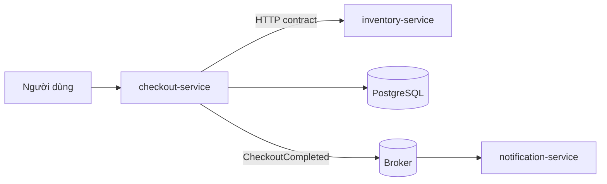
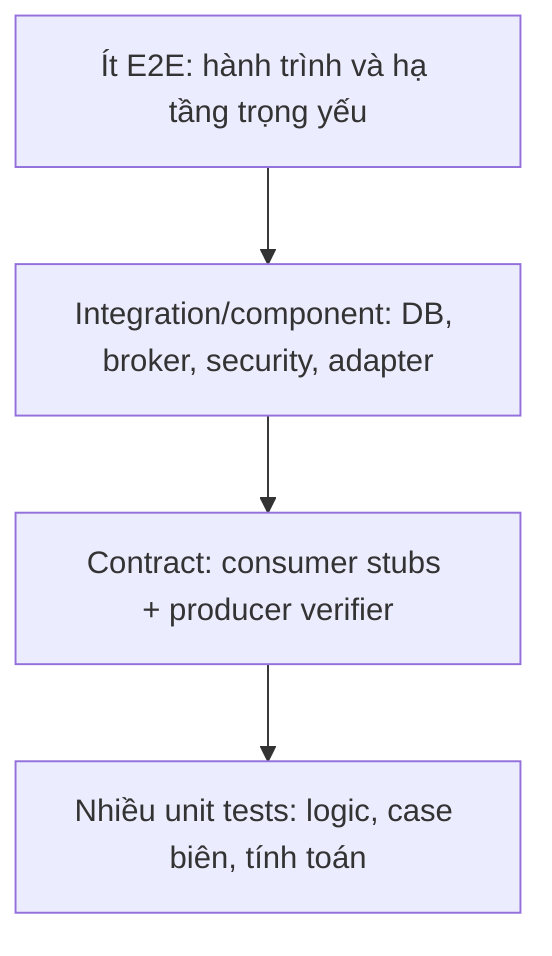
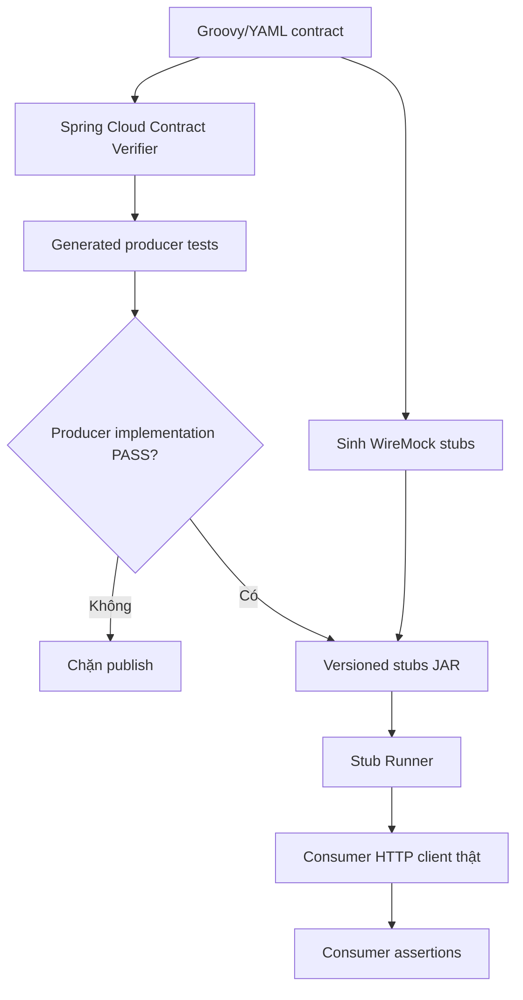
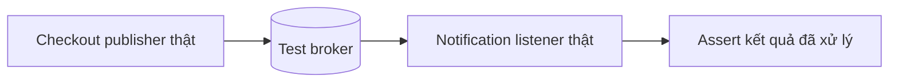
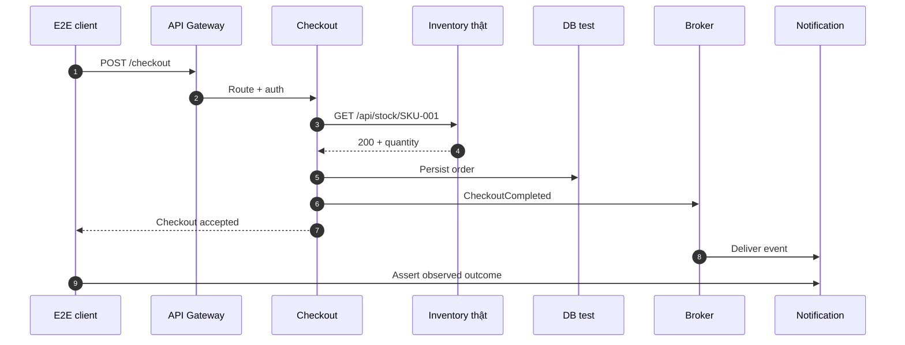
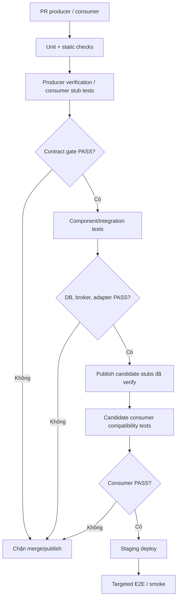
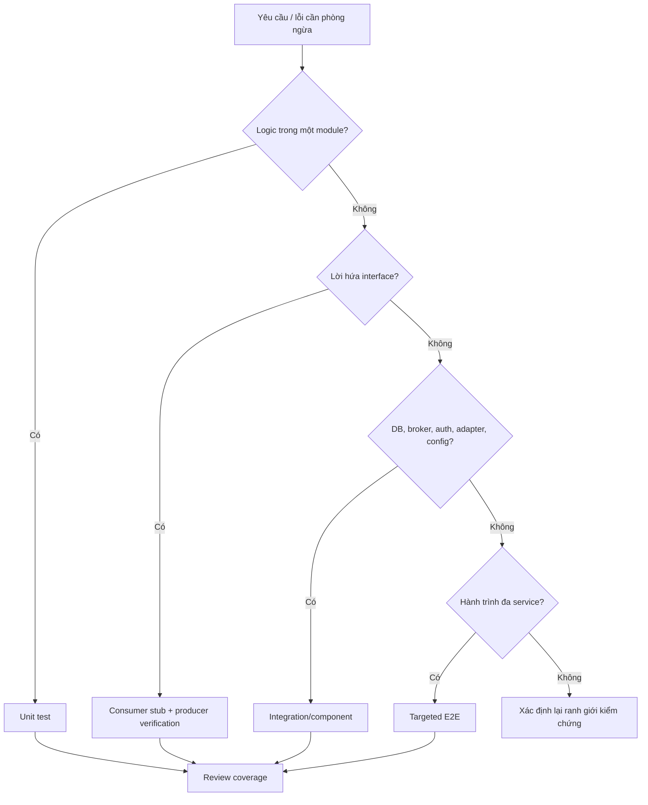

# Phối hợp contract test với kiểm thử tích hợp và end-to-end

> **Chương:** Kiểm thử consumer  
> **Module:** Spring Cloud Contract (`SPRING_CLOUD_CONTRACT`) — học kiểm thử hợp đồng giữa producer và consumer bằng Groovy/YAML DSL cho HTTP hoặc thông điệp, sinh test phía producer, phát hành stub, dùng Stub Runner và tích hợp CI để phát hiện thay đổi API không tương thích.

## Mục tiêu học tập

Sau bài này, bạn có thể:

1. Phân biệt **consumer contract test**, **producer contract verification**, **integration/component test** và **end-to-end (E2E) test** theo câu hỏi mà mỗi loại trả lời.
2. Dùng một contract HTTP chung để vừa sinh test cho producer, vừa chạy **client thật của consumer** với Stub Runner.
3. Chỉ rõ điều gì vẫn chưa được bảo đảm khi cả producer verification và consumer stub tests đều PASS.
4. Bổ sung integration tests cho **database, HTTP adapter, security, broker, retry/timeout và wiring** mà không làm mọi bài kiểm tra phụ thuộc toàn hệ thống.
5. Thiết kế các E2E tests ít nhưng có giá trị, theo dõi kết quả nghiệp vụ thật qua các service được triển khai.
6. Xây ma trận kiểm thử cho thay đổi API, lỗi nghiệp vụ và lỗi hạ tầng; chọn tầng rẻ nhất có khả năng phát hiện từng loại.
7. Quản lý phiên bản stub, producer artifact và consumer release trong CI để ngăn "test xanh với stub cũ".
8. Tự thiết kế pipeline có quality gates và đánh giá khả năng phát hiện breaking changes bằng thử nghiệm có chủ đích.

## 1. Một hệ thống, nhiều câu hỏi khác nhau

Giả sử một luồng checkout gồm:

- `checkout-service`: nhận yêu cầu mua hàng từ frontend, là **consumer** của inventory.
- `inventory-service`: cung cấp tồn kho qua HTTP, là **producer** của API tồn kho.
- PostgreSQL: lưu checkout/order.
- Message broker: chuyển sự kiện `CheckoutCompleted`.
- `notification-service`: nhận sự kiện và gửi thông báo.

Consumer gọi:

```http
GET /api/stock/SKU-001 HTTP/1.1
Accept: application/json
```

Producer cam kết response:

```http
HTTP/1.1 200 OK
Content-Type: application/json

{
  "sku": "SKU-001",
  "available": true,
  "quantity": 4
}
```

Đối với yêu cầu mua `2` sản phẩm, có ít nhất bốn câu hỏi độc lập:

- **Contract ở consumer:** client checkout có gửi đúng `GET /api/stock/SKU-001`, parse boolean/number và đưa ra quyết định đủ hàng không?
- **Contract ở producer:** implementation inventory có trả đúng method/path/status/headers/body đã cam kết không?
- **Integration:** HTTP adapter có cấu hình auth/timeout đúng; repository có lưu đơn; producer/consumer có kết nối được DB/broker không?
- **E2E:** người dùng đi qua checkout đến lúc đơn hoàn tất và có thông báo thật (trong phạm vi môi trường test) không?

Nếu chỉ có một consumer contract test xanh, bạn mới biết checkout hoạt động với **stub**; producer/hạ tầng có thể đã thay đổi. Nếu chỉ có một E2E test checkout thành công, bạn chưa chắc bắt được mọi thay đổi nhỏ như `quantity` từ JSON number thành string khi parser có thể ép kiểu.

**Chiến lược tốt là chia trách nhiệm, không đặt tất cả kỳ vọng vào một loại test.**



## 2. Vai trò của từng loại test

| Loại | Thực thi những gì? | Phát hiện hiệu quả | Chưa chứng minh |
| --- | --- | --- | --- |
| **Unit test** | Một hàm/class với fake/mock phù hợp | Công thức, điều kiện biên, logic retry quyết định | HTTP wiring, network, database |
| **Consumer contract test** | Consumer HTTP client/handler **thật** + collaborator stubs | Sai request, URL, headers, DTO decode, cách consumer xử lý response | Producer mới nhất và hạ tầng production |
| **Producer contract verification** | Generated tests gọi producer implementation trong test | Producer đổi method, status, header, JSON shape/value trái contract | Client consumer dùng response đúng hay không |
| **Integration test** | Các thành phần thật qua một ranh giới cụ thể | Adapter, database, broker, transaction, security, serialization | Toàn bộ hành trình người dùng |
| **Component test** | Một service tương đối thật + các collaborator cô lập | HTTP endpoint, service logic, persistence, configuration | Tích hợp mọi service thực |
| **End-to-end test** | Hành trình xuyên các service/hạ tầng được chọn | Routing, auth, orchestration, kết quả nghiệp vụ cuối | Mọi biến thể dữ liệu/edge case và toàn production |

### 2.1. Hai lưu ý về tên gọi

**Consumer contract test thường là một integration test của consumer**, vì nó dùng HTTP client thật nối tới một stub server. "Contract" diễn đạt **nguồn kỳ vọng**, còn "integration" có thể diễn đạt **mức độ kết hợp thành phần**. Chúng không nhất thiết là hai tầng tách biệt tuyệt đối.

**Producer verification cũng thường là một integration/component test** vì generated tests có thể đi qua MockMvc, Spring context hoặc HTTP server thật. Điểm đặc biệt là assertion đến từ **hợp đồng chung**, thay vì do riêng producer tự đặt tiêu chuẩn.

Đừng cố xếp mọi bài test vào đúng một hình hộp; hãy hỏi **lỗi gì cần phát hiện**, **ranh giới nào được kiểm tra** và **đâu là thành phần thật/giả**.

### 2.2. Phân bổ chi phí theo ý định



Đây chỉ là một **mô hình cân bằng tốc độ và độ bao phủ**, không có tỷ lệ phần trăm bắt buộc. Tăng số E2E không tự giải quyết vấn đề nếu hợp đồng không mô tả rõ field hoặc error behavior mà consumer phụ thuộc.

## 3. Một hợp đồng chung cho hai phía

Giả sử contract của inventory nằm ở `src/test/resources/contracts/stock_available.yml` trong producer:

```yaml
name: stock_available
request:
  method: GET
  url: /api/stock/SKU-001
  headers:
    Accept: application/json
response:
  status: 200
  headers:
    Content-Type: application/json
  body:
    sku: SKU-001
    available: true
    quantity: 4
```

Cùng tương tác có thể viết bằng Groovy DSL:

```groovy
org.springframework.cloud.contract.spec.Contract.make {
    name 'stock_available'
    request {
        method 'GET'
        url '/api/stock/SKU-001'
        headers {
            header 'Accept': 'application/json'
        }
    }
    response {
        status 200
        headers {
            contentType(applicationJson())
        }
        body(
            sku: 'SKU-001',
            available: true,
            quantity: 4
        )
    }
}
```

**Khi chạy bài thực hành chỉ giữ một phiên bản YAML hoặc Groovy.** Nếu đặt hai bản tương đương trong thư mục contract, plugin có thể sinh test/stub trùng.

Contract cam kết:

- HTTP method `GET` và path `/api/stock/SKU-001`.
- Header request `Accept: application/json`.
- Response `200` và `Content-Type: application/json`.
- `available` là boolean, `quantity` là số trong JSON, `sku` là chuỗi.
- Trong tình huống mẫu, `available = true`, `quantity = 4`.

Contract **không tự mô tả** tồn kho của mọi SKU, tính chính xác của database hay chính sách auth của production. Những yêu cầu khác cần thêm contract/test phù hợp.

### 3.1. Cùng contract, hai bằng chứng



Producer verification kiểm tra code producer đã thực thi hợp đồng; Stub Runner cho consumer kiểm tra với **response được mô phỏng theo chính hợp đồng ấy**. Hai bằng chứng bổ sung nhau.

### 3.2. Consumer-driven không có nghĩa "consumer tự ý sửa contract"

Consumer đề xuất các hành vi họ thật sự phụ thuộc; producer review, chấp nhận và kiểm chứng. Có thể lưu hợp đồng ở repository producer hoặc repository hợp đồng riêng, nhưng cần **nguồn sự thật**, quy trình review và artifact có version.

Nếu producer phục vụ nhiều consumer, một consumer mới đồng ý API v2 **không** bảo đảm các consumer cũ đã nâng cấp. Hãy xem xét compatibility của những contract đang được hỗ trợ.

## 4. Consumer test phải gọi HTTP client thật

### 4.1. HTTP adapter dùng trong ứng dụng

Ví dụ Java 17+ với `RestClient` (Spring Framework 6.1+/Boot 3.2+ hoặc phiên bản tương ứng):

```java
package com.example.checkout;

import org.springframework.beans.factory.annotation.Value;
import org.springframework.http.MediaType;
import org.springframework.stereotype.Component;
import org.springframework.web.client.RestClient;

@Component
public class InventoryClient {

    private final RestClient http;

    public InventoryClient(
        RestClient.Builder builder,
        @Value("${inventory.base-url}") String baseUrl
    ) {
        this.http = builder.baseUrl(baseUrl).build();
    }

    public Stock fetch(String sku) {
        Stock response = http.get()
            .uri("/api/stock/{sku}", sku)
            .accept(MediaType.APPLICATION_JSON)
            .retrieve()
            .body(Stock.class);

        if (response == null) {
            throw new IllegalStateException("Empty inventory response");
        }
        return response;
    }

    public record Stock(
        String sku, boolean available, int quantity
    ) {}
}
```

Client này thực hiện path-variable substitution, thêm `Accept` và deserialize JSON. Trong production, `inventory.base-url` là địa chỉ thật; trong test, nó trỏ về WireMock do Stub Runner chạy.

Một số JSON mappers có thể **ép kiểu ngầm** (chuỗi `"4"` thành số `4`). Nếu contract yêu cầu kiểu JSON number chặt chẽ, cần cả producer assertion và consumer parser/schema check phù hợp; đừng chỉ tin rằng Java record có `int` là đủ để phát hiện mọi lỗi kiểu wire format.

### 4.2. Logic sử dụng dữ liệu của client

```java
package com.example.checkout;

import org.springframework.stereotype.Service;

@Service
public class CheckoutService {

    private final InventoryClient inventory;

    public CheckoutService(InventoryClient inventory) {
        this.inventory = inventory;
    }

    public boolean canCheckout(String sku, int amount) {
        if (amount <= 0) return false;

        InventoryClient.Stock stock = inventory.fetch(sku);
        return sku.equals(stock.sku())
            && stock.available()
            && stock.quantity() >= amount;
    }
}
```

Với `SKU-001` còn 4 đơn vị: mua 2 được phép, mua 5 bị từ chối. Unit test kiểm tra điều kiện `stock.quantity() >= amount` ở các giá trị biên, còn consumer contract test phải bảo đảm **HTTP client thật** lấy được dữ liệu đó.

### 4.3. Consumer contract test bằng Stub Runner

Giả định producer đã publish artifact:

```text
com.example:inventory-service:1.2.0:stubs
```

Ví dụ JUnit 5:

```java
package com.example.checkout;

import org.junit.jupiter.api.Test;
import org.springframework.beans.factory.annotation.Autowired;
import org.springframework.boot.test.context.SpringBootTest;
import org.springframework.cloud.contract.stubrunner.spring.AutoConfigureStubRunner;
import org.springframework.cloud.contract.stubrunner.spring.StubRunnerProperties;

import static org.junit.jupiter.api.Assertions.*;

@SpringBootTest(
    properties = "inventory.base-url=http://localhost:8090"
)
@AutoConfigureStubRunner(
    ids = "com.example:inventory-service:1.2.0:stubs:8090",
    stubsMode = StubRunnerProperties.StubsMode.LOCAL
)
class CheckoutInventoryContractTest {

    @Autowired
    CheckoutService checkout;

    @Test
    void clientDocResponseVaQuyetDinhDung() {
        assertTrue(checkout.canCheckout("SKU-001", 2));
        assertFalse(checkout.canCheckout("SKU-001", 5));
    }
}
```

**Điều kiện để chạy:** producer đã sinh và cài/publish stubs, consumer đã có bean `CheckoutService`/`InventoryClient`, dependencies web/test/Stub Runner tương thích và cổng 8090 đang rảnh. Trong CI chạy song song, nên ưu tiên cổng động, lấy URL qua `StubFinder.findStubUrl(...)` hoặc cơ chế inject port phù hợp.

Test này kiểm tra **client thực**, nhưng không gọi `inventory-service` thật. Không được gọi nó là full E2E.

### 4.4. Vì sao không mock chính InventoryClient?

Nếu trong bài này viết:

```java
when(inventoryClient.fetch("SKU-001"))
    .thenReturn(new InventoryClient.Stock("SKU-001", true, 4));
```

thì logic checkout vẫn có thể PASS, nhưng bạn đã **bỏ qua** URL, headers, JSON serialization/deserialization và xử lý HTTP status của client. Đây là một unit test phù hợp cho `CheckoutService`, không phải consumer contract test.

Đặt mock **ngoài ranh giới cần kiểm tra**, không mock luôn phần được yêu cầu kiểm chứng.

## 5. Producer verification phải gọi implementation

Producer đọc cùng contract và sinh generated tests. Base test với MockMvc có thể thiết lập một controller thật:

```java
package com.example.inventory;

import io.restassured.module.mockmvc.RestAssuredMockMvc;
import org.junit.jupiter.api.BeforeEach;

public abstract class ContractTestBase {
    @BeforeEach
    public void setup() {
        RestAssuredMockMvc.standaloneSetup(new StockController());
    }
}
```

Controller tối thiểu:

```java
package com.example.inventory;

import org.springframework.http.HttpStatus;
import org.springframework.http.MediaType;
import org.springframework.web.bind.annotation.*;
import org.springframework.web.server.ResponseStatusException;

@RestController
@RequestMapping("/api/stock")
public class StockController {

    @GetMapping(
        value = "/{sku}",
        produces = MediaType.APPLICATION_JSON_VALUE
    )
    public Stock get(@PathVariable String sku) {
        if (!"SKU-001".equals(sku)) {
            throw new ResponseStatusException(
                HttpStatus.NOT_FOUND, "SKU not found"
            );
        }
        return new Stock(sku, true, 4);
    }

    public record Stock(
        String sku, boolean available, int quantity
    ) {}
}
```

Đây là **fixture producer tối thiểu** không có DB. Trong ứng dụng thật, base test có thể cần Spring context, controller advice, Security hoặc mock external gateway; phải giữ **hành vi đang cam kết với consumer** trong phạm vi thật.

Cấu hình Maven plugin minh họa:

```xml
<!-- Trong <dependencies> -->
<dependency>
    <groupId>org.springframework.cloud</groupId>
    <artifactId>spring-cloud-starter-contract-verifier</artifactId>
    <scope>test</scope>
</dependency>

<!-- Trong <build><plugins> -->
<plugin>
    <groupId>org.springframework.cloud</groupId>
    <artifactId>spring-cloud-contract-maven-plugin</artifactId>
    <version>${spring-cloud-contract.version}</version>
    <extensions>true</extensions>
    <configuration>
        <testFramework>JUNIT5</testFramework>
        <testMode>MOCKMVC</testMode>
        <baseClassForTests>com.example.inventory.ContractTestBase</baseClassForTests>
    </configuration>
</plugin>
```

Đây là **POM fragment**: project cần parent/BOM tương thích, version property, dependency Spring MVC và test. `testMode=MOCKMVC` phải khớp với base test dùng `RestAssuredMockMvc`.

Khi chạy:

```bash
mvn clean verify
```

hãy đọc **test reports** để xác nhận generated tests được sinh, biên dịch và **thực sự chạy**. Nếu build xanh với `0 contract tests`, đó không phải bằng chứng implementation đúng contract.

### 5.1. Thử breaking change có chủ đích

Đổi producer trả:

```java
return new Stock(sku, true, 0);
```

và giữ contract `quantity: 4`. Generated producer verification **phải FAIL**. Nếu không, kiểm tra file contract có được plugin đọc, test có chạy, base class có dựng controller thật và body assertion có tồn tại hay không.

Đây là cách kiểm tra **chất lượng pipeline**, không phải bước chạy Content QA của bài viết.

### 5.2. Đối với field động

Nếu producer sinh `requestId` mới mỗi lần, đừng ép response thật trùng một UUID mẫu:

```yaml
response:
  status: 200
  body:
    sku: SKU-001
    available: true
    quantity: 4
    requestId: 55145a90-f0a1-4c47-bcdf-550d89023902
  matchers:
    body:
      - path: $.requestId
        type: by_regex
        predefined: uuid
```

Đây là **biến thể response độc lập**, chỉ áp dụng nếu API có `requestId`. Matcher nới duy nhất ID, không nới `quantity`, `sku` hoặc `available`.

## 6. Vì sao cả hai contract tests PASS vẫn chưa đủ?

Một tình huống có thể xảy ra:

1. `inventory-service` PASS producer verification với fixture.
2. `checkout-service` PASS consumer tests dùng `inventory-service:1.2.0:stubs`.
3. Hệ thống triển khai thật vẫn không thể checkout.

| Sự cố | Vì sao contract có thể PASS? | Tầng cần bổ sung |
| --- | --- | --- |
| Sai DNS/service discovery | Consumer test gọi localhost WireMock | Deployment smoke/integration |
| Gateway chặn hoặc xóa header | Stub test không qua gateway production | Security/network integration |
| Token sai scope hoặc hết hạn | Contract không test auth thật | Auth integration/E2E |
| Database checkout không commit | Consumer test không gọi repository thật | DB/component integration |
| Kafka sai topic/serializer | Contract HTTP không đi qua broker | Messaging/broker integration |
| Timeout, retry gửi trùng | Contract mô tả một response bình thường | Adapter resilience/integration |
| Producer mới khác stub cũ | Consumer pin artifact `1.2.0` | Release/version compatibility gate |
| Sai dữ liệu hoặc transaction giữa services | Fixture stubs tĩnh | Integration/E2E |

**Contract test giảm rủi ro "hai bên hiểu khác nhau về interface".** Nó không tự kiểm tra toàn bộ deployment, persistence, authentication, network, broker và orchestration.

## 7. Integration test: kiểm tra một ranh giới có thật

### 7.1. HTTP adapter integration

Một adapter test có thể dùng WireMock/verified stubs để kiểm tra `InventoryClient`:

- URI, path/query, headers, auth được dựng đúng.
- `404` được chuyển thành domain exception phù hợp.
- `503` hoặc timeout dẫn đến retry/fallback theo chính sách.
- Số lần gọi nằm trong giới hạn; không retry một POST gây side effect ngoài ý muốn.
- Decoder không âm thầm chấp nhận JSON thiếu field cần thiết.

Nếu thêm fault/delay chỉ phục vụ robustness mà producer không cam kết response cụ thể, gọi đây là **adapter resilience test**. Không tự sửa hợp đồng producer để chứa mọi kiểu fault giả.

Ví dụ thêm contract riêng cho SKU không tồn tại:

```yaml
name: stock_not_found
request:
  method: GET
  url: /api/stock/SKU-404
  headers:
    Accept: application/json
response:
  status: 404
  headers:
    Content-Type: application/json
  body:
    code: SKU_NOT_FOUND
    message: Stock item not found
```

Chỉ thêm contract khi producer thật **cam kết** lỗi `404` cùng cấu trúc này. Nếu controller chưa có exception handler trả body đó, phải triển khai trước khi producer verification có thể PASS. Consumer test cần khẳng định hành vi **của client** trước `404`, không chỉ xác nhận WireMock trả 404.

### 7.2. Database integration

Muốn kiểm tra checkout lưu order, transaction rollback và unique constraint, dùng database thực trong test, chẳng hạn PostgreSQL do Testcontainers quản lý:

```java
@Testcontainers
@SpringBootTest
class CheckoutPersistenceIT {

    @Container
    static PostgreSQLContainer<?> postgres =
        new PostgreSQLContainer<>("postgres:16-alpine");

    @DynamicPropertySource
    static void properties(DynamicPropertyRegistry props) {
        props.add("spring.datasource.url", postgres::getJdbcUrl);
        props.add("spring.datasource.username", postgres::getUsername);
        props.add("spring.datasource.password", postgres::getPassword);
    }

    // @Autowired CheckoutRepository repository;
    // @Test: ghi đơn, đọc lại, kiểm tra constraint/transaction.
}
```

Đây là **khung test** (chưa có imports, entities/schema và fixtures). Cần dependencies Spring Boot Test/Testcontainers, Docker-compatible runtime và cấu hình JPA/migrations. Spring Boot phiên bản hỗ trợ `@ServiceConnection` còn có thể tự thiết lập connection details.

Một **repository integration test** không cần gọi inventory. Một **checkout component test** có DB thật vẫn có thể stub inventory để cô lập upstream. Ranh giới phải được nêu rõ.

### 7.3. Messaging integration

Khi checkout phát:

```json
{
  "eventType": "CheckoutCompleted",
  "checkoutId": "CHK-0042",
  "total": 240000,
  "currency": "VND"
}
```

Message contract test kiểm tra event type, payload/header/destination. Stub Runner có thể hỗ trợ consumer listener xử lý event mẫu. Nhưng nếu cần bảo vệ **Kafka/RabbitMQ/JMS binding, serializer, partition/offset, ACK, retry, DLQ**, phải dùng integration test với broker/test adapter phù hợp.



Nếu dùng in-memory test binder, không được suy ra broker thật đã được kiểm chứng. Hãy dùng topic/queue/consumer group riêng và chờ xử lý bất đồng bộ với **timeout có giới hạn**, tránh `Thread.sleep` đoán thời gian.

## 8. Component test: một service thật, collaborator ngoài được cô lập

Một component test `checkout-service` có thể bao gồm:

- Controller, service, validation và Spring configuration thật.
- PostgreSQL Testcontainers.
- Inventory/payment upstream qua verified stubs hoặc test doubles.
- Broker test hoặc adapter có kiểm soát.
- HTTP entry point qua embedded server ở random port.

Nó bảo vệ **wiring, HTTP response, nghiệp vụ và persistence** của checkout mà không phải dựng toàn bộ microservices.

```text
CheckoutComponentIT
  REAL: CheckoutController, CheckoutService, PostgreSQL
  STUB: inventory-service, payment gateway
  ASSERT: HTTP status/body, đơn đã lưu, event dự kiến
```

Nếu checkout trả `201` nhưng không lưu đơn, consumer contract test của inventory không bắt được; component test với DB sẽ phát hiện.

**Đừng gọi component test này là E2E toàn hệ thống** nếu các upstream chính vẫn bị stub.

## 9. E2E test: hành trình nghiệp vụ xuyên dịch vụ

E2E kiểm tra một hành trình từ điểm bắt đầu thực tế đến **kết quả nghiệp vụ quan sát được**, đi qua các service/hạ tầng nằm trong phạm vi đã định.

Kịch bản checkout thành công:

1. Chuẩn bị tài khoản, tồn kho và dữ liệu test được sở hữu riêng.
2. Gọi checkout qua API gateway/ingress của môi trường thử nghiệm.
3. Checkout gọi **inventory-service triển khai thật**.
4. Checkout ghi đơn vào database.
5. Thanh toán qua sandbox hoặc test gateway **được ghi rõ là sandbox**.
6. Phát `CheckoutCompleted` vào broker và notification xử lý.
7. Test xác nhận đơn hoàn tất **và** kết quả notification được ghi nhận.



E2E chỉ nên có **số lượng hợp lý** các luồng giá trị cao; không cần lặp lại hàng chục biến thể kiểu dữ liệu đã được contract/unit test kiểm tra rẻ hơn.

### 9.1. Không chỉ assert HTTP 200

Đối với workflow bất đồng bộ, checkout `202` không chứng minh notification đã được gửi. Cần polling có timeout:

```java
await().atMost(Duration.ofSeconds(10))
    .untilAsserted(() -> {
        NotificationStatus status =
            notificationProbe.findByCheckoutId("CHK-0042");
        assertEquals(NotificationStatus.SENT, status);
    });
```

Đây là **đoạn minh họa** dùng Awaitility và probe do môi trường test cung cấp, không phải API mặc định của Spring Cloud Contract. Hãy assert kết quả cuối cùng qua một kênh được phép quan sát; không phụ thuộc sleep cố định.

### 9.2. Những điều khiến E2E dễ flaky

- Dữ liệu staging dùng chung bị test khác sửa.
- Event xử lý chậm, retry chồng lên lần chạy tiếp.
- Token/secret hết hạn, quota sandbox.
- Đồng hồ/múi giờ và timestamp không đồng bộ.
- Transaction chưa commit lúc assertion chạy.
- Không reset scenario state của Stub Runner ở một số test setup.
- Chạy song song nhiều test cùng order ID, topic hoặc database.

Nên tạo dữ liệu theo từng run, có cleanup/cô lập, dùng idempotency key khi phù hợp, quản lý timeout và ghi log correlation. Không chỉ bật retry CI để che test contamination.

## 10. Ma trận bao phủ theo rủi ro

| Rủi ro | Unit | Consumer contract | Producer verification | Integration/component | E2E |
| --- | :---: | :---: | :---: | :---: | :---: |
| Quy tắc `quantity >= requested` sai | **Chính** | Có | Không bắt buộc | Có thể | Chọn lọc |
| Client sai URL/header | Không | **Chính** | Phía producer | Có | Có |
| Producer đổi number thành string | Không đủ | Tùy parser | **Chính** | Có | Có thể |
| Bỏ field `available` | Không đủ | Có | **Chính** | Có | Có thể |
| Đổi HTTP status trái contract | Không đủ | Có | **Chính** | Có | Có |
| Client không xử lý `404` | Unit domain | **Chính** | Kiểm chứng error contract | Có | Một đường lỗi |
| Sai token/auth scope | Không đủ | Không đủ | Tùy verifier setup | **Chính** | Có |
| DB không lưu đơn | Không | Không | Không | **Chính** | Có |
| Kafka routing/ACK hỏng | Không | Message contract hỗ trợ | Message contract hỗ trợ | **Chính** | Có |
| Sai proxy/TLS/discovery sau deploy | Không | Không | Không | Có thể | **Chính** |
| Tổng luồng checkout kết thúc sai | Một phần | Một phần | Một phần | Một phần | **Chính** |

"Chính" là nơi ưu tiên phát hiện lỗi; "Có" là bằng chứng bổ sung. Không cần lặp cùng assertion ở mọi tầng nếu không tăng khả năng phát hiện.

### 10.1. Bộ test tối thiểu hữu ích

Cho checkout–inventory:

1. Unit test quyết định đủ hàng, số lượng biên và null/invalid input.
2. Consumer stub test cho thành công và lỗi upstream quan trọng.
3. Producer verification cho tất cả contract được chấp nhận.
4. Component/integration test cho DB checkout, security/client retry và một broker path quan trọng.
5. Vài E2E/smoke journeys qua đường triển khai thật.

Sau mỗi incident, bổ sung regression test **ở tầng rẻ nhất nhìn thấy được đúng lỗi đó**.

## 11. Breaking changes: test nào phải đỏ?

| Producer thay đổi | Producer contract | Consumer dùng stub cũ | E2E thực |
| --- | --- | --- | --- |
| Bỏ `available` | **FAIL** nếu field được cam kết | Có thể PASS | Có thể fail |
| `quantity: 4` thành `quantity: "4"` | **FAIL** nếu type assertion đúng | Có thể PASS | Parser có thể ép kiểu |
| `GET` thành `POST` | **FAIL** | Client vẫn gửi GET đến stub | Có thể 405 |
| `200` thành `204` | **FAIL** | Có thể PASS | Client không có body |
| Thêm response field tùy chọn | Thường tương thích nếu contract cho phép | Thường PASS | Thường PASS |
| Thêm request header bắt buộc | Phải kiểm tra contract request cũ | Stub cũ có thể PASS | Consumer cũ lỗi |
| Thay gateway auth scope | Có thể PASS nếu test không bật Security | Có thể PASS | Có thể FAIL |

### 11.1. Ba tình huống tự tin sai

**Stub cũ:** Producer lên v1.3, consumer vẫn test với `inventory-service:1.2.0:stubs`. Test consumer xanh không kiểm tra triển khai mới.

**Contract bị sửa theo code sai:** Producer đổi `available` thành chuỗi, developer sửa contract để test xanh. Consumer cũ vẫn yêu cầu boolean; thiếu review CDC sẽ gây breaking change.

**E2E quá hẹp:** Luồng thành công vẫn xanh, nhưng error body `404` của producer bị đổi. Nếu E2E không chạm nhánh lỗi, nên có **error contract** riêng và consumer test xử lý lỗi.

## 12. Stub version và backward compatibility

Tọa độ stub cần đủ thông tin:

```text
com.example:inventory-service:1.2.0:stubs
```

- `LOCAL` đọc artifact từ Maven local của **chính runner consumer**.
- `REMOTE` tải artifact từ Maven-compatible repository được cấu hình.
- Phiên bản động `+` hữu ích cho **một pipeline thử candidate mới nhất**, nhưng không tái lập chắc chắn như một version cố định.
- Các CI runners thường không chia sẻ `~/.m2`; `mvn install` ở máy producer không tự chuyển stub sang consumer runner.

Hai trục version quan trọng: **build/commit producer đã chạy verification** và **stub version mà consumer thật sự tải**. Báo cáo CI phải ghi nhận cả hai.

### 12.1. Lộ trình thay đổi tương thích: expand → migrate → contract

1. Producer tiếp tục hỗ trợ endpoint/field cũ, đồng thời **mở rộng** với trường hoặc endpoint mới.
2. Producer verify cả contract cũ và mới; publish candidate stubs version mới.
3. Consumer cập nhật, chạy tests với candidate.
4. Triển khai consumer theo nhịp riêng và theo dõi consumer cũ.
5. Chỉ gỡ hành vi cũ khi chính sách versioning và bằng chứng usage cho phép.

Không bắt buộc producer và consumer phải deploy cùng lúc nếu API được thiết kế tương thích ngược.

### 12.2. Nhiều consumer

Spring Cloud Contract có tùy chọn **stubs per consumer** để chỉ nạp những scenarios liên quan một consumer. Nó làm test consumer gọn hơn nhưng **không** cho phép producer bỏ qua những contract đã chấp nhận của các consumer khác.

## 13. CI: chất lượng sớm, kiểm tra rộng có chọn lọc



Sơ đồ mô tả **logic quality gates**, không yêu cầu mọi job chạy tuần tự; các bước độc lập có thể chạy song song khi bảo đảm publish chỉ xảy ra sau những kiểm tra cần thiết.

### 13.1. Producer pull request

- Sinh và chạy contract tests từ DSL.
- Đọc test reports, **không chấp nhận 0 generated tests** ngoài dự kiến.
- Không sửa contract để hợp với output sai mà chưa review consumer compatibility.
- Chặn publish khi contract verification fail/bị skip.
- Nếu cần, tạo candidate stubs gắn đúng commit/build.

```bash
mvn clean verify
```

### 13.2. Consumer pull request

- Chạy unit logic và consumer tests dùng stubs của collaborators.
- Bảo đảm test gọi **client/handler consumer thật**.
- Kiểm tra success, error responses và những field consumer dùng.
- Ghi version/coordinates stub trong CI report.
- Thêm integration test khi code thay DB, security, broker, retry hoặc network adapter.

### 13.3. Candidate release và staging

1. Producer tạo stubs từ **build đã verified**.
2. Consumer compatibility suite dùng **đúng candidate stubs**.
3. Lưu report gắn version của hai bên.
4. Deploy đến staging, chạy một số E2E qua đường thật.
5. Quan sát sau deploy, có kế hoạch rollback.

Không publish "verified" stubs nếu producer tests bị `-DskipTests`. Một stub JAR tồn tại không chứng minh ứng dụng thật đã vượt qua contract verification.

### 13.4. Nhịp chạy tham khảo

| Thời điểm | Test nên ưu tiên |
| --- | --- |
| Mỗi commit/PR | Unit, producer verifier, consumer stub tests nhanh |
| PR thay DB/broker/config | Component/integration tests liên quan |
| Candidate release | Cross-service compatibility với stubs candidate |
| Staging/post-deploy | Smoke/E2E luồng chính |
| Nightly/định kỳ | E2E rộng hơn, resilience, migrations khi cần |

## 14. Isolation: để kết quả có thể tin được

Với bất kỳ tầng test nào, state cũ đều có thể tạo PASS giả:

- **Database:** test trước đã lưu đơn `ORD-1001`, test sau đọc lại và PASS dù service mới không lưu.
- **Broker:** message tồn từ test trước được listener test mới nhận.
- **WireMock Scenario:** state `Confirmed` còn từ lần chạy trước khiến GET trả sai.
- **Application context:** mock/spy/singleton state và scheduled job còn từ test trước.
- **E2E môi trường dùng chung:** các suite sửa cùng tài khoản/SKU.

Nguyên tắc:

1. Dữ liệu, topic/queue và destination thuộc **test riêng** khi có thể.
2. Reset fixture **trước** test; kiểm tra và cleanup đúng cách **sau** test.
3. Dừng hoặc đợi async tasks hoàn thành, tránh message đến trễ.
4. Dùng bounded polling thay `Thread.sleep(...)` tùy ý.
5. Không purge queue/topic của môi trường dùng chung hoặc production.
6. Nếu các test chia sẻ state không thể tách, đừng chạy song song không kiểm soát.

## 15. Quy trình chọn tầng test cho một yêu cầu mới

Hãy trả lời bốn câu hỏi:

1. **Điều gì phải đúng?** Công thức, HTTP schema, cách client parse, DB transaction, network security hay luồng nghiệp vụ?
2. **Ai chịu trách nhiệm cho nó?** Consumer, producer, adapter, repository/broker hay tập dịch vụ?
3. **Tầng rẻ nhất nhìn thấy lỗi đó?** Unit, contract, integration/component hay E2E?
4. **Bộ test hiện tại có bảo vệ điều đó chưa?** Test mới bổ sung bằng chứng gì?



## 16. Anti-pattern và cách khắc phục

| Anti-pattern | Rủi ro | Hành động |
| --- | --- | --- |
| Consumer chỉ mock `InventoryClient` | Không kiểm tra HTTP/DTO thật | Dùng client thật với Stub Runner |
| Producer mock `StockController` trả response mẫu | Không kiểm tra implementation | Dựng controller/service thật ở phạm vi thích hợp |
| Chỉ kiểm tra status 200 | Sai body/kiểu vẫn qua | Assert field và semantics quan trọng |
| Chỉ có consumer contract test | Stub có thể lỗi thời | Producer verification + version gate |
| Chỉ có E2E test thành công | Nhánh lỗi không được kiểm tra | Error contracts + component tests |
| E2E dùng stubs toàn bộ mà được gọi "production E2E" | Phóng đại độ bao phủ | Ghi rõ real/stub boundaries |
| Version stub động khi release | Test không tái lập | Pin version/candidate metadata |
| Sửa contract theo code sai để CI xanh | Phá consumer cũ | Consumer CDC review + migration |
| Publish stubs dù verifier bị skip | Stub chưa được xác minh | Chặn publish, kiểm tra reports |
| Retry CI che flaky tests | Race/state leak chưa được sửa | Cô lập dữ liệu, timeout rõ |
| DB/broker dùng chung không cleanup | PASS giả, test order dependency | Test-owned resources + cleanup |

## 17. Bài tập thực hành

**Bài 1 — Phân loại rủi ro.** Chọn tầng ưu tiên cho: (a) `quantity` đổi từ number sang string; (b) checkout không lưu đơn; (c) client thiếu `Accept`; (d) token gateway sai; (e) notification không nhận event; (f) công thức đủ hàng sai.

**Bài 2 — Consumer thực.** Dùng `InventoryClient` và `CheckoutService` ở mục 4. Viết test Stub Runner kiểm tra mua 2 được phép, mua 5 không được phép. Vì sao không mock HTTP client?

**Bài 3 — Producer verification.** Sinh test từ `stock_available.yml`. Đổi controller trả `quantity: 0`. Test nào phải đỏ? Nếu CI xanh, cần kiểm tra những bước nào?

**Bài 4 — Error contract.** Viết contract cho `GET /api/stock/SKU-404` trả `404` và body `code: SKU_NOT_FOUND`. Cần thay đổi producer implementation/error handler như thế nào để pass? Consumer cần assert gì?

**Bài 5 — DB integration.** Viết outline một `CheckoutPersistenceIT` với PostgreSQL Testcontainers: setup, fixture, behavior, transaction assertion, cleanup. Vì sao Stub Runner của inventory không thể thay test này?

**Bài 6 — Messaging.** Checkout phát `CheckoutCompleted`. Thiết kế contract message payload và một integration test với Kafka/RabbitMQ/JMS bảo vệ serialization, routing, ACK hoặc retry.

**Bài 7 — E2E.** Thiết kế một luồng checkout thành công có inventory thật, checkout DB, broker, notification. Ghi rõ payment sandbox/mock, kết quả quan sát được và timeout.

**Bài 8 — Stub drift.** Producer lên `1.3.0` bỏ field `available`, consumer vẫn dùng `1.2.0:stubs`. Giải thích PASS giả có thể xảy ra và cổng compatibility cần thêm.

**Bài 9 — Ma trận.** Tạo bảng Unit/Consumer contract/Producer verification/Integration/E2E cho 8 rủi ro của một ứng dụng bạn biết. Mỗi rủi ro cần một **tầng chính** và có thể có tầng bổ sung.

**Bài 10 — CI.** Chia pipeline thành producer PR, consumer PR, candidate release và staging smoke. Xác định nơi chặn build khi generated producer tests không chạy.

### Đáp án gợi ý

1. (a) Producer contract; (b) DB/component integration; (c) consumer contract; (d) security integration/smoke; (e) message/broker integration; (f) unit logic.
2. Dùng adapter HTTP thật, test cả quyết định trong service; mock client bỏ qua wire format và request mapping.
3. Producer generated test phải FAIL; kiểm tra plugin, base class, test reports và body assertions.
4. Hợp đồng lỗi riêng, implementation trả body theo cam kết, client xử lý response thành domain error hợp lý.
5. Test với DB thật để kiểm tra persistence/transaction, không thay bằng HTTP stub.
6. Contract bảo vệ schema/destination; broker integration bảo vệ kết nối, serialization, ACK/retry.
7. Assert kết quả cuối được lưu/notification processed với bounded wait, ghi rõ thành phần thật/giả.
8. Stub cũ không nhìn thấy producer mới; verify contract cũ và chạy consumer compatibility với candidate mới.
9. Không lặp mọi assertion ở mọi tầng; chọn tầng rẻ nhất đủ nhìn thấy lỗi.
10. Chặn publish khi producer verification thất bại/không chạy, kiểm tra stub version ở candidate và E2E qua môi trường triển khai.

## 18. Checklist đưa vào dự án

**Trước khi viết contract:**

- Consumer nào phụ thuộc behavior này?
- Field nào bắt buộc, field nào động; status/header/error body được cam kết tới mức nào?
- Ai review hợp đồng và kiểm soát thay đổi không tương thích?
- Test producer sẽ thực thi những thành phần thật nào?

**Trước merge:**

- Generated producer tests có được sinh và chạy với số lượng mong đợi?
- Consumer stub tests có gọi HTTP client thật không?
- Tọa độ stub và version đã rõ?
- Có error contracts cho nhánh mà client thực sự cần xử lý?
- DB/broker/security/adapter changes có test thích hợp?
- Có test nào PASS giả vì state cũ hoặc mock quá rộng không?

**Trước release:**

- Candidate stubs xuất phát từ producer build đã verify?
- Consumer compatibility tests có chạy với đúng candidate?
- Có E2E/smoke qua đường triển khai thật, không chỉ localhost WireMock?
- Test data, secrets, timeouts và cleanup được quản lý?
- Có backward compatibility/rollback plan cho các consumer cũ?

## 19. Tổng kết

**Contract test, integration test và E2E test phải phối hợp, không thay thế nhau.** Spring Cloud Contract bảo vệ lời hứa ở ranh giới HTTP/message: **Producer Contract Verifier** xác minh code producer, còn **Consumer Stub Runner** kiểm tra client hoặc handler thật của consumer với stubs đã được phát hành. Khi cả hai phía PASS, rủi ro lệch giao diện giảm đáng kể, nhưng database, broker, auth, proxy, service discovery và orchestration vẫn cần kiểm chứng riêng.

Dùng **unit tests** cho logic, **contract tests** cho API, **integration/component tests** cho wiring và hạ tầng, **ít E2E tests có giá trị cao** cho hành trình người dùng. Trên CI, phải kiểm tra generated tests thực sự chạy, kiểm soát stub/version và chặn publish khi producer phá hợp đồng. Một bộ test tốt không cần mọi thành phần đều thật trong mọi bài test; nó cần **mỗi rủi ro quan trọng có bằng chứng ở đúng ranh giới**.

## Tài liệu tham khảo

- [Spring Cloud Contract — Consumer Driven Contracts](https://docs.spring.io/spring-cloud-contract/reference/getting-started/cdc.html) — hướng quản lý hợp đồng giữa hai phía.
- [Spring Cloud Contract — Getting Started](https://docs.spring.io/spring-cloud-contract/reference/getting-started/first-application.html) — producer verification và stub artifact.
- [Spring Cloud Contract — Stub Runner Core](https://docs.spring.io/spring-cloud-contract/reference/project-features-stubrunner/stub-runner-core.html) — HTTP consumer stubs và artifact.
- [Spring Cloud Contract — Stubs Per Consumer](https://docs.spring.io/spring-cloud-contract/reference/project-features-stubrunner/stub-runner-stubs-per-consumer.html) — nhiều consumer.
- [Spring Cloud Contract — Dynamic Properties](https://docs.spring.io/spring-cloud-contract/reference/project-features-contract/dsl-dynamic-properties.html) — matcher cho giá trị động.
- [Spring Boot — Testing Spring Boot Applications](https://docs.spring.io/spring-boot/reference/testing/spring-boot-applications.html) — Spring tests và test slices.
- [Spring Boot — Testcontainers](https://docs.spring.io/spring-boot/reference/testing/testcontainers.html) — hạ tầng tích hợp trong container.
- [Spring Cloud Contract — Messaging](https://docs.spring.io/spring-cloud-contract/reference/project-features-messaging.html) — message contract, producer verifier và messaging stubs.
