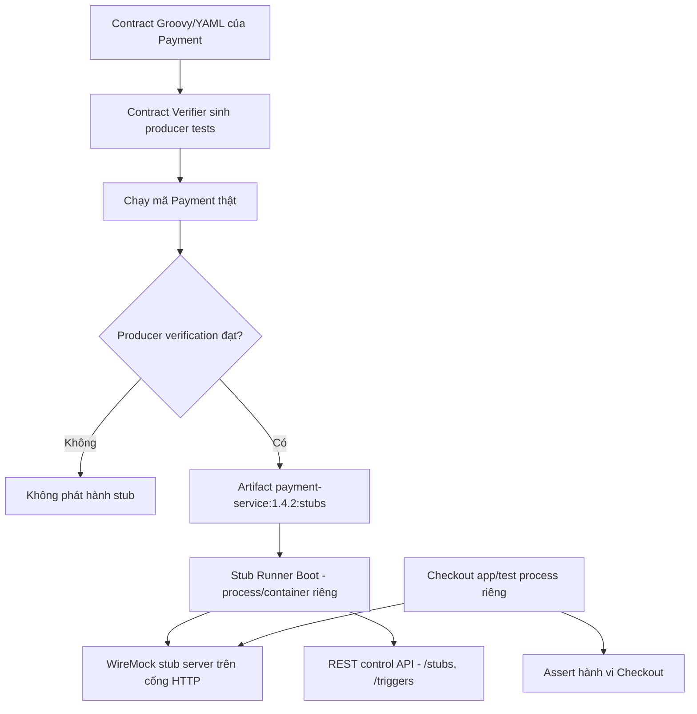
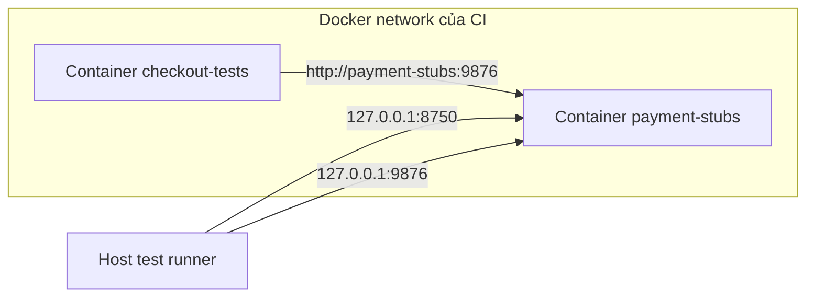
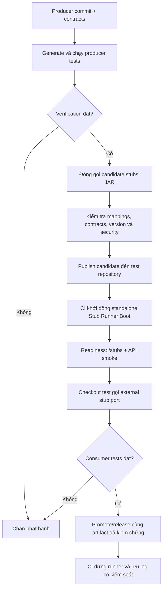

# Chạy stub ngoài tiến trình kiểm thử của consumer

## 1. Tại sao cần một stub server độc lập?

Giả sử `checkout-service` (consumer) gọi `payment-service` (producer) để biết đơn hàng đã được thanh toán hay chưa. Checkout cần kiểm thử luồng đặt hàng mà không phụ thuộc Payment, ngân hàng và cơ sở dữ liệu thật. Nhóm Payment đã định nghĩa hành vi HTTP bằng **Spring Cloud Contract**, viết hợp đồng bằng **Groovy hoặc YAML DSL**, chạy **producer verification tests** và phát hành artifact chứa stub.

Có hai cách phổ biến để sử dụng stub đó:

- **Khởi chạy trong tiến trình kiểm thử consumer:** test Spring/JUnit dùng `@AutoConfigureStubRunner` hoặc `StubRunnerExtension`. Stub Runner khởi tạo các HTTP stub server trong vòng đời của test.
- **Khởi chạy ngoài tiến trình kiểm thử consumer:** một ứng dụng **Stub Runner Boot**, container Docker hoặc một WireMock server độc lập tải và phục vụ stub. Checkout chạy như một ứng dụng/test process riêng, kết nối đến địa chỉ HTTP của stub qua mạng.

Trong cách thứ hai, consumer **không cần phụ thuộc vào thư viện Stub Runner để khởi tạo stub trong JVM**. Điều consumer cần chỉ là **base URL** của endpoint giả lập. Đây là lựa chọn rất hữu ích cho kiểm thử bằng Postman/Newman, Playwright, ứng dụng Node.js/Python/.NET, kiểm thử giao diện, chạy nhiều tiến trình hoặc CI có bước khởi động hạ tầng riêng.

Tuy nhiên, chạy stub ngoài tiến trình **không tự khiến nó chính xác hơn**. Độ tin cậy đến từ một chuỗi rõ ràng: contract đã được producer xác minh → artifact stub đúng version → standalone runner nạp đúng artifact → client gửi HTTP đến đúng stub → test consumer kiểm tra kết quả nghiệp vụ.

### Mục tiêu bài học

Sau bài này, bạn có thể:

1. Phân biệt Stub Runner trong test JVM và Stub Runner Boot/Docker chạy riêng.
2. Hiểu **control port** của Stub Runner Boot khác **WireMock stub port** mà consumer gọi.
3. Sử dụng artifact coordinates `groupId:artifactId:version:classifier:port`, chọn `LOCAL` hoặc `REMOTE` và pin version.
4. Khởi động stub độc lập, kiểm tra `GET /stubs` và gọi API mẫu qua HTTP thật.
5. Nối consumer chạy tại host hoặc container khác tới đúng địa chỉ stub.
6. Đặt quy tắc readiness, reset state, bảo mật và cleanup trong CI.
7. Hiểu những gì standalone stub chứng minh — và những gì vẫn cần producer verification hoặc integration test thật.

## 2. Các thành phần trong kiến trúc



**Hai đường HTTP có mục đích khác nhau:**

- **Control API** của Stub Runner Boot cho biết runner đã nạp stub nào, chúng đang nghe ở cổng nào và những nhãn messaging nào có thể kích hoạt.
- **Business stub HTTP API** mô phỏng endpoint của Payment, chẳng hạn `GET /api/payments/PAY-1001`; đây là nơi Checkout phải gửi request.

Đừng cấu hình Checkout gọi `http://localhost:8750/api/payments/...` chỉ vì Stub Runner Boot quản lý cổng `8750`. Nếu payment stub thực tế chạy ở `9876` thì Checkout cần gọi `http://localhost:9876/api/payments/...` khi cả hai chạy trên cùng host.

## 3. So sánh các cách chạy stub

| Cách chạy | Vòng đời | Nguồn mapping | Khi phù hợp |
| --- | --- | --- | --- |
| `@AutoConfigureStubRunner` | Spring TestContext của consumer; thường tự dừng cùng test. | Artifact SCC `stubs`. | Test Spring Boot/JUnit cục bộ, ít hạ tầng ngoài. |
| `StubRunnerExtension` | JUnit extension điều phối khi test chạy. | Artifact SCC `stubs`. | Unit/integration tests Java không cần cả Spring context. |
| **Stub Runner Boot chạy riêng** | Ứng dụng/tiến trình độc lập, do shell/CI/container quản lý. | Artifact SCC `stubs` từ local/remote repository. | Consumer ở JVM khác, ngôn ngữ khác, UI/E2E test. |
| **Stub Runner Boot Docker** | Container độc lập, có thể dùng Docker Compose. | Artifact SCC `stubs` và cấu hình repository trong container. | CI nhiều dịch vụ, môi trường cách ly, test đa ngôn ngữ. |
| **WireMock standalone thuần** | Process độc lập do người dùng quản lý. | WireMock `mappings/`/`__files` tự cung cấp. | Cần mock HTTP độc lập nhưng không cần cơ chế tải SCC artifact/nhãn messaging. |

**Phân biệt quan trọng:** một WireMock standalone JAR biết đọc mappings của WireMock; nó **không tự động** hiểu Maven coordinates `:stubs`, chọn version hay cung cấp control API và messaging trigger của Stub Runner Boot. Nếu mục tiêu là **dùng stub đã được producer xác minh và đóng gói**, nên ưu tiên Stub Runner Boot hoặc một runtime nạp artifact theo cơ chế tương đương.

Stub Runner trong consumer JVM vẫn mở HTTP port cho WireMock, nhưng **bộ điều phối và vòng đời runner nằm trong test process**. Bài này tách cả bộ điều phối sang **một process/container khác**.

## 4. Xây dựng một hợp đồng HTTP làm đầu vào

Ví dụ API đã thống nhất: `GET /api/payments/PAY-1001` trả HTTP `200` và trạng thái `PAID`.

### Groovy DSL

```groovy
import org.springframework.cloud.contract.spec.Contract

Contract.make {
    name 'get_paid_payment'
    description 'Tra cứu giao dịch đã thanh toán'

    request {
        method 'GET'
        urlPath '/api/payments/PAY-1001'
        headers {
            header 'Accept': 'application/json'
        }
    }

    response {
        status 200
        headers {
            contentType(applicationJson())
        }
        body([
            paymentId: 'PAY-1001',
            orderId: 'ORD-2001',
            status: 'PAID',
            amount: 250000,
            currency: 'VND'
        ])
    }
}
```

### YAML DSL tương đương

```yaml
description: Tra cứu giao dịch đã thanh toán
name: get_paid_payment
request:
  method: GET
  urlPath: /api/payments/PAY-1001
  headers:
    Accept: application/json
response:
  status: 200
  headers:
    Content-Type: application/json
  body:
    paymentId: PAY-1001
    orderId: ORD-2001
    status: PAID
    amount: 250000
    currency: VND
```

Đây là **hai biểu diễn thay thế** của một contract; một dự án thường chỉ giữ một bản làm nguồn thật để tránh sinh test/stub trùng lặp. Không đưa hostname, port máy phát triển hoặc URL Artifactory vào request contract: các chi tiết ấy thuộc môi trường chạy, không thuộc cam kết path API.

**Producer verification** phải gửi request đến implementation Payment thật và kiểm tra status, header, body. Dữ liệu `PAY-1001` cần có fixture xác định hoặc adapter test thích hợp. Sau khi test chạy đạt, plugin chuyển contract thành HTTP mappings cho WireMock và đóng gói artifact stub. Chỉ làm một JSON mapping viết tay rồi chạy nó bằng standalone server **không chứng minh producer thực hiện đúng hợp đồng**.

## 5. Artifact stub và cách chỉ định một server

Một artifact Maven giả định:

```text
groupId    = com.example
artifactId = payment-service
version    = 1.4.2
classifier = stubs
type       = jar

Ví dụ file:
payment-service-1.4.2-stubs.jar
```

Spring Cloud Contract Stub Runner sử dụng dạng **Ivy notation**:

```text
groupId:artifactId:version:classifier:port
```

Ví dụ:

```text
com.example:payment-service:1.4.2:stubs:9876
```

Nghĩa là: nạp stub của `payment-service` phiên bản `1.4.2`, classifier `stubs`, cho HTTP stub server nghe **cổng 9876**. Phần `port` là **cổng WireMock cho stub**, không phải cổng REST quản lý của Stub Runner Boot. Nếu bỏ port, Stub Runner có thể chọn cổng từ vùng cấu hình `minPort/maxPort`; khi đó consumer phải **phát hiện đúng cổng thực tế** trước khi gọi.

`version` hoặc `classifier` có thể được lược bỏ theo quy ước mặc định, nhưng với CI phát hành nên **khóa cả version lẫn classifier**. Ký hiệu version `+` hoặc các version ranges tiện cho phát triển thử nghiệm, không phải lựa chọn tốt cho release gate cần tái hiện được.

### Bên trong JAR có gì?

Bố cục thường gặp:

```text
META-INF/
└── com.example/
    └── payment-service/
        └── 1.4.2/
            ├── contracts/
            │   └── http/get-paid-payment.groovy
            └── mappings/
                └── http/get-paid-payment.json
```

Đây là ví dụ **khái niệm**, tên file/layout phụ thuộc plugin/version. Khi một mapping tham chiếu body file, artifact phải kèm tài nguyên cần thiết. Có thể dùng `jar tf payment-service-1.4.2-stubs.jar` để kiểm tra danh sách entry trước khi runner nạp. Một JAR rỗng hoặc không chứa contract/mapping cần thiết vẫn có thể tồn tại về mặt file.

## 6. Chọn nguồn tải stub: LOCAL, REMOTE hay CLASSPATH?

| Chế độ | Runner đọc stub ở đâu? | Điểm cần lưu ý |
| --- | --- | --- |
| **LOCAL** | Maven local repository của **chính tiến trình/container runner**. | Không đồng nghĩa dùng `~/.m2` trên host khác; container cần volume/copy thích hợp. |
| **REMOTE** | Artifact repository đã cấu hình, ví dụ Nexus hoặc Artifactory. | Cần URL, version, mạng và quyền truy cập; không dùng secret trong command log. |
| **CLASSPATH** | Stubs có sẵn trên classpath của runner theo cơ chế hỗ trợ. | Không giống tự tải một Maven artifact từ remote repository. |

Các thuộc tính cấu hình được tài liệu Stub Runner mô tả thường có prefix:

```properties
spring.cloud.contract.stubrunner.ids=com.example:payment-service:1.4.2:stubs:9876
spring.cloud.contract.stubrunner.stubsMode=REMOTE
spring.cloud.contract.stubrunner.repositoryRoot=https://repo.example.test/maven/releases
```

URL repository ở đây là **giả định**, không phải endpoint hoạt động. Trong một dự án có property binder sử dụng relaxed binding, tên như `stubs-mode`/`repository-root` có thể xuất hiện dưới dạng kebab-case; khi cấu hình bằng CLI/biến môi trường, hãy theo **cú pháp tương thích với phiên bản Stub Runner đang dùng**.

### Vì sao LOCAL thường gây nhầm trong Docker?

Bạn đã chạy `mvn install` ở máy host nên có:

```text
Host: /home/developer/.m2/repository/.../payment-service-1.4.2-stubs.jar
```

Nhưng Docker container là **filesystem khác**. Nếu bật `LOCAL` mà không mount/copy đúng Maven repository, Stub Runner Boot có thể báo không tìm thấy artifact. Ngược lại, chạy `REMOTE` mà không cấu hình `repositoryRoot` hoặc credentials hợp lệ sẽ thất bại khi tải. Chế độ phải được chọn có chủ đích, không dùng một mode rồi “đoán” file ở đâu.

## 7. Khởi động Stub Runner Boot qua Docker

Theo tài liệu Spring Cloud Contract hiện hành, **Docker image của Stub Runner Boot là hướng chạy standalone được ưu tiên**. Tài liệu cũng lưu ý rằng do giới hạn công cụ phát hành artifact, **executable JAR Stub Runner Boot không được phát hành ở các dòng từ 4.1.6**; các lệnh tải fat JAR cũ chỉ phù hợp với version thực sự còn artifact hoặc khi tự build ứng dụng. Không nên lấy một lệnh `wget` lịch sử rồi giả định nó hoạt động cho mọi bản mới.

Một mẫu cho consumer test chạy **trên cùng Docker host**, với stub artifact đã được publish tới repository mà container truy cập được:

```bash
docker run --rm --name payment-stubs \
  -e SERVER_PORT=8750 \
  -e SPRING_CLOUD_CONTRACT_STUBRUNNER_STUBS_MODE=REMOTE \
  -e SPRING_CLOUD_CONTRACT_STUBRUNNER_IDS=com.example:payment-service:1.4.2:stubs:9876 \
  -e SPRING_CLOUD_CONTRACT_STUBRUNNER_REPOSITORY_ROOT=https://repo.example.test/maven/releases \
  -p 127.0.0.1:8750:8750 \
  -p 127.0.0.1:9876:9876 \
  spring-cloud/spring-cloud-contract-stub-runner:REPLACE_WITH_COMPATIBLE_TAG
```

**Đây là lệnh mẫu để điều chỉnh, không phải lệnh đã thực thi.** Chọn image tag thực sự tồn tại và tương thích với hệ thống Spring Cloud Contract của producer. Tên environment variables được viết theo thuộc tính Spring Boot hiện đại với prefix `SPRING_CLOUD_CONTRACT_STUBRUNNER_...`. Một số tài liệu/image legacy dùng biến ngắn `STUBRUNNER_IDS` hoặc `STUBRUNNER_STUBS_MODE`; hãy kiểm tra hướng dẫn của **đúng image tag** thay vì trộn hai đời cấu hình.

Khi chạy thành công:

- **Cổng 8750 trong container:** REST control API của Stub Runner Boot vì đã đặt `SERVER_PORT=8750`.
- **Cổng 9876 trong container:** HTTP WireMock stub server dành cho `payment-service`.
- **Host loopback 127.0.0.1:8750:** người vận hành trên cùng host có thể truy vấn control API.
- **Host loopback 127.0.0.1:9876:** test hoặc ứng dụng trên cùng host có thể gọi API mô phỏng Payment.
- **Repository URL:** container phải có DNS/routing/TLS và credentials cần thiết để tải `com.example:payment-service:1.4.2:stubs`.

Việc bind hai cổng vào `127.0.0.1` nhằm giới hạn quyền truy cập từ mạng ngoài trong môi trường test đơn giản. Nếu consumer chạy ở một container khác, nó sẽ **không** gọi `127.0.0.1` của host được; hãy dùng shared Docker network/service name như phần 10.

### Local mode trong container

Khi không có artifact repository, có thể dùng `LOCAL` và mount thư mục Maven local repository vào **đúng home/repository path mà image sử dụng**:

```text
STUBS_MODE = LOCAL
Maven repository của container = đường dẫn đã mount từ host
Stub ID = com.example:payment-service:1.4.2:stubs:9876
```

Hướng dẫn Docker của Spring Cloud Contract có ví dụ mount `.m2` vào home của user trong image. Đường dẫn container thực và quyền file có thể thay đổi theo image tag, nên kiểm tra user/home/repository path của bản đang dùng. Với CI phân tán, **REMOTE** thường thuận tiện hơn vì không cần chia sẻ filesystem giữa các job.

## 8. Hai cổng: quản trị runner và HTTP stub

Đây là chỗ nhiều người bắt đầu tích hợp bị nhầm:

| Địa chỉ ví dụ | Đối tượng | Request phù hợp |
| --- | --- | --- |
| `http://127.0.0.1:8750/stubs` | **Stub Runner Boot control API** | Liệt kê các stub đã nạp. |
| `http://127.0.0.1:8750/stubs/payment-service` | **Control API** | Trả về cổng của stub tương ứng theo ID được hỗ trợ. |
| `http://127.0.0.1:8750/triggers` | **Control API** | Liệt kê các label messaging có thể kích hoạt. |
| `http://127.0.0.1:9876/api/payments/PAY-1001` | **Payment HTTP stub** | Consumer gọi như gọi API Payment. |
| `http://127.0.0.1:9876/__admin/mappings` | **WireMock admin API** của stub | Xem mappings để debug trên server test tin cậy. |

Trước khi chạy test consumer, có thể kiểm tra:

```bash
# Control plane: runner đã nạp artifact nào?
curl -i http://127.0.0.1:8750/stubs

# Hỏi cổng của stub theo artifactId nếu endpoint hỗ trợ:
curl -i http://127.0.0.1:8750/stubs/payment-service

# Business plane: gọi endpoint Payment giả lập:
curl -i \
  -H "Accept: application/json" \
  http://127.0.0.1:9876/api/payments/PAY-1001
```

Response mô phỏng mong đợi từ lệnh cuối:

```http
HTTP/1.1 200 OK
Content-Type: application/json

{
  "paymentId": "PAY-1001",
  "orderId": "ORD-2001",
  "status": "PAID",
  "amount": 250000,
  "currency": "VND"
}
```

**Không mặc định `/actuator/health` luôn tồn tại**: endpoint Actuator cần dependency và cấu hình riêng, còn `GET /stubs` được Stub Runner Boot mô tả trong tài liệu. Nếu runner chưa tải xong artifact, port có thể chưa sẵn sàng dù container đã start; cần chờ readiness ở tầng runtime và xác minh request nghiệp vụ.

### Phát hiện cổng động

Nếu Stub Runner ID **không ghi port**, WireMock có thể chạy trên cổng được chọn trong một khoảng. Trên cùng mạng mà control API truy cập được, consumer/test harness có thể:

1. Gọi `GET /stubs` để lấy stub IDs và cổng đã mở.
2. Chọn đúng entry của `com.example:payment-service:1.4.2:stubs`.
3. Đưa host + port vào cấu hình `payment.base-url` của consumer.
4. Gọi một request smoke để chứng minh stub đã sẵn sàng.

Chỉ đọc số port từ control API **không xác định tự động hostname** mà consumer phải dùng trong container khác. Host cần lấy từ cấu hình mạng, ví dụ DNS name của service Stub Runner. Khi dùng Docker publish cổng động, còn cần biết host port được Docker ánh xạ; vì vậy trong ví dụ đơn giản ta chọn `9876` rõ ràng.

## 9. Chạy Stub Runner Boot bằng ứng dụng Spring Boot riêng

Nếu dự án không thể dùng Docker, có thể xây một Spring Boot application **chỉ làm nhiệm vụ stub runner**. Theo tài liệu Spring Cloud Contract, cách này dùng starter Stub Runner và `@EnableStubRunnerServer`:

```java
import org.springframework.boot.SpringApplication;
import org.springframework.boot.autoconfigure.SpringBootApplication;
import org.springframework.cloud.contract.stubrunner.server.EnableStubRunnerServer;

@SpringBootApplication
@EnableStubRunnerServer
public class ExternalStubRunnerApplication {

    public static void main(String[] args) {
        SpringApplication.run(ExternalStubRunnerApplication.class, args);
    }
}
```

Đoạn này minh họa kiến trúc ứng dụng, **không phải project đầy đủ**: tên package của annotation và cách đăng ký server cần đối chiếu chính xác với phiên bản Spring Cloud Contract đang dùng; project phải có Spring Boot plugin, `spring-cloud-starter-stub-runner`, dependency management và các cấu hình cần thiết.

Ví dụ cấu hình `application.yml` của **ứng dụng runner riêng**, không phải của Checkout:

```yaml
server:
  port: 8750

spring:
  cloud:
    contract:
      stubrunner:
        stubsMode: REMOTE
        repositoryRoot: https://repo.example.test/maven/releases
        ids:
          - "com.example:payment-service:1.4.2:stubs:9876"
```

Khi build được một executable JAR của **chính ứng dụng runner riêng**, có thể chạy:

```bash
java -jar external-stub-runner.jar
```

Lựa chọn này **không phụ thuộc vào việc Spring có publish executable Stub Runner Boot fat JAR dựng sẵn hay không**, vì nhóm tự build ứng dụng. Tuy nhiên, phải quản lý source, dependencies, version và security của runner giống một test utility riêng, không triển khai nó vào production.

### Dùng fat JAR phát hành sẵn trong tài liệu cũ

Tài liệu cũ đưa ví dụ:

```bash
java -jar stub-runner.jar \
  --server.port=8750 \
  --spring.cloud.contract.stubrunner.ids=com.example:payment-service:1.4.2:stubs:9876 \
  --spring.cloud.contract.stubrunner.stubsMode=REMOTE \
  --spring.cloud.contract.stubrunner.repositoryRoot=https://repo.example.test/maven/releases
```

Đây là mẫu cho **JAR đã tồn tại và chạy được**. Với nhiều dòng Spring Cloud Contract mới, executable JAR dựng sẵn không được publish; hãy chọn Docker hoặc tự build runner thay vì cố tải một tọa độ artifact không có.

## 10. Consumer chạy trong container khác: đừng dùng localhost sai chỗ

Khi Checkout cũng chạy bằng Docker, `localhost` **bên trong container Checkout** trỏ đến chính container Checkout, **không phải** container Stub Runner.

Ví dụ kiến trúc Docker Compose:



Mảnh cấu hình Compose minh họa:

```yaml
services:
  payment-stubs:
    image: spring-cloud/spring-cloud-contract-stub-runner:REPLACE_WITH_COMPATIBLE_TAG
    environment:
      SERVER_PORT: "8750"
      SPRING_CLOUD_CONTRACT_STUBRUNNER_STUBS_MODE: REMOTE
      SPRING_CLOUD_CONTRACT_STUBRUNNER_IDS: "com.example:payment-service:1.4.2:stubs:9876"
      SPRING_CLOUD_CONTRACT_STUBRUNNER_REPOSITORY_ROOT: "https://repo.example.test/maven/releases"
    ports:
      - "127.0.0.1:8750:8750"
      - "127.0.0.1:9876:9876"

  checkout-tests:
    image: your-private-checkout-test-image:REPLACE_WITH_TAG
    environment:
      PAYMENT_BASE_URL: "http://payment-stubs:9876"
    depends_on:
      - payment-stubs
```

Đây là **sơ đồ cấu hình**, không phải Compose file chạy được ngay: hai image tags, private repository URL và test image cần được cung cấp; không lưu credentials thực trong file. Hai service cùng network mặc định có thể phân giải DNS name `payment-stubs`. Consumer test từ trong container **không cần cổng publish ra host**; các `ports` chỉ phục vụ lệnh debug từ host.

**Quan trọng:** `depends_on` theo thứ tự start **không mặc định bảo đảm** stub đã tải artifact hoặc WireMock đã lắng nghe. Bài test vẫn cần readiness check/retry có thời hạn trên `GET /stubs` hoặc một HTTP request nghiệp vụ trước khi chạy test chính. Trong một CI chạy nhiều job trên cùng host, nên dùng project/network riêng, port động hoặc bỏ host port publishing để tránh đụng `8750`/`9876`.

### Consumer chạy trên máy host thay vì container

Khi runner đã publish hai cổng như ví dụ Docker:

```text
PAYMENT_BASE_URL=http://127.0.0.1:9876
```

Khi Checkout chạy trong Compose:

```text
PAYMENT_BASE_URL=http://payment-stubs:9876
```

Cùng một stub nhưng **hostname khác vì khác network namespace**. Một lỗi thường thấy là test trên laptop xanh khi dùng `localhost`, vào CI Docker lại `Connection refused` mặc dù runner vẫn hoạt động.

## 11. Kết nối HTTP client thực của consumer với stub

Đừng hard-code base URL test vào mã nghiệp vụ. Nên đưa qua cấu hình, ví dụ Spring Boot consumer có:

```yaml
payment:
  base-url: ${PAYMENT_BASE_URL:http://127.0.0.1:9876}
```

Đây là **application-test.yml** của Checkout, không phải cấu hình của runner. Môi trường CI có thể đặt `PAYMENT_BASE_URL=http://payment-stubs:9876`; production sử dụng địa chỉ Payment thực trong cấu hình được quản lý riêng.

Ví dụ HTTP client dùng Spring WebClient:

```java
@Component
public class PaymentGatewayClient {
    private final WebClient http;

    public PaymentGatewayClient(
            WebClient.Builder builder,
            @Value("${payment.base-url}") String baseUrl) {
        this.http = builder.baseUrl(baseUrl).build();
    }

    public Mono<PaymentView> getPayment(String id) {
        return http.get()
            .uri("/api/payments/{id}", id)
            .accept(MediaType.APPLICATION_JSON)
            .retrieve()
            .bodyToMono(PaymentView.class);
    }
}
```

Ví dụ cần import Spring WebFlux, Reactor, `@Value`, `@Component` và DTO `PaymentView` của Checkout. HTTP client **thật** được dùng ở đây; không mock luôn `PaymentGatewayClient` nếu mục tiêu là xác minh Checkout tương thích stub.

Một test JUnit 5 chạy trong **tiến trình Checkout**, độc lập với tiến trình stub:

```java
@SpringBootTest
class CheckoutStandaloneStubIT {

    @Autowired PaymentGatewayClient paymentClient;

    @Test
    void readsPaidPaymentFromExternalStub() {
        PaymentView payment = paymentClient
            .getPayment("PAY-1001")
            .block(Duration.ofSeconds(3));

        assertThat(payment.paymentId()).isEqualTo("PAY-1001");
        assertThat(payment.orderId()).isEqualTo("ORD-2001");
        assertThat(payment.status()).isEqualTo("PAID");
        assertThat(payment.currency()).isEqualTo("VND");
    }
}
```

Sử dụng `block(Duration)` ở đây **chỉ để minh họa test đồng bộ trên client reactive**, không phải khuyến nghị block trong code xử lý HTTP WebFlux production. Nếu Checkout sử dụng Reactor, có thể dùng `StepVerifier` để assert. Quan trọng hơn: test này **không có `@AutoConfigureStubRunner`** — runner phải được khởi động trước, ở process/container riêng.

Nếu muốn kiểm tra toàn bộ logic Checkout, gọi entry point của Checkout rồi assert đơn hàng chỉ được xác nhận khi Payment trả `PAID`. Kiểm tra DTO đơn thuần chỉ xác minh phần decode và HTTP routing.

## 12. Chuẩn bị readiness thay vì sleep một khoảng cố định

Một container có thể được Docker đánh dấu `running` trước khi:

1. Ứng dụng Stub Runner Boot khởi động xong.
2. Artifact `payment-service:1.4.2:stubs` được tải và giải nén.
3. WireMock server đã đăng ký mappings và lắng nghe ở cổng `9876`.

Vì vậy, lệnh `sleep 5` không phải tiêu chí đáng tin: trên laptop có thể đủ nhưng CI mạng chậm có thể cần lâu hơn; ngủ quá lâu lại làm test chậm không cần thiết.

Một readiness gate nên có **deadline và fail rõ ràng**:

```text
1. GET http://runner:8750/stubs
2. Kiểm tra danh sách có payment-service:1.4.2:stubs và port mong đợi
3. GET http://runner:9876/api/payments/PAY-1001
4. Kiểm tra status 200, Content-Type JSON, status nghiệp vụ PAID
5. Nếu chưa đạt: retry ngắn trong giới hạn; quá hạn -> FAIL
```

Thực tế, nếu một request smoke đã trả được dữ liệu kỳ vọng thì chính mapping cần dùng đã sẵn sàng. `GET /stubs` vẫn có ích để xác minh **đúng version/artifact** được nạp, tránh trường hợp runner mở được port nhưng chứa stub sai.

**Không đánh đồng một HTTP `404` của WireMock vì thiếu mapping với response `404 PAYMENT_NOT_FOUND` mà Payment đã cam kết**. Muốn kiểm tra lỗi nghiệp vụ, phải có contract lỗi riêng, được producer verification xác minh.

## 13. Nhiều stub trong một runner

Stub Runner Boot có thể nạp nhiều producer artifacts, ví dụ:

```yaml
spring:
  cloud:
    contract:
      stubrunner:
        stubsMode: REMOTE
        repositoryRoot: https://repo.example.test/maven/releases
        ids:
          - "com.example:payment-service:1.4.2:stubs:9876"
          - "com.example:inventory-service:2.3.0:stubs:9877"
          - "com.example:shipping-service:3.0.1:stubs:9878"
```

Mỗi HTTP stub server có **cổng riêng**, trong khi control API của Stub Runner Boot là một endpoint quản lý chung. Consumer có thể nhận ba base URLs khác nhau:

```text
PAYMENT_BASE_URL   = http://payment-stubs:9876
INVENTORY_BASE_URL = http://payment-stubs:9877
SHIPPING_BASE_URL  = http://payment-stubs:9878
```

Ở ví dụ này `payment-stubs` là tên container runner dùng chung. Trong dự án thật, có thể đặt tên service trung tính như `contract-stubs`; tên container **không liên quan** đến artifactId. Đừng trỏ cả ba client đến một cổng rồi mong Stub Runner tự route theo tên microservice.

Ưu điểm: một container có thể phục vụ nhiều dependency trong một suite. Nhược điểm: nhiều tests chia sẻ mappings, request journal hoặc scenario state của mỗi WireMock server; một test reset trạng thái sai cách có thể ảnh hưởng các test khác. Khi cần chạy song song nhiều suite có fixtures khác nhau, **mỗi job nên có runner riêng** hoặc một chiến lược cô lập rõ ràng.

## 14. Messaging labels khi chạy Stub Runner Boot ngoài JVM

Ngoài HTTP, Stub Runner Boot có **REST endpoints để kích hoạt messaging contract theo label**, ví dụ Payment phát sự kiện `PaymentCaptured`:

```groovy
import org.springframework.cloud.contract.spec.Contract

Contract.make {
    name 'payment_captured_event'
    label 'payment_captured_1001'

    input {
        triggeredBy('emitPaymentCaptured()')
    }

    outputMessage {
        sentTo('payments.captured')
        body([
            eventId: 'EVT-1001',
            eventType: 'PaymentCaptured',
            paymentId: 'PAY-1001',
            orderId: 'ORD-2001',
            amount: 250000,
            currency: 'VND'
        ])
        headers {
            messagingContentType(applicationJson())
        }
    }
}
```

Phía **producer verification**, `triggeredBy('emitPaymentCaptured()')` phải thực thi mã producer thật và kiểm tra event. Phía **consumer**, standalone runner có thể phát event mẫu theo nhãn thông qua control API:

```bash
# Xem những messaging labels hiện có:
curl -i http://127.0.0.1:8750/triggers

# Kích hoạt một label đã đăng ký:
curl -i -X POST \
  http://127.0.0.1:8750/triggers/payment_captured_1001
```

Khi có nhiều stub artifacts, API hỗ trợ dạng:

```text
POST /triggers/{ivy}/{label}
```

Trong đó `ivy` chọn producer stub; đường dẫn/path segment phải được URL-encode phù hợp khi chứa dấu đặc biệt, và có thể dùng artifactId trong trường hợp được API hỗ trợ. Đừng giả định nhãn giống nhau từ hai producer sẽ được chọn đúng nếu chỉ gọi label.

**Lưu ý:** REST trigger thành công không có nghĩa consumer đã nhận và xử lý event. Stub Runner phải có **messaging integration/binder phù hợp**, destination `payments.captured` phải được nối đến nơi consumer lắng nghe, và test phải assert kết quả nghiệp vụ sau khi xử lý. Nếu consumer nằm ở process/container khác, việc phát message qua broker thực hoặc middleware test cần cấu hình/đường mạng riêng. Chạy HTTP stubs thành công **không tự bật messaging**.

## 15. Vòng đời và reset state của standalone stub

Một runner độc lập có thể sống lâu hơn một test method hoặc test class. Do đó WireMock request journal, scenario state và mappings có thể tồn tại giữa các bài test. Các nguy cơ:

- Test A đã gọi POST; test B kiểm tra số lần gọi nhưng journal vẫn chứa request A.
- Test A chuyển scenario từ `PENDING` sang `PAID`; test B bắt đầu ở trạng thái cũ.
- Test A thêm runtime mapping, khiến test B nhận response khác mapping đã publish.
- Một suite xóa toàn bộ mappings qua WireMock Admin API, khiến suite khác báo không tìm thấy stub.

**Quy tắc sử dụng:**

1. Ưu tiên **runner riêng cho mỗi job/suite độc lập**, nhất là khi test chạy song song.
2. Nếu dùng chung runner trong một suite, có fixture setup/reset rõ ràng, không dựa vào thứ tự chạy của các test methods.
3. Với request journal, chỉ xóa log khi đã hoàn tất những assertion cần đếm request, và bảo đảm không có test khác đang dùng cùng server.
4. Với scenario state, reset scenario riêng khi cần khởi động từ đầu.
5. **Không gọi reset toàn bộ WireMock mappings tùy tiện** trên stub server mà Stub Runner quản lý; các mapping tải từ artifact có thể không tự được đăng ký lại theo đúng cách.
6. Khi kết thúc job, dừng/loại bỏ container hoặc process đã khởi động, giải phóng cổng và tài nguyên.

WireMock Admin API như `GET /__admin/mappings` hoặc `GET /__admin/requests` có thể hữu ích để debug **trên stub server** ở cổng `9876`. Không nhầm chúng với Stub Runner Boot control API ở `8750`, và không để các Admin endpoints mở cho môi trường không tin cậy.

Một artifact stub của Spring Cloud Contract có thể chứa stateful mappings. Standalone runtime **mô phỏng trạng thái đã khai báo**, không tự bảo đảm transactional semantics, idempotency hay dữ liệu bền vững như producer thật; các cam kết này cần test nghiệp vụ/integration riêng.

## 16. Bảo mật: standalone stub không được vận hành như production service

Tài liệu Spring Cloud Contract nhấn mạnh rằng **Stub Runner Boot không được bảo vệ sẵn bằng cơ chế authentication/authorization** và chỉ dành cho môi trường test đáng tin cậy. Nó có thể cung cấp nhiều endpoints điều khiển và khởi động HTTP stub servers với dữ liệu giả.

Các quy tắc tối thiểu:

| Rủi ro | Biện pháp |
| --- | --- |
| Control API hoặc WireMock Admin bị truy cập ngoài ý muốn | Chỉ bind loopback hoặc dùng private Docker network/CI network; không publish cổng lên internet. |
| Artifact chứa dữ liệu khách hàng | Dùng fixture tổng hợp, quét secret/PII trước khi phát hành stub. |
| Repository cần token | Cấp qua secret manager/CI secret injection, tránh ghi plaintext trong YAML đã commit/log Docker. |
| Container image không rõ nguồn | Dùng image từ nguồn tin cậy, **pin tag/digest** theo chính sách; kiểm tra tương thích. |
| Stub đứng lâu và tái sử dụng ngoài vòng đời test | Giới hạn thời gian sống, tự dừng container/job, không tạo shared “staging thật” từ stub. |
| Dùng nhầm endpoint stub trên production | Tách cấu hình production và test, kiểm tra base URL của client khi deploy. |
| HTTP test chạm vào dependency live | Cô lập outbound calls, không đặt secret production trong stub fixtures. |

**Không deploy Stub Runner Boot vào production hoặc một môi trường public rồi thêm port mapping như dịch vụ bình thường.** Nếu cần chia sẻ stub giữa nhiều nhóm, nên bảo vệ bằng network isolation và chính sách truy cập rõ ràng; bản thân Stub Runner Boot không được thiết kế làm public API gateway.

## 17. Chẩn đoán những lỗi thường gặp

| Triệu chứng | Nguyên nhân có thể | Cách xác minh và sửa |
| --- | --- | --- |
| Container chạy nhưng `/stubs` rỗng | `ids` sai, artifact chưa tải, mode/repository sai. | Xem log startup, coordinates, repository và auth; fail readiness. |
| `/stubs` có Payment nhưng Checkout báo connection refused | Gọi sai port, hostname/network namespace hoặc WireMock chưa sẵn sàng. | Kiểm tra control port và business stub port, base URL, Docker DNS. |
| Host gọi được, test container không gọi được | Consumer dùng `localhost` trong container khác. | Dùng tên Docker service và cổng container. |
| Stub trả 404 không có JSON lỗi | Request không khớp mapping. | Kiểm tra method/path/headers/query; không xem đây là contract 404 nghiệp vụ. |
| LOCAL báo artifact not found | Runner container không có local Maven repository. | Mount/copy đúng repository hoặc chuyển REMOTE. |
| REMOTE không tải được artifact | URL, TLS, credentials, network hoặc version sai. | Xác minh URL bằng client tin cậy, pin version, sửa quyền. |
| Test dùng stub version không mong muốn | Dùng `+`/latest, repository cache hoặc artifact ghi đè. | Pin version, so checksum/artifact identity. |
| `/triggers` có label nhưng consumer không nhận | Thiếu messaging binder, sai destination, consumer handler không chạy. | Kiểm tra middleware/test binder, connection và assertion nghiệp vụ. |
| Stub trả response khác giữa test | Scenario state/journal/runtime mapping còn từ test trước. | Runner riêng hoặc reset đúng mức và chắc mappings còn. |
| Cổng 9876 đã được sử dụng | Hai runner/job cùng bind host port cố định. | Dùng CI network riêng, cổng động hoặc không publish host port. |
| Fat JAR không tải được trên Maven mới | Bản executable Stub Runner Boot không được publish ở một số dòng kể từ 4.1.6. | Dùng Docker image hoặc tự build runner Boot. |
| Build consumer xanh nhưng Payment production sai | Chỉ chạy consumer với stub; producer verification bỏ qua. | Chạy producer tests trước khi phát hành stub. |
| Cổng quản trị bị truy cập từ mạng ngoài | Docker publish `0.0.0.0:8750` hoặc thiếu network policy. | Bind `127.0.0.1` hoặc private network, không dùng trong production. |

### Thứ tự debug khuyến nghị

1. Xác định artifact được producer xác minh và version/commit cụ thể.
2. Kiểm tra runner đang đọc `LOCAL`, `REMOTE` hay `CLASSPATH`, repository có truy cập được không.
3. Xác định **control API port** và **business stub port** đang chạy.
4. Kiểm tra `GET /stubs` có đúng Payment artifact/version.
5. Gọi `GET /api/payments/PAY-1001` trực tiếp tới stub port.
6. Kiểm tra HTTP client của Checkout đã dùng đúng base URL theo network namespace.
7. Xem WireMock mappings/unmatched requests nếu cần, không reset bừa.
8. Chạy consumer business assertions và xác minh producer verification report.

## 18. Đưa standalone stub vào CI/CD

Một pipeline có thể tách hẳn **producer verification**, **artifact phát hành** và **consumer test**.



**Một chuỗi triển khai mẫu:**

1. Producer CI sinh/runs generated tests từ Groovy/YAML contract, ghi số test thực thi và đảm bảo không có contract đang hỗ trợ bị bỏ qua.
2. Tạo candidate JAR từ **cùng contract/commit**, kiểm tra layout, HTTP mappings, messaging contracts, tài nguyên body và secret scanning.
3. Đăng candidate artifact có version rõ ràng vào **test repository** hoặc dùng LOCAL được mount cô lập. Đây chưa phải hành động publish release cuối.
4. Consumer CI khởi động Stub Runner Boot trong một container riêng, cấu hình REMOTE/LOCAL và Stub ID chứa version cụ thể.
5. Chờ runner đã nạp stub bằng readiness check có timeout, xác minh HTTP smoke request đúng dữ liệu.
6. Cấp `PAYMENT_BASE_URL` cho tiến trình Checkout, chạy test consumer thực qua HTTP.
7. Khi cả hai phía đạt, promote **chính artifact đã kiểm tra** sang repository phát hành hoặc xác nhận byte/checksum không thay đổi.
8. Dừng container, thu hồi credential test, lưu log cần thiết và không giữ server mở ngoài vòng đời job.

### Vì sao phải giới hạn cổng và version trong CI?

Khi nhiều pull requests chạy song song trên một máy, dùng cố định host port `9876` có thể gây lỗi bind hoặc tệ hơn là consumer gọi **stub của PR khác**. Container network tách biệt, runner instance riêng và phát hiện cổng rõ ràng giúp tránh nhiễu. Khi release, pin version ngăn một PR lấy nhầm stub mới nhất chưa được kiểm tra với mã consumer.

### Không gọi “build xanh” khi chỉ có server khởi động

Các dấu hiệu thành công phải bao gồm:

- Producer verification đã chạy và đạt, không phải 0 test.
- Runner tải đúng stub JAR và mapping kỳ vọng.
- Consumer **gửi HTTP request thật** đến process/container stub độc lập.
- Consumer kiểm tra status/body và quyết định nghiệp vụ của ứng dụng.
- Stub candidate được so checksum với artifact đã publish/promote.
- Hạ tầng test được cleanup dù job đạt hay thất bại.

## 19. Bài tập thực hành: kiểm thử Checkout bằng Stub Runner Boot độc lập

Bạn có:

```text
Producer artifact: com.example:payment-service:1.4.2:stubs
Control API port: 8750
Payment HTTP stub port: 9876

Endpoint A: GET /api/payments/PAY-1001
             -> 200 + status=PAID + orderId=ORD-2001

Endpoint B: GET /api/payments/PAY-9999
             -> 404 + error.code=PAYMENT_NOT_FOUND

Consumer: checkout-service, HTTP client lấy base URL từ PAYMENT_BASE_URL
```

Giả định cả A và B đều có **contract được producer verification xác minh**.

**Nhiệm vụ:**

1. Viết Groovy hoặc YAML contract cho endpoint A, với status/body và Content-Type rõ ràng. Giải thích vì sao contract không chứa `localhost:9876`.
2. Mô tả nội dung JAR `payment-service-1.4.2-stubs.jar`: artifact coordinates, contracts và mappings.
3. Viết cấu hình Stub Runner Boot chế độ `REMOTE` lấy đúng version `1.4.2`, mở control API ở `8750` và stub Payment ở `9876`.
4. Dùng Docker chạy standalone runner và chỉ publish hai cổng lên `127.0.0.1`. Giải thích vì sao không nên publish control API ra internet.
5. Dùng `GET /stubs` xác nhận Payment đã nạp, rồi gửi curl đến `GET /api/payments/PAY-1001` qua **stub port**. Hai request khác nhau thế nào?
6. Chạy Checkout trong container khác. Đặt `PAYMENT_BASE_URL` thành gì? Vì sao `http://localhost:9876` không đúng trong container Checkout?
7. Viết một integration test của Checkout không sử dụng `@AutoConfigureStubRunner`, nhưng gọi HTTP client thật tới external stub và assert chỉ xác nhận đơn nếu `status=PAID`.
8. Tạo readiness gate có timeout thay vì `sleep 10`; mô tả cách phát hiện artifact chưa tải hoặc request không khớp mapping.
9. Kiểm tra endpoint B: phân biệt `404 PAYMENT_NOT_FOUND` do contract với `404 No matching stub` từ WireMock.
10. Mô tả tình huống CI chạy hai pull requests trên cùng host, đều dùng port 9876. Đề xuất cách cô lập mà không làm consumer gọi nhầm stub.
11. Nếu producer thêm messaging contract có `label=payment_captured_1001`, trình bày cách Stub Runner Boot liệt kê và kích hoạt nhãn, cùng điều kiện để consumer nhận được event.
12. Giải thích vì sao test consumer với standalone stub xanh nhưng producer verification trên mã Payment thất bại **không cho phép phát hành** artifact đó.

**Tự đánh giá:** một bài làm đúng phải phân biệt rõ **process, container, control API, business stub port, artifact version, URL theo network namespace** và ranh giới giữa consumer test với producer verification.

## 20. Ghi nhớ

- **Standalone stub** chạy ngoài tiến trình kiểm thử consumer, thường bằng **Stub Runner Boot Docker** hoặc một Spring Boot runner tự đóng gói.
- Với Spring Cloud Contract, stub phải đến từ **contract đã được producer xác minh**, đóng gói thành artifact có version; chạy một WireMock mapping viết tay không thay thế bước này.
- Dạng ID `groupId:artifactId:version:classifier:port` đặt **cổng stub HTTP**; `server.port` của Stub Runner Boot là **cổng control API** khác.
- `GET /stubs` dùng để quan sát artifact/cổng, còn consumer gọi **endpoint nghiệp vụ trên stub port**. `GET /triggers`/`POST /triggers/{label}` phục vụ messaging khi tích hợp được cấu hình.
- `LOCAL` đọc Maven repository của runner, `REMOTE` tải từ artifact repository; khi chạy trong Docker phải lưu ý filesystem, DNS, TLS và credentials.
- Container khác **không dùng `localhost` của Stub Runner**; dùng service DNS và cổng trong Docker network hoặc endpoint host đã publish.
- Stub Runner Boot **không được bảo mật sẵn để vận hành công khai**: chỉ dùng trong môi trường test đáng tin cậy, giới hạn network và cleanup.
- CI cần readiness + smoke test + assertion nghiệp vụ, artifact pin version và producer verification gate; **server khởi động thành công không đủ chứng minh tương thích**.

### Tài liệu tham khảo

- [Spring Cloud Contract — Using the Stub Runner Boot Application](https://docs.spring.io/spring-cloud-contract/reference/project-features-stubrunner/stub-runner-boot.html): standalone server, tình trạng executable JAR, REST control endpoints và lưu ý bảo mật.
- [Spring Cloud Contract — Docker Project](https://docs.spring.io/spring-cloud-contract/reference/docker-project.html): Docker Stub Runner Boot, biến môi trường và cách kết nối từ ứng dụng khác.
- [Spring Cloud Contract — Stub Runner Common Properties](https://docs.spring.io/spring-cloud-contract/reference/project-features-stubrunner/stub-runner-common.html): `ids`, `stubsMode`, repository, classifier, port và version.
- [Spring Cloud Contract — Stub Runner](https://docs.spring.io/spring-cloud-contract/reference/project-features-stubrunner.html): tiêu thụ stubs artifact của producer.
- [Spring Cloud Contract — Publishing Stubs as JARs](https://docs.spring.io/spring-cloud-contract/reference/project-features-stubrunner/stub-runner-publishing-stubs-as-jars.html): đóng gói và phát hành artifact.
- [WireMock — Stub Mappings](https://wiremock.org/docs/stubbing/): HTTP mappings và công cụ kiểm tra request/response.
