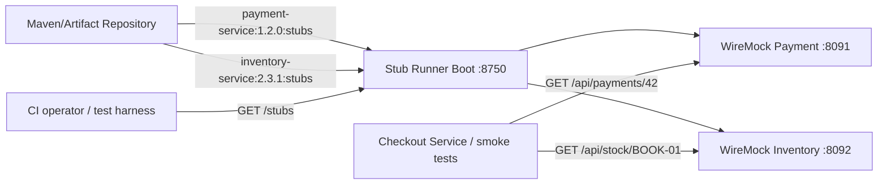
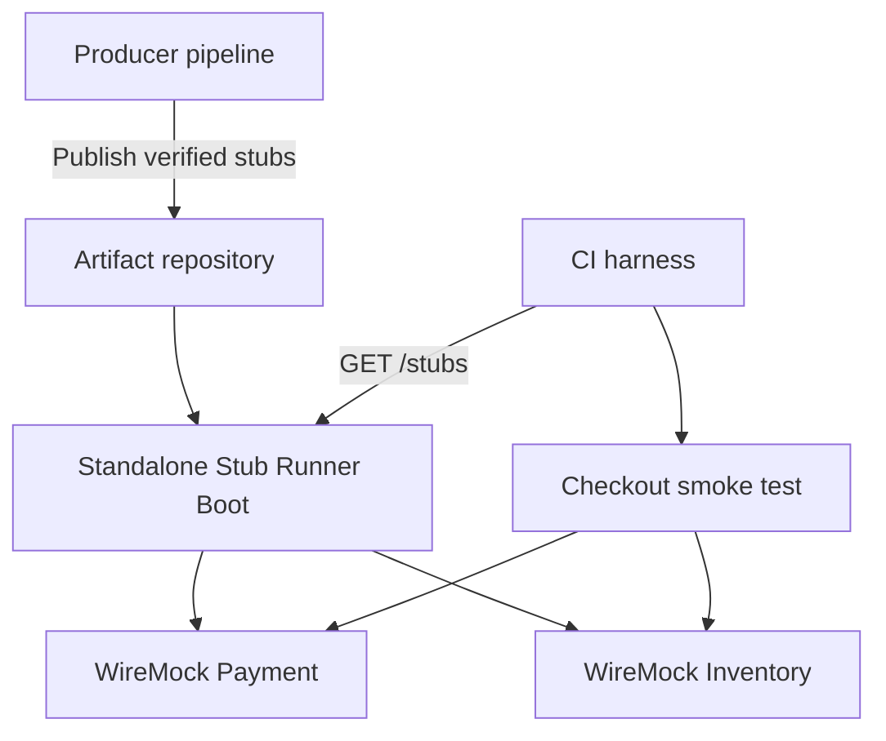

# Stub Runner Boot và cách cấu hình các producer stub

## 1. Vấn đề: chạy nhiều producer stub mà không khởi động toàn bộ microservice

Giả sử `Checkout Service` cần gọi đồng thời `Payment Service` và `Inventory Service` để hoàn tất đơn hàng. Mỗi lần chạy smoke test, nếu phải khởi động cả hai producer cùng database và hạ tầng liên quan, thời gian chuẩn bị có thể lớn hơn thời gian kiểm tra chính.

Với **Spring Cloud Contract**, mỗi producer có thể mô tả hành vi HTTP hoặc thông điệp bằng Groovy/YAML DSL, sinh **producer verification tests** và xuất bản **stub artifact** sau khi kiểm chứng. Consumer sử dụng những stub đó để kiểm tra request, response, serialization và cách xử lý lỗi mà không cần chạy producer thật.

**Stub Runner Boot** là một ứng dụng Spring Boot chạy **độc lập** để tải, đăng ký và cung cấp stub của nhiều producer qua những HTTP server mô phỏng (thường là WireMock). Ứng dụng còn có các REST endpoint quản lý danh sách stub và kích hoạt các messaging label khi tích hợp messaging được cấu hình. Nó hữu ích cho môi trường test dùng chung, consumer viết bằng ngôn ngữ không phải JVM, smoke test sau đóng gói hoặc pipeline CI cần dịch vụ giả lập có thể truy cập qua mạng.

Mục tiêu của bài này:

1. Hiểu Stub Runner Boot khác gì `@AutoConfigureStubRunner`, WireMock và Contract Verifier.
2. Khai báo nhiều **producer stub IDs**, repository, version, classifier và cổng HTTP cho từng producer.
3. Phân biệt `CLASSPATH`, `LOCAL`, `REMOTE`; hiểu khi nào cần `repository-root`.
4. Chạy một ứng dụng Stub Runner Boot bằng Docker hoặc ứng dụng Spring Boot riêng phù hợp phiên bản.
5. Sử dụng đúng hai loại endpoint: **cổng điều khiển Stub Runner** và **cổng WireMock của mỗi producer**.
6. Chẩn đoán lỗi không tải được JAR, sai phiên bản, sai cổng, request không khớp và stub messaging không kích hoạt.
7. Thiết kế môi trường CI an toàn và tái lập, không nhầm stub test với producer verification.

## 2. Kiến trúc: một control server, nhiều HTTP stub server

Khi chạy độc lập, Stub Runner Boot có thể quản lý nhiều producer cùng lúc:



Trong sơ đồ:

- **Cổng 8750** là cổng HTTP của **ứng dụng Stub Runner Boot**. Ví dụ cấu hình `server.port: 8750`.
- **Cổng 8091** là HTTP server mô phỏng `Payment Service`.
- **Cổng 8092** là HTTP server mô phỏng `Inventory Service`.
- Các cổng là **giá trị minh họa**, phải thực sự được mở/ánh xạ trong môi trường chạy.

**Không gửi `GET /api/payments/42` tới cổng 8750.** Cổng điều khiển chứa endpoint như `/stubs`; request nghiệp vụ phải đến cổng WireMock của producer, ví dụ `http://localhost:8091/api/payments/42`.

### 2.1. So sánh ba cách sử dụng Stub Runner

| Cách | Vòng đời | Phù hợp với |
| --- | --- | --- |
| `@AutoConfigureStubRunner` trong Spring test | Stub khởi động cùng test context của consumer | JUnit/integration test JVM, URL được inject theo test |
| **Stub Runner Boot standalone** | Ứng dụng độc lập, quản lý stub cho nhiều consumer/test harness | Smoke test, Docker/CI, client Python/Node.js, môi trường test dùng chung |
| WireMock chạy trực tiếp | Người viết test tự nạp/tạo mappings | HTTP client test đặc thù, fault simulation, không cần tải artifact Contract |

Stub Runner Boot **không** tự tạo hợp đồng mới hay sinh producer tests. Nó chỉ sử dụng artifact stub đã có từ build producer hoặc một nguồn stub được cấu hình.

## 3. Điều kiện bắt buộc: producer đã xuất bản stub artifact

Trước khi cấu hình một producer stub, phải xác định:

1. Producer sở hữu API nào và các hợp đồng đã được thống nhất với consumer nào.
2. Build producer đã **sinh và chạy Contract Verifier tests** trên implementation thực.
3. Test producer đạt trước khi publish stub artifact; tránh dùng bản chưa xác minh.
4. Stub JAR có thể được tải từ Maven local repository hoặc artifact repository phù hợp.
5. Tọa độ `groupId`, `artifactId`, `version`, `classifier` chính xác.

Ví dụ giả định hai artifact đã tồn tại:

```text
com.example:payment-service:1.2.0:stubs
com.example:inventory-service:2.3.1:stubs
```

Tên file JAR phổ biến tương ứng:

```text
payment-service-1.2.0-stubs.jar
inventory-service-2.3.1-stubs.jar
```

Một HTTP contract ví dụ ở `Payment Service`:

```groovy
import org.springframework.cloud.contract.spec.Contract

Contract.make {
    description 'Tra cuu thanh toan da hoan tat'
    request {
        method GET()
        url '/api/payments/42'
        headers {
            header('Accept', 'application/json')
        }
    }
    response {
        status OK()
        headers {
            contentType(applicationJson())
        }
        body(paymentId: 42, status: 'PAID')
    }
}
```

Một contract YAML giả định ở `Inventory Service`:

```yaml
description: Kiem tra so luong ton kho
request:
  method: GET
  url: /api/stock/BOOK-01
response:
  status: 200
  headers:
    Content-Type: application/json
  body:
    sku: BOOK-01
    available: 12
```

Khi producer verification đạt, stub mappings được đóng gói để consumer nhận `200` và dữ liệu mẫu. **Stub Runner Boot không gọi hai producer thật để xác nhận những response đó.**

## 4. Cú pháp producer stub ID: Ivy/Maven coordinates và cổng

Stub Runner nhận danh sách `ids` theo dạng:

```text
groupId:artifactId:version:classifier:port
```

Ví dụ:

```text
com.example:payment-service:1.2.0:stubs:8091
com.example:inventory-service:2.3.1:stubs:8092
```

| Trường | Ví dụ | Ý nghĩa |
| --- | --- | --- |
| `groupId` | `com.example` | Nhóm Maven của producer |
| `artifactId` | `payment-service` | Artifact của producer, **không phải consumer** |
| `version` | `1.2.0` | Phiên bản stub artifact cần tải |
| `classifier` | `stubs` | Phân biệt JAR stubs với JAR ứng dụng thông thường |
| `port` | `8091` | Cổng HTTP stub server tương ứng với producer đó |

Phần version, classifier và port có thể được lược bỏ tùy cú pháp mà bản Stub Runner hỗ trợ. Mặc định thường dùng classifier `stubs`, khi không chỉ định port thì chọn một cổng rảnh trong dải cấu hình. Nếu không chỉ định version, một số bản chọn `+` để lấy bản mới nhất.

**Khuyến nghị cho CI:** khai báo **version cụ thể** và cân nhắc cổng cố định khi cần chạy từ bên ngoài container. Dùng `+` thuận tiện khi khám phá nhưng gây thiếu khả năng tái lập nếu artifact mới xuất hiện giữa hai lần build.

### 4.1. Cổng cố định hay cổng ngẫu nhiên?

- **Cổng cố định:** thuận lợi cho Docker `-p`, smoke test từ Node.js và các hệ thống không có client `StubFinder`; phải tránh chạy song song trùng cổng.
- **Cổng ngẫu nhiên:** thuận lợi cho JUnit tests chạy song song trong một máy; test cần tra cứu port từ Stub Runner thay vì tự hard-code.

`spring.cloud.contract.stubrunner.min-port` và `max-port` xác định khoảng chọn cổng tự động. Chúng **không thay thế** những port đã ghi rõ ở cuối `ids`.

## 5. `stubs-mode`: chọn nguồn tải stub

Ba chế độ thường dùng:

| Chế độ | Nguồn stub | Khi nên dùng |
| --- | --- | --- |
| `CLASSPATH` | Stubs nằm trên classpath ứng dụng/test theo cấu hình | Dự án nhúng artifact trực tiếp trong classpath |
| `LOCAL` | Maven local repository trên filesystem có thể truy cập | Phát triển máy cá nhân, CI đã cài stub JAR trước |
| `REMOTE` | Artifact repository hoặc nguồn remote được hỗ trợ | CI/container, nhóm dùng Nexus/Artifactory |

**`LOCAL` không có nghĩa Stub Runner tự tìm source contract trong repository Git của producer.** Nó cần một artifact phù hợp trong Maven local repository (ví dụ đã được cài bằng quy trình build/publish local).

**`REMOTE` không có nghĩa bật chế độ HTTP proxy tới producer thật.** Nó chỉ chỉ dẫn cách **tải stub artifact**, sau đó WireMock mô phỏng API của producer.

### 5.1. Cấu hình LOCAL trong `application.yml`

Ví dụ cấu hình cho một ứng dụng Stub Runner Boot tùy chỉnh:

```yaml
server:
  port: 8750

spring:
  application:
    name: standalone-stub-runner
  cloud:
    contract:
      stubrunner:
        stubs-mode: LOCAL
        ids:
          - "com.example:payment-service:1.2.0:stubs:8091"
          - "com.example:inventory-service:2.3.1:stubs:8092"
```

Điều kiện để cấu hình chạy:

1. Stub JAR của Payment và Inventory đã nằm trong **Maven local repository của chính process Stub Runner Boot**.
2. Các cổng 8750, 8091 và 8092 không bị tiến trình khác chiếm.
3. Các mapping trong JAR đúng cấu trúc Stub Runner đọc được.
4. Consumer được cấu hình trỏ tới **cổng stub**, không trỏ tới producer thật.

Ví dụ cây artifact local mang tính minh họa:

```text
~/.m2/repository/com/example/payment-service/1.2.0/
    payment-service-1.2.0-stubs.jar
~/.m2/repository/com/example/inventory-service/2.3.1/
    inventory-service-2.3.1-stubs.jar
```

Nếu chạy qua Docker, thư mục `~/.m2` ở host **không tự xuất hiện trong container**. Phải mount nó đến vị trí local Maven repo mà image sử dụng, với quyền đọc phù hợp, và tránh đưa thông tin đăng nhập Maven không cần thiết vào container.

### 5.2. Cấu hình REMOTE cho Nexus hoặc Artifactory

```yaml
server:
  port: 8750

spring:
  cloud:
    contract:
      stubrunner:
        stubs-mode: REMOTE
        repository-root: "https://artifacts.example.test/repository/maven-releases/"
        ids:
          - "com.example:payment-service:1.2.0:stubs:8091"
          - "com.example:inventory-service:2.3.1:stubs:8092"
```

Tên miền `artifacts.example.test` **chỉ là địa chỉ minh họa**, không phải Maven repository có thật. Khi sử dụng, thay bằng địa chỉ Nexus/Artifactory mà CI có quyền đọc.

Nếu repository cần xác thực, Stub Runner có các thuộc tính `username`, `password` tương ứng. Hãy cung cấp chúng bằng **secret manager/environment variables** tại runtime thay vì lưu vào YAML đang commit:

```text
SPRING_CLOUD_CONTRACT_STUBRUNNER_USERNAME
SPRING_CLOUD_CONTRACT_STUBRUNNER_PASSWORD
```

Cấu hình trên phục vụ **tải artifact**; không tự áp dụng HTTP Basic hoặc JWT cho stub endpoint của producer.

### 5.3. Mô hình CLASSPATH

Với `CLASSPATH`, stubs cần thực sự có trên classpath. Nếu đóng gói JAR tùy chỉnh hoặc dựa vào classpath trong môi trường khác, phải xác minh các resource `mappings` và contract có thể được Stub Runner nhìn thấy.

Không trộn lẫn giả định “JAR nằm trên classpath” với “JAR đã cài vào Maven local repository”. Hai cách nạp có cơ chế tìm artifact khác nhau; nên đặt `stubs-mode` tường minh để tránh lỗi phụ thuộc default giữa các phiên bản.

## 6. Chạy Stub Runner Boot bằng Docker: hướng ưu tiên cho bản mới

**Lưu ý quan trọng về phát hành:** Tài liệu Spring Cloud Contract hiện hành cảnh báo từ bản **4.1.6** chưa thể phát hành executable `spring-cloud-contract-stub-runner-boot` JAR qua quy trình repository hiện tại. Docker Stub Runner Boot image là cách dùng được **khuyến nghị**, hoặc nhóm có thể tự build ứng dụng từ source. Vì vậy **đừng mặc định tải một fat JAR bản mới từ Maven Central sẽ thành công**.

Tài liệu Docker hiện hành ghi nhận image độc lập:

```text
spring-cloud/spring-cloud-contract-stub-runner
```

Tag/version và đường dẫn registry có thể thay đổi theo release; cần kiểm tra image/tag được xuất bản cho **phiên bản Spring Cloud Contract phù hợp** trước khi chạy. Một số ví dụ cũ dùng tên `springcloud/spring-cloud-contract-stub-runner`; không tự suy rằng hai tên luôn là alias tương đương.

### 6.1. Ví dụ khởi động hai producer stubs từ remote repository

Đoạn lệnh sau là **mẫu để chạy sau khi thay image tag, địa chỉ repository và tọa độ artifact thật**:

```bash
docker run --rm --name contract-stub-runner \
  -e SERVER_PORT=8750 \
  -e SPRING_CLOUD_CONTRACT_STUBRUNNER_STUBS_MODE=REMOTE \
  -e SPRING_CLOUD_CONTRACT_STUBRUNNER_REPOSITORY_ROOT=https://artifacts.example.test/repository/maven-releases/ \
  -e SPRING_CLOUD_CONTRACT_STUBRUNNER_IDS="com.example:payment-service:1.2.0:stubs:8091,com.example:inventory-service:2.3.1:stubs:8092" \
  -p 127.0.0.1:8750:8750 \
  -p 127.0.0.1:8091:8091 \
  -p 127.0.0.1:8092:8092 \
  spring-cloud/spring-cloud-contract-stub-runner:<compatible-tag>
```

Giải thích:

| Tùy chọn | Ý nghĩa |
| --- | --- |
| `SERVER_PORT=8750` | Đặt cổng HTTP quản lý của Spring Boot |
| `STUBS_MODE=REMOTE` | Tải stub artifact từ nguồn remote |
| `REPOSITORY_ROOT` | URL artifact repository |
| `IDS` | Hai producer và hai port WireMock cố định |
| `-p 127.0.0.1:8750:8750` | Chỉ mở control API cho localhost trên host |
| `-p 127.0.0.1:8091:8091` | Mở HTTP stub Payment ra localhost |
| `-p 127.0.0.1:8092:8092` | Mở HTTP stub Inventory ra localhost |

Tùy image/release, biến `IDS` có thể cần biểu diễn dưới dạng danh sách theo cú pháp environment binding phù hợp. Hãy xem log khi khởi động để xác nhận **cả hai ID được parse thành hai mục**, không bị hiểu thành một chuỗi duy nhất. Nếu cần tránh sự mơ hồ này, có thể dùng cấu hình YAML được mount hoặc truyền `SPRING_CLOUD_CONTRACT_STUBRUNNER_IDS_0`, `..._IDS_1` theo cơ chế Spring Boot binder của phiên bản đang chạy.

**Đây là ví dụ dành cho máy Linux/macOS có shell hỗ trợ dấu `\` nối dòng.** Trong PowerShell trên Windows, dùng một dòng hoặc ký hiệu tiếp dòng của PowerShell, không sao chép nguyên ký tự `\` cuối dòng.

### 6.2. Docker LOCAL cần volume chứa Maven local

Nếu hai artifact đã được cài vào Maven local của host, chọn `LOCAL` và mount repository:

```bash
docker run --rm --name contract-stubs-local \
  -e SERVER_PORT=8750 \
  -e SPRING_CLOUD_CONTRACT_STUBRUNNER_STUBS_MODE=LOCAL \
  -e SPRING_CLOUD_CONTRACT_STUBRUNNER_IDS="com.example:payment-service:1.2.0:stubs:8091" \
  -v "$HOME/.m2:/home/scc/.m2:ro" \
  -p 127.0.0.1:8750:8750 \
  -p 127.0.0.1:8091:8091 \
  spring-cloud/spring-cloud-contract-stub-runner:<compatible-tag>
```

`/home/scc/.m2` là **đường dẫn container được sử dụng trong ví dụ tài liệu của một số image**; phải kiểm tra image/tag thực tế và user chạy bên trong container trước khi áp dụng. Nếu Maven local của container nằm chỗ khác, mount đúng chỗ đó hoặc cấu hình `maven.repo.local`.

Nếu host chưa có stub JAR, mount thư mục rỗng không làm `LOCAL` tự tải từ Artifactory. Khi đó cần bước build producer cài JAR vào Maven local hoặc chuyển sang `REMOTE`.

### 6.3. Không xuất bản control API ra mạng không tin cậy

Stub Runner Boot **không được thiết kế có bảo mật mặc định**. Tài liệu chính thức cảnh báo không chạy fat JAR hoặc Docker image trên vị trí mạng không tin cậy. Những endpoint quản lý có thể tiết lộ stub đang chạy hoặc kích hoạt message.

Vì vậy:

- Chỉ chạy trên **máy phát triển, mạng CI hoặc môi trường test cô lập**.
- Bind host ports vào `127.0.0.1` khi chỉ dùng từ cùng máy.
- Với CI nhiều container, dùng network riêng và giới hạn inbound traffic; không đẩy control port ra Internet.
- Không tải JAR từ nguồn không đáng tin hoặc mở khả năng quản lý WireMock cho mọi người.
- Không đặt credentials artifact repository vào image hoặc commit trong repository.

## 7. Tự tạo một Stub Runner Boot server bằng Spring Boot

Nếu không dùng image có sẵn, có thể tạo một ứng dụng Spring Boot riêng tương thích với bản Spring Cloud Contract của dự án.

Dependency cốt lõi theo tài liệu:

```groovy
dependencies {
    implementation 'org.springframework.cloud:spring-cloud-starter-stub-runner'
}
```

Đây là **đoạn trong `build.gradle`**, chưa phải project đầy đủ. Cần Spring Boot plugin, dependency management/BOM và versions tương thích.

Ứng dụng Boot minh họa:

```java
@SpringBootApplication
@EnableStubRunnerServer
public class StandaloneStubRunnerApplication {

    public static void main(String[] args) {
        SpringApplication.run(StandaloneStubRunnerApplication.class, args);
    }
}
```

Các import được lược bỏ để tập trung vào ý tưởng; hãy dùng annotation `@EnableStubRunnerServer` do **thư viện Stub Runner của phiên bản dự án** cung cấp. Khi đóng gói, tạo executable Spring Boot JAR bằng plugin build tương ứng và cấu hình `application.yml` như mục 5.

**Khác biệt quan trọng:** Tự tạo ứng dụng `@EnableStubRunnerServer` không đồng nghĩa tải được executable JAR `spring-cloud-contract-stub-runner-boot` bản mới từ Maven Central. Đây là **hai cách phân phối khác nhau**: tự build một ứng dụng Boot và sử dụng binary prebuilt.

### 7.1. Chạy custom JAR với đối số CLI

Nếu đã build ứng dụng Boot của nhóm:

```bash
java -jar standalone-stub-runner.jar \
  --server.port=8750 \
  --spring.cloud.contract.stubrunner.stubs-mode=LOCAL \
  --spring.cloud.contract.stubrunner.ids="com.example:payment-service:1.2.0:stubs:8091"
```

`standalone-stub-runner.jar` là tên file giả định **do nhóm build**, không phải lời khẳng định file này đang có sẵn hoặc tên artifact chính thức của Spring Cloud Contract.

### 7.2. Hướng dẫn cũ: fat JAR hoặc Spring Cloud CLI

Một số tài liệu/release cũ minh họa:

```bash
java -jar spring-cloud-contract-stub-runner-boot-<old-version>.jar \
  --spring.cloud.contract.stubrunner.ids="com.example:payment-service:1.2.0:stubs:8091"
```

hoặc Spring Cloud CLI với lệnh `spring cloud stubrunner`. Cả hai là **hướng dẫn có tính lịch sử/phụ thuộc công cụ**: trước khi chọn, xác minh artifact, CLI và tương thích phiên bản còn sẵn có. Với các bản phát hành mới, tài liệu khuyến nghị Docker hoặc tự build.

## 8. REST endpoints quản lý của Stub Runner Boot

Khi ứng dụng khởi động trên cổng `8750`, nó cung cấp các endpoint để kiểm tra stub đang chạy và kích hoạt messaging label (theo tích hợp/version):

| Method | Endpoint trên control server | Mục đích |
| --- | --- | --- |
| `GET` | `/stubs` | Liệt kê producer stubs đang chạy và port |
| `GET` | `/stubs/{ivy}` | Tra cứu port của một producer theo tọa độ ID/viết gọn được hỗ trợ |
| `GET` | `/triggers` | Liệt kê các messaging labels có thể kích hoạt |
| `POST` | `/triggers/{label}` | Kích hoạt một message stub theo label |
| `POST` | `/triggers/{ivy}/{label}` | Kích hoạt label cho producer được chỉ định |

Các endpoint này là **API của Stub Runner Boot**, không phải API nghiệp vụ Payment/Inventory. `{ivy}` biểu thị producer stub ID; một số phiên bản cho phép chỉ dùng `artifactId` khi duy nhất và không gây nhập nhằng.

### 8.1. Tra cứu các stub đã khởi động

```bash
curl -s http://localhost:8750/stubs
```

Phản hồi minh họa:

```json
{
  "com.example:payment-service:1.2.0:stubs": 8091,
  "com.example:inventory-service:2.3.1:stubs": 8092
}
```

**Đây là ví dụ về kiểu dữ liệu**, không khẳng định tên key/thứ tự/format khác của mọi phiên bản giống hệt. Hãy dùng output thực tế của `/stubs` để xác nhận mapping giữa producer và port.

Tra cứu riêng Payment bằng dạng đơn giản nếu server cho phép:

```bash
curl -s http://localhost:8750/stubs/payment-service
```

Kỳ vọng khi ID tồn tại là một cổng dương, ví dụ `8091`. Nếu có nhiều stub cùng artifactId nhưng khác group/version, nên dùng tọa độ đầy đủ hoặc định danh đủ phân biệt, và encode URL nếu có ký tự đặc biệt.

### 8.2. Gọi HTTP API của producer stub

```bash
curl -i -H "Accept: application/json" \
  http://localhost:8091/api/payments/42
```

Ví dụ response:

```http
HTTP/1.1 200 OK
Content-Type: application/json

{"paymentId":42,"status":"PAID"}
```

Inventory:

```bash
curl -i http://localhost:8092/api/stock/BOOK-01
```

Nếu `GET /stubs` hiển thị `8091` nhưng `curl` từ máy khác không tới được cổng đó, vấn đề có thể nằm ở **Docker port publish, network namespace, firewall hoặc host address**, không phải nội dung contract.

## 9. Messaging labels và trigger trong standalone server

Stub Runner Boot không chỉ quản lý HTTP stubs. Với messaging integration phù hợp, nó còn cung cấp endpoint trigger message.

Một hợp đồng messaging ví dụ:

```groovy
import org.springframework.cloud.contract.spec.Contract

Contract.make {
    description 'Thong bao thanh toan hoan tat'
    label 'payment_completed'

    input {
        triggeredBy('completePaymentAndPublish()')
    }

    outputMessage {
        sentTo('payments.completed')
        body(
            eventType: 'PaymentCompleted',
            paymentId: 42,
            status: 'PAID'
        )
    }
}
```

Khi stub artifact này được nạp và **Stub Runner Boot có message verifier/binder hoặc broker adapter thích hợp**, có thể xem labels:

```bash
curl -s http://localhost:8750/triggers
```

Sau đó kích hoạt label:

```bash
curl -i -X POST http://localhost:8750/triggers/payment_completed
```

**Cần hiểu chính xác:**

- API `/triggers` chỉ điều phối hành động gửi message stub; message được phát vào **transport đã cấu hình**.
- `POST /triggers/payment_completed` thành công **không chứng minh** Notification Service đã nhận và xử lý sự kiện.
- Nếu nhiều producer có label trùng nhau, nên dùng `/triggers/{ivy}/{label}` để chỉ rõ nguồn.
- Không phải cứ bật Stub Runner Boot là có Kafka/RabbitMQ broker hoạt động; messaging cần dependency, binder, destination và connection phù hợp.
- HTTP WireMock không tự thay thế message broker, và Stub Runner Boot không tự kiểm chứng retry, ordering hoặc exactly-once delivery.

Ví dụ Docker có thể cần khai báo `MESSAGING_TYPE` theo hướng dẫn image, cùng cấu hình `SPRING_KAFKA_BOOTSTRAP_SERVERS` hoặc `SPRING_RABBITMQ_ADDRESSES`. Đối chiếu lựa chọn với phiên bản image và cách tích hợp messaging thực của hệ thống.

## 10. Chọn consumer name khi một producer có nhiều nhóm hợp đồng

Một producer có thể đóng gói nhiều nhóm contract:

```text
contracts/
  checkout-service/
    payment_status.groovy
  reporting-service/
    payment_report.groovy
```

Nếu bật **stubs-per-consumer**, Stub Runner có thể lọc mapping dành cho một consumer thay vì nạp toàn bộ.

```yaml
spring:
  cloud:
    contract:
      stubrunner:
        stubs-per-consumer: true
        consumer-name: checkout-service
```

Khác với `@AutoConfigureStubRunner` trong test context, một standalone server phục vụ **nhiều consumer đồng thời** cần cân nhắc: nếu cấu hình `consumer-name: checkout-service` toàn cục thì các mappings của Reporting có thể không được nạp. Nếu cần các nhóm khác nhau trong cùng test environment, hãy thiết kế các instance Stub Runner Boot hoặc một chiến lược lọc phù hợp.

**`consumer-name` không phải cơ chế xác thực người gọi.** Nó chỉ quyết định tập mapping được nạp, không chứng minh request đến từ consumer nào. Không dùng nó thay authorization hoặc tenant isolation.

## 11. Service discovery và smoke test nhiều dịch vụ

Một mục đích của Stub Runner Boot là chạy smoke tests khi ứng dụng consumer vừa được đóng gói/triển khai: chỉ chạy consumer thật cùng một nhóm producer stubs thay vì triển khai đủ mọi microservice.

Nếu consumer gọi downstream bằng `serviceId` thông qua service discovery/load balancer thay vì URL cố định, có hai chiến lược:

1. **Cấu hình URL trực tiếp trong test profile** trỏ tới các stub ports của Payment/Inventory.
2. **Tích hợp Stub Runner Boot với service discovery** theo cơ chế mà Spring Cloud Contract và discovery backend đang hỗ trợ để client có thể tìm đúng stub.

Ví dụ khi dùng URL trực tiếp:

```yaml
payment:
  client:
    base-url: http://localhost:8091
inventory:
  client:
    base-url: http://localhost:8092
```

Đây là cấu hình **của consumer** trong môi trường smoke test, không phải cấu hình `ids` của Stub Runner. Trong Docker Compose/Kubernetes, `localhost` của consumer **không** phải localhost của container Stub Runner; phải dùng hostname/service name và port có thể truy cập qua mạng chung.

Nếu dùng discovery thật, cần kiểm tra tên `serviceId`, cách Stub Runner đăng ký fake instance, TTL/health checks và khả năng load balancer trả đúng endpoint. Một `ids` có `artifactId=payment-service` không bảo đảm service registry sẽ tự công bố cùng tên khi ứng dụng đặt serviceId khác.

## 12. Thiết kế môi trường Docker Compose hoặc CI

### 12.1. Các thành phần tối thiểu



Một workflow CI đáng tin cậy có thể gồm:

1. Producer build chạy **generated contract verification** trên implementation thực.
2. Chỉ khi pass, producer publish artifact có classifier `stubs`.
3. CI nhận thông tin version của từng producer stub cần dùng.
4. CI khởi động Stub Runner Boot trong mạng test riêng.
5. Kiểm tra `GET /stubs` cho biết đủ producer và port.
6. Chạy vài request kiểm tra mappings HTTP/labels messaging.
7. Khởi động consumer/smoke-test application với downstream URLs đã định tuyến sang stub.
8. Chạy test nghiệp vụ của consumer và thu thập log khi thất bại.
9. Dừng/loại bỏ môi trường stub, không để server test tồn tại ngoài phạm vi cần thiết.

### 12.2. Dữ liệu và version phải tái lập

Ví dụ một bản ghi cấu hình test:

```yaml
contract-test-environment:
  consumer-build: checkout-service-2.8.0
  producers:
    payment-service: 1.2.0
    inventory-service: 2.3.1
  stub-runner:
    server-port: 8750
    payment-port: 8091
    inventory-port: 8092
```

Đây là **mô hình metadata CI minh họa**, không phải file `application.yml` mà Spring Boot tự động đọc và cấu hình. Có thể lưu các giá trị tương ứng dưới dạng biến pipeline hoặc build manifest để tái hiện môi trường khi lỗi xảy ra.

Không dùng các version động như `+` khi cần tái lập chính xác một lỗi. Nếu có nhiều pipeline chạy song song, nên cấp cổng/network riêng hoặc dùng cổng ngẫu nhiên cùng cơ chế khám phá để tránh conflict.

### 12.3. Tách trách nhiệm kiểm thử

| Bước | Điều nó chứng minh | Điều nó không tự chứng minh |
| --- | --- | --- |
| Producer Verifier | Producer đúng với contract đã chạy | Mọi luồng nghiệp vụ/E2E đều đúng |
| Stub Runner Boot khởi động | Artifact có thể được nạp và stub server hoạt động | Producer đang chạy thật hoặc database hoạt động |
| Consumer smoke test với stub | Client gọi đúng stub và xử lý dữ liệu mẫu | Mạng production, DNS, auth, broker có cùng hành vi |
| Integration/E2E test | Luồng được thử trong hạ tầng gần thật hơn | Không bảo đảm mọi trường hợp ngoài phạm vi test |

Chỉ vì `GET /stubs` trả hai producer và cổng HTTP không có nghĩa mọi request trong hợp đồng đều khớp hoặc producer hiện tại đã tương thích.

## 13. Chẩn đoán lỗi cấu hình producer stubs

| Triệu chứng | Nguyên nhân thường gặp | Hướng xử lý |
| --- | --- | --- |
| `/stubs` trả danh sách rỗng | `ids` không được parse, không có artifact hoặc config không được nạp | Kiểm tra environment binding, effective properties và log tải stub |
| Không tải được stub JAR ở `LOCAL` | Local Maven repo của process không có artifact | Build/publish local hoặc mount đúng repo container |
| Không tải được stub JAR ở `REMOTE` | Repository URL/credentials/network sai, version không tồn tại | Kiểm tra repository-root, quyền đọc, proxy và coordinates |
| Đã tải JAR nhưng không có HTTP mappings | JAR thiếu mapping hoặc layout/classifier sai | Kiểm tra cấu trúc artifact được phát hành |
| `/stubs` hiển thị port nhưng curl bị connection refused | Stub server bind khác interface, Docker không publish port | Kiểm tra process, container ports, firewall |
| `/stubs/payment-service` không trả port | Artifact name/ID không khớp, nhiều phiên bản gây nhập nhằng | Dùng tọa độ đầy đủ |
| Curl trả 404 nhưng đã đăng ký stub | URL, method, header hoặc JSON body không khớp | Kiểm tra request journal và WireMock mapping |
| Consumer nhận response sai | Stub version cũ, mapping xung đột hoặc stub của consumer khác | Ghim version, kiểm tra `stubs-per-consumer` và mappings |
| Hai producer đòi cùng port | Cấu hình `ids` trùng cổng | Cấp cổng khác nhau hoặc dùng dynamic ports |
| Docker chạy nhưng từ container consumer không gọi được | Đang trỏ localhost của container consumer | Dùng hostname mạng chung của Stub Runner |
| Messaging trigger không gửi event | Binder/broker/label/destination thiếu hoặc sai | Kiểm tra `/triggers`, message adapter và broker config |
| Test xanh nhưng producer đã đổi schema | Consumer vẫn dùng stub JAR cũ hoặc producer tests bị skip | Chạy producer verification trên code/version mới |

### 13.1. Phân biệt “không có mapping” với response nghiệp vụ 404

Request tới `http://localhost:8091/api/payments/999` nhận `404` có thể vì:

- Stub thực sự có hợp đồng `PAYMENT_NOT_FOUND`, trả `404` cùng body lỗi đã thỏa thuận.
- WireMock không có mapping nào khớp, nên trả lỗi unmatched request.

Phải kiểm tra **body/headers** và WireMock diagnostics, không kết luận rằng producer API đã phát sinh lỗi nghiệp vụ chỉ từ status `404`.

### 13.2. Stub Runner Boot server đang chạy nhưng consumer vẫn kết nối producer thật

Thường do consumer configuration chưa override URL/service discovery. Stub Runner không thể tự chặn HTTP client tùy ý gọi host production; cần cấu hình test profile hoặc discovery integration phù hợp.

Hãy kiểm tra actual target URL của request được gửi, nhưng **không log token/PII thật** trong dữ liệu debug. Với mỗi producer, lưu rõ `artifact ID → stub port → URL consumer`.

### 13.3. Sai service name, version hoặc classifier

```text
Expected: com.example:payment-service:1.2.0:stubs
Actual:   com.example:payment-api:1.2.0
```

Khác `artifactId` hoặc thiếu `classifier=stubs` có thể dẫn tới tải nhầm artifact hay không tải được. Đừng tự đổi `ids` sang tên consumer (ví dụ `checkout-service`) để “khớp” với Spring application name.

### 13.4. Nạp nhiều producer nhưng một producer bị lỗi

Một stub server khởi động thành công không chứng minh **tất cả** `ids` đã tải đúng. Hãy đối chiếu `/stubs` với **toàn bộ danh sách mong đợi** và fail CI nếu thiếu bất kỳ producer bắt buộc nào. Kiểm tra log tải artifact, parse IDs và liệu một mode hoặc profile đang override danh sách.

## 14. Bài thực hành: chạy hai producer stub cho một consumer

Giả sử `Booking Service` (consumer) cần:

- `Room Service`: `GET /api/rooms/101`, trả `{"roomId":101,"available":true}`.
- `Pricing Service`: `GET /api/prices/101`, trả `{"roomId":101,"nightlyPrice":850000,"currency":"VND"}`.

Producer đã kiểm chứng và phát hành:

```text
com.example:room-service:1.4.0:stubs
com.example:pricing-service:2.1.0:stubs
```

### 14.1. Yêu cầu

1. Chọn hai HTTP stub ports `8093`, `8094` và control port `8750`.
2. Viết `application.yml` để chạy Stub Runner Boot ở chế độ `LOCAL` với hai producer IDs.
3. Đề xuất cấu hình consumer Booking để gửi đúng hai request.
4. Viết các lệnh kiểm tra `/stubs` và gọi hai API mẫu.
5. Giải thích điều gì xảy ra khi local Maven repository không chứa `pricing-service-2.1.0-stubs.jar`.
6. Chuyển cấu hình sang `REMOTE` nếu CI dùng Nexus/Artifactory.
7. Nếu ứng dụng Booking ở container khác với Stub Runner Boot, vì sao `localhost:8093` là địa chỉ sai?

### 14.2. Gợi ý lời giải YAML

```yaml
server:
  port: 8750
spring:
  cloud:
    contract:
      stubrunner:
        stubs-mode: LOCAL
        ids:
          - "com.example:room-service:1.4.0:stubs:8093"
          - "com.example:pricing-service:2.1.0:stubs:8094"
```

Trong consumer test chạy cùng host:

```yaml
room:
  client:
    base-url: "http://localhost:8093"
pricing:
  client:
    base-url: "http://localhost:8094"
```

Điều kiện: `RoomClient` và `PricingClient` của ứng dụng thật phải được cấu hình để đọc đúng hai key này.

### 14.3. Lệnh kiểm tra

```bash
curl -s http://localhost:8750/stubs
curl -i http://localhost:8093/api/rooms/101
curl -i http://localhost:8094/api/prices/101
```

Nếu thiếu `pricing-service` ở Maven local, phải **cài stub artifact** hoặc chọn `REMOTE` với tọa độ artifact và repository đúng. Việc đổi sang REMOTE không bảo đảm thành công nếu artifact chưa được publish hoặc CI không có quyền đọc.

Trong Docker Compose, Booking cần trỏ đến hostname của service Stub Runner (ví dụ `http://stub-runner:8093`) trên cùng network, không phải localhost của chính Booking container.

### 14.4. Bài tập phản biện

| Câu hỏi | Gợi ý |
| --- | --- |
| Cổng 8750 có trả `/api/rooms/101` không? | Không; đó là control port, API nghiệp vụ nằm trên cổng Room stub |
| Producer đã thay `available` từ boolean thành string, consumer test stub cũ vẫn xanh; sao? | Stub JAR cũ không phản ánh implementation mới; cần producer verification và nâng version |
| Dùng `+` thay version cụ thể có lợi gì, hại gì? | Tiện lấy mới nhất nhưng làm mất khả năng tái lập |
| Stub Runner Boot có xác minh Kafka retry/DLQ không? | Không; cần message integration/broker tests |
| Có nên mở `/triggers` ra Internet không? | Không; Stub Runner Boot không được thiết kế bảo mật mặc định |

## 15. Checklist trước khi dùng Stub Runner Boot trong CI

- Đã phân biệt **control port** và cổng HTTP stub của từng producer?
- Các producer stub artifacts đã được **producer verification** trước khi publish?
- `ids` có đúng `groupId:artifactId:version:classifier:port` và version được ghim?
- Đã chọn `CLASSPATH`/`LOCAL`/`REMOTE` có chủ đích?
- `repository-root` và credentials có đúng; có tránh lưu secrets vào repository?
- Nếu dùng Docker, đã chọn image/tag tương thích, publish đúng ports và mount Maven repo khi chạy LOCAL?
- `GET /stubs` có hiển thị **đủ tất cả producer bắt buộc**?
- Consumer HTTP client có trỏ đúng stub server, không gọi nhầm producer thật?
- `stubs-per-consumer` và `consumer-name` có phù hợp khi artifact chứa nhiều nhóm mapping?
- Nếu dùng messaging, đã có binder/broker/adapter và `label` tương ứng?
- Control API có giới hạn trong mạng test tin cậy, không công khai ra Internet?
- CI có dọn container, reset state và lưu log đủ để chẩn đoán khi lỗi?
- Có giữ security/integration/E2E tests cho những thứ Stub Runner Boot không thể chứng minh?

**Tài liệu chính thức để tra cứu và đối chiếu phiên bản:**

- [Spring Cloud Contract — Stub Runner Boot Application](https://docs.spring.io/spring-cloud-contract/reference/project-features-stubrunner/stub-runner-boot.html).
- [Spring Cloud Contract — Stub Runner Common Properties](https://docs.spring.io/spring-cloud-contract/reference/project-features-stubrunner/stub-runner-common.html).
- [Spring Cloud Contract — Docker Project](https://docs.spring.io/spring-cloud-contract/reference/docker-project.html).
- [Spring Cloud Contract — Stub Runner Spring Cloud](https://docs.spring.io/spring-cloud-contract/reference/project-features-stubrunner/stub-runner-cloud.html).
- [Spring Cloud Contract — Stub Runner Stubs Per Consumer](https://docs.spring.io/spring-cloud-contract/reference/project-features-stubrunner/stub-runner-stubs-per-consumer.html).

**Ghi nhớ:** **Stub Runner Boot là một ứng dụng điều phối stub độc lập**: tải producer stub artifacts theo tọa độ Maven, khởi động một HTTP stub server cho mỗi producer và cung cấp các endpoint `/stubs`, `/triggers` trên cổng quản lý. Để kiểm thử hiệu quả, hãy ghim version, cấu hình đúng mode/repository/ports, xác minh mỗi stub đã chạy và trỏ consumer đúng cổng. Stub Runner Boot **không tự xác minh producer implementation**, không phải production service và không nên được triển khai trên mạng không tin cậy.
