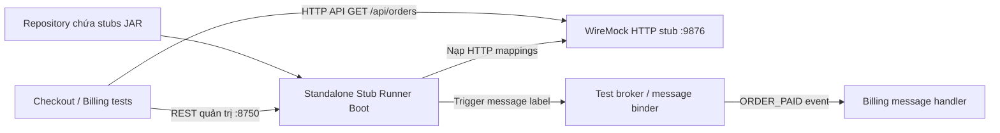
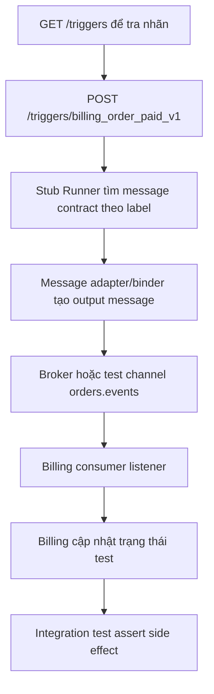
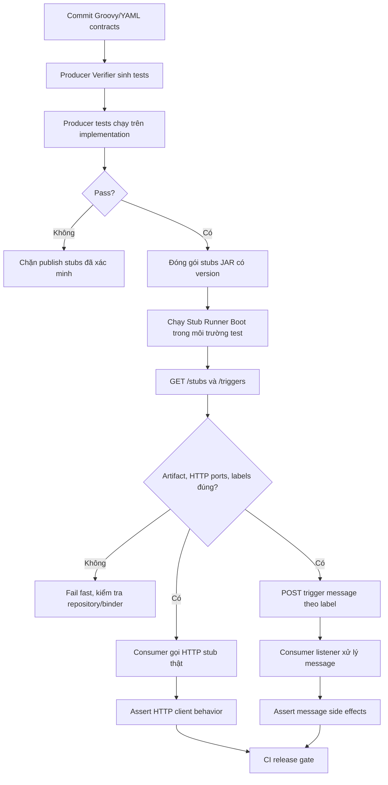

# Tra cứu stub đang chạy và kích hoạt thông điệp

Trong hệ thống microservices, một consumer thường cần sử dụng nhiều **stub** cùng lúc: gọi HTTP tới một producer giả lập và nhận những sự kiện mà producer đó dự kiến sẽ phát. Khi stub được chạy **độc lập** trong một tiến trình hoặc container riêng, người kiểm thử phải biết **stub nào đã khởi động, cổng HTTP nào đang phục vụ nó, những nhãn thông điệp nào có thể kích hoạt và cách xác nhận consumer đã nhận được sự kiện**.

**Spring Cloud Contract Stub Runner Boot** giải quyết nhu cầu này bằng một ứng dụng điều khiển độc lập. Nó tải các **stubs artifacts** được sinh từ hợp đồng **Groovy/YAML DSL**, khởi động những HTTP stub servers thích hợp và công bố các **REST endpoints quản lý** để tra cứu những stub/nhãn đang có. Với message contracts, ứng dụng còn có thể kích hoạt thông điệp mẫu theo `label` khi đã cấu hình đúng cơ chế messaging.

Bài thuộc chương **Stub độc lập** của lộ trình **SPRING_CLOUD_CONTRACT**: học kiểm thử hợp đồng giữa producer và consumer, sinh producer tests, đóng gói stub, chạy Stub Runner và tích hợp CI để phát hiện thay đổi API không tương thích. Nội dung tập trung vào **tra cứu stub đang chạy và kích hoạt thông điệp**, bao gồm cách dùng REST API của standalone Stub Runner, phân biệt hai loại cổng, chuẩn bị broker/binder, kiểm tra kết quả và xử lý lỗi cấu hình.

## 1. Khi nào cần Stub Runner chạy độc lập?

Có hai mô hình thường gặp:

| Mô hình | Stub Runner sống ở đâu? | Cách consumer truy cập |
|---|---|---|
| **Trong ứng dụng test** | Cùng Spring test context, thường qua `@AutoConfigureStubRunner` | Test có thể inject `StubFinder`/`StubTrigger` |
| **Standalone Stub Runner Boot** | Một Spring Boot process hoặc Docker container riêng | Gọi REST quản trị `/stubs`, `/triggers` và HTTP stub ports |
| **WireMock thủ công** | Một server được test tạo và cấu hình riêng | Gọi port WireMock; không tự có REST quản trị của Stub Runner Boot |

**Standalone** hữu ích khi một test suite không muốn khởi động Stub Runner bên trong mỗi consumer application, khi cần smoke test nhiều dịch vụ hoặc khi consumer viết bằng ngôn ngữ không phải Java cũng cần sử dụng cùng bộ stubs.

Tuy nhiên, **ứng dụng Stub Runner Boot không phải producer giả lập có state nghiệp vụ đầy đủ**. Nó phục vụ mappings/message samples từ hợp đồng; nó không chạy Order Service/Inventory Service thật, không tự kết nối database producer và không thay thế producer contract verification.

### 1.1. Ba lớp cần nhìn rõ



Ví dụ có **ba cổng/địa chỉ khác nhau**:

- `localhost:8750` — cổng **quản trị Stub Runner Boot**: dùng `/stubs` và `/triggers`.
- `localhost:9876` — cổng **HTTP stub của Order Service**: dùng `/api/orders/ORDER-42`.
- Địa chỉ **broker** (nếu test messaging thực sự sử dụng Kafka, RabbitMQ, JMS hoặc adapter khác): nơi message được gửi và consumer subscribe.

Không gọi `GET /api/orders/ORDER-42` vào `localhost:8750` rồi cho rằng contract mapping bị thiếu. Cũng không gọi `POST /triggers/...` vào cổng `9876` — đó là cổng của WireMock stub, không phải REST management API.

## 2. Những gì phải có trước khi chạy standalone

Giả sử:

- Producer: **Order Service**, Maven coordinates `com.example:order-service:1.4.0`.
- Consumer HTTP: **Checkout Service**.
- Consumer message: **Billing Service**.
- Artifact dành cho stubbing: `com.example:order-service:1.4.0:stubs`.
- Cổng management Stub Runner Boot: `8750`.
- Cổng HTTP stub Order Service: `9876`.
- Message contract label: `billing_order_paid_v1`.
- Output destination: `orders.events`.

### 2.1. Điều kiện đầu vào

1. Producer có **Groovy/YAML contracts** mô tả các request/response hoặc sự kiện đã thỏa thuận.
2. Spring Cloud Contract plugin đã **sinh và chạy producer contract tests** trên implementation của Order Service.
3. Build producer đã đóng gói một **stubs JAR** có classifier `stubs`.
4. Stubs artifact đã có trong Maven local repository hoặc remote repository mà Stub Runner được phép truy cập.
5. Version Stub Runner Boot tương thích với Java, Spring Boot/Spring Cloud Contract và artifact layout.
6. Nếu kiểm thử message, test broker/binder cùng consumer listener phải được chuẩn bị và kết nối đúng.
7. Chỉ mở cổng management cho môi trường **thử nghiệm đáng tin cậy**.

**Phân biệt artifact:** `order-service-1.4.0.jar` là artifact ứng dụng; `order-service-1.4.0-stubs.jar` thường chứa contracts và mappings. Standalone Stub Runner **không khởi động application JAR của Order Service**.

### 2.2. Ví dụ hợp đồng HTTP

Groovy DSL cho một tương tác Checkout cần:

```groovy
import org.springframework.cloud.contract.spec.Contract

Contract.make {
    name 'checkout_get_paid_order_200'

    request {
        method GET()
        url '/api/orders/ORDER-42'
        headers {
            header 'Accept', 'application/json'
        }
    }

    response {
        status OK()
        headers {
            contentType(applicationJson())
        }
        body(
            id: 'ORDER-42',
            status: 'PAID',
            totalAmount: 125000
        )
    }
}
```

Một contract YAML khác cho trường hợp không có đơn:

```yaml
name: checkout_get_missing_order_404
request:
  method: GET
  url: /api/orders/ORDER-MISSING
  headers:
    Accept: application/json
response:
  status: 404
  headers:
    Content-Type: application/json
  body:
    code: ORDER_NOT_FOUND
```

Hai hợp đồng này chỉ cần producer verification và một stubs artifact; khi Stub Runner nạp mappings, Checkout có thể thử `200` và `404` mà không cần chạy producer thật.

## 3. Hợp đồng thông điệp và `label` để kích hoạt

Giả sử Order Service phát `ORDER_PAID` khi đơn hàng chuyển sang trạng thái đã thanh toán. Billing muốn kiểm tra listener thực của mình trên một event mẫu.

Groovy message contract:

```groovy
import org.springframework.cloud.contract.spec.Contract

Contract.make {
    name 'billing_order_paid_event_v1'
    label 'billing_order_paid_v1'

    input {
        triggeredBy('publishOrderPaid()')
    }

    outputMessage {
        sentTo('orders.events')
        headers {
            header('contentType', 'application/json')
            header('eventType', 'ORDER_PAID')
        }
        body(
            eventId: 'EVENT-ORDER-42',
            eventType: 'ORDER_PAID',
            orderId: 'ORDER-42',
            totalAmount: 125000
        )
    }
}
```

Ý nghĩa các thành phần:

| Thành phần | Vai trò |
|---|---|
| `name 'billing_order_paid_event_v1'` | Tên contract/generated test |
| `label 'billing_order_paid_v1'` | Nhãn dùng để kích hoạt message stub phía consumer |
| `triggeredBy('publishOrderPaid()')` | Hook do base test phía **producer** cung cấp để phát sự kiện thật trong producer verification |
| `outputMessage.sentTo('orders.events')` | Destination của message đầu ra |
| `outputMessage.headers` và `body` | Những giá trị Billing cần deserialize/kiểm tra |

**`label` không phải `eventId`**. Label là tên kịch bản ổn định trong bộ stubs, còn `eventId` là một trường của message, có thể thay đổi với mỗi event instance trong production.

### 3.1. Producer verification khác trigger phía consumer

Khi kiểm tra **producer**, generated test thường gọi `publishOrderPaid()` trên base class rồi xác minh Order Service thật phát event theo hợp đồng. Khi chạy **standalone Stub Runner**, lệnh trigger theo label sử dụng message sample từ **stubs artifact** để gửi một sự kiện mô phỏng; nó **không gọi** phương thức `publishOrderPaid()` của producer thật.

Một YAML message contract có thể diễn đạt thông tin tương đương trong những phiên bản hỗ trợ:

```yaml
name: billing_order_paid_event_v1
label: billing_order_paid_v1
input:
  triggeredBy: publishOrderPaid()
outputMessage:
  sentTo: orders.events
  headers:
    contentType: application/json
    eventType: ORDER_PAID
  body:
    eventId: EVENT-ORDER-42
    eventType: ORDER_PAID
    orderId: ORDER-42
    totalAmount: 125000
```

Cấu trúc YAML message DSL, header conversion và khả năng sinh message trigger **phụ thuộc phiên bản**. Hãy xác minh bản Verifier đã chọn chấp nhận schema và stubs JAR chứa nhãn tương ứng. Không đưa cả Groovy và YAML **tương đương cho cùng kịch bản** vào cùng source set nếu không có chủ đích.

## 4. Chuẩn bị stubs artifact và version

Một stubs JAR minh họa:

```text
order-service-1.4.0-stubs.jar
└── META-INF/
    └── com.example/
        └── order-service/
            └── 1.4.0/
                ├── contracts/
                │   ├── checkout/
                │   │   └── get_paid_order_200.groovy
                │   └── billing/
                │       └── order_paid_event_v1.groovy
                └── mappings/
                    └── checkout/
                        └── checkout_get_paid_order_200.json
```

Đây là **layout minh họa**, không phải đường dẫn bắt buộc cho mọi phiên bản/plugin. Message stub có thể cần **contract nguồn trong artifact**, không chỉ một WireMock mapping JSON. Stub Runner đọc hợp đồng message và xây dựng đường kích hoạt thông điệp theo messaging integration.

Các bước phía producer:

1. Viết contracts phù hợp với consumer.
2. Cấu hình Spring Cloud Contract Verifier/plugin, test base và fixture.
3. Sinh và **thực thi** producer tests.
4. Đóng gói stubs artifact.
5. Kiểm tra classifier, version, contracts/mappings.
6. `install` vào local Maven repository hoặc `publish` tới remote Maven repository.

Ví dụ lệnh Maven trong **dự án producer đã cấu hình**:

```bash
./mvnw clean verify
./mvnw install
jar tf target/order-service-1.4.0-stubs.jar
```

Không phải cứ chạy ba dòng này là mọi project tạo ra file đúng tên: các task, plugin goals, file path và finalName phụ thuộc build. Không dùng `-DskipTests` rồi coi stubs artifact là **đã được producer xác minh**.

### 4.1. Tọa độ stubs trong Stub Runner

Một khai báo thường dùng:

```text
com.example:order-service:1.4.0:stubs:9876
```

Các trường:

```text
groupId       = com.example
artifactId    = order-service
version       = 1.4.0
classifier    = stubs
stubHttpPort  = 9876
```

Cổng `9876` ở cuối là **cổng HTTP của stub server**, không thuộc Maven artifact identity. Khi muốn cổng động, một số cấu hình/phiên bản có thể bỏ cổng hoặc yêu cầu cơ chế chọn cổng riêng; khi đó phải **tra cứu cổng sau khi chạy**, không hard-code URL.

## 5. Khởi động Stub Runner Boot độc lập

Có thể chạy Stub Runner Boot bằng **Docker image**, một ứng dụng Stub Runner Server tự đóng gói hoặc executable JAR **nếu phiên bản đó thực sự được phát hành**.

**Lưu ý về phiên bản:** tài liệu chính thức Spring Cloud Contract ghi nhận rằng **từ 4.1.6**, việc phát hành executable Stub Runner Boot JAR bị tạm ngừng do giới hạn của công cụ phát hành artifact; **Docker Stub Runner Boot image** được khuyến nghị làm lựa chọn thay thế. Vì vậy không nên viết một hướng dẫn bắt buộc tải `stub-runner-boot-x.y.z.jar` cho mọi bản. Trước khi chạy, kiểm tra nguồn phân phối của **version dự án đã chọn**.

### 5.1. Ví dụ Docker dùng remote Maven repository

Lệnh dưới đây minh họa cách chạy trên môi trường thử nghiệm với cổng management `8750` và HTTP stub `9876`:

```bash
docker run --rm --name order-contract-stubs \
  -e STUBRUNNER_IDS=com.example:order-service:1.4.0:stubs:9876 \
  -e STUBRUNNER_STUBS_MODE=REMOTE \
  -e STUBRUNNER_REPOSITORY_ROOT=https://repo.example.test/maven-releases \
  -p 8750:8750 \
  -p 9876:9876 \
  springcloud/spring-cloud-contract-stub-runner:VERSION_PHU_HOP
```

**Đây là mẫu cấu hình**, không phải lệnh đã được chạy. Phải thay `VERSION_PHU_HOP` bằng image tag tồn tại và tương thích; thay URL ví dụ bằng artifact repository của môi trường test có chứa `order-service:1.4.0:stubs`. Các tên environment variables/port mặc định cần được kiểm tra với **tag Docker và Spring Cloud Contract version** thực tế.

Để lệnh chạy thành công cần:

- Registry có image phù hợp, Docker engine hoạt động.
- Repository trả về đúng stubs artifact, có quyền truy cập và credentials an toàn nếu cần.
- Các cổng `8750` và `9876` không bị chiếm ở host.
- HTTP stub trong container thực sự lắng nghe cổng `9876`.
- Không công bố cổng quản trị ra mạng không tin cậy.

Docker có thể cần truy cập broker bằng tên host trong **cùng Docker network**, không phải `localhost` bên trong container. `localhost` trong container là chính container đó.

### 5.2. Sử dụng Maven local repository

Nếu producer vừa chạy `./mvnw install` và stub đã nằm trong Maven local, có thể sử dụng chế độ `LOCAL`. Với Docker, cần mount local Maven repository **theo vị trí home của user trong image**. Trong một số image mẫu Spring Cloud Contract, thư mục mount được tài liệu dùng là `/home/scc/.m2`:

```bash
docker run --rm --name local-contract-stubs \
  -v "$HOME/.m2:/home/scc/.m2:ro" \
  -e STUBRUNNER_IDS=com.example:order-service:1.4.0:stubs:9876 \
  -e STUBRUNNER_STUBS_MODE=LOCAL \
  -p 8750:8750 \
  -p 9876:9876 \
  springcloud/spring-cloud-contract-stub-runner:VERSION_PHU_HOP
```

Cần xác minh user home, permissions và Maven settings của image cụ thể, nhất là với Docker Desktop trên Windows. Không tự giả định mount vào một path khác sẽ được Stub Runner nhận diện.

### 5.3. Khi tự đóng gói Stub Runner Server

Một số phiên bản cung cấp annotation `@EnableStubRunnerServer` để một Spring Boot application hoạt động như server quản trị. Ví dụ cấu trúc:

```java
import org.springframework.boot.SpringApplication;
import org.springframework.boot.autoconfigure.SpringBootApplication;
import org.springframework.cloud.contract.stubrunner.server.EnableStubRunnerServer;

@SpringBootApplication
@EnableStubRunnerServer
public class ContractStubServerApplication {
    public static void main(String[] args) {
        SpringApplication.run(ContractStubServerApplication.class, args);
    }
}
```

Đây là **mẫu kiến trúc cần đối chiếu package/import theo phiên bản**; project phải có starter/dependencies Stub Runner Server phù hợp, build được executable artifact và cung cấp properties. Đừng sao chép annotation rồi cho rằng không cần kiểm tra classpath, version hoặc security.

Một cấu hình Spring Boot có thể dùng thuộc tính chung:

```yaml
server:
  port: 8750
spring:
  cloud:
    contract:
      stubrunner:
        ids:
          - com.example:order-service:1.4.0:stubs:9876
        stubs-mode: LOCAL
```

Tên properties khi dùng **standalone distribution/image** có thể xuất hiện dưới tiền tố `stubrunner` trong tài liệu các bản khác; hãy xem **effective configuration** của phiên bản đang chạy. Đừng trộn hai kiểu cấu hình không rõ cơ chế ưu tiên rồi debug một server với stub không được tải.

## 6. Cổng quản trị và cổng HTTP stub là hai dịch vụ khác nhau

Bảng sau là trung tâm của bài:

| Cổng | Chủ sở hữu | URL ví dụ | Mục đích |
|---|---|---|---|
| `8750` | Stub Runner Boot | `GET /stubs` | Liệt kê stubs đang chạy |
| `8750` | Stub Runner Boot | `GET /stubs/order-service` | Tra cổng của stub cụ thể |
| `8750` | Stub Runner Boot | `GET /triggers` | Liệt kê message labels |
| `8750` | Stub Runner Boot | `POST /triggers/billing_order_paid_v1` | Kích hoạt message |
| `9876` | WireMock cho Order Service | `GET /api/orders/ORDER-42` | Trả HTTP response mẫu |
| Broker riêng | Messaging integration | `orders.events` | Chuyển message đến Billing listener |

Nếu `GET /stubs` hoạt động, điều đó chứng minh **management API** đang hoạt động; chưa chứng minh mọi mapping đã được nạp đúng hoặc consumer có thể gọi stub port từ network của mình.

Nếu `GET /triggers` trả nhãn, điều đó chứng minh **Stub Runner nhận diện được label**; chưa chứng minh đã có broker đang hoạt động hoặc Billing đã tiêu thụ event.

## 7. Tra cứu tất cả stub HTTP đang chạy: `GET /stubs`

Trong Stub Runner Boot, endpoint quản trị:

```http
GET http://localhost:8750/stubs
```

Theo tài liệu, response cung cấp **danh sách/map các stub đang chạy, theo Ivy notation gắn với số cổng**.

Chạy thử:

```bash
curl -sS http://localhost:8750/stubs
```

Response minh họa:

```json
{
  "com.example:order-service:1.4.0:stubs": 9876,
  "com.example:inventory-service:2.1.0:stubs": 9877
}
```

**Lưu ý:** đây là response ví dụ giả định hai artifacts đã được cấu hình, không phải kết quả thật của môi trường. Version đã resolve và định dạng key được tạo theo Stub Runner thực tế; kiểm tra JSON trả về thay vì so khớp literal bất biến.

### 7.1. Dùng kết quả để cấu hình client

Nếu Stub Runner quản lý nhiều stubs, consumer không nên đoán mỗi artifact luôn ở cổng cố định. Quy trình phù hợp:

1. Gọi `GET /stubs`.
2. Tìm key của producer đang cần.
3. Lấy port tương ứng.
4. Cấu hình client test trỏ đến HTTP stub host:port.
5. Gọi endpoint nghiệp vụ qua client thật.
6. Assert response theo hợp đồng.

**Không dùng management URL làm base URL của client.** Ví dụ Checkout phải gọi `http://localhost:9876/api/orders/ORDER-42`, không phải `http://localhost:8750/api/orders/ORDER-42`.

### 7.2. Khi `/stubs` trả map rỗng

Có thể do:

- Chưa cấu hình `ids`.
- Stubs artifact không tải được từ Maven local/remote repository.
- Sai classifier/version hoặc artifact không chứa mappings.
- Stub Runner khởi động nhưng không có HTTP stub cần chạy.
- Lỗi bootstrapping/stub mappings bị bỏ qua theo cấu hình.
- Ứng dụng đang gọi nhầm một server hoặc cổng khác.

Cần xem logs khởi động và `stubs` đã resolve, chứ không mặc định đó là lỗi controller của producer.

## 8. Tra cổng của một stub: `GET /stubs/{ivy}`

Thay vì lấy toàn bộ danh sách, có thể hỏi cổng của một artifact cụ thể:

```http
GET http://localhost:8750/stubs/order-service
```

Ví dụ:

```bash
curl -sS http://localhost:8750/stubs/order-service
```

Kết quả có thể là một số cổng như:

```text
9876
```

Theo tài liệu Stub Runner Boot, phần `{ivy}` có thể là **Ivy notation** của artifact hoặc chỉ **artifactId**. Vì thế, nếu trong tập stubs chỉ có một `order-service`, dạng rút gọn giúp thao tác thuận tiện.

### 8.1. Khi nào cần tên đầy đủ?

Nếu nhiều artifact có artifactId trùng ở các group hoặc versions khác nhau, đừng chỉ dùng `order-service` rồi giả định Stub Runner chọn bản bạn muốn. Hãy dùng định danh đủ cụ thể theo khả năng endpoint của phiên bản đó.

Ví dụ minh họa:

```bash
curl -sS 'http://localhost:8750/stubs/com.example:order-service:1.4.0:stubs'
```

Dấu hai chấm trong một path segment thường được HTTP client chấp nhận, nhưng URL encoding/proxy có thể thay đổi cách xử lý. Nếu gặp lỗi, tra `GET /stubs` và sử dụng key/notation được tài liệu và routing của phiên bản xác nhận.

### 8.2. Nếu stub chưa chạy

Ví dụ thử tra:

```bash
curl -i http://localhost:8750/stubs/not-existing-service
```

Với Stub Runner Boot, yêu cầu tìm stub không tồn tại có thể nhận `404` từ management API. **Đây khác** với `404 ORDER_NOT_FOUND` của Order Service stub trên cổng `9876`.

Hai loại `404` phải được báo cáo khác nhau:

- Management `404`: không tìm thấy **stub artifact/port** cần tra.
- Business stub `404`: request nghiệp vụ không được mapping hoặc contract công bố response lỗi.

## 9. Gọi HTTP stub trên cổng tìm được

Sau khi `GET /stubs/order-service` trả `9876`, Checkout mới gọi API nghiệp vụ:

```bash
curl -i \
  -H 'Accept: application/json' \
  http://localhost:9876/api/orders/ORDER-42
```

Response mẫu:

```http
HTTP/1.1 200 OK
Content-Type: application/json

{"id":"ORDER-42","status":"PAID","totalAmount":125000}
```

Để kiểm tra lỗi nghiệp vụ:

```bash
curl -i \
  -H 'Accept: application/json' \
  http://localhost:9876/api/orders/ORDER-MISSING
```

Kỳ vọng nếu mapping `404` đã được đóng gói và nạp:

```http
HTTP/1.1 404 Not Found
Content-Type: application/json

{"code":"ORDER_NOT_FOUND"}
```

**Không chỉ assert status `404`.** WireMock cũng có thể trả `404` khi request **không khớp mapping nào**, chẳng hạn thiếu header `Accept` hoặc sai URL. Phải kiểm tra body lỗi đúng contract, request matcher và danh sách mappings trong stub server nếu cần.

### 9.1. Đừng gọi trực tiếp stub bằng curl rồi kết luận consumer tương thích

`curl` là công cụ chẩn đoán port và mapping. **Consumer integration test** phải gọi qua **HTTP client thực của Checkout**, để kiểm tra cách xử lý path, authentication headers, deserialization và logic ứng dụng.

Cổng có thể khác giữa local và Docker network. Nếu Checkout chạy trong container riêng, `localhost:9876` bên trong container Checkout **không phải** host Docker hoặc Stub Runner container. Cần giải quyết host name, port publish và Docker network đúng.

## 10. Liệt kê nhãn thông điệp: `GET /triggers`

Với message contract có:

```groovy
label 'billing_order_paid_v1'
```

Standalone Stub Runner Boot cung cấp:

```http
GET http://localhost:8750/triggers
```

Lệnh:

```bash
curl -sS http://localhost:8750/triggers
```

Response **minh họa**:

```json
{
  "com.example:order-service:1.4.0:stubs": [
    "billing_order_paid_v1"
  ]
}
```

Theo tài liệu, endpoint trả các nhãn theo notation **Ivy artifact → danh sách labels**. Khi một artifact có nhiều message contracts, list có thể chứa nhiều nhãn.

### 10.1. Phân biệt không có nhãn và chưa có consumer listener

Nếu `GET /triggers` trả `{}` hoặc không thấy `billing_order_paid_v1`, hãy kiểm tra:

1. Stubs JAR có chứa message contract không?
2. Contract có `label` hay chỉ có `name`?
3. Artifact/version đúng chưa?
4. Stub Runner có bật hoặc khởi tạo messaging integration không?
5. Framework/binder tương ứng có mặt trên classpath/image không?
6. Có nhiều framework messaging khiến Stub Runner chọn nhầm adapter không?

**Không có label trong registry** là vấn đề trước bước kích hoạt. Trong khi đó **label có mặt nhưng consumer không nhận event** có thể là vấn đề broker, binding/destination, listener hoặc thời điểm quan sát.

### 10.2. `GET /triggers` chỉ tra cứu, không phát message

Chỉ gọi endpoint GET **không kích hoạt sự kiện**. Để gửi message mẫu cần **POST** tới một endpoint trigger cụ thể. Đừng viết consumer test “GET /triggers trả label thì handler chắc chắn đã chạy”.

## 11. Kích hoạt message theo label: `POST /triggers/{label}`

Để yêu cầu Stub Runner phát message mẫu:

```http
POST http://localhost:8750/triggers/billing_order_paid_v1
```

Thao tác thử:

```bash
curl -i -X POST \
  http://localhost:8750/triggers/billing_order_paid_v1
```

Nếu label hợp lệ và message infrastructure hoạt động, Stub Runner tìm kịch bản trong stubs artifact và kích hoạt **message stub output** của contract đó.

### 11.1. Điều gì thật sự diễn ra?



**POST trả thành công không đồng nghĩa Billing đã xử lý xong event.** Lời gọi REST kiểm tra yêu cầu trigger đã được thực hiện ở lớp quản trị; message có thể cần đi qua broker, converter và listener bất đồng bộ.

Consumer test nên assert **kết quả nhận/giải mã/xử lý** thay vì chỉ assert HTTP status của `POST /triggers/...`.

### 11.2. Tên label phải ổn định

Nên dùng nhãn như `billing_order_paid_v1` hoặc `billing_order_cancelled_v1` có ý nghĩa rõ. Không ghép UUID/timestamp ngẫu nhiên vào label; nếu label thay đổi mỗi build, consumer test không thể biết endpoint nào để trigger.

**Không nhầm**:

- `billing_order_paid_event_v1` — tên contract.
- `billing_order_paid_v1` — label được Stub Runner đăng ký.
- `EVENT-ORDER-42` — eventId bên trong payload.
- `orders.events` — destination của message.
- `order-service` — artifactId của producer có chứa stub.

## 12. Kích hoạt theo artifact và label: `POST /triggers/{ivy}/{label}`

Khi nhiều producers có thể dùng cùng label `payment_completed_v1`, chỉ gọi:

```text
POST /triggers/payment_completed_v1
```

có thể không thể hiện rõ bạn muốn kích hoạt stub của artifact nào. Stub Runner Boot hỗ trợ endpoint với **Ivy notation hoặc artifactId**:

```http
POST http://localhost:8750/triggers/order-service/billing_order_paid_v1
```

Ví dụ:

```bash
curl -i -X POST \
  http://localhost:8750/triggers/order-service/billing_order_paid_v1
```

Trong môi trường có nhiều artifacts với artifactId trùng nhau, có thể dùng định danh Ivy đầy đủ theo tài liệu phiên bản:

```bash
curl -i -X POST \
  'http://localhost:8750/triggers/com.example:order-service:1.4.0:stubs/billing_order_paid_v1'
```

Việc URL encoding phần Ivy notation cần tương thích với HTTP client/proxy. Cách an toàn để xác định key thực tế là **tra `GET /triggers`** rồi dùng notation được Stub Runner công bố, đối chiếu tài liệu routing của phiên bản.

### 12.1. Nên ưu tiên dạng nào?

| Tình huống | Cách gọi |
|---|---|
| Một producer, label duy nhất | `POST /triggers/{label}` |
| Nhiều producers, cần rõ nguồn | `POST /triggers/{ivy}/{label}` |
| Muốn xem nhãn trước | `GET /triggers` |
| Muốn tìm cổng HTTP producer | `GET /stubs/{ivy}` |
| Muốn gọi API nghiệp vụ | Gửi request tới **stub HTTP port**, không phải `/triggers` |

Không dùng `GET` để gửi trigger, và không đưa JSON payload mới vào endpoint nếu API chỉ hỗ trợ kích hoạt **payload đã định nghĩa trong stub contract**. Muốn thử nhiều payload, cần nhiều kịch bản/labels hoặc cơ chế customization được phiên bản hỗ trợ.

## 13. Messaging phải có binder, transport và consumer thật

Đây là điểm người học dễ bỏ qua: **REST endpoint trigger có thể hiện diện nhưng message không tự đến Billing nếu thiếu messaging infrastructure**.

Tùy stack dự án, có thể cần:

- Spring Cloud Stream hoặc Spring Integration adapter, RabbitMQ/Kafka/JMS integration tương thích với Stub Runner.
- Test broker chạy và reachable từ standalone Stub Runner container.
- Destination như `orders.events` được tạo/mapped đúng.
- Content type, serializer và message headers tương thích với Billing listener.
- Billing application hoặc test handler đã đăng ký subscribe trước lúc trigger.
- Consumer group, correlation key và state được cô lập giữa các lần chạy.
- Cơ chế chờ xử lý async với timeout rõ.

### 13.1. Docker image và `MESSAGING_TYPE`

Tài liệu Docker Stub Runner mô tả biến `MESSAGING_TYPE` để chọn loại middleware, ví dụ `rabbit` hoặc `kafka` trong những phiên bản image hỗ trợ. Cấu hình broker thường được truyền qua environment variables tương ứng, ví dụ:

```text
MESSAGING_TYPE=rabbit
SPRING_RABBITMQ_ADDRESSES=rabbitmq:5672
```

Hoặc:

```text
MESSAGING_TYPE=kafka
SPRING_KAFKA_BOOTSTRAP_SERVERS=kafka:9092
```

Đây là các giá trị **minh họa**; phải kiểm tra image version, binder/dependency được tích hợp, cách tạo destination và broker hostname thực tế. Nếu chạy cả Stub Runner và broker trong Docker, hai container cần network cho phép phân giải tên `rabbitmq` hoặc `kafka`.

**Không mặc định** việc đặt `MESSAGING_TYPE` một mình đủ để consumer nhận message; còn cần adapter, routes, binding, broker và listener. Khi có nhiều messaging frameworks trên classpath, cần cấu hình lựa chọn framework rõ theo tài liệu của version để tránh route sai.

### 13.2. Không có broker thật vẫn có thể kiểm tra message không?

Một số test có thể dùng Spring Integration channels hoặc test binder **in-memory** nếu phiên bản và cấu hình hỗ trợ, giúp kiểm tra logic consumer nhanh hơn. Nhưng standalone Docker image và consumer application **không tự chia sẻ cùng một in-memory channel** khi chạy trong hai process riêng.

Nếu test thực sự có **hai tiến trình độc lập**, muốn sự kiện đi từ Stub Runner tới Billing phải dùng một transport mà **hai tiến trình đều truy cập được** hoặc một cơ chế giao tiếp được cấu hình rõ. Không thể mong một bean `MessageChannel` in-memory trong container A tự xuất hiện ở container B.

## 14. Xác minh handler Billing đã nhận message

Một consumer test đầy đủ nên có:

1. Fixture Billing ở trạng thái chưa xử lý `EVENT-ORDER-42`.
2. Billing listener thực sự chạy và subscribe đúng destination.
3. Stub Runner đã nạp label `billing_order_paid_v1`.
4. Test gọi `POST /triggers/order-service/billing_order_paid_v1`.
5. Test chờ **side effect** trong Billing (ví dụ invoice chuyển sang `PAID`) với timeout.
6. Test assert đúng `orderId`/`eventId`, không chỉ số event tổng.
7. Cleanup broker/DB state để test chạy lần sau vẫn đúng.

Ví dụ kiểm tra side effect dùng **Awaitility**:

```java
import java.time.Duration;
import org.junit.jupiter.api.Test;
import static org.awaitility.Awaitility.await;
import static org.junit.jupiter.api.Assertions.assertEquals;

class BillingEventConsumerIT {

    @Test
    void handlesOrderPaidEvent() throws Exception {
        // Giả định:
        // 1. Billing test context và listener đã chạy.
        // 2. billingRepository là test helper đã inject.
        // 3. Event EVENT-ORDER-42 chưa được xử lý.
        // 4. stubRunnerManagementClient gọi POST /triggers/... thật.

        stubRunnerManagementClient.trigger(
            "order-service",
            "billing_order_paid_v1"
        );

        await().atMost(Duration.ofSeconds(10))
            .untilAsserted(() -> {
                var invoice = billingRepository
                    .findByOrderId("ORDER-42");
                assertEquals("PAID", invoice.status());
            });
    }
}
```

**Đây là đoạn minh họa luồng test**, không phải JUnit class biên dịch độc lập: `stubRunnerManagementClient`, `billingRepository` và kiểu `invoice` là thành phần người học cần hiện thực/inject; bổ sung Spring Boot test configuration, helper HTTP client và dependency Awaitility.

### 14.1. Tránh false positive từ trạng thái còn sót

Nếu `invoice.status` đã là `PAID` **trước khi trigger**, test có thể xanh dù message không đến. Cần seed trạng thái `PENDING` hoặc một correlation/event ID riêng, sau đó kiểm tra thay đổi sang `PAID` do event hiện tại gây ra.

Với hệ thống at-least-once delivery, message có thể tới nhiều lần. Nếu consumer cần idempotency, viết bài test bổ sung trigger cùng label lặp lại và xác minh không tạo duplicate invoice/charge.

### 14.2. Kiểm tra message đến đúng destination

Nếu `GET /triggers` có label và `POST` trả thành công nhưng Billing không cập nhật:

- Kiểm tra destination `orders.events` được map đúng với binder.
- Kiểm tra listener có đang subscribe đúng topic/queue và consumer group.
- Kiểm tra header `contentType` và converter JSON.
- Kiểm tra broker ACL, addresses, credentials và kết nối.
- Kiểm tra message có bị listener khác tiêu thụ trong queue chung.
- Kiểm tra publisher/trigger logs và dead-letter/error channels.
- Không sửa `label` tùy ý rồi giả định vấn đề ở Groovy/YAML DSL.

## 15. API Java trong test embedded: `StubFinder` và `StubTrigger`

Nếu Stub Runner chạy **cùng test context Spring** thay vì standalone, test có thể dùng Java API trực tiếp.

Trong các phiên bản tương ứng, `StubFinder` cho phép **tra URL stub đang chạy**, và vì interface này mở rộng `StubTrigger`, nó cũng có các phương thức trigger/labels.

Ví dụ minh họa:

```java
import java.net.URL;
import org.springframework.beans.factory.annotation.Autowired;
import org.springframework.cloud.contract.stubrunner.StubFinder;

class CheckoutContractTest {

    @Autowired
    StubFinder stubFinder;

    void inspect() {
        URL url = stubFinder.findStubUrl(
            "com.example",
            "order-service"
        );

        var availableLabels = stubFinder.labels();

        boolean triggered = stubFinder.trigger(
            "order-service",
            "billing_order_paid_v1"
        );

        // Kiểm tra url, availableLabels và side effect phù hợp.
    }
}
```

Đoạn này chỉ minh họa API; muốn inject được `StubFinder` phải có cấu hình Stub Runner test, như `@AutoConfigureStubRunner` và dependency đúng phiên bản. Không dùng Java API này để truy cập từ một process **khác** khi chỉ có standalone server; trường hợp đó dùng **HTTP management API** `/stubs` và `/triggers`.

### 15.1. REST management API so với Java API

| Tác vụ | Standalone Boot REST | Embedded Java test |
|---|---|---|
| Liệt kê HTTP stubs | `GET /stubs` | `StubFinder` hoặc API tra URL tương ứng |
| Tra URL/cổng | `GET /stubs/{ivy}` | `findStubUrl(...)` |
| Xem label | `GET /triggers` | `labels()` |
| Trigger theo label | `POST /triggers/{label}` | `trigger(label)` |
| Trigger theo artifact | `POST /triggers/{ivy}/{label}` | `trigger(ivy, label)` |
| Vị trí thực thi | Process/container riêng | Test JVM/Spring context |

**Không nhầm** việc gọi `POST /triggers` với việc gọi phương thức `trigger()` không tham số trong Java API. Tài liệu Boot REST công bố các endpoint **POST theo label**; `StubTrigger.trigger()` trong Java có thể kích hoạt mọi kịch bản theo interface, nhưng không suy ra ngay rằng Boot có `POST /triggers` để kích hoạt tất cả nếu endpoint đó không được tài liệu phiên bản công bố.

## 16. Security: không mở quản trị Stub Runner Boot ra mạng không tin cậy

Tài liệu Spring Cloud Contract nhấn mạnh **Stub Runner Boot không được bảo mật theo thiết kế** và **không dành để chạy trong môi trường production không tin cậy**. Lý do là hệ thống này dùng để test nhiều stubs, không muốn ép mọi mock endpoint phải có cơ chế authentication chung.

Các biện pháp nên áp dụng:

- Chỉ chạy standalone Stub Runner trong **môi trường test nội bộ**.
- Chỉ publish cổng `8750` cho host/network đáng tin cậy, ví dụ bind `127.0.0.1` nếu chỉ kiểm thử local.
- Không expose `/triggers` ra internet; bất kỳ client nào truy cập được có thể cố kích hoạt message stub.
- Không đưa token, credentials Maven repository, broker passwords hay dữ liệu khách hàng thật vào contracts hoặc log.
- Gắn network policy, firewall, container network isolation và secrets management cho CI.
- Không dùng Stub Runner như API gateway hay producer replacement trong production.
- Dọn container/ports/broker test sau pipeline.

### 16.1. Port publish an toàn hơn cho local test

Trong Docker local, có thể ràng buộc cổng management chỉ trên loopback của host:

```bash
docker run --rm --name order-stubs-local \
  -e STUBRUNNER_IDS=com.example:order-service:1.4.0:stubs:9876 \
  -e STUBRUNNER_STUBS_MODE=LOCAL \
  -v "$HOME/.m2:/home/scc/.m2:ro" \
  -p 127.0.0.1:8750:8750 \
  -p 127.0.0.1:9876:9876 \
  springcloud/spring-cloud-contract-stub-runner:VERSION_PHU_HOP
```

Đây là mẫu cho **máy phát triển** với image/network hỗ trợ. Nếu consumer test chạy trong container khác, binding vào host loopback có thể khiến container đó **không truy cập được**; khi đó chọn network/container-to-container routing an toàn thay vì mở công khai.

## 17. Chẩn đoán lỗi theo từng lớp

| Triệu chứng | Nguyên nhân thường gặp | Bước điều tra |
|---|---|---|
| Không gọi được `localhost:8750` | Standalone chưa chạy hoặc port mapping sai | Container/process logs, `server.port`, Docker `-p` |
| `GET /stubs` trả map rỗng | Không resolve artifact, `ids` rỗng hoặc không có HTTP stubs | Repository, classifier, version, startup logs |
| `GET /stubs/order-service` trả `404` | Artifact chưa chạy hoặc tên tra sai | Đối chiếu key từ `GET /stubs` |
| Có port nhưng gọi `GET /api/orders/...` thất bại | Client trỏ nhầm management port hoặc mapping không khớp | Gọi đúng stub port, kiểm tra path/header |
| HTTP stub trả `404` không mong muốn | Request unmatched hoặc thiếu mapping | WireMock mappings, body lỗi, request journal |
| `GET /triggers` không có label | Contract thiếu `label`, artifact cũ hoặc messaging chưa nạp | Stubs JAR, version, messaging config |
| `POST /triggers/{label}` không thành công | Label sai hoặc không có route phù hợp | `GET /triggers`, tên label, logs |
| POST thành công nhưng Billing không nhận message | Broker/binder/listener chưa đúng | Destination, network, consumer group, serialization |
| Billing nhận message nhưng xử lý sai | Payload/header/schema lệch hoặc consumer logic lỗi | Message body, listener logs, side effects |
| Hai stubs cùng artifactId | Tra bằng tên ngắn không rõ version/group | Dùng Ivy notation đầy đủ |
| Docker chạy `LOCAL` nhưng không tìm JAR | Maven local chưa mount hoặc path/permission sai | Volume mapping, user home trong image |
| `REMOTE` resolve lỗi | Repo URL, credentials, TLS hoặc artifact chưa publish | Repository metadata và logs |
| Test chỉ lỗi khi chạy song song | Trùng port, broker/DB state hoặc label trigger lẫn nhau | Cô lập container, ports, topics, fixtures |
| Container có nhãn nhưng không có HTTP port | Message-only artifact hoặc không có HTTP mappings | Phân biệt `/stubs` và `/triggers` |
| Test xanh dù listener không chạy | Side effect còn tồn tại từ lần trước | Seed trạng thái ban đầu và correlation riêng |

### 17.1. Quy trình debug nhanh

1. **Management có chạy?** Gọi `GET /stubs` và `GET /triggers` ở port management.
2. **Artifact đúng chưa?** Xem `groupId:artifactId:version:stubs` đã resolve.
3. **HTTP stub đang ở đâu?** Lấy port từ `GET /stubs/{ivy}`.
4. **Mapping có nhận request?** Gọi đúng stub port/path/headers.
5. **Label có tồn tại?** Xem `GET /triggers`.
6. **Đã POST đúng label chưa?** Dùng endpoint với artifactId để tránh mơ hồ.
7. **Broker có nhận message?** Kiểm tra route/destination, network và converter.
8. **Consumer có xử lý?** Assert side effect với eventId/correlation phù hợp.
9. **Version nào được dùng?** Ghi rõ stub artifact version và image tag.
10. **Có phụ thuộc trạng thái test trước?** Reset fixture/broker và khởi tạo lại nếu cần.

Đừng bắt đầu sửa controller Order Service khi `GET /stubs` trống: đó là lỗi **artifact discovery/bootstrap**, không phải lỗi implementation của producer.

## 18. CI: tra stub, trigger message và xác minh consumer

Một pipeline minh họa:



### 18.1. Checklist CI

- [ ] Producer generated contract tests **thực sự chạy**, không bị skip.
- [ ] Stubs JAR có classifier `stubs`, đúng version và chứa mappings/contracts.
- [ ] Standalone image/JAR version tương thích với artifact/plugin.
- [ ] Repository và broker credentials được cung cấp qua secrets, không hard-code.
- [ ] Cổng management và HTTP stub không bị trùng giữa các jobs.
- [ ] `GET /stubs` hiển thị đúng artifact/port.
- [ ] Client test dùng đúng HTTP stub host:port.
- [ ] `GET /triggers` có label dự kiến.
- [ ] `POST /triggers/{ivy}/{label}` được gọi sau khi listener/broker sẵn sàng.
- [ ] Consumer assertion kiểm tra **side effect do event mới**, không chỉ status POST.
- [ ] Có deadline cho việc chờ message và kết quả test.
- [ ] Broker/topic/DB state được cô lập hoặc reset giữa các jobs.
- [ ] Không có token thật/PII trong stubs và logs.
- [ ] Sau test, container, topics, DB fixture và những cổng tạm được dọn.
- [ ] Test report ghi producer artifact version, Stub Runner image tag và label được kích hoạt.

### 18.2. Không dùng `latest` tùy tiện

Nếu stub consumer test phụ thuộc `com.example:order-service:+:stubs` hoặc một image tag không cố định, mỗi lần CI chạy có thể nạp bộ hợp đồng khác. Khi cần tái hiện lỗi, hãy dùng version artifact và image tag được ghim; với snapshot cần ghi build/commit tương ứng.

Không đánh dấu **verified** chỉ vì Docker đã start thành công. Cổng release cần cả **producer verification** và **consumer tests** trên đúng artifact/version.

## 19. Bài thực hành: một HTTP stub và một event stub

Mục tiêu: sử dụng **standalone Stub Runner Boot** để Checkout đọc đơn hàng và Billing nhận `ORDER_PAID` mà không cần chạy Order Service thật.

### Bước 1 — chuẩn bị hợp đồng

1. Tạo contract `GET /api/orders/ORDER-42` trả `200` và JSON `status=PAID`.
2. Tạo contract `GET /api/orders/ORDER-MISSING` trả `404 ORDER_NOT_FOUND`.
3. Tạo message contract `ORDER_PAID` với `label=billing_order_paid_v1`, `sentTo=orders.events`.
4. Seed fixture producer cho cả ba kịch bản.
5. Sinh và chạy producer contract tests trước khi đóng gói stubs.

### Bước 2 — đóng gói và khởi động

1. Kiểm tra stubs artifact `com.example:order-service:1.4.0:stubs`.
2. Chọn Stub Runner Boot image/tag phù hợp.
3. Chạy standalone với management port `8750`, HTTP stub port `9876`.
4. Dùng `LOCAL` nếu stubs JAR trong Maven local được mount đúng; dùng `REMOTE` nếu có Maven repository phù hợp.
5. Giữ cổng quản trị trong test network tin cậy.

### Bước 3 — tra cứu HTTP stubs

1. Gọi `GET http://localhost:8750/stubs`.
2. Ghi lại key của `order-service` và port trả về.
3. Gọi `GET /stubs/order-service` để tra cổng.
4. Gọi HTTP API trên cổng stub, kiểm tra `200` và `404` có body đúng.
5. Thử cố ý gọi nhầm vào port `8750` để thấy management và business HTTP khác nhau.

### Bước 4 — tra nhãn và kích hoạt message

1. Khởi động broker/test messaging infrastructure tương thích.
2. Khởi động Billing test listener, seed trạng thái `PENDING`.
3. Gọi `GET http://localhost:8750/triggers`.
4. Xác minh `billing_order_paid_v1` xuất hiện dưới artifact Order Service.
5. Gửi `POST /triggers/order-service/billing_order_paid_v1`.
6. Chờ Billing cập nhật trạng thái thành `PAID`, kiểm tra đúng `orderId`/`eventId`.
7. Thử label không tồn tại và quan sát lỗi quản trị riêng.

### Bước 5 — kiểm tra các lỗi thường gặp

1. Đổi classifier hoặc version thành một artifact không có trong repository; xem `/stubs` và logs.
2. Dùng cổng Stub Runner management thay cho HTTP stub; kiểm tra client báo lỗi như thế nào.
3. Không khởi động broker/listener rồi trigger; giải thích vì sao label có thể tồn tại nhưng side effect không xuất hiện.
4. Đặt `consumerName` hoặc destination sai nếu test có dùng cơ chế lọc per-consumer; quan sát mappings/labels được nạp thực tế.
5. Reset dữ liệu Billing và lặp lại test với kết quả nhất quán.

### Bước 6 — tích hợp CI

1. Ghim image tag và stubs artifact version.
2. Chạy producer verification trước packaging.
3. Chạy Stub Runner Boot trong môi trường cô lập.
4. Chạy readiness/discovery bằng `/stubs` và `/triggers`.
5. Chạy Checkout HTTP integration tests và Billing message consumer tests.
6. Dọn container/broker/test state sau pipeline.

**Tiêu chí hoàn thành:** bạn phân biệt được cổng management với cổng HTTP stub, tra được stub/label đã nạp, kích hoạt đúng event theo label, chứng minh Billing handler xử lý event mới, và không coi REST trigger thành công là bằng chứng producer thật hoặc toàn bộ broker hoạt động hoàn chỉnh.

## 20. Những sai lầm cần tránh

**“Chỉ cần biết cổng 8750 là gọi được API producer.”** Không. `8750` là cổng quản trị; HTTP stub có cổng riêng.

**“`GET /triggers` sẽ phát message.”** Không. Đây là endpoint liệt kê labels; cần `POST` để kích hoạt.

**“Tên contract và label luôn giống nhau.”** Không. `name` định danh kịch bản; `label` dùng kích hoạt stub message.

**“POST trigger trả 200 là Billing đã xử lý xong.”** Không. Consumer có thể chưa subscribe, không deserialize được hoặc message đang nằm trong broker.

**“Có label là tự có broker.”** Không. Cần messaging adapter/binder và transport phù hợp.

**“Standalone tự chạy producer Java service.”** Không. Nó chạy stubs từ artifact, không chạy implementation.

**“Cứ tải executable Stub Runner Boot JAR mới nhất từ Maven là được.”** Không. Có các dòng phát hành không còn cung cấp executable JAR; cần kiểm tra Docker/source distribution theo version.

**“Chỉ cần artifactId để phân biệt mọi stub.”** Không nếu nhiều group/version trùng artifactId; nên dùng Ivy notation đủ cụ thể.

**“Stub Runner Boot an toàn để công khai trên internet.”** Không. Management không bảo mật theo thiết kế; chỉ triển khai trong test network tin cậy.

**“Một message in-memory trong container sẽ tự tới consumer ở container khác.”** Không. Hai tiến trình cần transport chung.

**“Consumer stub test xanh đồng nghĩa producer verification đạt.”** Không. Cần chạy producer tests trên implementation thật trước khi coi stubs được xác minh.

## 21. Câu hỏi tự kiểm tra

1. **Standalone Stub Runner Boot có vai trò gì?** Chạy và quản lý stubs độc lập, cung cấp REST endpoints cho tra cứu HTTP stub và kích hoạt message.
2. **`GET /stubs` trả thông tin gì?** Danh sách/map Ivy artifact notation gắn với HTTP stub ports.
3. **`GET /stubs/{ivy}` dùng làm gì?** Tìm cổng của một stub cụ thể.
4. **Có thể dùng artifactId thay Ivy notation không?** Có trong các phiên bản hỗ trợ, nhưng phải tránh mơ hồ khi nhiều artifacts trùng tên.
5. **Cổng `8750` và `9876` khác nhau thế nào?** `8750` quản trị Stub Runner, `9876` phục vụ HTTP API giả lập.
6. **`GET /triggers` có gửi event không?** Không, nó liệt kê labels.
7. **Cú pháp REST để trigger một label là gì?** `POST /triggers/{label}`.
8. **Làm sao chọn cả artifact và label?** `POST /triggers/{ivy}/{label}`.
9. **`label` có giống `eventId` không?** Không; label định danh kịch bản, eventId là dữ liệu message.
10. **`triggeredBy` phía producer có được gọi khi consumer POST trigger không?** Không; standalone phát message stub sample, không chạy nghiệp vụ producer thật.
11. **Có label mà Billing không nhận message thì nên kiểm tra gì?** Broker/binder, destination, listener, JSON converter, test fixture.
12. **POST trigger thành công có đủ để kết luận test pass?** Không; phải assert side effect của consumer.
13. **Vì sao cần reset Billing state trước test?** Để tránh false positive từ sự kiện cũ.
14. **Docker `LOCAL` cần điều kiện gì?** Stubs artifact trong Maven local và volume mount/quyền đúng theo image.
15. **`REMOTE` cần điều kiện gì?** Repository hợp lệ, artifact đúng tọa độ và credentials/trust.
16. **Vì sao không nên để management API public?** Stub Runner Boot không có security theo thiết kế.
17. **Nếu `GET /stubs` rỗng nhưng `GET /triggers` có label thì sao?** Có thể artifact chỉ chứa message stubs hoặc không có HTTP mappings; cần kiểm tra output và logs.
18. **Stub Runner standalone thay thế producer contract verification không?** Không; producer tests phải chạy trên implementation.
19. **Khi nào dùng `StubFinder`/`StubTrigger`?** Trong test context có Stub Runner Java API, khác với REST từ process ngoài.
20. **CI cần xác minh những gì trước khi phát hành?** Producer verification, stubs artifact/version, discovery, trigger, consumer side effects và isolation.

## 22. Tài liệu tham khảo và giới hạn phiên bản

Những endpoint được trình bày trong bài được mô tả ở **tài liệu chính thức Spring Cloud Contract — Using the Stub Runner Boot Application**, bao gồm:

- `GET /stubs`
- `GET /stubs/{ivy}`
- `GET /triggers`
- `POST /triggers/{label}`
- `POST /triggers/{ivy}/{label}`

Nguồn đọc thêm:

- [Spring Cloud Contract — Using the Stub Runner Boot Application](https://docs.spring.io/spring-cloud-contract/reference/project-features-stubrunner/stub-runner-boot.html)
- [Spring Cloud Contract — Messaging](https://docs.spring.io/spring-cloud-contract/reference/project-features-messaging.html)
- [Spring Cloud Contract — Stub Runner Core](https://docs.spring.io/spring-cloud-contract/reference/project-features-stubrunner/stub-runner-core.html)
- [Spring Cloud Contract — Docker Project](https://docs.spring.io/spring-cloud-contract/docs/current/reference/html/docker-project.html)
- [Spring Cloud Contract — Configuration Properties](https://docs.spring.io/spring-cloud-contract/reference/configprops.html)

**Lưu ý:** thông tin về Docker image, executable JAR, tên properties, message adapter, artifact layout và dependency cần được kiểm tra lại theo **Spring Boot/Spring Cloud Contract version đã ghim**. Bài này hướng dẫn quy trình và những API quản trị được tài liệu công bố, không khẳng định một cấu hình Docker mẫu duy nhất sẽ hoạt động trên mọi release train.

## Kết luận

Muốn dùng **stub độc lập** một cách tin cậy, phải làm đúng hai việc: **tra cứu những stub/nhãn mà Standalone Stub Runner Boot thực sự đang phục vụ** và **kích hoạt message đúng label thông qua hạ tầng messaging đã cấu hình**. REST quản trị `/stubs` và `/triggers` giúp phân biệt **cổng management**, **HTTP stub port** và **message destination**; song một lời gọi `POST` thành công chưa chứng minh consumer đã xử lý xong sự kiện.

Kết hợp **Groovy/YAML contracts**, **generated producer tests**, **stubs JAR có version**, **Standalone Stub Runner Boot**, broker/binder, assertions cho side effects của consumer và **CI release gate** giúp nhóm kiểm thử giao tiếp HTTP và thông điệp không cần chạy producer thật trong mọi vòng kiểm thử, đồng thời vẫn phát hiện được các thay đổi API không tương thích.
