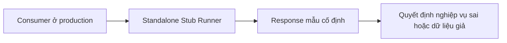
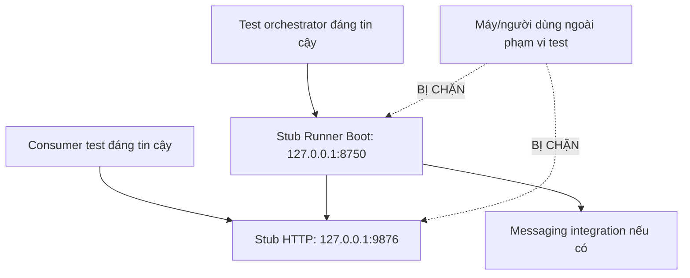
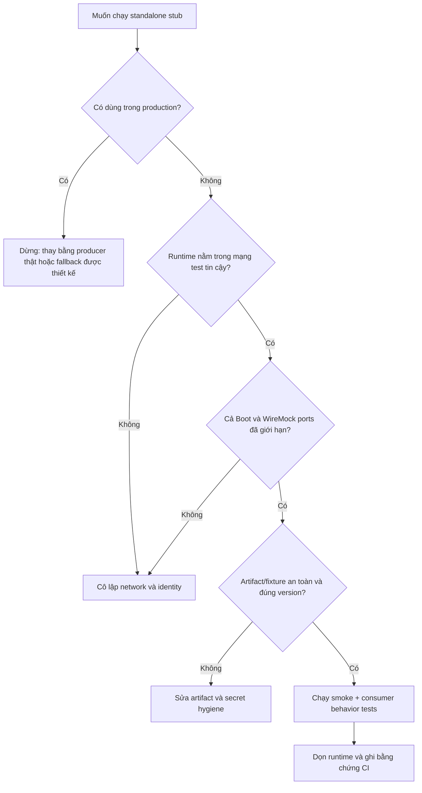

# Giới hạn truy cập và tránh dùng stub như dịch vụ production

## 1. Stub độc lập giải quyết vấn đề gì?

Trong module **SPRING_CLOUD_CONTRACT**, Spring Cloud Contract giúp producer và consumer thống nhất hành vi HTTP hoặc thông điệp bằng **Groovy/YAML DSL**. Contract Verifier sinh producer tests để kiểm chứng hành vi thật; sau đó hợp đồng được đóng gói thành stub theo phiên bản. Consumer có thể dùng **Stub Runner** và CI để phát hiện sự thay đổi API không tương thích mà **không phải luôn khởi động producer thật**.

**Standalone Stub Runner** (thường được gọi là *Stub Runner Boot* hoặc chạy bằng Docker image tương ứng) mở các HTTP stub server và cung cấp API điều khiển để liệt kê stub, tra cổng hoặc kích hoạt thông điệp theo nhãn. Nhờ đó, một nhóm frontend, ứng dụng di động hay hệ thống viết bằng ngôn ngữ khác Java có thể dùng stub như một **phụ thuộc giả trong môi trường thử nghiệm**.

Nhưng sự tiện lợi này tạo ra rủi ro nếu người vận hành để stub phục vụ như một dịch vụ thật:

- Stub **không nhất thiết có xác thực và phân quyền** giống producer.
- Response có thể là **dữ liệu mẫu cố định**, không phản ánh trạng thái database.
- Stub thường không có tính chất vận hành của một hệ thống production: lưu trữ bền vững, giao dịch, retry, giám sát, SLA hay cơ chế kiểm soát truy cập.
- Standalone Stub Runner còn có **API điều khiển** và có thể cho phép kích hoạt message mẫu.
- Khi mở cổng ra mạng rộng, người không thuộc nhóm thử nghiệm có thể gọi endpoint mô phỏng, quan sát fixture hoặc sử dụng một response giả như thể đó là kết quả nghiệp vụ thật.

**Nguyên tắc bảo mật:** Stub Runner Boot là **tiện ích kiểm thử**, không phải ứng dụng đã được bảo mật để vận hành trên mạng không tin cậy. Tài liệu chính thức của Spring Cloud Contract cảnh báo rõ ứng dụng này *không được bảo vệ sẵn* và **không dành cho production**. Chỉ những client đáng tin cậy trong môi trường thử nghiệm được phép truy cập.

### Mục tiêu bài học

Sau bài này, bạn có thể:

1. Phân biệt **cổng quản lý Standalone Stub Runner** và **cổng HTTP WireMock** mà nó khởi động.
2. Giới hạn quyền truy cập theo localhost, container network, firewall và môi trường CI.
3. Nhận diện endpoint điều khiển như `/stubs`, `/triggers` và endpoint quản trị WireMock.
4. Quản lý phiên bản artifact, dữ liệu mẫu, secret và log an toàn.
5. Tách rõ môi trường **development/test/CI** với **staging có kiểm soát** và **production**.
6. Thiết kế smoke test, consumer contract test và kiểm tra bảo mật khi chạy Docker/JAR.
7. Giải thích vì sao một stub không thể thay thế producer thật, kể cả khi các test tích hợp với stub đều đạt.

## 2. Stub là công cụ mô phỏng, không phải producer thật

Giả sử Orders Producer có hợp đồng HTTP:

```http
GET /api/orders/ord-1001 HTTP/1.1
Accept: application/json
```

Response mẫu:

```json
{
  "id": "ord-1001",
  "status": "CREATED",
  "totalAmount": 125000,
  "currency": "VND"
}
```

Với Spring Cloud Contract, có thể viết hợp đồng Groovy:

```groovy
import org.springframework.cloud.contract.spec.Contract

Contract.make {
    name 'get_order_created'

    request {
        method GET()
        url '/api/orders/ord-1001'
        headers {
            header 'Accept': 'application/json'
        }
    }

    response {
        status 200
        headers {
            contentType(applicationJson())
        }
        body([
            id         : 'ord-1001',
            status     : 'CREATED',
            totalAmount: 125000,
            currency   : 'VND'
        ])
    }
}
```

Sau producer verification, mapping stub có thể luôn trả đơn mẫu này khi request khớp. Điều đó **không chứng minh** có đơn `ord-1001` trong database production, cũng không chứng minh người gọi có quyền đọc đơn hay endpoint chịu được tải lớn.

| Khía cạnh | Producer thật | Standalone HTTP stub |
| --- | --- | --- |
| Trạng thái dữ liệu | Database/cache/event store thật | Thường dựa trên fixture; có thể có scenario state giả lập |
| Xác thực/phân quyền | Theo Spring Security/kiến trúc ứng dụng | Chỉ có nếu mapping hoặc lớp bảo vệ riêng chủ động mô hình hóa |
| Logic nghiệp vụ | Thực thi validation, transaction và service code | Khớp request rồi trả response mô phỏng |
| Lưu bền vững | Theo thiết kế production | Không được mặc định có |
| Tính sẵn sàng/SLA | Có mục tiêu vận hành và giám sát riêng | Không có bảo đảm production tương đương |
| Mục đích chính | Phục vụ người dùng/hệ thống thật | Kiểm thử consumer và tích hợp |
| Thông điệp | Broker/serializer/binding ứng dụng thật | Message stub qua integration được cấu hình |

Một stub **có thể** mô phỏng lỗi, độ trễ, stateful scenario hoặc quy tắc matcher phức tạp; nhưng đó vẫn là những **tình huống được sắp đặt**, không phải đầy đủ quy tắc và rủi ro của producer thật.

### 2.1. Sai lầm kiến trúc cần tránh



Không được cấu hình `orders.base-url` của ứng dụng production trỏ tới stub chỉ vì producer tạm thời không sẵn sàng. Đặc biệt với thanh toán, tồn kho, xác thực và phát hành đơn hàng, kết quả giả có thể khiến hệ thống **thừa nhận giao dịch chưa xảy ra**.

Nếu cần tiếp tục vận hành khi producer lỗi, hãy thiết kế **fallback có chủ đích** trong ứng dụng (cache với TTL, circuit breaker, trạng thái “chưa xác nhận”, queue chờ xử lý, cơ chế phục hồi), thay vì đưa stub kiểm thử vào tuyến production.

## 3. Standalone Stub Runner mở những cổng và endpoint nào?

Một thiết lập độc lập thường có **hai bề mặt HTTP khác nhau**:

1. **Stub Runner Boot server**: cổng của ứng dụng điều khiển, chẳng hạn `8750` trong bài.
2. **WireMock server**: cổng phục vụ endpoint API giả, chẳng hạn `9876` cho Orders API.



Đây là **mô hình mục tiêu**, không phải mô tả mặc định mạng của mọi Docker image/JAR. Cổng thật phụ thuộc cấu hình runtime; phải kiểm tra cả hai sau khi khởi động.

### 3.1. API quản lý của Stub Runner Boot

Tài liệu chính thức mô tả các đường dẫn điển hình:

| Method/path | Chức năng | Vì sao phải giới hạn? |
| --- | --- | --- |
| `GET /stubs` | Liệt kê các stubs đang chạy | Tiết lộ danh sách dependency và phiên bản |
| `GET /stubs/{ivy}` | Tra cổng của một stub theo định danh | Cho phép khám phá cổng HTTP giả lập |
| `GET /triggers` | Liệt kê các messaging labels khả dụng | Tiết lộ loại sự kiện/kịch bản nội bộ |
| `POST /triggers/{label}` | Kích hoạt message stub theo nhãn | Có thể phát sự kiện thử nghiệm vào môi trường gắn với transport |
| `POST /triggers/{ivy}/{label}` | Kích hoạt nhãn của stub cụ thể | Cần tránh truy cập ngoài nhóm được phép |

Trong bảng, `{ivy}` là ký hiệu định danh artifact theo cú pháp Stub Runner; không phải một tên ứng dụng bất biến.

**Điểm nhạy cảm:** `/triggers` là **API có khả năng tạo hành động**, không chỉ là health check. Nếu messaging stub kết nối nhầm broker dùng chung với môi trường thật, việc trigger có thể gửi **event giả tới consumer không mong muốn**. Hãy dùng broker/topic/test binding cô lập.

### 3.2. WireMock còn có endpoint quản trị riêng

Ngoài API Stub Runner Boot, một HTTP stub server dùng WireMock thường có admin API tại:

```text
http://127.0.0.1:9876/__admin/mappings
http://127.0.0.1:9876/__admin/requests
```

Tùy phiên bản/cấu hình, admin API có thể cho phép xem mapping, request journal và các thao tác quản trị khác. Nó có thể làm lộ:

- Dữ liệu mẫu hoặc những field được mô phỏng.
- Endpoint, header, query parameter và cấu trúc API.
- Token **giả** hoặc dữ liệu trong request journal nếu test gửi chúng.
- Các response đặc biệt và điều kiện kích hoạt kịch bản.

Không đặt WireMock sau một ingress công khai chỉ vì API Stub Runner Boot đã bị chặn. **Cả hai cổng đều phải được bảo vệ**.

### 3.3. Hai cổng không dùng chung chính sách truy cập mặc định

Nếu chỉ giới hạn `server.address=127.0.0.1` cho **ứng dụng Boot**, đừng mặc định toàn bộ WireMock servers cũng chỉ lắng nghe loopback. Cách WireMock bind socket có thể phụ thuộc vào thư viện và cấu hình riêng.

Hãy xác nhận thực tế bằng:

- Cổng nào đang lắng nghe và **địa chỉ bind** của từng tiến trình.
- Docker host port mappings cho **cả management và stub ports**.
- Host firewall/network policy có chặn truy cập ngoài phạm vi test không.
- Client/container nào được phép truy cập qua network nội bộ.

Với container, `127.0.0.1` **bên trong container** khác `127.0.0.1` **trên host**. Giới hạn publishing ở phía host thường rõ ràng hơn việc tùy tiện thay địa chỉ bind bên trong container.

## 4. Nguyên tắc giới hạn truy cập theo môi trường

| Môi trường | Cách triển khai phù hợp | Điều tuyệt đối tránh |
| --- | --- | --- |
| Máy lập trình viên | Chạy tạm, chỉ truy cập loopback; dừng khi không sử dụng | Public port trên Wi-Fi/mạng công cộng |
| CI runner riêng | Container/job tạm, network test có phạm vi hẹp | Dùng chung stub không quản lý giữa nhiều pipeline |
| Test namespace trong Kubernetes | Service dạng nội bộ, NetworkPolicy/identity giới hạn | Ingress/LoadBalancer/NodePort công khai không có kiểm soát |
| Staging có kiểm soát | Chỉ dùng cho smoke/contract tests, truy cập bởi test clients được cấp quyền | Trộn với dữ liệu/credentials production |
| Production | **Không triển khai Standalone Stub Runner** | Cấu hình ứng dụng người dùng thật trỏ tới stub |

**Ưu tiên cách cô lập đơn giản nhất:** nếu tất cả tests chạy trên một máy, dùng loopback. Nếu tests ở nhiều containers, dùng network riêng chỉ dành cho job. Nếu cần nhiều máy, dùng mạng thử nghiệm hạn chế, firewall và một lớp kiểm soát truy cập phù hợp, thay vì mở thẳng cổng ra Internet.

### 4.1. Giới hạn truy cập không phải chỉ bật authentication

Ngay cả khi một reverse proxy thêm Basic Auth/TLS, Standalone Stub Runner vẫn không tự trở thành ứng dụng production: response giả, trạng thái không bền vững, thiếu audit/availability và hạn chế của contract coverage vẫn tồn tại.

Mô hình phòng vệ theo lớp phù hợp hơn:

1. **Network isolation**: chỉ client test đáng tin cậy nhìn thấy cổng.
2. **Không công khai endpoint điều khiển**: đặc biệt `/triggers` và WireMock `/__admin`.
3. **Dữ liệu an toàn**: chỉ fixture giả, không dùng bí mật hoặc thông tin cá nhân thật.
4. **Tài khoản ít quyền**: chỉ được tải artifact và truy cập môi trường test.
5. **Lifecycle ngắn**: tạo stub cho từng job, dọn khi kết thúc.
6. **Giám sát mức test**: ghi lại stub/version/port và thất bại, tránh coi đó là monitoring production.

## 5. Chạy Docker standalone chỉ công bố cổng trên localhost

Tài liệu Spring Cloud Contract có ví dụ Docker image cho Stub Runner Boot. Đối với phiên bản mới, tài liệu cũng cảnh báo **executable JAR của Stub Runner Boot có thể không được phát hành từ bản 4.1.6 do giới hạn công cụ phát hành**, và khuyến nghị dùng Docker image hoặc tự build từ nguồn nếu thật sự cần JAR. Vì vậy **không được giả định luôn tải được fat JAR của mọi phiên bản**.

Ví dụ Bash bên dưới minh họa **nguyên tắc giới hạn host port**. Giá trị repository/image version là **placeholder**, phải thay bằng nguồn và phiên bản mà dự án đã phê duyệt:

```bash
docker run --rm --name scc-stub-isolated \
  -e SERVER_PORT=8750 \
  -e STUBRUNNER_IDS=com.example:orders-producer:1.4.2:stubs:9876 \
  -e STUBRUNNER_STUBS_MODE=REMOTE \
  -e STUBRUNNER_REPOSITORY_ROOT=https://repository.example.invalid/maven-releases \
  -p 127.0.0.1:8750:8750 \
  -p 127.0.0.1:9876:9876 \
  springcloud/spring-cloud-contract-stub-runner:PINNED_VERSION
```

**Điều kiện của ví dụ:**

- `PINNED_VERSION` phải được thay bằng image tag hiện có và tương thích; nên ghim digest trong pipeline yêu cầu tính tái lập cao.
- `repository.example.invalid` là **địa chỉ minh họa, không thể dùng để tải artifact thực**. Thay bằng Maven-compatible repository có stub đã được producer xác minh.
- `STUBRUNNER_IDS` chứa tọa độ `groupId:artifactId:version:classifier:port`; `9876` là cổng **WireMock**.
- `SERVER_PORT=8750` chỉ cổng **ứng dụng Stub Runner Boot** trong ví dụ.
- Cả hai dòng `-p 127.0.0.1:...` chỉ công bố cổng trên giao diện **loopback của host**, không phải mọi giao diện.
- Docker image/phiên bản cụ thể phải hỗ trợ các biến môi trường đó; đọc lại runtime log và kiểm tra port sau khi khởi động.
- Không đưa username/password hoặc secret thật trực tiếp vào shell command như ví dụ cấu hình. Dùng cơ chế secret/mount/config bảo mật của CI và repository resolver.

### 5.1. Khác biệt quan trọng giữa `-p 9876:9876` và `-p 127.0.0.1:9876:9876`

```bash
# Không dùng một cách vô ý trên máy có mạng không tin cậy:
docker run ... -p 9876:9876 ...

# Chỉ bind host loopback:
docker run ... -p 127.0.0.1:9876:9876 ...
```

Ví dụ đầu có thể công bố cổng trên mọi network interface của host, tùy cấu hình Docker. Ví dụ sau giới hạn cổng được publish trên loopback; trên một số cấu hình Docker cũ hay mạng đặc biệt vẫn cần kiểm tra truy cập thực tế và quy tắc firewall. **Không coi cú pháp này thay thế hoàn toàn cho việc kiểm chứng network isolation.**

### 5.2. Kiểm tra Docker port mappings

```bash
docker port scc-stub-isolated
```

Kết quả mong đợi về mặt ý tưởng:

```text
8750/tcp -> 127.0.0.1:8750
9876/tcp -> 127.0.0.1:9876
```

Output chính xác tùy Docker/runtime. Ngoài kiểm tra mapping, có thể thử kết nối từ một **máy ngoài phạm vi test** trong môi trường đã được phép để xác nhận cổng không truy cập được; không tự thực hiện scan bừa bãi mạng của tổ chức.

### 5.3. Kiểm tra hai mặt phẳng HTTP

```bash
# Control plane của Stub Runner Boot:
curl -i http://127.0.0.1:8750/stubs

# Data plane của một WireMock stub, nếu contract có endpoint này:
curl -i -H "Accept: application/json" \
  http://127.0.0.1:9876/api/orders/ord-1001
```

Một response thành công ở `/stubs` không tự chứng minh mapping `GET /api/orders/ord-1001` đã được nạp; cần kiểm tra cả **endpoint nghiệp vụ**. Ngược lại, data plane hoạt động không có nghĩa control plane nên được mở cho người dùng ngoài.

### 5.4. Docker networks và container-to-container

Khi ứng dụng consumer chạy trong container khác, `http://127.0.0.1:9876` từ container đó sẽ trỏ về **chính nó**, không phải container Stub Runner. Hướng phù hợp là:

- Đặt consumer test container và Stub Runner vào **một Docker network thử nghiệm cô lập**.
- Cho consumer truy cập **tên service/container nội bộ** và cổng stub, ví dụ `http://stub-runner:9876` khi tên này được cấu hình và resolve được.
- Không cần publish các cổng này ra host nếu toàn bộ traffic chỉ đi trên Docker network.
- Nếu runner cần tải artifact từ repository, giới hạn **egress** đến nguồn cần thiết; không nối container test tới database/broker production.

Tránh dùng `--network host` chỉ để sửa lỗi DNS, vì nó bỏ qua nhiều ranh giới mạng của container và có thể làm các cổng stub hiện diện rộng hơn dự kiến.

## 6. Chạy standalone JAR: bảo vệ cả Boot và WireMock

Trong phiên bản có sẵn JAR hợp lệ hoặc khi nhóm tự build ứng dụng Stub Runner Boot từ nguồn, có thể chạy bằng `java -jar`:

```bash
java -jar stub-runner-boot.jar \
  --server.address=127.0.0.1 \
  --server.port=8750 \
  --spring.cloud.contract.stubrunner.ids=com.example:orders-producer:1.4.2:stubs:9876 \
  --spring.cloud.contract.stubrunner.stubsMode=LOCAL
```

Đây là ví dụ khái niệm cho ứng dụng Spring Boot tương thích, **không khẳng định file `stub-runner-boot.jar` có sẵn cho mọi phiên bản**. Nếu project dùng tên property cũ hoặc image/CLI khác, đối chiếu tài liệu đúng version.

**Cảnh báo:** `server.address=127.0.0.1` chỉ bảo đảm ứng dụng **Boot** bind theo cấu hình đó; nó **không tự bảo vệ cổng WireMock `9876`**. Khi chạy trực tiếp trên host, cần kiểm tra WireMock bind address và dùng host firewall/chính sách mạng để bảo đảm cổng stub không truy cập được ngoài phạm vi cho phép. Nếu không thể chứng minh giới hạn, ưu tiên chạy container trong network cô lập.

### 6.1. Không cố gắng “bảo mật production” bằng cách chỉnh hợp đồng

Một hợp đồng có:

```groovy
request {
    method GET()
    url '/api/orders/ord-1001'
    headers {
        header 'Authorization': 'Bearer fake-test-token'
    }
}
```

có thể khiến WireMock chỉ trả mapping nếu request mang chuỗi header khớp. Nhưng đó chỉ là **điều kiện khớp request**, không phải dịch vụ xác thực thật:

- Stub không kiểm chứng chữ ký JWT, expiry, issuer và quyền trừ khi được cấu hình cơ chế riêng.
- Một chuỗi test token **không phải secret an toàn**; ai xem mapping có thể biết nó.
- Nếu có mapping khác không yêu cầu header, request có thể vẫn khớp nhánh đó.

Không dùng “stub yêu cầu header Authorization” làm lý do mở endpoint ra mạng không tin cậy.

## 7. Tài khoản và artifact repository: giới hạn quyền tải

Standalone Stub Runner thường tải các JAR chứa stub từ Maven-compatible repository (hoặc local Maven repository/classpath). Ví dụ một tọa độ:

```text
com.example:orders-producer:1.4.2:stubs
```

Một thiết lập an toàn cần **đồng thời** kiểm soát cách nạp artifact và nguồn dữ liệu trong artifact:

| Rủi ro | Biện pháp |
| --- | --- |
| Tải nhầm stub từ nguồn giả mạo | Chỉ dùng repository đã được phê duyệt, HTTPS/TLS hợp lệ |
| Consumer chạy stub version không mong muốn | Ghim version/release, không lặng lẽ dùng `+` hoặc latest |
| Token repository lộ trong log/command | Dùng secret store, tránh log command chứa credential |
| Quá nhiều quyền trên repository | Dùng tài khoản **read-only** cho Stub Runner |
| Credential production được mount vào container | Chỉ cấp credential và config dành cho test |
| Artifact bị thay đổi dưới cùng version | Không overwrite release, kiểm soát provenance/checksum theo chính sách |
| Mang theo toàn bộ `~/.m2` cá nhân | Chỉ mount repository/config tối thiểu; loại bỏ `settings.xml` chứa secret không cần thiết |

### 7.1. CLASSPATH, LOCAL và REMOTE là khác nhau

| Chế độ | Nguồn stub | Hạn chế thực tế |
| --- | --- | --- |
| `CLASSPATH` | Stub đã có trên classpath | Phải đặt đúng bản artifact vào classpath test |
| `LOCAL` | Local Maven repository | Container/CI có repository riêng, không tự thấy `~/.m2` của máy host |
| `REMOTE` | Repository được cấu hình | Cần mạng/TLS/quyền tối thiểu tới kho artifact |

Chọn mode ảnh hưởng **chuỗi cung ứng artifact**, không thay đổi bảo mật endpoint của Stub Runner. Dù mode là LOCAL, nếu cổng HTTP đang mở công khai thì vẫn có nguy cơ bị truy cập trái phép.

### 7.2. Dữ liệu stub cũng là dữ liệu cần rà soát

Contract và mapping có thể chứa:

- Mã đơn, email, địa chỉ, tên khách hàng.
- Header `Authorization`/`Cookie` dùng trong test.
- Payload sự kiện hoặc JSON/XML sample.
- Địa chỉ host/internal URL dùng trong ví dụ.

**Chỉ dùng dữ liệu tổng hợp hoặc đã khử nhận dạng**, không sao chép request/response production thật vào artifact. Nếu dữ liệu nhạy cảm đã lọt vào stub JAR, chỉ đổi quyền truy cập server chưa đủ; cần xử lý artifact, kho lưu trữ và log theo quy trình bảo mật dữ liệu của tổ chức.

## 8. Không gắn standalone stub với tài nguyên production

Một sai lầm nghiêm trọng là giữ Stub Runner trong mạng thử nghiệm nhưng cho nó **truy cập broker, database hoặc webhook production**. Điều đó vẫn làm mất ranh giới an toàn.

### 8.1. HTTP-only stubs

Với WireMock HTTP mapping thông thường, stub trả dữ liệu giả và không nên gọi vào database production để “làm response thực hơn”. Nếu consumer cần dữ liệu sát thực tế, hãy xây dựng fixture an toàn hoặc một tập dữ liệu đã ẩn danh trong môi trường test; không dùng endpoint production như backend ẩn phía sau stub.

### 8.2. Messaging stubs

Với hợp đồng có:

```groovy
Contract.make {
    name 'payment_succeeded_event'
    label 'payment_succeeded'

    input {
        triggeredBy('publishPaymentSucceeded()')
    }

    outputMessage {
        sentTo('payments.events')
        body([
            paymentId: 'pay-test-1001',
            status   : 'SUCCEEDED'
        ])
        headers {
            messagingContentType(applicationJson())
        }
    }
}
```

Khi consumer test gọi `POST /triggers/payment_succeeded` trên Stub Runner Boot, message stub có thể được gửi qua messaging integration đã cấu hình. Nếu destination/broker trùng với production, một consumer thật có thể xử lý **sự kiện thanh toán giả**.

Vì vậy:

1. Dùng broker hoặc binder **chỉ dành cho test**.
2. Dùng topic/queue namespace riêng khi broker dùng chung cho các nhóm test.
3. Dùng identity/service account không có quyền publish vào topic production.
4. Giới hạn network egress từ Stub Runner đến broker thử nghiệm.
5. Bảo đảm không có production consumer group đọc chung các sự kiện mô phỏng.
6. Dọn message và test state sau khi kết thúc.

Đừng coi chỉ thay event ID thành `pay-test-1001` là đủ; nhiều hệ thống xử lý event dựa trên **topic, schema và eventType** mà không phân biệt prefix ID.

## 9. Bảo mật endpoint quản lý và admin API

Standalone Stub Runner Boot cung cấp API điều khiển; WireMock có admin API tùy cấu hình. Dù dùng trong môi trường test, hãy áp dụng nguyên tắc **chỉ những tác nhân cần thiết mới được phép thao tác**.

| API | Quyền tối thiểu nên cấp trong mạng test | Hệ quả nếu lộ |
| --- | --- | --- |
| `GET /stubs` | Test orchestrator / diagnostics | Lộ tên stub và phiên bản |
| `GET /triggers` | Test orchestrator được phép | Lộ danh sách nhãn message |
| `POST /triggers/{label}` | Test runner có trách nhiệm cụ thể | Kích hoạt message giả ngoài kịch bản |
| `GET /__admin/mappings` | Developer/debug test được phép | Lộ cấu trúc API, fixture |
| `POST /__admin/mappings` (nếu hỗ trợ) | Công cụ quản trị được phép trong test | Có thể thay đổi hành vi stub đang chạy |
| HTTP `/api/...` của stub | Consumer test thực sự cần gọi | Trả dữ liệu mô phỏng cho client không mong muốn |

**Đừng đưa các cổng management/admin ra Internet**. Nếu một tổ chức thật sự cần điều khiển từ xa trong test environment, đặt sau mạng quản trị hạn chế, proxy có xác thực/TLS, quy tắc firewall và quyền rõ ràng; vẫn **không chuyển môi trường đó thành production**.

### 9.1. Không xem `/stubs` là health check đủ mạnh

`GET /stubs` trả về danh sách stub đang chạy (khi API sẵn sàng). Nó hữu ích để xác nhận ứng dụng điều khiển đã khởi động, nhưng chưa chứng minh:

- Hợp đồng HTTP cần thiết có mapping.
- Request thực sự khớp matcher.
- Header và body response đúng phiên bản.
- Consumer giải mã và xử lý được response.
- Mạng ngoài bị chặn.

Vì vậy, cần ít nhất **một smoke test HTTP nghiệp vụ**, cộng thêm **consumer behavior test** và kiểm tra ranh giới mạng.

## 10. Ví dụ quy trình test an toàn với Standalone Stub Runner

Giả sử Checkout Consumer cần gọi Orders API ở môi trường CI.

### 10.1. Bước chuẩn bị artifact

Producer có các hợp đồng:

```text
get_order_created.groovy       -> GET /api/orders/ord-1001 -> 200
get_order_not_found.groovy     -> GET /api/orders/ord-missing -> 404
```

Trước khi dùng stub, producer cần:

1. Sinh và **chạy** Contract Verifier tests trên producer thật với fixture phù hợp.
2. Chuyển đổi HTTP contracts thành WireMock mappings.
3. Đóng gói artifact `com.example:orders-producer:1.4.2:stubs`.
4. Publish phiên bản release bất biến hoặc cài vào Maven repository cục bộ của test.

**Không chuyển thẳng hợp đồng chưa được xác minh thành một dịch vụ public.**

### 10.2. Bước triển khai tạm

Trong CI, khởi động Stub Runner container có:

- Image version/digest đã ghim.
- Cổng management và stub chỉ trên network test.
- Repository credential read-only.
- Artifact version cố định.
- Không có production secrets, database hay broker routes.

Khi job kết thúc, dừng container và làm sạch các dữ liệu test. Tùy runner, dùng `--rm` hoặc cơ chế lifecycle của orchestrator để tránh stub tồn tại âm thầm nhiều ngày sau khi kiểm thử đã xong.

### 10.3. Bước kiểm thử

Ví dụ smoke test Bash khi ports được publish trên loopback:

```bash
curl -fsS http://127.0.0.1:8750/stubs

curl -i -H "Accept: application/json" \
  http://127.0.0.1:9876/api/orders/ord-1001

curl -i -H "Accept: application/json" \
  http://127.0.0.1:9876/api/orders/ord-missing
```

Với nhánh lỗi, kiểm tra không chỉ status `404` mà còn body có mã lỗi nghiệp vụ đã công bố, chẳng hạn `ORDER_NOT_FOUND`. Một `404` do **WireMock không có matching stub** không chứng minh producer đã định nghĩa nhánh lỗi.

Sau smoke tests, chạy **consumer code thật**:

```java
// Minh họa trong consumer test đã cấu hình HTTP client trỏ tới stub.
CheckoutView view = checkoutService.load("ord-1001");

assertThat(view.orderId()).isEqualTo("ord-1001");
assertThat(view.canPay()).isTrue();
```

`CheckoutView`/`checkoutService` là API giả định của consumer. Assertion này chỉ có ý nghĩa khi `checkoutService` thật sự gọi HTTP client tới stub và thực hiện quy tắc nghiệp vụ; không mock luôn client đang cần kiểm chứng.

### 10.4. Bước xác minh giới hạn truy cập

Trước khi coi setup đạt:

1. Kiểm tra tất cả host port mappings bằng `docker port` hoặc công cụ tương ứng.
2. Bảo đảm cổng quản lý **và** cổng stub không public trên host.
3. Kiểm tra client trong mạng test gọi được, còn client ngoài phạm vi thì không.
4. Xác nhận không có production host/broker trong runtime config.
5. Kiểm tra log không in credentials hoặc dữ liệu cá nhân thật.

**Đã gọi được stub không đủ để kết luận setup an toàn**. Phải chứng minh rằng những bên **không được phép** không thể gọi stub.

## 11. Dùng CI namespace hoặc Kubernetes khi có nhiều nhóm

Khi pipeline chạy trong Kubernetes, tránh định nghĩa một Service kiểu `LoadBalancer` hoặc Ingress công khai chỉ để tests gọi stub dễ dàng. Một kiến trúc phù hợp hơn:

```text
Namespace: consumer-contract-test-<job-id>
  - Checkout consumer test pod
  - Stub Runner Boot pod
  - Test-only messaging broker (nếu cần)
  - ClusterIP service cho cổng stub nội bộ
  - NetworkPolicy chỉ cho các pod thử nghiệm giao tiếp
  - ServiceAccount và secret giới hạn quyền tải stub
  - TTL/cleanup job sau khi hoàn tất
```

Ở đây `<job-id>` là placeholder mô tả một namespace tạm, không phải tên namespace thật. Cấu hình NetworkPolicy chỉ có hiệu lực nếu CNI và cluster hỗ trợ; cần kiểm tra thực tế thay vì suy rằng tạo policy là đã chặn được mọi traffic.

### 11.1. Ingress công khai không phải lựa chọn mặc định

Nếu consumer test cần gọi từ bên ngoài cluster, nên dùng cơ chế kết nối tạm có xác thực và mạng hạn chế theo chính sách công ty, ví dụ một cổng chuyển tiếp có phạm vi kiểm soát hoặc một test gateway chuyên dụng; không đưa nguyên API Stub Runner Boot ra Internet.

### 11.2. Shared test environment cũng có thể rủi ro

Một môi trường staging dùng chung có thể có:

- Test của nhóm A thay mapping ảnh hưởng nhóm B.
- Các kịch bản messaging cùng dùng một topic và consumer group.
- Artifact version không được ghim, tự cập nhật giữa các test.
- Dữ liệu từ lần chạy trước làm assertion đạt sai.
- Log request của nhiều nhóm chứa thông tin không nên chia sẻ.

Vì vậy, nếu có thể, **mỗi CI job nên có stub runtime riêng**. Nếu phải dùng chung, cần namespace, quyền truy cập, cổng/destination và version isolation rõ ràng.

## 12. Những giới hạn hành vi của stub phải được nói rõ

Một stub không thể hiện tất cả tính chất của producer. Khi thiết kế chiến lược kiểm thử, hãy chỉ ra giới hạn này để tránh **niềm tin giả**.

| Khả năng | Stub thường có thể giúp | Vẫn cần kiểm thử khác |
| --- | --- | --- |
| HTTP method/path/header/body | Khớp một số request theo DSL | Toàn bộ validation và authorization thực |
| Thành công/thất bại theo nhánh | Trả `200`/`400`/`404`/`409` mẫu | Điều kiện dữ liệu thật, giao dịch, race condition |
| Định dạng response | Kiểm tra JSON/XML sample và header | Serializer, schema/encoding trên đường truyền thật |
| Dữ liệu động | Regex/matcher và giá trị stub cố định | Tính duy nhất, liên hệ với database, quy tắc tạo ID |
| Stateful stub | Mô phỏng một số bước theo scenario | Tính nhất quán và persistence production |
| Thời gian phản hồi | Mô phỏng delay/fault có chủ đích | Hiệu năng và hành vi tải cao |
| Messaging | Phát message mẫu theo label | Delivery, ordering, retry, idempotency, broker security |
| Error handling | Consumer xử lý response lỗi mẫu | Mất mạng, DNS, TLS, nửa kết nối, timeout thật |

### 12.1. Không lấy HTTP 200 của stub làm tín hiệu “giao dịch thành công”

Ví dụ nguy hiểm:

```text
POST /api/payments -> 200 {"status":"PAID"}
```

Nếu bất kỳ môi trường thực nào coi response từ stub là xác nhận thanh toán thật, người dùng có thể được cấp hàng/dịch vụ dù giao dịch chưa xảy ra. Hợp đồng chỉ chứng minh **hình dạng và hành vi mô phỏng** của response với tình huống mẫu, không phải kết quả từ nhà cung cấp thanh toán.

### 12.2. Không dùng stub làm fallback lúc hệ thống lỗi

Khi Orders Producer ngừng hoạt động, ứng dụng consumer không nên âm thầm chuyển base URL sang Stub Runner. Điều đó làm API trả dữ liệu giả và có thể tạo ra hành động nghiệp vụ sai. Nếu một môi trường demo cố ý dùng dữ liệu giả, cần:

- Được gắn nhãn **DEMO/TEST** rõ ràng.
- Không có luồng thanh toán/gửi thông báo thật.
- Không có kết nối tới dữ liệu production.
- Không dùng cho người dùng thật nếu họ có thể hiểu nhầm kết quả giả là kết quả thực.

## 13. Các tình huống sai phổ biến và hướng khắc phục

| Triệu chứng | Nguy cơ/nguồn gốc | Hướng xử lý |
| --- | --- | --- |
| Người ngoài mạng dev gọi được `/stubs` | Cổng control plane được publish rộng | Giới hạn host bind, firewall và mạng test |
| Chặn `8750` nhưng `9876` vẫn truy cập được | Chỉ bảo vệ Boot, quên WireMock | Kiểm tra **mọi** stub ports |
| `POST /triggers/...` phát event vào broker chung | Stub messaging nối sai environment | Dùng broker/topic/identity test riêng, chặn egress production |
| Production config trỏ `orders.base-url` tới stub | Phân tách môi trường thất bại | Chặn theo deployment policy, kiểm tra config trước rollout |
| Stub trả dữ liệu có email thật | Fixture lấy từ production mà chưa xử lý | Thay bằng dữ liệu tổng hợp, xử lý artifact/log cũ |
| Repository password xuất hiện trong log | Secret truyền qua dòng lệnh/config in ra | Dùng secret store, không in credentials |
| Local test pass nhưng CI download nhầm artifact | Version động/cache cũ | Ghim version và kiểm tra tọa độ đã resolve |
| Container test vẫn sống sau khi job xong | Thiếu cleanup | Dùng lifecycle/TTL/`--rm` và dọn network |
| HTTP stub trả `404` như mong đợi nhưng sai body | Có thể do no mapping | Assert business error body, kiểm tra mapping được nạp |
| Consumer test luôn pass khi producer thay đổi | Đang dùng stub cũ hoặc chỉ assert fixture | Producer verification và consumer test với artifact ứng viên |
| Dùng `--network host` để sửa lỗi localhost | Bỏ isolation container | Dùng mạng Docker riêng/service discovery nội bộ |
| WireMock admin bị expose ra Internet | Khả năng xem/thay mapping | Không public admin; chặn cả cổng WireMock |

### 13.1. Chẩn đoán có thứ tự



## 14. Bài tập thực hành: chạy Orders stub trong mạng test

### 14.1. Bối cảnh

Checkout Consumer cần mô phỏng hai nhánh Orders Producer:

| Contract | Request | Response |
| --- | --- | --- |
| `get_order_created` | `GET /api/orders/ord-1001` | `200`, `status=CREATED` |
| `get_order_not_found` | `GET /api/orders/ord-missing` | `404`, `code=ORDER_NOT_FOUND` |

Producer đã xác minh và phát hành một artifact **giả định**:

```text
com.example:orders-producer:1.4.2:stubs
```

Yêu cầu bài tập là chạy standalone stub cho consumer test **mà không mở dịch vụ giả ra mạng không tin cậy**.

### 14.2. Nhiệm vụ

1. Chuẩn bị artifact `-stubs.jar` từ repository được phép, đúng version đã được producer verification.
2. Chạy Stub Runner Boot trong môi trường tạm với **management port `8750`** và **Orders WireMock port `9876`**.
3. Nếu chạy Docker trên máy cá nhân, cấu hình publish cả hai cổng trên `127.0.0.1`; ghi lại kết quả `docker port`.
4. Kiểm tra `GET http://127.0.0.1:8750/stubs` để xác nhận stub đã được nạp.
5. Gọi `GET http://127.0.0.1:9876/api/orders/ord-1001`; assert HTTP `200` và các trường body đã cam kết.
6. Gọi `GET http://127.0.0.1:9876/api/orders/ord-missing`; assert **cả HTTP `404` và `ORDER_NOT_FOUND`**, không chỉ status.
7. Chạy test trên **mã Checkout Consumer thật** với client trỏ tới cổng `9876`; kiểm tra quy tắc `canPay` và xử lý không tìm thấy.
8. Xác nhận từ một client ngoài phạm vi test **không truy cập được** management/stub ports, theo chính sách mạng được phép kiểm tra.
9. Xem runtime config và bảo đảm **không có database hoặc broker production**.
10. Dừng container/job và kiểm tra không còn listener hoặc tài nguyên test sót.

### 14.3. Một cấu hình cố ý nguy hiểm để nhận diện

```bash
# Ví dụ phản diện: KHÔNG chạy ngoài môi trường test cô lập.
docker run --rm \
  -e STUBRUNNER_IDS=com.example:orders-producer:1.4.2:stubs:9876 \
  -p 8750:8750 \
  -p 9876:9876 \
  springcloud/spring-cloud-contract-stub-runner:PINNED_VERSION
```

**Vì sao nguy hiểm?** Hai dòng `-p` không ghi host IP có thể publish cổng trên các giao diện mạng rộng. Nếu host có public IP hoặc được kết nối vào mạng nhiều người dùng, người ngoài nhóm test có thể gọi các API mô phỏng và API điều khiển.

**Sửa tối thiểu trong bối cảnh host-only:** dùng `-p 127.0.0.1:8750:8750` và `-p 127.0.0.1:9876:9876`, đồng thời xác minh cấu hình listen port, image tag và môi trường tải artifact như mục 5. Đối với container-to-container, nên tránh publish không cần thiết và sử dụng network test nội bộ.

### 14.4. Câu hỏi tự kiểm tra

**Câu 1.** Chỉ giới hạn `server.address=127.0.0.1` cho Stub Runner Boot có đủ bảo vệ mọi WireMock stub không?

**Đáp án:** Không. Các WireMock server có thể bind vào địa chỉ/cổng riêng; cần kiểm tra và hạn chế cả những cổng này.

**Câu 2.** Vì sao `POST /triggers/payment_succeeded` nhạy cảm hơn một endpoint đọc tĩnh?

**Đáp án:** Nó có thể yêu cầu phát message mẫu qua messaging integration. Nếu cấu hình broker sai môi trường, message giả có thể tới consumer không mong muốn.

**Câu 3.** Nếu tất cả consumer tests chạy xanh với stub, có thể đưa stub vào production thay Orders Producer không?

**Đáp án:** Không. Stub không có đầy đủ logic, dữ liệu, xác thực, khả năng vận hành hay bảo đảm production của producer thật.

**Câu 4.** Dùng `STUBRUNNER_STUBS_MODE=LOCAL` có tự bảo vệ các HTTP endpoints khỏi người ngoài không?

**Đáp án:** Không. LOCAL chỉ mô tả **nguồn lấy artifact**; quyền truy cập vào ports vẫn cần kiểm soát riêng.

**Câu 5.** Nếu container chỉ dùng dữ liệu giả, có thể publish `/stubs` ra Internet không?

**Đáp án:** Không nên. Stub Runner Boot không được bảo vệ sẵn; management API lộ thông tin stub/version và các thao tác điều khiển khác. Dữ liệu giả cũng không biến một dịch vụ kiểm thử thành dịch vụ public an toàn.

**Câu 6.** Vì sao không nên bind toàn bộ thư mục Maven `~/.m2` của developer vào container dùng chung?

**Đáp án:** Thư mục đó có thể chứa artifact nội bộ và `settings.xml`/credentials hoặc metadata không cần thiết. Chỉ cấp đúng các artifact/config tối thiểu với quyền read-only phù hợp.

## 15. Checklist trước khi sử dụng standalone stub

- [ ] Stub Runner chỉ dùng cho **development, test, CI hoặc staging thử nghiệm được kiểm soát**.
- [ ] Không có consumer production trỏ base URL tới stub.
- [ ] Có producer verification và artifact stub đúng version đã được kiểm chứng.
- [ ] Standalone Stub Runner Boot **không được xem là secured-by-default**.
- [ ] Cả management port và mọi WireMock HTTP ports đều được hạn chế.
- [ ] Nếu dùng Docker, không publish cổng rộng ngoài ý muốn; đã kiểm tra `docker port`.
- [ ] Nếu dùng JAR, không chỉ hạn chế `server.address` mà quên WireMock bind/network.
- [ ] Nếu dùng Kubernetes, không tạo Ingress/LoadBalancer công khai cho stub.
- [ ] API `/stubs`, `/triggers` và WireMock admin chỉ truy cập bởi client test được phép.
- [ ] Message stub chỉ kết nối broker/topic/test binder của môi trường thử nghiệm.
- [ ] Không gắn database, secret, webhook hoặc service account production.
- [ ] Chỉ dùng fixture tổng hợp, không chứa thông tin cá nhân/bí mật thật trong contract, JAR, request journal.
- [ ] Repository được tin cậy; tài khoản tải stub có quyền tối thiểu; version được ghim.
- [ ] Test kiểm tra **hành vi consumer thật**, không chỉ status/body của fixture.
- [ ] Có kiểm tra nhánh lỗi; phân biệt WireMock no-match `404` với business `404`.
- [ ] Có cleanup/TTL, không để stub container chạy âm thầm sau khi test xong.
- [ ] CI lưu bằng chứng: artifact ID/version, cổng, test result, nhưng không in credentials.
- [ ] Đã kiểm tra ranh giới mạng trên chính runtime đang sử dụng.

### Tài liệu tham khảo

- [Spring Cloud Contract — Using the Stub Runner Boot Application](https://docs.spring.io/spring-cloud-contract/reference/project-features-stubrunner/stub-runner-boot.html): cảnh báo bảo mật, hạn chế với executable JAR, API `/stubs` và `/triggers`.
- [Spring Cloud Contract — Stub Runner Common Properties](https://docs.spring.io/spring-cloud-contract/reference/project-features-stubrunner/stub-runner-common.html): `ids`, `stubsMode`, `repositoryRoot`, cổng WireMock và phiên bản artifact.
- [Spring Cloud Contract — Docker Project](https://docs.spring.io/spring-cloud-contract/docs/current/reference/html/docker-project.html): Docker image standalone Stub Runner và cấu hình environment variables/messaging.
- [WireMock — Administration API](https://wiremock.org/docs/standalone/admin-api-reference/): các endpoint quản trị WireMock và request journal.
- [Docker — Publishing and exposing ports](https://docs.docker.com/get-started/docker-concepts/running-containers/publishing-ports/): ý nghĩa publish port, host IP và mạng container.

**Ghi nhớ:** **standalone stub là công cụ thử nghiệm, không phải dịch vụ sản xuất**. Giới hạn truy cập đồng thời ở **Stub Runner Boot**, **các WireMock ports** và **messaging transport**; dùng artifact/fixture an toàn, phiên bản rõ ràng, mạng cô lập và lifecycle ngắn. Stub giúp kiểm thử lời cam kết HTTP/message, nhưng chỉ producer verification và các kiểm thử tích hợp/vận hành phù hợp mới cung cấp bằng chứng về hành vi thật trong môi trường production.
