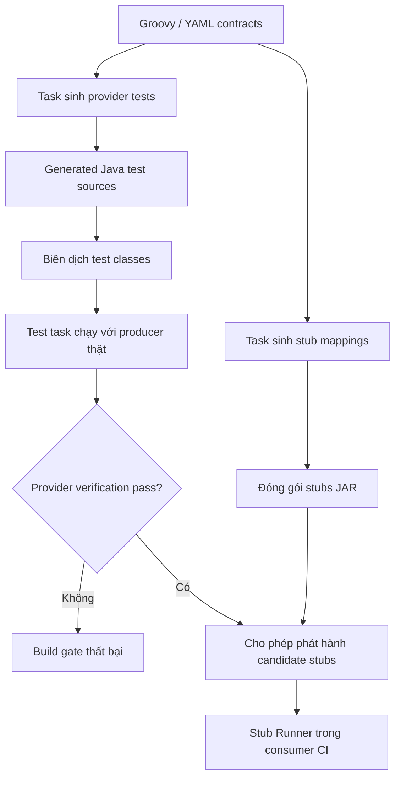
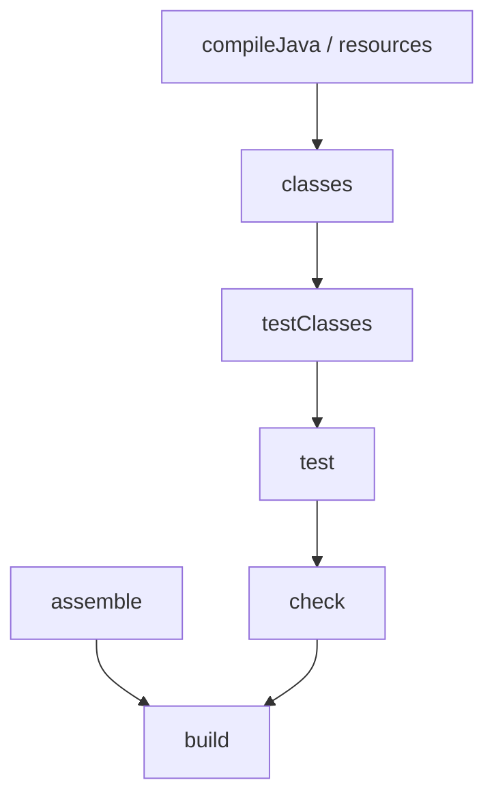
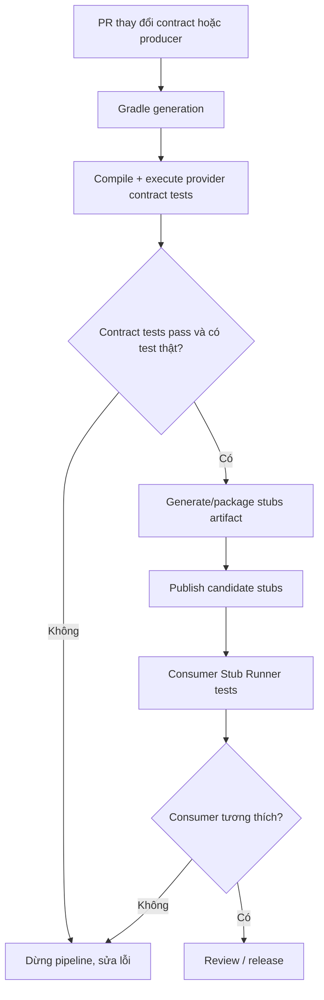

# Task sinh kiểm thử và quan hệ với vòng đời test trong Gradle

**Spring Cloud Contract (SCC)** hỗ trợ kiểm thử hợp đồng giữa **producer** và **consumer**: nhóm phát triển khai báo hành vi HTTP hoặc thông điệp bằng **Groovy/YAML DSL**, sinh kiểm thử để xác minh producer, đóng gói stubs và cho consumer chạy **Stub Runner**. Khi dự án dùng **Gradle**, việc khai báo contract chỉ là bước đầu. Điều quan trọng không kém là biết **task nào sinh mã kiểm thử, task nào biên dịch/chạy mã đó, task nào tạo stub và task nào được gọi trong vòng đời `test → check → build`**.

Một hiểu lầm rất phổ biến là thấy `generateContractTests` báo thành công rồi kết luận producer đã tuân thủ hợp đồng. **Sinh test không đồng nghĩa chạy test.** Một hiểu lầm khác là nghĩ `./gradlew test` hoặc `./gradlew build` luôn thực thi mọi bài kiểm thử contract trong mọi phiên bản plugin. Thực tế, phải xem **task graph** và **báo cáo test của build đang dùng**, đặc biệt trong dự án đa module hoặc có cấu hình riêng.

Bài thuộc chương **Tích hợp Gradle** này giải thích luồng build, các task thường gặp, quan hệ với Gradle Java lifecycle, cấu hình kiểm thử producer, đóng gói stubs và thiết kế CI để phát hiện thay đổi API không tương thích. Ví dụ xuyên suốt sử dụng `order-producer` có endpoint `GET /api/orders/1001` và `checkout-consumer` dùng stubs tương ứng.

## 1. Mục tiêu học tập

Sau bài này, bạn có thể:

1. Giải thích khác biệt giữa **contract sources**, **generated test sources**, **compiled test classes**, **executed provider tests** và **stubs JAR**.
2. Nhận diện các task liên quan SCC Gradle, nhất là `generateContractTests`, `contractTest` và `verifierStubsJar` trong những phiên bản cung cấp chúng.
3. Phân biệt task `test`, `check`, `build` của Gradle Java plugin với task kiểm thử hợp đồng do plugin bổ sung.
4. Kiểm tra task dependency graph bằng `tasks --all`, `help --task` và `--dry-run` thay vì suy đoán.
5. Cấu hình base class cho generated tests và bảo đảm test framework/classpath phù hợp.
6. Tránh phát hành stub mà chưa có bằng chứng producer verification pass.
7. Đưa test và stub artifacts vào CI đa module hoặc nhiều repository với phiên bản rõ ràng.

**Thông điệp trung tâm:** muốn tin kết quả của một Gradle build, phải xác minh **có contract → có generated test → test được chạy → provider đáp ứng → stub đúng phiên bản được đóng gói**. Không bước nào tự chứng minh tất cả các bước còn lại.

## 2. Năm loại kết quả khác nhau trong một vòng build

Giả sử nguồn hợp đồng có tệp `src/test/resources/contracts/http/get-order.groovy`. Luồng logic gồm:



Sơ đồ này mô tả **quan hệ mong muốn về mặt quy trình**. Các mũi tên **không phải cam kết rằng một plugin version bất kỳ đã tự đăng ký đúng dependency/order giữa mọi task**. Việc phát hành candidate stubs phải được CI chặn nếu provider verification thất bại.

| Kết quả | Nghĩa là gì? | Không chứng minh điều gì? |
| --- | --- | --- |
| Contract file đã tồn tại | Có tài liệu DSL trong repository | DSL được plugin phát hiện hoặc hợp lệ |
| Generated test sources đã sinh | Plugin đọc hợp đồng và tạo mã test | Test đã được biên dịch hoặc chạy |
| Generated tests biên dịch được | Mã Java/Groovy test không lỗi biên dịch | Producer trả đúng response |
| Contract test task pass | Những bài test được thực thi đã thành công | Tất cả hợp đồng đều được phát hiện, không có test bị skip |
| Stubs JAR được tạo | Có artifact mô phỏng giao diện để phân phối | Producer implementation đã được xác minh nếu test không chạy |
| Consumer Stub Runner test pass | Consumer xử lý được response/message mẫu | Producer production và hạ tầng thực đang hoạt động đúng |

**Một `BUILD SUCCESSFUL` là cần nhưng chưa đủ**: phải biết build đó chạy **những task nào**, bao nhiêu tests và sử dụng contract/stubs version nào.

## 3. Gradle Java lifecycle: test, check và build vốn làm gì?

Trước khi thêm SCC, Gradle Java plugin đã có một số task tiêu chuẩn:

| Task Java/Gradle thông dụng | Vai trò |
| --- | --- |
| `compileJava` | Biên dịch mã Java chính |
| `processResources` | Chuẩn bị main resources |
| `classes` | Tổng hợp kết quả main classes |
| `compileTestJava` | Biên dịch test Java của source set tiêu chuẩn |
| `processTestResources` | Chuẩn bị test resources |
| `testClasses` | Tổng hợp kết quả build test sources |
| `test` | Thực thi test thuộc source set/test suite tiêu chuẩn |
| `check` | Điểm gom các task kiểm tra chất lượng được đăng ký vào lifecycle |
| `assemble` | Tạo các artifact build thông thường |
| `build` | Gồm đường assemble và check của Java lifecycle |

Mối quan hệ đơn giản:



Các mũi tên ở đây **rút gọn một task graph thực tế**; nhiều task còn có dependencies khác và Gradle chỉ chạy các task cần thiết theo cấu hình plugin.

Khi thêm Spring Cloud Contract, các task sinh/kiểm tra contract cần được **gắn vào graph này** sao cho nguồn test được tạo trước khi biên dịch, kiểm thử contract được thực thi trong cổng chất lượng thích hợp và artifact stubs được phát hành đúng lúc.

### 3.1. Câu hỏi không nên bỏ qua

`./gradlew test` có chạy những generated contract tests của dự án không? **Không được đoán.** Plugin có thể tạo source set và `contractTest` riêng với `test`. Hãy kiểm tra phiên bản plugin, danh sách task, generated test classes và XML/HTML test reports.

`./gradlew build` có chắc chắn chạy `contractTest` không? **Chỉ khi task đã được nối vào đường `check`/`build` hoặc được gọi rõ ràng.** Việc có task trong danh sách không đồng nghĩa nó là dependency của `check`.

## 4. Thiết lập Gradle plugin ở producer

Một cấu hình minh họa bằng **Groovy DSL `build.gradle`**:

```groovy
plugins {
    id 'java'
    id 'org.springframework.cloud.contract' version 'YOUR_COMPATIBLE_SCC_VERSION'
}

dependencies {
    testImplementation 'org.springframework.cloud:spring-cloud-starter-contract-verifier'
    testImplementation 'org.springframework.boot:spring-boot-starter-test'
}

contracts {
    baseClassForTests = 'com.example.order.contract.OrderContractBase'
}

tasks.withType(Test).configureEach {
    useJUnitPlatform()
}
```

**Đây là khung cấu hình, chưa phải bản build dùng được nguyên xi.** `YOUR_COMPATIBLE_SCC_VERSION` phải được thay bằng phiên bản plugin tương thích với Spring Boot, Spring Cloud BOM, Gradle và Java của dự án. Nếu không có dependency management/BOM, các dependency còn cần khai báo version. Phải chọn cùng thế hệ SCC/Boot/test framework, không ghép phiên bản tùy ý.

Một số dự án cũ áp dụng plugin bằng `buildscript`/`apply plugin` thay vì `plugins` DSL. Điều này không đổi nguyên tắc task graph nhưng có thể ảnh hưởng cách plugin được resolve và cách cấu hình extension.

### 4.1. Tại sao dùng `tasks.withType(Test)`?

Vì dự án có thể có hơn một task kiểu `Test`, cấu hình:

```groovy
tasks.withType(Test).configureEach {
    useJUnitPlatform()
}
```

nhằm đồng bộ test engine cho các task `Test`, **bao gồm `contractTest` nếu nó được tạo dưới dạng Test task**. Nếu generated tests của plugin/version đang dùng là JUnit 4 hoặc Spock, phải điều chỉnh framework và test engine cho tương thích. Đừng ép `useJUnitPlatform()` rồi cho rằng test JUnit 4 chắc chắn được chạy mà không có engine phù hợp.

### 4.2. Điều cần có ngoài `build.gradle`

- Spring Boot application hoặc producer component thực sự cần kiểm chứng.
- Contract nằm trong đường dẫn được plugin cấu hình.
- Base class chuẩn bị HTTP test mode hoặc message verifier.
- Test dependencies và classpath chứa helper/assertion mà generated tests gọi.
- Một dữ liệu/fixture có thể tái hiện kịch bản đã khai báo.
- CI có quyền truy cập Gradle dependencies và repository cần thiết.

**Gradle chỉ điều phối công việc**. Nếu producer test cần mock một dependency nhưng base class không tạo mock, có thêm task dependency cũng không tự làm contract test trở nên đúng.

## 5. Tổ chức nguồn contract và nguồn test được sinh

Một cấu trúc producer điển hình:

```text
order-producer/
├── build.gradle
├── settings.gradle
├── gradlew
├── gradlew.bat
└── src/
    ├── main/java/com/example/order/...
    └── test/
        ├── java/com/example/order/contract/
        │   └── OrderContractBase.java
        └── resources/contracts/http/
            └── get-order.groovy
```

Từ contract trên, task generation sẽ tạo **mã kiểm thử** trong một khu vực build/generated tương ứng, tùy phiên bản và cấu hình plugin. Ví dụ ở mức ý tưởng:

```text
src/test/resources/contracts/http/get-order.groovy
    -> [generateContractTests]
    -> build/.../generated-test-sources/.../ContractTest.java
    -> [compile generated tests]
    -> [contractTest hoặc Test task được cấu hình]
    -> report: pass / fail
```

**Không tự ghi hoặc sửa nguồn generated test trong `build/` để sửa lỗi dài hạn.** Thư mục `build/` là output của Gradle và có thể bị xóa bởi `clean`. Nguồn cần sửa thường là contract DSL, base test, fixture hoặc plugin configuration.

### 5.1. Đường dẫn output phụ thuộc cấu hình

Các phiên bản SCC có thể cung cấp options cho contract directory, generated test directory, stubs output và test package. Nếu muốn tùy biến, phải xem API extension **của phiên bản đang dùng**, vì tên property có thể thay đổi.

Không nên hardcode mọi tài liệu vào một đường dẫn duy nhất như `build/generated-test-sources/contracts` rồi kết luận plugin lỗi khi output thực nằm ở vị trí khác. Dùng output của Gradle task và cấu hình project để xác định đường dẫn thực.

## 6. Task `generateContractTests`: sinh mã kiểm thử, chưa thực thi

Trong nhiều phiên bản **Spring Cloud Contract Gradle plugin**, task thường có tên `generateContractTests`. Mục đích là đọc Groovy/YAML contracts và **sinh provider verification tests**.

Ví dụ để thử sinh test:

```bash
./gradlew generateContractTests
```

Trên Windows PowerShell, wrapper thường được gọi bằng:

```powershell
.\gradlew.bat generateContractTests
```

Nếu task tồn tại và cấu hình đúng, output thường là mã test trong khu vực build. Nhưng **task generation không tự gửi HTTP request đến producer hoặc chạy assertion ở generated class**.

### 6.1. Các lỗi generation có thể phát hiện

- Groovy DSL không parse/biên dịch được.
- YAML không phù hợp schema được hỗ trợ.
- Contract chứa phần khai báo chưa hợp lệ với phiên bản plugin.
- Plugin không thể tạo mã test do cấu hình sai.
- Đường dẫn contract bị cấu hình khác với dự kiến.

Và các lỗi có thể **không** bị phát hiện chỉ ở generation:

- Endpoint trả `500` thay cho `200`.
- Body thực thiếu trường `status`.
- Base class không có đúng fixture mà generated test cần.
- Security filter chặn request test vì token/headers thiếu.
- Consumer vẫn deserialize theo schema cũ.
- Không có bài test nào được sinh vì thư mục contracts thực tế rỗng hoặc bị quét nhầm.

**Đặc biệt nguy hiểm:** `generateContractTests` hoàn thành nhưng tạo **0 test**. Nếu không kiểm tra số contract/test được phát hiện, CI có thể xanh dù toàn bộ giao diện không được bảo vệ.

### 6.2. Kiểm chứng output sau khi generation

Hãy tìm câu trả lời cho ba câu hỏi:

1. Có generated test cho `get-order.groovy` không?
2. Generated test có sử dụng đúng base class/test mode không?
3. Test đã được đăng ký vào task thực thi nào?

Nếu mã được sinh nhưng không có task biên dịch/chạy nó, phần quan trọng nhất của contract verification chưa diễn ra.

## 7. Ví dụ HTTP contract để nhìn thấy generated test cần làm gì

Tệp `src/test/resources/contracts/http/get-order.groovy`:

```groovy
import org.springframework.cloud.contract.spec.Contract

Contract.make {
    description 'GET đơn hàng tồn tại trả trạng thái và đơn vị tiền'

    request {
        method GET()
        url '/api/orders/1001'
        headers {
            header('Accept', 'application/json')
        }
    }

    response {
        status OK()
        headers {
            contentType(applicationJson())
        }
        body(
            id: 1001,
            status: 'CREATED',
            currency: 'VND'
        )
    }
}
```

Hợp đồng này yêu cầu producer trả `200`, JSON có `id=1001`, `status=CREATED` và `currency=VND`. Một generated test sẽ có các bước **về mặt logic**:

```text
prepare request:
  GET /api/orders/1001
  Accept: application/json

execute request against producer test context

assert:
  HTTP status == 200
  Content-Type JSON
  body.id == 1001
  body.status == CREATED
  body.currency == VND
```

Đây là **pseudocode**, không phải code Java generated chính xác; cú pháp thực tế phụ thuộc test mode, framework và phiên bản SCC.

### 7.1. Dùng YAML DSL có đổi task graph không?

Hợp đồng YAML tương đương:

```yaml
description: "GET đơn hàng tồn tại trả trạng thái và đơn vị tiền"
request:
  method: GET
  url: /api/orders/1001
  headers:
    Accept: application/json
response:
  status: 200
  headers:
    Content-Type: application/json
  body:
    id: 1001
    status: CREATED
    currency: VND
```

Bạn chỉ nên chọn **một bản** cho cùng kịch bản trong build thực tế để tránh duplicated generated tests/stubs.

Gradle vẫn cần **generation → compile → run**. Khác biệt Groovy/YAML chủ yếu nằm ở DSL parser và cách biểu diễn contract; không biến generation task thành execution task.

## 8. Biên dịch và chạy contract tests: `contractTest`

Trong nhiều bản SCC Gradle plugin, producer có task kiểm thử hợp đồng `contractTest`. Hãy xem danh sách task của chính dự án để xác nhận tên và kiểu task thực tế.

Lệnh thường gặp:

```bash
./gradlew contractTest
```

Khi được cấu hình đúng, task này cần:

- Có generated tests hoặc test sources được chỉ định.
- Có task biên dịch phù hợp đã chạy trước đó.
- Có producer classpath/application context.
- Có base class được generated tests kế thừa.
- Có test engine phù hợp (JUnit Jupiter, JUnit 4, v.v.).
- Có fixture ổn định để tạo response/message đúng contract.

### 8.1. Base test cho producer HTTP

Ví dụ Java class trong `src/test/java/com/example/order/contract/OrderContractBase.java`:

```java
package com.example.order.contract;

import io.restassured.module.mockmvc.RestAssuredMockMvc;
import org.junit.jupiter.api.BeforeEach;
import org.springframework.beans.factory.annotation.Autowired;
import org.springframework.boot.test.autoconfigure.web.servlet.AutoConfigureMockMvc;
import org.springframework.boot.test.context.SpringBootTest;
import org.springframework.test.web.servlet.MockMvc;

@SpringBootTest
@AutoConfigureMockMvc(addFilters = true)
public abstract class OrderContractBase {

    @Autowired
    private MockMvc mockMvc;

    @BeforeEach
    public void setUpContractHttp() {
        RestAssuredMockMvc.mockMvc(mockMvc);
    }
}
```

**Đây là một ví dụ khi generated tests sử dụng MockMvc-based test mode**, không phải base class bắt buộc cho mọi dự án. Tùy plugin/testMode, có thể phải cấu hình REST Assured HTTP server hoặc web test client khác.

Nếu endpoint dùng Spring Security, việc giữ filter chain và fixture credentials phù hợp có thể quyết định provider test có kiểm chứng đúng giao diện thực không. `@AutoConfigureMockMvc(addFilters=false)` khiến test có thể bỏ qua các quy tắc do filter thực thi; test pass trong trường hợp ấy không chứng minh endpoint production được bảo vệ đúng.

### 8.2. Vì sao generated test có thể compile fail?

Ví dụ contract dùng `byCommand('assertValidOrderId($it)')` nhưng base class không có method `assertValidOrderId`. Khi đó, mã sinh ra có thể không biên dịch hoặc test fail.

Đây là vấn đề **classpath/chữ ký/base class**, không phải vấn đề WireMock. Kiểm tra generated Java test, inheritance, method signature và dependency của task biên dịch.

### 8.3. Phải xem test reports

Nếu `contractTest` là task kiểu `Test` và được cấu hình theo convention Gradle, test reports có thể nằm ở thư mục tương ứng trong `build/reports/tests/` và `build/test-results/`. Đường dẫn chính xác tùy cấu hình.

Không chỉ nhìn tên task `:contractTest` trong output; kiểm tra **số tests đã chạy, pass/fail/skip và việc generated test thực sự có mặt trong report**.

## 9. `test` và `contractTest`: vì sao không được đánh đồng?

Trong một dự án producer, hai nhóm test có mục đích khác nhau:

| Nhóm | Ví dụ | Mục đích |
| --- | --- | --- |
| Unit/integration tests thông thường | `OrderServiceTest`, `OrderControllerTest` | Logic ứng dụng |
| Generated provider contract tests | `get-order.groovy` → generated test | Producer đáp ứng giao diện mà consumer phụ thuộc |

`test` của Java plugin chạy test của source set/suite được cấu hình cho nó. `contractTest` (khi plugin tạo task riêng) chạy generated contract tests theo cấu hình tương ứng. **Không phải lúc nào gọi `test` cũng đồng nghĩa gọi `contractTest`.**

### 9.1. Ba trường hợp có thể gặp

**Trường hợp A — plugin tự nối kiểm thử contract vào `check`:** `./gradlew check` chạy cả kiểm thử thông thường và contract tests.

**Trường hợp B — plugin tạo `contractTest` nhưng project chưa nối task vào `check`:** `./gradlew check` có thể không chạy contract tests.

**Trường hợp C — project đã tùy biến source sets/test suites:** generated tests có thể chạy qua một task `Test` riêng, tên khác tùy cấu hình.

Không đoán từ tên plugin. **Kiểm tra graph bằng `--dry-run` và xác minh bằng test report**.

### 9.2. Khi nào chạy task nào?

| Mục đích | Lệnh minh họa | Ghi chú |
| --- | --- | --- |
| Kiểm tra syntax/task contract generation | `./gradlew generateContractTests` | Chưa thực thi producer assertions |
| Chạy unit tests tiêu chuẩn | `./gradlew test` | Không mặc định bao gồm mọi generated contract test |
| Chạy contract tests riêng | `./gradlew contractTest` | Nếu plugin/version đăng ký task đó |
| Chạy toàn bộ checks đã được nối | `./gradlew check` | Phải kiểm tra có dependency contract test |
| Chạy build theo lifecycle Java | `./gradlew build` | Gồm assemble/check, nhưng phụ thuộc graph thực |
| Đóng gói stubs artifact | `./gradlew verifierStubsJar` | Kiểm tra plugin/version/task có tồn tại |

Nếu một task không tồn tại, **không tự thêm tên task giống dự đoán**; kiểm tra phiên bản và các task được plugin đăng ký.

## 10. Quan sát task graph đúng cách

Một số lệnh giúp hiểu build mà không sửa source code:

```bash
./gradlew tasks --all
./gradlew help --task generateContractTests
./gradlew help --task contractTest
./gradlew check --dry-run
./gradlew build --dry-run
```

Với multi-project, thêm prefix project, ví dụ:

```bash
./gradlew :order-producer:tasks --all
./gradlew :order-producer:check --dry-run
./gradlew :order-producer:contractTest --dry-run
```

**Ý nghĩa từng lệnh:**

- `tasks --all`: liệt kê task có trong project, kể cả nhiều task không nằm ở danh mục mặc định.
- `help --task`: xem thông tin về task nếu Gradle version hỗ trợ cú pháp này.
- `--dry-run`: in ra **các task dự kiến thực thi** trong dependency graph nhưng **không chạy hành động thực**.
- `--info` hoặc `--debug`: tăng chi tiết log để chẩn đoán build.
- `--rerun-tasks`: ép Gradle thực hiện lại task thay vì dựa vào trạng thái up-to-date thông thường.

**Đừng xem `--dry-run` như bằng chứng provider tests pass**, vì nó không chạy assertion. Dùng nó để xác minh mối quan hệ, rồi chạy build thật và xem report.

### 10.1. Tìm task bị bỏ khỏi lifecycle

Giả sử output `./gradlew check --dry-run` chỉ liệt kê:

```text
:compileJava SKIPPED
:classes SKIPPED
:compileTestJava SKIPPED
:test SKIPPED
:check SKIPPED
```

Đây là **output minh họa**, không phải output thực từ dự án. Nếu không thấy `contractTest` trong graph, cần tìm hiểu: plugin chưa tạo task, task đã bị thay tên, hay chưa nối vào `check`?

Lưu ý `SKIPPED` trong `--dry-run` là cách Gradle biểu thị không thực thi tác vụ trong chế độ thử; nó **không có nghĩa test đã được thực thi và bị skip**.

## 11. Nối `contractTest` vào `check` khi dự án cần

Nếu plugin version **có task `contractTest`** nhưng `check` chưa phụ thuộc vào nó, project có thể chủ động nối:

```groovy
tasks.named('check') {
    dependsOn tasks.named('contractTest')
}
```

Đoạn này có điều kiện tiên quyết: `check` và `contractTest` thực sự được đăng ký trong project mà `build.gradle` đang áp dụng. Với dự án đa module, task có thể nằm ở subproject khác, nên cần đặt cấu hình ở đúng project.

Nếu plugin **đã tự nối** `contractTest` vào `check`, không cần viết một cấu hình trùng lặp chỉ để làm đẹp file. Quan trọng là **graph thực tế**.

### 11.1. `dependsOn`, `mustRunAfter`, `finalizedBy` khác nhau

| Cơ chế Gradle | Ý nghĩa | Có tự đưa task kia vào graph không? |
| --- | --- | --- |
| `dependsOn` | Task phụ thuộc task khác và task kia phải chạy trước | **Có** |
| `mustRunAfter` | Đặt ràng buộc thứ tự nếu cả hai task đã có trong graph | **Không** |
| `shouldRunAfter` | Gợi ý thứ tự, không đảm bảo trong mọi tình huống | **Không** |
| `finalizedBy` | Chạy finalizer sau task được chỉ định theo quy tắc Gradle | Không thay thế dependency kiểm thử trước publish |

Ví dụ nếu chỉ khai báo:

```groovy
tasks.named('verifierStubsJar') {
    mustRunAfter tasks.named('contractTest')
}
```

thì **gọi `verifierStubsJar` riêng không tự kích hoạt `contractTest`**. `mustRunAfter` là thứ tự, không phải bắt buộc chạy thêm task. Đây là một lỗi cấu hình rất dễ làm CI phát hành stub chưa được xác minh.

Nếu cần đưa kiểm thử thành điều kiện bắt buộc cho đóng gói, xem xét `dependsOn` ở task/stage phù hợp và kiểm tra có phát sinh cycle hay không; hoặc **chia thành hai stage CI**, stage đóng gói/publish chỉ được chạy khi stage kiểm thử đã pass.

### 11.2. Ví dụ một cổng chất lượng rõ ràng

Một cách đơn giản trong CI khi task `contractTest` tồn tại:

```bash
./gradlew --no-daemon clean test contractTest
./gradlew --no-daemon verifierStubsJar
```

Hai lệnh **phải nằm trong pipeline có kiểm tra exit code**: nếu lệnh đầu fail, không chạy lệnh thứ hai hoặc không publish artifact. Đây chỉ là lệnh minh họa, không phải lời khẳng định mọi project tự có đúng hai task kể trên.

## 12. Tạo stubs: khác với chạy provider verification

Bên cạnh task sinh provider tests, plugin SCC Gradle trong nhiều phiên bản còn có task tạo stub mappings và đóng gói artifact, thường gặp các tên như:

- `generateClientStubs`: sinh các mô tả/mappings phục vụ stub client từ nguồn contract.
- `verifierStubsJar`: đóng gói artifact chứa stubs và những tài nguyên cần thiết theo cấu hình plugin.
- Các task chuẩn bị/sao chép contract hoặc các task nội bộ khác có thể được plugin tạo thêm.

**Hãy kiểm tra `./gradlew tasks --all` và `help --task` trên phiên bản đang dùng.** Không phải mọi tutorial trên Internet đều mô tả đúng tên task hoặc wiring của bản SCC/Gradle hiện tại.

### 12.1. Task sinh test và task đóng gói stub không có cùng mục đích

```text
get-order.groovy
  ├── generateContractTests
  │     └── generated provider test
  │           └── compile + execute
  │                 └── assert producer really returns 200
  │
  └── stub generation
        └── WireMock mapping
              └── verifierStubsJar
                    └── stubs artifact for consumer
```

Nếu contract đúng cú pháp nhưng producer implementation chưa được cập nhật, **các mappings vẫn có thể được sinh**. Vì vậy một stubs JAR có thể chứa response `CREATED` trong khi producer thực tế trả `PAID`, trừ khi pipeline bắt buộc provider verification pass.

### 12.2. Kiểm tra artifact sau khi đóng gói

Stub artifact thường được định danh bằng Maven coordinates tương đương:

```text
groupId    = com.example
artifactId = order-producer
version    = 1.0.0
classifier = stubs
```

Tên file JAR minh họa:

```text
order-producer-1.0.0-stubs.jar
```

Đừng chỉ kiểm tra `verifierStubsJar` báo thành công. Hãy kiểm tra JAR thực tế có HTTP mappings hoặc message stubs cần thiết, và artifact version/classifier mà consumer dùng tương ứng với build đang được xem xét.

### 12.3. Đóng gói không đồng nghĩa publish

Task tạo stubs JAR không tự đảm bảo artifact đã có trong Maven local repository hoặc remote repository. Với Gradle, việc publish thường được cấu hình thêm thông qua `maven-publish` hoặc quy trình artifact của tổ chức.

Các phần **tạo artifact**, **kiểm chứng artifact**, **publish artifact** và **consumer resolve artifact** là các bước riêng. Không coi một stubs JAR trên máy lập trình viên là bằng chứng consumer CI đã dùng đúng bản.

## 13. Nối Gradle test lifecycle với Stub Runner ở consumer

Consumer có thể dùng `Stub Runner` để chạy stubs JAR được phát hành từ producer, ví dụ:

```java
import org.springframework.boot.test.context.SpringBootTest;
import org.springframework.cloud.contract.stubrunner.spring.AutoConfigureStubRunner;
import org.springframework.cloud.contract.stubrunner.spring.StubRunnerProperties;

@SpringBootTest(properties = {
    "order.api.base-url=http://localhost:8085"
})
@AutoConfigureStubRunner(
    ids = "com.example:order-producer:1.0.0:stubs:8085",
    stubsMode = StubRunnerProperties.StubsMode.LOCAL
)
class CheckoutConsumerContractTest {
    // Gọi OrderClient thật, assert response/error handling.
}
```

Đây là ví dụ về **consumer test class**, không phải task tự sinh bởi Gradle SCC plugin. Consumer có thể chạy bài test qua `test` của Gradle Java plugin hoặc test suite riêng do project cấu hình.

Hai phía cần được kiểm tra độc lập:

| Producer build | Consumer build |
| --- | --- |
| Sinh và chạy generated provider tests | Resolve stubs artifact |
| Kiểm tra implementation tuân thủ contract | Khởi chạy Stub Runner/WireMock |
| Đóng gói stubs JAR đúng version | Trỏ client thực đến stub URL |
| Chặn publish nếu test fail | Assert consumer deserialize/error mapping |
| Publish candidate stubs sau verification | Test với **candidate**, không dùng artifact cũ |

Một consumer test xanh với stubs release cũ `1.0.0` **không chứng minh** consumer tương thích với producer candidate `1.1.0`. Gradle task graph của consumer không tự phát hiện producer commit nào cần test; CI phải truyền đúng tọa độ candidate.

### 13.1. HTTP và messaging có cùng nguyên tắc build

Với messaging, contract thường chứa `label`, `input.triggeredBy`, `outputMessage.sentTo`, headers và body. Generation sinh provider verification theo test mode/message verifier; stubs có thể được Stub Runner kích hoạt qua `StubTrigger`.

Dù là HTTP hay message, **sinh test không đồng nghĩa chạy test**, và **stub chỉ bảo vệ kịch bản được mô tả**, không tự kiểm tra broker ack/retry/DLQ, giao dịch hay gateway.

## 14. Incremental build, up-to-date và cache: vì sao cần đọc log đúng

Gradle tối ưu build bằng cơ chế **incremental tasks** và **up-to-date checks**; một số build cũng bật **build cache**. Nhờ đó, task có thể không chạy lại action nếu Gradle đánh giá inputs/outputs phù hợp.

Các trạng thái thường thấy:

| Log trạng thái | Ý nghĩa thường gặp | Điều cần hỏi |
| --- | --- | --- |
| `UP-TO-DATE` | Task không cần chạy action vì inputs/outputs không đổi theo thông tin theo dõi | Inputs của contracts/base class đã được khai báo chính xác chưa? |
| `FROM-CACHE` | Output được khôi phục từ cache hợp lệ | Cache key có bao gồm input quan trọng không? |
| `NO-SOURCE` | Task không tìm thấy source cần xử lý | Có sai đường dẫn contracts/generated tests không? |
| `SKIPPED` | Task không chạy do điều kiện/thiết lập | Bị `onlyIf`, disabled hoặc loại trừ không? |
| `FAILED` | Một task thực thi thất bại | Lỗi generation, compile, runtime assertion hay repo? |

Không coi `UP-TO-DATE` là lỗi tự động, vì đó là cơ chế hợp lệ của Gradle. Nhưng nếu một thay đổi contract **không làm task generation/test cần thiết được xét lại**, hãy điều tra cấu hình inputs/source sets và cache.

### 14.1. Cách kiểm tra khi nghi ngờ cache hoặc task bị skip

```bash
./gradlew clean generateContractTests
./gradlew contractTest --rerun-tasks --info
./gradlew check --dry-run
```

Các lệnh chỉ áp dụng khi project thật sự có task tương ứng. Chúng hỗ trợ debug:

- `clean` xóa output build cục bộ theo lifecycle để tái tạo.
- `--rerun-tasks` yêu cầu chạy lại các task được chọn thay vì dựa vào up-to-date state thông thường.
- `--info` tăng log để tìm test classes, task skipping và source detection.
- `--dry-run` chỉ quan sát graph, **không chứng minh assertion đã chạy**.

**Không dùng `--rerun-tasks` trong mọi CI run chỉ để giải quyết một lỗi wiring chưa hiểu.** Mục tiêu là input/output modeling và task graph đúng; chạy lại toàn bộ chỉ nên là bước chẩn đoán hoặc yêu cầu kiểm soát đặc biệt.

### 14.2. Tại sao `NO-SOURCE` nguy hiểm hơn `UP-TO-DATE`?

Một task contract test có thể báo `NO-SOURCE` vì chưa sinh test hoặc source set của nó trống. Khi đó cổng CI có thể xanh dù không có một bài kiểm chứng producer nào. Hãy có assertion/kiểm tra riêng về **số contract được phát hiện hoặc số generated tests thực thi** cho module cần bảo vệ API.

## 15. Những cấu hình có thể vô hiệu hóa hợp đồng dù build xanh

Trong Gradle, có nhiều cách khiến test không thực thi:

- Gọi `./gradlew build -x test` để loại task `test`.
- Gọi `./gradlew build -x contractTest` khi có task `contractTest`.
- Đặt `enabled = false` hoặc `onlyIf { false }` cho task quan trọng.
- Cấu hình filter chỉ chạy test có tên khác với generated class.
- Thiếu JUnit engine hoặc test discovery không nhận generated classes.
- Plugin chưa được apply trong module producer.
- Contract file đặt ở đường dẫn không được quét.
- `check` chưa phụ thuộc `contractTest`.
- Chỉ chạy `generateContractTests` và `verifierStubsJar`, không chạy producer assertions.
- Chỉ chạy `--dry-run` nhưng diễn giải như test đã pass.

### 15.1. Checklist xác minh thực thi

Trước khi tin pipeline, cần có bằng chứng:

1. Gradle plugin được áp dụng vào **đúng module** chứa contract.
2. Generated test source files thực sự xuất hiện sau generation.
3. Có task biên dịch class của generated tests.
4. Task thực thi `Test` phù hợp được chạy trong CI.
5. Test report chứa ít nhất các kịch bản contract dự kiến.
6. Test không bị skip hoặc thiếu test engine.
7. Cố tình đổi response producer vi phạm contract làm test fail.
8. Sau khi khôi phục, test pass và artifact mới được phát hành.
9. Consumer test với candidate stub phát hiện được breaking change thuộc phạm vi API.

Bước 7 rất hữu ích: **mutation test thủ công** giúp biết rằng cổng kiểm tra có thực sự bảo vệ contract, thay vì chỉ chứng minh Gradle chạy không lỗi.

## 16. Multi-project Gradle: đừng chạy nhầm module

Trong một mono-repo Gradle, có thể có:

```text
root/
├── settings.gradle
├── build.gradle
├── order-producer/
│   └── build.gradle
└── checkout-consumer/
    └── build.gradle
```

Với mỗi project, task có **đường dẫn đầy đủ**:

```text
:order-producer:generateContractTests
:order-producer:contractTest
:order-producer:verifierStubsJar
:checkout-consumer:test
```

Đây là **tên task minh họa** nếu chúng tồn tại trong các project tương ứng. Lệnh để chỉ định rõ producer:

```bash
./gradlew :order-producer:generateContractTests
./gradlew :order-producer:contractTest
./gradlew :order-producer:verifierStubsJar
```

Một root command như `./gradlew test` có thể chọn nhiều task theo quy tắc task name matching của multi-project, nhưng **không nên dựa vào điều đó để suy ra mọi test contract của mọi subproject đều được chạy**. Khi cần kiểm soát chặt, dùng project-qualified path trong CI và kiểm tra graph.

### 16.1. Plugin cần ở đúng subproject

Nếu root build khai báo plugin nhưng không áp dụng vào `order-producer`, task SCC có thể không xuất hiện ở subproject đó. Kiểm tra:

- Plugin được apply ở project nào?
- Contract path tính tương đối từ project directory nào?
- `baseClassForTests` trỏ package trong module nào?
- Generated test runtimeClasspath chứa dependency của producer module không?
- Stubs JAR lấy group/version của project nào?

Không tự copy contracts vào root project chỉ để task “tìm thấy”, vì điều đó dễ làm sai ownership của artifact.

### 16.2. Producer và consumer trong cùng build

Ngay cả khi cùng mono-repo, consumer tests dùng Stub Runner cần xác định **candidate stub artifact**. Có thể thiết kế pipeline build producer trước, tạo/publish stubs vào repository test/local rồi chạy consumer tests. Đừng để consumer ngầm lấy JAR cũ còn trong Maven local repo của developer.

## 17. Cấu hình CI: kiểm thử phải chặn đường publish

Một pipeline điển hình có các stage:



Ở đây **stage gating** là quan trọng: nếu producer verification thất bại, không phát hành candidate stubs như một artifact đã được xác minh. Nếu consumer test với candidate version thất bại, cần phối hợp thay đổi producer/consumer hoặc có chiến lược versioning tương thích trước release.

### 17.1. Một ví dụ pseudo-pipeline dùng Gradle Wrapper

```text
Stage A — producer verification
  ./gradlew --no-daemon :order-producer:clean
  ./gradlew --no-daemon :order-producer:test :order-producer:contractTest
  Assert: generated contract tests count > 0

Stage B — package candidate stubs
  ./gradlew --no-daemon :order-producer:verifierStubsJar
  Assert: stubs JAR contains expected mappings

Stage C — distribute candidate artifact
  Publish/install candidate stubs using configured mechanism
  Record: producer revision + group:artifact:version:stubs

Stage D — consumer verification
  Run checkout-consumer tests with Stub Runner on that exact candidate
  Assert: use cases and error handling pass
```

Đây là **quy trình khái niệm**, không phải CI YAML hoặc một command hứa chạy được với mọi phiên bản. Nếu `contractTest` có tên khác, hoặc plugin tự nối nó vào `check`, sửa lệnh theo task graph đã xác nhận.

### 17.2. Không dùng generated artifacts sai vòng đời

Một lỗi phát hành phổ biến:

```text
./gradlew verifierStubsJar
publish stubs
./gradlew contractTest
```

Nếu test cuối cùng fail nhưng artifact đã được publish thành công vào repository chính thức, consumer khác có thể tải một stub chưa có bằng chứng provider verification. Hãy **đảo thứ tự thành kiểm chứng → publish**, và dùng repository candidate có vòng đời/permissions phù hợp.

### 17.3. Ghi nhận tính truy vết

CI nên lưu:

- Producer commit/revision và trạng thái generated tests.
- Gradle version (Gradle Wrapper) và SCC plugin version.
- Test reports, số test được chạy và số skipped.
- Artifact name, version, classifier và checksum nếu có.
- Repository nguồn của candidate stubs.
- Consumer commit/version và kết quả tests với candidate artifact đó.
- Các test bị exclude và lý do nếu có.

Tính truy vết giúp phân biệt **breaking change thật** với một build dùng sai dependency/stub version.

## 18. Kiểm tra bằng lỗi có chủ đích

Một số thay đổi giả lập để xác minh cổng Gradle/SCC:

| Thay đổi có chủ đích | Task/test nào nên phát hiện? |
| --- | --- |
| YAML contract sai cấu trúc | Generation task nếu schema được kiểm tra |
| Xóa tệp contract nhưng build vẫn xanh | Kiểm tra số contract/generated tests |
| Producer trả 500 thay 200 | Executed provider contract test |
| Producer đổi `status=CREATED` thành `PAID` | Provider test nếu contract còn exact |
| Sai tên base class | Compilation/setup của generated tests |
| Thiếu method `byCommand` | Compilation hoặc runtime generated test |
| Đổi JUnit engine khiến không discover test | Test execution/report count gate |
| Chỉ chạy `generateContractTests` | CI phải không coi đó là provider verification pass |
| Bỏ `contractTest` khỏi `check` | Task graph verification |
| Stubs artifact không chứa mapping cần thiết | Artifact inspection |
| Consumer vẫn dùng release stub cũ | Candidate version validation |
| Producer đổi URL và consumer chưa cập nhật | Consumer Stub Runner tests với candidate stubs |

**Không tạo test chỉ để kiểm tra mọi task luôn pass**. Cổng chất lượng cần có khả năng **fail khi implementation vi phạm contract**. Thử phá vỡ một kịch bản có kiểm soát trước khi tin pipeline.

## 19. Troubleshooting theo tầng

| Hiện tượng | Cần kiểm tra trước |
| --- | --- |
| `Task 'generateContractTests' not found` | Plugin đã apply đúng project chưa? Tên task của version hiện tại là gì? |
| `Task 'contractTest' not found` | Plugin/version có tạo task đó không, hay test suite khác? |
| `generateContractTests UP-TO-DATE` dù đổi YAML | Contract directory/input tracking và source file được quét |
| `contractTest NO-SOURCE` | Generation path, source set, test class discovery |
| Generated Java test compile fail | Base class, imports, dependencies, generated test framework |
| Generated test fail 401/403 | Security filter/test fixture/headers và test mode |
| Generated test fail 404 | URL, context path, controller mapping hoặc MockMvc setup |
| Generated test fail JSON assertion | Body/header, serializer, regex/matcher hoặc fixture |
| `check` xanh nhưng provider bug rõ | Task graph, exclusions, reports, số test |
| `verifierStubsJar` không có artifact mong muốn | Task output, archive classifier, build config |
| Consumer Stub Runner không resolve stub | Group/artifact/version/classifier/repository |
| Build chỉ fail trên CI | Gradle/Java version, timezone/locale, secrets, port hoặc shared state |

Trình tự chẩn đoán tốt:

1. Xác định **module** và SCC plugin version đang áp dụng.
2. Xem danh sách task và graph thực tế.
3. Xác định contract file có nằm trong input của generation không.
4. Sinh test và mở generated source.
5. Kiểm tra test classpath và base class.
6. Chạy task kiểm thử thật, xem test reports.
7. Kiểm tra stubs artifact sau packaging.
8. Chạy consumer test bằng candidate stubs đúng version.
9. Chỉ sau đó mới điều chỉnh plugin tasks hoặc lifecycle wiring.

**Đừng bỏ `contractTest` bằng `-x` chỉ để build xanh.** Nếu setup test lỗi, việc skip chỉ xóa tín hiệu bảo vệ tương thích.

## 20. Bài thực hành: truy vết từ contract tới Gradle build

Chuẩn bị một Spring Boot producer có Spring Cloud Contract Gradle plugin tương thích và một consumer có Stub Runner.

1. **Tạo contract:** Định nghĩa `GET /api/orders/1001` trả `200` và JSON có `id`, `status`, `currency` bằng Groovy; sau đó thử YAML tương đương ở nhánh riêng.
2. **Khám phá task:** Chạy `./gradlew tasks --all` và ghi lại các task SCC hiện có.
3. **Sinh test:** Chạy `generateContractTests` nếu phiên bản hỗ trợ, tìm generated Java test và xem request/assertions.
4. **Phân biệt sinh/chạy:** Cho producer trả sai một field; generation có thể vẫn thành công, nhưng executed provider test phải fail.
5. **Base test:** Cấu hình `baseClassForTests`, HTTP test mode và fixture xác định; đảm bảo generated test kế thừa đúng class.
6. **Chạy contract test:** Chạy `contractTest` hoặc task tương đương của project; kiểm tra báo cáo số tests và trạng thái.
7. **Task graph:** Dùng `check --dry-run` để xác minh contract test có được đưa vào `check` không.
8. **Wiring nếu thiếu:** Thêm `dependsOn` ở đúng project khi cần, tránh cycle và không dùng `mustRunAfter` thay cho dependency.
9. **So sánh test/build:** Đối chiếu `test`, `check`, `build` và ghi ra những task nào thực sự chạy trong từng lệnh.
10. **Artifact:** Tạo `verifierStubsJar` nếu có, kiểm tra stubs JAR chứa mapping cho `GET /api/orders/1001`.
11. **Consumer:** Dùng Stub Runner tải đúng candidate stubs và kiểm tra client parse `CREATED`.
12. **Cache:** Thử `UP-TO-DATE` rồi thay contract, xác minh Gradle cập nhật task outputs khi input thay đổi.
13. **NO-SOURCE:** Cố tình chỉ đường dẫn contract sai trong nhánh thử nghiệm; xác minh CI có phát hiện số test bằng 0.
14. **CI:** Thiết kế stage kiểm chứng producer, packaging/publish candidate stubs và consumer tests, mỗi stage có điều kiện pass rõ ràng.
15. **Mutation:** Đổi response producer từ `CREATED` thành `PAID`; xác minh pipeline chặn release rồi khôi phục mã.

### 20.1. Bảng tự đánh giá

| Năng lực | Bằng chứng hoàn thành |
| --- | --- |
| Hiểu nhiệm vụ task | Phân biệt generation, compilation, execution và packaging |
| Hiểu `test`/`contractTest` | Biết task nào đang chạy provider tests trong dự án |
| Hiểu `check`/`build` | Xác minh được graph chứ không suy đoán |
| Biết dùng Gradle Wrapper | Có lệnh tương ứng Linux/macOS và Windows |
| Cấu hình base class | Generated tests compile và chạy |
| Kiểm tra output | Có test report, không chỉ generated source |
| Nhận biết false green | Phát hiện `NO-SOURCE`/test skip/contract directory sai |
| Quản lý stubs JAR | Artifact chứa mapping và version chính xác |
| Consumer compatibility | Stub Runner dùng candidate artifact |
| CI | Producer verification là cổng trước publish/release |

## 21. Kết luận: Gradle điều phối, contract tests mới xác minh hành vi

Trong Spring Cloud Contract, **task sinh kiểm thử** là một mắt xích quan trọng nhưng **chưa phải bằng chứng producer đáp ứng hợp đồng**. Cần **biên dịch và thực thi generated provider tests** bằng đúng application/test context. Sau khi xác minh producer, nhóm có thể **đóng gói stubs JAR**, cho consumer dùng **Stub Runner**, và đưa các kết quả này vào CI để phát hiện thay đổi API không tương thích.

Hãy ghi nhớ:

- **`generateContractTests`**: tạo mã test từ Groovy/YAML contracts, **không tự chạy assertions**.
- **`contractTest`** hoặc task thực thi tương ứng: phải thực sự chạy provider verification, không chỉ tồn tại trong Gradle task list.
- **`test`, `check`, `build`**: thuộc vòng đời Gradle; quan hệ với contract tests cần **kiểm tra graph thực tế** vì tùy plugin/version/project configuration.
- **`verifierStubsJar`** và các task liên quan stubs: tạo artifact cho consumer; **không thay cho việc xác minh producer**.
- **`dependsOn`** là dependency thực sự, còn **`mustRunAfter`** chỉ điều chỉnh thứ tự khi các task đã được chọn.
- **CI đáng tin** phải xác nhận số test được thực thi, chặn publish khi producer verification fail và chạy consumer tests với **đúng candidate stub version**.

Khi hiểu task graph thay vì chỉ ghi nhớ một lệnh `./gradlew build`, bạn sẽ biết Gradle đang **sinh gì, chạy gì, bỏ qua gì và phát hành gì** — đó là nền tảng để dùng Spring Cloud Contract hiệu quả và tránh những cổng kiểm thử xanh giả.
