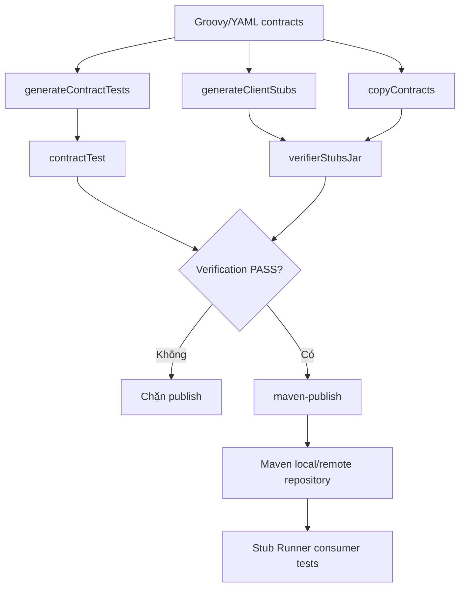
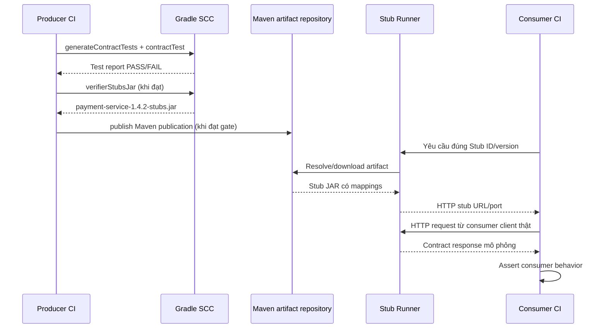

# Task sinh stub, đóng gói và công bố artifact

## 1. Mục tiêu và kết quả cần đạt

Trong **Spring Cloud Contract (SCC)**, producer và consumer thống nhất hành vi HTTP hoặc thông điệp bằng **Groovy/YAML DSL**. Producer sử dụng Gradle plugin để sinh **verification tests**, tạo **stub mappings**, đóng gói chúng thành artifact. Consumer dùng **Stub Runner** để lấy đúng stub artifact và chạy kiểm thử HTTP client hoặc message handler. CI kết nối hai phía nhằm phát hiện các thay đổi API không tương thích.

Bài thuộc chương **Tích hợp Gradle**, tập trung vào vòng đời **sinh stub → đóng gói JAR → công bố artifact**, không chỉ dừng ở việc viết một contract đúng cú pháp.

Ví dụ xuyên suốt:

- Producer: `payment-service` với tọa độ Maven `com.acme.billing:payment-service:1.4.2`.
- Consumer: `checkout-service`.
- Giao diện: `GET /api/payments/PAY-42` trả `200` và `state: CAPTURED`.
- Stub JAR mong muốn: `payment-service-1.4.2-stubs.jar`.
- Stub Runner phía consumer dùng `com.acme.billing:payment-service:1.4.2:stubs`.

Sau bài học, bạn có thể phân biệt những task Gradle chính, cấu hình nơi đặt contract và output, chạy producer verification, đóng gói stub JAR có classifier `stubs`, thiết lập Maven Publish và cổng CI bảo đảm **test đúng build trước khi phát hành**, đồng thời chẩn đoán lỗi artifact/mappings.

> **Nguyên tắc:** Sinh mapping và đóng gói JAR thành công **không mặc nhiên** có nghĩa generated producer tests đã chạy thành công. Cần nối các bước vào CI gate có kiểm chứng.

## 2. Các task quan trọng trong SCC Gradle plugin



Đây là **sơ đồ quy trình CI mong muốn**, không phải khẳng định plugin đã tạo sẵn mọi dependency của task graph. Các task riêng có vai trò:

| Task/lifecycle | Chức năng | Bằng chứng/kết quả |
|---|---|---|
| `generateContractTests` | Sinh producer tests từ DSL | Generated Java/Groovy tests |
| `contractTest` | Thực thi generated producer tests | Test report PASS/FAIL |
| `generateClientStubs` | Tạo WireMock JSON mappings cho HTTP contract | Generated stub mappings |
| `copyContracts` | Chép DSL gốc sang vùng đóng gói | Groovy/YAML trong stub output |
| `verifierStubsJar` | Đóng gói mappings và contracts | JAR classifier `stubs` |
| `check` | Lifecycle kiểm tra Gradle, có tích hợp task SCC | Chỉ có nghĩa khi tests thật sự chạy |
| `publishToMavenLocal` | Xuất Maven publications vào local Maven repo | Artifact ở `~/.m2/repository` |
| `publish` | Xuất Maven publications lên repository khai báo | Artifact ở Nexus/Artifactory/Maven repo |
| `pushStubsToScm` | Công bố stubs lên SCM theo cơ chế riêng | Git/SCM, **không phải Maven Publish** |

**`generateClientStubs` và `verifierStubsJar` không phải test runner.** `contractTest` mới kiểm chứng producer implementation theo contract. Theo tài liệu SCC, `verifierStubsJar` phụ thuộc vào `generateClientStubs` và `copyContracts`, **không thể suy ra nó mặc nhiên phụ thuộc `contractTest`**. Cần thực hiện rõ bước kiểm tra khi publish.

### 2.1. Khảo sát task graph của một project thật

```bash
./gradlew tasks --all
./gradlew verifierStubsJar --dry-run
./gradlew publish --dry-run
```

`tasks --all` liệt kê task được plugin/version đăng ký, `--dry-run` hiển thị task graph dự kiến mà không thực thi. Để chứng minh test thực sự chạy, phải xem `contractTest` output và test reports, không chỉ đọc dry-run.

## 3. Vị trí đặt contract trong dự án Gradle

Tài liệu Spring Cloud Contract Gradle plugin hiện đại mô tả thư mục mặc định:

```text
src/contractTest/resources/contracts
```

Cấu trúc producer minh họa:

```text
payment-service/
  build.gradle
  settings.gradle
  src/
    main/java/com/acme/payment/...
    contractTest/
      java/com/acme/payment/contract/ContractTestBase.java
      resources/
        contracts/
          payments/
            payment-captured.yml
            payment-not-found.yml
```

Phân biệt:

- `src/contractTest/resources/contracts`: nguồn Groovy/YAML DSL theo mặc định Gradle.
- `src/contractTest/java`: vị trí phổ biến cho base class của generated producer tests theo source set Gradle.
- `src/test/resources/contracts`: cách bố trí xuất hiện trong tài liệu cũ/Maven; tài liệu Gradle cho biết đường dẫn này đã **deprecated cho Gradle kể từ SCC 3.0**.
- Nếu đổi thư mục, khai báo `contractsDslDir` tường minh. Đừng trông chờ generator tự quét toàn bộ repository.

Contract được tổ chức thành các thư mục con để plugin sinh class/test có cấu trúc; phải kiểm tra generated source và package/base class kế thừa đúng cấu hình.

## 4. Contract mẫu: cùng DSL sinh test và stub

File minh họa `src/contractTest/resources/contracts/payments/payment-captured.yml`:

```yaml
name: payment_captured
description: "Consumer đọc thanh toán đã hoàn tất"
request:
  method: GET
  url: /api/payments/PAY-42
  headers:
    Accept: application/json
response:
  status: 200
  headers:
    Content-Type: application/json
  body:
    paymentId: "PAY-42"
    state: "CAPTURED"
    amount: 150000
    currency: "VND"
```

Plugin dùng contract này theo hai hướng:

- **Producer verification test:** gọi API producer và assert status, headers, body đã cam kết.
- **Consumer HTTP stub:** tạo mapping sao cho WireMock trả response mẫu khi request khớp.

YAML không tự seed bản ghi `PAY-42` trong database producer. Base test/fixture phải đưa producer vào trạng thái có payment tương ứng trước request, nếu không generated test có thể trả `404` vì thiếu dữ liệu.

**Messaging khác HTTP:** `input`/`outputMessage` có thể tạo định nghĩa stub messaging/trigger cho Stub Runner, không phải lúc nào cũng biến thành HTTP JSON mapping. Bài này tập trung minh họa **stub JAR cho HTTP**, nhưng nguyên tắc công bố versioned artifact áp dụng cho cả các định nghĩa messaging được hỗ trợ.

## 5. Cấu hình `build.gradle` cho producer

Ví dụ **Gradle Groovy DSL**, chọn Spring MVC, JUnit 5 và SCC plugin. Đây là **khung trọng tâm**, không phải file chạy được ở mọi tổ hợp phiên bản: cần thay version placeholders và cấu hình dependency management/BOM phù hợp với Spring Boot và Spring Cloud đang dùng.

```groovy
plugins {
    id 'java'
    id 'org.springframework.boot' version 'REPLACE_WITH_BOOT_VERSION'
    id 'org.springframework.cloud.contract' version 'REPLACE_WITH_SCC_VERSION'
    id 'maven-publish'
}

group = 'com.acme.billing'
version = '1.4.2'

repositories {
    mavenCentral()
}

dependencies {
    implementation 'org.springframework.boot:spring-boot-starter-web'
    testImplementation 'org.springframework.boot:spring-boot-starter-test'
    testImplementation 'org.springframework.cloud:spring-cloud-starter-contract-verifier'
}

contracts {
    contractsDslDir = file('src/contractTest/resources/contracts')
    baseClassForTests = 'com.acme.payment.contract.ContractTestBase'
    testFramework = 'JUNIT5'
    testMode = 'MockMvc'
    stubsOutputDir = file('build/stubs')
}

tasks.withType(Test).configureEach {
    useJUnitPlatform()
}
```

Giải thích:

- `org.springframework.cloud.contract` là plugin **build time** để tạo generated tests và stub mappings.
- `spring-cloud-starter-contract-verifier` ở **test classpath**, không cần đóng gói trong ứng dụng production.
- `maven-publish` chỉ kích hoạt cơ chế publishing Gradle, **chưa tự công bố `verifierStubsJar`** nếu không khai báo publication.
- `testFramework` và `testMode` quyết định generated producer test dùng JUnit và HTTP test client nào.
- `baseClassForTests` phải trùng fully qualified class name mà generated test kế thừa.
- `stubsOutputDir` là thư mục **đầu ra** của generator, không phải thư mục DSL nguồn.

Spring Cloud/Boot/Gradle plugin có thể cung cấp convention và classpath khác nhau theo phiên bản. Nếu project dùng `build.gradle.kts`, cú pháp Kotlin DSL khác Groovy DSL; không dán nguyên khối trên vào Kotlin DSL. Với Kotlin DSL, dùng `id("maven-publish")` trong `plugins {}` và khai báo extension/task theo API plugin phiên bản tương ứng.

## 6. `generateContractTests` so với `contractTest`

Hai lệnh phục vụ hai mục tiêu:

```bash
./gradlew generateContractTests
./gradlew contractTest
```

- `generateContractTests`: sinh mã kiểm thử producer từ Groovy/YAML DSL. **Không tự chứng minh API producer trả đúng**.
- `contractTest`: chạy tests đã sinh, để test framework so sánh response thật của producer với contract.

Base test JUnit 5 minh họa:

```java
@SpringBootTest
public abstract class ContractTestBase {
    @Autowired
    private WebApplicationContext context;

    @Autowired
    private PaymentContractFixture fixture;

    @BeforeEach
    void prepare() {
        fixture.resetIsolatedTestPayments();
        fixture.saveCapturedPayment("PAY-42", 150000L, "VND");
        RestAssuredMockMvc.webAppContextSetup(context);
    }
}
```

`PaymentContractFixture` là helper **do dự án triển khai**, không phải API có sẵn của SCC. Đoạn mã bỏ qua package/imports để tập trung vào lifecycle. Không được chạy `resetIsolatedTestPayments()` trên database production/shared; test cần database, schema hoặc fixture riêng.

Trước khi kết luận verification PASS, kiểm tra:

1. Generated tests tồn tại trong build output.
2. Generated tests kế thừa đúng `ContractTestBase`, phù hợp JUnit 5 và `MockMvc`.
3. Test runner báo **số test thực chạy**, không phải `0 tests`.
4. Các fixture ở trạng thái đúng trước request.
5. Sai status/header/body thực sự khiến test fail.

## 7. `generateClientStubs`: tạo WireMock mappings

Task:

```bash
./gradlew generateClientStubs
```

chuyển các HTTP contracts thành **WireMock stub mappings**. Vị trí output tùy `stubsOutputDir`, plugin version và layout cụ thể.

```text
contractsDslDir  -> nguồn Groovy/YAML
stubsOutputDir   -> output mapping/stub đã sinh
```

Một mapping có ý nghĩa phải phản ánh HTTP method, URL, request headers/body matchers và response status, headers, JSON body theo DSL.

**Bẫy:** task chạy thành công nhưng thư mục contract rỗng hoặc sai đường dẫn; Gradle có thể không tạo mapping mong muốn. Cần kiểm tra **số contracts nguồn và số mappings đầu ra**, không dựa riêng vào exit code 0.

Nếu contract dùng giá trị hai phía hoặc regex matchers, phải đối chiếu generated mapping và producer tests: đừng tự nới lỏng `.*` để che thay đổi schema.

## 8. `copyContracts` và `verifierStubsJar`: đóng gói

Theo tài liệu SCC Gradle plugin, task `verifierStubsJar` đóng gói stub output, với dependencies lên `generateClientStubs` và `copyContracts`. Lệnh:

```bash
./gradlew verifierStubsJar
```

Kết quả thường là:

```text
build/libs/payment-service-1.4.2-stubs.jar
```

Tên file thực tế có thể khác nếu project tùy chỉnh Gradle archive attributes. **Classifier `stubs` là phần quan trọng** để consumer chọn đúng artifact, khác main application JAR.

### 8.1. Cấu trúc JAR mà Stub Runner cần

Tài liệu Stub Runner mô tả cấu trúc dạng:

```text
payment-service-1.4.2-stubs.jar
└── META-INF/
    └── com.acme.billing/
        └── payment-service/
            └── 1.4.2/
                ├── contracts/
                │   └── payments/payment-captured.yml
                └── mappings/
                    └── ...mapping.json
```

Nếu tự tùy chỉnh JAR task, phải bảo đảm cấu trúc `groupId/artifactId/version` mà Stub Runner tìm kiếm; không chỉ gom các JSON vào gốc JAR rồi mặc định classpath scanning sẽ hiểu.

### 8.2. Kiểm tra JAR thực tế

```bash
./gradlew verifierStubsJar
jar tf build/libs/payment-service-1.4.2-stubs.jar
```

Tìm contracts và WireMock mappings đúng artifact. Nếu JDK `jar` không có sẵn, dùng công cụ xem ZIP/JAR tương đương. Đừng sửa trực tiếp output đã build để “thêm” mapping bị thiếu; sửa DSL/cấu hình generator rồi build lại.

**Nhắc lại:** `verifierStubsJar` tạo ra gói stub, không chạy `publish` và không đủ làm bằng chứng producer verification đã PASS.


## 9. Maven Publish: đưa `verifierStubsJar` vào publication

**Từ Spring Cloud Contract 3.0**, cơ chế tự động publication stub nội bộ đã bị vô hiệu hóa theo tài liệu. Vì vậy nếu dùng `maven-publish`, **phải khai báo rằng publication bao gồm `verifierStubsJar`**. Việc có plugin SCC và chạy `verifierStubsJar` không tự khiến file JAR được publish.

Một ví dụ Groovy DSL **bổ sung vào `build.gradle` ở mục 5**:

```groovy
publishing {
    publications {
        mavenJava(MavenPublication) {
            // Thành phần Java thông thường của producer.
            from components.java

            // Đính kèm stub JAR dưới classifier 'stubs'.
            artifact(tasks.named('verifierStubsJar'))
        }
    }

    repositories {
        maven {
            name = 'internal'
            url = uri(
                'https://repo.example.org/repository/maven-releases/'
            )
            credentials {
                username = providers.environmentVariable(
                    'MAVEN_REPO_USER').orNull
                password = providers.environmentVariable(
                    'MAVEN_REPO_PASSWORD').orNull
            }
        }
    }
}
```

**Cần hiểu đúng:**

- `mavenJava(MavenPublication)` là một **publication do project khai báo**, tên `mavenJava` không phải tên task của SCC.
- `from components.java` thêm Java component bình thường. Với Spring Boot, cần kiểm tra artifact **plain JAR vs executable bootJar** theo chiến lược publish của dự án; đoạn này không tự biến `bootJar` thành artifact chính.
- `artifact(tasks.named('verifierStubsJar'))` thêm artifact thứ hai vào publication đó. Stub artifact sử dụng classifier do task `verifierStubsJar` tạo ra, thường là `stubs`.
- `repositories.maven` là **địa chỉ kho Maven**, không phải URL API của producer.
- Username/password lấy từ biến môi trường **trong runtime Gradle của CI**, không hard-code trong source.
- Gói `payment-service-1.4.2-stubs.jar` có thể được publish cùng `payment-service-1.4.2.jar` nếu cấu hình Java component phù hợp.

Đây là **ví dụ cấu hình có thể điều chỉnh**, không phải file chạy độc lập. Project cần plugin Java/SCC/Maven Publish đã được áp dụng và phiên bản Gradle hỗ trợ `tasks.named`, `providers.environmentVariable`. Nếu bạn dùng repository snapshot riêng, hãy định tuyến `-SNAPSHOT` đúng kho, đừng đăng bản snapshot vào release repository trái chính sách.

### 9.1. Tọa độ Maven của publication

Với:

```groovy
group = 'com.acme.billing'
version = '1.4.2'
```

và project name `payment-service`, publication thông thường có:

```text
Main Java artifact:
  com.acme.billing:payment-service:1.4.2

Attached stub artifact:
  com.acme.billing:payment-service:1.4.2:stubs

File ví dụ:
  payment-service-1.4.2.jar
  payment-service-1.4.2-stubs.jar
```

**Không tự đổi `artifactId` thành `payment-service-stubs` nếu muốn Stub Runner tiếp tục dùng `payment-service:1.4.2:stubs`.** Một publication có artifactId `payment-service-stubs` và classifier `stubs` sẽ có tọa độ khác, ví dụ `com.acme.billing:payment-service-stubs:1.4.2:stubs`; consumer phải chỉ định chính xác tọa độ đó hoặc bạn cần thay đổi cách publish.

### 9.2. Publication riêng cho stubs có nên không?

Bạn có thể chỉ tạo publication chứa `verifierStubsJar` mà không thêm Java component, nếu mục tiêu là kho chỉ chứa stubs. Tuy nhiên cần tránh **hai publications có cùng `groupId:artifactId:version` nhưng công bố hai POM/artifact không thống nhất lên cùng repository**. Cách dễ hiểu nhất trong ví dụ là **một Maven publication cho Java + attached stubs classifier**.

Nếu công ty có cơ chế publish ứng dụng/bootJar riêng, có thể điều chỉnh publication một cách có chủ đích. Khi đó cần kiểm tra POM, artifact file, classifier và consumer resolution chứ không chỉ nhìn tên task `publish`.

## 10. Buộc việc publish phụ thuộc vào verification

Đây là điểm thường bị bỏ sót.

Theo tài liệu Gradle plugin, `verifierStubsJar` có dependencies để tạo mapping và copy contracts. **Nó không tự chứng minh `contractTest` đã chạy PASS**. Một pipeline gọi thẳng `publish` có thể công bố stub chưa được xác minh, nếu task graph không gắn producer verification.

Có thể bổ sung **vào cuối build script mẫu**:

```groovy
tasks.named('publish') {
    dependsOn(tasks.named('contractTest'))
}

tasks.named('publishToMavenLocal') {
    dependsOn(tasks.named('contractTest'))
}
```

Cấu hình minh họa này tạo **task dependency**, để khi gọi `publish` hoặc `publishToMavenLocal`, Gradle phải thực thi `contractTest` và dừng nếu test thất bại. Nếu dự án có nhiều loại publication/release tasks, cần bổ sung gate cho **đúng các publish tasks mà CI thực sự gọi**.

**Giới hạn của cách làm:** Nó không ngăn ai đó dùng một lệnh khác để đưa file JAR lên repository ngoài Gradle publishing. CI và quyền publish trên repository vẫn phải thực thi chính sách “artifact đã được xác minh”.

### 10.1. Vì sao không chỉ dựa vào `mustRunAfter`?

`mustRunAfter` điều chỉnh **thứ tự** khi cả hai tasks cùng có mặt, nhưng **không tự thêm `contractTest` vào task graph**. Với mục tiêu “không publish nếu test chưa chạy”, `dependsOn` phù hợp hơn.

```groovy
// CHƯA ĐỦ để bảo vệ publish:
tasks.named('publish') {
    mustRunAfter(tasks.named('contractTest'))
}
```

Nếu chạy chỉ `./gradlew publish`, `contractTest` có thể không nằm trong graph. Do đó, đừng chỉ nhìn thứ tự tasks, hãy đảm bảo **producer verification thực sự là dependency của cổng publish**.

### 10.2. `finalizedBy` cũng không thay thế verification gate

`finalizedBy` thường dùng cho cleanup/report tasks, kể cả khi task chính thất bại. Nó không phù hợp để “chạy test trước publish” như một điều kiện bắt buộc. Không gắn task publish sau test bằng `finalizedBy` rồi tưởng rằng chỉ publish khi test PASS.

### 10.3. Task `check` có thể đã tích hợp `contractTest`

SCC Gradle plugin có thể hook tests vào lifecycle `check`. Nhưng nếu quy trình CI gọi thẳng các publish tasks hoặc tùy biến source sets, hãy kiểm tra graph thực tế. **Explicit dependency hoặc CI stage có điều kiện** khiến chủ đích dễ review hơn.

## 11. Công bố vào local Maven repository

Sau khi đã khai báo publication, bạn có thể cài artifact vào Maven local repository bằng:

```bash
./gradlew clean contractTest verifierStubsJar publishToMavenLocal
```

Khi đã có `publishToMavenLocal.dependsOn(contractTest)`, lệnh có thể rút thành `./gradlew publishToMavenLocal`; tuy nhiên lúc học/kiểm tra, gọi tường minh giúp thấy rõ các bước.

Đầu ra thường là:

```text
~/.m2/repository/com/acme/billing/payment-service/1.4.2/
  payment-service-1.4.2.pom
  payment-service-1.4.2.jar
  payment-service-1.4.2-stubs.jar
```

Đây là đường dẫn **điển hình của Maven local repository**, có thể thay đổi theo cấu hình Gradle/Maven settings.

**Đừng nhầm `mavenLocal()` trong `repositories` với publishToMavenLocal.** `mavenLocal()` giúp Gradle **đọc dependencies từ local repo**; `publishToMavenLocal` là task **ghi Maven publication vào local repo**.

### 11.1. Consumer thử artifact LOCAL

Bên consumer, nếu artifact đã có trong local Maven repo và Stub Runner được cấu hình:

```java
@AutoConfigureStubRunner(
    ids = "com.acme.billing:payment-service:1.4.2:stubs",
    stubsMode = StubRunnerProperties.StubsMode.LOCAL
)
```

thì Stub Runner có thể lấy `payment-service-1.4.2-stubs.jar`. Consumer HTTP tests chạy với stub server do Stub Runner khởi động; nó **không chạy producer thật**.

Nếu consumer không tìm thấy JAR, kiểm tra **group/artifact/version/classifier**, local repository thực tế và việc Gradle đã publish **đúng publication**. Không sửa `stubsMode` lung tung khi artifact chưa được tạo.

## 12. Công bố vào repository từ xa

Sau khi khai báo `publishing.repositories` và cấu hình credentials an toàn:

```bash
./gradlew contractTest publish
```

hoặc nếu task graph đã bảo đảm phụ thuộc:

```bash
./gradlew publish
```

Gradle sẽ thực thi các tasks publication được tạo bởi `maven-publish`, ví dụ `publishMavenJavaPublicationToInternalRepository` nếu tên publication là `mavenJava` và repository là `internal`. **Tên task chính xác** phụ thuộc tên publication và repository đã đặt.

Tại kho Maven remote, artifact được bố trí thường theo:

```text
com/acme/billing/payment-service/1.4.2/
  payment-service-1.4.2.pom
  payment-service-1.4.2.jar
  payment-service-1.4.2-stubs.jar
```

Dùng `publish` không đồng nghĩa consumer đã tải và chạy stub thành công. Sau publication, hãy thử **resolve artifact từ một consumer test** bằng Stub Runner ở mode REMOTE.

### 12.1. Consumer tải stub từ remote repository

```java
@AutoConfigureStubRunner(
    ids = "com.acme.billing:payment-service:1.4.2:stubs",
    stubsMode = StubRunnerProperties.StubsMode.REMOTE,
    repositoryRoot =
        "https://repo.example.org/repository/maven-releases/"
)
```

`repositoryRoot` chỉ định **artifact repository**; URL này không phải base URL của payment API. Consumer HTTP client phải lấy URL/port của **stub server được khởi chạy** (qua `@StubRunnerPort` hoặc `StubFinder`) để gọi `/api/payments/PAY-42`.

### 12.2. Phân biệt `publish`, `build` và `bootJar`

| Lệnh | Mục tiêu | Có đưa stub lên Maven repository? |
|---|---|---|
| `./gradlew build` | Build/test theo Gradle lifecycle | **Không mặc nhiên** |
| `./gradlew bootJar` | Đóng gói ứng dụng Spring Boot chạy được | **Không** |
| `./gradlew verifierStubsJar` | Đóng gói stub JAR | **Không** |
| `./gradlew publishToMavenLocal` | Công bố publications lên Maven local | **Có**, nếu stubs đã được attach |
| `./gradlew publish` | Công bố publications lên repository cấu hình | **Có**, nếu stubs đã được attach |
| `./gradlew pushStubsToScm` | Đưa stub lên Git/SCM theo SCC | **Không phải Maven publish** |

Một `build/libs/payment-service-1.4.2-stubs.jar` tồn tại **không đủ** để Stub Runner ở mode REMOTE tìm thấy artifact nếu chưa có publish hoặc repository chưa cập nhật.

## 13. Bảo mật và tính bất biến của artifact

**Repository credentials** thuộc secret manager/CI secrets, không nằm trong source code. Để triển khai an toàn:

- Dùng biến môi trường hoặc Gradle credentials providers phù hợp, không hard-code token.
- Chỉ cấp quyền **publish** cho pipeline/role cần thiết; consumer chỉ cần quyền **read**.
- Kiểm tra repository HTTPS/certificate theo chính sách nội bộ.
- Không log username/password/token trong build output.
- Dùng **release version bất biến**; hạn chế ghi đè artifact cùng version.
- Với `SNAPSHOT`, xác định retention/cache policy và ghi resolved version/checksum để có thể điều tra.
- Ràng buộc publish với commit/test report chính xác, tránh tạo artifact từ source khác commit đã kiểm tra.

**Không thay lỗi credentials bằng việc publish sang repository công khai hoặc vô hiệu hóa kiểm tra TLS**. Đó là thay đổi phạm vi phân phối/sự an toàn, không phải giải pháp kỹ thuật cho plugin.

### 13.1. Version động `+` ở consumer có rủi ro gì?

Stub Runner có thể phân giải version `+` theo nguồn artifact. Nhưng khi kho cập nhật, cùng một commit consumer có thể tải một stub khác giữa hai lần CI. Với release gate, **ưu tiên pin version**, ví dụ `1.4.2`. Nếu nhóm có job thử “latest”, phải log **version thực tế được phân giải**.

### 13.2. Đừng dùng classifier làm artifactId hai lần

Nếu publication mang `artifactId = payment-service-stubs` và task JAR mang classifier `stubs`, tọa độ là `payment-service-stubs:1.4.2:stubs` — khác `payment-service:1.4.2:stubs`. Hãy chọn một quy ước rồi đối chiếu **POM, JAR filenames, repository metadata và Stub Runner ID**.

## 14. Custom JAR task: khi nào nên thay `verifierStubsJar`?

SCC plugin tạo `verifierStubsJar` với cấu hình mặc định; Gradle cho phép tùy chỉnh task `Jar` như các Gradle tasks khác.

Ví dụ cần bổ sung metadata **không nhạy cảm**:

```groovy
tasks.named('verifierStubsJar', Jar) {
    manifest {
        attributes(
            'Contract-Producer': project.name,
            'Contract-Version': project.version.toString()
        )
    }
}
```

Manifest giúp traceability nhưng **không thay thế đường dẫn `META-INF/group/artifact/version` mà Stub Runner quét**.

Nếu tự tạo task mới `stubsJar`, cần:

1. Cấu hình `archiveClassifier.set('stubs')`.
2. Bảo đảm task phụ thuộc mapping/contract generation tương ứng.
3. Đặt contracts và mappings vào layout mà Stub Runner hỗ trợ.
4. Attach **đúng task mới** vào Maven publication.
5. Đảm bảo `contractTest` chạy trước publish.
6. Kiểm tra consumer thực sự tải được artifact mới.

Không tự thêm hai JAR cùng classifier vào một publication, vì Gradle có thể báo conflict/duplicate artifact. Nếu không có yêu cầu đặc biệt, sử dụng `verifierStubsJar` sẵn có thường đơn giản và ít rủi ro hơn.

## 15. Dự án Gradle nhiều module: chọn đúng project publication

Giả sử repository có nhiều module:

```text
root/
  settings.gradle
  payment-service/
    build.gradle
    src/contractTest/resources/contracts/...
  checkout-service/
    build.gradle
```

Khi đó những lệnh dưới đây có phạm vi khác:

```bash
./gradlew :payment-service:contractTest
./gradlew :payment-service:verifierStubsJar
./gradlew :payment-service:publishToMavenLocal
```

**Plugin phải được apply trong module producer** (hoặc được apply đúng qua convention plugin). Nếu chỉ apply SCC ở root project không có contracts/source set như mong muốn, task có thể không tồn tại ở module hoặc đọc sai thư mục.

Tương tự, `project.group`, `project.name`, `project.version` của subproject phải khớp tọa độ `com.acme.billing:payment-service:1.4.2`. Không tự suy artifactId từ tên root project hoặc `spring.application.name`.

### 15.1. Chia sẻ publication configuration bằng convention plugin

Với nhiều producer, nhóm có thể dùng Gradle convention plugin để thống nhất:

- SCC plugin/version và `contractsDslDir`.
- `maven-publish`, classifier `stubs` và repository settings.
- `contractTest` gate trước publish.
- Quy tắc version/repository credentials.
- Log/test report/artifact metadata trong CI.

Nhưng convention plugin không nên bắt consumer modules phải sinh producer tests nếu consumer chỉ cần Stub Runner. Xác định rành mạch **module producer nào sở hữu contract và stub publication**.


## 16. Nếu contracts nằm ở repository bên ngoài producer

Một số nhóm lưu contracts cùng mã producer, nhóm khác lưu trong repository chung hoặc Git riêng. Đây là quyết định **nguồn contract**, khác với quyết định **nơi publish stub artifact**.

SCC Gradle plugin có cấu hình **`contractDependency`** hoặc **`contractRepository`** để lấy contract từ nguồn ngoài, ví dụ ý tưởng:

```groovy
contracts {
    contractDependency {
        stringNotation =
            'com.acme.contracts:payment-contracts:1.4.2:stubs'
    }
    contractsPath = 'contracts/payments'
}
```

**Đây là cấu hình khái niệm**: đường dẫn, classifier và version phải khớp artifact contracts thực tế mà nhóm đã phát hành, không được suy ra từ ví dụ `payment-service`. Tài liệu chính thức mô tả `contractDependency` với các trường `groupId`, `artifactId`, `version`, `classifier` và `contractsPath` để chọn vị trí nested. Với Git, có cơ chế `contractRepository.repositoryUrl` phù hợp.

Quy trình khi dùng nguồn ngoài:

1. Producer Gradle plugin **lấy đúng contract revision**.
2. Sinh tests/stub mappings từ revision đó.
3. Chạy `contractTest` trên producer build hiện tại.
4. Đóng gói `verifierStubsJar`.
5. Publish stub artifact với **version/revision liên kết rõ ràng**.

**Cảnh báo:** Không trộn lẫn `contractDependency` (đầu vào hợp đồng) với `verifierStubsJar` (đầu ra của producer) hoặc `repositoryRoot` trong Stub Runner consumer (nơi tải stub). Ba thành phần phục vụ ba thời điểm khác nhau.

Nếu cấu hình DSL không đúng với phiên bản SCC đang dùng, cần kiểm tra generated source/task log thay vì đoán thêm tùy chọn không có trong plugin.

## 17. Công bố stubs lên Git/SCM thay vì Maven repository

Tài liệu SCC còn hỗ trợ workflow dùng **SCM làm kho lưu contracts/stubs**, thông qua task liên quan `pushStubsToScm` và cấu hình repository tương ứng.

Ví dụ lệnh theo tài liệu Gradle Project:

```bash
./gradlew pushStubsToScm
```

Điểm cần hiểu:

- Đây là một **luồng công bố khác** với `maven-publish`.
- Có thể phải cung cấp `contractRepository.repositoryUrl`, `contractsMode`, `contractsPath` và cách xác thực Git tương ứng.
- Không mặc định task này đẩy lên `origin` của source repository; URL đích do cấu hình SCM quyết định.
- Các tài liệu/how-to và phiên bản SCC có thể dùng tên/cấu hình publication khác nhau, vì thế cần kiểm tra `./gradlew tasks --all` trên đúng project/plugin version.
- **Không** tự động coi push lên SCM là producer verification PASS; vẫn phải có gate riêng.

Nếu nhóm sử dụng Maven artifacts cho Stub Runner `LOCAL/REMOTE`, hãy tập trung vào `verifierStubsJar` + `maven-publish` trước. Chỉ chọn SCM khi quy trình hợp đồng/consumer downloader thực sự sử dụng nguồn này.

## 18. Xây dựng CI pipeline có thể kiểm chứng

Đối với `payment-service`, một pipeline rõ ràng nên phân biệt:

### Stage A — Sinh và xác minh

```bash
./gradlew clean generateContractTests contractTest
```

Cần có **generated tests thật sự chạy**, với test report và khả năng fail khi producer đổi status/header/body trái contract. Đừng chỉ kiểm tra Gradle task `generateContractTests` hoàn thành.

### Stage B — Đóng gói và kiểm tra artifact

```bash
./gradlew verifierStubsJar
jar tf build/libs/payment-service-1.4.2-stubs.jar
```

Kiểm tra file JAR tồn tại, classifier `stubs` và mappings/DSL đúng layout. Với các môi trường CI Linux/Windows khác nhau, dùng công cụ xem JAR tương đương nếu cần. Không dựa riêng vào tên file mà bỏ qua nội dung.

### Stage C — Công bố có điều kiện

```bash
./gradlew publish
```

Stage này chỉ được chạy **nếu Stage A đạt** và artifact của Stage B ứng với **cùng commit/version**. Nếu các stage chạy trên runner khác, phải lưu và truyền artifact có checksum/build metadata đúng, không âm thầm rebuild từ revision khác.

### Stage D — Consumer xác minh với Stub Runner

Consumer `checkout-service` dùng:

```text
com.acme.billing:payment-service:1.4.2:stubs
```

và `REMOTE` với repository đã publish. Stub Runner tải gói, khởi động HTTP stub, consumer HTTP client gọi `GET /api/payments/PAY-42` và assert business outcome. Nếu stub không tải được hoặc mapping không khớp, consumer CI fail.



### 18.1. Có cần cả `check` và `contractTest`?

Tùy Gradle SCC plugin/version, `check` có thể đã phụ thuộc `contractTest`. Nếu gọi cả hai, Gradle thường chỉ thực thi cùng một task một lần trong cùng invocation. Tuy nhiên để tránh hiểu nhầm, xác minh task graph và test report. Cấu hình CI minh bạch là biết **task nào thực sự thực thi producer tests**, không dựa vào tên lifecycle chung.

### 18.2. Không để Gradle task publication chạy sớm

Các cách bảo vệ:

- `tasks.named('publish') { dependsOn(tasks.named('contractTest')) }`.
- Cấu hình tương tự cho `publishToMavenLocal` hoặc task publication cụ thể trong build.
- Pipeline stage chỉ chạy publish khi stage test thành công.
- Phân quyền repository để chỉ pipeline được duyệt có quyền ghi release.

Hai loại bảo vệ **cấp build graph** và **cấp CI/repository policy** bổ sung cho nhau. `dependsOn` không thể ngăn một người dùng API repository để upload JAR thủ công nếu họ có quyền ngoài quy trình.

### 18.3. Truy vết phiên bản bằng metadata

Một record CI hữu ích gồm:

| Thành phần | Ví dụ |
|---|---|
| Producer commit | `abc1234` |
| Contract source/revision | `payment-contract-1.4.2` |
| SCC plugin version | Version tương thích do project khóa |
| Generated contract tests | Số test chạy, PASS/FAIL |
| Stub artifact | `com.acme.billing:payment-service:1.4.2:stubs` |
| Artifact checksum | SHA-256 của gói đã publish |
| Repository | Release/staging repository cụ thể |
| Consumer build/version | `checkout-service` bản tương ứng |
| Stub Runner version/resolution | Phiên bản gói thực tế consumer tải |
| Consumer test report | PASS/FAIL và các trường hợp đã test |

Không nhất thiết phải ghi tất cả vào một file build; có thể sử dụng build metadata, CI artifact provenance hoặc release dashboard phù hợp. Điều quan trọng là **consumer test không bí mật dùng một stub cũ** rồi kết luận producer mới tương thích.

## 19. Chẩn đoán lỗi Gradle stub publication

| Hiện tượng | Nguyên nhân thường gặp | Cách kiểm tra |
|---|---|---|
| Không có `generateClientStubs` | Plugin SCC chưa được apply ở đúng module | Kiểm tra `plugins {}`, `tasks --all`, subproject |
| `generateContractTests` không sinh file | Sai `contractsDslDir` hoặc contract không hợp lệ | Xem DSL directory, logs, generated sources |
| `contractTest` không được chạy | CI chỉ gọi `verifierStubsJar`/`publish` | Kiểm tra test report và thêm publication gate |
| Generated tests compile lỗi | Thiếu Verifier/JUnit/test classpath | Kiểm tra `testFramework`, dependency graph/source set |
| Test trả `404` dù contract là `200` | Fixture chưa seed hoặc controller sai | Phân biệt setup với implementation |
| `generateClientStubs` PASS nhưng không có mappings | Không tìm thấy contracts hoặc output dir sai | Kiểm tra source dir và `stubsOutputDir` |
| Không tạo `-stubs.jar` | Chưa gọi `verifierStubsJar`, task thiếu hoặc lỗi | Xem `tasks --all` và `build/libs` |
| JAR có nhưng Stub Runner không tìm được mappings | Layout `META-INF` sai hoặc JAR rỗng | Dùng `jar tf`, kiểm tra group/artifact/version |
| `publish` không upload stubs | Chưa `artifact(verifierStubsJar)` trong Maven publication | Kiểm tra `publishing.publications` và repo artifacts |
| Main JAR có nhưng stub classifier không có | Publication chỉ chứa `components.java` | Attach `verifierStubsJar` đúng task |
| `publishToMavenLocal` có JAR, `REMOTE` không thấy | Chỉ ghi vào `~/.m2`, chưa publish remote | Chạy đúng publish task/repository |
| Remote repository trả 401/403 | Thiếu credentials/quyền | Kiểm tra secret injection/permissions |
| Remote repository trả 404 | Sai GAV/classifier/version hoặc repo URL | Đối chiếu đúng artifact metadata |
| Published `payment-service-stubs` nhưng consumer dùng `payment-service:...:stubs` | Đổi artifactId và thêm classifier không thống nhất | Chốt đúng naming convention |
| CI song song publish hai nội dung cùng version | Version không bất biến | Dùng version release riêng và reject overwrite |
| Consumer test xanh nhưng producer mới sai | Consumer dùng stub cũ hoặc producer tests bị skip | Chạy producer verification đúng commit/version |
| `publish` chạy mà không thấy `contractTest` | Chưa đặt dependency gate | Dùng `dependsOn` hoặc CI stage condition |
| Task SCM push không tồn tại | Tên task/plugin version khác | Kiểm tra tài liệu phiên bản, `tasks --all` |

### 19.1. Thứ tự debug hữu ích

**Bước 1 — Contract input.** File ở đúng `contractsDslDir`? Plugin đọc bao nhiêu definitions?

**Bước 2 — Generation.** `generateClientStubs` có sinh mapping JSON không? `generateContractTests` có sinh source test không?

**Bước 3 — Verification.** `contractTest` có chạy và pass trên producer thật trong test context không?

**Bước 4 — Packaging.** `verifierStubsJar` chứa mappings/contracts đúng đường dẫn và classifier chưa?

**Bước 5 — Publication.** POM/JAR đã có trên Maven local hay remote? Đúng group/artifact/version/classifier?

**Bước 6 — Consumer.** Stub Runner có resolve gói và khởi động HTTP stub? Consumer client có gọi đúng stub URL và assert logic không?

Không sửa contract chỉ để né một lỗi Maven credentials, và không nới lỏng producer assertion để che lỗi cấu hình repository.

## 20. Bài tập thực hành: publish stub của inventory-service

### 20.1. Bối cảnh

Producer `inventory-service` dùng Gradle và Spring MVC, công bố artifact:

```text
groupId    = com.acme.catalog
artifactId = inventory-service
version    = 2.1.0
classifier = stubs
```

Consumer `order-orchestrator` cần kiểm tra:

- `GET /api/stock/SKU-100` → `200` với `available: true` và `quantity: 8`.
- `GET /api/stock/SKU-404` → `404` với `code: SKU_NOT_FOUND`.

### 20.2. Yêu cầu

1. Tạo thư mục `src/contractTest/resources/contracts/inventory` và hai YAML HTTP contracts.
2. Cấu hình Gradle SCC plugin với `testFramework=JUNIT5`, `testMode=MockMvc` và `baseClassForTests` phù hợp.
3. Viết test fixture bảo đảm SKU-100 tồn tại và SKU-404 không tồn tại trong test database.
4. Chạy `generateContractTests` và `contractTest`, xem generated source/test report.
5. Chạy `generateClientStubs` và kiểm tra mappings.
6. Chạy `verifierStubsJar`; xác minh file `inventory-service-2.1.0-stubs.jar` có layout `META-INF` phù hợp.
7. Cấu hình `maven-publish` với Maven publication đính kèm `verifierStubsJar`.
8. Gắn `publish` và `publishToMavenLocal` phụ thuộc `contractTest`.
9. Thử `publishToMavenLocal`, rồi chạy consumer Stub Runner `LOCAL`.
10. Khi CI có remote Maven repo, publish với credentials từ secrets và thử consumer `REMOTE`.
11. Nêu cách phát hiện trường hợp `publish` “PASS” nhưng test report ghi `0 tests`.

### 20.3. Gợi ý contract thành công

```yaml
name: stock_available
description: "Kho còn tám sản phẩm SKU-100"
request:
  method: GET
  url: /api/stock/SKU-100
response:
  status: 200
  headers:
    Content-Type: application/json
  body:
    sku: "SKU-100"
    available: true
    quantity: 8
```

### 20.4. Gợi ý publishing

```groovy
publishing {
    publications {
        mavenJava(MavenPublication) {
            from components.java
            artifact(tasks.named('verifierStubsJar'))
        }
    }
}

tasks.named('publish') {
    dependsOn(tasks.named('contractTest'))
}

tasks.named('publishToMavenLocal') {
    dependsOn(tasks.named('contractTest'))
}
```

Đây là trích đoạn **bổ sung** vào build có áp dụng `maven-publish` và SCC plugin. Khi muốn publish từ xa, thêm `publishing.repositories.maven` có URL/credentials hợp lệ. Nếu project chỉ muốn phát hành stub mà không phát hành main JAR, cần thiết kế publication riêng và kiểm tra POM/GAV để không tạo artifact conflict.

### 20.5. Tiêu chí tự kiểm

- Contracts được plugin tìm thấy, generated tests thực sự chạy.
- Producer verification fail khi controller cố ý trả status hoặc JSON sai.
- Có mapping JSON và stub JAR không rỗng.
- Artifact publication gắn classifier `stubs` đúng `groupId:artifactId:version`.
- `publish` không thể thành công nếu `contractTest` thất bại qua graph đã thiết kế.
- Stub Runner `LOCAL` và `REMOTE` tải đúng artifact sau từng bước publish tương ứng.
- Consumer HTTP client thật nhận response và xử lý các nhánh `200/404`.
- Build/release log có thể truy vết contract revision và artifact checksum/version.

## 21. Checklist trước khi merge

- [ ] Plugin `org.springframework.cloud.contract` được apply vào **đúng Gradle producer module**.
- [ ] `contractsDslDir` trỏ tới thư mục Groovy/YAML DSL chính xác.
- [ ] Base class ở source set phù hợp và generated tests kế thừa đúng class.
- [ ] `generateContractTests` sinh test, `contractTest` thực thi test thật, không có `0 tests` ngoài chủ đích.
- [ ] `generateClientStubs` tạo mappings phù hợp contract HTTP.
- [ ] `copyContracts` được tích hợp và nguồn contracts có thể truy vết.
- [ ] `verifierStubsJar` sinh JAR có classifier `stubs`.
- [ ] Stub JAR chứa `META-INF/groupId/artifactId/version/contracts` và `mappings` mà Stub Runner hỗ trợ.
- [ ] `maven-publish` có publication đính kèm `verifierStubsJar`.
- [ ] `group`, `project.name/artifactId` và `version` khớp stub ID của consumer.
- [ ] `publish`/`publishToMavenLocal` có gate bắt buộc producer verification.
- [ ] Repository credentials dùng secrets, không hard-code.
- [ ] Release artifacts không bị ghi đè tùy tiện cùng version.
- [ ] Nếu dùng multi-module, publish đúng `:producer:` module, không phải project root.
- [ ] Consumer Stub Runner phân giải stub bằng đúng `CLASSPATH`/`LOCAL`/`REMOTE` theo nguồn.
- [ ] CI fail nếu thiếu JAR, thiếu mapping, thiếu verification hoặc publish sai.
- [ ] Consumer test gọi HTTP client thật với stub và assert các nhánh quan trọng.
- [ ] Báo cáo ghi artifact version, commit/contract revision và test results.

## 22. Ghi nhớ và tài liệu tham khảo

**Task sinh stub, task đóng gói và task công bố artifact là ba việc khác nhau:**

- `generateClientStubs` chuyển contracts thành mappings.
- `copyContracts` mang DSL vào output để đóng gói.
- `verifierStubsJar` tạo JAR thường có classifier `stubs`.
- `maven-publish` + `artifact(verifierStubsJar)` quyết định Maven publication chứa gói đó.
- `contractTest` xác minh producer implementation và phải tham gia CI gate **trước khi phát hành**.
- `publishToMavenLocal` và `publish` là hai đích công bố khác nhau.
- **Stub Runner** ở consumer dùng đúng `groupId:artifactId:version:stubs` để chạy kiểm thử giao diện mô phỏng.

Một artifact tồn tại và có thể tải được **không đồng nghĩa producer đã được xác minh**. Bằng chứng đáng tin cậy cần gắn đúng contract, generated producer tests, producer build, stub classifier, artifact version và consumer test.

**Tài liệu chính thức nên đọc theo phiên bản dự án:**

- [Spring Cloud Contract — Gradle Project: tasks, contracts, verifierStubsJar và publishing](https://docs.spring.io/spring-cloud-contract/reference/gradle-project.html).
- [Spring Cloud Contract — Stub Runner Core: download, classpath scanning và META-INF layout](https://docs.spring.io/spring-cloud-contract/reference/project-features-stubrunner/stub-runner-core.html).
- [Spring Cloud Contract — Publishing Stubs as JARs](https://docs.spring.io/spring-cloud-contract/reference/project-features-stubrunner/stub-runner-publishing-stubs-as-jars.html).
- [Spring Cloud Contract — How to Use Git as Storage for Contracts and Stubs](https://docs.spring.io/spring-cloud-contract/reference/howto/how-to-use-git-as-storage.html).
- [Gradle User Manual — Maven Publish Plugin](https://docs.gradle.org/current/userguide/publishing_maven.html).
- [Gradle User Manual — Task Dependencies](https://docs.gradle.org/current/userguide/controlling_task_execution.html).


