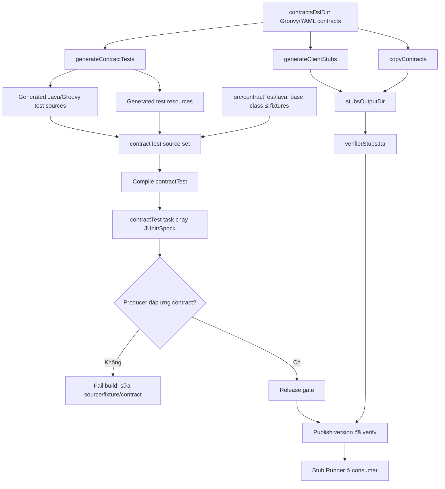
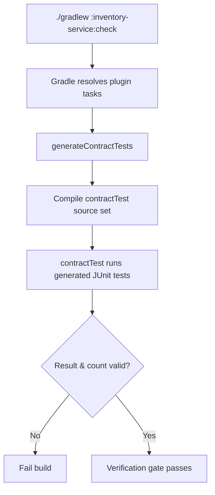

# Cấu hình source set, thư mục nguồn và đầu ra

Một file contract Groovy hoặc YAML có thể mô tả đúng HTTP API, nhưng **Spring Cloud Contract Verifier** vẫn không bảo vệ được producer nếu Gradle không tìm thấy file ấy, sinh test vào thư mục compiler không sử dụng, hoặc chạy nhầm task `test` thay vì `contractTest`. Tương tự, một thư mục `build/stubs` có nhiều JSON mappings chưa chắc đã trở thành artifact mà **Stub Runner** của consumer có thể tải và sử dụng.

Bài học thuộc chương **Tích hợp Gradle** của module **SPRING_CLOUD_CONTRACT**. Module hướng đến kiểm thử hợp đồng giữa producer và consumer bằng **Groovy/YAML DSL**, sinh test phía producer, phát hành stub và tích hợp CI để phát hiện thay đổi API không tương thích. Chủ đề này tập trung vào **Gradle source set**, **đường dẫn đầu vào** và **các loại đầu ra của plugin**, đồng thời giải thích cách nối chúng vào compilation, test execution và stub packaging.

Trong bài, `InventoryService` là producer HTTP còn `OrderService` là consumer. Các tên dự án và API chỉ dùng để minh họa; **không giả định một build thực tế đang có những file đó**. Ví dụ chủ yếu viết bằng **Gradle Groovy DSL** (`build.gradle`); với Gradle Kotlin DSL (`build.gradle.kts`), cú pháp và một số kiểu giá trị khác nhau.

Sau bài học, bạn có thể:

- Giải thích source set `main`, `test` và `contractTest` trong Gradle.
- Phân biệt `contractsDslDir`, `generatedTestJavaSourcesDir`, `generatedTestGroovySourcesDir`, `generatedTestResourcesDir` và `stubsOutputDir`.
- Chọn đúng vị trí contract nguồn, base class viết tay và generated test.
- Cấu hình Gradle plugin Spring Cloud Contract với JUnit 5 và MockMvc.
- Kiểm task `generateContractTests`, `contractTest`, `generateClientStubs` và `verifierStubsJar`.
- Di chuyển contract từ `src/test/resources/contracts` theo quy ước cũ sang `src/contractTest/resources/contracts` một cách có kiểm soát.
- Xử lý source set tùy chỉnh, multi-module, cache và artifacts trong CI.
- Chứng minh rằng generated tests thực sự **đã chạy** chứ không chỉ tồn tại trên đĩa.

## 1. Vì sao Gradle source set quan trọng với kiểm thử hợp đồng?

Trong Gradle Java plugin, một **source set** nhóm source code, resources, dependency configurations và output class files dùng cho một mục đích. Hai source sets cơ bản:

| Source set | Mục đích | Ví dụ |
| --- | --- | --- |
| `main` | Mã ứng dụng production | `src/main/java`, `src/main/resources` |
| `test` | Unit/integration tests thông thường | `src/test/java`, `src/test/resources` |
| `contractTest` | Generated producer contract tests và lớp base của chúng khi Spring Cloud Contract Gradle plugin được cấu hình theo quy ước hiện hành | `src/contractTest/java`, `src/contractTest/resources/contracts` |

Tên `contractTest` không phải thư mục do Maven sử dụng giống hệt. Trong Spring Cloud Contract Gradle plugin từ dòng **3.x trở đi**, `contractTest` là source set mặc định được tài liệu plugin dùng cho verification. Các dự án cũ có thể tổ chức khác; cần đọc đúng tài liệu version, không tự suy đường dẫn từ một ví dụ Maven.

### Source set không giống thư mục contract DSL

`contractsDslDir` cho biết **nơi plugin đọc các định nghĩa contract**; `contractTest` là source set phục vụ **biên dịch và thực thi test**, gồm base classes và generated code đã được plugin nối vào build. Cả hai liên quan nhau nhưng **không phải cùng một thiết lập**.

Ví dụ:

```text
src/contractTest/resources/contracts/   # Input DSL: các file .groovy / .yml
src/contractTest/java/                  # Base class, helper viết tay
build/generated-test-sources/...        # Generated tests: plugin tạo
build/classes/...                       # Bytecode: compiler tạo
build/test-results/contractTest/        # XML kết quả của task contractTest
```

Nếu đưa contract vào `src/contractTest/java` như một file test JUnit nhưng không cấu hình DSL source directory, plugin không tự biết phải đọc nó như contract. Ngược lại, nếu chỉ tạo test source files vào thư mục `build/generated-test-sources` mà không đưa vào source set/test task, chúng **có thể không được compile hoặc chạy**.

## 2. Luồng input → generated output → verification → artifact



Sơ đồ là **mô hình logic**, không phải thứ tự mà Gradle tự áp đặt cho mọi task. Ví dụ, một lần gọi `verifierStubsJar` có thể sinh JAR dù bạn **chưa chạy `contractTest`**. Chính sách CI phải đảm bảo producer verification đạt trước khi publish stub.

Hãy phân biệt năm nhóm tài sản:

1. **Source DSL**: hợp đồng viết tay, cần review và version control.
2. **Test base/fixture**: mã kiểm thử viết tay để khởi tạo ứng dụng và dữ liệu.
3. **Generated test sources/resources**: kết quả tạm của generator, được build lại từ DSL.
4. **Stub mappings/contracts packaging output**: nội dung chờ đóng gói JAR.
5. **Reports và artifact cuối**: kết quả chạy test cùng JAR có classifier/version dùng cho consumer.

Không nên sửa trực tiếp một file được sinh trong `build` rồi coi thay đổi ấy là nguồn sự thật: lần chạy plugin sau sẽ tạo lại nó.

## 3. Cấu trúc dự án Gradle nên bắt đầu từ đâu?

Theo quy ước của Spring Cloud Contract Gradle plugin hiện hành, một producer Spring MVC có thể bố trí:

```text
inventory-service/
├── settings.gradle
├── build.gradle
├── gradlew
├── gradlew.bat
├── gradle/wrapper/...
└── src/
    ├── main/
    │   ├── java/com/example/inventory/...
    │   └── resources/application.yml
    ├── test/
    │   ├── java/...                   # Unit tests thường
    │   └── resources/...
    └── contractTest/
        ├── java/com/example/inventory/
        │   └── ContractVerifierBase.java
        └── resources/
            └── contracts/
                └── reservations/
                    ├── create-reservation-success.groovy
                    └── insufficient-stock.yml
```

Hai file contract dưới `reservations/` là ví dụ hai kịch bản **khác nhau**, không phải đặt Groovy/YAML trùng hợp đồng thành công rồi vô tình sinh test hai lần.

### Quy tắc tổ chức

- `src/main` chứa mã producer thật.
- `src/test` dành cho các bài test khác của dự án, không phải nơi được khuyến nghị cho **Gradle contract DSL mặc định mới**.
- `src/contractTest/java` chứa base classes/helpers tự viết; các lớp này phải được Git quản lý.
- `src/contractTest/resources/contracts` chứa DSL source.
- `build` là khu vực do Gradle/plugin tạo ra và thông thường **không commit**.

Các thư mục generated có thể được cấu hình lại; đừng dùng đường dẫn trong một bài hướng dẫn làm kết luận về mọi phiên bản plugin.

## 4. Lưu ý lớn khi chuyển từ Gradle plugin 2.x sang 3.x trở lên

Đường dẫn contract mặc định đã thay đổi qua các đời:

| Dòng tài liệu | Thư mục DSL thường gặp | Source set mặc định cần lưu ý |
| --- | --- | --- |
| Các cấu hình Gradle plugin 2.x | `src/test/resources/contracts` | Có những phiên bản dùng `test` |
| Gradle plugin 3.x+ trong tài liệu chính thức | `src/contractTest/resources/contracts` | `contractTest` |
| Maven plugin | `src/test/resources/contracts` theo quy ước Maven | **Không** dùng source set Gradle |

Trong quá trình chuyển đổi, plugin Gradle từ 3.0 có hỗ trợ tìm contract ở vị trí cũ `src/test/resources/contracts` nhưng đưa ra **cảnh báo deprecation**. Đừng dựa mãi vào đường tìm kiếm legacy hoặc coi warning là vô hại: khi nâng toolchain, contract có thể không còn được đọc như trước. Xem thêm [tài liệu Spring Cloud Contract Gradle](https://docs.spring.io/spring-cloud-contract/reference/gradle-project.html).

Quy trình migrate:

1. Ghi nhận version plugin, Gradle Wrapper và đường input hiện có.
2. Chọn nguồn duy nhất cho contracts; tránh để file tương đương ở cả đường cũ và mới.
3. Chuyển DSL tới `src/contractTest/resources/contracts`, giữ package/nhóm phù hợp.
4. Chuyển base class và helpers đang dùng từ `src/test/java` sang `src/contractTest/java` hoặc cấu hình rõ classpath/source set nếu chủ ý dùng chung.
5. Sửa `contractsDslDir` và `baseClassForTests` nếu trước đây có override.
6. Chạy `generateContractTests`, kiểm đúng số lượng lớp/phương thức sinh.
7. Chạy `contractTest`, kiểm compilation, fixtures và JUnit discovery.
8. Sinh stub và kiểm nội dung JAR sau migration.

Việc đổi vị trí base class quan trọng: generated test có thể tìm được DSL nhưng **fail compile** vì superclass vẫn ở source set `test` mà `contractTest` không nhìn thấy.

## 5. Những thuộc tính đường dẫn chính của Gradle plugin

| Thuộc tính trong `contracts { ... }` | Input/Output | Vai trò |
| --- | --- | --- |
| `contractsDslDir` | Input | Thư mục chứa Groovy/YAML contracts |
| `sourceSet` | Tổ chức test | Chọn source set plugin dùng cho kiểm thử hợp đồng; khi không đặt, thông thường là `contractTest` |
| `generatedTestJavaSourcesDir` | Output | Test Java/JUnit do generator tạo |
| `generatedTestGroovySourcesDir` | Output | Test Groovy/Spock do generator tạo |
| `generatedTestResourcesDir` | Output | Tài nguyên phục vụ generated tests |
| `stubsOutputDir` | Output | Stub mappings và dữ liệu dành cho đóng gói |
| `basePackageForTests` | Generated package | Package của generated tests |
| `baseClassForTests` | Tham chiếu class | Base class viết tay mà generated tests kế thừa |
| `packageWithBaseClasses` | Quy ước class | Chọn các base classes theo cấu trúc contract |
| `baseClassMappings` | Ánh xạ class | Gắn package contract cụ thể với một base class |

**Quan trọng:** `generatedTestSourcesDir` là tên tùy chọn cũ đã **deprecated** trong tài liệu Gradle plugin hiện nay. Khi cấu hình mới, dùng `generatedTestJavaSourcesDir` và `generatedTestGroovySourcesDir` tương ứng; đừng vừa bật tùy chọn cũ vừa kỳ vọng nó luôn ghi đè mọi cấu hình mới.

Theo phần “Default Setup” của tài liệu plugin dòng 5.0, các đường thường là:

```text
Input:
  <projectDir>/src/contractTest/resources/contracts

Outputs (mô hình minh họa cho buildDir mặc định):
  <buildDir>/generated-test-sources/contractTest/java
  <buildDir>/generated-test-sources/contractTest/groovy
  <buildDir>/generated-test-resources/contracts
  <buildDir>/stubs
```

Tài liệu có chỗ trình bày `generatedTestResourcesDir` thành `.../contracts`, có chỗ mô tả `.../contractTest`. **Khi cần kiểm CI, ưu tiên giá trị extension thực tế được resolve bởi plugin đang dùng**, hoặc cấu hình rõ đường output của dự án, thay vì phỏng đoán một mặc định duy nhất.

### Vì sao nên để generated output trong build directory?

- `gradlew clean` loại bỏ output cũ trước khi sinh lại.
- Tránh vô tình commit/generated test trùng với test do nhóm viết.
- Gradle có thể quản lý outputs trong task graph và build cache đúng cách nếu plugin khai báo input/output phù hợp.
- Giảm rủi ro generator ghi đè file thủ công.
- Dễ kiểm đường đi từ contract source đến generated files rồi đến report.

Không nên đặt `generatedTestJavaSourcesDir` vào `src/contractTest/java` chỉ để IDE thấy file: điều này trộn mã sinh với base class viết tay và khiến Git diff, clean/build hoặc nâng plugin khó kiểm soát.

## 6. Ví dụ `build.gradle`: định nghĩa đầu vào và đầu ra rõ ràng

Đoạn sau **là phần cấu hình tham khảo**, cần ghép với build Spring Boot và dependency management hiện có. Cần thay `SCC_VERSION_COMPATIBLE` bằng phiên bản Spring Cloud Contract tương thích với Spring Boot, JDK và Gradle Wrapper của dự án.

```groovy
plugins {
    id 'java'
    id 'org.springframework.cloud.contract' version 'SCC_VERSION_COMPATIBLE'
}

repositories {
    mavenCentral()
}

dependencies {
    // Các versions được quản lý bằng BOM/platform hoặc build của dự án.
    contractTestImplementation 'org.springframework.cloud:spring-cloud-starter-contract-verifier'
    contractTestImplementation 'org.springframework.boot:spring-boot-starter-test'
    contractTestRuntimeOnly 'org.junit.platform:junit-platform-launcher'
}

contracts {
    // Contract DSL nguồn: không phải thư mục generated.
    contractsDslDir = file('src/contractTest/resources/contracts')

    // Test framework và transport; ở đây producer Spring MVC.
    testFramework = 'JUNIT5'
    testMode = 'MockMvc'
    baseClassForTests = 'com.example.inventory.ContractVerifierBase'

    // Output của generator. Đặt trong build/ để có thể clean và tái tạo.
    generatedTestJavaSourcesDir =
        layout.buildDirectory.dir('generated-test-sources/contractTest/java').get().asFile
    generatedTestGroovySourcesDir =
        layout.buildDirectory.dir('generated-test-sources/contractTest/groovy').get().asFile
    generatedTestResourcesDir =
        layout.buildDirectory.dir('generated-test-resources/contracts').get().asFile
    stubsOutputDir = layout.buildDirectory.dir('stubs').get().asFile
}

tasks.named('contractTest', Test) {
    useJUnitPlatform()
    testLogging {
        events 'passed', 'failed', 'skipped'
    }
}
```

**Đọc kỹ trước khi chạy:**

1. Đây là **Groovy DSL**; `build.gradle.kts` cần API/syntax Kotlin tương ứng.
2. Các artifact không có version trong ví dụ cần một **BOM/platform/dependency management** hoặc khai báo version hợp lệ đã được dự án thiết lập. Ví dụ không thể chạy độc lập nếu thiếu chúng.
3. `contractTestImplementation`/`contractTestRuntimeOnly` là configurations gắn với source set `contractTest`. Chúng tồn tại khi plugin đã tạo source set đó. Với các plugin/version rất cũ, phải xác nhận source set thực tế.
4. `testMode = 'MockMvc'` dành cho Spring MVC. Với Spring WebFlux, message hoặc HTTP server thật, cần điều chỉnh test mode và base class.
5. `layout.buildDirectory.dir(...).get().asFile` cung cấp `File` cho thuộc tính plugin theo cú pháp Gradle Groovy DSL. Tài liệu chính thức cũng có ví dụ dùng `project.file("$buildDir/...")`; cách mới rõ hơn với layout API, nhưng khả năng tương thích phụ thuộc Gradle/plugin version.
6. Cấu hình `useJUnitPlatform()` được đặt trên task `contractTest`, **không chỉ task `test`**.

Nếu dự án dùng Spock, cần `groovy` plugin, dependencies `spock-core`/`spock-spring` tương thích, test framework Spock và đúng source directory `src/contractTest/groovy`. Không dùng nguyên phần JUnit5 trong ví dụ cho Spock mà không thay đổi.

## 7. Base class phải nằm trên đúng classpath

Một producer MVC có thể có:

```java
package com.example.inventory;

import io.restassured.module.mockmvc.RestAssuredMockMvc;
import org.junit.jupiter.api.BeforeEach;
import org.springframework.beans.factory.annotation.Autowired;
import org.springframework.boot.test.context.SpringBootTest;
import org.springframework.web.context.WebApplicationContext;

@SpringBootTest
public abstract class ContractVerifierBase {
    @Autowired
    WebApplicationContext context;

    @BeforeEach
    void setup() {
        RestAssuredMockMvc.webAppContextSetup(context);
    }
}
```

Đặt file này tại:

```text
src/contractTest/java/com/example/inventory/ContractVerifierBase.java
```

Nó là **mã viết tay**, có thể chuẩn bị fixture SKU, clock, database hoặc test doubles cần thiết. Nó không nằm trong `build/generated-test-sources`, vì đó là output của plugin.

Lưu ý về classpath:

- `baseClassForTests` là **tên class đầy đủ** (package + class), không phải đường dẫn filesystem.
- `basePackageForTests` quyết định package các test được sinh; nó **không** tự làm base class xuất hiện trên classpath.
- Nếu base class dùng Spring Test, RestAssured MockMvc hay test utilities, phải có dependencies trên `contractTest` compile/runtime classpath.
- Nếu base class ở `src/test/java` nhưng không được share/include đúng, generated test có thể gặp `cannot find symbol` hoặc `ClassNotFoundException`.
- Nếu controller thật dùng validation/security/Jackson customizations, setup context phải có các bean cần thiết theo phạm vi contract.

**Đừng chữa lỗi compilation bằng cách sửa generated Java**. Hãy sửa source set, đường dẫn base class, dependency hoặc plugin configuration, rồi sinh lại.

## 8. Contract nguồn Groovy/YAML và generated test

Ví dụ file:

```text
src/contractTest/resources/contracts/reservations/create-success.groovy
```

```groovy
import org.springframework.cloud.contract.spec.Contract

Contract.make {
    name 'create_reservation_success'
    description 'OrderService đặt giữ 2 đơn vị SKU-001'

    request {
        method 'POST'
        url '/api/v1/reservations'
        headers {
            contentType(applicationJson())
        }
        body([
            sku     : 'SKU-001',
            quantity: 2
        ])
    }

    response {
        status 201
        headers {
            contentType(applicationJson())
        }
        body([
            reservationId: $(consumer('RES-701'),
                             producer(regex('RES-[0-9]+'))),
            status: 'HELD'
        ])
    }
}
```

Contract này hứa request mẫu phải được producer xử lý với `201`, JSON chứa ID theo quy tắc và `status=HELD`. Generator chuyển DSL thành các assertions của test producer, đồng thời có thể tạo stub trả `RES-701` cho consumer.

### Cùng ý tưởng bằng YAML

```yaml
name: create_reservation_success
description: OrderService đặt giữ 2 đơn vị SKU-001
request:
  method: POST
  url: /api/v1/reservations
  headers:
    Content-Type: application/json
  body:
    sku: SKU-001
    quantity: 2
response:
  status: 201
  headers:
    Content-Type: application/json
  body:
    reservationId: RES-701
    status: HELD
```

Đây là **một cách mô tả thay thế** ở mức cơ bản; YAML này dùng literal `RES-701`, **chưa tương đương về matcher động** với Groovy phía trên. Muốn tương đương, phải thêm matcher theo cú pháp YAML của Spring Cloud Contract đúng phiên bản. Đừng đặt cả hai cùng kịch bản trong source directory rồi khiến generator tạo trùng test/mapping.

Vì file DSL đặt trong nhóm `reservations/`, plugin có thể dùng cấu trúc thư mục để xác định generated test class/package theo quy ước; tên cụ thể phụ thuộc `basePackageForTests`, `name` và generator version. Đừng viết test filtering trong CI phụ thuộc tuyệt đối vào một tên generated class giả định.

## 9. Gradle task graph: sinh file khác với chạy test

Spring Cloud Contract Gradle plugin đăng ký những tasks chuyên biệt. Tên phổ biến theo tài liệu chính thức:

| Task | Đích sử dụng | Có xác minh producer không? |
| --- | --- | --- |
| `generateContractTests` | Đọc contract và sinh producer tests | **Chưa**; mới tạo source |
| `contractTest` | Biên dịch/chạy contract tests qua source set và test runner | **Có**, nếu test thật sự được phát hiện và chạy |
| `generateClientStubs` | Sinh các stub mappings từ contracts | **Không** |
| `copyContracts` | Copy contract definitions vào khu vực stub packaging | **Không** |
| `verifierStubsJar` | Đóng gói stub output thành JAR | **Không mặc nhiên** |
| `check` | Lifecycle kiểm thử Gradle; plugin thường nối contract test vào đây | Có, **nếu task graph đã nối đúng** |

Lưu ý: tên task là của plugin trong các đời tài liệu đang tham khảo. Một dự án có plugin khác, custom test suites hoặc áp dụng Spring Cloud Contract khác version cần xem task graph thật, không tự kết luận từ bảng.

### Lệnh quan sát — không thay thế kiểm kết quả

```bash
# Chạy trong thư mục có Gradle Wrapper.
./gradlew tasks --all

# Chỉ sinh producer tests; chưa chứng minh implementation đúng:
./gradlew generateContractTests --info

# Biên dịch và chạy producer contract tests:
./gradlew contractTest --info

# Sinh HTTP stub mappings:
./gradlew generateClientStubs --info

# Đóng gói stub artifact:
./gradlew verifierStubsJar

# Chạy bộ kiểm tra được nối vào Gradle verification lifecycle:
./gradlew clean check
```

Trên Windows dùng `gradlew.bat`; trong multi-module, ưu tiên task path có project cụ thể, ví dụ `:inventory-service:contractTest`. Không nhất thiết phải chạy tất cả các lệnh tuần tự trong CI: một task lifecycle có thể đã kéo theo nhiều prerequisites. **Nội dung cần xác nhận là task nào thực sự đã chạy**, không phải số dòng lệnh.

### Luồng task lý tưởng



Tài liệu Gradle plugin nói plugin được gắn vào `check`, và có task `contractTest` để chạy generated tests. Tuy nhiên, việc tạo/lưu JAR `verifierStubsJar` có thể không phụ thuộc vào trạng thái test. Vì vậy **publish pipeline phải dùng `check`/`contractTest` làm gate riêng**.

## 10. Output của generated Java khác compiled bytecode

Sau khi chạy `generateContractTests`, bạn có thể thấy một file Java ở:

```text
build/generated-test-sources/contractTest/java/
└── org/springframework/cloud/contract/verifier/tests/
    └── ...GeneratedTest.java
```

Mã Java này thường kế thừa base class của test và chứa các assertion tương đương contract. Trong `build` còn có thể có:

```text
build/
├── generated-test-sources/contractTest/java/  # Source sinh
├── generated-test-resources/contracts/        # Resource sinh
├── classes/java/contractTest/                 # Kết quả biên dịch source set
├── test-results/contractTest/                 # JUnit XML reports
└── reports/tests/contractTest/                # HTML report nếu Gradle tạo
```

**Đừng trộn các lớp output:**

- Java source trong `generated-test-sources` chứng minh generator đã tạo mã.
- Class files trong `classes` chứng minh mã được biên dịch.
- Test reports chứng minh runner đã **thực thi** bài test cụ thể.
- Assertion pass khi đi qua implementation producer mới hỗ trợ kết luận producer phù hợp contract.

Đường dẫn output class/report chịu ảnh hưởng bởi Gradle version, ngôn ngữ, test suite và custom tasks. Các đường trên là bố cục **thường gặp**, không phải contract rằng mọi Gradle build đều phải đúng từng ký tự.

### Vì sao cần để Gradle biết generated source directory?

Test compiler chỉ biên dịch những file thuộc source set/task đã cấu hình. Nếu generator ghi vào một thư mục khác đường mà source set dùng:

1. File Java được tạo thành công.
2. `compileContractTestJava` hoặc task tương ứng **không nhìn thấy file đó**.
3. `contractTest` không có test nào, hoặc chỉ chạy test viết tay.
4. `check` có thể xanh dù một phần contract không được xác minh.

Vì thế khi tùy chỉnh `generatedTestJavaSourcesDir`, phải kiểm plugin thực sự cập nhật source set và task dependencies; không mặc định Gradle tìm mọi thư mục tên `generated`.

## 11. Source set `contractTest` và dependency configurations

Java plugin tạo `testImplementation`/`testRuntimeOnly` cho source set `test`. Khi Spring Cloud Contract plugin tạo `contractTest`, bạn cũng cần hiểu các cấu hình phụ thuộc như:

```text
contractTestImplementation
contractTestCompileOnly
contractTestRuntimeOnly
contractTestRuntimeClasspath
```

Chính xác những configurations có sẵn và quan hệ `extendsFrom` phụ thuộc source set/plugin đã áp dụng. Không nên cho rằng thêm thư viện vào `testImplementation` chắc chắn đủ để generated `contractTest` thấy nó.

### Ví dụ thiếu dependencies

Một base class:

```java
import org.springframework.boot.test.context.SpringBootTest;
import org.junit.jupiter.api.BeforeEach;
import io.restassured.module.mockmvc.RestAssuredMockMvc;
```

Nếu `contractTestCompileClasspath` không có Spring Test/JUnit/RestAssured MockMvc tương ứng, compile generated tests có thể fail dù unit tests trong `src/test` chạy tốt.

Hãy khai báo dependency ở đúng configuration, ví dụ:

```groovy
dependencies {
    contractTestImplementation 'org.springframework.cloud:spring-cloud-starter-contract-verifier'
    contractTestImplementation 'org.springframework.boot:spring-boot-starter-test'
    contractTestRuntimeOnly 'org.junit.platform:junit-platform-launcher'
}
```

Đây là **mảnh Gradle** giả định `contractTest` đã tồn tại và versions đã được quản lý. Trong các dự án có conventions plugins hoặc dependency constraints riêng, có thể dùng `extendsFrom` thay vì lặp mọi dependency, nhưng phải xác định cấu hình nào được kế thừa.

### Lệnh kiểm dependency của source set

```bash
./gradlew dependencies --configuration contractTestCompileClasspath
./gradlew dependencies --configuration contractTestRuntimeClasspath
./gradlew dependencyInsight --configuration contractTestRuntimeClasspath \
  --dependency junit-jupiter
```

Đây là lệnh cho Gradle Wrapper trên shell Unix; trên PowerShell cú pháp xuống dòng của ví dụ cuối cần viết lại trên một dòng. Mục tiêu là xác minh dependency **thật sự đã resolve**, không chỉ nhìn khối `dependencies { ... }` trong một build script.

## 12. Nếu muốn đổi source set: đừng chỉ đổi tên thư mục

Đôi khi tổ chức muốn đặt generated tests trong `test` hoặc một source set kiểm thử tích hợp khác, thay vì `contractTest`. Spring Cloud Contract Gradle extension có tùy chọn `sourceSet` để chọn source set phù hợp.

Một **ví dụ định hướng** cho dự án đã tạo source sets:

```groovy
contracts {
    // sourceSet là một source set Gradle, không phải String đường dẫn.
    // Chỉ dùng nếu đã xác minh plugin/version hỗ trợ đúng cách.
    sourceSet = sourceSets.test

    // Thư mục contract DSL vẫn được chỉ định riêng:
    contractsDslDir = file('src/contractTest/resources/contracts')
}
```

Điểm cần kiểm sau khi thay:

1. Generated Java/Groovy source thuộc **source set nào**?
2. Base class có mặt trên compile/runtime classpath của source set đó không?
3. Task `test` hay `contractTest` mới là task **thực thi generated tests**?
4. Phần nào của `check` bị thay đổi? Có chạy trùng test không?
5. Báo cáo XML/HTML được ghi vào đâu?
6. Nếu có song song test tasks, có chia sẻ fixture/database/port dẫn đến kết quả không ổn định không?

**Không suy rằng đặt `sourceSet = sourceSets.test` đồng nghĩa `contractsDslDir` chuyển tự động về `src/test/resources/contracts`.** Đó là hai khái niệm tách biệt: một bên là bố trí source/test classpath, bên kia là nơi tải file contract định nghĩa.

### Vì sao thường nên giữ source set riêng?

- Có thể cấu hình test framework và dependencies phù hợp contract verification.
- Có thể chạy `contractTest` độc lập khi chẩn đoán.
- Báo cáo contract tests tách khỏi unit tests.
- Base class/fixture rõ ràng và không lẫn với test thường.
- CI dễ áp điều kiện kiểm số generated tests và phát hiện skip.

Tuy vậy, source set riêng làm phát sinh nhiệm vụ quản lý classpath và test lifecycle. Với multi-module phức tạp, cần một convention plugin nhất quán để tránh mỗi module cấu hình khác nhau.

## 13. Generated test resources chứa gì?

Một số contract yêu cầu test fixture, request/response body file hoặc tài nguyên tham chiếu mà generator cần dùng khi biên dịch/chạy tests. `generatedTestResourcesDir` là nơi plugin có thể tạo **tài nguyên cho generated tests**.

Phân biệt:

| Thư mục | Nội dung điển hình | Ai sở hữu? |
| --- | --- | --- |
| `src/contractTest/resources/contracts` | DSL contract Groovy/YAML | Developer, review qua Git |
| `src/contractTest/resources` ngoài `contracts` | Fixture test, cấu hình test do nhóm viết | Developer |
| `build/generated-test-resources/...` | Resources do generator tạo | Plugin |
| `build/resources/contractTest` | Resources đã qua bước process/copy cho test runtime | Gradle |
| `build/stubs` | Stub mappings/contract definitions chuẩn bị packaging | Plugin/build |

Một file JSON body dùng cho producer test và một file JSON body dùng cho WireMock stub có thể giống nội dung nhưng **khác vai trò**. Đừng copy nhầm `__files` của WireMock vào test resources rồi giả định plugin sẽ nạp đúng theo mọi cấu hình.

### Khi có file payload riêng

Ví dụ contract tham chiếu `order-created-request.json` hoặc `reservation-response.json` bằng helper/DSL tương ứng, dự án phải đảm bảo:

- File gốc được version control.
- Generator biết vị trí đọc file tương ứng.
- Generated tests có thể load resource khi chạy, không chỉ khi sinh source.
- Stub packaging mang body file nếu mapping dùng `bodyFileName`.
- File path trong JAR và trên filesystem phù hợp với cơ chế runtime.

Chỉ nhìn thấy filename trong repository **không** chứng minh cả producer tests và consumer stub đều đọc được nó.

## 14. Output stubs khác output tests

`stubsOutputDir` không phải nơi đặt generated JUnit tests. Nó chứa nội dung dành cho WireMock/Stub Runner như JSON mappings và contracts được copy khi packaging.

Một bố cục minh họa:

```text
build/
├── generated-test-sources/contractTest/java/...
├── generated-test-resources/contracts/...
└── stubs/
    └── META-INF/
        └── com.example/
            └── inventory-service/
                └── 1.4.2/
                    ├── mappings/
                    │   └── create_reservation_success.json
                    └── contracts/
                        └── create-success.groovy
```

Cấu trúc `META-INF/...` là ví dụ quy ước artifact Spring Cloud Contract, **không bảo đảm** mọi Gradle plugin version và custom task có cùng layout. Đường thư mục được đưa vào JAR có thể được cấu hình trong nhiệm vụ `copyContracts`/`verifierStubsJar`; cách duy nhất để xác nhận là xem artifact cuối.

### Kiểm bằng lệnh Gradle và công cụ JDK

```bash
./gradlew generateClientStubs
./gradlew verifierStubsJar

# Tìm file tạo thực tế trong build/libs trước khi dùng tên dưới đây.
jar tf build/libs/inventory-service-1.4.2-stubs.jar
```

Nếu `jar tf` không có mappings/contracts, đừng tự đổi tên file cho giống `-stubs.jar` rồi coi là xong. Hãy kiểm `stubsOutputDir`, input của `Jar` task, `copyContracts` và đường dẫn artifact publication.

**Giới hạn quan trọng:** lệnh `generateClientStubs` và `verifierStubsJar` **không chứng minh producer implementation đúng contract**. Trước khi phát hành, CI phải chạy `contractTest` và các verification gate khác.

## 15. Đóng gói stubs bằng Gradle và xuất bản có kiểm soát

Tài liệu Spring Cloud Contract Gradle mô tả task `verifierStubsJar` để đóng gói stub output, cùng `copyContracts` để đưa contract definitions vào artifact. Từ Spring Cloud Contract 3.0, **publication mặc định đã bị vô hiệu hóa**, vì vậy người phát triển cần tự định nghĩa publication thích hợp.

Ví dụ một **mảnh `build.gradle`**:

```groovy
plugins {
    id 'maven-publish'
}

publishing {
    publications {
        producer(MavenPublication) {
            from components.java
            artifact tasks.named('verifierStubsJar')
        }
    }
}
```

Mảnh trên giả định plugin `java` và Spring Cloud Contract Gradle đã có từ phần cấu hình trước; `verifierStubsJar` đã được đăng ký. Với Spring Boot, việc phát hành `jar` thông thường hay `bootJar` phải theo cấu hình producer thực tế. Hãy kiểm publication có **đúng artifact chính và stub classifier**, không chỉ nhìn tên publication.

Để điều chỉnh nội dung JAR bằng Gradle-native task API, có thể bổ sung metadata **không nhạy cảm**:

```groovy
tasks.named('verifierStubsJar', Jar) {
    // Ví dụ minh họa, metadata phải do build tạo đúng version.
    from(layout.buildDirectory.dir('generated-metadata')) {
        include 'git.properties'
    }
}
```

Nếu file metadata không tồn tại, Gradle có thể không đưa gì vào artifact; đây **không phải bước bắt buộc** của Spring Cloud Contract. Nên kiểm `jar tf` và checksum khi phát hành.

### Tại sao không publish ngay sau `generateClientStubs`?

Stub được tạo từ **lời hứa trong DSL**. Nó vẫn có thể trả `201 HELD` ngay cả khi producer code đã đổi sang `200`, vì stub generator không cần gọi controller thật. Do đó thứ tự logic của release phải là:

```text
Commit producer code + contract
  -> Gradle generateContractTests
  -> Compile / execute contractTest
  -> Verify required integration tests
  -> Generate client stubs
  -> Package verifierStubsJar
  -> Publish versioned artifact
  -> Consumer Stub Runner resolves the exact version
```

Gradle task graph có thể sinh stubs ở thời điểm khác cho hiệu năng, nhưng **publish gate không được bỏ qua producer verification**.

## 16. Multi-module Gradle: đường dẫn tương đối thuộc project nào?

Trong một repository nhiều dịch vụ, `rootProject.projectDir` và `project.projectDir` thường khác nhau. Đây là nguyên nhân phổ biến của lỗi “chỉ producer A sinh tests, producer B không tìm thấy contract”.

Ví dụ:

```text
platform-services/
├── settings.gradle
├── build.gradle
├── inventory-service/
│   ├── build.gradle
│   └── src/contractTest/resources/contracts/...
├── order-service/
│   ├── build.gradle
│   └── src/test/java/...
└── pricing-service/
    ├── build.gradle
    └── src/contractTest/resources/contracts/...
```

Trong `inventory-service/build.gradle`:

```groovy
contracts {
    // file(...) được phân giải tương đối theo subproject.
    contractsDslDir = file('src/contractTest/resources/contracts')
    stubsOutputDir = layout.buildDirectory.dir('stubs').get().asFile
}
```

Khi muốn dùng một repository contracts **chung** ở root, có thể chỉ rõ root path:

```groovy
contracts {
    // Chỉ ví dụ trường hợp tổ chức CHỦ ĐÍCH dùng contracts tập trung.
    contractsDslDir = rootProject.file(
        'contracts/inventory-service'
    )
}
```

**Không đổi tất cả modules sang `rootProject.file('src/contractTest/...')`**. Khi đó nhiều producers có thể đọc nhầm cùng một tập contract hoặc một thư mục không tồn tại tại root.

### Dùng task path đầy đủ

```bash
./gradlew :inventory-service:generateContractTests
./gradlew :inventory-service:contractTest
./gradlew :inventory-service:verifierStubsJar
./gradlew :pricing-service:contractTest
./gradlew :inventory-service:check
```

Lợi ích:

- Biết test của producer nào vừa chạy.
- Đọc đúng output `inventory-service/build/...`.
- Không nhầm artifact của một subproject khác.
- Dễ phân chia CI jobs khi producers độc lập.
- Có thể chọn chạy build toàn bộ hoặc incremental theo thay đổi.

Trong multi-module, không nên báo `TOTAL CONTRACT TESTS=10` chung nếu chỉ module Inventory có 10 và module Pricing có 0 ngoài ý muốn. Cần thống kê theo **producer module** rồi tổng hợp.

## 17. Hợp đồng ở repository hoặc artifact bên ngoài

Không phải tổ chức nào cũng lưu contracts cùng producer. Gradle plugin có hỗ trợ cấu hình nguồn hợp đồng qua một artifact dependency hoặc repository ngoài.

Một **mẫu cấu trúc** của extension:

```groovy
contracts {
    contractDependency {
        // Tọa độ minh họa, phải trỏ tới artifact tồn tại.
        stringNotation = 'com.example:inventory-contracts:1.4.2:contracts'
    }
    // Path bên trong artifact cần đối chiếu layout thực tế.
    contractsPath = 'com/example/inventory-service'
}
```

Tùy version, plugin còn có `contractRepository`, `contractsMode` hoặc options cache/download. Đừng đặt một branch name biến động hoặc `latest` làm contract source cho release build nếu cần tái lập.

### Vì sao source set và external contracts vẫn là hai chuyện khác nhau?

Ngay cả khi DSL được tải từ một JAR/repository khác:

- Gradle vẫn phải sinh Java/Groovy producer tests **vào source set của module đang kiểm**.
- Base class/fixture vẫn thuộc project producer hoặc một test support module.
- Dependencies của `contractTest` vẫn cần đủ để compile/run tests.
- `stubsOutputDir` vẫn là output của build producer.
- CI phải ghi lại **producer code revision** và **contract artifact/revision** để chứng minh đúng bộ đã xác minh.

Nếu consumer cung cấp contracts từ repository riêng, hai lần build cùng commit producer có thể cho hai kết quả khác nhau nếu luôn tải nội dung mới nhất mà không pin revision.

## 18. Build cache và incremental execution: đừng dùng output stale

Gradle có incremental tasks, up-to-date checks và có thể dùng local/remote build cache. Những tính năng này giúp nhanh hơn, nhưng muốn contract tests đáng tin, các inputs và outputs phải được theo dõi đúng.

### Những input quan trọng

- Contract source files và thư mục `contractsDslDir`.
- Cấu hình `contracts { ... }` như test framework, test mode, base class mapping.
- Plugin version và dependencies dùng khi sinh/biên dịch tests.
- Base class, fixture và mã producer.
- Environment/test properties cần thiết cho test thực thi.
- Tập contract được tải từ bên ngoài và revision thực sự đã resolve.

### Những output quan trọng

- `generatedTestJavaSourcesDir` hoặc `generatedTestGroovySourcesDir`.
- `generatedTestResourcesDir`.
- `stubsOutputDir`.
- Compiled test classes.
- Test reports và `verifierStubsJar`.

Nếu task đầu vào thay đổi nhưng output generator vẫn được dùng lại sai cách, Gradle có thể kiểm producer bằng **contract cũ**. Trong lúc điều tra, chạy clean/re-run theo công cụ đang dùng:

```bash
# Tái tạo producer test outputs trong module cần kiểm:
./gradlew :inventory-service:clean :inventory-service:contractTest --rerun-tasks

# Chẩn đoán xem build cache có che output cũ hay không:
./gradlew :inventory-service:contractTest --no-build-cache --info
```

**Không cần vô hiệu hóa cache vĩnh viễn**. Điều cần giải quyết là khai báo đúng inputs/outputs và sử dụng tasks của plugin tương thích. `clean` có ích để chẩn đoán nhưng không biến một task graph cấu hình sai thành đúng.

### Những thói quen nên tránh

- Commit `build/generated-test-sources` để rồi quên tạo lại sau khi đổi contract.
- Copy generated tests từ một branch vào branch khác để cho compiler nhìn thấy.
- Cache toàn bộ `build` theo key chỉ dựa vào JDK mà không tính contract revision.
- Chạy task generate một lần trên máy cá nhân rồi CI chỉ chạy test source cũ.
- Dùng `UP-TO-DATE` như bằng chứng producer đã được kiểm ở bản code hiện tại.

Nếu Gradle báo `UP-TO-DATE`, việc đó chỉ có nghĩa task đánh giá inputs/outputs theo metadata đã khai báo. Để kết luận đúng, cần biết task **quản lý đúng những input liên quan** và có bằng chứng verification từ build được phép dùng cache.

## 19. Không có contract và không có test: hai kiểu thất bại khác nhau

Spring Cloud Contract Gradle plugin có tùy chọn `failOnNoContracts`, theo tài liệu mới mặc định là `true`. Có thể đặt rõ:

```groovy
contracts {
    failOnNoContracts = true
    failOnInProgress = true
}
```

Tuy vậy, **có contract không đồng nghĩa JUnit đã chạy được test**. Một pipeline còn cần kiểm số tests thực thi:

| Dấu hiệu | Nguyên nhân có thể | Cần làm |
| --- | --- | --- |
| Không tìm thấy contracts | Sai `contractsDslDir`, nhầm projectDir/rootDir, hoặc dùng sai path legacy | Sửa input path và kiểm plugin logs |
| Generator sinh 0 Java/Groovy files dù có DSL | Contracts bị ignored/filtered hoặc lỗi config | Kiểm số files/contract list, log generation |
| Generated sources có nhưng không có class files | Source set không nhận output hoặc compile fail | Kiểm `compileContractTestJava/Groovy` và classpath |
| Class files có nhưng task `contractTest` chạy 0 tests | JUnit Platform/test discovery/filter sai | Kiểm task config, reports và JUnit dependencies |
| `test` chạy unit tests nhưng không chạy contract tests | Dùng nhầm source set/task | Chạy `contractTest` hoặc `check` đã nối đúng |
| Test chạy nhưng toàn bộ skipped | Test bị disable hoặc skip flags | Fail CI nếu skip không hợp lệ |
| Generated tests pass khi producer trả response giả | Base class mock mất implementation cần kiểm | Sửa setup/test boundary và thêm integration tests |

Một đoạn kiểm test count **minh họa** trên Gradle Groovy DSL:

```groovy
tasks.named('contractTest', Test) {
    useJUnitPlatform()

    afterSuite { descriptor, result ->
        if (descriptor.parent == null) {
            logger.lifecycle(
                "contractTest: total={}, passed={}, failed={}, skipped={}",
                result.testCount,
                result.successfulTestCount,
                result.failedTestCount,
                result.skippedTestCount
            )
            if (result.testCount == 0) {
                throw new GradleException(
                    'No contract tests were executed'
                )
            }
        }
    }
}
```

Đoạn này giúp chặn **task được thực thi nhưng báo 0 test**, trong môi trường đang có test suite hợp lệ. Nó không thay thế `failOnNoContracts`, không tự kiểm **từng contract có được sinh test** và cần rà soát tương thích với Gradle/test task version đang dùng. Với module cố ý không có contract, áp dụng chính sách riêng thay vì bật một check gây fail vô điều kiện.

**Cổng CI còn phải biết task `contractTest` có được lên lịch hay không.** Nếu không chạy task, callback `afterSuite` của nó cũng không chạy; vì vậy cần bảo đảm `check` hoặc CI job **phụ thuộc rõ** vào `contractTest`.

## 20. Cấu hình CI khi Gradle là nguồn sự thật của task graph

Một GitHub Actions workflow **minh họa**:

```yaml
name: Verify producer contracts with Gradle

on:
  pull_request:
  push:
    branches: [main]

jobs:
  verify-contracts:
    runs-on: ubuntu-latest
    steps:
      - uses: actions/checkout@v4
      - uses: actions/setup-java@v4
        with:
          distribution: temurin
          java-version: '21'

      - name: Setup Gradle
        uses: gradle/actions/setup-gradle@v4

      - name: Verify producer and build stubs
        run: |
          ./gradlew --no-daemon \
            :inventory-service:clean \
            :inventory-service:check \
            :inventory-service:verifierStubsJar

      - name: Keep contract test reports
        if: always()
        uses: actions/upload-artifact@v4
        with:
          name: inventory-contract-test-reports
          path: |
            inventory-service/build/test-results/contractTest/
            inventory-service/build/reports/tests/contractTest/
```

Đây là **workflow tham khảo**, không phải bản cấu hình hoàn chỉnh cho mọi dự án. Cần điều chỉnh JDK, paths, Gradle Wrapper permissions, dependencies, Gradle version và lịch CI đúng với repository. Với subproject có name khác, thay `:inventory-service:...` và thư mục artifact tương ứng.

### Các điều kiện phải xác minh ngoài lệnh build

1. Generator tìm đúng contract files từ `contractsDslDir` hoặc external revision được pin.
2. `contractTest` thực thi số test hợp lý (không 0 hoặc skipped ngoài dự kiến).
3. Test đi qua code producer, fixture và assertion có ý nghĩa; không chỉ thông qua một mock trả sẵn response.
4. Generated stubs/contract definitions xuất hiện trong `verifierStubsJar`.
5. Không có đường copy/merge nào làm stub artifact chứa mapping từ commit/contract cũ.
6. Chỉ có job publish được bảo vệ mới được đẩy producer/stub version ra repository.
7. Consumer CI dùng **đúng phiên bản stub** qua Stub Runner.

### Không publish trên mọi pull request

Việc sinh và đóng gói JAR trong PR giúp kiểm logic pipeline, nhưng **publish** có thể làm bẩn repository release hoặc khiến consumer lấy một artifact chưa được producer xác minh chính thức.

Thường nên tách:

- **PR verify**: `check` + validate JAR + lưu test reports.
- **Release publish**: từ commit/tag đã được chấp thuận, xác minh test cùng revision rồi publish artifact version bất biến.
- **Consumer compatibility**: test consumer với stub version pin và kiểm request/response phù hợp.

Trong một hệ thống yêu cầu tái lập, lưu producer Git commit, contract revision, Spring Cloud Contract plugin version, Gradle Wrapper version, test results và checksum của stub JAR.

## 21. Trường hợp producer dùng Spock/Groovy thay vì JUnit/Java

Source set và generated outputs vẫn có cùng nguyên lý, nhưng ngôn ngữ test thay đổi:

| Điểm | JUnit 5 / Java | Spock / Groovy |
| --- | --- | --- |
| Base class | `src/contractTest/java` | `src/contractTest/groovy` |
| Generated source | `generatedTestJavaSourcesDir` | `generatedTestGroovySourcesDir` |
| Framework | `JUNIT5` | `SPOCK` (chọn theo version/plugin) |
| Dependencies | Spring Test, JUnit Platform, verifier | Groovy, Spock core/spring, verifier |
| Test task | `contractTest` + JUnit Platform phù hợp | `contractTest` với Spock/JUnit Platform phù hợp |

Ví dụ một base class Spock **mang tính minh họa**:

```groovy
package com.example.inventory

import io.restassured.module.mockmvc.RestAssuredMockMvc
import spock.lang.Specification

abstract class ContractVerifierBaseSpec extends Specification {
    def setup() {
        RestAssuredMockMvc.standaloneSetup(
            new ReservationController(new FakeReservationService())
        )
    }
}
```

`ReservationController` và `FakeReservationService` là **lớp ví dụ của ứng dụng**, không phải các class có sẵn của framework. Với production logic phức tạp, standalone setup chỉ kiểm controller boundary; cần kiểm ở tầng khác nếu contract bao gồm state/side effects mà fake đã thay thế.

Không nên lấy ví dụ Spock này rồi cho rằng chỉ cần thêm `id 'groovy'` là mọi dependency đã tương thích. Cần khóa Groovy/Spock/Spring Boot/Spring Cloud Contract versions theo release train.

## 22. Trường hợp WebFlux và messaging

Trong module Spring Cloud Contract, test source directories vẫn phải cấu hình đúng ngay cả khi contract không phải HTTP servlet. Nhưng cách **test generated code hoạt động** thay đổi:

- **Spring MVC/MockMvc**: base class có thể khởi tạo RestAssuredMockMvc và controller/web context.
- **Spring WebFlux/WebTestClient**: chọn test mode phù hợp, base class và HTTP client reactive tương ứng; không sao chép MockMvc setup từ MVC.
- **Messaging**: generated tests cần message verifier adapter, nguồn/destination tương ứng, fixture trigger và Spring Integration/Stream/AMQP support nếu dùng.

Trong mọi trường hợp:

1. `contractsDslDir` là input Groovy/YAML DSL.
2. Generated test sources/resources phải đến đúng source set/classpath.
3. `contractTest` hoặc task kiểm thử được cấu hình phải **thực thi**.
4. `stubsOutputDir` là output dành cho consumer stubs, không phải chứng minh producer behavior.

Nếu kết hợp HTTP và messaging contracts trong cùng module, một base class chung chưa chắc đủ. Có thể dùng `baseClassMappings` hoặc `packageWithBaseClasses` để các nhóm contract nhận setup phù hợp theo package. Hãy kiểm generated test kế thừa đúng base class sau khi chạy generator.

## 23. Chẩn đoán theo đúng tầng của hệ thống build

Nếu `./gradlew check` fail hoặc xanh đáng ngờ, hãy đi theo thứ tự từ **input** đến **test execution**, không sửa generated source như một giải pháp lâu dài.

| Triệu chứng | Cấp gây lỗi thường gặp | Việc cần kiểm |
| --- | --- | --- |
| Không thấy contract nào | Input DSL | `contractsDslDir`, đường dẫn trong subproject, legacy path và case sensitivity |
| Plugin có warning về `src/test/resources/contracts` | Convention/migration | Di chuyển contract sang `src/contractTest/resources/contracts` và xác minh source duy nhất |
| `generateContractTests` chạy nhưng generated Java rỗng | Generator/config | Contract có bị `ignored`, `ignoredFiles` hoặc in-progress filter loại bỏ không |
| Generated tests xuất hiện ở thư mục khác mong đợi | Output config | `generatedTestJavaSourcesDir` và giá trị `layout.buildDirectory` |
| File Java sinh nhưng compiler không thấy | Source set | `contractTest` source roots, task dependencies và compilation |
| `ContractVerifierBase` không tìm được | Source set hoặc package | `src/contractTest/java`, `baseClassForTests`, dependencies |
| `RestAssuredMockMvc` không tìm được | Dependency | `contractTestCompileClasspath` có starter/verifier runtime phù hợp không |
| `contractTest` báo No tests found | Test discovery | JUnit 5 engine, `useJUnitPlatform`, include/exclude filters |
| `test` xanh nhưng `contractTest` fail | Chạy sai task | Dùng `contractTest` hoặc `check` đã nối plugin đúng |
| `check` xanh nhưng 0 generated tests | Skip/generation/test discovery | `failOnNoContracts`, test count, task graph thật |
| Mapping JSON sinh nhưng `-stubs.jar` thiếu | Packaging | `stubsOutputDir`, `copyContracts`, `verifierStubsJar` và publication |
| Stub JAR có mapping cũ | Cache hoặc contracts revision | Clean/re-run, kiểm source commit và input của generator |
| CI chỉ fail trên Linux | Path/case/line endings | Tên thư mục, phân biệt hoa/thường và encoding |
| IntelliJ chạy test khác với Gradle | IDE source roots/runner | Delegate tests cho Gradle, kiểm generated root và test task |
| Chỉ module root sinh stubs | Multi-module path | Plugin có áp vào đúng subproject và input path có đúng projectDir không |

### Quy trình 7 bước khi không có generated tests

1. Mở đường dẫn `contractsDslDir` do **module producer** cấu hình; xác nhận DSL nguồn thực sự ở đó.
2. Chạy `tasks --all` và bảo đảm `generateContractTests`/`contractTest` có mặt trong task graph.
3. Chạy generator với `--info`, kiểm plugin có phát hiện contract và target generated dir không.
4. Xem generated Java/Groovy source, không sửa trực tiếp; xác nhận số class/method có ý nghĩa.
5. Kiểm base class viết tay ở đúng source set cùng dependency classpath.
6. Chạy `contractTest`, xem JUnit XML report về số tests, failed/skipped.
7. Chạy lại `check`/CI gate và bảo đảm không có nhánh skip hoặc một module chưa được kiểm.

### Quy trình 6 bước khi stub JAR thiếu mapping

1. Chạy `generateClientStubs` và kiểm `stubsOutputDir`.
2. Kiểm file contract nguồn tương ứng có được generator đọc không.
3. Kiểm `copyContracts` có copy contract definitions vào output dự kiến không.
4. Chạy `verifierStubsJar` và đọc `jar tf`.
5. Kiểm publication đăng ký đúng `verifierStubsJar` cùng coordinates/version.
6. Đưa JAR mới vào **Stub Runner instance sạch** và gọi một request tiêu biểu để xác nhận mapping thực sự được nạp.

## 24. Phân biệt Gradle và Maven về nguồn/đầu ra

Đây là bảng so sánh để tránh lấy một snippet Maven và áp dụng nguyên đường dẫn lên Gradle:

| Mối quan tâm | Gradle plugin theo quy ước mới | Maven plugin thông dụng |
| --- | --- | --- |
| Contract source directory | `src/contractTest/resources/contracts` | `src/test/resources/contracts` |
| Cấu hình đường dẫn | `contractsDslDir` | `contractsDirectory` hoặc cấu hình tương ứng theo Maven plugin version |
| Source set | `contractTest` | Maven test sources/lifecycle |
| Generated Java sources | `build/generated-test-sources/contractTest/java` (thường gặp) | `target/generated-test-sources/contracts` (thường gặp) |
| Generated resources | `generatedTestResourcesDir` trong `build` | Output resources theo Maven plugin |
| Chạy producer verification | `./gradlew contractTest` / `check` | `mvn test`/`verify` theo cấu hình |
| Sinh stubs | `generateClientStubs` | Maven plugin goal/lifecycle tương ứng |
| Đóng gói stubs | `verifierStubsJar` và Gradle Jar task | Attached artifact/assembly do Maven plugin cấu hình |
| Phát hành | Gradle `maven-publish`/SCM theo cấu hình | Maven `deploy` hoặc cơ chế repo |

Giá trị đường dẫn phụ thuộc phiên bản; bảng so sánh **ý tưởng**, không phải tuyên bố một mọi plugin version đều cố định một path.

## 25. Checklist trước khi chấp nhận cấu hình Gradle

- [ ] Đã xác định module producer, phiên bản Gradle Wrapper và Spring Cloud Contract plugin.
- [ ] Nguồn Groovy/YAML contract ở đúng `contractsDslDir`, không đặt nhầm theo đường Maven.
- [ ] Không tồn tại hai bản contract trùng nhau ở đường legacy và đường mới.
- [ ] Source set `contractTest` (hoặc source set chủ ý khác) có base class/fixtures viết tay.
- [ ] `baseClassForTests` là FQN đúng, có classpath nhìn thấy.
- [ ] `generatedTestJavaSourcesDir`/`generatedTestGroovySourcesDir` nằm trong build output.
- [ ] `generatedTestResourcesDir` đã được cấu hình/resolve theo phiên bản đang chạy.
- [ ] `stubsOutputDir` dành cho stub output, không chứa mã test viết tay.
- [ ] Generated source directory được compiler/test task nhận đúng.
- [ ] `contractTestImplementation`/runtime classpath chứa dependency verifier, JUnit/Spock và Spring Test cần thiết.
- [ ] Nếu dùng JUnit 5, `contractTest` bật JUnit Platform.
- [ ] `./gradlew generateContractTests` tạo test sources từ contract đang version control.
- [ ] `./gradlew contractTest` thực sự chạy tests và assert implementation producer.
- [ ] `check`/CI phụ thuộc vào test verification, không chỉ `generateClientStubs`.
- [ ] Có cơ chế fail khi không có contracts hoặc generated tests ngoài ý muốn.
- [ ] Plugin đã tạo stub mappings và `verifierStubsJar` chứa nội dung dự kiến.
- [ ] Publication và Stub Runner cùng dùng version/classifier phù hợp.
- [ ] Khi multi-module, mỗi project dùng projectDir/buildDir của mình và báo cáo theo module.
- [ ] Cache không che các thay đổi DSL/plugin/fixture; có cách clean/re-run để chẩn đoán.
- [ ] Không commit generated source từ `build` và không sửa trực tiếp mapping được sinh.
- [ ] CI lưu reports, artifact version và revision có thể truy vết.

### Bài tập thực hành

Giả sử có dự án Gradle `inventory-service` thuộc hệ thống cung cấp thông tin giữ hàng cho `order-service`. API mẫu:

```text
POST /api/v1/reservations
Request:  {"sku":"SKU-001","quantity":2}
Response: 201 {"reservationId":"RES-701","status":"HELD"}
```

Hãy thực hiện lần lượt:

1. Tạo cây thư mục gồm `src/main/java`, `src/test/java`, `src/contractTest/java` và `src/contractTest/resources/contracts/reservations`; giải thích vai trò từng phần.
2. Viết contract Groovy cho API `POST` thành công, dùng sample ID phía consumer và regex phía producer.
3. Viết một contract YAML khác cho `SKU-EMPTY` trả `409 INSUFFICIENT_STOCK`; không sao chép trùng kịch bản success.
4. Khai báo plugin `org.springframework.cloud.contract` với version tương thích, kiểm bằng `tasks --all`.
5. Đặt `contractsDslDir` đúng thư mục nguồn; cấu hình rõ `generatedTestJavaSourcesDir`, `generatedTestResourcesDir` và `stubsOutputDir`.
6. Viết `ContractVerifierBase` dưới `src/contractTest/java`; chuẩn bị fixture `SKU-001` đủ hàng và `SKU-EMPTY` hết hàng.
7. Khai báo dependency trên `contractTestImplementation`; cấu hình `contractTest` sử dụng JUnit Platform.
8. Chạy `generateContractTests`; xác định generated Java classes nằm ở đâu và vì sao không commit chúng.
9. Chạy `contractTest`, xem test report xác nhận số test thực thi. Cố tình sửa controller trả `200` thay vì `201` và quan sát test fail.
10. Di chuyển contract sang `src/test/resources/contracts` như một thí nghiệm migration; xem warning/hành vi thực tế của plugin và chuyển lại đúng nguồn.
11. Tạo `generateClientStubs`/`verifierStubsJar`, liệt kê JAR và chứng minh có mapping của cả success/error.
12. Tạo một subproject `pricing-service` có contracts riêng; dùng task paths `:inventory-service:contractTest` và `:pricing-service:contractTest` để chứng minh không đọc chéo.
13. Bật một phép kiểm phát hiện 0 generated tests hoặc 0 executed tests trong CI. Thử cố ý đổi `contractsDslDir` sang thư mục rỗng và quan sát kết quả.
14. Chạy `clean contractTest --rerun-tasks` khi nghi cache cũ; so sánh output/reports.
15. Viết một release gate chỉ publish stubs khi producer contract tests cùng các integration tests bắt buộc đã pass; consumer test pin version qua Stub Runner.

**Tiêu chí hoàn thành:** bạn chỉ ra được **contract nguồn được Gradle đọc ở đâu**, **generated test được ghi và biên dịch ở đâu**, **task nào đã chạy chúng**, **stub mapping/JAR được tạo ở đâu** và **CI đã kiểm producer thật** chứ không chỉ tạo file đầu ra. Nếu không chứng minh được chuỗi này, build xanh chưa đủ để công bố stub tương thích.

## Tài liệu tham khảo

- [Spring Cloud Contract — Gradle Project](https://docs.spring.io/spring-cloud-contract/reference/gradle-project.html): plugin DSL, nguồn contract, source set `contractTest`, generated output, các tasks và publication.
- [Spring Cloud Contract — Contract DSL](https://docs.spring.io/spring-cloud-contract/reference/project-features-contract.html): Groovy/YAML, nguồn hợp đồng và cách sinh tests/stubs.
- [Spring Cloud Contract — Reference](https://docs.spring.io/spring-cloud-contract/reference/): tổng quan producer verification và Stub Runner.
- [Gradle — Testing in Java & JVM Projects](https://docs.gradle.org/current/userguide/java_testing.html): source sets, test tasks, compile/runtime classpaths và test discovery.
- [Gradle — Java Plugin](https://docs.gradle.org/current/userguide/java_plugin.html): `main`, `test`, compilation, resources và lifecycle tasks.
- [Gradle — Maven Publish Plugin](https://docs.gradle.org/current/userguide/publishing_maven.html): publication, artifact classifier và repository.
- [Gradle — Incremental Build](https://docs.gradle.org/current/userguide/incremental_build.html): inputs, outputs, up-to-date checks và cache.
