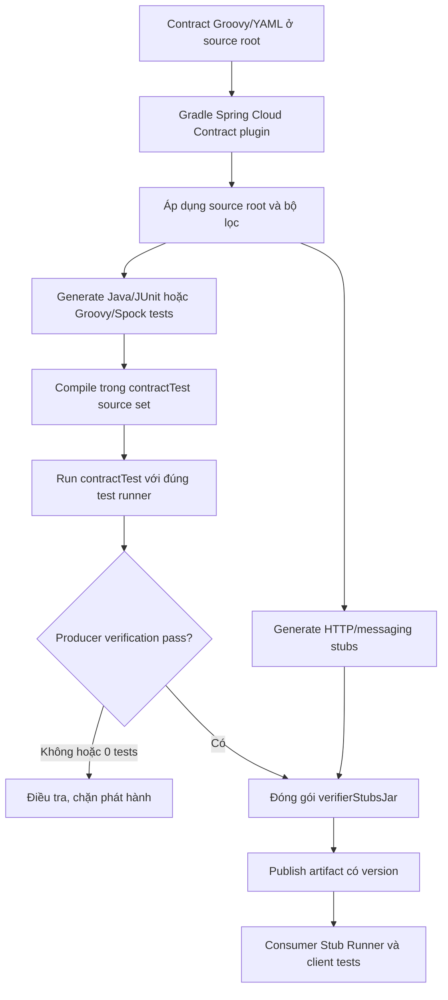
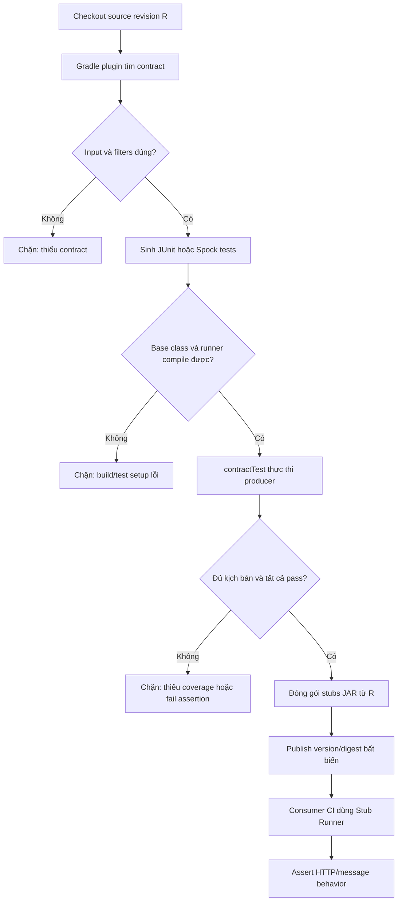

# Chọn test framework, base class và bộ lọc hợp đồng

## 1. Ba quyết định định hình kiểm thử hợp đồng với Gradle

Trong **Spring Cloud Contract**, producer và consumer thống nhất những hành vi HTTP hoặc thông điệp bằng hợp đồng **Groovy/YAML DSL**. Từ cùng nguồn contract, **Contract Verifier** có thể sinh test xác minh producer và sinh stub để consumer chạy qua **Stub Runner**. Tích hợp vào CI giúp phát hiện thay đổi API không tương thích trước khi đưa một phiên bản mới vào sử dụng.

Với một dự án **Gradle**, ba nhóm cấu hình quyết định generated tests có thực sự kiểm tra đúng producer và đúng hợp đồng hay không:

1. **Test framework**: generated test viết bằng **JUnit 5**, **JUnit 4** hay **Spock**; Gradle test task có runner và dependencies tương ứng không?
2. **Base class và test mode**: generated test kế thừa lớp nào để khởi tạo controller, HTTP server, security, dữ liệu thử hoặc messaging adapter? Request có đi qua đúng tầng implementation cần bảo vệ không?
3. **Bộ lọc và nguồn hợp đồng**: plugin đọc contract ở đâu, bỏ qua những tệp nào và generated tests có bao phủ đúng những kịch bản phải được kiểm tra không?

Một build xanh chưa chắc chứng minh producer đáp ứng hợp đồng: Gradle có thể chạy `test` thành công trong khi `contractTest` không được thực thi, hoặc các contract quan trọng đã bị lọc bỏ. Ngược lại, một contract đúng có thể fail vì base class gọi sai server/port hoặc test framework không được nhận diện.

**Mục tiêu bài học:** cấu hình ba nhóm trên có chủ đích; hiểu cách chúng phối hợp với plugin Spring Cloud Contract; thiết kế base class cho HTTP/messaging; chọn contract filter an toàn; kiểm tra số test đã sinh/thực thi; và xây CI có khả năng truy vết từ contract nguồn đến artifact stub.

## 2. Từ contract nguồn đến stubs JAR: Gradle chạy những gì?

Một luồng producer tiêu biểu:



Các task phổ biến trong Gradle plugin gồm `generateContractTests`, `contractTest`, `generateClientStubs` và `verifierStubsJar`. Những task này phục vụ mục đích khác nhau:

| Task hoặc giai đoạn | Mục đích | Không tự chứng minh |
| --- | --- | --- |
| `generateContractTests` | Sinh mã kiểm thử phía producer từ contract | Các generated tests đã chạy/pass |
| `contractTest` | Thực thi tập kiểm thử contract theo cấu hình source set/runner | Mọi hành vi nghiệp vụ ngoài contract |
| `generateClientStubs` | Sinh HTTP stub mappings hoặc nội dung stub được hỗ trợ | Producer hiện tuân thủ contract |
| `verifierStubsJar` | Đóng gói stub artifact, thường có classifier `stubs` | Artifact đã được publish hoặc producer verification đã pass nếu pipeline không ràng buộc |
| `check` / `build` | Chạy các lifecycle tasks theo task graph | Số contract tests đã thực thi nếu cấu hình bị thay đổi |

Tài liệu Gradle plugin mô tả `contractTest` là task cần chạy để xác minh phía producer; task này có thể được nối vào `check` trong cấu hình mặc định. **Hãy kiểm tra task graph thực tế của phiên bản plugin và module hiện tại**, thay vì suy từ tên lệnh `build`. Khi chỉ chạy `generateContractTests` rồi kết luận test đã pass, ta đã bỏ qua giai đoạn quan trọng nhất.

## 3. Cấu hình Gradle ban đầu: chọn một cấu hình nhất quán

Ví dụ `build.gradle` **Groovy DSL** cho producer Spring Boot dùng Spring MVC và JUnit 5:

```groovy
plugins {
    id 'java'
    id 'org.springframework.boot' version 'REPLACE_WITH_COMPATIBLE_BOOT_VERSION'
    id 'org.springframework.cloud.contract' version 'REPLACE_WITH_COMPATIBLE_SCC_VERSION'
}

repositories {
    mavenCentral()
}

dependencies {
    testImplementation 'org.springframework.boot:spring-boot-starter-test'
    testImplementation 'org.springframework.cloud:spring-cloud-starter-contract-verifier'
}

contracts {
    testFramework = 'JUNIT5'
    testMode = 'MockMvc'
    baseClassForTests = 'com.example.orders.contract.OrderContractBase'
    contractsDslDir = file('src/contractTest/resources/contracts')
}

tasks.withType(Test).configureEach {
    useJUnitPlatform()
}
```

**Đây là khung minh họa, không phải một build file hoàn chỉnh có thể chạy ngay.** Hai version placeholder phải được thay bằng bản **Spring Boot, Spring Cloud, Spring Cloud Contract và Gradle/JDK tương thích**; cũng cần dependency management/BOM thích hợp. Các dependency và runner được dùng cho generated `contractTest` source set phải được plugin/build cấu hình đúng, không mặc định `testImplementation` luôn giải quyết mọi vấn đề classpath ở một build tùy biến.

Lựa chọn trong ví dụ:

| Cấu hình | Ý nghĩa |
| --- | --- |
| `testFramework = 'JUNIT5'` | Sinh Java tests theo JUnit Jupiter |
| `testMode = 'MockMvc'` | Gửi HTTP request qua Spring MVC MockMvc theo chế độ plugin hỗ trợ |
| `baseClassForTests` | Các generated tests kế thừa lớp setup chung |
| `contractsDslDir` | Nơi plugin tìm contract nguồn |
| `useJUnitPlatform()` | Cho Gradle test tasks chạy JUnit 5; cần kiểm tra task `contractTest` thực tế |

**Không trộn khái niệm:** `testFramework` chọn cách **viết/chạy test**; `testMode` chọn cách **gửi request/quan sát producer**. JUnit 5 vẫn có thể dùng với HTTP thật (`EXPLICIT`) hoặc MockMvc; `MockMvc` không có nghĩa test framework là JUnit 4.

## 4. Chọn test framework theo runtime của đội phát triển

Spring Cloud Contract Verifier hỗ trợ những lựa chọn phổ biến sau, tùy phiên bản:

| Lựa chọn | Ngôn ngữ test sinh ra | Runner và dependency | Khi hợp lý |
| --- | --- | --- | --- |
| **JUnit 5** — `JUNIT5` | Java | JUnit Jupiter, Gradle `useJUnitPlatform()` | Dự án Spring Boot/JUnit mới |
| **JUnit 4** — `JUNIT` | Java | JUnit 4, runner phù hợp hoặc Vintage nếu chạy qua Platform | Bảo trì dự án cũ, migration từng bước |
| **Spock** — `SPOCK` | Groovy | Groovy + Spock, engine tương ứng Spock 1/2 | Đội dùng specification-style test và Groovy |

Giá trị mặc định về `testFramework` trong tài liệu nhiều nhánh là **JUnit 4**. Vì vậy **nên cấu hình rõ `JUNIT5`** nếu project đang dùng JUnit Jupiter, thay vì giả định Spring Boot starter test tự khiến plugin sinh JUnit 5.

### 4.1. JUnit 5: lựa chọn dễ duy trì cho Spring Boot hiện đại

```groovy
contracts {
    testFramework = 'JUNIT5'
    baseClassForTests = 'com.example.orders.contract.OrderContractBase'
}
tasks.named('contractTest', Test) {
    useJUnitPlatform()
}
```

Chạy thử:

```bash
./gradlew :order-service:generateContractTests
./gradlew :order-service:contractTest
```

`order-service` là tên module minh họa; nếu project đơn module, bỏ prefix `:order-service:`. Sau lệnh đầu, xem mã generated có `org.junit.jupiter.api.Test` hay không. Sau lệnh thứ hai, xem test report để chắc chắn test **đã thực thi**, không chỉ biên dịch.

Nếu plugin ở phiên bản cũ không chấp nhận cấu hình này hoặc source set chưa có task `contractTest`, dùng `./gradlew tasks --all` để tìm tên task thật và điều chỉnh theo plugin version, không tự tạo một task rỗng cùng tên.

### 4.2. JUnit 4: giữ đồng bộ annotation và runner

```groovy
contracts {
    testFramework = 'JUNIT'
    baseClassForTests = 'com.example.orders.contract.LegacyOrderBase'
}
```

Generated tests có thể dùng `org.junit.Test` và lifecycle `@Before`/`@After`. Nếu Gradle test task chạy **JUnit Platform chỉ với Jupiter engine**, JUnit 4 tests có thể **không được nhận diện** nếu thiếu Vintage engine hoặc runner tương thích. Không đổi `@BeforeEach` vào base class JUnit 4 rồi kỳ vọng lifecycle tự hoạt động.

### 4.3. Spock: dùng Groovy source set và đúng engine

```groovy
plugins {
    id 'groovy'
    id 'org.springframework.cloud.contract' version 'REPLACE_WITH_COMPATIBLE_SCC_VERSION'
}

contracts {
    testFramework = 'SPOCK'
    testMode = 'MockMvc'
    baseClassForTests = 'com.example.orders.contract.OrderContractSpecBase'
}
```

Spock 2 chạy trên JUnit Platform; các tổ hợp Spock 1/Groovy cũ có yêu cầu khác. Cần thêm dependencies và cấu hình runner đúng với **Spock/Groovy/JDK/Spring Boot version** đã chọn. Chỉ đặt `testFramework = 'SPOCK'` mà không cài Groovy/Spock hoặc không cho generated Groovy tests vào nguồn compile sẽ dẫn đến lỗi test compilation/execution.

### Một “bài kiểm tra smoke” cho framework

Trước khi viết hàng trăm contract, chỉ tạo **một** contract GET nhỏ, chạy `generateContractTests` và `contractTest`, rồi xác nhận:

1. Ngôn ngữ của generated file đúng kỳ vọng.
2. Tên annotation test/lifecycle tương ứng framework.
3. Base class được kế thừa và có trên test classpath.
4. Gradle report báo ít nhất **1 test executed**, không phải 0.
5. Khi cố tình trả sai HTTP status, test **fail**.

Một smoke test như vậy phát hiện sớm nhầm JUnit runner hơn là nhìn cả pipeline xanh mà không biết generated tests có chạy không.

## 5. Test framework và test mode là hai trục độc lập

Sau khi chọn JUnit hay Spock, phải quyết định **generated test sẽ tiếp cận producer bằng cơ chế nào**:

| `testMode` thường gặp | Cách gửi request | Dùng khi nào | Base class cần chuẩn bị |
| --- | --- | --- | --- |
| `MockMvc` | Rest Assured MockMvc / Spring MVC test pipeline | Producer Spring MVC, muốn test tầng HTTP controller không mở cổng thật | MockMvc, controller/application context, fixture |
| `EXPLICIT` | HTTP thực tới địa chỉ do test cấu hình | HTTP server embedded, runtime JAX-RS khác hoặc cần đi qua servlet/filter thực | Start server, host/port, Rest Assured, dữ liệu |
| `WEBTESTCLIENT` / `WebTestClient` | WebTestClient theo tích hợp hỗ trợ | Producer WebFlux/reactive | WebTestClient hoặc reactive test infrastructure |
| `JAXRSCLIENT` / `JaxRsClient` | JAX-RS test client theo plugin | Khi phiên bản SCC và JAX-RS runtime hỗ trợ | JAX-RS server và client target, provider |

Các giá trị/định danh có thể được chuẩn hóa khác nhau tùy phiên bản plugin; **đọc cấu hình được chấp nhận và generated code của đúng phiên bản dự án**. Tên ví dụ `MockMvc` và `EXPLICIT` thể hiện hai cách triển khai khác nhau, không phải hai test frameworks.

### Ví dụ: cùng JUnit 5, đổi từ MockMvc sang HTTP thực

```groovy
contracts {
    testFramework = 'JUNIT5'
    testMode = 'EXPLICIT'
    baseClassForTests = 'com.example.orders.contract.HttpContractBase'
}
```

Thay đổi này **không** làm source contract thay đổi, nhưng generated test có thể cần base class hoàn toàn khác. Nếu chỉ đổi `testMode` mà vẫn giữ base class cấu hình `RestAssuredMockMvc`, test HTTP có thể gọi cổng mặc định, bị `Connection refused` hoặc vô tình đi vào một server khác.

### Khi nào chọn HTTP thật?

- API do **Jersey, CXF/JAX-RS** hoặc một runtime không dùng Spring MVC DispatcherServlet phục vụ.
- Cần kiểm tra filter/serializer/router của **HTTP boundary** thực, thay vì chỉ route MVC mô phỏng.
- Consumer quan tâm path sau context root hoặc header do server/filter tạo.

HTTP thật không mặc nhiên kiểm thử database, broker, authentication gateway hoặc toàn bộ hệ phân tán. Chất lượng phụ thuộc **những thành phần được khởi chạy trong test**.

## 6. Base class JUnit 5 cho Spring MVC / MockMvc

Giả sử producer `order-service` có controller thực nhận `GET /api/orders/42`. Ta dùng:

```groovy
contracts {
    testFramework = 'JUNIT5'
    testMode = 'MockMvc'
    baseClassForTests = 'com.example.orders.contract.OrderContractBase'
}
```

Ví dụ Java base class:

```java
package com.example.orders.contract;

import io.restassured.module.mockmvc.RestAssuredMockMvc;
import org.junit.jupiter.api.BeforeEach;
import org.springframework.beans.factory.annotation.Autowired;
import org.springframework.boot.test.autoconfigure.web.servlet.AutoConfigureMockMvc;
import org.springframework.boot.test.context.SpringBootTest;
import org.springframework.test.web.servlet.MockMvc;

@SpringBootTest
@AutoConfigureMockMvc
public abstract class OrderContractBase {

    @Autowired
    private MockMvc mvc;

    @BeforeEach
    void configureVerifierClient() {
        RestAssuredMockMvc.mockMvc(mvc);
    }
}
```

Lớp này cung cấp **MockMvc gắn với Spring application context**. Khi generated test dùng Rest Assured MockMvc, nó gửi request qua Spring MVC tầng web được test. Đây là một ví dụ có import/lifecycle rõ ràng, nhưng cần đúng dependency Rest Assured MockMvc và cách generated test dùng API ở **phiên bản plugin tương ứng**. Nếu generator dùng một cấu trúc khác, hãy mở mã sinh ra để điều chỉnh.

### Dữ liệu thử là một phần của base class

Contract `GET /api/orders/42` giả định đơn `42` tồn tại với trạng thái `CONFIRMED`. Có thể bổ sung setup:

```java
@BeforeEach
void prepareFixture() {
    // Seed đơn 42 trong test database hoặc stub service dependency.
    // Dữ liệu phải giống điều kiện kịch bản DSL đang xác minh.
}
```

Không nên giả định mỗi test chạy với dữ liệu sạch khi dùng database chia sẻ. Nếu contract `GET /api/orders/999` muốn kiểm tra `404`, phải bảo đảm fixture **không** có đơn đó. Nếu test `POST` tạo dữ liệu, cần dọn dữ liệu giữa tests.

**Không mock mất behavior đang kiểm chứng:** Test contract của endpoint `POST /api/orders` không có giá trị về controller nếu base class mock chính controller để luôn trả JSON mẫu. Mock dependency phía dưới controller có thể hợp lý cho HTTP contract, nhưng phạm vi DB transaction và business logic bị mock cần có test khác.

### Package và vị trí source

Tên `com.example.orders.contract.OrderContractBase` trong `baseClassForTests` là **fully-qualified name** của class thực. Nó phải nằm trên **compile/runtime classpath của source set generated contract tests**. Trong Gradle, nguồn plugin mặc định thường thuộc `contractTest`; chỉ đặt base class ở `src/test/java` không bảo đảm `contractTest` nhìn thấy nếu cấu hình classpath tùy biến tách hai source sets.

Một vị trí minh họa:

```text
src/
  contractTest/
    java/com/example/orders/contract/OrderContractBase.java
    resources/contracts/http/orders/get-confirmed-order.groovy
```

Đây là layout của **ví dụ sử dụng `contractTest`**. Nếu project cấu hình một source set khác, phải cập nhật cả vị trí contract DSL và cách Gradle compile/load base class. Không đoán package chỉ từ tên thư mục.

## 7. Base class cho chế độ EXPLICIT: HTTP server thật

Khi test yêu cầu HTTP thật, base class cần khởi động server ở cổng biết được và truyền cổng ấy cho client. Ví dụ JUnit 5 + embedded Spring Boot:

```java
package com.example.orders.contract;

import io.restassured.RestAssured;
import org.junit.jupiter.api.BeforeEach;
import org.springframework.boot.test.context.SpringBootTest;
import org.springframework.boot.test.web.server.LocalServerPort;

@SpringBootTest(webEnvironment = SpringBootTest.WebEnvironment.RANDOM_PORT)
public abstract class HttpContractBase {

    @LocalServerPort
    int port;

    @BeforeEach
    void configureHttpClient() {
        RestAssured.baseURI = "http://localhost";
        RestAssured.port = port;
        RestAssured.basePath = "";
    }
}
```

Cấu hình Gradle:

```groovy
contracts {
    testFramework = 'JUNIT5'
    testMode = 'EXPLICIT'
    baseClassForTests = 'com.example.orders.contract.HttpContractBase'
}
```

Lưu ý `@LocalServerPort` có package khác trên một số phiên bản Spring Boot cũ; tham khảo đúng bản được dùng. `RestAssured` có trạng thái cấu hình tĩnh trong JVM: khi chạy nhiều test song song với các server/port khác nhau, phải có chiến lược isolation hoặc request specification riêng phù hợp generator.

Nếu producer là **JAX-RS deployment ngoài Spring Boot**, base class phải quản lý server/container riêng, chờ readiness và cấu hình base URL; `@SpringBootTest` không thể tự khởi chạy một application server ngoài process. Với một deployment có context path `/shop`, cần quyết định phần nào thuộc `request.url` của contract và phần nào là base path môi trường để tránh gọi nhầm `/shop/shop/api/orders`.

## 8. Base class Spock và JUnit 4: đừng trộn lifecycle

### Spock

Trong Spock, base class là một `Specification` bằng Groovy:

```groovy
package com.example.orders.contract

import spock.lang.Specification
import io.restassured.module.mockmvc.RestAssuredMockMvc

abstract class OrderContractSpecBase extends Specification {

    def setup() {
        // Ví dụ đơn giản: OrderController là controller thực của ứng dụng.
        RestAssuredMockMvc.standaloneSetup(new OrderController())
    }
}
```

Ví dụ là **khung**: một controller thực tế có service dependency nên không thể luôn tạo bằng constructor rỗng. Có thể thay bằng setup Spring context/inject bean phù hợp. Điều quan trọng là test được sinh từ `testFramework = 'SPOCK'` phải kế thừa một base class thích hợp cho **Spock**, thay vì một base Java chỉ có annotation JUnit 5.

### JUnit 4

```java
import org.junit.Before;

public abstract class LegacyOrderContractBase {
    @Before
    public void setUp() {
        // Setup HTTP test client và fixture theo JUnit 4.
    }
}
```

Trong JUnit 4, `@Before` được dùng thay `@BeforeEach`. Nếu Gradle chạy các test bằng JUnit Platform, có thể cần Vintage engine để nhận diện JUnit 4 tests, hoặc phải dùng runner JUnit 4. Các dự án migration có thể giữ cả JUnit 4 và Jupiter, nhưng phải kiểm tra **test engine nào thực sự thực thi generated classes**.

### Ma trận nhận diện sai framework

| Triệu chứng | Khả năng cần điều tra |
| --- | --- |
| `No tests found` | Runner/test engine không nhận diện generated annotation |
| `ClassNotFoundException` cho base class | FQN sai, base class không nằm trên contractTest classpath |
| `NoClassDefFoundError: Specification` | Thiếu Spock/Groovy dependency |
| `@BeforeEach` không chạy | Test đang được sinh/chạy theo JUnit 4 hoặc lifecycle không khớp |
| Spock test Groovy không compile | Thiếu plugin Groovy hoặc source set sai |
| MockMvc chưa cấu hình | Base class chưa khởi tạo request client hoặc runtime không phải Spring MVC |
| `Connection refused` ở EXPLICIT | HTTP server chưa chạy, host/port sai |

**Sửa tại nguồn:** cấu hình `testFramework`, dependency, base class và Gradle test task. Không sửa từng generated test trong `build/` vì lần generate tiếp theo có thể ghi đè mọi thay đổi.

## 9. Khi một base class không đủ: mapping HTTP và messaging

Một producer có thể vừa phục vụ HTTP qua controller vừa phát thông điệp qua Spring Cloud Stream hoặc Spring Integration. Nếu gộp tất cả contract vào một base class MockMvc, generated **messaging test** không được setup đúng adapter/trigger; nếu dùng một base class messaging cho HTTP, request client có thể không được khởi tạo.

Spring Cloud Contract hỗ trợ lựa chọn lớp nền theo nhóm contract. Trong Gradle:

```groovy
contracts {
    testFramework = 'JUNIT5'
    baseClassForTests = 'com.example.contract.DefaultContractBase'

    baseClassMappings {
        baseClassMapping('.*http.*', 'com.example.contract.HttpContractBase')
        baseClassMapping('.*messaging.*', 'com.example.contract.MessagingContractBase')
    }
}
```

**`baseClassMapping` dùng regex trên package/đường phân nhóm contract mà plugin xác định**, không phải matcher HTTP URL hay regex body. Những tên `http`/`messaging` ở đây chỉ là quy ước thư mục minh họa; hãy **kiểm tra package generated class** và tên base class được sinh ra để bảo đảm regex thực sự match đúng nhóm.

Ví dụ cấu trúc:

```text
src/contractTest/resources/contracts/
  http/
    orders/
      get-confirmed-order.groovy
      create-order.yml
  messaging/
    orders/
      order-confirmed.groovy
```

Ý định phân loại:

| Nhóm contract | Base class | Trách nhiệm |
| --- | --- | --- |
| `http/orders/**` | `HttpContractBase` | MockMvc/HTTP server, dữ liệu đơn hàng, auth |
| `messaging/orders/**` | `MessagingContractBase` | Message verifier adapter, trigger, test binder/queue |
| Không match mapping nào | `DefaultContractBase` | Fallback có cấu hình hợp lệ, hoặc làm test fail rõ ràng |

### Thứ tự ưu tiên của cơ chế chọn base class

Tài liệu Gradle plugin nêu ba cơ chế:

1. **`baseClassMappings`**: ánh xạ regex sang FQN, ưu tiên cao nhất khi mapping khớp.
2. **`packageWithBaseClasses`**: chọn base class theo quy ước tên package/folder.
3. **`baseClassForTests`**: base class chung hoặc fallback khi không có lựa chọn ưu tiên hơn.

Nếu hai regex mapping có thể match cùng một nhóm contract, không nên dựa vào thứ tự cấu hình như một chính sách ổn định: hãy làm **regex phân biệt rõ** và kiểm tra generated classes. Nếu một contract không match mapping nào, base class fallback phải phù hợp hoặc có cơ chế build fail để không che việc phân nhóm sai.

### Vì sao không chỉ dùng `baseClassForTests` toàn cục?

Với 5–10 contracts cùng HTTP mode, một base class chung là lựa chọn dễ duy trì. Nhưng nếu dự án vừa dùng controller với MockMvc vừa dùng event publisher, lớp chung có thể cần setup cả hai, làm test chậm, phụ thuộc nhiều bean, dễ flaky và khó biết failure nằm ở đâu. **Chia theo nhóm contract và base class có trách nhiệm rõ ràng** thường giúp debug tốt hơn.

## 10. `packageWithBaseClasses`: dựa trên quy ước tên

Nếu các nhóm contract đã có cây thư mục ổn định, có thể cấu hình:

```groovy
contracts {
    packageWithBaseClasses = 'com.example.orders.contract.base'
    baseClassForTests = 'com.example.orders.contract.FallbackBase'
}
```

Ví dụ hợp đồng nằm trong `foo/bar/baz` ở phần package tương ứng; theo quy ước của Spring Cloud Contract, plugin có thể suy ra lớp `BarBazBase` trong package được chỉ định. Quy tắc dùng các thành phần cuối của package/folder và hậu tố `Base`. Điều kiện là **class tương ứng phải tồn tại trên test classpath**.

Điểm mạnh: không phải khai báo regex cho từng nhóm; có thể mở rộng theo quy ước đặt tên. Điểm yếu: việc đổi tên/thêm tầng thư mục có thể đổi tên base class mà plugin dự kiến. Khi generated test bỗng báo không tìm thấy class `BarBazBase` sau một thao tác di chuyển hợp đồng, hãy kiểm tra convention thay vì sửa implementation.

**Chọn cách nào?** Nếu chỉ một loại kiểm thử, dùng `baseClassForTests`. Nếu có vài nhóm rõ ràng và cần kiểm soát, dùng `baseClassMappings`. Nếu hệ thống lớn có cấu trúc thư mục đồng nhất, cân nhắc `packageWithBaseClasses`, nhưng phải giữ quy ước và kiểm tra source sinh ra. Không bật cả ba một cách ngẫu nhiên mà không hiểu thứ tự ưu tiên.

## 11. Đặt đúng source root: `contractsDslDir` không giống `sourceSet`

Theo tài liệu Gradle plugin, một layout mặc định thường là:

```text
src/contractTest/
  resources/
    contracts/
      orders/
        get-order.groovy
        missing-order.yml
  java/
    com/example/contract/OrderContractBase.java
```

Thuộc tính `contractsDslDir` chọn **thư mục chứa DSL contract**. Trong khi đó, `sourceSet` liên quan đến **nguồn/test code** mà Gradle dùng cho generated tests và classpath của chúng. Hai khái niệm này cần được kiểm tra riêng.

```groovy
contracts {
    contractsDslDir = file('src/contractTest/resources/contracts')
}
```

Nếu project cũ đang đặt hợp đồng theo bố cục Maven:

```text
src/test/resources/contracts/orders/get-order.groovy
```

thì có thể cấu hình Gradle trỏ tới vị trí ấy:

```groovy
contracts {
    contractsDslDir = file('src/test/resources/contracts')
}
```

**Không sao chép mặc định của Maven vào Gradle theo trí nhớ.** Tài liệu Gradle hiện hành chỉ rõ mặc định `src/contractTest/resources/contracts` trong cấu hình điển hình, còn nhiều hướng dẫn Maven thường dùng `src/test/resources/contracts`. Quan trọng nhất là **đọc giá trị thực của extension trong project** và đếm những tệp plugin quét.

### Đổi `contractsDslDir` chưa chắc đổi generated test source set

Khi chuyển DSL từ `src/contractTest/resources/contracts` sang `src/test/resources/contracts`, phần Java/Groovy generated tests có thể vẫn nằm ở source set `contractTest`. Nếu base class đặt trong `src/test/java` mà `contractTest` không có dependency/classpath tới đó, generated tests sẽ không compile. Phải kiểm tra:

- `contractsDslDir` (input DSL);
- `sourceSet` và các source directories (nơi build test code);
- `generatedTestJavaSourcesDir`, `generatedTestGroovySourcesDir`, `generatedTestResourcesDir` nếu build custom;
- compile/runtime classpath của `contractTest` và test runner thực.

Tránh sửa các thư mục generated trong `build/` bằng tay: chúng là **output tạm**, có thể được sinh lại sau `clean` hoặc `generateContractTests`.

## 12. Bộ lọc hợp đồng với Gradle: bỏ qua có chủ đích

Trong extension Gradle, một cơ chế lọc quan trọng được tài liệu hóa là **`ignoredFiles`**, dùng **Ant-style pattern** để chọn những tệp không cần đưa qua xử lý.

Ví dụ muốn bỏ qua hợp đồng nháp:

```groovy
contracts {
    contractsDslDir = file('src/contractTest/resources/contracts')
    ignoredFiles = [
        '**/draft/**',
        '**/archived/**'
    ]
}
```

Pattern minh họa:

```text
contracts/
  http/orders/get-order.groovy       # Cần xử lý
  http/orders/create-order.yml      # Cần xử lý
  draft/orders/future-api.groovy    # Có chủ đích bỏ qua
  archived/old-error-contract.yml   # Có chủ đích bỏ qua
```

`ignoredFiles` **không thay đổi contract DSL**; nó chỉ tác động đến phạm vi mà build đưa vào xử lý. Cần đọc log và generated outputs để xác minh từng pattern ở phiên bản plugin đang dùng, bởi đường path tương đối mà matcher nhìn thấy và quá trình tạo stub/test có thể bị ảnh hưởng bởi cấu hình khác.

### Đặc biệt: đừng lẫn Gradle `ignoredFiles` với Maven `includedFiles`/`excludedFiles`

Hướng dẫn Maven plugin có thể nhắc tới bộ lọc `includedFiles` và `excludedFiles`. **Không tự chép nguyên tên property đó vào `contracts { ... }` của Gradle** rồi cho rằng Gradle plugin chắc chắn hỗ trợ giống nhau. Tài liệu Gradle plugin mô tả `ignoredFiles` và cơ chế `contractsDslDir`; nếu cần **include-only**, có thể tổ chức contract source root/thư mục riêng hoặc kiểm tra API lọc cụ thể của đúng phiên bản plugin.

| Mục tiêu | Cách phù hợp trong Gradle | Điều phải kiểm chứng |
| --- | --- | --- |
| Chỉ quét nhóm hợp đồng trong một cây thư mục | `contractsDslDir` trỏ đúng root | Các contract cần thiết nằm trong root |
| Bỏ qua bản nháp/legacy không còn áp dụng | `ignoredFiles` theo Ant pattern | Những file ấy thực sự không được xử lý |
| Chọn base class theo nhóm | `baseClassMappings` | Generated tests kế thừa class đúng |
| Chỉ chạy một vài test để debug | Gradle `--tests` hoặc lọc task Test | Không coi bộ test chọn lọc là release gate |
| Chặn build không có contract | `failOnNoContracts` theo plugin version | Khi không tìm thấy contract, job thất bại |
| Không nhận hợp đồng đang in-progress | `failOnInProgress` khi được hỗ trợ | Không publish stub cho hợp đồng chưa hoàn tất |

### Nguy cơ lọc mất phạm vi bảo vệ

Nếu một producer có hai kịch bản `GET /api/orders/42` thành công và `GET /api/orders/999` trả 404, nhưng pattern vô tình loại mất thư mục `errors`, CI có thể vẫn xanh với các test còn lại. Kết quả đó **không chứng minh producer xử lý lỗi đúng**.

Để tránh, cần xây **expected inventory** về những nhóm/kịch bản bắt buộc và kiểm tra generated tests, không chỉ có một số lượng tổng lớn hơn 0. `failOnNoContracts` giúp bắt trường hợp quét được 0 hợp đồng, nhưng **không phát hiện tự động rằng 2 trong 20 hợp đồng cần thiết đã bị lọc mất**.

## 13. `failOnNoContracts` và `failOnInProgress`: kiểm soát mất vùng bảo vệ

Tùy phiên bản Gradle plugin, hai property quan trọng là:

```groovy
contracts {
    failOnNoContracts = true
    failOnInProgress = true
}
```

Ý nghĩa:

- `failOnNoContracts`: báo lỗi nếu không có contract nào được tìm thấy, tránh “thành công” sau khi đổi sai source root hoặc áp dụng filter quá mạnh. Tài liệu Gradle plugin nêu mặc định là `true` trong cấu hình được mô tả.
- `failOnInProgress`: ngăn hợp đồng còn được đánh dấu **in progress** bị âm thầm dùng như cam kết sẵn sàng. Tài liệu của những nhánh được hỗ trợ cũng mô tả mặc định `true`.

Đừng dựa vào việc này để thay thế review danh sách contract. Một dự án có hàng chục hợp đồng nhưng bỏ sót đúng endpoint consumer cần vẫn có thể vượt qua kiểm tra “ít nhất một hợp đồng”.

### Nên làm gì với một hợp đồng đang phát triển?

Không cần xóa contract đang viết dở để build xanh. Có thể đặt nó trong vùng `draft` được quản lý theo quy ước, dùng `ignoredFiles` nếu policy của dự án cho phép, hoặc quản lý trạng thái in-progress theo cách plugin hỗ trợ. Nhưng **phải phân biệt** những hợp đồng đã được producer cam kết với những đề xuất chưa sẵn sàng. Không publish stub của một contract chưa verify như thể là lời hứa chính thức.

## 14. Ví dụ xuyên suốt: HTTP và messaging trong cùng một producer

Giả sử `order-service` vừa phục vụ endpoint tra cứu đơn hàng, vừa phát event xác nhận đơn. Ta có:

```text
src/contractTest/resources/contracts/
  http/
    orders/
      get-confirmed-order.groovy
      get-missing-order.yml
  messaging/
    orders/
      order-confirmed.groovy
  draft/
    orders/
      future-pagination.groovy
```

Mục tiêu:

- Sinh producer tests cho **hai** contract HTTP và **một** contract messaging.
- Không sinh tests/stubs cho `future-pagination.groovy` đang nháp.
- HTTP tests kế thừa `HttpContractBase`; messaging tests kế thừa `MessagingContractBase`.
- Cả hai loại test đều có runner JUnit 5.

Ví dụ Gradle:

```groovy
contracts {
    testFramework = 'JUNIT5'
    contractsDslDir = file('src/contractTest/resources/contracts')

    ignoredFiles = ['**/draft/**']
    failOnNoContracts = true
    failOnInProgress = true

    baseClassForTests = 'com.example.contract.DefaultContractBase'
    baseClassMappings {
        baseClassMapping('.*http.*', 'com.example.contract.HttpContractBase')
        baseClassMapping('.*messaging.*', 'com.example.contract.MessagingContractBase')
    }
}
```

**Lưu ý quan trọng về `testMode`:** Một giá trị `testMode` trong plugin có thể áp dụng cho **cả nhóm generated HTTP tests**. Mapping base class theo package **không tự đổi testMode** cho từng contract. Nếu HTTP và messaging cần cơ chế gửi/nhận khác nhau, hãy cấu hình verifier messaging adapter/base class thích hợp; khi cần HTTP modes mâu thuẫn nhau (ví dụ MockMvc và EXPLICIT), cân nhắc **tách module/source set hoặc task/generation configuration** thay vì nghĩ `baseClassMappings` một mình giải quyết được.

### Contract HTTP bằng Groovy

```groovy
import org.springframework.cloud.contract.spec.Contract

Contract.make {
    description 'GET trả đơn hàng đã xác nhận'

    request {
        method GET()
        url '/api/orders/42'
        headers {
            accept(applicationJson())
        }
    }
    response {
        status OK()
        headers {
            contentType(applicationJson())
        }
        body([
            orderId: 42,
            status: 'CONFIRMED'
        ])
    }
}
```

### Contract HTTP lỗi bằng YAML

```yaml
description: Không tìm thấy đơn hàng 999
request:
  method: GET
  url: /api/orders/999
response:
  status: 404
  headers:
    Content-Type: application/json
  body:
    code: "ORDER_NOT_FOUND"
    message: "Đơn hàng không tồn tại"
```

### Contract messaging bằng Groovy

```groovy
import org.springframework.cloud.contract.spec.Contract

Contract.make {
    description 'Phát sự kiện OrderConfirmed'
    label 'order_confirmed'
    input {
        triggeredBy('confirmOrder()')
    }
    outputMessage {
        sentTo('orders.confirmed')
        headers {
            messagingContentType(applicationJson())
            header('eventType', 'OrderConfirmed')
        }
        body([
            orderId: 42,
            status: 'CONFIRMED'
        ])
    }
}
```

Base class messaging phải cung cấp method `confirmOrder()` và cấu hình **message verifier/test binder** quan sát output thật của producer. Chỉ gán class tên `MessagingContractBase` không đủ; nếu test không gửi/nhận được message, cần kiểm tra adapter, trigger, destination và fixture. Trong một số phiên bản, cần annotation/configuration cụ thể như `@AutoConfigureMessageVerifier` theo runtime.

### Kết quả kỳ vọng sau generate

| Tệp contract | Cần generate test? | Base class kỳ vọng |
| --- | --- | --- |
| `http/orders/get-confirmed-order.groovy` | Có | `HttpContractBase` |
| `http/orders/get-missing-order.yml` | Có | `HttpContractBase` |
| `messaging/orders/order-confirmed.groovy` | Có | `MessagingContractBase` |
| `draft/orders/future-pagination.groovy` | Không | Không có generated test |

Đây là **mục tiêu của cấu hình minh họa**, không phải kết quả đã chạy trên repository. Phải kiểm tra generated source thực tế để xem regex base class và pattern `ignoredFiles` có match đúng không; nếu không, điều chỉnh cấu hình theo plugin version và đường dẫn mà matcher nhìn thấy.

## 15. Đọc generated tests để biết Gradle đã chọn đúng

Sau khi cấu hình, dùng những lệnh sau trong bài thực hành:

```bash
# Liệt kê các task trong producer module
./gradlew :order-service:tasks --all

# Chỉ sinh generated tests để kiểm tra framework/base class
./gradlew :order-service:generateContractTests

# Chạy generated contract tests phía producer
./gradlew :order-service:contractTest
```

Những câu lệnh là **hướng dẫn người học**, không phải lệnh đã chạy trong quá trình soạn tài liệu này. Tên `order-service` chỉ là tên module ví dụ; trong một build đơn module, thay `:order-service:` bằng task không có prefix.

Trong layout Gradle mặc định được tài liệu hóa, generated Java tests có thể được đặt ở vùng:

```text
build/generated-test-sources/contractTest/java/
```

Spock/Groovy generated tests thường ở vùng `generated-test-sources/contractTest/groovy`. **Đừng hard-code đường dẫn này trong mọi phiên bản:** `generatedTestJavaSourcesDir`, `generatedTestGroovySourcesDir`, `sourceSet` và custom Gradle layout có thể thay đổi output. Kiểm tra log task và source directories thực tế.

### Những dòng cần tìm trong generated test

```java
// PSEUDOCODE: hình thức minh họa, không phải code SCC sinh nguyên văn.
class GetConfirmedOrderTest extends HttpContractBase {

    @Test
    void validateGetConfirmedOrder() {
        // GET /api/orders/42
        // Assert HTTP 200
        // Assert $.orderId == 42
        // Assert $.status == "CONFIRMED"
    }
}
```

Đọc generated class để trả lời:

1. Class kế thừa **đúng base class**? Nếu không, xem regex package/convention.
2. Test annotation là `org.junit.jupiter.api.Test` hay `org.junit.Test`/Spock feature?
3. Test dùng `RestAssuredMockMvc`, HTTP Rest Assured hay một client khác? Có khớp `testMode`?
4. Test có setup context/server và seed dữ liệu trước request?
5. Các assertion phản ánh status, header, JSONPath, matcher của nguồn contract?
6. Có generated test cho **từng hợp đồng bắt buộc**, hay filter đã bỏ sót?

### Cần phân biệt “không sinh test” với “có test nhưng không chạy”

| Dấu hiệu | Kết luận sơ bộ | Chỗ cần xem |
| --- | --- | --- |
| Contract file có nhưng không có generated class | Discovery/filter/generation có vấn đề | `contractsDslDir`, `ignoredFiles`, parse error |
| Generated class có nhưng compile fail | Framework/base class/classpath lệch | FQN, dependency JUnit/Spock, source set |
| Generated class compile, report có 0 tests | Runner/task selection/engine sai | `contractTest`, JUnit Platform/Vintage, filters |
| Test chạy và fail HTTP 404 | URL/MockMvc/server/data setup | Request thực, controller, fixture |
| Test chạy và fail body assertion | Producer response khác contract | Expected/actual, serializer, matcher |
| Test pass nhưng dùng mock controller trả sẵn body | Test setup không xác minh implementation cần bảo vệ | Thiết kế lại base class và phạm vi kiểm thử |

Một Gradle task `generateContractTests` thành công chỉ chứng minh generator **có thể sinh code từ đầu vào được chọn**, không phải những assertions ấy đã chạy trên producer.

## 16. Debug source set, filter test và Gradle task selection

Gradle có **hai loại filter khác nhau** dễ bị trộn:

- **Contract source filter (`ignoredFiles`)**: tác động đến **tệp DSL đầu vào** mà generator xem xét.
- **Gradle test filter (`--tests`, include/exclude trong task `Test`)**: tác động đến **những test đã compile** được chọn chạy.

Ví dụ một lệnh debug chỉ chạy một class/method:

```bash
./gradlew :order-service:contractTest --tests '*GetConfirmedOrder*' --info
```

Nó hữu ích khi tìm nguyên nhân fail cụ thể, nhưng **không phải lệnh release gate đầy đủ**; những contract khác có thể chưa được chạy. Cũng không được áp dụng `--tests` rồi suy rằng `contractTest` đã xác minh toàn bộ module.

### Mẫu kiểm tra vùng bảo vệ

```text
Input DSL files in target scope:       4
Intentionally ignored drafts:         1
Expected active contracts:            3
Generated verification scenarios:     >= 3 (theo cấu trúc DSL)
Executed contract test scenarios:     >= 3
Failed required scenarios:            0
```

Đây là **checklist minh họa**, không phải output mặc định của Gradle/SCC. Một file DSL có thể chứa nhiều kịch bản, nên số **files** không nhất thiết bằng số **test methods**. Quan trọng là biết rõ **kịch bản nào được bảo vệ**.

### Tại sao không nên đặt cùng tên class/test cho hai framework?

Nếu cùng build vừa sinh JUnit vừa có Spock test với tên/package gây trùng hoặc chạy sai source set, kết quả có thể là duplicate class, compilation error hoặc test bị lọc. Hãy chọn test framework thống nhất cho một generated-test pipeline, hoặc tách rõ module/source set và artifact nếu cần migrate.

### Quan sát task graph thay vì đoán

```bash
./gradlew :order-service:contractTest --dry-run
./gradlew :order-service:contractTest --info
```

`--dry-run` chỉ cho biết **Gradle dự kiến chạy tasks nào**, không chạy assertions và không cung cấp bằng chứng producer pass. `--info` giúp xem nhiều log hơn để điều tra generated sources/source sets, nhưng vẫn cần đọc **test report** mới xác nhận được bao nhiêu bài đã thực thi.

## 17. Từ producer verification đến stubs JAR và Stub Runner

Gradle không chỉ sinh tests mà còn có thể đóng gói stubs để consumer dùng. Tuy nhiên, **việc sinh JAR** và **việc xác minh producer** là hai giai đoạn khác nhau. Một `verifierStubsJar` có thể được tạo nếu contract hợp lệ về mặt DSL, dù producer implementation chưa pass generated tests, nếu pipeline không đặt gate phù hợp.

### Lệnh sinh và đóng gói

```bash
# Khi cần xem từng giai đoạn riêng
./gradlew :order-service:generateContractTests
./gradlew :order-service:contractTest
./gradlew :order-service:generateClientStubs
./gradlew :order-service:verifierStubsJar
```

Task names phụ thuộc Gradle plugin/version. Hãy xem `tasks --all` trước khi đưa lệnh vào CI. Nếu muốn build chạy theo task graph đầy đủ, phải cấu hình dependencies và release gate sao cho **publish không được bắt đầu nếu producer contract tests fail**.

### Publication phải được khai báo rõ

Tài liệu Gradle plugin cho biết từ các phiên bản Spring Cloud Contract mới hơn, publication nội bộ của stubs **không tự động được kích hoạt như trước**; đội phát triển nên dùng `maven-publish` và gắn `verifierStubsJar` vào publication phù hợp.

Trích đoạn Gradle Groovy DSL minh họa:

```groovy
plugins {
    id 'maven-publish'
}

publishing {
    publications {
        mavenJava(MavenPublication) {
            from components.java
            artifact tasks.named('verifierStubsJar')
        }
    }
}
```

Đây chỉ là **một ví dụ cách attach artifact**, không tự bảo đảm `contractTest` chạy trước publish. Tùy Gradle/SCC version và cách cấu hình task, có thể cần điều chỉnh `artifact`/task provider, classifier và publication. Trước release, hãy kiểm tra output archive thực sự có classifier `stubs` và chứa những mappings/contracts cần thiết.

Consumer có thể dùng:

```java
@AutoConfigureStubRunner(
    ids = "com.example:order-service:1.5.0:stubs:9090",
    stubsMode = StubRunnerProperties.StubsMode.LOCAL
)
```

`LOCAL` yêu cầu artifact có trong Maven local repository; CI độc lập có thể dùng `REMOTE` và artifact repository được cấu hình. Consumer test pass với stub chỉ chứng minh consumer xử lý response/message mô phỏng, không thay bằng chứng **generated producer tests đã chạy trên cùng revision**.

### Source root/filter sai có thể tạo stub thiếu kịch bản

Ví dụ `ignoredFiles` vô tình bỏ cả nhóm `http/errors`, stubs JAR có thể chỉ chứa mapping thành công. Consumer test nhánh `404 ORDER_NOT_FOUND` sẽ không có response nghiệp vụ đúng; WireMock có thể trả 404 mặc định khi không có mapping, tạo **pass giả** nếu test chỉ assert status. Cần xác minh mã lỗi/body và inventory những contract thực sự đã vào JAR.

## 18. CI gate: kiểm tra framework, base class và coverage cùng lúc



### Những kiểm tra cần đặt trong pipeline

| Gate | Điều kiện | Rủi ro nếu bỏ |
| --- | --- | --- |
| Contract discovery | `contractsDslDir` có những nhóm hợp đồng cần thiết | Bỏ sót API |
| Contract filter | `ignoredFiles` chỉ loại những tệp được cho phép | Filter vô tình xóa nhóm lỗi quan trọng |
| Test generator | Test framework và source set sinh ra đúng | Generated test không compile hoặc chạy |
| Base class | FQN, dependency, lifecycle và test mode đúng | Request không đi qua implementation cần bảo vệ |
| Test execution | `contractTest` thật sự chạy các kịch bản bắt buộc | 0 test nhưng CI vẫn xanh |
| Assertion | Status/header/body/matcher pass | Producer vi phạm contract |
| Stub publication | Artifact cùng source revision, version/digest truy vết | Consumer dùng stub cũ/khác code |
| Consumer CI | Stub Runner tải đúng artifact và client xử lý response | Consumer không xử lý được API đã cam kết |

### Lệnh minh họa cho producer CI

```bash
# Đọc task graph khi kiểm tra pipeline
./gradlew :order-service:tasks --all

# Chạy đầy đủ verification, không dùng --tests để cắt giảm
./gradlew :order-service:contractTest

# Kiểm tra các tasks khác trong lifecycle
./gradlew :order-service:check
```

Đây là **quy trình tham khảo**, không phải khẳng định đã chạy lệnh. Trong pipeline thật, phải lưu test reports, artifacts và metadata build để không dựa chỉ vào mã thoát `0`. Nếu module không có contract bắt buộc, chính sách nên chỉ rõ ngoại lệ, thay vì tắt `failOnNoContracts` toàn hệ thống.

### Nếu project dùng cache và incremental build

Gradle có thể đánh dấu task `UP-TO-DATE` hoặc lấy output từ build cache. Điều đó không có nghĩa tool gian lận; nhưng với bằng chứng release, phải bảo đảm **cache key phản ánh đúng contract source, producer code, dependency và test configuration**. Khi nghi cache làm dùng generated source cũ, có thể chạy lại một cách có kiểm soát:

```bash
./gradlew :order-service:clean :order-service:contractTest --rerun-tasks
```

Lệnh này dành cho **chẩn đoán**, không nhất thiết phải chạy `--rerun-tasks` trong mọi CI build. Kết quả cần lưu vẫn là tên test, số executed/skipped/fail và artifact/version được tạo từ revision đang kiểm tra.

### Đừng để “quét được 1 contract” che “thiếu 10 contract”

Nếu kỳ vọng ba nhóm `http/orders`, `http/errors` và `messaging`, gate tốt nên có danh sách bắt buộc hoặc chỉ báo coverage theo nhóm. `failOnNoContracts = true` bắt trường hợp tổng bằng 0, nhưng không thể thay kiểm soát **chất lượng phạm vi**. Một thay đổi pattern từ `**/draft/**` thành `**/http/**` có thể làm đa số HTTP contract biến mất nhưng vẫn còn messaging tests để build báo xanh.

## 19. Bài thực hành: JUnit 5 + hai base classes + bộ lọc an toàn

### Bối cảnh

Một producer tên `order-service` dùng Gradle và Spring Cloud Contract để kiểm chứng:

1. `GET /api/orders/42` trả HTTP 200 và JSON có `orderId = 42`, `status = CONFIRMED`.
2. `GET /api/orders/999` trả HTTP 404 và `code = ORDER_NOT_FOUND`.
3. Khi xác nhận đơn, phát message `OrderConfirmed` đến destination `orders.confirmed`.
4. Một contract phân trang còn đang nháp, **không được xuất bản như hợp đồng đã verified**.

Các nhóm đã được tổ chức trong `http`, `messaging`, `draft`. Đội dùng JUnit 5 cho generated tests và MockMvc cho HTTP.

### Phần A — Hoàn thiện build.gradle

Hãy cấu hình:

- Plugin Java, Spring Cloud Contract và dependencies tương thích.
- `contracts.testFramework = 'JUNIT5'`; `tasks.named('contractTest', Test) { useJUnitPlatform() }`.
- `contractsDslDir` tới `src/contractTest/resources/contracts`.
- `ignoredFiles = ['**/draft/**']`; bật `failOnNoContracts`.
- `baseClassMappings` cho HTTP và messaging, có `baseClassForTests` fallback.

**Mục tiêu:** một lần `generateContractTests` sinh ra ba kịch bản hoạt động; contract nháp không có generated test. Cần kiểm tra kết quả thật, không chỉ nhìn file cấu hình.

### Phần B — Kiểm tra framework/base class

1. Đọc class generated cho HTTP `GET /api/orders/42`. Xác nhận nó dùng JUnit Jupiter và kế thừa `HttpContractBase`.
2. Trong `HttpContractBase`, khởi tạo MockMvc gắn với application context và seed dữ liệu đơn 42.
3. Đọc generated messaging test, xác nhận kế thừa `MessagingContractBase`.
4. Trong `MessagingContractBase`, cung cấp `confirmOrder()` và message verifier adapter quan sát output.
5. Chạy `contractTest` và xác minh test report có các kịch bản đã chạy.

### Phần C — Thử những lỗi có chủ đích

| Thao tác | Dự kiến xảy ra | Cách sửa đúng |
| --- | --- | --- |
| Đổi `testFramework` sang `JUNIT` nhưng giữ Jupiter-only runner | Test có thể không được phát hiện | Đồng bộ framework/runner hoặc bật Vintage phù hợp |
| Đặt base class sai package | Compile fail với missing class | Sửa FQN hoặc source set/classpath |
| Mapping regex HTTP sai | Generated HTTP test chọn fallback | Kiểm tra regex trên package contract |
| Đổi `contractsDslDir` sang thư mục rỗng | Discovery fail với `failOnNoContracts` | Trỏ đúng source root |
| Đổi `ignoredFiles` thành `**/http/**` | HTTP contracts mất khỏi tập active | Khôi phục filter và inventory check |
| Controller trả `state` thay `status` | Generated HTTP test phải fail | Sửa implementation hoặc migration được đồng thuận |
| Trigger messaging không gửi output | Messaging contract test phải fail/timeout | Sửa publisher/adapter/test setup |
| Chỉ chạy `generateContractTests` | Có generated source nhưng chưa có producer verification | Chạy `contractTest` và đọc report |
| Publish stub trước khi chạy verification | Có artifact nhưng chưa có bằng chứng producer pass | Thêm CI gate trước publish |

### Phần D — Đánh giá một báo cáo CI

Giả sử một job ghi:

```text
Gradle build: SUCCESS
Generated HTTP test classes: 2
Generated messaging test classes: 1
Executed contract tests: 0
Published stubs artifact: order-service-1.5.0-stubs.jar
```

**Câu hỏi:** Có được dùng artifact này làm bằng chứng producer 1.5.0 tương thích với consumer không?

**Đáp án:** **Không.** Có generated source và artifact nhưng **chưa có producer verification đã thực thi**. Phải kiểm tra runner/source set/task graph và chạy lại `contractTest` cho đúng revision. Nếu output `0 tests` là do JUnit 5 không chạy hoặc filter Gradle khác loại hết tests, việc publish phải bị chặn cho đến khi sửa.

### Phần E — Bài thực hành mở rộng

Producer chuyển HTTP tests từ MockMvc sang **EXPLICIT** vì phải đi qua servlet/filter thật. Hãy:

1. Thay `testMode = 'EXPLICIT'`.
2. Xây `HttpContractBase` mới khởi động server ở cổng động và cấu hình Rest Assured.
3. Đảm bảo các base class mappings vẫn trỏ đúng nhóm contract.
4. Kiểm tra generated tests gửi HTTP tới cổng đúng, không vô tình gọi MockMvc.
5. Chạy lại producer tests và consumer Stub Runner tests với stubs mới chỉ sau khi verification pass.

Nếu application sử dụng JAX-RS/Jersey/CXF, xem khả năng tích hợp của đúng phiên bản Spring Cloud Contract. Không kỳ vọng chỉ đổi `testFramework` là đã đổi từ Spring MVC sang JAX-RS.

## 20. Bảng chẩn đoán nhanh các lỗi cấu hình Gradle

| Triệu chứng | Lỗi có khả năng | Thao tác kiểm tra trước |
| --- | --- | --- |
| `UnknownPluginException` | Plugin ID/version/repository không đúng | `plugins`, plugin portal/internal mirror, compatibility |
| `Could not find ... contract-verifier` | Dependency management hoặc repository sai | BOM, phiên bản, `repositories`, dependency tree |
| Không có task `contractTest` | Plugin không được áp dụng đúng module hoặc version khác | `tasks --all` của **producer module** |
| Contract có nhưng không có generated tests | Sai `contractsDslDir` hoặc `ignoredFiles` | Source root, patterns, plugin logs |
| Generated tests kế thừa base class lạ | `baseClassMappings` không match hoặc convention ưu tiên | Package generated class, regex, `packageWithBaseClasses` |
| `cannot find symbol BaseClass` | Base class/FQN/source set sai | File Java/Groovy, package và compile classpath |
| `No tests found` | Gradle test task/engine/filter không nhận test | JUnit5 Platform, JUnit4 runner, Spock engine, `--tests` |
| Spock tests không compile | Thiếu plugin `groovy` hoặc Spock/Groovy dependency lệch | Test classpath, compiler source set |
| MockMvc tests trả 404 | Controller/context/fixture không đúng | Route, `@AutoConfigureMockMvc`, request path |
| EXPLICIT tests bị `Connection refused` | Server/port chưa chạy hoặc sai | `@LocalServerPort`, Rest Assured base URI, readiness |
| Test chạy nhưng sai JSON field | Producer DTO/serializer thay đổi | Expected/actual và DSL response matcher |
| Messaging contract timeout | Không trigger hoặc adapter không bắt được output | Messaging base class, destination, listener/test binder |
| Có generated tests nhưng 0 executed | Lệch runner hoặc task selection | `contractTest` report; test filters/classpath |
| `verifierStubsJar` có nhưng consumer tải không thấy | Chưa attach/publish artifact `stubs` | `maven-publish` publication, classifier, repository |
| CI local pass, build server fail | Version/cache/port/fixture khác | Gradle/JDK lock, source revision, test profile |

Một câu hỏi kiểm tra nguyên nhân hữu ích: **Failure xảy ra ở discovery, generation, compilation, execution, assertion hay publication?** Nếu test chưa sinh, không sửa controller để chữa; nếu test chưa chạy, không nới contract matcher; nếu response producer sai, không sửa generated source trong `build/`.

## 21. Checklist trước khi hoàn tất cấu hình

- [ ] Đã khóa phiên bản Gradle, Spring Boot, Spring Cloud Contract và JDK tương thích.
- [ ] Plugin `org.springframework.cloud.contract` được khai báo **ở producer module** cần sinh tests.
- [ ] `testFramework` được chọn rõ: `JUNIT5`, `JUNIT` hoặc `SPOCK` theo project.
- [ ] Có test engine/dependency phù hợp và task `contractTest` nhận diện generated tests.
- [ ] `testMode` được chọn theo runtime: MockMvc, EXPLICIT, WebTestClient hoặc JAX-RS theo hỗ trợ của phiên bản.
- [ ] `baseClassForTests` có FQN đúng và base class nằm trên test classpath.
- [ ] Base class cung cấp server/controller, request client, fixture và lifecycle phù hợp.
- [ ] Với nhiều nhóm contract, `baseClassMappings` hoặc `packageWithBaseClasses` được kiểm tra trên **generated classes**.
- [ ] `contractsDslDir` trỏ đúng nguồn DSL; không lẫn mặc định Gradle với bố cục Maven.
- [ ] `ignoredFiles` chỉ bỏ những hợp đồng được phép bỏ; không vô tình lọc mất trường hợp lỗi quan trọng.
- [ ] Đã hiểu `ignoredFiles` khác `baseClassMappings` và khác Gradle `--tests`.
- [ ] `failOnNoContracts`/`failOnInProgress` được dùng theo chính sách và plugin version.
- [ ] `generateContractTests` thực sự sinh những test/contract mong muốn.
- [ ] `contractTest` chạy đủ kịch bản bắt buộc, có report **executed/failed/skipped**.
- [ ] Có một negative smoke test: cố ý đổi status/body producer để xác nhận generated tests **fail**.
- [ ] Nếu có messaging contract, adapter/trigger/output được kiểm chứng đúng.
- [ ] Stubs JAR chứa những mapping/contracts mong đợi và được tạo sau producer verification.
- [ ] Publication qua `maven-publish` gắn artifact/version/digest đúng, consumer Stub Runner tải đúng bản.
- [ ] CI không coi `BUILD SUCCESS` hoặc `UP-TO-DATE` mà thiếu bằng chứng test là thành công về tương thích.
- [ ] Những bảo đảm ngoài contract (DB, broker, security, concurrency) có integration/E2E tests riêng khi cần.

## 22. Đối chiếu tài liệu chính thức theo phiên bản

Khi cấu hình thực tế, hãy chọn tài liệu đúng nhánh Spring Cloud Contract đã khóa trong build:

- [Spring Cloud Contract — Gradle Project](https://docs.spring.io/spring-cloud-contract/reference/gradle-project.html): `contracts` extension, `testFramework`, `testMode`, `contractsDslDir`, `ignoredFiles`, base class mappings, `contractTest` và `verifierStubsJar`.
- [Spring Cloud Contract — How-to Guides](https://docs.spring.io/spring-cloud-contract/docs/current/reference/html/howto.html): ví dụ cấu hình `baseClassMappings`, dùng JUnit 5 và quản lý contract trong các workflow khác nhau.
- [Spring Cloud Contract — Project Features](https://docs.spring.io/spring-cloud-contract/docs/current/reference/html/project-features.html): cách generated tests, stubs và các kiểu giao tiếp được tích hợp.

Những URL `current`/`reference` có thể được cập nhật theo thời gian; nếu project đang dùng một nhánh cũ hơn, phải đối chiếu **versioned docs** trước khi dùng tên property, test mode hay API cụ thể. Tài liệu này hướng dẫn phương pháp và các ví dụ cấu hình, **không thay thế bước thử nghiệm build với phiên bản thực tế**.

**Ghi nhớ:** Trong Gradle, **test framework** quyết định generated tests dùng JUnit hay Spock; **test mode và base class** quyết định các test ấy chạy qua môi trường producer nào; **source root và bộ lọc** quyết định những hợp đồng nào thực sự được bảo vệ. Muốn CI có ý nghĩa, phải nối ba quyết định đó với **`contractTest` đã thực thi và pass**, rồi mới phát hành stubs artifact cho consumer dùng Stub Runner. Một build xanh nhưng thiếu hợp đồng, chọn sai base class hoặc không chạy generated tests chưa đủ bằng chứng producer tương thích.
