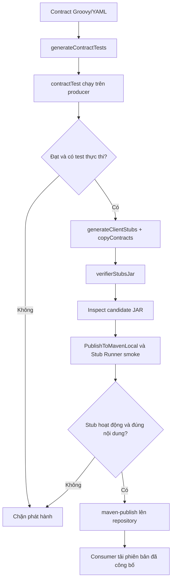

# Tích hợp Maven Publish cho artifact stubs

## 1. Bài toán: producer đã có contract, làm sao để consumer tải được stub?

Giả sử nhóm xây dựng `payment-service` bằng Spring Boot và Gradle. `checkout-service` cần kiểm tra việc gọi Payment mà không phải chạy cùng database, cổng thanh toán và toàn bộ hệ thống thật. Hai nhóm thỏa thuận API bằng **Spring Cloud Contract**: viết Groovy/YAML DSL, sinh **producer verification tests**, sau đó tạo **stub JAR** để Checkout dùng với **Stub Runner**.

Trong máy phát triển, chạy `generateClientStubs` thành công mới tạo ra các tệp mô phỏng. Để consumer khác tải được phiên bản stub một cách nhất quán, cần **đóng gói và công bố artifact** vào một Maven-compatible repository, chẳng hạn Maven Local khi thử nghiệm, hoặc Nexus/Artifactory/GitHub Packages nội bộ khi chạy CI.

Gradle có plugin **`maven-publish`** để thực hiện việc này. Spring Cloud Contract Gradle plugin có task **`verifierStubsJar`** đóng gói các stub đã sinh và contract cần thiết. Kể từ dòng Spring Cloud Contract **3.0.0**, publication stub nội bộ không còn tự được bật theo mặc định: dự án cần **đưa `verifierStubsJar` vào một `MavenPublication` do mình sở hữu**.

Một cấu hình sai có thể khiến build producer xanh nhưng consumer vẫn gặp:

- `com.example:payment-service:1.4.2:stubs` không tìm thấy trong repository;
- Maven chỉ có `payment-service-1.4.2.jar` mà thiếu `payment-service-1.4.2-stubs.jar`;
- JAR có classifier đúng nhưng chứa mappings từ lần build trước;
- Stub Runner tải artifact đúng tên nhưng không tìm thấy contracts/mappings;
- CI chạy `publish` dù generated producer tests chưa chạy;
- Maven publication thay đổi `artifactId` thành `payment-service-stubs` khiến coordinates của consumer không còn khớp.

**Mục tiêu bài học:** cấu hình Gradle Groovy DSL với `maven-publish`, đưa `verifierStubsJar` vào publication, kiểm tra tọa độ `groupId/artifactId/version/classifier`, chạy producer verification trước khi phát hành, dùng `publishToMavenLocal` và repository từ xa đúng mục đích, kiểm chứng artifact bằng Stub Runner, và tạo release gate trong CI.

## 2. Phân biệt sinh test, sinh stub, tạo JAR và publish

Các bước không phải một:

| Bước | Vai trò | Kết quả điển hình |
| --- | --- | --- |
| **Nguồn hợp đồng** | Định nghĩa hành vi HTTP hoặc messaging giữa producer và consumer. | Các file `.groovy`/`.yml` trong thư mục contracts. |
| **`generateContractTests`** | Sinh mã kiểm thử phía producer. | Generated test sources trong `build/`. |
| **`contractTest`** | Chạy generated tests trên implementation của producer. | Test report xác nhận API hoặc event thực đúng hợp đồng. |
| **`generateClientStubs`** | Chuyển contract thành nội dung stub có thể dùng cho consumer. | HTTP WireMock mappings và tài nguyên liên quan. |
| **`copyContracts`** | Đưa các file contract nguồn vào khu vực đóng gói. | Contract DSL được đưa vào stub artifact, có ích với messaging. |
| **`verifierStubsJar`** | Tạo JAR với stub contents và classifier mặc định, thường là `stubs`. | `payment-service-1.4.2-stubs.jar`. |
| **`publishToMavenLocal`** | Đăng publication vào local Maven repository. | Artifact + metadata tại `~/.m2/repository/`. |
| **`publish...To...Repository`** | Upload publication vào repository được cấu hình. | Artifact có version để CI/consumer khác tải được. |

**Sinh JAR không tự chứng minh producer đã tuân thủ contract.** Theo tài liệu Gradle plugin, task đóng gói stub phụ thuộc bước sinh client stub và copy contract; điều đó **không đồng nghĩa** chính lệnh publish luôn chạy đầy đủ producer verification. Trước công bố, phải kiểm tra `contractTest` thực sự chạy và đạt.



Trong một dự án thực tế, Gradle có thể sắp xếp task theo dependency graph; sơ đồ thể hiện **điều kiện gate mong muốn**, không bắt buộc thứ tự chạy tuần tự của mọi task nội bộ. Dự án có thể chạy job nhanh ở PR nhưng phải bảo đảm release gate bao phủ tất cả contract còn được cam kết hỗ trợ.

## 3. Maven coordinates: điều gì xác định đúng stub artifact?

Một producer giả định có:

```text
group       = com.example
project.name = payment-service
version     = 1.4.2
```

Với cách publish phổ biến **cùng `groupId/artifactId/version` và thêm classifier `stubs`**, các file tại Maven repository có thể trông như:

```text
com/example/payment-service/1.4.2/
├── payment-service-1.4.2.pom
├── payment-service-1.4.2.jar
├── payment-service-1.4.2-stubs.jar
└── [metadata khác tùy công cụ/repository]
```

Phân biệt:

- **`com.example`** — `groupId`, tạo thư mục Maven theo từng đoạn tên miền.
- **`payment-service`** — `artifactId`, thường là tên module producer, nhưng có thể được override.
- **`1.4.2`** — `version` của publication; cần khớp với phiên bản contract/producer được kiểm tra.
- **`stubs`** — `classifier`, phân biệt JAR stub với JAR ứng dụng trong cùng tọa độ.
- **`jar`** — loại file chứa stub.

Stub Runner thường dùng notation:

```text
com.example:payment-service:1.4.2:stubs
```

Nếu muốn dành cổng cụ thể trong bài test:

```text
com.example:payment-service:1.4.2:stubs:6565
```

**Cổng `6565` chỉ thuộc cấu hình Stub Runner**, không đi vào tên JAR hay Maven coordinates được publish. Với môi trường chạy song song, có thể dùng cổng động và truyền địa chỉ thực vào HTTP client.

### Không nhầm classifier với artifactId

Hai lựa chọn sau **không tương đương**:

| Cách publish | Ví dụ file | Consumer coordinate |
| --- | --- | --- |
| Cùng artifactId, **classifier stubs** | `payment-service-1.4.2-stubs.jar` | `com.example:payment-service:1.4.2:stubs` |
| ArtifactId đổi thành `payment-service-stubs`, không có classifier | `payment-service-stubs-1.4.2.jar` | Cần cấu hình phù hợp với tọa độ mới; không tự suy ra như cách trên. |

Đối với một producer vốn đã phát hành ứng dụng dưới `com.example:payment-service`, lựa chọn **thêm classifier `stubs` vào cùng publication** là cấu trúc dễ hiểu để consumer sử dụng. Nếu tổ chức chủ động dùng một artifactId khác, hãy thống nhất rõ format và thông số downloader; không tự thêm cả hậu tố `-stubs` vào artifactId **và** classifier `stubs` khi chưa có lý do.

## 4. Tạo contract nguồn để có thứ thực sự được publish

Ví dụ Payment API:

```http
GET /api/payments/PAY-1001 HTTP/1.1
Accept: application/json
```

Response đã thỏa thuận:

```json
{
  "paymentId": "PAY-1001",
  "orderId": "ORD-2001",
  "status": "PAID",
  "amount": 250000,
  "currency": "VND"
}
```

### Groovy DSL

```groovy
import org.springframework.cloud.contract.spec.Contract

Contract.make {
    name 'get_paid_payment'
    description 'Tra cứu giao dịch thanh toán thành công'

    request {
        method 'GET'
        urlPath '/api/payments/PAY-1001'
        headers {
            header 'Accept': 'application/json'
        }
    }

    response {
        status 200
        headers {
            contentType(applicationJson())
        }
        body([
            paymentId: 'PAY-1001',
            orderId: 'ORD-2001',
            status: 'PAID',
            amount: 250000,
            currency: 'VND'
        ])
    }
}
```

### YAML DSL tương đương

```yaml
description: Tra cứu giao dịch thanh toán thành công
name: get_paid_payment
request:
  method: GET
  urlPath: /api/payments/PAY-1001
  headers:
    Accept: application/json
response:
  status: 200
  headers:
    Content-Type: application/json
  body:
    paymentId: PAY-1001
    orderId: ORD-2001
    status: PAID
    amount: 250000
    currency: VND
```

Đây là **hai cách diễn đạt cùng một kịch bản**. Trong repository thật nên giữ một bản Groovy **hoặc** YAML làm contract nguồn, tránh sinh hai test và hai mapping trùng nhau.

Gradle plugin Spring Cloud Contract hiện đại thường tìm contract dưới:

```text
src/contractTest/resources/contracts/
└── payment/
    └── get-paid-payment.groovy
```

Một số tài liệu cũ sử dụng `src/test/resources/contracts`; plugin có cơ chế tương thích, nhưng tài liệu hiện tại khuyến nghị source set `contractTest`. Nếu muốn đường dẫn khác, khai báo `contractsDslDir` thay vì nghĩ Gradle tự tìm mọi file DSL trong repository.

**Contract nguồn phải được producer verification xác minh** bằng fixture `PAY-1001` phù hợp. Việc đưa file này vào JAR không xác nhận implementation thực trả `PAID`; phần đó thuộc nhiệm vụ generated producer tests.

## 5. Khai báo plugin Gradle cần thiết

Với **Gradle Groovy DSL** trong `build.gradle`, ba plugin trung tâm:

```groovy
plugins {
    id 'java'
    id 'maven-publish'
    id 'org.springframework.cloud.contract' version 'REPLACE_WITH_COMPATIBLE_SCC_VERSION'
}

group = 'com.example'
version = '1.4.2'
```

Đây là **mảnh cấu hình minh họa**, không phải `build.gradle` có thể chạy ngay vì version plugin chưa được chọn. Một ứng dụng Spring Boot thực còn cần Boot plugin, dependency management/BOM tương thích, repositories, các thư viện test và lớp base cho generated contract tests.

Thông thường có phần cấu hình:

```groovy
dependencies {
    testImplementation 'org.springframework.boot:spring-boot-starter-test'
    testImplementation 'org.springframework.cloud:spring-cloud-starter-contract-verifier'
}

contracts {
    contractsDslDir = file('src/contractTest/resources/contracts')
    testFramework = 'JUNIT5'
    testMode = 'MOCKMVC'
    baseClassForTests =
        'com.example.payment.contract.ContractBase'
}
```

**Các dependency ở đây cũng chỉ là một phần**: chúng cần version thông qua BOM/management, môi trường Gradle plugin/JDK, test runtime và framework test phù hợp. Với ứng dụng WebFlux, có thể chọn `WEBTESTCLIENT`; với HTTP socket thật, có thể chọn `EXPLICIT`. Đây là các **test modes**, không phải lựa chọn publication.

Trong bố cục source set Gradle, base class thường được đặt ở khu vực `src/contractTest/java` hoặc `src/contractTest/groovy` theo cấu hình. Không đưa base class chỉ có trong test source set thông thường rồi mặc định generated tests sẽ nhìn thấy nó mà không kiểm tra classpath/source-set wiring.

## 6. Tích hợp maven-publish vào một publication ứng dụng

Đây là phần cốt lõi. Spring Cloud Contract tạo task `verifierStubsJar`; Gradle Maven Publish cần được chỉ rõ phải publish artifact đó.

```groovy
publishing {
    publications {
        mavenJava(MavenPublication) {
            // GAV thường kế thừa từ project.group/name/version.
            groupId = project.group.toString()
            artifactId = project.name
            version = project.version.toString()

            // Publish Java component (mã ứng dụng/thư viện).
            from components.java

            // Thêm stub JAR do Spring Cloud Contract tạo.
            artifact verifierStubsJar

            pom {
                name = 'Payment Service'
                description = 'Payment API và stubs đã xác minh'
            }
        }
    }
}
```

**Đây là đoạn được khuyến nghị để hiểu nguyên lý**, phù hợp dự án có `java` component và task `verifierStubsJar` mà plugin Spring Cloud Contract đã đăng ký. Trên ứng dụng Spring Boot, `from components.java` có thể publish một **plain JAR** chứ không phải executable `bootJar`, tùy phiên bản/cấu hình Boot plugin. Nếu dự án muốn publish executable application JAR, phải cấu hình artifact đó riêng theo quy tắc Spring Boot/Gradle; không coi `components.java` luôn đồng nghĩa `bootJar`.

Điểm mấu chốt:

1. `mavenJava(MavenPublication)` tạo **publication tên `mavenJava`**; tên này ảnh hưởng tên các Gradle publish tasks.
2. `from components.java` gắn Java component với publication, thường đem theo artifact và metadata dependency tương ứng.
3. `artifact verifierStubsJar` thêm **artifact thứ hai** do Contract plugin tạo.
4. Task `verifierStubsJar` thông thường có classifier theo `contracts.stubsSuffix`, mặc định là `stubs`.
5. Maven repo nhận **cùng GAV** với các file JAR khác nhau nhờ classifier; Stub Runner cần tải **JAR có classifier stubs**, không phải JAR ứng dụng.

Tài liệu Spring Cloud Contract ghi rõ **từ 3.0.0 publication stub nội bộ không được bật mặc định** và khuyến nghị khai báo `artifact verifierStubsJar` trong publication do ứng dụng quản lý. Đừng kỳ vọng chỉ thêm plugin `org.springframework.cloud.contract` là `publish` sẽ tự upload JAR stub.

### Nếu Gradle hiện đại dùng lazy task providers

Trong một số cấu hình, các task được đăng ký lazily. Gradle có thể nhận task notation theo tên hoặc provider, nhưng bạn cần dùng **cách mà phiên bản plugin/Gradle thực tế chấp nhận**; ví dụ tài liệu chính thức sử dụng `artifact verifierStubsJar`. Nếu gặp lỗi không resolve được thuộc tính `verifierStubsJar` khi cấu hình, hãy kiểm tra plugin đã được apply, task thật sự được đăng ký và cú pháp Provider/Task tương thích, thay vì tạo một JAR rỗng cùng tên để làm build xanh.

## 7. Có thể publish chỉ stub JAR, không publish application JAR không?

Có. Một publication có thể khai báo một artifact tùy chỉnh **mà không có `from components.java`**:

```groovy
publishing {
    publications {
        stubsOnly(MavenPublication) {
            groupId = project.group.toString()
            artifactId = project.name
            version = project.version.toString()

            artifact verifierStubsJar
        }
    }
}
```

Điểm cần hiểu:

- Đây là **một publication tên `stubsOnly`**, không có Java component; POM được tạo có thể không chứa metadata dependency của ứng dụng.
- Artifact JAR vẫn cần classifier `stubs`. Nếu plugin được cấu hình dùng suffix khác, phải kiểm tra filename và cập nhật Stub Runner notation.
- **Không** đồng thời publish cả `mavenJava` và `stubsOnly` có **cùng GAV** đến **cùng repository** trong một build nếu cả hai mang POM/metadata xung đột. Hãy chọn **một chiến lược publication** hoặc đặt GAV riêng có chủ đích và đồng bộ consumer.
- Một gói “stubs only” không tự thay thế application artifact của producer; cần pipeline riêng nếu ứng dụng vẫn phải được publish.

Trong hệ thống microservices thông thường, **một publication mang Java component + classifier stub** thường giúp dễ theo dõi version nhất. `stubsOnly` hữu ích nếu tổ chức có pipeline riêng cho artifacts kiểm thử và đã thống nhất quy ước tọa độ.

## 8. Không sửa tùy tiện classifier hoặc nội dung verifierStubsJar

Spring Cloud Contract Gradle plugin đăng ký một task JAR có tên `verifierStubsJar`; nó lấy nội dung generated stubs, copy contract nguồn và áp dụng suffix đã cấu hình.

Theo pseudocode của tài liệu plugin:

```groovy
// Cấu trúc khái niệm; KHÔNG đăng ký lại task trong dự án.
tasks.register('verifierStubsJar', Jar) {
    dependsOn 'generateClientStubs'
    // Copy contracts là một dependency khác.
    archiveClassifier = 'stubs'
    from(/* thư mục stub output do plugin quản lý */)
}
```

Đoạn trên **chỉ mô tả ý tưởng**, không được dán vào `build.gradle` vốn đã áp dụng Contract plugin: tạo task trùng tên sẽ lỗi hoặc ghi đè cơ chế đúng của plugin.

Khi cần bổ sung một metadata không nhạy cảm vào JAR, có thể tùy chỉnh **task đã tồn tại**:

```groovy
tasks.named('verifierStubsJar', Jar) {
    from(layout.buildDirectory.dir('resources/main')) {
        include 'git.properties'
    }
}
```

Ví dụ này chỉ có tác dụng nếu `git.properties` thực sự được build tạo ra ở vị trí đó; không dùng thư mục source/metadata ngẫu nhiên. Tên file chỉ là ví dụ; tuyệt đối tránh đưa credential, token hoặc dữ liệu khách hàng thật vào artifact.

### Trước khi thêm tài nguyên, kiểm tra cấu trúc Stub Runner cần

JAR stub thường có layout:

```text
META-INF/
└── com.example/
    └── payment-service/
        └── 1.4.2/
            ├── contracts/
            │   └── payment/get-paid-payment.groovy
            └── mappings/
                └── payment/get-paid-payment.json
```

Đây là layout minh họa, không phải cấu trúc duy nhất cho mọi phiên bản và nguồn stub. Stub Runner cần loader nhận diện đúng `groupId/artifactId/version` và tìm thấy mappings/contracts. **Đổi GAV ở Maven publication mà không cập nhật cấu trúc JAR** có thể khiến Stub Runner không tìm được nội dung, dù file đã publish thành công.

Nếu phát hành artifact theo consumer hoặc từ contract repository khác, layout và cách chọn contracts có thể khác. Điều quan trọng là **kiểm tra JAR thật**, không chỉ đối chiếu cú pháp của `build.gradle`.

## 9. Kiểm tra đường đi của một Gradle publish task

Với publication tên `mavenJava`, `maven-publish` tạo các task:

| Task | Mục đích |
| --- | --- |
| `generatePomFileForMavenJavaPublication` | Tạo Maven POM của publication. |
| `publishMavenJavaPublicationToMavenLocal` | Đăng publication đó vào local Maven repository. |
| `publishToMavenLocal` | Aggregate: publish **mọi** publication được khai báo vào Maven Local. |
| `publishMavenJavaPublicationToReleasesRepository` | Publish `mavenJava` đến repository tên `releases` nếu được cấu hình. |
| `publish` | Aggregate: publish các publication tới **các repositories đã khai báo**, không mặc định là Maven Local. |

Ví dụ chuỗi lệnh **chỉ để thực hành trên dự án đã cấu hình đầy đủ**:

```bash
# Generated producer verification tests.
./gradlew clean contractTest

# Sinh/đóng gói JAR stub của candidate.
./gradlew verifierStubsJar

# Đăng riêng publication mavenJava vào Maven Local.
./gradlew publishMavenJavaPublicationToMavenLocal
```

**Đừng nhầm `publishToMavenLocal` với `publish`:** lệnh đầu ghi vào local Maven cache; lệnh sau publish đến những repository cấu hình bên trong `publishing.repositories`. Nếu project có nhiều publications, dùng task granularity theo tên giúp tránh publish ngoài ý muốn.

Các task publish có thể tự kích hoạt các dependency cần thiết để tạo artifact. Nhưng **không có bảo đảm tổng quát rằng task publish luôn chạy producer verification**; release gate vẫn phải yêu cầu `contractTest` đã thực thi và thành công trên cùng code/contract version.

### Mỗi lần thay đổi phạm vi nên clean

Trong quá trình phát triển, nếu hôm trước chỉ sinh stub cho nhóm HTTP, hôm nay mở lại toàn bộ contract messaging, generated outputs cũ có thể làm kết quả khó giải thích nếu configuration/cache không được quản lý. Lệnh `clean` tại release gate giúp giảm rủi ro đó. Nếu CI dùng build cache, phải đảm bảo cache key phản ánh contract files, plugin version, generated sources và input configuration.

Không lấy thành công của `generateClientStubs` hoặc `verifierStubsJar` làm bằng chứng test đã chạy; xem **test report** của `contractTest`.

## 10. Kiểm tra Maven Local sau publish

Khi `publishMavenJavaPublicationToMavenLocal` thành công, kiểm tra:

```text
~/.m2/repository/com/example/payment-service/1.4.2/
├── payment-service-1.4.2.pom
├── payment-service-1.4.2.jar
└── payment-service-1.4.2-stubs.jar
```

Nếu `from components.java` được cấu hình khác, file ứng dụng có thể mang classifier khác hoặc không được publish; bảng trên là **kỳ vọng cho publication minh họa**. Cần nhìn danh sách file thực thay vì khẳng định mọi project Spring Boot đều xuất một JAR chính như vậy.

### POM không giống stub JAR

POM chứa **metadata Maven**: groupId, artifactId, version, dependencies và thông tin publication. Classifier `stubs` nằm trong **tên file artifact/coordinate yêu cầu khi tải**, không phải một field JSON trong POM để khai báo nội dung mapping.

Ví dụ POM rút gọn:

```xml
<project xmlns="http://maven.apache.org/POM/4.0.0">
  <modelVersion>4.0.0</modelVersion>
  <groupId>com.example</groupId>
  <artifactId>payment-service</artifactId>
  <version>1.4.2</version>
</project>
```

Đây là minh họa, POM Gradle phát hành thực còn có metadata và dependency nếu publication đi từ Java component. **Không kết luận không có classifier chỉ vì POM không có dòng `<classifier>stubs</classifier>`**.

### Kiểm tra nội dung JAR

Sử dụng công cụ JDK:

```bash
jar tf build/libs/payment-service-1.4.2-stubs.jar
```

Tìm các file contract và mappings ở namespace đúng. Không bắt số mapping bằng số file contract trong mọi tình huống, vì một file DSL có thể chứa nhiều kịch bản và messaging không nhất thiết được biểu diễn bởi một WireMock mapping.

Kiểm tra hành vi:

1. Mapping HTTP có method/URL/path đúng không?
2. Có matcher cho request header, query, body khi chúng ảnh hưởng nghiệp vụ không?
3. Status, headers, response JSON có đúng cam kết không?
4. File body ngoài/binary được tham chiếu có nằm trong artifact ở nơi loader đọc được không?
5. Messaging contract có `label` và `sentTo` đúng destination không?
6. Có mapping/contract cũ, in-progress hoặc ignored mà pipeline vẫn publish như đã verify không?
7. Có thông tin nhạy cảm trong headers/body, file fixtures hoặc metadata không?

File JAR của `verifierStubsJar` có thể không ở `build/libs` nếu project tùy chỉnh đường dẫn output; lệnh trên là ví dụ theo bố cục Gradle thông thường, phải thay bằng file thật.

## 11. Dùng Stub Runner thử đúng artifact đã publish local

Mục tiêu của bước smoke test: **consumer có thật sự đọc stub đã đóng gói**, chứ không chỉ biết Maven Local có một file .jar.

Ví dụ consumer `checkout-service` chạy Spring Boot test:

```java
@SpringBootTest(properties = {
    "payment.base-url=http://localhost:6565"
})
@AutoConfigureStubRunner(
    ids = "com.example:payment-service:1.4.2:stubs:6565",
    stubsMode = StubRunnerProperties.StubsMode.LOCAL
)
class CheckoutPaymentStubTest {

    @Autowired
    PaymentGatewayClient paymentClient;

    @Test
    void readsCapturedPayment() {
        PaymentView payment = paymentClient
            .getPayment("PAY-1001");

        assertThat(payment.paymentId()).isEqualTo("PAY-1001");
        assertThat(payment.status()).isEqualTo("PAID");
        assertThat(payment.currency()).isEqualTo("VND");
    }
}
```

**Đoạn test minh họa** giả định `PaymentGatewayClient` là HTTP client thật của Checkout và trả `PaymentView` đồng bộ; nếu dùng WebClient reactive, hãy dùng `StepVerifier`/blocking có kiểm soát trong test. Cần imports và dependencies `spring-cloud-starter-contract-stub-runner`, Spring Boot Test, JUnit/AssertJ cùng lớp ứng dụng.

Test này phải đạt khi local Maven repository chứa đúng artifact được Gradle publish. Nhưng local repository có thể đã có **một JAR cũ cùng version**. Vì vậy:

- Không ghi đè release version `1.4.2` nhiều lần giữa các commit không tương thích.
- Dùng version candidate riêng hoặc một Maven Local/cache **cô lập cho job**.
- Kiểm tra file mà Stub Runner thực sự resolve, không chỉ tên test.
- So checksum SHA-256 của candidate JAR và bản trong repository nếu cần bảo đảm cùng byte.
- Đưa vào smoke suite cả request **không được phép match** để tránh mapping quá rộng.

**Một WireMock `404 No matching stub` không tự là contract lỗi nghiệp vụ `404 PAYMENT_NOT_FOUND`**. Nếu muốn test hành vi trả `404` của producer, phải có contract lỗi riêng và generated producer test xác minh nó.

## 12. Cấu hình Maven repository từ xa cho publication

Để CI/consumer khác có thể tải, cấu hình repository Maven tương thích:

```groovy
publishing {
    repositories {
        maven {
            name = 'releases'
            url = uri(
                providers.gradleProperty('publishUrl')
                    .orElse('https://repo.example.invalid/maven/releases')
                    .get()
            )
            credentials {
                username = providers.environmentVariable(
                    'MAVEN_REPO_USER').orNull
                password = providers.environmentVariable(
                    'MAVEN_REPO_PASSWORD').orNull
            }
        }
    }
}
```

**URL ở trên là ví dụ không hoạt động**; thay bằng URL repository được tổ chức cho phép và cung cấp `-PpublishUrl=...` hoặc cấu hình tương đương. Credentials đến từ biến môi trường của CI và không xuất hiện trong source. Khi phát hành thật, pipeline phải đảm bảo biến môi trường có mặt và đúng quyền; nếu không được cấp, publish phải thất bại một cách rõ ràng.

Lệnh dành cho **một publication** và **một repository**:

```bash
./gradlew publishMavenJavaPublicationToReleasesRepository \
  -PpublishUrl=https://repo.example.invalid/maven/releases
```

Không chạy lệnh ví dụ này như một lệnh triển khai thật khi URL chưa được thay bằng repository hợp lệ. Trong Gradle, tên task sinh từ tên `MavenPublication` (ở đây `mavenJava`) và tên repository (ở đây `releases`). Nếu đổi thành `stubsOnly` hoặc `snapshots`, tên task cũng đổi.

### Snapshot và release

Một tổ chức có thể chọn repository theo version:

```groovy
def snapshotBuild = project.version.toString()
    .endsWith('-SNAPSHOT')

publishing {
    repositories {
        maven {
            name = 'internal'
            url = uri(snapshotBuild
                ? 'https://repo.example.invalid/maven/snapshots'
                : 'https://repo.example.invalid/maven/releases')
        }
    }
}
```

Đây là **đoạn minh họa lựa chọn repository**, không phải một cấu hình đầy đủ credentials và IAM. Snapshot có thể được publish nhiều lần tùy repository policy; **release version nên bất biến** để consumer tải lại vẫn nhận cùng byte artifact.

Không dùng version dynamic `+` trong consumer CI release gate; kết quả sẽ không tái hiện khi có stub mới được publish. Pin một version cụ thể để biết producer/contract nào đã được xác minh.

## 13. Multi-module Gradle: publication thuộc module nào?

Giả sử một repository có:

```text
platform/
├── settings.gradle
├── build.gradle
├── payment-service/
│   ├── build.gradle
│   └── src/contractTest/resources/contracts/
├── inventory-service/
│   ├── build.gradle
│   └── src/contractTest/resources/contracts/
└── checkout-service/
    └── build.gradle
```

Nếu root và mọi subproject đều được apply `maven-publish` và Spring Cloud Contract mà không cần thiết, có thể phát sinh publications không mong muốn hoặc cùng GAV. Nên đặt:

- `org.springframework.cloud.contract` và `maven-publish` tại **những producer modules có contract cần sinh/phát hành stub**.
- `group`, `version` và `artifactId` chính xác cho từng producer module.
- Base class/test framework/test mode phù hợp với code của từng producer.
- Repository config có thể chia sẻ qua convention plugin, nhưng đừng tự động publish module không có contract.

Ví dụ task theo module:

```bash
./gradlew :payment-service:contractTest
./gradlew :payment-service:verifierStubsJar
./gradlew :payment-service:publishMavenJavaPublicationToMavenLocal
```

Các lệnh giả định module Gradle thực sự có tên `payment-service` và publication tên `mavenJava`. Nếu root project có cùng `version` nhưng module tự override version hoặc artifactId, phải kiểm tra cả filename, POM lẫn layout JAR.

**Đừng publish stub từ module Checkout** chỉ vì Checkout đang sử dụng Spring Cloud Contract Stub Runner. Consumer thường **tiêu thụ artifact của producer**, còn producer mới là nơi Contract Verifier chạy và stub được đóng gói.

## 14. Chặn tình trạng publish thành công nhưng không chạy producer test

Giả sử pipeline chỉ chạy:

```bash
./gradlew verifierStubsJar publish
```

Nó có thể **tạo và phát hành JAR** nếu task graph cho phép, ngay cả khi `contractTest` chưa được thực thi trong job đó. Điều này nguy hiểm vì stub có thể mô tả một hành vi mà implementation Payment chưa hỗ trợ.

### Chính sách gate tối thiểu

1. Chốt commit producer và phiên bản contract.
2. `./gradlew clean contractTest` phải chạy **generated producer tests** và báo kết quả đạt.
3. Test report phải có số tests executed mong đợi; không chấp nhận `NO-SOURCE`, task `SKIPPED` ngoài chính sách hoặc zero test.
4. Kiểm tra contract `inProgress`/`ignored` không xuất hiện dưới nhãn stub verified một cách âm thầm.
5. Sinh candidate JAR và kiểm tra nó chứa toàn bộ contract/mapping cần công bố.
6. Chạy Stub Runner smoke test trên **cùng candidate** (LOCAL isolated hoặc candidate repo).
7. Chỉ khi mọi gate đạt mới gọi publish lên kho phát hành.
8. Sau publish, đối chiếu checksum/coordinates để chắc bản remote là candidate đã được kiểm thử.

Đây là **quy trình CI**, không phải mặc định dependency graph của Gradle. Nếu muốn buộc publish task phụ thuộc verification, có thể thêm task dependency phù hợp vào build convention của dự án, nhưng vẫn phải kiểm tra báo cáo test/coverage; chỉ nối một task dependency không tự chứng minh mọi hợp đồng đã được chọn và chạy.

### Không dùng skip tests để phát hành

Các cấu hình như `-x contractTest`, `-DskipTests` ở tool tương ứng, hoặc disable test tasks để tăng tốc có thể hữu ích cho một build tạm thời, **không hợp lệ làm bằng chứng compatibility gate** nếu không có kiểm thử thành công được lưu/chứng thực từ cùng source revision.

Tách job PR nhanh (có thể chạy subset) và job release đầy đủ nếu dự án có nhiều contract. Nhưng artifact được quảng bá là “verified stubs” phải phản ánh **tập contract đã được producer xác minh**.

## 15. Kiểm tra metadata và tính toàn vẹn của artifact

Một release record có thể ghi:

```text
Producer source commit    : abc1234 (minh họa)
Contract source           : src/contractTest/resources/contracts
Contract Verifier version : theo BOM/plugin đã khóa
Publication               : mavenJava
Maven coordinates         : com.example:payment-service:1.4.2
Stub classifier           : stubs
Stub candidate filename   : payment-service-1.4.2-stubs.jar
Stub candidate SHA-256    : checksum được CI tính
Producer verification     : số test executed/passed/failed/skipped
Stub Runner smoke         : PASS
Remote artifact SHA-256   : trùng candidate
```

Các giá trị là **minh họa**, không phải metadata đã có sẵn trong một project cụ thể. Một JAR có thể chứa thêm metadata commit nếu tổ chức cần, nhưng cần đảm bảo chúng không chứa secrets/PII và không làm loader Stub Runner đọc sai layout.

### Vì sao POM và checksum đều quan trọng?

- POM xác định identity GAV và metadata dependency mà Maven/Gradle có thể dùng.
- Tên artifact với classifier xác định **đúng tệp stub** mà Stub Runner phải tải.
- Checksum so sánh **nội dung byte thực tế**; hai file cùng tên/version chưa chắc giống nhau nếu repository cho phép overwrite.
- Generated test reports chứng minh producer code đã được kiểm tra với contract ở **thời điểm build**.

Gradle `publishToMavenLocal` không nhất thiết tạo những checksum sidecar giống remote Maven publication. Nếu muốn so checksum, hãy tính trực tiếp hash của JAR candidate và file đã được local/remote resolve, thay vì đợi Maven Local tự tạo file `.sha256`.

## 16. Các tình huống đặc biệt

### 16.1. HTTP và messaging cùng một stub artifact

HTTP stubs được WireMock load từ mappings, còn messaging stubs có thể cần **contract definitions với `label` và `sentTo`**. Vì vậy không chỉ đếm file `*.json` dưới `mappings/` để kết luận mọi hành vi đã được phát hành.

Ví dụ messaging contract:

```groovy
import org.springframework.cloud.contract.spec.Contract

Contract.make {
    name 'payment_captured_event'
    label 'payment_captured_1001'
    input {
        triggeredBy('emitPaymentCaptured()')
    }
    outputMessage {
        sentTo('payments.captured')
        body([
            eventType: 'PaymentCaptured',
            paymentId: 'PAY-1001',
            orderId: 'ORD-2001'
        ])
    }
}
```

Khi publish, kiểm tra `contracts/` chứa definition cần thiết, producer messaging verification chạy đúng và Stub Runner consumer có thể kích hoạt label. Một mapping WireMock JSON không tự chứng minh broker routing, delivery hoặc consumer function hoạt động.

### 16.2. Stub-per-consumer

Nếu producer có contract riêng cho nhiều consumer, cần kiểm tra layout và cấu hình **stubs-per-consumer** theo version plugin/runner. Không tự publish một gói chỉ dành cho Reporting rồi để Checkout resolve như full stubs của Payment. Tọa độ/artifact version và phạm vi phải được truyền đạt rõ.

### 16.3. Contract nguồn nằm ở artifact/repository riêng

Gradle plugin có cấu hình tải contract từ nguồn chung qua `contractDependency` hoặc repository. Khi đó cần khóa source version và `contractsPath` phù hợp:

```groovy
contracts {
    contractDependency {
        stringNotation =
            'com.example.contracts:payment-contracts:1.4.2'
    }
    contractsPath = '/'
}
```

Đây là ví dụ cần điều chỉnh theo plugin version và cấu trúc artifact thật. **Không kiểm tra contract version A nhưng đóng gói stub từ contract version B**. Khi đổi nguồn contract, hãy đối chiếu tập được chọn, generated tests và JAR output thay vì chỉ nhìn command publish.

### 16.4. Chỉnh classifier theo yêu cầu của tổ chức

Spring Cloud Contract thường đặt hậu tố stub theo `contracts.stubsSuffix`. Nếu muốn khác `stubs`, phải cập nhật **cả** JAR classifier, publication và Stub Runner notation. Không chỉ sửa tên filename bằng tay sau build; Gradle publication metadata sẽ không tự hiểu đổi tên đó.

## 17. Lỗi thường gặp khi tích hợp Maven Publish

| Triệu chứng | Nguyên nhân có thể | Hướng khắc phục |
| --- | --- | --- |
| `publish` thành công nhưng không có `-stubs.jar` | Quên `artifact verifierStubsJar`, publication không được dùng, hoặc classifier khác. | Kiểm tra publications, task output và file repo thật. |
| Gradle báo không tìm thấy `verifierStubsJar` | Chưa apply Contract plugin hoặc plugin/task API khác phiên bản. | Kiểm tra version và task registration, dùng đúng notation. |
| `publishToMavenLocal` có stub nhưng `publish` không có | Chưa cấu hình `publishing.repositories` hoặc publish nhầm publication. | Xem tên repository/publication và task đã chạy. |
| Repo có `payment-service-stubs-1.4.2.jar` nhưng Stub Runner tìm `payment-service:1.4.2:stubs` | Đã đổi `artifactId` thay vì dùng classifier. | Đồng bộ GAV/classifier hoặc quay về publication cùng artifactId. |
| Publish báo HTTP 401/403 | Credentials sai hoặc thiếu quyền ghi repository. | Cấp secret đúng scope trong CI, không hard-code credentials. |
| Publish báo 409 Conflict | Repository không cho ghi đè version đã phát hành. | Tạo version mới, không ghi đè release cũ. |
| Repo tải được JAR nhưng stub không chạy | Layout `META-INF` sai, mappings thiếu hoặc file body không có. | Kiểm tra `jar tf`, WireMock/Stub Runner smoke. |
| Stub Runner trả response cũ | Local Maven cache hoặc phiên bản artifact không được tăng. | Pin candidate version, xác minh SHA-256. |
| `contractTest` bị `NO-SOURCE` | Sai thư mục `contractsDslDir`, thiếu test base hoặc generated tests không được nhận. | Kiểm tra source set, generator, số test thực thi. |
| POM không có classifier `stubs` | Classifier không được biểu diễn theo cách người dùng mong đợi trong POM. | Kiểm tra tên artifact và resolver; classifier thuộc coordinate tải file. |
| Release gói cả contract `inProgress` | Stub có thể sinh từ contract chưa qua producer verification. | Áp policy chặn hoặc gắn nhãn preview, không gọi verified. |
| Multi-module publish cùng GAV | Thiếu `artifactId` riêng hoặc apply plugin rộng. | Cấu hình publication ở đúng producer module. |
| CI publish khi test thất bại | Publish job không có dependency/gate rõ. | Dùng pipeline gate hoặc task dependency và fail report check. |

### Debug theo thứ tự ngắn gọn

1. Xác định `group`, `project.name`, `version`, publication và classifier.
2. Kiểm tra contract DSL được đọc từ thư mục/source đúng.
3. Chạy `contractTest` và xác nhận test đã thực thi.
4. Xác nhận `verifierStubsJar` tạo file có nội dung.
5. Kiểm tra `publishing.publications` có `artifact verifierStubsJar`.
6. Publish local bằng task **đúng publication**, đọc POM và file `-stubs.jar`.
7. Chạy Stub Runner load **đúng artifact** và gửi request thật qua consumer.
8. Kiểm tra remote repository, permissions, checksum và version sau publish.

## 18. CI/CD: verify → package → inspect → smoke → publish

Mẫu workflow ở mức ý tưởng (không phải cú pháp GitHub Actions/GitLab/Jenkins chạy nguyên văn):

```yaml
jobs:
  producer-contract-verification:
    commands:
      - "./gradlew clean contractTest"
    required:
      - generated_tests_executed
      - all_supported_contracts_pass

  candidate-stub:
    needs: producer-contract-verification
    commands:
      - "./gradlew verifierStubsJar"
    required:
      - jar_has_expected_contracts_and_mappings
      - classifier_is_stubs
      - no_missing_body_files
      - no_secrets_in_fixtures

  consumer-smoke:
    needs: candidate-stub
    commands:
      - "./gradlew publishMavenJavaPublicationToMavenLocal"
      - "run Stub Runner against candidate in isolated Maven local"
    required:
      - correct_artifact_coordinates
      - expected_HTTP_and_messaging_behaviors

  publish-release:
    needs: consumer-smoke
    command: "./gradlew publishMavenJavaPublicationToReleasesRepository"
    required:
      - same_source_and_contract_version
      - same_candidate_checksum
      - release_repository_permission
```

**Mấu chốt:** publish release phải phụ thuộc toàn bộ các bước trước, không chỉ phụ thuộc `verifierStubsJar` về mặt task. Nếu job CI chạy ở máy khác nhau, artifact và test report cần được chuyển giữa jobs theo cách đảm bảo **cùng byte**; không build lại một JAR từ source đã thay đổi rồi gọi đó là candidate đã smoke test.

Khi cần thử với repository từ xa trước release chính thức, có thể publish candidate tới một **test/snapshot repository**, chạy consumer test, rồi promote chính artifact ấy sang release repository. Đừng dùng một tọa độ release không được phép overwrite để chứa nhiều candidate khác nhau.

### Kiểm tra trạng thái đầu ra của pipeline

| Giai đoạn | Điều kiện PASS | Khi FAIL |
| --- | --- | --- |
| **Generate/Test** | Contract được chọn, generated tests chạy trên producer và đều đạt. | Dừng, sửa implementation/fixture/contract. |
| **Package** | JAR tồn tại, đúng classifier, đúng GAV/layout. | Dừng, sửa task/publication/source. |
| **Inspect** | Có hành vi bắt buộc, body và headers đúng, không lộ dữ liệu. | Dừng, không gửi artifact cho consumer. |
| **Smoke** | Stub Runner tải đúng candidate và consumer thực sự gọi được. | Dừng, kiểm tra local cache/port/contract. |
| **Publish** | Repo nhận đúng byte, version bất biến, metadata khớp. | Dừng, xử lý credentials/repository/version. |

## 19. Bài tập thực hành: phát hành stub cho inventory-service

Bạn có một producer `inventory-service` Gradle và một consumer `checkout-service`. API:

```text
GET /api/inventory/SKU-001

Response:
HTTP 200
Content-Type: application/json
{"sku":"SKU-001","available":true,"quantity":12}
```

Thông tin dự án:

```text
group       = com.example
project.name = inventory-service
version     = 2.3.0
Source      = src/contractTest/resources/contracts
Artifact mong muốn:
  com.example:inventory-service:2.3.0:stubs
```

**Yêu cầu:**

1. Viết Groovy hoặc YAML contract cho API trên. Giải thích vì sao file contract không chứa hostname hoặc cổng của Stub Runner.
2. Cấu hình Gradle plugin `org.springframework.cloud.contract` và source set để có generated producer tests; chọn base class phù hợp.
3. Thêm `maven-publish` và publication `mavenJava` để publish Java component **cùng** `artifact verifierStubsJar`.
4. Dự đoán các file trong local Maven repository dưới `com/example/inventory-service/2.3.0/`. File nào chứa mapping? File nào là POM?
5. Viết lệnh chạy producer verification trước, tạo JAR sau, rồi publish chỉ publication `mavenJava` tới Maven Local.
6. Dùng `jar tf` kiểm tra các entry `META-INF/.../contracts` và `mappings`. Nếu JAR có classifier đúng nhưng mapping trống, bước nào phải fail?
7. Viết test Checkout dùng Stub Runner với ID `com.example:inventory-service:2.3.0:stubs:6565` và assert `available=true`, `quantity=12`.
8. Chỉnh giả định publication thành `artifactId='inventory-service-stubs'` nhưng vẫn giữ classifier `stubs`. Consumer notation cũ có tải được không? Giải thích cách sửa.
9. Cấu hình remote Maven repository với credentials từ CI secrets. Vì sao không lưu mật khẩu trực tiếp trong `build.gradle`?
10. Mô tả trường hợp `./gradlew publish` được chạy thành công nhưng `contractTest` bị skip. Vì sao artifact chưa đủ điều kiện phát hành?
11. Thiết kế gate trước release để kiểm tra đúng version, file body, contract messaging nếu có, checksum và số producer tests đã thực thi.
12. Giải thích cách xử lý khi consumer cần stub cũ `2.2.0` trong lúc producer đang phát hành `2.3.0`: có nên ghi đè artifact cũ không?

**Tự đánh giá:** câu trả lời đúng phải phân biệt **producer verification**, **`verifierStubsJar`**, **MavenPublication**, **classifier**, **Maven Local/remote**, và **Stub Runner**; đặc biệt không gắn nhãn “stub đã verify” khi producer tests chưa được thực thi.

## 20. Ghi nhớ

- Với Gradle, Spring Cloud Contract cung cấp task **`verifierStubsJar`** để đóng gói stub; `generateClientStubs` tạo mapping và `copyContracts` đưa contract nguồn vào gói theo plugin.
- Từ Spring Cloud Contract **3.0.0**, publication stub nội bộ **không tự bật**; thêm **`artifact verifierStubsJar`** vào một `MavenPublication` của `maven-publish`.
- Một cách thông dụng là publish **cùng GAV** với ứng dụng và sử dụng **classifier `stubs`**, ví dụ `com.example:payment-service:1.4.2:stubs`.
- `publishToMavenLocal` ghi các publications vào local Maven repository; `publish` ghi lên các repositories đã khai báo. Tên task chi tiết phụ thuộc tên publication/repository.
- **Không coi task JAR hoặc publish thành công là producer verification.** Trước release, `contractTest` phải chạy và test report xác nhận tập hợp đồng được hỗ trợ đạt.
- Kiểm tra **JAR thực, POM, metadata, contracts/mappings, body files và checksum**, sau đó chạy Stub Runner với đúng candidate artifact.
- Với CI, bảo vệ secret và quyền repository, pin artifact version, không ghi đè release, và áp dụng gate **verify → package → inspect → smoke → publish**.

### Tài liệu tham khảo

- [Spring Cloud Contract — Gradle Project](https://docs.spring.io/spring-cloud-contract/reference/gradle-project.html): cấu hình plugin, `contractTest`, `verifierStubsJar` và publication stub trong Gradle.
- [Spring Cloud Contract — Publishing Stubs as JARs](https://docs.spring.io/spring-cloud-contract/reference/project-features-stubrunner/stub-runner-publishing-stubs-as-jars.html): quy trình phát hành stub qua Maven repository.
- [Spring Cloud Contract — Stub Runner](https://docs.spring.io/spring-cloud-contract/reference/project-features-stubrunner.html): tiêu thụ stub artifact ở consumer.
- [Gradle — The Maven Publish Plugin](https://docs.gradle.org/current/userguide/publishing_maven.html): `MavenPublication`, `artifact`, `publishToMavenLocal`, repositories, POM và các task publish.
- [Spring Cloud Contract — HTTP Contracts](https://docs.spring.io/spring-cloud-contract/reference/project-features-contract/http.html): Groovy/YAML DSL, request/response và matchers.
