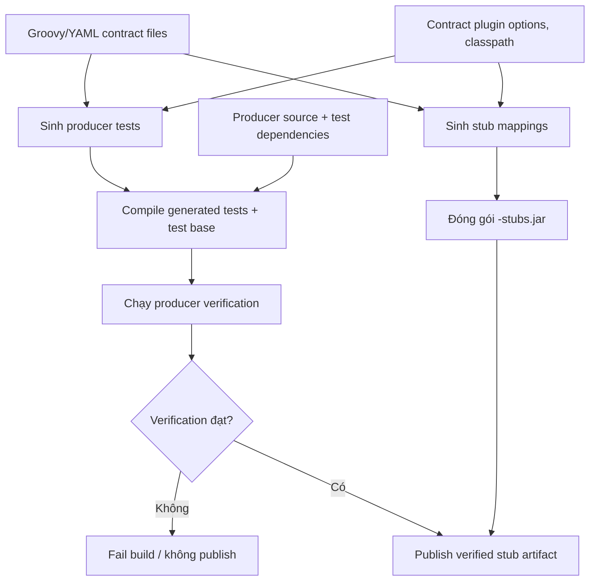
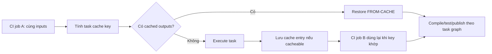
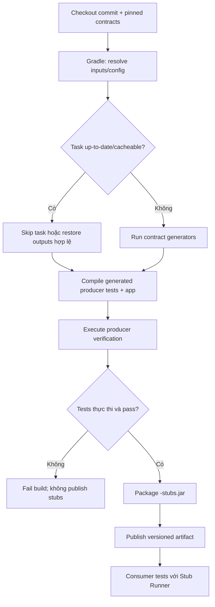

# Build tăng dần, build cache và đầu vào cần theo dõi

## 1. Tình huống: vì sao một thay đổi contract nhỏ có thể khiến build tốn kém?

Trong hệ thống microservices, `Order Service` (producer) sử dụng **Spring Cloud Contract** để định nghĩa các tương tác HTTP hoặc thông điệp bằng **Groovy/YAML DSL**. Gradle plugin giúp sinh kiểm thử cho producer, tạo stub, đóng gói artifact có classifier `stubs`; phía `Checkout Service` (consumer) dùng **Stub Runner** và các bài kiểm thử của mình để phát hiện thay đổi API không tương thích.

Ở một dự án có hàng trăm hợp đồng, một lần build có thể phải đọc DSL, sinh mã Java, biên dịch, chạy kiểm thử, tạo WireMock mappings và đóng gói stub JAR. Nhưng không phải thay đổi nào cũng cần thực hiện lại tất cả:

- Chỉ sửa tài liệu `README` thì hợp đồng không đổi.
- Sửa một hợp đồng HTTP có thể cần sinh lại test và stub tương ứng.
- Chỉ sửa implementation controller thì generated source có thể giữ nguyên, nhưng kiểm thử producer cần chạy lại với class mới.
- Đổi `testFramework`, `testMode`, `baseClassForTests` hoặc phiên bản plugin có thể ảnh hưởng **toàn bộ output sinh mã**.
- Nâng phiên bản dependency hoặc thay đổi cấu hình CI có thể khiến cache cũ không còn hợp lệ.

Gradle có các cơ chế giúp tránh làm lại công việc không cần thiết. Tuy nhiên, **nhanh hơn chỉ có ý nghĩa khi kết quả vẫn đúng**. Nếu một tệp contract hoặc một tùy chọn generator không được khai báo là đầu vào, task có thể bị đánh giá `UP-TO-DATE` sai và phát hành stub cũ.

Bài học thuộc chương **Tích hợp Gradle**, tập trung vào:

1. Phân biệt **up-to-date check**, **incremental execution**, **build cache** và **configuration cache**.
2. Nhận diện task graph của quy trình Spring Cloud Contract.
3. Biết những **input/output** nào Gradle phải quan sát khi sinh producer tests và stub.
4. Hiểu quan hệ giữa DSL files, options, plugin classpath, test base class và artifact đầu ra.
5. Dùng log Gradle để điều tra `UP-TO-DATE`, `FROM-CACHE`, `NO-SOURCE` và task chạy lại.
6. Thiết kế CI có thể tái lập, không để cache che khuất sự thay đổi API.

## 2. Bốn khái niệm Gradle thường bị gọi chung là “cache”

| Khái niệm | Mục đích | Ví dụ kết quả | Điều kiện để đúng |
| --- | --- | --- | --- |
| **Up-to-date checks** | Bỏ qua task nếu inputs/outputs không đổi so với lần thực thi trước | `UP-TO-DATE` | Task khai báo đầy đủ inputs và outputs |
| **Incremental execution** | Khi inputs đổi, chỉ xử lý **phần tệp thay đổi** nếu task hỗ trợ | Task chạy nhưng nhận danh sách added/modified/removed | Task dùng API incremental như `InputChanges` và có thuật toán phù hợp |
| **Build cache** | Khôi phục outputs từ một lần chạy trước có cùng cache key | `FROM-CACHE` | Task thật sự cacheable; inputs/outputs và môi trường phải được mô hình hóa đúng |
| **Configuration cache** | Tái sử dụng kết quả bước **cấu hình task graph** | `Reusing configuration cache` | Build logic/plugins tương thích với configuration cache |

Đây là **bốn cơ chế khác nhau**:

- `UP-TO-DATE` là Gradle không cần chạy task vì trạng thái đã biết ở **workspace hiện tại**.
- `FROM-CACHE` là Gradle có thể lấy **task outputs** từ local/remote build cache.
- Một task có thể chạy **incremental** dù không cacheable; ngược lại task cacheable có thể phải tính lại toàn bộ output nếu cache miss.
- Configuration cache làm nhanh bước cấu hình, **không có nghĩa** mã test/stub đã được cập nhật.

**Không suy từ việc thêm `--build-cache` rằng mọi task của Spring Cloud Contract đều được cache.** Khả năng cache phụ thuộc implementation và metadata của **task trong đúng phiên bản plugin** đang dùng.

### 2.1. Ví dụ hai lần chạy liên tiếp

Giả sử build có task `generateContractTests` và các tác vụ test thông thường:

```text
Lần 1:
  > Task :generateContractTests
  > Task :compileTestJava
  > Task :test

Lần 2, không sửa nguồn:
  > Task :generateContractTests UP-TO-DATE
  > Task :compileTestJava UP-TO-DATE
  > Task :test UP-TO-DATE
```

Đây là **log minh họa**, không phải output bắt buộc. Trong thực tế task có thể luôn chạy, báo `NO-SOURCE`, bị vô hiệu cache hoặc có đầu vào biến đổi do plugin/configuration. Cần đọc `--info` để hiểu tại sao Gradle chọn kết quả đó.

## 3. Task graph của Spring Cloud Contract trong Gradle

Luồng khái niệm:



Một số task thường thấy trong hệ sinh thái **Spring Cloud Contract Gradle plugin** có thể gồm `generateContractTests`, `generateClientStubs` và `verifierStubsJar`. **Tên, loại, dependency graph và default wiring phụ thuộc phiên bản plugin**; không dùng một danh sách task truyền miệng thay cho việc xem project thật.

Trong dự án đã cấu hình Gradle, có thể tự kiểm tra:

```bash
./gradlew tasks --all --console=plain
./gradlew help --task generateContractTests
./gradlew generateContractTests --dry-run
./gradlew test --dry-run
```

`--dry-run` chỉ cho biết **những task dự kiến trong graph**, không thực thi kiểm thử và không chứng minh cache đúng. Trước khi xây CI hoặc tối ưu build, hãy kiểm tra task nào thật sự sinh test, task nào sinh stubs và `test`/`check` có phụ thuộc đúng các công đoạn cần thiết hay không.

### 3.1. Sinh lại source không đồng nghĩa producer đã được kiểm chứng

Một task sinh `Validate_create_order.java` và WireMock mapping có thể hoàn thành dù implementation producer đã thay đổi hoặc không compile. Contract verification chỉ có giá trị khi **generated test được biên dịch và chạy với mã producer hiện tại**.

Vì vậy không được đồng nhất:

- “`generateContractTests` `UP-TO-DATE`” với “API producer vẫn đúng”.
- “Stub JAR có thể lấy từ cache” với “producer verification của commit hiện tại đã pass”.
- “Consumer test với Stub Runner pass” với “producer mới nhất đã đáp ứng tất cả hợp đồng”.

## 4. Đầu vào cần theo dõi khi sinh mã và sinh stub

Một task có thể được bỏ qua hoặc lấy cache **chỉ khi toàn bộ dữ liệu ảnh hưởng kết quả đã được mô hình hóa**. Với Spring Cloud Contract, cần phân biệt đầu vào của **generator** và đầu vào của **kiểm thử producer**.

| Thành phần | Ảnh hưởng tới | Tại sao cần theo dõi? |
| --- | --- | --- |
| Tệp `*.groovy`, `*.yml`, `*.yaml` trong contracts directory | Sinh tests/stubs | Thay đổi method, URL, headers, body hoặc matcher |
| Việc thêm/xóa/đổi tên tệp, thư mục hợp đồng | Sinh tests/stubs | Generated classes và mappings phải được tạo/xóa đúng |
| `testMode`, `testFramework` | Generated tests | Sinh mã MockMvc, REST Assured, JUnit tương ứng |
| `baseClassForTests`, `baseClassMappings` | Generated tests | Class `extends` và package liên quan có thể đổi |
| Package/test naming, output layout, source language | Generated source/stubs | Ảnh hưởng tên class, vị trí file, reference |
| Thư viện/plugin Spring Cloud Contract và classpath của generator | Sinh tests/stubs | Phiên bản mới có thể sinh mã/mapping khác |
| Hợp đồng tải từ nguồn ngoài, nếu có | Đầu vào generator | Version/revision cần cố định, không phụ thuộc dữ liệu remote thay đổi âm thầm |
| Tham số customize mapping/stub, template/extension nếu dùng | Sinh stubs | Cấu trúc WireMock response và request matcher có thể khác |
| Java/Kotlin test base class và fixture | Compile/test producer | Không nhất thiết đổi generated source, nhưng ảnh hưởng compile hoặc kết quả test |
| Controller/service/security implementation | Producer tests | Có thể khiến actual response đổi mà **không cần sinh lại test** |
| Test runtime dependencies, profile, database fixture | Producer test execution | Làm pass/fail thay đổi, nhất là với test tích hợp |

**Phân biệt tinh tế:** Nếu chỉ thay mã trong `HttpContractBase.java`, generator có thể vẫn chính xác khi `UP-TO-DATE`, vì chuỗi FQN lớp cha không đổi. Nhưng `compileTestJava` hoặc `test` **cần** thấy sự thay đổi đó. Ngược lại, đổi `baseClassForTests` từ `PublicBase` sang `InternalBase` có thể khiến **generated source** phải được viết lại vì mệnh đề `extends` thay đổi.

### 4.1. Ví dụ sửa contract phải tác động cả hai đầu ra

Hợp đồng ban đầu:

```groovy
response {
    status OK()
    body(orderId: 42, status: 'CREATED')
}
```

Sau đó consumer yêu cầu thêm `currency`:

```groovy
response {
    status OK()
    body(orderId: 42, status: 'CREATED', currency: 'VND')
}
```

Khi đổi file DSL, Gradle phải nhận thấy input đã thay đổi để:

1. Sinh lại assertion producer cho `currency` theo cấu hình matcher.
2. Sinh/cập nhật stub response có `currency`.
3. Chạy producer verification, phát hiện producer chưa trả `currency` nếu implementation chưa cập nhật.
4. Đóng gói stub đúng revision và chỉ phát hành khi các kiểm thử yêu cầu đã đạt.

Nếu task bị skip do thiếu input declaration, stub cũ có thể vẫn trả response thiếu `currency`. Đây là một **lỗi tính đúng đắn của build**, không chỉ là vấn đề hiệu năng.

## 5. Đầu vào tệp: cả nội dung lẫn đường dẫn đều có thể quan trọng

Gradle hỗ trợ khai báo các đầu vào dạng file:

- `@InputFile`: một tệp.
- `@InputFiles`: một tập tệp.
- `@InputDirectory`: một thư mục.
- `@Classpath`: collection kiểu classpath, có normalization phù hợp Java.
- `@CompileClasspath`: classpath compile với cách so sánh chuyên biệt.

Tương ứng, output có thể được khai báo qua `@OutputFile`, `@OutputFiles`, `@OutputDirectory` hoặc các property builder của task.

Khi theo dõi DSL, **nội dung** tệp quan trọng, nhưng **đường dẫn tương đối** thường cũng có ý nghĩa. Ví dụ:

```text
src/test/resources/contracts/
  public_http/create_order.groovy
  internal_http/create_order.groovy
```

Hai tệp trùng tên nhưng khác thư mục có thể được dùng cho **nhóm base class khác nhau** hoặc cách phân nhóm stub theo consumer. Nếu task chỉ theo dõi checksum của nội dung mà bỏ qua đường dẫn, một thao tác di chuyển file có thể không làm invalidate đầu ra đúng cách.

### 5.1. `PathSensitivity` và tính khả chuyển cache

Gradle có các tùy chọn về độ nhạy đường dẫn:

| Chế độ | Nhìn nhận đường dẫn input | Khi cần lưu ý |
| --- | --- | --- |
| `ABSOLUTE` | Coi đường dẫn tuyệt đối là một phần danh tính input | Cache khó tái sử dụng giữa hai workspace khác nhau |
| `RELATIVE` | Dựa trên đường dẫn tương đối dưới root input | Hữu ích cho tập contract có cấu trúc thư mục mang nghĩa |
| `NAME_ONLY` | Chủ yếu dựa trên tên file | Có thể không đủ nếu tên thư mục consumer/package quan trọng |
| `NONE` | Không coi đường dẫn là thông tin quan trọng | Chỉ dùng nếu thuật toán thật sự độc lập vị trí file |

Với nhóm contract đặt theo package/consumer, `RELATIVE` thường là lựa chọn có ý nghĩa hơn `NONE` hoặc `NAME_ONLY` **nếu task thực sự cần cấu trúc đường dẫn để sinh output**.

**Không thay đổi normalization của một task plugin tùy tiện chỉ để tăng cache hit.** Việc plugin generator sử dụng path nào và có phụ thuộc đường dẫn không là một phần ngữ nghĩa của task. Cần hiểu implementation và kiểm tra output trước khi tùy chỉnh.

### 5.2. Thêm/xóa/di chuyển file khác với sửa nội dung

| Thao tác | Điều output có thể cần làm |
| --- | --- |
| Sửa `create_order.groovy` | Sinh lại test/mapping ảnh hưởng |
| Thêm `delete_order.yml` | Sinh thêm test/mapping mới |
| Xóa `old_payment.groovy` | Xóa generated test/mapping **không còn hợp đồng** |
| Chuyển từ `public_http/` sang `internal_http/` | Chọn lại base class/package/mapping group |
| Đổi tên từ `.groovy` sang `.yml` | Đọc format khác, cập nhật danh tính và output |

Một task incremental đúng phải xử lý cả **removed inputs**. Nếu chỉ tạo file mới mà không dọn output cũ, một stub JSON đã hết hiệu lực vẫn có thể bị đóng gói vào `-stubs.jar`.

## 6. Ví dụ cấu hình Spring Cloud Contract Gradle plugin

Một đoạn `build.gradle` minh họa (Groovy DSL):

```groovy
plugins {
    id 'java'
    id 'org.springframework.cloud.contract' version '<compatible-scc-version>'
}

contracts {
    testFramework = 'JUNIT5'
    testMode = 'MOCKMVC'
    baseClassForTests = 'com.example.contract.OrderHttpContractBase'
    contractsDslDir = file('src/test/resources/contracts')
}
```

Đây là **ví dụ cấu hình ý tưởng**, không phải dự án Gradle chạy độc lập: cần Spring Boot plugin, dependency management/BOM, dependencies cho Contract Verifier, test framework và một **version thật** tương thích với Spring Boot/Cloud. Trong một số bản plugin, cách gán `contractsDslDir`, enum framework/mode hoặc tên property có thể khác; hãy đối chiếu extension API của bản đang dùng.

Với producer có nhiều nhóm hợp đồng, có thể dùng mapping tường minh:

```groovy
contracts {
    baseClassMappings {
        baseClassMapping(
            '.*public_http.*',
            'com.example.contract.PublicHttpContractBase'
        )
        baseClassMapping(
            '.*messaging.*',
            'com.example.contract.MessagingContractBase'
        )
    }
}
```

Khi thêm nhóm mới hoặc đổi regex, **configuration input** thay đổi. Generator cần cập nhật các class cha của test tương ứng. Không thể dựa riêng vào việc theo dõi `*.groovy`/`*.yml`; cấu hình plugin cũng ảnh hưởng output.

### 6.1. Biến môi trường và command-line properties

Giả sử CI đặt `CONTRACT_TEST_MODE=EXPLICIT` nhưng local dùng `MOCKMVC`. Nếu build logic đọc biến này và chọn kiểu generator, thì nó là **đầu vào về mặt ngữ nghĩa** của task. Gradle phải nhận biết đúng giá trị được dùng để tính cache key hoặc cấu hình task.

Nếu một custom task âm thầm gọi `System.getenv('CONTRACT_TEST_MODE')` ngay trong `doLast` mà không khai báo `@Input` hoặc `inputs.property`, Gradle có thể không biết đầu vào này đổi.

Với các task được viết bằng Groovy DSL, cách khai báo mang tính minh họa:

```groovy
tasks.register('printContractMode') {
    def mode = providers.environmentVariable('CONTRACT_TEST_MODE')
        .orElse('MOCKMVC')

    inputs.property('contractTestMode', mode)

    doLast {
        println "Contract mode: ${mode.get()}"
    }
}
```

Task trên **chỉ in giá trị** và không khai báo output, nên không phải ví dụ task build-cache có thể tái sử dụng. Điểm cần học là lấy cấu hình bằng **Provider API** và khai báo input trước khi dùng giá trị trong task action.

## 7. Minh họa task tự viết có khai báo inputs/outputs

Để thấy rõ Gradle quyết định `UP-TO-DATE` như thế nào, hãy tạo một task đơn giản **liệt kê tên hợp đồng** dưới dạng báo cáo. Nó không sinh producer tests/stubs, chỉ minh họa cơ chế theo dõi thay đổi.

Trong `build.gradle` Groovy DSL:

```groovy
import org.gradle.api.tasks.PathSensitivity

tasks.register('contractInputManifest') {
    def contractRoot = file('src/test/resources/contracts')
    def contractFiles = fileTree(contractRoot) {
        include '**/*.groovy', '**/*.yml', '**/*.yaml'
    }
    def destination = layout.buildDirectory.file(
        'reports/contracts/manifest.txt'
    )

    // Content + relative paths đều là inputs của task.
    inputs.files(contractFiles)
        .withPathSensitivity(PathSensitivity.RELATIVE)

    // Gradle có thể kiểm tra output có còn ở trạng thái đúng không.
    outputs.file(destination)

    doLast {
        def names = contractFiles.files.collect { file ->
            contractRoot.toPath()
                .relativize(file.toPath())
                .toString()
                .replace('\\', '/')
        }.sort()

        def outputFile = destination.get().asFile
        outputFile.parentFile.mkdirs()
        outputFile.setText(names.join('\n') + '\n', 'UTF-8')
    }
}
```

Chạy thử trên một project đã có thư mục hợp đồng:

```bash
./gradlew contractInputManifest --info
./gradlew contractInputManifest --info
```

Nếu input/output vẫn giữ nguyên, lần hai thường có thể báo `UP-TO-DATE`. Khi thêm, xóa hoặc di chuyển một tệp contract, task phải chạy lại vì tập input thay đổi.

**Lưu ý kỹ thuật:** Đây là ví dụ đơn giản về **up-to-date checking**, không phải cam kết task `contractInputManifest` đã tự được **build-cache**. Task ad-hoc kiểu `doLast` không nên được quảng bá như task cacheable nếu chưa có annotation/metadata và kiểm tra tính quyết định. Ngoài ra, ví dụ đang tạo danh sách tên file, không bao gồm nội dung DSL trong báo cáo; dù content đổi có thể khiến task chạy lại, output danh sách có thể giữ nguyên — điều này đúng với mục đích báo cáo.

### 7.1. `@CacheableTask` khác `inputs.files`

Khi viết **custom Gradle task type** nghiêm túc, có thể khai báo input/output dưới dạng property có annotation:

```groovy
@CacheableTask
abstract class GenerateContractCatalog extends DefaultTask {
    @InputFiles
    @PathSensitive(PathSensitivity.RELATIVE)
    abstract ConfigurableFileCollection getContractFiles()

    @Input
    abstract Property<String> getCatalogFormatVersion()

    @OutputFile
    abstract RegularFileProperty getCatalogFile()

    // @TaskAction phải tạo output một cách xác định
    // từ các properties đã khai báo.
}
```

Đây là **khung thiết kế**, không phải class có thể chạy độc lập vì chưa có `@TaskAction` và các import. `@CacheableTask` chỉ thích hợp khi output không phụ thuộc trạng thái ẩn, đường dẫn tuyệt đối ngẫu nhiên, network không cố định, đồng hồ hoặc dữ liệu bên ngoài chưa khai báo.

Đối với task do **Spring Cloud Contract plugin cung cấp**, nên ưu tiên cấu hình extension/plugin chính thức; không copy một custom task type rồi dùng nó để thay thế generator chỉ vì muốn nhìn thấy `FROM-CACHE`.

## 8. Cache key: thay đổi cái gì thì cache phải vô hiệu?

Hình dung build cache có một **khóa** được tính từ implementation task và các dữ liệu liên quan:

```text
cache key ~ task implementation
          + task properties
          + input files / normalized paths
          + relevant classpaths
          + các yếu tố Gradle dùng để mô hình hóa task
```

Đây là **mô hình khái niệm**, không phải công thức hash chính thức. Khi toàn bộ yếu tố đã khai báo giống nhau và task cacheable, Gradle có thể lấy output từ cache; nếu thay đổi, nó cần thực thi lại hoặc tìm cache entry khác.

### 8.1. Các thay đổi cần tác động cache key

| Thay đổi | Cần ảnh hưởng task nào? | Rủi ro nếu không theo dõi |
| --- | --- | --- |
| Sửa URL trong `create_order.yml` | Generator tests và stubs | Test/stub vẫn dùng endpoint cũ |
| Thêm hợp đồng `order_cancelled.groovy` | Generator tests và stubs | Thiếu test/stub mới |
| Xóa contract deprecated | Generator và packaging | Stub cũ vẫn được phát hành |
| Đổi `baseClassMappings` | Generator tests | Test kế thừa nhầm base class |
| Đổi `testMode` | Generator tests | Mã sinh dùng client/framework cũ |
| Nâng SCC plugin version | Generator implementation | Output mới không phản ánh generator mới |
| Đổi implementation controller | Compile/test producer | Test không chạy lại dù API sai |
| Đổi dependency Jackson trong producer | Compile/test và runtime serialization | Response JSON thực có thể đổi |
| Đổi artifact version/classifier | Packaging/publication | Consumer tải nhầm stub |

**Quan trọng:** Thay đổi artifact version có thể ảnh hưởng packaging/publishing nhưng không nhất thiết làm nội dung một WireMock JSON mapping thay đổi. Gradle cần mô hình hóa đầu vào ở đúng task, không ép tất cả task chạy lại khi thay version nếu điều đó không ảnh hưởng output.

### 8.2. Cảnh giác với external contract repository

Một số dự án lấy hợp đồng từ repository bên ngoài hoặc artifact `contracts`. Lúc này source có thể được copy/download trước khi generator chạy. Nếu dùng tham chiếu động như `+`, `SNAPSHOT`, một Git branch không pin commit, hoặc URL trả dữ liệu thay đổi mà không có revision cụ thể, output có thể khác giữa hai lần chạy dù Gradle nhìn thấy cùng một chuỗi cấu hình.

Một quy trình an toàn hơn:

1. Pin contract artifact version hoặc Git commit/revision.
2. Tải/copy hợp đồng qua task có inputs/outputs rõ ràng.
3. Không để generator tự gọi network ngầm trong task action mà Gradle không quan sát được.
4. Đảm bảo các file đã lấy về là inputs của generator.
5. Lưu provenance (revision/artifact coordinates) trong log hoặc metadata CI.

Không nên coi **remote build cache** là giải pháp cho một **remote contract source không ổn định**. Cache đúng chỉ khi source revision đã được quản lý.

## 9. Khi task thực sự hỗ trợ incremental execution

Giả sử có 100 hợp đồng, chỉ một file `payment_created.yml` đổi. Một generator lý tưởng có thể chỉ tái sinh output của file đó. Nhưng Gradle không tự biết **một input file tương ứng output nào** nếu implementation task không cung cấp thuật toán này.

Một task incremental thường sử dụng `InputChanges` để nhận thay đổi:

```text
ADDED:    contracts/payment_refunded.yml
MODIFIED: contracts/payment_created.yml
REMOVED:  contracts/payment_legacy.groovy
```

Đây là **dạng dữ liệu khái niệm**, không phải log mặc định của Spring Cloud Contract. Implementation phải:

- Sinh output mới cho file được thêm.
- Cập nhật output tương ứng khi file đổi.
- **Xóa output cũ** nếu file nguồn bị xóa.
- Xử lý trường hợp cấu hình chung đổi khiến phải sinh lại toàn bộ.

Một task có thể được Gradle coi là `UP-TO-DATE` khi không đổi, nhưng khi có thay đổi lại **sinh lại tất cả**. Vậy nó có up-to-date checks, **chưa chắc incremental theo từng tệp**.

**Không khẳng định `generateContractTests` hay `generateClientStubs` hỗ trợ xử lý tăng dần từng file trong mọi phiên bản.** Cần kiểm tra task implementation và log thực tế. Nếu một task không hỗ trợ incremental file changes, chạy lại toàn bộ khi input đổi vẫn có thể là cách đúng.

## 10. Cách đọc log Gradle khi task chạy hoặc bị bỏ qua

Các trạng thái thường gặp:

| Trạng thái | Diễn giải ngắn | Việc cần làm |
| --- | --- | --- |
| `UP-TO-DATE` | Inputs/outputs không đổi theo dữ liệu Gradle theo dõi | Bình thường nếu không có thay đổi thực |
| `FROM-CACHE` | Restore task outputs từ build cache | Xác nhận task cacheable và key đầy đủ |
| `NO-SOURCE` | Task không có input source để xử lý | Kiểm tra đường dẫn contract và include patterns |
| `SKIPPED` | Task bị bỏ qua do onlyIf, disabled hoặc lý do khác | Phải đọc lý do, nhất là với producer verification |
| Không có trạng thái hậu tố | Task có thể đã được thực thi | Xem `--info` để hiểu nguyên nhân |
| `FAILED` | Task thực thi lỗi | Đọc assertion/test/report/stacktrace |

Lệnh điều tra hữu ích:

```bash
./gradlew generateContractTests --info --console=plain
./gradlew test --info --console=plain
./gradlew test --build-cache --info
```

Nếu task chính có tên khác ở bản plugin của bạn, thay bằng tên có trong `./gradlew tasks --all`. Các lệnh ở đây **là hướng dẫn thực hành**, không phải lệnh đã được chạy khi viết bài.

### 10.1. Dùng `--rerun-tasks` để kiểm tra giả thuyết

```bash
./gradlew generateContractTests --rerun-tasks --info
```

`--rerun-tasks` buộc các task được chọn và dependencies liên quan chạy lại, thay vì dựa vào kết quả up-to-date/cache thông thường. Nó hữu ích để phân biệt “file sinh ra bị cũ” với “nội dung DSL sai”. Không cần luôn bật cho CI vì sẽ làm mất lợi ích tránh thực thi không cần thiết.

`--no-build-cache` tắt **sử dụng build cache**, nhưng **không đồng nghĩa** tắt up-to-date checks. Ngược lại, `clean` xóa outputs trong workspace nên task không thể `UP-TO-DATE` dựa trên outputs cũ, nhưng vẫn có thể `FROM-CACHE` nếu build cache được bật và có entry phù hợp.

### 10.2. Một trình tự kiểm tra dễ diễn giải

1. Chạy một lần để có output đầy đủ.
2. Chạy lại **không sửa gì**, xem task nào `UP-TO-DATE`.
3. Sửa một trường DSL, chạy lại và xem generator/test/stub nào bị tác động.
4. Hoàn nguyên, sau đó xóa một contract, bảo đảm generated output cũ không còn được đóng gói.
5. Đổi một property generator như `baseClassForTests`, xác minh generated `extends` thay đổi.
6. Thử `--build-cache` khi task có hỗ trợ, xem có `FROM-CACHE` hay không.
7. Dùng `--rerun-tasks` nếu nghi stale output, so sánh kết quả.

Nếu thấy “DSL đã đổi nhưng generator vẫn `UP-TO-DATE`”, trước hết kiểm tra **đường dẫn input/contract source**, include patterns và effective plugin config. Đừng lập tức sửa file generated source bằng tay.

## 11. Build cache local, remote và khả năng tái sử dụng trong CI

Gradle có thể dùng **local build cache** trên máy hiện tại và **remote build cache** dùng chung giữa các worker CI nếu được cấu hình.



Một cấu hình Gradle chung mang tính minh họa:

```properties
# gradle.properties trong phạm vi project phù hợp
org.gradle.caching=true
```

Sau đó có thể chạy:

```bash
./gradlew test --build-cache --info
```

**Cảnh báo:** Các dòng này chỉ bật **cơ chế tìm/ghi cache nếu task hỗ trợ**. Nó **không biến** bất kỳ task Spring Cloud Contract nào thành cacheable và cũng không bảo đảm sẽ thấy `FROM-CACHE`. Plugin có thể đánh dấu task không cacheable theo thiết kế hoặc vì còn tác động phụ chưa được mô hình hóa.

### 11.1. Vì sao một task không nên cache?

Một task **không nên** được cache nếu output phụ thuộc dữ liệu không khai báo, ví dụ:

- Trạng thái mutable của network/service/database.
- Timestamp hiện tại trong generated file.
- Random ID không được seed cố định.
- Đường dẫn tuyệt đối hoặc hostname của CI runner bị ghi vào output.
- Version động của external contracts/dependencies chưa khóa.
- Secret được nhúng vào output theo runtime mà không được quản lý an toàn.

Không nên dùng `outputs.cacheIf { true }` để “ép” cache cho task plugin mà chưa chứng minh tính quyết định và đầy đủ input. Một cache hit sai có thể khiến JAR stub không còn tương ứng với hợp đồng hiện tại.

### 11.2. Cache artifacts có thể mang rủi ro bảo mật

Nếu contract test chứa token thật, cookie hoặc PII và task đóng gói chúng vào stub response, **build cache cũng có thể lưu nội dung đó**. Vì vậy:

- Chỉ dùng fixture giả hoặc dữ liệu đã ẩn danh.
- Hạn chế quyền đọc/ghi remote cache.
- Cẩn trọng với việc cho pipeline pull request không tin cậy **ghi** vào cache dùng chung.
- Không dùng cache làm kho lưu trữ duy nhất của artifact đã phát hành.
- Version hóa/publish stub artifact qua kho có kiểm soát, không phụ thuộc vào task cache của Gradle như “artifact registry”.

## 12. Configuration cache là câu chuyện khác

Configuration cache lưu lại trạng thái cấu hình build để những lần chạy sau khỏi phải đánh giá lại mọi `build.gradle` và plugin configuration. Thử nghiệm:

```bash
./gradlew tasks --configuration-cache
./gradlew tasks --configuration-cache
```

Nếu plugin/task tương thích, lần hai Gradle có thể báo đang **reuse configuration cache**. Nếu build script hoặc task thực hiện những thao tác không tương thích (giữ tham chiếu tới `Project` trong task action, đọc trạng thái ngoài không đúng cách, v.v.), Gradle sẽ có cảnh báo hoặc từ chối lưu cache.

**Không gọi đây là “cache kết quả sinh test”.** Kể cả khi configuration cache được reuse, task `generateContractTests` vẫn phải được Gradle kiểm tra inputs/outputs, quyết định `UP-TO-DATE`, chạy, hoặc `FROM-CACHE` theo cơ chế riêng.

Đặc biệt với Spring Cloud Contract Gradle plugin, **compatibility với configuration cache phụ thuộc phiên bản plugin/Gradle**. Hãy kiểm tra tài liệu release và log build của dự án; không ép chạy bằng cách bỏ qua cảnh báo mà chưa đánh giá kết quả.

## 13. Đầu vào phi tệp: dependency, toolchain, môi trường và tham số build

Không chỉ DSL file mới ảnh hưởng kết quả build. Ví dụ:

| Loại đầu vào | Ví dụ | Lớp cần quan tâm |
| --- | --- | --- |
| Gradle plugin implementation | Spring Cloud Contract plugin version | Generator/cache key |
| Dependency classpath | Spring Cloud Contract Verifier, Jackson, Spring Test | Sinh mã, biên dịch/test |
| Java toolchain | JDK target/version | Compiler và môi trường chạy tests |
| Test framework | JUnit 5 vs bản khác | Generator/test runner |
| Test mode | MockMvc vs explicit HTTP test | Cách generated test gửi request |
| Build/system property | Profile test, locale, timezone khi có ảnh hưởng | Producer verification |
| Credentials/endpoint | Test database hoặc stub repository | Test runtime, artifact retrieval |
| Artifact classifier/version | `stubs`, `1.2.0` | Packaging/publication, consumer resolving |

**Không phải mọi biến môi trường đều là generator input.** Ví dụ mật khẩu dùng để **publish artifact** không nên ảnh hưởng file source Java được generator sinh. Ngược lại, nếu một biến chọn test mode hoặc thay nội dung stub JSON, nó ảnh hưởng đầu ra và cần được mô hình hóa đúng.

### 13.1. Phụ thuộc của test khác phụ thuộc generator

Sửa implementation trong `src/main/java` không nhất thiết buộc task sinh test chạy lại, nhưng phải làm task compile/test producer chạy với class mới. Nếu CI chỉ chạy `generateContractTests` rồi publish stub, nó sẽ bỏ qua bước verification quan trọng.

Tương tự, thay phiên bản Jackson có thể tác động **response serialization thật** của producer. Cần test chạy lại để so sánh JSON thực, ngay cả khi hợp đồng và stub mapping không đổi.

## 14. Tối ưu task graph mà không phá producer verification

Một số nguyên tắc thực tế:

1. **Không ép tất cả task `dependsOn clean`**: làm mất lợi ích up-to-date ở mỗi lần chạy.
2. **Đặt outputs dưới `build/`** hoặc nơi plugin thiết kế; tránh ghi vào `src/test/java` bằng tác vụ sinh mã mà không kiểm soát.
3. **Không commit generated files** như nguồn chân lý nếu chúng được generator tái tạo và quy trình không yêu cầu.
4. **Không chỉnh output generated trực tiếp**: sửa contract hoặc plugin config.
5. **Không đặt nhiều task ghi vào cùng output directory** nếu không có phối hợp rõ ràng, vì Gradle khó theo dõi output ownership.
6. **Đảm bảo producer verification là cổng trước publication** ở CI, kể cả khi các task sinh mã lấy kết quả từ cache.
7. **Có kiểm tra test count** để tránh tình trạng `NO-SOURCE` hoặc `SKIPPED` làm pipeline xanh giả.
8. **Phân biệt staging/source contract directory với output directory** nếu contracts được copy từ nguồn ngoài.

### 14.1. Khi test thất bại sau cache hit

Ví dụ:

```text
> Task :generateContractTests FROM-CACHE
> Task :compileTestJava
> Task :test FAILED
```

Đây có thể là kết quả **hoàn toàn đúng**: source test được khôi phục từ cache vì DSL không đổi, nhưng implementation producer mới đã thay behavior khiến assertion fail. **Không vô hiệu hóa cache generator chỉ vì producer test phát hiện lỗi.**

Ngược lại:

```text
> Task :generateContractTests UP-TO-DATE
> Task :verifierStubsJar UP-TO-DATE
```

trong khi bạn vừa thay một contract mà pipeline không hề kiểm tra tác động có thể là tín hiệu xấu. Cần xác minh **file đó có nằm trong input set hay không**, plugin có đọc đúng `contractsDslDir` không và thao tác copy contract từ repository ngoài có xảy ra trước generator không.

## 15. Kịch bản lỗi build cache thường gặp

| Triệu chứng | Nguyên nhân có thể | Cách điều tra |
| --- | --- | --- |
| Sửa `*.groovy` nhưng task vẫn `UP-TO-DATE` | Plugin trỏ sai thư mục, include pattern bỏ qua file, input tracking thiếu | Xem effective contracts directory, `--info`, generated source |
| Thêm contract nhưng không sinh test | Không đọc đúng DSL source, task `NO-SOURCE` | Kiểm tra `contractsDslDir`, include patterns và task graph |
| Xóa contract nhưng stub cũ vẫn còn trong JAR | Stale outputs/cleanup chưa đúng | Kiểm tra generated mapping dir và packaging input |
| Nâng plugin nhưng output không thay đổi bất ngờ | Build cache/config chưa invalidate đúng hoặc đang dùng plugin version khác | Kiểm tra resolved plugin version, cache key diagnostics |
| `--build-cache` nhưng không thấy `FROM-CACHE` | Task không cacheable, cache miss, inputs khác hoặc cache bị tắt | Đọc lý do trong `--info`; không ép cache |
| Local pass, CI fail vì generated class khác | Absolute paths, JDK, locale hoặc plugin/dependency versions khác | Ghim toolchain/version; xem inputs và paths |
| Gradle task `SKIPPED` nhưng CI xanh | Task bị disable/onlyIf hoặc test task bị filter | Kiểm tra executed test count, build logic |
| Stub artifact chứa bản contract cũ | Packaging không phụ thuộc generator đúng hoặc source cũ | Kiểm tra task dependencies, file inputs và nội dung JAR |
| Test dùng dữ liệu cũ từ database | External state không được kiểm soát | Cô lập fixture hoặc tắt cache cho task có side effect |
| Configuration cache báo lỗi | Plugin/custom task giữ trạng thái `Project` hoặc đọc dữ liệu không hợp lệ | Đọc báo cáo Gradle, sửa task logic hoặc tắt có chủ đích |

### 15.1. Nếu nghi build cache “nhiễm độc”

Thử theo thứ tự ít phá hủy:

1. Đọc `--info` xem task bị bỏ qua hay lấy cache vì lý do gì.
2. Kiểm tra contract source và generated output trong chính workspace.
3. Chạy `--no-build-cache` để tách ảnh hưởng của build cache.
4. Dùng `--rerun-tasks` cho task liên quan để buộc thực thi.
5. So sánh generated source/mappings với hợp đồng hiện tại.
6. Sửa thiếu input/output declaration hoặc configuration sai ở **nguồn build logic**, không chỉ xóa cache rồi coi như hoàn tất.

Tránh xóa cache global hoặc shared remote cache như phản xạ đầu tiên; nguyên nhân gốc có thể vẫn tái diễn.

## 16. Thiết kế CI với cache nhưng vẫn bắt lỗi không tương thích



CI có thể theo nguyên tắc:

1. **Ghim Spring Boot, Spring Cloud, Gradle wrapper và plugin versions**.
2. **Ghim nguồn hợp đồng** ở artifact version/commit rõ ràng.
3. **Bật Gradle build cache** cho những task được plugin đánh dấu cacheable; không ép các task có side effect.
4. **Chạy producer verification thực**, xác nhận test count, không chỉ kiểm tra generator thành công.
5. **Chặn publish stub** nếu kiểm thử hợp đồng fail.
6. **Đóng gói và publish artifact theo version**, không dùng Gradle build cache làm kho phân phối stub.
7. **Chạy consumer tests bằng Stub Runner** với producer stub version được ghi nhận.
8. **Theo dõi cache hit/miss và build time**, nhưng ưu tiên tính đúng và khả năng giải thích output.

Với pipeline pull request từ nguồn không tin cậy, tránh cho job có quyền **ghi** vào remote cache dùng chung nếu chưa có mô hình kiểm soát cache phù hợp. Cache được chia sẻ giữa các tác vụ cần được quản lý tương tự các artifact có thể được tải và thực thi.

## 17. Bài thực hành: dự đoán task nào cần chạy lại

Giả sử `Order Service` có các hợp đồng:

```text
src/test/resources/contracts/
  public_http/get_order.yml
  public_http/create_order.groovy
  messaging/order_created.groovy
```

Nhóm dùng `baseClassMappings` để ánh xạ `public_http` sang `HttpContractBase`, `messaging` sang `MessagingContractBase`. Các generated tests được chạy khi Gradle `test`/quy trình verification có hiệu lực.

### 17.1. Các tình huống

1. Không sửa gì, chạy lại cùng lệnh Gradle trên cùng workspace.
2. Thay `response.status` trong `get_order.yml` từ `200` thành `404`.
3. Chỉ sửa implementation `OrderController`, không sửa hợp đồng.
4. Đổi `baseClassMappings` để nhóm HTTP kế thừa một base class khác.
5. Xóa `messaging/order_created.groovy`.
6. Nâng Spring Cloud Contract Gradle plugin lên phiên bản tương thích mới.
7. Chạy CI trên runner mới cùng source và version, có remote build cache.
8. Chạy `./gradlew test --no-build-cache` sau khi một task đã `UP-TO-DATE`.

### 17.2. Đáp án định hướng

| Tình huống | Kỳ vọng hợp lý | Điều cần kiểm chứng |
| --- | --- | --- |
| 1 | Task có thể `UP-TO-DATE` | Inputs/outputs thật không đổi |
| 2 | Sinh lại assertion/mapping và test producer | Stub/producer phản ánh status mới |
| 3 | Compile/test producer cần xem code mới; generator có thể giữ nguyên | Test vẫn kiểm tra response thực |
| 4 | Generated test cần extends base class mới | Mapping config là generator input |
| 5 | Output cũ cần được dọn, không còn stub event lỗi thời | Task xử lý removed input và packaging |
| 6 | Generator implementation có thể đổi, cần invalidation hợp lý | Cache key có phản ánh plugin version |
| 7 | Task cacheable có thể `FROM-CACHE`; task khác vẫn chạy | Chỉ restore khi cache key đủ và output đúng |
| 8 | Không dùng build cache, nhưng up-to-date checks vẫn có thể áp dụng | `--no-build-cache` không bằng `--rerun-tasks` |

### 17.3. Thử nghiệm có chủ đích

Trong một nhánh test riêng của project:

```bash
# Baseline
./gradlew test --info

# Lặp lại không đổi inputs
./gradlew test --info

# Xem behavior khi bật build cache
./gradlew test --build-cache --info

# Buộc chạy lại để kiểm tra giả thuyết stale output
./gradlew test --rerun-tasks --info
```

Sau đó đổi một trường trong DSL và kiểm tra: generated producer test có assertion mới không, stub mapping/JAR có response mới không và producer verification có fail khi implementation chưa đáp ứng không. **Các lệnh trên là gợi ý thực hành; không được thực thi khi biên soạn tài liệu này.**

## 18. Checklist trước khi merge thay đổi build logic

- Đã phân biệt **up-to-date**, **incremental**, **build cache** và **configuration cache**?
- Có xác định đúng task do Spring Cloud Contract plugin cung cấp trong **phiên bản thực tế**?
- DSL files, đường dẫn tương đối, thêm/xóa/di chuyển contracts được theo dõi?
- `testMode`, `testFramework`, base class mapping và các generator options khác được mô hình hóa?
- Có phân biệt **base test class source** là đầu vào compile/test với **base FQN config** ảnh hưởng generator?
- Các nguồn contract từ ngoài project có được pin version/revision và copy qua task có inputs/outputs?
- Task sinh mã có outputs riêng dưới `build/`, không để stale generated files lọt vào artifact?
- Không ép cache cho task không quyết định hoặc có network/clock/random/external state chưa khai báo?
- Đã kiểm tra log `UP-TO-DATE`, `FROM-CACHE`, `NO-SOURCE`, `SKIPPED` bằng `--info`?
- CI xác nhận generated producer tests **thực sự được chạy** và fail khi implementation trái hợp đồng?
- Stub JAR chỉ được publish sau producer verification đạt, consumer dùng đúng version qua Stub Runner?
- Build cache/remote cache được kiểm soát quyền truy cập và không chứa dữ liệu nhạy cảm?

**Tài liệu tham khảo chính thức theo phiên bản dự án:**

- [Gradle — Incremental Builds](https://docs.gradle.org/current/userguide/incremental_build.html).
- [Gradle — Build Cache](https://docs.gradle.org/current/userguide/build_cache.html).
- [Gradle — Tasks and Inputs/Outputs](https://docs.gradle.org/current/userguide/implementing_custom_tasks.html).
- [Gradle — Configuration Cache](https://docs.gradle.org/current/userguide/configuration_cache.html).
- [Spring Cloud Contract — Gradle Project](https://docs.spring.io/spring-cloud-contract/reference/gradle-project.html).
- [Spring Cloud Contract — Reference](https://docs.spring.io/spring-cloud-contract/reference/).

**Ghi nhớ:** **Gradle chỉ bỏ qua task hoặc khôi phục cache đúng khi mọi đầu vào ảnh hưởng kết quả đã được theo dõi**. Với Spring Cloud Contract, không chỉ DSL files mà còn **đường dẫn nhóm hợp đồng, generator options, plugin version và quan hệ task graph** đều có ý nghĩa. `UP-TO-DATE` không đồng nghĩa incremental từng tệp, `--build-cache` không biến mọi task thành cacheable và kết quả sinh stub không thay thế **producer verification chạy trên implementation hiện tại**. Tối ưu build phải luôn giữ đúng cam kết API trước khi phát hành artifact cho consumer.
