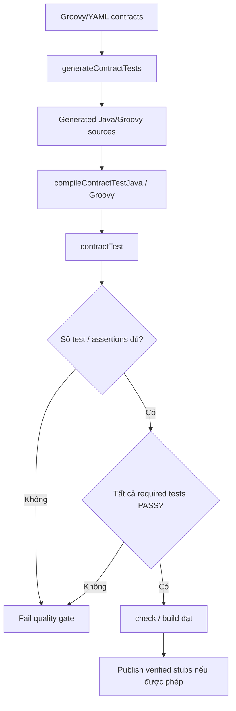
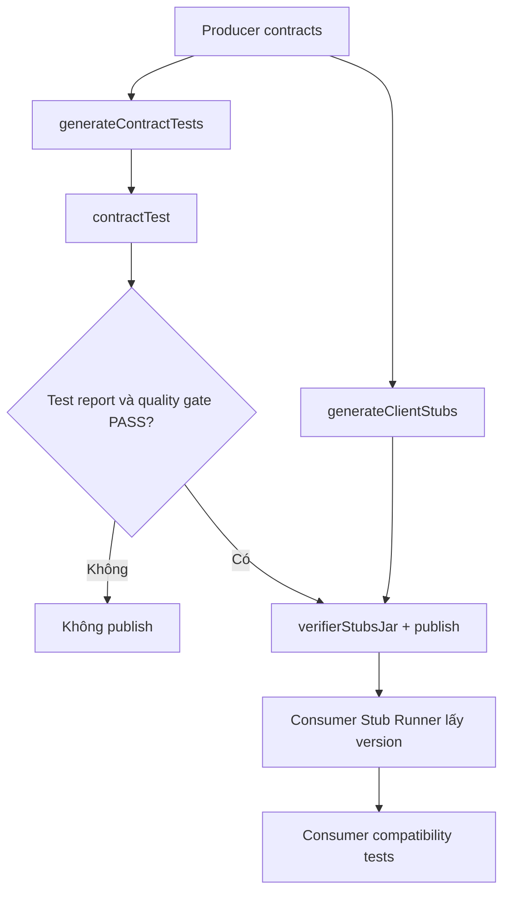

# Kiểm chứng một clean build thực sự sinh và chạy đủ kiểm thử

> **Chương:** Tích hợp Gradle  
> **Module:** `SPRING_CLOUD_CONTRACT` — học kiểm thử hợp đồng giữa producer và consumer với Groovy/YAML DSL cho HTTP hoặc messaging; sinh kiểm thử cho producer, đóng gói stub, chạy Stub Runner và đưa quality gates vào CI nhằm phát hiện thay đổi API không tương thích.

## Mục tiêu học tập

Sau bài này, bạn có thể:

1. Giải thích vì sao **`./gradlew clean build` thành công không tự động chứng minh tất cả contract tests đã được sinh và chạy**.
2. Nhận diện nguồn contract mặc định của **Gradle plugin** là `src/contractTest/resources/contracts`, khác với cấu trúc thường gặp trong hướng dẫn Maven.
3. Hiểu chuỗi `generateContractTests → compileContractTestJava → contractTest → check/build` và nhận biết task `generateClientStubs` có nhiệm vụ riêng.
4. Cấu hình `testFramework = 'JUNIT5'`, `testMode = 'MockMvc'`, `baseClassForTests` và `useJUnitPlatform()` tương ứng.
5. Đọc task outcome (`SUCCESS`, `UP-TO-DATE`, `FROM-CACHE`, `NO-SOURCE`, `SKIPPED`) và biết khi nào phải dùng `--rerun-tasks` cùng `--no-build-cache` để có bằng chứng chạy mới.
6. Xác minh **ba mức bằng chứng**: contract được phát hiện, mã test sinh ra được biên dịch, **test thực tế được thực thi và ghi vào report**.
7. Viết quality gate Gradle kiểm tra số test, số test bị skip và báo cáo `build/test-results/contractTest/`, kể cả khi không có báo cáo nào.
8. Thiết kế CI cho producer verification và chỉ phát hành stub sau khi toàn bộ contract bắt buộc PASS.
9. Dùng một thay đổi cố ý phá API để thử xem pipeline thật sự bắt lỗi thay vì chỉ báo xanh.

## 1. Vấn đề: BUILD SUCCESS nhưng hợp đồng chưa hề được kiểm chứng

Một producer `inventory-service` dùng Gradle để xây dựng ứng dụng và Spring Cloud Contract để mô tả API kiểm tra tồn kho. Người phát triển chạy:

```bash
./gradlew clean build

# BUILD SUCCESSFUL
```

Thông báo này **chỉ xác nhận các task thực sự tham gia build đã hoàn thành theo cấu hình hiện tại**. Có thể tồn tại những trường hợp nguy hiểm:

- Không có file contract nào được plugin tìm thấy do đặt sai thư mục.
- Task sinh test chạy nhưng không sinh test vì một cấu hình filter/ignored file.
- Generated Java test có tồn tại, nhưng task `contractTest` không được chạy trong workflow thực tế.
- Test class được biên dịch nhưng JUnit Jupiter không phát hiện được method nào.
- Task có `onlyIf { false }`, `enabled = false` hoặc bị chỉ định bỏ qua.
- Build lấy kết quả từ cache/đánh dấu up-to-date, nên **không có lượt kiểm chứng mới tại máy đó**.
- Gradle chạy unit test `test` thành công nhưng **không chạy source set `contractTest`**.
- Test report có test nhưng tất cả đều `skipped`.
- Plugin bị gỡ hoặc build script thay đổi làm `check` không còn kéo contract verification theo mong đợi.

**Tiêu chuẩn đúng:** phải kiểm tra **đúng các task và kết quả** chứ không chỉ exit code của `build`.

### 1.1. Ba mức bằng chứng

| Mức | Câu hỏi | Bằng chứng cần |
| --- | --- | --- |
| **A — Phát hiện** | Plugin đã nhìn thấy đúng các contract? | Đường dẫn và số kịch bản contract được kiểm soát; task `generateContractTests` chạy |
| **B — Sinh và biên dịch** | Generated tests đã được tạo và biên dịch? | Java/Groovy test nằm dưới `build/generated-test-sources/...`; task biên dịch source set thành công |
| **C — Thực thi** | Đã có những assertion chạy trên producer thật? | `contractTest` thực thi và có JUnit XML/HTML report với số test chạy, PASS/FAIL và skipped |

Chỉ mức A + B chưa đủ. Stub JAR cũng có thể được đóng gói khi chưa có bằng chứng mức C nếu pipeline publish không có quality gate phù hợp.



## 2. Gradle plugin tạo source set contractTest riêng

Trong dự án Gradle dùng Spring Cloud Contract Verifier hiện đại, plugin mặc định tìm contract tại:

```text
inventory-service/
├── build.gradle
├── gradlew
└── src/
    ├── main/java/com/example/inventory/
    │   └── StockController.java
    ├── test/java/com/example/inventory/
    │   └── StockControllerUnitTest.java
    └── contractTest/
        ├── java/com/example/inventory/
        │   └── ContractTestBase.java
        └── resources/contracts/
            └── stock/
                ├── stock_available.yml
                └── stock_empty.yml
```

**Khác biệt cần nhớ:**

- Với **Gradle**, tài liệu Spring Cloud Contract 5.x ghi nguồn mặc định là `src/contractTest/resources/contracts` và base test class ở `src/contractTest/java` hoặc Groovy tương ứng.
- `src/test/resources/contracts` từng được hỗ trợ để chuyển tiếp, nhưng đã bị đánh dấu **deprecated trong Gradle plugin từ Spring Cloud Contract 3.0.0**. Không dựa vào đường dẫn này khi thiết kế project mới.
- Có thể đổi đường dẫn bằng `contractsDslDir` nếu dự án có cấu trúc riêng, nhưng phải bảo đảm plugin và team CI dùng **cùng một nguồn**.
- Các test sinh ra thường được nhóm theo **thư mục contract**, vì vậy **một thư mục có hai file không nhất thiết tạo hai class test**; thường là một class với nhiều test methods.

Hai file trong thư mục `stock` dự kiến tạo **hai trường hợp producer verification** (nếu không bị ignore/in-progress), nhưng số test methods chính xác phải được xác minh từ generated sources/report của phiên bản plugin đang dùng.

### 2.1. Tại sao chỉ nhìn thư mục src/test là nguy hiểm?

Giả sử developer tạo `src/test/resources/contracts/stock_available.yml` do sao chép hướng dẫn Maven. Nếu dự án Gradle không còn dùng cơ chế tương thích cũ, `generateContractTests` có thể không nhìn thấy file.

Một build xanh khi chưa có contract tests không phải tín hiệu hợp đồng đúng. Giải pháp là **nhìn vào nguồn contract thực tế và bắt lỗi khi không có contract**.

## 3. Bộ hợp đồng mẫu để thử clean build

Trong thư mục `src/contractTest/resources/contracts/stock/`, tạo **hai file riêng**.

### 3.1. stock_available.yml

```yaml
name: stock_available
description: "SKU-001 con hang"

request:
  method: GET
  url: /api/stock/SKU-001
  headers:
    Accept: application/json

response:
  status: 200
  headers:
    Content-Type: application/json
  body:
    sku: SKU-001
    available: true
    quantity: 4
```

### 3.2. stock_empty.yml

```yaml
name: stock_empty
description: "SKU-002 het hang"

request:
  method: GET
  url: /api/stock/SKU-002
  headers:
    Accept: application/json

response:
  status: 200
  headers:
    Content-Type: application/json
  body:
    sku: SKU-002
    available: false
    quantity: 0
```

Các contract này kiểm tra **đúng hai tình huống đã cam kết**, không phải toàn bộ SKU trong database. Consumer `checkout-service` có thể dựa vào `available` là boolean và `quantity` là JSON number để quyết định có cho đặt hàng hay không.

### 3.3. Một contract bằng Groovy DSL tương đương

Nếu dự án dùng Groovy DSL thay cho YAML, `stock_available.groovy` có thể là:

```groovy
org.springframework.cloud.contract.spec.Contract.make {
    name 'stock_available'

    request {
        method 'GET'
        url '/api/stock/SKU-001'
        headers {
            header 'Accept': 'application/json'
        }
    }

    response {
        status 200
        headers {
            contentType(applicationJson())
        }
        body(
            sku: 'SKU-001',
            available: true,
            quantity: 4
        )
    }
}
```

**Không lưu cả YAML và Groovy diễn đạt cùng scenario vào một lượt build**, nếu bạn kỳ vọng đúng hai contract tests. Sự trùng lặp sẽ làm thống kê kiểm thử và stub mappings khó kiểm soát.

## 4. Producer implementation để generated test có gì kiểm chứng

Một controller tối thiểu:

```java
package com.example.inventory;

import org.springframework.http.MediaType;
import org.springframework.web.bind.annotation.GetMapping;
import org.springframework.web.bind.annotation.PathVariable;
import org.springframework.web.bind.annotation.RequestMapping;
import org.springframework.web.bind.annotation.RestController;

@RestController
@RequestMapping("/api/stock")
public class StockController {

    @GetMapping(
        value = "/{sku}",
        produces = MediaType.APPLICATION_JSON_VALUE
    )
    public StockResponse getStock(@PathVariable String sku) {
        if ("SKU-001".equals(sku)) {
            return new StockResponse("SKU-001", true, 4);
        }
        if ("SKU-002".equals(sku)) {
            return new StockResponse("SKU-002", false, 0);
        }
        throw new IllegalArgumentException("Unknown SKU: " + sku);
    }

    public record StockResponse(
        String sku, boolean available, int quantity
    ) {}
}
```

Controller ví dụ **chỉ triển khai hai nhánh thành công**. Nhánh exception chưa có `@ControllerAdvice`; vì vậy chưa định nghĩa HTTP error contract cho SKU lạ. Muốn kiểm tra `404` với body có cấu trúc, cần triển khai exception mapping và contract tương ứng.

Với project thực, controller có thể gọi service/repository. Test có thể mock các cổng tích hợp **ngoài ranh giới đang kiểm tra**, nhưng phải giữ code thật tạo response đã cam kết.

## 5. Base class ở đúng source set contractTest

Tạo `src/contractTest/java/com/example/inventory/ContractTestBase.java`:

```java
package com.example.inventory;

import io.restassured.module.mockmvc.RestAssuredMockMvc;
import org.junit.jupiter.api.BeforeEach;

public abstract class ContractTestBase {

    @BeforeEach
    public void prepareMvc() {
        RestAssuredMockMvc.standaloneSetup(
            new StockController()
        );
    }
}
```

Với `testMode = 'MockMvc'`, generated producer tests sẽ dùng RestAssuredMockMvc để gọi endpoint. `@BeforeEach` chuẩn bị môi trường trước mỗi test JUnit 5.

**Đây không phải một consumer stub test**: nó dùng **controller producer thật**, chỉ tránh mở một cổng HTTP. Với ứng dụng có Spring Security, custom serialization, filter và controller advice, cần base test dựa trên Spring context hoặc test mode khác nếu những thành phần ấy quyết định hợp đồng.

### 5.1. Nếu base class không đúng vị trí

Khi plugin sinh test kế thừa `com.example.inventory.ContractTestBase` nhưng source set `contractTest` không chứa class này, bạn có thể thấy:

```text
cannot find symbol: class ContractTestBase
```

Không "sửa" bằng cách xóa `baseClassForTests` để test tự biên dịch rồi bỏ setup HTTP. Hãy kiểm tra package, đường dẫn `src/contractTest/java`, dependency của source set và task biên dịch.

## 6. Cấu hình Gradle plugin có thể kiểm chứng

Ví dụ **fragment Groovy DSL `build.gradle`** cho producer đã có Spring Boot và dependency management/BOM tương thích:

```groovy
plugins {
    id 'groovy'
    id 'org.springframework.cloud.contract' version '5.0.3'
}

repositories {
    mavenCentral()
}

dependencies {
    // Project Spring Boot đã quản lý phiên bản dependency tương thích.
    contractTestImplementation(
        'org.springframework.cloud:spring-cloud-starter-contract-verifier'
    )
}

contracts {
    testFramework = 'JUNIT5'
    testMode = 'MockMvc'
    baseClassForTests = 'com.example.inventory.ContractTestBase'
    contractsDslDir = file('src/contractTest/resources/contracts')

    // Không cho phép lặng lẽ có 0 contract.
    failOnNoContracts = true
}

tasks.named('contractTest', Test) {
    useJUnitPlatform()

    testLogging {
        events 'passed', 'skipped', 'failed'
        exceptionFormat 'full'
    }

    reports {
        junitXml.required = true
        html.required = true
    }
}
```

**Đây không phải `build.gradle` hoàn chỉnh**, bởi vì còn cần plugin Spring Boot/Java phù hợp, dependency `spring-boot-starter-web` và version management cho toàn project. Version `5.0.3` ở plugin là mốc tài liệu tham khảo Spring Cloud Contract; không được kết hợp bừa với bất kỳ Spring Boot/Gradle/JDK nào. Hãy chọn **bộ phiên bản tương thích** với project đang dùng.

Ý nghĩa:

- `org.springframework.cloud.contract`: plugin sinh verification tests và stubs.
- `contractsDslDir`: chốt rõ nguồn Groovy/YAML contracts, tránh dựa vào vị trí mặc định bị hiểu sai.
- `testFramework = 'JUNIT5'`: sinh test JUnit Jupiter.
- `testMode = 'MockMvc'`: HTTP request đi qua RestAssuredMockMvc trong test.
- `baseClassForTests`: generated test kế thừa setup của producer.
- `contractTestImplementation`: dependency cần thiết trong **source set contractTest**.
- `tasks.named('contractTest', Test) { useJUnitPlatform() }`: yêu cầu Gradle test engine nhận diện JUnit 5 tests.
- Bật cả XML và HTML reports để CI có bằng chứng sau khi test chạy.

**Cần phân biệt `contractTest` và `test`:** chúng là những task/source set khác nhau. Chỉ cấu hình `tasks.test { useJUnitPlatform() }` có thể **không đủ** cho `contractTest`. Cần cấu hình đúng task đang chạy generated tests.

### 6.1. Gradle Kotlin DSL thì sao?

Nếu project dùng `build.gradle.kts`, cú pháp khác Groovy DSL. Mẫu **ý tưởng tương ứng**, không phải bản copy nguyên xi:

```kotlin
plugins {
    java
    id("org.springframework.cloud.contract") version "5.0.3"
}

dependencies {
    add(
        "contractTestImplementation",
        "org.springframework.cloud:spring-cloud-starter-contract-verifier"
    )
}

contracts {
    testFramework = "JUNIT5"
    testMode = "MockMvc"
    baseClassForTests = "com.example.inventory.ContractTestBase"
    contractsDslDir = file("src/contractTest/resources/contracts")
    failOnNoContracts = true
}

tasks.named<Test>("contractTest") {
    useJUnitPlatform()
}
```

Đoạn này minh họa cách cấu hình; tính tương thích type/accessor của `contracts` trong Kotlin DSL phụ thuộc phiên bản plugin, các import và cách plugin tạo extension. Kiểm tra DSL API khi áp dụng; **không tự suy Groovy closure là Kotlin DSL hợp lệ**.

### 6.2. Không đổi testMode vô tình

| Cấu hình | Generated test dự kiến dùng | Base test tương ứng |
| --- | --- | --- |
| `MockMvc` | RestAssuredMockMvc | `standaloneSetup` hoặc `webAppContextSetup` |
| `Explicit` | HTTP client tới server test | Chạy embedded HTTP server và set base URI/port |
| `WebTestClient` | Reactive test client | Base setup cho WebFlux |

Không đặt `testMode = 'Explicit'` trong khi base chỉ gọi `RestAssuredMockMvc.standaloneSetup(...)`: test được sinh sẽ dùng cơ chế request khác setup của bạn.

## 7. Hiểu task graph: sinh mã không phải chạy test

Spring Cloud Contract Gradle plugin có task `generateContractTests` để chỉ sinh mã kiểm chứng. Source set `contractTest` có test task riêng. Tài liệu chính thức nêu plugin được nối vào lifecycle `check`.

```bash
# Xem các task thực tế dự án đã cấu hình.
./gradlew tasks --all

# Chỉ xem task graph, KHÔNG chạy thực.
./gradlew clean build --dry-run

# Chỉ sinh Java/Groovy tests từ DSL.
./gradlew generateContractTests

# Chạy producer contract tests được plugin tích hợp.
./gradlew contractTest

# Xây dựng đầy đủ theo lifecycle và các quality gates.
./gradlew clean build
```

**Không suy ra `generateContractTests` chạy xong thì `contractTest` đã chạy.** Task generate chỉ tạo nguồn. Tương tự, `generateClientStubs` tạo WireMock stub mappings, không thay cho producer verification.

### 7.1. Chuỗi task điển hình

Tên chính xác có thể thay đổi theo Gradle/plugin/source set, nhưng ý nghĩa thường như sau:

| Hoạt động/task | Trách nhiệm | Bằng chứng |
| --- | --- | --- |
| `generateContractTests` | Đọc DSL và sinh test sources | File test Java/Groovy trong build |
| `compileContractTestJava` / `compileContractTestGroovy` | Biên dịch generated test và base class | Class files trong output source set |
| `contractTest` | **Thực thi** JUnit/Spock tests của source set | Test XML/HTML reports |
| `check` | Tập hợp quality gates Gradle; plugin gắn verification | Task graph và trạng thái của các test task |
| `build` | `assemble` + `check` theo lifecycle | Kết quả tổng build |
| `generateClientStubs` | Sinh mapping stubs từ DSL | Output stubs/mappings |
| `verifierStubsJar` | Đóng gói stub JAR theo cấu hình plugin | `*-stubs.jar` |

Trên dự án đa module, task có dạng `:inventory-service:contractTest`. Chạy `./gradlew test` từ root **không chứng minh** task `:inventory-service:contractTest` đã được thực thi.

### 7.2. Dùng --dry-run đúng cách

```bash
./gradlew clean build --dry-run --console=plain
```

`--dry-run` liệt kê task graph và cho bạn biết `generateContractTests`, `compileContractTestJava`, `contractTest` có nằm trong đường chạy dự kiến không. Nhưng **không thực thi task**. Log `SKIPPED` của một lệnh dry-run không thể được dùng làm bằng chứng test đã chạy.

Nếu không thấy `contractTest` trên graph, kiểm tra Gradle plugin, cấu hình source set và wiring `check` trước khi kết luận "contract build đã được bảo vệ".

## 8. Clean build thực sự chạy: dùng các cờ với mục đích rõ ràng

### 8.1. Lệnh cơ bản

```bash
./gradlew clean build --console=plain
```

`clean` xóa output trong `build/` của project theo cấu hình Gradle, giúp tránh nhầm file generated từ lần trước. Nhưng `clean` **không xóa toàn bộ Gradle User Home**, artifact cache hoặc remote build cache.

Vì thế, một số task có thể được khôi phục output từ **build cache** thay vì chạy lại phần việc của nó.

### 8.2. Lệnh kiểm chứng không dùng lại task output

Khi muốn kiểm tra một lần **thực thi mới trên máy/runner hiện tại**:

```bash
./gradlew clean build \
  --rerun-tasks \
  --no-build-cache \
  --console=plain \
  --info
```

Diễn giải:

- `clean`: dọn output build cũ.
- `--rerun-tasks`: không dùng kết quả up-to-date cho task; ép Gradle xem xét thực hiện lại.
- `--no-build-cache`: không đọc/ghi task output từ build cache cho lượt chạy này.
- `--console=plain`: log dễ lưu và tìm trong CI.
- `--info`: tăng log cần thiết để xác định task làm gì, nhưng không nhất thiết bật `--debug` chứa nhiều thông tin nhạy cảm.

**Chạy trên Windows PowerShell** có thể dùng:

```powershell
.\gradlew.bat clean build --rerun-tasks --no-build-cache --console=plain --info
```

Hai lệnh là hướng dẫn **để người học chạy trong project của họ**; chúng không được thực thi khi biên soạn bài STEP 4 này.

### 8.3. Đọc outcome đúng nghĩa

| Outcome/log | Ý nghĩa | Có phải đã thực thi mới? |
| --- | --- | --- |
| `SUCCESS` / task hoàn thành bình thường | Task đã chạy thành công theo Gradle | Cần xem riêng số test và assertions |
| `UP-TO-DATE` | Gradle thấy inputs/outputs không đổi | **Không**, dùng output hiện có |
| `FROM-CACHE` | Output được khôi phục từ cache | **Không** chạy task mới tại máy này |
| `NO-SOURCE` | Task không có source input cần thiết | **Không**, tín hiệu rất đáng điều tra với `contractTest` |
| `SKIPPED` | Task bị bỏ qua do điều kiện/flag/cấu hình | **Không** |
| `FAILED` | Task thực thi/cấu hình thất bại | Cần xem lỗi nguồn, biên dịch hay assertion |

Điểm quan trọng: `UP-TO-DATE` hoặc `FROM-CACHE` **không nhất thiết là lỗi CI thông thường** nếu build cache đáng tin và provenance được quản lý. Nhưng khi bạn đang thực hiện một **kiểm chứng clean build "thật sự chạy"**, không được dùng chúng làm bằng chứng test vừa chạy.

`NO-SOURCE` là dấu hiệu đặc biệt cần theo dõi: plugin có thể không sinh test, source set sai hoặc task không có class nào để thực thi.

## 9. Kiểm tra file generated sau khi chạy

Với cấu hình Gradle hiện đại, output thường ở những thư mục tương tự:

```text
build/
├── generated-test-sources/
│   └── contractTest/
│       ├── java/
│       │   └── .../Stock.java
│       └── groovy/
├── classes/
│   └── java/
│       └── contractTest/
├── test-results/
│   └── contractTest/
│       └── TEST-...Stock.xml
└── reports/
    └── tests/
        └── contractTest/
            └── index.html
```

Đường dẫn và tên file có thể khác theo version/plugin, vì `generatedTestJavaSourcesDir` hoặc các reporting directories có thể được cấu hình lại. Hãy ưu tiên **cấu hình thực tế** thay vì hard-code một đường dẫn mặc định cho mọi dự án.

### 9.1. Kiểm tra generated class và method

Plugin thường nhóm contract theo thư mục. Với hai file dưới `contracts/stock/`, có thể có một generated class đại diện `stock` và các methods cho `stock_available`, `stock_empty`.

Trong generated test, tìm:

- Method HTTP `GET` với URL chứa `SKU-001` hoặc `SKU-002`.
- Request header `Accept: application/json`.
- Assertion HTTP status `200`.
- Assertion response `Content-Type` và JSON body.
- `quantity = 4`, `available = true` ở kịch bản có hàng.
- `quantity = 0`, `available = false` ở kịch bản hết hàng.
- Kiểu JUnit test và base class `ContractTestBase` đúng.

**Đếm file Java không thay thế đếm test methods.** Một class có thể chứa nhiều case; ngược lại một contract list có thể sinh nhiều case tùy DSL.

### 9.2. Kiểm tra compiled output

Nếu generated source có mặt nhưng `compileContractTestJava` fail do `ContractTestBase` không tìm thấy, pipeline **chưa đến bước assert**. Sửa source set/package/dependency trước, không đổi contract cho vừa lỗi compiler.

Nếu build thành công nhưng không có class/test reports, cần xem nó đang chạy `contractTest` hay chỉ `generateContractTests`.

## 10. Báo cáo kiểm thử là bằng chứng mạnh hơn BUILD SUCCESS

Gradle `Test` task tạo JUnit XML và HTML reports. Với task `contractTest`, thường có:

```text
build/test-results/contractTest/TEST-<test-class>.xml
build/reports/tests/contractTest/index.html
```

Một JUnit XML minh họa:

```xml
<testsuite
    name="com.example.inventory.Stock"
    tests="2"
    skipped="0"
    failures="0"
    errors="0">
    <testcase name="stock_available" classname="com.example.inventory.Stock"/>
    <testcase name="stock_empty" classname="com.example.inventory.Stock"/>
</testsuite>
```

Đây là **XML minh họa để học cách đọc report**; tên class/method thật phụ thuộc generator. Không ghi nhận "2 tests đã chạy" chỉ vì có hai YAML files, mà phải đối chiếu **XML hoặc report Gradle thực tế**.

### 10.1. Điều cần trích từ report

| Chỉ số | Vì sao quan trọng |
| --- | --- |
| `tests` | Số test case Gradle/JUnit báo cáo |
| `failures` | Test thất bại vì assertion |
| `errors` | Lỗi khi chạy/setup |
| `skipped` | Test bị bỏ qua |
| `tests - skipped` | Số case có cơ hội thực hiện thay vì bị bỏ qua (cần xem report/test engine) |
| `classname + name` | Đối chiếu đúng scenario, không chỉ tổng số |

**Hai tests PASS trong `test` không nói gì về source set `contractTest`.** Với project nhiều test suites, phải đọc **đúng thư mục report của task**.

### 10.2. Gradle 9: fail khi không phát hiện test có phải đã đủ?

Từ **Gradle 9.0**, `Test.failOnNoDiscoveredTests` mặc định là `true`: khi có **test sources** nhưng test engine không khám phá được test, Gradle có thể làm task fail. Đây là một lớp bảo vệ hữu ích.

Nhưng nó **không giải quyết mọi trường hợp 0 contract tests**:

- Nếu source set `contractTest` không có source/class, task có thể bị `NO-SOURCE` và **không chạy test discovery**.
- Nếu một task bị skip, cơ chế discovery không có cơ hội kiểm tra.
- Nếu task có test khác nhưng thiếu những generated scenarios bắt buộc, số test vẫn có thể lớn hơn 0.
- Nếu test bị filter, hành vi fail/no match phụ thuộc filter/task config.

Với các Gradle cũ hơn, cách phát hiện 0 test có thể khác. **Không tắt `failOnNoDiscoveredTests` chỉ để CI xanh** mà không giải thích vì sao suite rỗng là hợp lệ.

### 10.3. Kiểm tra theo định danh case, không chỉ số lượng

Nếu project yêu cầu ba case `available`, `empty` và `notFound`, một kiểm tra "ít nhất 3 tests" có thể PASS khi một case bị mất nhưng một test khác được thêm. Quality gate mạnh hơn gồm:

1. Manifest các hợp đồng **bắt buộc** đã review.
2. Kiểm tra nguồn contract có đủ files/scenarios.
3. Đọc generated test sources để xác định case nào được sinh.
4. Đọc XML case names/classes sau chạy; đối chiếu các định danh bắt buộc.
5. Fail khi một case bị bỏ qua, biến mất hoặc không có assertion quan trọng.

Không nên viết quy tắc đếm chỉ dựa tên Java file; mapping từ contract → method có thể thay đổi theo plugin version.

## 11. Fail-fast khi contractTest chạy 0 case

Một cách thực dụng là kiểm tra tổng số test trong callback của **đúng task `contractTest`**:

```groovy
tasks.named('contractTest', Test) {
    useJUnitPlatform()

    afterSuite { descriptor, result ->
        if (descriptor.parent == null) {
            long ran = result.successfulTestCount + result.failedTestCount

            if (ran == 0) {
                throw new GradleException(
                    'contractTest executed no test cases'
                )
            }

            if (result.skippedTestCount > 0) {
                throw new GradleException(
                    'contractTest skipped ' +
                    result.skippedTestCount + ' case(s)'
                )
            }
        }
    }
}
```

Đoạn này kiểm tra outcome khi **task đã thực thi đến callback cuối suite**. Nó **không đủ** nếu `contractTest` bị `NO-SOURCE` hay `SKIPPED` hoàn toàn, vì callback không chạy. Vì vậy cần quality gate sau `contractTest`, kiểm tra **báo cáo tồn tại và số case thực thi**.


## 12. Quality gate kiểm tra XML, kể cả khi task NO-SOURCE

Thêm một task **bổ sung** vào `build.gradle` của producer. Nó phụ thuộc `contractTest` và đọc XML report. Mục tiêu: nếu không có report hoặc số case thấp hơn mức bắt buộc, **fail build**.

```groovy
tasks.register('verifyContractExecution') {
    dependsOn tasks.named('contractTest')

    doLast {
        File reportDir = layout.buildDirectory
            .dir('test-results/contractTest')
            .get().asFile

        Set<File> reports = fileTree(reportDir) {
            include 'TEST-*.xml'
        }.files

        if (reports.isEmpty()) {
            throw new GradleException(
                'No contractTest XML reports found. ' +
                'Check task NO-SOURCE / SKIPPED / test discovery.'
            )
        }

        int total = 0
        int skipped = 0
        int failures = 0
        int errors = 0

        def factory =
            javax.xml.parsers.DocumentBuilderFactory.newInstance()

        reports.each { File xmlFile ->
            def doc = factory.newDocumentBuilder().parse(xmlFile)
            def suite = doc.documentElement

            total += Integer.parseInt(suite.getAttribute('tests'))
            skipped += Integer.parseInt(
                suite.getAttribute('skipped') ?: '0'
            )
            failures += Integer.parseInt(
                suite.getAttribute('failures') ?: '0'
            )
            errors += Integer.parseInt(
                suite.getAttribute('errors') ?: '0'
            )
        }

        int executed = total - skipped
        int requiredMinimum = 2 // stock_available và stock_empty

        if (executed < requiredMinimum ||
            skipped > 0 || failures > 0 || errors > 0) {
            throw new GradleException(
                'Contract verification incomplete: ' +
                "total=" + total + ", executed=" + executed +
                ", skipped=" + skipped + ", failures=" + failures +
                ", errors=" + errors
            )
        }

        logger.lifecycle(
            "Verified contractTest cases: " + executed
        )
    }
}

tasks.named('check') {
    dependsOn tasks.named('verifyContractExecution')
}
```

**Vì sao ví dụ này có ích:**

- `verifyContractExecution` phụ thuộc `contractTest`, nên nó chỉ chạy sau khi test task đã được hoàn thành (hoặc bị bỏ qua).
- Với `NO-SOURCE`, thường không có XML report mới sau `clean`; task kiểm tra **fail**.
- `total - skipped` giúp loại số trường hợp bị skip khỏi số case có cơ hội thực hiện.
- `requiredMinimum = 2` phản ánh **cam kết cục bộ của bộ ví dụ**.
- `check` phụ thuộc thêm vào quality gate, do đó `build` không thành công nếu gate chưa đạt.

**Giới hạn quan trọng:** gate kiểm tra tổng số, **không xác minh mọi assertion** và không chứng minh hai case cụ thể đều hiện diện nếu trong source set có thêm test không liên quan. Với CI nghiêm ngặt, cần kiểm tra danh sách case bắt buộc trong JUnit XML/generated sources. Bên cạnh đó, đoạn code đọc XML đơn giản giả định JUnit report theo dạng `testsuite` của Gradle; nếu pipeline tùy biến cách xuất XML, hãy điều chỉnh parser cho report format thật.

### 12.1. Vì sao chỉ dùng afterSuite không đủ?

Nếu `contractTest` có outcome `NO-SOURCE`, callback `afterSuite` không chắc được gọi. Một `dependsOn` tới task kiểm tra XML giúp phát hiện **sự vắng mặt** của bằng chứng.

Nếu pipeline bỏ qua hẳn `check` và chỉ chạy `generateContractTests`, task `verifyContractExecution` cũng không được gọi. Vì vậy **CI phải chạy đúng quality gate** và không chỉ chạy task sinh test.

### 12.2. Một guard mạnh hơn khi có nhiều case

Ví dụ khi bộ hợp đồng thêm `stock_not_found.yml`, hãy:

- Nâng `requiredMinimum` nếu thật sự dự kiến có thêm generated test.
- Lưu danh sách scenario bắt buộc trong test plan.
- Trích class/test names từ XML và kiểm tra danh sách bằng set.
- Xác nhận những file marked ignored/in-progress có được policy cho phép.
- Thử mutation cho từng scenario quan trọng để chứng minh assertion thật sự nhạy với lỗi.

Không tăng ngưỡng tùy tiện nếu nhiều YAML files chỉ đóng vai stub helper hoặc nếu một DSL chứa nhiều definitions. **Ngưỡng phải xuất phát từ những hành vi bắt buộc**.

## 13. Failure modes cần được phân biệt

| Giai đoạn | Triệu chứng | Nguyên nhân thường gặp | Cách xác minh |
| --- | --- | --- | --- |
| Contract discovery | 0 contract | Sai `contractsDslDir`; dùng nhầm `src/test` | Đọc DSL path và log generator |
| Generate | `generateContractTests` không có output | Source bị ignore/in-progress, plugin không áp dụng | Xem task outcome và generated directories |
| Compile | `cannot find ContractTestBase` | Base ở sai source set/package | Kiểm tra `src/contractTest/java` và classpath |
| Test framework | JUnit test không được phát hiện | Thiếu `useJUnitPlatform()` hoặc engine | Đọc `contractTest` report; Gradle version |
| Task graph | `contractTest` không xuất hiện | Chỉ chạy `test`/`assemble`; custom lifecycle | `./gradlew build --dry-run` |
| No source | `:contractTest NO-SOURCE` | Generated/compiled tests không có | XML gate fail sau clean |
| Skip | `contractTest SKIPPED` | `-x contractTest`, `enabled=false`, `onlyIf` | CI flags, task config |
| Cache | `FROM-CACHE` | Task output được khôi phục | Dùng `--no-build-cache --rerun-tasks` để kiểm chứng mới |
| Execution | Expected 200, actual 404 | Method/path/controller setup sai | Generated test và producer response |
| Assertion | `quantity expected 4 but 0` | Producer vi phạm contract hoặc fixture sai | Mutation/fixture/readback |
| Report | Test pass nhưng report không được upload | CI chỉ lưu `test` XML | Archive `contractTest` XML/HTML |
| Publish | Có stubs JAR nhưng verifier chưa chạy | Publish không phụ thuộc check/gate | Cấu hình release job |

**Không sửa contract cho khớp output sai chỉ vì build đỏ.** Cần phân biệt lỗi cấu hình pipeline với API breaking change; đôi khi base test fixture sai, đôi khi producer thật đã phá lời hứa với consumer.

## 14. Thử phá hợp đồng để chứng minh pipeline có tác dụng

Giả sử controller ban đầu trả `quantity = 4` cho `SKU-001`. Thử thay đổi cố ý trong một branch thử nghiệm:

```java
if ("SKU-001".equals(sku)) {
    return new StockResponse("SKU-001", true, 0);
}
```

Giữ YAML `quantity: 4`. Chạy trên **project của bạn**:

```bash
./gradlew clean build --rerun-tasks --no-build-cache --console=plain
```

**Kỳ vọng:**

1. `generateContractTests` sinh test từ `stock_available.yml`.
2. `contractTest` thực sự chạy.
3. Generated assertion thất bại vì response có `quantity = 0` thay vì `4`.
4. `check/build` thất bại, không phát hành verified stubs.
5. Khi phục hồi code `quantity = 4`, build trở lại PASS.

Nếu build vẫn xanh:

- Có phải `contractTest` không nằm trong task graph?
- Có phải `contractTest` `SKIPPED`/`NO-SOURCE`?
- Có phải plugin tìm nhầm contract directory?
- Có phải generated test không có assertion cho `quantity`?
- Có phải test đang gọi **controller giả** hoặc mock service trả đúng dữ liệu bất kể producer code?
- Có phải CI đang dùng artifacts/caches từ commit khác?

**Mutation là bài kiểm tra tín hiệu test**, không phải một bước nội dung QA học thuật. Mục đích là chứng minh pipeline sẽ đỏ khi implementation phá contract.

### 14.1. Thử lỗi thiếu contract

Một thử nghiệm khác là tạm di chuyển toàn bộ contract sang thư mục không được quét. Với `failOnNoContracts = true` và quality gate, build phải FAIL. Nếu vẫn PASS, chưa đủ cơ sở coi CI bảo vệ hợp đồng.

**Chỉ làm trên branch/test workspace**; không tự di chuyển các contract production hay xóa dữ liệu của module khác.

### 14.2. Thử bỏ qua một case bắt buộc

Giả sử `stock_empty.yml` bị đặt thành ignored hoặc biến mất. Dự án cần phát hiện **mất một kịch bản**. Với `requiredMinimum = 2` trong bài, XML gate sẽ FAIL nếu chỉ còn một case được thực thi.

Trong dự án lớn, thay cách đếm đơn giản bằng danh sách case bắt buộc hoặc kiểm tra names trong XML để ngăn một test khác vô tình "bù" đủ số lượng.

## 15. Multi-module Gradle: đừng kiểm tra nhầm project

Một monorepo có thể có:

```text
platform/
├── settings.gradle
├── inventory-producer/
│   └── build.gradle
├── checkout-consumer/
│   └── build.gradle
└── notification-service/
    └── build.gradle
```

Khi chạy tại root:

```bash
./gradlew :inventory-producer:clean :inventory-producer:build \
  --no-build-cache --rerun-tasks --console=plain
```

Hãy nhìn task path:

```text
:inventory-producer:generateContractTests
:inventory-producer:compileContractTestJava
:inventory-producer:contractTest
:inventory-producer:verifyContractExecution
```

Không nhầm `:checkout-consumer:test` với producer verification. Chúng kiểm tra **hai phía** của hợp đồng:

- Producer `contractTest`: implementation inventory tuân thủ contract.
- Consumer test với `Stub Runner`: checkout client gọi/parse đúng verified stub.

Nếu project có custom source sets hoặc composite builds, hãy xác minh **task graph thực tế** sau khi áp dụng plugin; không cứng nhắc ép mọi repo có cùng đường dẫn report.

## 16. Sinh stub và phát hành chỉ sau khi verification đạt

Gradle plugin có task `generateClientStubs` để sinh WireMock mappings và task `verifierStubsJar` để đóng gói stub JAR (tùy cấu hình/version). Hai task này **không thay thế `contractTest`**.



Từ Spring Cloud Contract 3.x, **plugin Gradle không tự cấu hình publication stubs mặc định như trước**; cần cấu hình `maven-publish` rõ ràng nếu muốn xuất artifact vào Maven-compatible repository.

Ví dụ khung publication, dành cho producer đã có Maven publication phù hợp:

```groovy
plugins {
    id 'maven-publish'
}

publishing {
    publications {
        mavenJava(MavenPublication) {
            // Thêm components/artifacts chính của producer theo dự án.
            artifact tasks.named('verifierStubsJar')
        }
    }
}
```

**Đây là fragment**, không phải publication hoàn chỉnh có metadata/component cho mọi ứng dụng. Tùy Gradle version, cách truy cập task provider và packaging cần được kiểm tra theo API dự án. Quan trọng nhất: **CI không chạy publish trước khi quality gate `check/verifyContractExecution` đạt**.

### 16.1. Stub JAR tồn tại chưa đủ

Một Gradle build có thể sinh `*-stubs.jar` nhờ `generateClientStubs` mà chưa kiểm tra implementation. Vì vậy:

- Producer CI chạy verification **trước** khi publish artifact.
- Không bỏ qua test bằng `-x contractTest` hoặc `enabled = false` trong release job.
- Gắn stub version với commit/build đã PASS.
- Consumer test dùng đúng artifact version, không mặc định phiên bản mới nhất.
- Nếu CI chạy nhiều job tách runner, chuyển artifact bằng repository hoặc cơ chế artifacts của CI.

## 17. Ví dụ CI có quality gates rõ ràng

Với GitHub Actions (ví dụ; runner Linux có Java/Gradle wrapper):

```yaml
name: producer-contract-verification

on:
  pull_request:
  push:
    branches: [main]

jobs:
  contract-verification:
    runs-on: ubuntu-latest
    steps:
      - uses: actions/checkout@v4

      - uses: actions/setup-java@v4
        with:
          distribution: temurin
          java-version: '17'

      - name: Verify clean build and contract execution
        run: |
          ./gradlew clean build \
            --rerun-tasks --no-build-cache \
            --console=plain --info

      - name: Upload contract test results
        if: always()
        uses: actions/upload-artifact@v4
        with:
          name: contract-test-reports
          path: |
            **/build/test-results/contractTest/**
            **/build/reports/tests/contractTest/**
```

Đây là **pipeline tham khảo**. Nếu Gradle plugin/Boot version cần JDK 21, thay toolchain cho phù hợp. Không dùng `./gradlew publish` trong chính job trên trước khi `build` và quality gate PASS.

### 17.1. Ví dụ quy tắc job phát hành riêng

Một release pipeline có thể theo thứ tự:

```text
checkout
  -> clean build + contract verification + XML gate
  -> kiểm tra verified commit/version
  -> publish app + stubs artifact
  -> consumer CI tải candidate stubs
  -> consumer tests / smoke
```

Nếu có nhiều nhánh, không xuất một artifact tên/version cố định từ nhiều commit khác nhau mà không kiểm soát provenance. Chọn version/candidate ID rõ ràng và tránh để consumer test đột nhiên tải artifact khác theo thời gian.

### 17.2. Có nên cache Gradle trong CI?

Có. Gradle dependency cache và build cache giúp giảm thời gian bình thường; điều đó không sai. Chỉ cần phân biệt:

- **CI thông thường:** có thể dùng cache đáng tin để tăng tốc, vẫn phải có quality gates và provenance của kết quả.
- **Lượt chẩn đoán "thực sự chạy":** thêm `--rerun-tasks --no-build-cache` để xác nhận task và test chạy mới.
- **Không bao giờ:** coi `FROM-CACHE` là bằng chứng test vừa được chạy trên runner hiện tại.

Không cần cấm cache vĩnh viễn cho mọi pipeline chỉ vì một lần kiểm tra có yêu cầu chạy sạch.

## 18. Chẩn đoán nhanh theo triệu chứng

| Triệu chứng | Kiểm tra đầu tiên | Hướng xử lý |
| --- | --- | --- |
| `BUILD SUCCESSFUL` nhưng không thấy `contractTest` | `./gradlew build --dry-run` | Kiểm tra plugin/task graph và `check` |
| `generateContractTests NO-SOURCE` | `contractsDslDir` / contract source | Đặt đúng `src/contractTest/resources/contracts` |
| Generated Java trống | Contract parser/ignored files | Xem log generator, `failOnNoContracts` |
| Generated source có nhưng compile fail | Base class/dependencies | Đặt base vào `src/contractTest/java` |
| `contractTest` chạy 0 test | JUnit Platform, source set, classpath | `useJUnitPlatform()` và XML gate |
| `contractTest NO-SOURCE` | Không có compiled test classes | Kiểm tra generate + compile; fail gate |
| `contractTest SKIPPED` | `-x`, `onlyIf`, `enabled` | Xóa skip trong CI bắt buộc |
| `contractTest FROM-CACHE` | Task output cache | Chạy lại với `--rerun-tasks --no-build-cache` |
| XML test count thấp hơn kỳ vọng | Contract bị xóa/ignore, test class không được nhận | So manifest scenario và generated cases |
| Tất cả `skipped` nhưng build xanh | JUnit annotations/conditions | Fail quality gate, điều tra |
| Assert sai JSON | Producer code/fixture không khớp | Xem generated test, response thật |
| Stub JAR có nhưng producer test đỏ | Publish chưa phụ thuộc verification | Chặn publish |
| Local chạy PASS, CI thất bại | JDK/Gradle/OS/env khác | So toolchain, deps, report và log |
| Consumer Stub Runner 404 | Stub version/mapping hoặc request client sai | Xem artifact/version/method/path/headers |

## 19. Thực hành có hướng dẫn

### Bài 1 — Xác minh nguồn và task graph

Tạo hai YAML contracts trong `src/contractTest/resources/contracts/stock/`. Kiểm tra base class nằm dưới `src/contractTest/java`. Chạy:

```bash
./gradlew tasks --all
./gradlew clean build --dry-run
```

Ghi tên task tham gia build. Tại sao chỉ có `generateContractTests` trên graph mà thiếu `contractTest` là chưa đủ?

### Bài 2 — Clean build với bằng chứng

Chạy:

```bash
./gradlew clean build --rerun-tasks --no-build-cache --console=plain --info
```

Chụp/lưu log task `generateContractTests`, `compileContractTestJava` và `contractTest`. Đọc JUnit XML, ghi nhận `tests`, `skipped`, `failures` và số case executed.

### Bài 3 — Trường hợp 0 contract

Trong **branch thực hành**, tạm đổi `contractsDslDir` sang thư mục trống. Điều gì phải xảy ra nếu `failOnNoContracts` bật? Nếu task `contractTest` chạy `NO-SOURCE`, quality gate XML ở mục 12 có giúp phát hiện không?

### Bài 4 — JUnit discovery lỗi

Bỏ `useJUnitPlatform()` của `contractTest` trong branch riêng. Quan sát task/test reports trên Gradle version đang dùng. Vì sao có source files nhưng không có test executed có thể là cấu hình sai test engine?

### Bài 5 — Breaking change có chủ đích

Đổi controller trả `quantity = 0` cho `SKU-001` nhưng giữ contract yêu cầu `4`. Generated producer test nào phải FAIL? Nếu không, nêu ít nhất bốn giả thuyết về pipeline và cách kiểm chứng.

### Bài 6 — Không đồng nhất số files và số tests

Cho thư mục `stock` có hai contract YAML và một contract Groovy chứa nhiều definitions. Đối chiếu generated test classes/methods với file count; giải thích tại sao guard "một file = một test" có thể không chính xác.

### Bài 7 — Quality gate

Bổ sung `verifyContractExecution` để kiểm tra XML. Thử tình huống 0 report, 1 test, 2 test nhưng 1 skipped, 2 test đều PASS. Kết quả của gate phải ra sao?

### Bài 8 — Không nhầm cache

Chạy build hai lần với caching. Ghi nhận `UP-TO-DATE` hoặc `FROM-CACHE` (nếu có). Sau đó dùng `--rerun-tasks --no-build-cache`. Kết luận được điều gì về **một lượt thực thi mới**?

### Bài 9 — Multi-module

Trong root Gradle có `inventory-producer` và `checkout-consumer`, chạy `:inventory-producer:clean :inventory-producer:build`. Xác minh đúng report `inventory-producer/build/test-results/contractTest`. Vì sao `checkout-consumer:test` PASS không chứng minh producer contract tests đã chạy?

### Bài 10 — Release gate

Thiết kế CI producer kiểm chứng generated tests, assert danh sách scenario, publish `verifierStubsJar` gắn version sau PASS và gọi consumer CI với Stub Runner. Nêu điều gì phải chặn publish nếu test bị skip hoặc task `contractTest` `NO-SOURCE`.

### Gợi ý đáp án

1. `generateContractTests` chỉ sinh nguồn; `contractTest` mới chạy generated tests và tạo report.
2. Cần có ba mức: contract discovery, generated source/compile, executed tests; XML thực tế là bằng chứng mức C.
3. `failOnNoContracts` phải chặn không có contract; XML gate độc lập cũng fail khi không có report sau clean.
4. JUnit 5 cần `useJUnitPlatform()` trên **đúng** `Test` task; Gradle version ảnh hưởng cảnh báo/failure.
5. Assertion `quantity = 4` phải FAIL; nếu không, kiểm tra task graph, sourceSet, fixture, assertion, skip/cache.
6. Một folder có thể sinh một class nhiều methods; contract DSL có list/definitions; dùng manifest và report thay vì chỉ đếm files.
7. 0 report/1 test/1 skipped phải FAIL nếu minimum 2; 2 executed PASS mới đạt.
8. Up-to-date/cache không phải chạy mới; flags giúp xác nhận compile/test mới trong phạm vi runner.
9. Mỗi subproject có source set/task/report riêng; test consumer và producer là hai quality gates khác nhau.
10. Publish chỉ sau contractTest + quality gate; không dùng `-x contractTest` hoặc bỏ qua kiểm tra XML.

## 20. Checklist trước khi chấp nhận BUILD SUCCESS

- [ ] Source `src/contractTest/resources/contracts` (hoặc `contractsDslDir` được cấu hình rõ) có đủ hợp đồng bắt buộc.
- [ ] `failOnNoContracts` không bị tắt ngoài chính sách.
- [ ] Base test class ở source set phù hợp, đúng package và được generated tests kế thừa.
- [ ] `testFramework` tương thích với test runner; JUnit 5 dùng `useJUnitPlatform()` trên `contractTest`.
- [ ] `generateContractTests` có output nguồn đúng scenario.
- [ ] Generated test sources được biên dịch thành công.
- [ ] Task `contractTest` xuất hiện trên task graph của `check/build`.
- [ ] Test task không bị `NO-SOURCE`, `SKIPPED` hoặc lọc mất case ngoài dự kiến.
- [ ] Báo cáo `build/test-results/contractTest` có test case thực thi.
- [ ] Số case executed đạt ngưỡng, không có required tests bị skipped.
- [ ] Danh sách scenario bắt buộc có trong generated/report (khi áp dụng gate nâng cao).
- [ ] Thử mutation cho một response field quan trọng làm build đỏ.
- [ ] Release job chỉ publish verified stub artifact sau khi mọi quality gate PASS.
- [ ] CI lưu JUnit XML/HTML reports để trace lỗi mà không cần đoán từ `BUILD SUCCESSFUL`.

## 21. Tổng kết

**Clean build có ý nghĩa khi bạn nhìn thấy đúng các lớp bằng chứng.** Với Spring Cloud Contract Gradle plugin, hợp đồng nằm dưới source set `contractTest`; `generateContractTests` **sinh nguồn**, task biên dịch **tạo class**, `contractTest` mới **thực thi assertion** trên producer implementation. `check/build` chỉ là cửa vào lifecycle; cần đọc task graph và kết quả thực tế.

Một lượt xác minh có độ tin cậy cao dùng `clean build --rerun-tasks --no-build-cache` khi muốn chạy mới, theo dõi `NO-SOURCE/SKIPPED/UP-TO-DATE/FROM-CACHE`, kiểm tra `build/test-results/contractTest` và dựng quality gate fail nếu test report thiếu hoặc số case thấp hơn hợp đồng bắt buộc. **BUILD SUCCESS không có generated tests được chạy thì chưa phải producer verification.**

Sau khi producer verification thật sự PASS, mới đóng gói/phát hành stubs để consumer dùng Stub Runner, và kết hợp các integration/E2E tests phù hợp cho những ranh giới ngoài hợp đồng. Đó là cách biến contract testing từ **một plugin có mặt trong build script** thành **một tín hiệu kiểm soát breaking changes có thể kiểm chứng**.

## Tài liệu tham khảo

- [Spring Cloud Contract 5.0.3 — Gradle Project](https://docs.spring.io/spring-cloud-contract/reference/gradle-project.html) — source set `contractTest`, `generateContractTests`, `contractTest`, cấu hình plugin, `failOnNoContracts` và `verifierStubsJar`.
- [Spring Cloud Contract — Contract DSL](https://docs.spring.io/spring-cloud-contract/reference/project-features-contract.html) — Groovy/YAML contract và generated producer verification tests.
- [Spring Cloud Contract — Stub Runner Core](https://docs.spring.io/spring-cloud-contract/reference/project-features-stubrunner/stub-runner-core.html) — kiểm thử consumer với verified stubs artifact.
- [Gradle — Testing in Java & JVM Projects](https://docs.gradle.org/current/userguide/java_testing.html) — Test task, JUnit Platform, test discovery, XML/HTML reports và cấu hình source sets.
- [Gradle — Upgrading to 9.0](https://docs.gradle.org/current/userguide/upgrading_major_version_9.html) — `failOnNoDiscoveredTests` và các thay đổi liên quan test discovery.
- [Gradle — Command-line Interface](https://docs.gradle.org/current/userguide/command_line_interface.html) — `--rerun-tasks`, `--no-build-cache`, `--dry-run` và logging.
