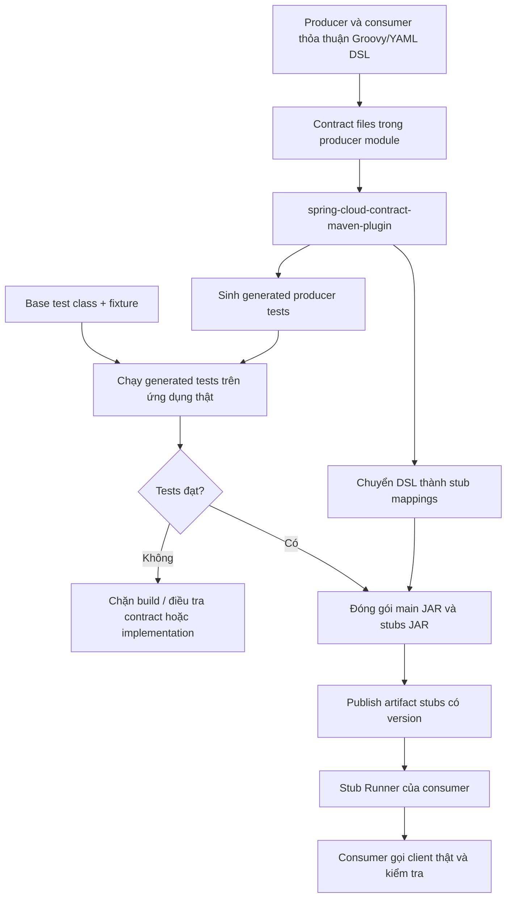
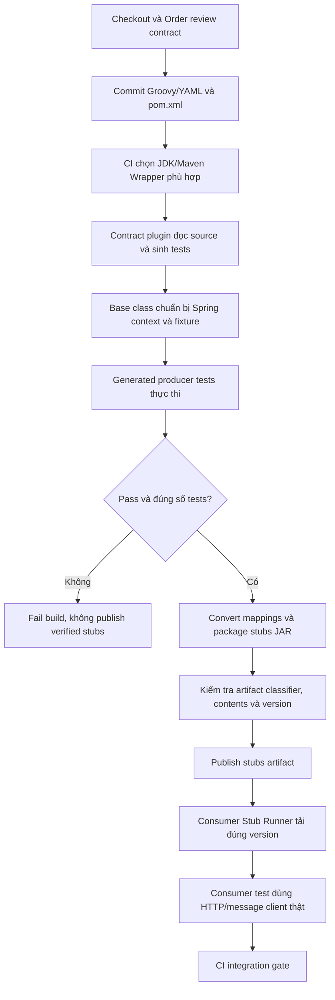

# Khai báo spring-cloud-contract-maven-plugin

**Spring Cloud Contract Maven Plugin** là thành phần nối **hợp đồng Groovy/YAML DSL** với vòng đời build của một producer sử dụng Maven. Sau khi nhóm producer và consumer thống nhất một API hoặc thông điệp, plugin có thể đọc contract, **sinh kiểm thử phía producer**, chuyển mô tả thành **stub mappings**, và đóng gói artifact có classifier `stubs` để consumer sử dụng thông qua **Stub Runner**.

Bài học thuộc chương **Tích hợp Maven** của lộ trình **SPRING_CLOUD_CONTRACT**. Trọng tâm là cách khai báo đúng `org.springframework.cloud:spring-cloud-contract-maven-plugin` trong `pom.xml`, lựa chọn phiên bản phù hợp, nối **base test class**, hiểu các Maven goals và xác minh generated tests **thực sự chạy** trước khi phát hành stub. Các ví dụ giả định producer là một ứng dụng **Spring Boot MVC** có tên `order-service` và consumer là `checkout-service`; với WebFlux, messaging hoặc một phiên bản Spring Cloud Contract khác, phải điều chỉnh test mode và hạ tầng tương ứng.

## 1. Plugin đứng ở đâu trong quy trình kiểm thử hợp đồng?

Trước khi cấu hình Maven, cần phân biệt các đối tượng:

| Thành phần | Ai tạo? | Mục đích |
|---|---|---|
| **Contract DSL** | Producer và consumer thỏa thuận | Định nghĩa request, response, matcher hoặc thông điệp |
| **Maven plugin** | Nhóm producer khai báo trong `pom.xml` | Chuyển contract thành generated tests và stubs |
| **Base test class** | Producer tự viết | Khởi tạo Spring context, HTTP client, fixture hoặc message adapter |
| **Generated producer tests** | Contract Verifier sinh | Kiểm tra implementation producer thật đáp ứng DSL |
| **Stubs JAR** | Plugin đóng gói | Cung cấp mappings/contracts cho Stub Runner |
| **Consumer integration tests** | Consumer tự viết | Gọi client thật qua Stub Runner để kiểm tra khả năng tương thích |

Luồng tổng quát:



**Cốt lõi:** Maven plugin là **công cụ generate và tích hợp build**. Nó không tự viết business implementation, không tự tạo dữ liệu database phù hợp với mọi contract, và không thay thế consumer tests. Nếu plugin sinh test mà test không được thực thi, build chưa chứng minh producer tuân thủ hợp đồng.

## 2. Những điều phải kiểm tra trước khi sửa `pom.xml`

Vì Spring Boot, Spring Cloud và Spring Cloud Contract phát hành theo các dòng phiên bản khác nhau, **không nên ghép ngẫu nhiên** plugin của bản mới với starter của bản cũ.

Trước khi khai báo:

1. Xác định **phiên bản JDK** đang được dự án và CI sử dụng.
2. Kiểm tra **Maven Wrapper** (`mvnw` và cấu hình wrapper có sẵn trong dự án).
3. Xác định **Spring Boot version** và dòng **Spring Cloud release train** tương thích.
4. Chọn **Spring Cloud Contract version** tương thích với bộ trên.
5. Kiểm tra producer là **Spring MVC**, **Spring WebFlux**, **JAX-RS**, hay ứng dụng dùng messaging.
6. Xác nhận source contracts được quản lý **trong module producer** hay tải từ artifact/repository ngoài.
7. Xác định project dùng **JUnit Jupiter/JUnit 5** hay một test framework khác.
8. Kiểm tra cách producer tạo và làm sạch **fixture** trước từng generated test.

Tham khảo phiên bản hiện hành từ tài liệu [Spring Cloud Contract](https://docs.spring.io/spring-cloud-contract/reference/), [Spring Cloud](https://spring.io/projects/spring-cloud) và [Spring Boot](https://docs.spring.io/spring-boot/system-requirements.html). **Các placeholder phiên bản dưới đây không phải artifact versions hợp lệ; phải thay bằng version cụ thể trước khi build.**

### 2.1. Maven Wrapper nên được ưu tiên

Lệnh trên Linux/macOS:

```bash
./mvnw -version
./mvnw clean verify
```

Trên Windows PowerShell:

```powershell
.\mvnw.cmd -version
.\mvnw.cmd clean verify
```

Wrapper giúp local và CI sử dụng Maven theo cấu hình dự án. `mvn -version` cũng hữu ích nhưng có thể trỏ tới một Maven installation khác. Phiên bản Java mà Maven **thực sự chạy** có thể khác `java -version` trên terminal nếu `JAVA_HOME` hoặc toolchain được cấu hình không đúng.

## 3. Khung `pom.xml` chứa Maven plugin

Mẫu đầy đủ về **vị trí khai báo** (dùng Spring MVC/JUnit 5 theo giả định của bài):

```xml
<project xmlns="http://maven.apache.org/POM/4.0.0"
         xmlns:xsi="http://www.w3.org/2001/XMLSchema-instance"
         xsi:schemaLocation="http://maven.apache.org/POM/4.0.0
             https://maven.apache.org/xsd/maven-4.0.0.xsd">

    <modelVersion>4.0.0</modelVersion>

    <parent>
        <groupId>org.springframework.boot</groupId>
        <artifactId>spring-boot-starter-parent</artifactId>
        <version>BOOT_VERSION_PHU_HOP</version>
        <relativePath/>
    </parent>

    <groupId>com.example</groupId>
    <artifactId>order-service</artifactId>
    <version>1.4.0-SNAPSHOT</version>

    <properties>
        <java.version>JAVA_VERSION_PHU_HOP</java.version>
        <spring-cloud-contract.version>CONTRACT_VERSION_PHU_HOP</spring-cloud-contract.version>
    </properties>

    <dependencyManagement>
        <dependencies>
            <dependency>
                <groupId>org.springframework.cloud</groupId>
                <artifactId>spring-cloud-contract-dependencies</artifactId>
                <version>${spring-cloud-contract.version}</version>
                <type>pom</type>
                <scope>import</scope>
            </dependency>
        </dependencies>
    </dependencyManagement>

    <dependencies>
        <dependency>
            <groupId>org.springframework.boot</groupId>
            <artifactId>spring-boot-starter-web</artifactId>
        </dependency>

        <dependency>
            <groupId>org.springframework.boot</groupId>
            <artifactId>spring-boot-starter-test</artifactId>
            <scope>test</scope>
        </dependency>

        <dependency>
            <groupId>org.springframework.cloud</groupId>
            <artifactId>spring-cloud-starter-contract-verifier</artifactId>
            <scope>test</scope>
        </dependency>
    </dependencies>

    <build>
        <plugins>
            <plugin>
                <groupId>org.springframework.cloud</groupId>
                <artifactId>spring-cloud-contract-maven-plugin</artifactId>
                <version>${spring-cloud-contract.version}</version>
                <extensions>true</extensions>
                <configuration>
                    <baseClassForTests>
                        com.example.order.contract.OrderContractTestBase
                    </baseClassForTests>
                    <testMode>MOCKMVC</testMode>
                </configuration>
            </plugin>

            <plugin>
                <groupId>org.springframework.boot</groupId>
                <artifactId>spring-boot-maven-plugin</artifactId>
            </plugin>
        </plugins>
    </build>
</project>
```

**Đây là mẫu học tập, không phải một POM đã kiểm chứng trên tất cả release trains.** Phải thay `BOOT_VERSION_PHU_HOP`, `JAVA_VERSION_PHU_HOP` và `CONTRACT_VERSION_PHU_HOP` bằng các version phù hợp. Ngoài ra, production project có thể cần Spring Cloud BOM, repository, security/data dependencies, plugin configuration hoặc test infrastructure khác. Không nên đưa các placeholders vào CI rồi kỳ vọng Maven tự chọn bản mới.

### 3.1. Vì sao có cả dependency và plugin?

| Khai báo | Vai trò | Chạy ở scope nào? |
|---|---|---|
| `spring-boot-starter-test` | JUnit/Spring Test và hạ tầng kiểm thử | `test` |
| `spring-cloud-starter-contract-verifier` | Công cụ/runtime cần cho producer contract verification | `test` |
| `spring-cloud-contract-dependencies` | BOM quản lý version của nhóm dependency Spring Cloud Contract | `dependencyManagement` |
| `spring-cloud-contract-maven-plugin` | Maven goals sinh tests, chuyển DSL và đóng gói stub | `build/plugins` |
| `spring-boot-maven-plugin` | Đóng gói hoặc chạy Spring Boot application tùy mục tiêu | `build/plugins` |

**BOM quản lý dependency versions, không thay thế cấu hình version của Maven plugin.** Một dependency có đúng version chưa đủ để Maven tự sinh contract tests: plugin phải được khai báo/áp dụng vào lifecycle của module producer.

### 3.2. `<extensions>true</extensions>` có vai trò gì?

Các hướng dẫn Spring Cloud Contract Maven chính thức thường sử dụng:

```xml
<extensions>true</extensions>
```

trong khai báo plugin để tích hợp khả năng của plugin vào Maven build lifecycle như mẫu được dự án/phiên bản hỗ trợ. Không xem thuộc tính này như một thay thế cho `baseClassForTests`, test dependencies, contracts directory hoặc generated test execution.

Nếu dự án đã có cấu hình plugin executions tường minh hoặc parent POM tùy biến, cần đối chiếu với tài liệu **đúng plugin version**; không thêm những executions trùng lặp chỉ để “chắc chắn”, vì có thể generate hai lần hoặc gây khác biệt giữa môi trường.

## 4. Vị trí `build/plugins` khác `pluginManagement`

Trong Maven, **`pluginManagement`** được dùng để quản lý phiên bản và cấu hình mặc định của plugin cho các module con; nó **không có cùng ý nghĩa với việc kích hoạt plugin trong `build/plugins`**.

Ví dụ parent POM quản lý version:

```xml
<build>
    <pluginManagement>
        <plugins>
            <plugin>
                <groupId>org.springframework.cloud</groupId>
                <artifactId>spring-cloud-contract-maven-plugin</artifactId>
                <version>${spring-cloud-contract.version}</version>
            </plugin>
        </plugins>
    </pluginManagement>
</build>
```

Nếu một module con muốn thực thi goals theo cấu hình/plugin lifecycle, nó cần thực sự sử dụng plugin — ví dụ:

```xml
<build>
    <plugins>
        <plugin>
            <groupId>org.springframework.cloud</groupId>
            <artifactId>spring-cloud-contract-maven-plugin</artifactId>
            <extensions>true</extensions>
            <configuration>
                <baseClassForTests>
                    com.example.order.contract.OrderContractTestBase
                </baseClassForTests>
            </configuration>
        </plugin>
    </plugins>
</build>
```

Trong trường hợp trên, version có thể được kế thừa từ parent `pluginManagement` đã được resolve. Cần kiểm tra **effective POM** để xác nhận Maven thực sự sử dụng phiên bản/cấu hình mong muốn.

**Sai lầm phổ biến:** khai báo plugin chỉ trong `pluginManagement` của parent rồi kết luận tất cả module producer đã generate contract tests. Khi generated test count bằng 0, hãy kiểm tra plugin có nằm trong `build/plugins` của effective producer module hay không.

## 5. Những tham số cấu hình quan trọng

Plugin có nhiều tham số. Với một module producer đơn giản, thường bắt đầu bằng:

```xml
<configuration>
    <contractsDirectory>
        ${project.basedir}/src/test/resources/contracts
    </contractsDirectory>
    <baseClassForTests>
        com.example.order.contract.OrderContractTestBase
    </baseClassForTests>
    <testMode>MOCKMVC</testMode>
    <testFramework>JUNIT5</testFramework>
</configuration>
```

Một số tham số ở đây đã có **giá trị mặc định tương ứng ở những phiên bản** và có thể được bỏ đi cho cấu hình gọn; ví dụ `contractsDirectory` thường mặc định ở `src/test/resources/contracts` và `testMode` mặc định `MOCKMVC` trong tài liệu plugin 4.x. Nhưng tên enum, default và khả năng hỗ trợ phải được xác nhận theo **version thực tế**.

| Tham số | Công dụng | Điều cần kiểm tra |
|---|---|---|
| `contractsDirectory` | Thư mục chứa Groovy/YAML contracts | Đường dẫn trong module producer đúng chưa? |
| `baseClassForTests` | Fully qualified name của test base class | Package, tên class, test classpath đúng chưa? |
| `testMode` | Chọn adapter/mode cho generated HTTP tests | `MOCKMVC`, `EXPLICIT`, `WEBTESTCLIENT`… có được bản đang dùng hỗ trợ? |
| `testFramework` | Chọn framework test sinh ra | `JUNIT5` hay Spock/JUnit khác theo plugin version |
| `basePackageForTests` | Package chứa generated tests | Có va chạm class/package hoặc thiếu visibility không? |
| `baseClassMappings` | Map các nhóm contracts tới base classes khác nhau | Regex và FQN mapping có khớp không? |
| `packageWithBaseClasses` | Quy tắc suy base class theo package/tên folder | Dùng khi cần tách setup theo loại hợp đồng |
| `contractDependency` | Nguồn contracts được đóng gói thành artifact ngoài | Chỉ dùng khi dự án lưu contracts bên ngoài |
| `contractsPath` | Đường dẫn contract trong một artifact ngoài | Đúng package/layout được publish chưa? |
| `failOnNoContracts` | Cách xử lý khi không phát hiện contract | CI nên fail khi kỳ vọng có contracts |
| `skip`/các flag skip | Bỏ qua một phần plugin/test execution | Tránh dùng trong verified release pipeline |

**Không cấu hình đồng thời mọi tham số** nếu không có nhu cầu. Một POM đơn giản, có generated tests rõ ràng và test report đầy đủ thường dễ bảo trì hơn một POM phức tạp với nhiều override chưa được kiểm chứng.

## 6. Nguồn hợp đồng: `src/test/resources/contracts`

Trong một producer module, cấu trúc thường gặp:

```text
order-service/
├── pom.xml
├── src/
│   ├── main/java/com/example/order/
│   │   ├── OrderServiceApplication.java
│   │   └── OrderController.java
│   └── test/
│       ├── java/com/example/order/contract/
│       │   ├── OrderContractTestBase.java
│       │   └── OrderContractFixtures.java
│       └── resources/contracts/
│           └── checkout/
│               ├── get_paid_order_200.groovy
│               └── get_missing_order_404.yml
└── target/                  # Sinh bởi Maven sau build
```

Mỗi contract nên mô tả một kịch bản rõ ràng. Ví dụ `GET /api/orders/ORDER-42` trả `200` và `GET /api/orders/ORDER-MISSING` trả `404` là hai kịch bản khác biệt.

**Thư mục con** có thể ảnh hưởng cách plugin sinh package/class test và cách plugin tổ chức mappings. Không được suy ra từ tên folder rằng Maven tự biết consumer thực tế: cần kiểm tra quy tắc plugin và mapping output.

### 6.1. Contract Groovy DSL mẫu

```groovy
import org.springframework.cloud.contract.spec.Contract

Contract.make {
    name 'checkout_get_paid_order_200'
    description 'Checkout đọc một đơn đã thanh toán'

    request {
        method GET()
        url '/api/orders/ORDER-42'
        headers {
            header 'Accept', 'application/json'
        }
    }

    response {
        status OK()
        headers {
            contentType(applicationJson())
        }
        body(
            id: 'ORDER-42',
            status: 'PAID',
            totalAmount: 125000
        )
    }
}
```

### 6.2. Contract YAML DSL cho lỗi `404`

```yaml
name: checkout_get_missing_order_404
description: Đơn hàng không tồn tại
request:
  method: GET
  url: /api/orders/ORDER-MISSING
  headers:
    Accept: application/json
response:
  status: 404
  headers:
    Content-Type: application/json
  body:
    code: ORDER_NOT_FOUND
```

YAML ở đây mô tả **kịch bản khác** với Groovy `200`, không phải bản sao. Nếu dự án viết cùng request/response một lần bằng Groovy và một lần bằng YAML, plugin có thể tạo generated tests/stubs trùng hoặc tạo tên va chạm. Chỉ giữ một nguồn cho mỗi hợp đồng, trừ khi thiết kế có lý do riêng.

### 6.3. Dữ liệu trong contract không tự xuất hiện trong database

Nếu `ORDER-42` không có trong database test, generated test có thể nhận `404` thay vì `200` dù plugin đã được cấu hình chính xác. Vì vậy plugin đúng **chưa đồng nghĩa môi trường verification đúng**. Producer cần fixture seed hoặc mock dependency có chủ đích.

## 7. Khai báo `baseClassForTests` và base class thực tế

`baseClassForTests` chỉ ra **FQN** (*fully qualified name*) của lớp mà generated producer tests sẽ kế thừa.

Ví dụ:

```xml
<baseClassForTests>
    com.example.order.contract.OrderContractTestBase
</baseClassForTests>
```

Một base class dành cho **Spring MVC + MockMvc**:

```java
package com.example.order.contract;

import io.restassured.module.mockmvc.RestAssuredMockMvc;
import org.junit.jupiter.api.BeforeEach;
import org.springframework.beans.factory.annotation.Autowired;
import org.springframework.boot.test.autoconfigure.web.servlet.AutoConfigureMockMvc;
import org.springframework.boot.test.context.SpringBootTest;
import org.springframework.test.web.servlet.MockMvc;

@SpringBootTest
@AutoConfigureMockMvc
public abstract class OrderContractTestBase {

    @Autowired
    MockMvc mockMvc;

    @Autowired
    OrderContractFixtures fixtures;

    @BeforeEach
    protected void setUpContractVerification() {
        fixtures.resetOrderContractData();
        fixtures.insertPaidOrder("ORDER-42", 125000);
        fixtures.ensureOrderAbsent("ORDER-MISSING");

        RestAssuredMockMvc.mockMvc(mockMvc);
    }
}
```

Đây là **mẫu tổ chức base class**, không phải một class độc lập có thể biên dịch mà không cần ứng dụng Order Service và `OrderContractFixtures`. Fixture helper do dự án tự viết, cần triển khai trên database test riêng, không đụng dữ liệu production.

### 7.1. Ý nghĩa của từng phần

- `@SpringBootTest`: nạp ứng dụng Spring Boot cho producer verification.
- `@AutoConfigureMockMvc`: chuẩn bị MockMvc cho ứng dụng Spring MVC.
- `@BeforeEach`: chuẩn bị trạng thái trước mỗi generated test với JUnit Jupiter.
- `RestAssuredMockMvc.mockMvc(mockMvc)`: gắn MockMvc cho adapter mà generated tests sử dụng khi test mode tương ứng.
- `fixtures.reset...`: bảo đảm mỗi test không phụ thuộc dữ liệu còn lại từ test trước.

**Phải kiểm tra mã generated test thực tế.** Nếu plugin đang sinh RestAssured gọi server thật, không thể chỉ cung cấp RestAssuredMockMvc rồi kỳ vọng mọi request chạy. Nếu dùng WebFlux-only app, MockMvc không phải adapter đúng mặc định.

### 7.2. Test mode phải tương thích với base class

| Test mode | Định hướng | Base test cần gì |
|---|---|---|
| `MOCKMVC` | Test HTTP qua Spring MVC infrastructure | MockMvc, adapter và Spring MVC test context |
| `EXPLICIT` | Gọi HTTP thực đến server chạy trong test | Random port, base URI/client setup |
| `WEBTESTCLIENT` | WebTestClient cho WebFlux khi phiên bản hỗ trợ | Reactive application/test context và WebTestClient phù hợp |
| `JAXRSCLIENT` | Client mode cho JAX-RS khi phiên bản hỗ trợ | JAX-RS test infrastructure tương ứng |

Những tên trên xuất hiện trong tài liệu nhiều dòng Spring Cloud Contract, nhưng **không nên giả định mọi plugin version đều có đủ hoặc có cùng API**. Đọc generated source sau generate để biết mode nào đã thực sự được áp dụng.

### 7.3. Khi nào cần nhiều base classes?

Ví dụ producer có hai loại hợp đồng:

```text
contracts/
├── http/
│   └── get_order.groovy
└── messaging/
    └── order_paid.groovy
```

HTTP tests cần MockMvc hoặc server; message tests cần message verifier, broker/binder test và hook `triggeredBy(...)`. Nếu không muốn một **God base class**, có thể dùng `baseClassMappings` hoặc `packageWithBaseClasses` theo cơ chế được phiên bản hỗ trợ.

Ví dụ cấu hình mapping:

```xml
<configuration>
    <baseClassForTests>com.example.order.contract.DefaultContractBase</baseClassForTests>
    <baseClassMappings>
        <baseClassMapping>
            <contractPackageRegex>.*http.*</contractPackageRegex>
            <baseClassFQN>com.example.order.contract.HttpContractBase</baseClassFQN>
        </baseClassMapping>
        <baseClassMapping>
            <contractPackageRegex>.*messaging.*</contractPackageRegex>
            <baseClassFQN>com.example.order.contract.MessageContractBase</baseClassFQN>
        </baseClassMapping>
    </baseClassMappings>
</configuration>
```

Đây là **mẫu cấu trúc** theo cú pháp Maven plugin có hỗ trợ `baseClassMappings`; regex cần được thiết kế đúng với **package thực tế của contracts**, và các base classes phải có trên test classpath. Sau khi sinh, mở từng generated test để xác minh mapping đúng, thay vì suy từ folder.

## 8. Maven goals của Spring Cloud Contract Plugin

Để debug cấu hình Maven, cần biết plugin thường có những goals sau:

| Goal | Công việc chính | Kết quả kỳ vọng |
|---|---|---|
| `generateTests` | Sinh producer tests từ contracts | Generated Java/Groovy tests |
| `convert` | Chuyển DSL sang stub mapping (ví dụ WireMock JSON) | Generated mappings |
| `generateStubs` | Đóng gói mappings/contracts thành stubs JAR | Artifact `-stubs.jar`, thường classifier `stubs` |
| `run` | Chạy HTTP stubs từ thư mục hoặc artifact được cấu hình | Stub server phục vụ mappings |
| `pushStubsToScm` | Đẩy stubs sang SCM theo cấu hình | Dành cho quy trình lưu trữ Git được cấu hình |
| `help` | Hiển thị thông tin plugin parameters/goals | Dùng để kiểm tra version cụ thể |

Theo tài liệu các dòng plugin, `generateTests` có thể được gắn vào **`generate-test-sources`**, `convert` chạy trước tạo stubs, và `generateStubs` thường nằm ở hoặc gần pha `package`. **Lifecycle binding cụ thể phải kiểm tra theo plugin version và effective POM**; không tự gắn trùng goals nếu plugin đã có execution mặc định.

### 8.1. Các lệnh chẩn đoán Maven thường dùng

```bash
# Xác nhận Maven và JDK
./mvnw -version

# Kiểm tra POM thực sự hiệu lực sau kế thừa/profile
./mvnw help:effective-pom

# Sinh tests bằng goal đầy đủ khi cần điều tra
./mvnw org.springframework.cloud:spring-cloud-contract-maven-plugin:generateTests

# Chạy các pha test và đóng gói theo lifecycle
./mvnw clean test
./mvnw clean verify

# Cài artifacts của producer vào Maven local repository
./mvnw clean install
```

Lệnh dùng plugin goal trực tiếp có thể phụ thuộc plugin dependencies, cấu hình contracts và các goals cần chạy trước; **chạy goal riêng không thay thế quy trình `clean verify`**. Plugin có `help` để xem thông số hỗ trợ trong đúng bản đã được khai báo.

### 8.2. Khi nào dùng `test`, `verify` và `install`?

| Lệnh | Mục tiêu | Điều cần quan sát |
|---|---|---|
| `./mvnw clean test` | Chạy unit/generated tests qua test phase | Có contract tests trong report không? |
| `./mvnw clean package` | Đóng gói artifacts theo cấu hình | Có main JAR và stubs classifier JAR không? |
| `./mvnw clean verify` | Thực thi lifecycle đến verify | Các tests/checks mà build định nghĩa có đạt? |
| `./mvnw clean install` | Chạy lifecycle đến install và lưu vào Maven local | Stubs classifier đúng version có thể resolve được? |

Đây là các **cách chạy thay thế nhau tùy mục tiêu**, không phải bốn câu lệnh bắt buộc cần chạy liên tiếp. Ví dụ `clean install` đã đi qua phần lớn các pha trước; không cần chạy `clean test` rồi `clean verify` rồi `clean install` trong mọi job chỉ vì ba lệnh đều được liệt kê.

### 8.3. Không nhầm Maven plugin prefix với groupId

Cú pháp đầy đủ:

```bash
./mvnw org.springframework.cloud:spring-cloud-contract-maven-plugin:generateTests
```

giúp tránh phụ thuộc Maven có resolve được prefix `spring-cloud-contract` hay chưa. Cú pháp ngắn:

```bash
./mvnw spring-cloud-contract:generateTests
```

có thể yêu cầu cấu hình plugin group hoặc Maven đã nhận diện plugin theo project metadata. Nếu prefix lookup báo lỗi, dùng định danh groupId/artifactId đầy đủ để điều tra trước khi kết luận plugin không tồn tại.

## 9. Generated tests được đặt ở đâu?

Trong các dòng Maven plugin phổ biến, generated producer tests có thể nằm dưới:

```text
target/
└── generated-test-sources/
    └── contracts/
        └── ...
```

Đường dẫn có thể thay đổi theo version/configuration. Nếu test đã được sinh nhưng IDE không hiển thị, điều đó chưa có nghĩa plugin sai; phải xác nhận Maven **đã đưa generated test source root vào test compilation** và Surefire đang chạy tests ấy.

Một generated test có thể có dạng minh họa:

```java
// Minh họa kiến trúc, không phải file generated chính xác.
public class CheckoutGetPaidOrderTest
        extends OrderContractTestBase {

    @Test
    void checkoutGetPaidOrder200() {
        // Gửi GET /api/orders/ORDER-42 vào implementation.
        // Assert HTTP 200 và các trường JSON theo contract.
    }
}
```

**Không sửa mã được sinh thủ công.** Nó sẽ bị thay thế ở lần generate sau. Nếu base class sai hoặc assertions sai, cần sửa **`pom.xml`, contract DSL, base test hoặc implementation**, rồi generate lại.

### 9.1. Kiểm tra Maven Surefire chạy generated tests

Sau `./mvnw clean test` hoặc `clean verify`, thường có test reports dưới:

```text
target/
└── surefire-reports/
    ├── ...
    └── TEST-*.xml
```

Cần kiểm tra:

- Có generated test classes tương ứng các contracts không?
- Mỗi generated test có thực sự chạy hay bị skip?
- Số tests có khớp kỳ vọng từ contracts không?
- Có test report bị thiếu vì tên class không khớp conventions của Surefire?
- JUnit Jupiter/JUnit 5 engine và dependencies có phù hợp không?
- Build có bật profile/surefire excludes khiến generated tests không được chọn?
- Có vô tình cấu hình `failIfNoTests=false` rồi che việc không có tests không?

**Build xanh với `Tests run: 0` không phải bằng chứng producer đã đáp ứng hợp đồng.**

### 9.2. `skipTests`, `maven.test.skip` và skip plugin

Các flags dễ gây nhầm:

- `-DskipTests`: thường bỏ qua **chạy** tests trong Surefire/Failsafe nhưng vẫn có thể compile test sources.
- `-Dmaven.test.skip=true`: thường bỏ qua cả test compilation/execution tùy plugin.
- Các `skip` flags của Spring Cloud Contract plugin: có thể bỏ qua **generation/conversion** theo tham số và version.
- Maven profiles có thể thay đổi plugin executions/test filters.

Vì vậy, **sinh được stubs JAR không chứng minh producer verification đã chạy**. CI cần kiểm tra test reports, số lượng generated tests, và trạng thái cuối của cả những bước cần thiết.

## 10. Generated stubs và classifier `stubs`

Sau khi chuyển contract thành mappings và đóng gói, producer thường có hai artifacts:

```text
target/
├── order-service-1.4.0-SNAPSHOT.jar
└── order-service-1.4.0-SNAPSHOT-stubs.jar
```

- **Main JAR** chứa ứng dụng Spring Boot hoặc library code.
- **Stubs JAR** chứa contracts/mappings để Stub Runner dùng.
- Hai artifacts thường có cùng `groupId`, `artifactId`, `version` nhưng khác **classifier**.

Một layout minh họa:

```text
order-service-1.4.0-SNAPSHOT-stubs.jar
└── META-INF/
    └── com.example/
        └── order-service/
            └── 1.4.0-SNAPSHOT/
                ├── contracts/
                │   └── checkout/
                │       ├── get_paid_order_200.groovy
                │       └── get_missing_order_404.yml
                └── mappings/
                    └── checkout/
                        ├── checkout_get_paid_order_200.json
                        └── checkout_get_missing_order_404.json
```

Đây là **sơ đồ**, không bảo đảm đường dẫn byte-for-byte theo mọi Spring Cloud Contract version. Hãy **mở JAR thật** để xem nội dung.

### 10.1. Kiểm tra bằng công cụ `jar` của JDK

```bash
jar tf target/order-service-1.4.0-SNAPSHOT-stubs.jar
jar tf target/order-service-1.4.0-SNAPSHOT.jar
```

Kỳ vọng stubs JAR chứa các contracts/mappings tương ứng. **Đổi tên main JAR thành `-stubs.jar` không tạo ra stub mappings.**

Sau Maven `install`, hai artifacts có thể được cài vào local Maven repository:

```text
~/.m2/repository/com/example/order-service/1.4.0-SNAPSHOT/
├── order-service-1.4.0-SNAPSHOT.pom
├── order-service-1.4.0-SNAPSHOT.jar
└── order-service-1.4.0-SNAPSHOT-stubs.jar
```

Vị trí local repository có thể thay đổi theo `settings.xml` hoặc CI configuration.

## 11. Consumer dùng stubs JAR qua Stub Runner

Sau khi producer verification đạt và stubs artifact đã được cài/phát hành, consumer Checkout có thể dùng:

```java
import org.springframework.boot.test.context.SpringBootTest;
import org.springframework.cloud.contract.stubrunner.spring.AutoConfigureStubRunner;
import org.springframework.cloud.contract.stubrunner.spring.StubRunnerProperties;

@SpringBootTest(
    properties = "clients.order.base-url=http://localhost:8085"
)
@AutoConfigureStubRunner(
    ids = "com.example:order-service:1.4.0-SNAPSHOT:stubs:8085",
    stubsMode = StubRunnerProperties.StubsMode.LOCAL
)
class CheckoutOrderClientContractTest {
    // Inject OrderClient thật của Checkout và thêm @Test.
    // Gọi getOrder("ORDER-42") rồi assert dữ liệu parse đúng.
}
```

Đây là **mẫu cấu hình consumer test**, không phải một test class hoàn chỉnh. `clients.order.base-url` là property do ứng dụng Checkout định nghĩa, không phải property mà Spring Cloud Contract tự hiểu.

`LOCAL` nghĩa là Stub Runner thường resolve artifact từ Maven local repository. Với `REMOTE`, cần repository URL và credentials được cấu hình đúng, artifact phải được publish. Không trộn `LOCAL` và `REMOTE` trong cùng mô tả test mà không rõ nguồn artifact.

**`ids` của Stub Runner không phải Maven dependency XML.** Trong ví dụ, trường cuối `8085` là **HTTP stub port**, không thuộc Maven coordinates của stubs artifact.

### 11.1. Vì sao Maven plugin phải ở producer?

Plugin sinh tests và stubs từ các contract **mà producer có trách nhiệm đáp ứng**. Consumer chủ yếu cần **Stub Runner dependency** và artifact stubs đã publish. Thêm plugin generate producer tests vào `pom.xml` của Checkout chỉ vì Checkout muốn chạy stub không phải thiết lập mặc định phù hợp.

Trong hệ thống có contracts được lưu ở Git/repository ngoài, producer vẫn phải **verify implementation**; việc ai sở hữu nơi lưu contracts có thể thay đổi, nhưng trách nhiệm producer verification không thay đổi.

## 12. Maven multi-module: plugin nên nằm ở đâu?

Giả sử dự án:

```text
commerce-platform/
├── pom.xml                    # Parent/aggregator
├── order-service/
│   ├── pom.xml                # Producer
│   └── src/test/resources/contracts/
├── checkout-service/
│   └── pom.xml                # Consumer
└── common-model/
    └── pom.xml
```

Một phương án hợp lý:

- **Parent POM:** quản lý version Spring Cloud Contract plugin/BOM khi cần.
- **`order-service/pom.xml`:** bật plugin trong `build/plugins`, cấu hình base class và source contracts.
- **`checkout-service/pom.xml`:** dependency Stub Runner cho consumer integration tests, dùng stub artifact Order Service.
- **`common-model`:** chỉ dùng phụ thuộc phù hợp; không tự bật Contract Verifier nếu không có contract producer cần verify.

Nếu plugin được đặt trong parent `build/plugins` và kế thừa toàn bộ modules, module không có contracts có thể bị xử lý ngoài ý muốn. Nên cân nhắc `pluginManagement` ở parent và kích hoạt plugin **chỉ tại producer modules**.

### 12.1. `contractsDirectory` trong module con

Tương đối với module:

```xml
<contractsDirectory>
    ${project.basedir}/src/test/resources/contracts
</contractsDirectory>
```

`${project.basedir}` ở một Maven module thường chỉ **thư mục của module đó**, không nhất thiết là root aggregator. Nếu contracts nằm ở một module khác hoặc nguồn ngoài, cấu hình phải thay đổi có chủ đích.

**Không dùng hard-coded absolute path của máy developer** trong POM, vì CI runner có thể có workspace khác.

### 12.2. Chạy riêng producer module

Trong Maven reactor multi-module, có thể chọn module bằng `-pl` và kéo dependencies cần thiết bằng `-am`:

```bash
./mvnw -pl order-service -am clean verify
```

Lệnh chỉ mang tính minh họa cho **một reactor đã được cấu hình**, không đảm bảo project nào cũng có module tên `order-service`. Sau khi chạy, xác nhận generated contract tests và report **của đúng producer module**, không chỉ nhìn kết quả aggregator.

## 13. Hợp đồng thông điệp với Maven plugin

Spring Cloud Contract cũng hỗ trợ **message contracts**. Ví dụ Order Service phát `ORDER_PAID` khi nghiệp vụ hoàn tất:

```groovy
import org.springframework.cloud.contract.spec.Contract

Contract.make {
    name 'billing_order_paid_event_v1'
    label 'billing_order_paid_v1'

    input {
        triggeredBy('publishOrderPaid()')
    }

    outputMessage {
        sentTo('orders.events')
        body(
            eventType: 'ORDER_PAID',
            orderId: 'ORDER-42',
            totalAmount: 125000
        )
    }
}
```

Plugin có thể sinh producer message test nhưng **base class và test dependencies phải có message verifier/binder** phù hợp Spring Cloud Stream/Spring Integration hoặc broker được hỗ trợ. Hook `publishOrderPaid()` phải kích hoạt **nghiệp vụ thật**, không chỉ dựng một message giả để test xanh.

Nếu cùng module có cả HTTP và message contracts, cân nhắc mapping đến **hai base classes** hoặc một shared fixture abstraction phù hợp. Việc đặt `<testMode>MOCKMVC</testMode>` không tự cấu hình Kafka/RabbitMQ. Cần kiểm tra mã sinh và transport của message tests riêng.

Stub Runner phía Billing có thể sử dụng message labels như `billing_order_paid_v1` nếu artifact và messaging integration phiên bản đó hỗ trợ; nó không có nghĩa chạy implementation Order Service khi consumer kích hoạt label.

## 14. Tùy chọn nâng cao: nơi lưu contracts bên ngoài

Một số tổ chức không đặt contracts trong cùng Git repository với producer mà giữ ở **contracts artifact**, Maven repository hoặc Git. Spring Cloud Contract Maven plugin có các tùy chọn liên quan như:

- `contractDependency` — nhận contract definitions từ artifact.
- `contractsPath` — xác định phần đường dẫn trong artifact cần đọc.
- `contractsMode` — chế độ tra cứu contract artifacts.
- `contractsRepositoryUrl` — nơi resolve contracts, tùy giao thức được hỗ trợ.
- `contractsRepositoryUsername`/`Password` — thông tin xác thực repository theo cách cấu hình an toàn.

Không nên đưa toàn bộ các tùy chọn này vào POM của bài học đầu tiên nếu contracts đã nằm ở `src/test/resources/contracts`.

### 14.1. Mẫu khái niệm tải contract dependency

```xml
<configuration>
    <baseClassForTests>
        com.example.order.contract.OrderContractTestBase
    </baseClassForTests>
    <contractDependency>
        <groupId>com.example.contracts</groupId>
        <artifactId>order-contracts</artifactId>
        <version>CONTRACT_ARTIFACT_VERSION_PHU_HOP</version>
    </contractDependency>
    <contractsPath>com/example/order-service</contractsPath>
</configuration>
```

**Đây là khung hướng dẫn**, không phải lời khẳng định plugin sẽ tìm được contract nếu artifact repository/layout chưa được chuẩn bị. `contractsPath` phải khớp đúng vị trí contracts trong artifact; cơ chế tải/phân giải cần được đối chiếu với phiên bản Maven plugin.

Với Git contract repositories, có thể cần một URL/cấu hình khác hoặc quy trình push stubs riêng. **Không để password/token repository trong `pom.xml` đã commit**; sử dụng Maven settings và CI secret injection phù hợp.

## 15. CI: từ `pom.xml` đến artifact đã xác minh

Một pipeline phù hợp:



**Gating bắt buộc** nên có:

1. Maven/JDK/Spring Cloud Contract version được ghim và tương thích.
2. Plugin hiện diện trong **effective POM của producer module**.
3. Contracts được quét đúng đường dẫn và không rỗng ngoài ý định.
4. Generated tests tồn tại, có đúng base class/test mode.
5. Generated tests **thực sự được Surefire/Failsafe thực thi**, không bị skip.
6. Fixture dùng database/broker test riêng, tests có thể chạy lặp lại.
7. Test reports được lưu để truy vết thất bại.
8. Stubs JAR có classifier `stubs` và mappings/contracts mong đợi.
9. Stubs artifact được gắn với build/commit của producer đã verification.
10. Consumer dùng Stub Runner resolve **đúng version**, không lấy ngẫu nhiên bản `latest`.
11. Consumer integration tests dùng client/handler thật.
12. Secrets không xuất hiện trong contract fixtures, Maven logs hoặc stubs artifact.

**Một artifact `-stubs.jar` có thể được tạo ra ngay cả khi pipeline vô tình bỏ qua producer tests.** Release gate phải nhìn **bằng chứng thực thi tests**, không chỉ kiểm tra file tồn tại.

### 15.1. Pipeline Maven tối thiểu ở mức ý tưởng

```bash
# Trong module producer đã cấu hình dependency/plugin:
./mvnw -version
./mvnw clean verify

# Chỉ nếu verification đạt và cần cài local:
./mvnw install

# Xem stubs archive đúng version/module:
jar tf target/order-service-1.4.0-SNAPSHOT-stubs.jar
```

CI thực tế có thể chạy `clean install` một lần thay vì lặp các pha, hoặc deploy/publish vào repository được phép. **Không tự chèn `skipTests` để build nhanh rồi đánh dấu verified.**

## 16. Cách chẩn đoán Maven plugin theo từng lớp

| Hiện tượng | Nguyên nhân nghi ngờ | Hướng điều tra |
|---|---|---|
| `Plugin not found` | Sai groupId/artifactId/version hoặc repository/plugin mirror | Kiểm tra coordinates, Maven settings và internet/repo |
| `Could not resolve plugin` | Version không tồn tại, credentials/TLS/proxy | Kiểm tra repository và effective POM |
| `No contracts found` | `contractsDirectory` sai, folder/file extension chưa được nhận | Xem module path, build logs, nguồn DSL |
| Build xanh nhưng không có generated tests | Plugin chưa được kích hoạt hoặc goals chưa chạy | `build/plugins`, goal binding, logs |
| Generated tests không compile | Sai base class FQN hoặc thiếu test dependencies | Test classpath, generated imports, JUnit version |
| `cannot find symbol: OrderContractTestBase` | Package/class không khớp `baseClassForTests` | Kiểm tra đúng FQN, module và source set |
| Generated tests dùng sai adapter | `testMode` không khớp MVC/WebFlux/server | Đọc generated code; điều chỉnh plugin/base |
| `MockMvc` không được inject | Spring TestContext/annotation/dependency sai | Kiểm tra `@SpringBootTest` và `@AutoConfigureMockMvc` |
| `200` thành `404` | Fixture thiếu `ORDER-42` hoặc request sai | Seed DB, path/query/header |
| `401/403` bất ngờ | Security/test token/filter setup | Kiểm tra base test security config |
| Generated tests bị skip | Surefire filters/profile hoặc `-DskipTests` | Xem report, effective POM, Maven arguments |
| Main JAR có nhưng không có `-stubs.jar` | `generateStubs`/`convert` không chạy hoặc attach lỗi | Plugin goals, logs, JAR output |
| Stubs JAR có nhưng không có mappings | Contracts không được convert hoặc path sai | Kiểm tra generated mappings trước package |
| Stub Runner không resolve artifact | Classifier/version/repository sai | Kiểm tra local/remote Maven repository |
| Consumer stub trả `404` | Request unmatched hoặc mapping không được nạp | Đối chiếu WireMock mappings, method/path/header |
| Chỉ CI fail | JDK/Maven khác, fixture race, repository chậm | Ghim toolchain, cô lập state, retry hạ tầng có chẩn đoán |
| Multi-module module khác cũng chạy plugin | Plugin bị bật ở parent thay vì producer module | `pluginManagement`/`plugins` kế thừa |
| Plugin/version Boot không tương thích | Ghép BOM/Boot/Contract không đúng | Ma trận compatibility chính thức |

### 16.1. Quy trình debug có thứ tự

1. **Toolchain:** kiểm tra Maven Wrapper và JDK.
2. **Effective POM:** plugin version/configuration thực sự của module.
3. **Contract source:** đúng `contractsDirectory`, YAML/Groovy được nhận diện.
4. **Generate:** có generated tests và mappings ở target directories không?
5. **Base class:** generated tests kế thừa đúng FQN và dùng adapter đúng test mode?
6. **Test execution:** Surefire/Failsafe có chạy và report đúng số cases?
7. **Implementation/fixture:** HTTP/message response thực có đúng hợp đồng?
8. **Package:** có stubs classifier và mappings đúng?
9. **Repository:** stubs artifact đã install/publish đúng tọa độ chưa?
10. **Consumer:** Stub Runner tải đúng version, client thật gọi đúng stub?

**Không sửa `pom.xml` hoặc generated code theo suy đoán một cách đồng loạt.** Đi qua pipeline theo thứ tự sẽ biết lỗi nằm ở plugin activation, generation, test execution, packaging hay consumer side.

## 17. Những sai lầm phổ biến

**“Đã thêm `spring-cloud-starter-contract-verifier` là Maven tự sinh tests.”** Chưa. Dependency không thay thế plugin lifecycle configuration.

**“Có plugin trong `pluginManagement` là module đã dùng plugin.”** Không mặc định. Cần plugin được kích hoạt trong `build/plugins`/effective producer module.

**“`baseClassForTests` nhận tên file Java thay vì FQN.”** Không. Cần tên class đầy đủ gồm package, ví dụ `com.example.order.contract.OrderContractTestBase`.

**“Generated test thiếu bean thì sửa file dưới `target`.”** Không. Mã sinh sẽ bị thay thế; phải sửa base class, test config hoặc plugin.

**“`MOCKMVC` hoạt động cho mọi WebFlux producer.”** Không nên giả định. Test mode phải phù hợp stack và plugin version.

**“Chạy `generateTests` đồng nghĩa đã xác minh producer.”** Không. Goal sinh mã; JUnit tests phải được thực thi.

**“Thấy `BUILD SUCCESS` thì chắc contract tests đã chạy.”** Không nếu có `skipTests`, không có contracts hoặc Surefire không chọn test.

**“Có stubs JAR thì implementation chắc đúng.”** Không. Stub có thể được generate mà verification bị skip hoặc fail gate không được cấu hình.

**“Chỉ cần thêm `<plugin>` vào parent POM thì các module đều nên generate contract.”** Không. Hãy xác định module producer nào thực sự cần plugin.

**“Version dependency được BOM quản lý thì plugin version cũng tự được quản lý.”** Không nhất thiết. Plugin version cần được khai báo hoặc quản lý qua `pluginManagement`.

**“`LOCAL` Stub Runner tự tìm main JAR và chuyển thành stubs.”** Không. Cần classifier `stubs` được install đúng repository.

**“Có cùng HTTP status `404` là chắc request khớp hợp đồng lỗi.”** Không. WireMock cũng có unmatched `404`; cần assert body/code.

**“Nên dùng `maven.test.skip=true` trên CI để có stubs nhanh.”** Không nếu mục tiêu là phát hành **verified stubs**; việc đó làm mất bằng chứng producer verification.

## 18. Bài thực hành: khai báo plugin cho Order Service

Mục tiêu: từ producer Spring Boot MVC, sinh tests cho `GET /api/orders`, chạy verification và đóng gói stubs dùng được bởi Checkout.

### Phần A — chuẩn bị Maven

1. Xác định Spring Boot/Cloud/Contract versions tương thích theo tài liệu.
2. Kiểm tra `./mvnw -version` trả JDK và Maven dự kiến.
3. Thêm `spring-cloud-contract-dependencies` BOM khi phù hợp với cách quản lý dependencies của dự án.
4. Thêm `spring-cloud-starter-contract-verifier` với `scope=test`.
5. Thêm Maven plugin vào **`build/plugins`** và khai báo version rõ.

### Phần B — cấu hình plugin

1. Đặt `baseClassForTests` là `com.example.order.contract.OrderContractTestBase`.
2. Với producer Spring MVC, chọn `testMode=MOCKMVC` hoặc dùng default tương ứng đã xác minh.
3. Chỉ rõ `contractsDirectory` nếu khác mặc định.
4. Không thêm `baseClassMappings` nếu chỉ có một base class.
5. Chạy `help:effective-pom` để kiểm tra cấu hình được Maven áp dụng.

### Phần C — viết contract và base test

1. Tạo Groovy contract `checkout_get_paid_order_200`.
2. Tạo YAML contract `checkout_get_missing_order_404`.
3. Tạo `OrderContractTestBase` có Spring context, MockMvc/RestAssuredMockMvc.
4. Seed `ORDER-42` với `status=PAID` và `totalAmount=125000`.
5. Bảo đảm `ORDER-MISSING` không tồn tại.
6. Chạy từng generated test riêng và cả suite để bảo đảm isolation.

### Phần D — sinh, kiểm tra và thử làm lỗi

1. Chạy `./mvnw clean test`.
2. Xác minh generated source có tests và kế thừa đúng base class.
3. Mở `target/surefire-reports` để xác minh tests **thực sự chạy**.
4. Cố ý đổi `status=PAID` thành `CANCELLED` trong response thật; generated test phải fail nếu assertion bảo vệ trường đó.
5. Khôi phục code và chạy lại.
6. Thử cấu hình sai FQN base class để nhận diện lỗi compilation, rồi sửa lại.

### Phần E — đóng gói và dùng stubs

1. Chạy Maven lifecycle với verification bắt buộc.
2. Xác nhận main JAR và `-stubs.jar` trong output.
3. Dùng `jar tf` kiểm tra mappings/contracts trong stubs JAR.
4. `install` stubs artifact vào Maven local hoặc publish trong môi trường test.
5. Cho Checkout dùng `@AutoConfigureStubRunner` với đúng version/classifier.
6. Kiểm tra client thật của Checkout gọi `GET /api/orders/ORDER-42` và xử lý `404`.

### Phần F — đưa vào CI

1. Bật pipeline bắt buộc chạy generated producer tests.
2. Không bỏ qua tests trong build phát hành stubs đã xác minh.
3. Ghim toolchain và artifact version.
4. Lưu test reports và metadata của stubs artifact.
5. Khi producer contract tests fail, chặn publish.
6. Khi consumer test fail, kiểm tra stub version/request matcher trước khi đổi implementation.

**Tiêu chí hoàn thành:** plugin xuất hiện đúng trong effective POM, contracts được nhận, generated tests biên dịch và thực thi trên producer, stubs JAR chứa mappings, và consumer test resolve đúng artifact qua Stub Runner.

## 19. Checklist review `pom.xml`

- [ ] Maven Wrapper và JDK đúng với Spring Boot/Cloud/Contract versions.
- [ ] `spring-cloud-contract-maven-plugin` có `groupId/artifactId` chính xác.
- [ ] Plugin **được kích hoạt** trong producer `build/plugins`, không chỉ nằm ở `pluginManagement`.
- [ ] Plugin version được ghim hoặc quản lý bằng một nguồn rõ ràng.
- [ ] Test dependencies cần thiết có `scope=test`.
- [ ] BOM/dependency management không bị nhầm với plugin management.
- [ ] `baseClassForTests` là FQN tồn tại trên test classpath.
- [ ] `testMode` khớp MVC/WebFlux/server test setup.
- [ ] `contractsDirectory` trỏ đúng nguồn và Groovy/YAML files được nhận diện.
- [ ] Generated tests đã xuất hiện trong target output.
- [ ] Surefire/Failsafe báo đúng số tests chạy, không bị skip.
- [ ] Test fixtures có thể tái lập, không truy cập production data.
- [ ] Plugin convert/generateStubs tạo mappings và stubs classifier JAR.
- [ ] Main JAR khác stubs JAR, không được đổi tên thay thế.
- [ ] Artifact version được gắn với commit/build đã verification.
- [ ] Stub Runner của consumer resolve đúng version và classifier.
- [ ] Không có Maven repository secrets trong POM hoặc contract files.
- [ ] CI chặn phát hành khi tests fail hoặc số tests không như kỳ vọng.

## 20. Câu hỏi tự kiểm tra

1. **Plugin `spring-cloud-contract-maven-plugin` làm gì?** Sinh producer tests, chuyển DSL thành stub mappings và hỗ trợ đóng gói stubs theo Maven lifecycle.
2. **Đặt plugin ở đâu để producer module thực sự dùng?** Trong `build/plugins` hoặc qua cơ chế kích hoạt plugin tương ứng ở effective POM.
3. **`pluginManagement` khác `build/plugins` ở chỗ nào?** Một bên quản lý defaults/version; bên kia khai báo plugin được module sử dụng.
4. **BOM có tự quản lý Maven plugin version không?** Không mặc định; plugin version cần được xác định riêng.
5. **`spring-cloud-starter-contract-verifier` nên ở scope nào trong producer?** Thông thường `test`.
6. **Thư mục contracts mặc định phổ biến là gì?** `src/test/resources/contracts`.
7. **`baseClassForTests` phải chứa gì?** FQN của test base class, bao gồm package.
8. **`MOCKMVC` phù hợp với loại producer nào?** Spring MVC với test infrastructure phù hợp.
9. **Nếu producer chạy WebFlux-only có nên copy base MockMvc không?** Không nên; chọn mode/adapter được version hỗ trợ.
10. **`generateTests` có thực thi JUnit assertions không?** Không; đó là bước sinh mã, test lifecycle phải chạy tests.
11. **Goal `convert` làm gì?** Chuyển DSL thành stub mappings.
12. **Goal `generateStubs` phụ thuộc điều gì?** Các mappings/contract resources được tạo đúng trước khi package.
13. **Vì sao `-DskipTests` có thể làm phát hành stub thiếu tin cậy?** Vì không có bằng chứng producer tests đã chạy.
14. **Generated tests thường nằm ở đâu?** Một thư mục như `target/generated-test-sources/contracts`, tùy version.
15. **Kiểm tra generated tests thực thi bằng gì?** Surefire/Failsafe reports và số tests chạy.
16. **Stubs JAR khác main JAR thế nào?** Stubs chứa mappings/contracts cho Stub Runner, main JAR chứa implementation.
17. **`LOCAL` trong Stub Runner cần gì?** Stubs classifier artifact được cài trong Maven local repository phù hợp.
18. **Vì sao `ORDER-42` có thể trả `404` dù contract yêu cầu `200`?** Fixture chưa seed hoặc request/config implementation sai.
19. **Vì sao multi-module không nên bật plugin vô điều kiện trên mọi module?** Module không sở hữu contracts có thể chạy các goals không cần thiết hoặc báo lỗi.
20. **CI cần gì trước publish?** Generated tests có thật, chạy và pass; stubs JAR đúng nội dung/classifier; artifact có version truy vết được.

## 21. Tài liệu tham khảo và giới hạn phiên bản

Các tài liệu chính thức hữu ích:

- [Spring Cloud Contract — Maven Project](https://docs.spring.io/spring-cloud-contract/reference/maven-project.html)
- [Spring Cloud Contract — Developing Your First Application](https://docs.spring.io/spring-cloud-contract/reference/getting-started/first-application.html)
- [Spring Cloud Contract Maven Plugin — Goals](https://docs.spring.io/spring-cloud-contract/docs/current/spring-cloud-contract-maven-plugin/plugin-info.html)
- [Spring Cloud Contract Maven Plugin — generateTests Parameters](https://docs.spring.io/spring-cloud-contract/docs/current/spring-cloud-contract-maven-plugin/generateTests-mojo.html)
- [Spring Cloud Contract Maven Plugin — generateStubs Parameters](https://docs.spring.io/spring-cloud-contract/docs/current/spring-cloud-contract-maven-plugin/generateStubs-mojo.html)
- [Spring Cloud Contract — Reference](https://docs.spring.io/spring-cloud-contract/reference/)

**Không trộn cấu hình plugin 4.x với tài liệu tham số của 5.x mà không kiểm chứng.** Trang reference và trang Maven plugin docs có thể mô tả những release khác nhau; hãy mở **tài liệu tương ứng version đã ghim**, kiểm tra `help` của plugin, sinh thử test và đọc mã sinh. Bài này mô tả workflow và các patterns phổ biến; việc chạy một POM cụ thể vẫn cần project dependencies, source code, fixture và toolchain thực tế.

## Kết luận

Khai báo đúng **`spring-cloud-contract-maven-plugin`** là bước quan trọng để biến hợp đồng Groovy/YAML thành **kiểm thử thực thi trên producer** và **stubs artifact cho consumer** trong Maven. Một cấu hình tốt đặt plugin đúng `build/plugins`, ghim version tương thích, xác định `baseClassForTests`, chọn test mode đúng stack, đọc contracts từ thư mục rõ ràng và nối generated tests vào Maven test lifecycle.

Điều cần ghi nhớ không phải chỉ là một đoạn XML: **phải chứng minh plugin đã sinh tests, Maven đã thực sự chạy và vượt các assertions, và stubs JAR được đóng gói từ cùng build đã kiểm chứng**. Khi consumer dùng Stub Runner với đúng classifier/version và CI chặn phát hành khi producer contract tests thất bại, nhóm có thể phát hiện thay đổi API hoặc thông điệp không tương thích một cách có hệ thống và tái lập được.
