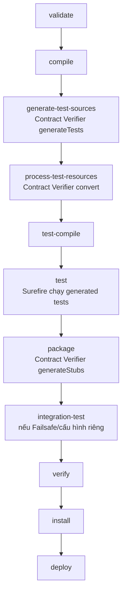
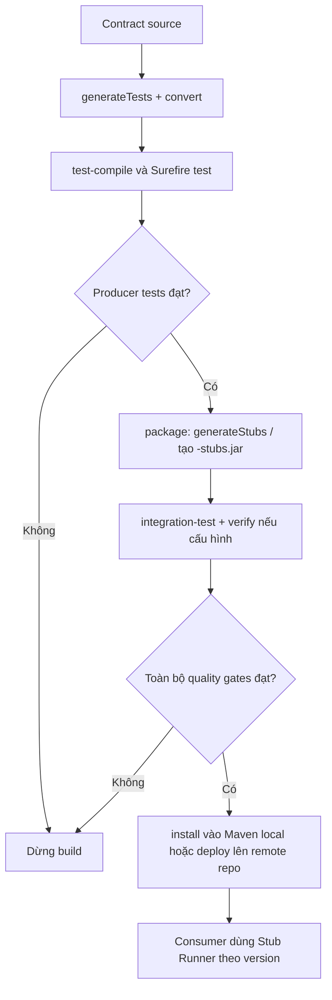
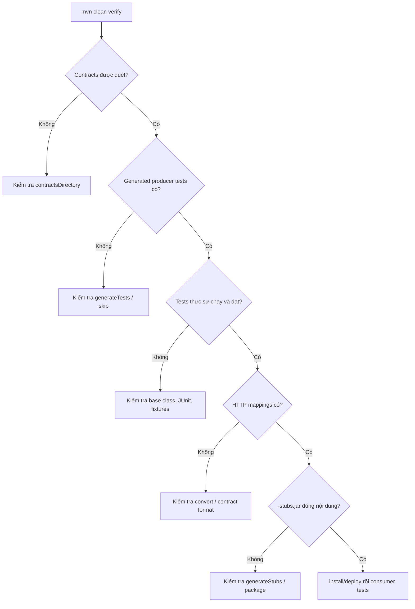

# Cấu hình plugin, dependency và thứ tự thực thi

## 1. Vai trò của Maven trong vòng đời Spring Cloud Contract

Trong module **SPRING_CLOUD_CONTRACT**, ta học kiểm thử hợp đồng giữa **producer** và **consumer** bằng Groovy/YAML DSL cho HTTP hoặc thông điệp. Spring Cloud Contract có thể sinh kiểm thử ở producer, chuyển các hợp đồng HTTP thành WireMock mappings, đóng gói stub theo phiên bản, rồi để consumer dùng **Stub Runner**. Khi tích hợp vào **Maven** và CI, chuỗi công việc đó phải được thực thi **đúng thứ tự** để không phát hành một stub mà producer chưa đáp ứng.

Một dự án có `pom.xml` khai báo plugin nhưng vẫn có thể không kiểm chứng được gì nếu:

- Thiếu dependency cần cho generated producer tests hoặc test framework.
- Không tìm thấy file Groovy/YAML trong thư mục contracts.
- Generated test không có **base test class** hoặc base test chưa khởi tạo HTTP/message infrastructure.
- Chỉ chạy goal sinh source mà **không thực thi generated tests**.
- Chạy đóng gói stub khi chưa chuyển đổi contracts thành HTTP mappings.
- Dùng `-DskipTests`, sai test engine hoặc sai naming khiến build xanh nhưng contract tests không chạy.
- Cài/publish artifact không mang classifier `stubs` hoặc dùng sai phiên bản.

Bài này tập trung vào ba yếu tố liên quan chặt chẽ: **Maven plugin**, **dependencies** và **thứ tự các phase/goal**. Đây không phải chỉ là cách viết một tệp XML; mục tiêu là biết mỗi phần cung cấp khả năng gì và bằng chứng nào xác nhận toàn bộ producer–consumer workflow hoạt động.

### Sau bài học, bạn có thể

1. Phân biệt `spring-cloud-contract-maven-plugin` với dependency `spring-cloud-starter-contract-verifier` và `spring-cloud-starter-contract-stub-runner`.
2. Đặt phiên bản nhất quán bằng Spring Cloud Contract BOM và cấu hình Maven plugin.
3. Sử dụng `baseClassForTests`, `testFramework`, `testMode` và contracts root phù hợp.
4. Giải thích quan hệ giữa `generateTests`, `convert`, `generateStubs` với Maven lifecycle.
5. Chạy producer verification trước khi `package`, `install` hoặc `deploy` stub.
6. Kiểm tra generated test sources, Surefire report và nội dung artifact `-stubs.jar`.
7. Sử dụng stub ở consumer qua Stub Runner và chẩn đoán lỗi build/CI.

## 2. Phân biệt plugin Maven và các dependencies

| Thành phần | Loại | Nhiệm vụ | Được sử dụng ở |
| --- | --- | --- | --- |
| `spring-cloud-contract-maven-plugin` | **Build plugin** | Đọc DSL, sinh producer tests, chuyển contracts thành stubs, tạo artifact | `build/plugins` của producer |
| `spring-cloud-starter-contract-verifier` | **Test dependency** | Cung cấp thư viện cần thiết cho kiểm thử hợp đồng được sinh và xác minh producer | `dependencies` của producer, `scope=test` |
| `spring-cloud-contract-dependencies` | **BOM** | Quản lý phiên bản những Spring Cloud Contract modules theo một bản tương thích | `dependencyManagement` |
| `spring-boot-starter-test` | **Test dependency** | JUnit/AssertJ, Spring Test, các thành phần test theo Spring Boot | `dependencies`, `scope=test` |
| `spring-cloud-starter-contract-stub-runner` | **Test dependency** | Cho consumer tải/chạy stub, khởi động WireMock và/hoặc tích hợp messaging | `dependencies` của consumer, `scope=test` |
| `maven-surefire-plugin` | **Test runner plugin** | Khám phá và chạy test thuộc Maven `test` phase | `build/plugins` hoặc quản lý từ parent |
| `maven-failsafe-plugin` | **Integration-test runner** | Chạy các test được quy ước là integration tests tại `integration-test`/`verify` | Khi dự án **chủ động** tách test suite |

**Sai lầm phổ biến:** thêm `spring-cloud-starter-contract-verifier` vào dependencies nhưng không cấu hình Maven plugin rồi mong các file Groovy tự biến thành JUnit tests. Dependency chỉ làm các lớp/thư viện khả dụng trên **classpath**, không tự tạo goal build. Ngược lại, plugin có thể sinh Java source nhưng thiếu dependency/test engine thì test không compile hoặc không chạy.

### 2.1. Vì sao producer và consumer không dùng cùng một dependency chính?

**Producer** cần thực thi ứng dụng của mình để chứng minh status, header, JSON body hay message output khớp hợp đồng; do đó nó dùng **Contract Verifier**.

**Consumer** cần chạy **mã client/handler thật của mình** nhưng mô phỏng producer bên ngoài; do đó nó dùng **Stub Runner**. Consumer thông thường **không cần** kế thừa producer base class hoặc dùng verifier plugin của producer chỉ để gửi request đến stub.

Trong repository có nhiều module, dependencies này nên được khai báo tại **đúng module** có vai trò tương ứng, thay vì thêm tất cả vào mọi module ở scope production.

### 2.2. BOM không tự cài plugin

Maven `dependencyManagement` quản lý dependency coordinates khi các dependency đó được khai báo; nó **không tự thêm dependency** và **không tự tạo build plugin**. Đặc biệt, phiên bản của Maven plugin cần được chỉ định/được quản lý riêng, thường bằng cùng property phiên bản Spring Cloud Contract.

```text
Spring Boot parent/BOM  -> Spring Boot ecosystem versions
Spring Cloud Contract BOM -> Spring Cloud Contract dependency versions
spring-cloud-contract-maven-plugin -> Generator/packager, có plugin version riêng
spring-cloud-starter-contract-verifier -> Test runtime ở producer
spring-cloud-starter-contract-stub-runner -> Test runtime ở consumer
```

## 3. Chọn phiên bản tương thích trước khi cấu hình

Spring Boot, Spring Framework, Spring Cloud release train và Spring Cloud Contract có **ma trận tương thích** theo từng dòng phát hành. Không nên lấy ngẫu nhiên phiên bản mới nhất của một thành phần rồi gắn vào dự án đang dùng phiên bản cũ.

Một cách quản lý rõ ràng trong `pom.xml` của producer:

```xml
<properties>
  <!-- PHẢI thay bằng phiên bản phù hợp với Spring Boot/Cloud của dự án. -->
  <spring-cloud-contract.version>REPLACE_WITH_COMPATIBLE_VERSION</spring-cloud-contract.version>
</properties>

<dependencyManagement>
  <dependencies>
    <dependency>
      <groupId>org.springframework.cloud</groupId>
      <artifactId>spring-cloud-contract-dependencies</artifactId>
      <version>${spring-cloud-contract.version}</version>
      <type>pom</type>
      <scope>import</scope>
    </dependency>
  </dependencies>
</dependencyManagement>
```

**Lưu ý:** `REPLACE_WITH_COMPATIBLE_VERSION` là placeholder, **không phải phiên bản có thể resolve**. Với Spring Boot parent/BOM và Spring Cloud BOM đã quản lý cùng nhóm dependencies, nhóm cần kiểm tra `effective-pom` và dependency tree để tránh import BOM trùng/không tương thích.

Tài liệu chính thức Spring Cloud Contract có thể sử dụng những phiên bản khác nhau tùy nhánh hướng dẫn. Luôn xem **reference và plugin documentation đúng phiên bản đã chọn**, đặc biệt khi sử dụng Java 17+, JUnit 5, Spock, message binder hoặc servlet/reactive stack.

### 3.1. Các nguyên tắc quản lý version

- Dùng **một phiên bản Spring Cloud Contract được hỗ trợ** cho plugin và BOM/test libraries.
- Không thêm version tùy tiện cho mọi module nếu BOM đã quản lý.
- Maven plugin là phần của **build toolchain**, nên khai báo version minh bạch.
- Ghim Maven Wrapper và JDK phù hợp với yêu cầu của Boot/Spring Cloud Contract.
- Cập nhật Boot/Cloud/Contract theo một thay đổi được review/test như nâng cấp platform.
- Không đưa dependency Contract Verifier hoặc Stub Runner vào runtime production chỉ vì dùng trong tests.

## 4. Ví dụ `pom.xml` producer với JUnit 5 và MockMvc

Giả sử ứng dụng `orders-producer` là một Spring MVC service có endpoint `GET /api/orders/{id}`. Dự án đã có Spring Boot parent và dependency management tương thích. Một cấu hình **rút gọn, cần bổ sung phần project/parent thực tế**:

```xml
<dependencies>
  <!-- HTTP controller thực của producer. -->
  <dependency>
    <groupId>org.springframework.boot</groupId>
    <artifactId>spring-boot-starter-web</artifactId>
  </dependency>

  <!-- Spring Test + JUnit/AssertJ và các công cụ test Boot. -->
  <dependency>
    <groupId>org.springframework.boot</groupId>
    <artifactId>spring-boot-starter-test</artifactId>
    <scope>test</scope>
  </dependency>

  <!-- Dependency thực thi generated producer contract tests. -->
  <dependency>
    <groupId>org.springframework.cloud</groupId>
    <artifactId>spring-cloud-starter-contract-verifier</artifactId>
    <scope>test</scope>
  </dependency>
</dependencies>

<build>
  <plugins>
    <plugin>
      <groupId>org.springframework.cloud</groupId>
      <artifactId>spring-cloud-contract-maven-plugin</artifactId>
      <version>${spring-cloud-contract.version}</version>
      <extensions>true</extensions>
      <configuration>
        <testFramework>JUNIT5</testFramework>
        <testMode>MOCKMVC</testMode>
        <baseClassForTests>com.example.orders.contract.ContractVerifierBase</baseClassForTests>
        <failOnNoContracts>true</failOnNoContracts>
      </configuration>
    </plugin>
  </plugins>
</build>
```

**Phân tích:**

| Thành phần XML | Lý do |
| --- | --- |
| `spring-boot-starter-web` | Đưa ứng dụng HTTP Spring MVC thực lên classpath |
| `spring-boot-starter-test` | Hỗ trợ Spring Boot test/JUnit/MockMvc |
| `spring-cloud-starter-contract-verifier` | Các lớp cần cho generated verification tests |
| `<version>${spring-cloud-contract.version}</version>` | Cố định version Maven plugin |
| `<extensions>true</extensions>` | Tích hợp plugin vào Maven lifecycle theo cơ chế Spring Cloud Contract |
| `<testFramework>JUNIT5</testFramework>` | Sinh test theo JUnit 5 |
| `<testMode>MOCKMVC</testMode>` | Kiểm thử HTTP qua MockMvc; phù hợp ứng dụng servlet |
| `<baseClassForTests>...` | Chỉ lớp nền producer test có setup cần thiết |
| `<failOnNoContracts>true</failOnNoContracts>` | Làm lộ tình huống không tìm thấy hợp đồng khi goal hỗ trợ |

**Không phải POM hoàn chỉnh:** ví dụ chưa có `groupId`, `artifactId`, `version`, Boot parent, repository, compiler configuration và setup persistence. Phần `spring-cloud-contract.version` phải được khai báo như mục 3; cần kiểm tra bản plugin đang dùng hỗ trợ các tùy chọn như minh họa.

### 4.1. Vì sao không dùng `testMode=MOCKMVC` cho mọi công nghệ?

`MOCKMVC` phù hợp cho Spring MVC/servlet. Nếu producer là Spring WebFlux, JAX-RS hoặc cần gửi HTTP qua server thật, xem các test mode mà **phiên bản Spring Cloud Contract** hỗ trợ, ví dụ `WEBTESTCLIENT` hoặc `EXPLICIT`. Base class và cách khởi tạo client phải khớp test mode đã chọn. Chọn sai mode khiến generated tests compile/run lỗi dù hợp đồng Groovy đúng.

## 5. Tổ chức thư mục source và contracts

Một producer Maven được tổ chức như sau:

```text
orders-producer/
  pom.xml
  src/
    main/
      java/
        com/example/orders/
          OrdersApplication.java
          OrderController.java
          OrderService.java
    test/
      java/
        com/example/orders/contract/
          ContractVerifierBase.java
          OrderFixture.java
      resources/
        contracts/
          orders/
            get_order_success.groovy
            get_order_not_found.yml
          messaging/
            order_created_event.groovy
```

Theo mặc định Maven plugin tìm hợp đồng dưới `src/test/resources/contracts`. Chúng là **test resources**, không phải Java production sources. Thư mục con `orders` giúp generator nhóm các tình huống, đặt tên generated class và có thể ảnh hưởng chiến lược chọn base class.

### 5.1. Đổi thư mục bằng `contractsDirectory`

Khi cần dùng nơi khác:

```xml
<configuration>
  <contractsDirectory>
    ${project.basedir}/src/test/resources/contracts
  </contractsDirectory>
  <baseClassForTests>
    com.example.orders.contract.ContractVerifierBase
  </baseClassForTests>
</configuration>
```

Ví dụ này đặt lại **đúng đường dẫn mặc định** để làm rõ cú pháp. Khi thay thư mục, cần xác minh cả `generateTests` và `convert` thực sự quét những hợp đồng mong muốn. Không chỉ nhìn log `BUILD SUCCESS`; phải đếm được generated tests và HTTP mappings.

### 5.2. Không đọc từ đường dẫn mà worker tự suy đoán

Nếu contracts ở một JAR/Git repository độc lập, plugin có những cấu hình lấy hợp đồng như `contractDependency` hoặc chế độ repository tùy phiên bản. Phải cấu hình **nguồn hợp đồng có chủ đích** và kiểm tra version; không đổi đường dẫn cục bộ rồi mặc định plugin sẽ tìm được file trong repository ngoài.

## 6. Hai hợp đồng HTTP ví dụ

### 6.1. Hợp đồng thành công: Groovy DSL

File `src/test/resources/contracts/orders/get_order_success.groovy`:

```groovy
import org.springframework.cloud.contract.spec.Contract

Contract.make {
    name 'get_order_success'
    description 'Đọc đơn hàng đã tồn tại'

    request {
        method GET()
        url '/api/orders/ord-1001'
    }

    response {
        status 200
        headers {
            contentType(applicationJson())
        }
        body([
            id    : 'ord-1001',
            status: 'CREATED'
        ])
    }
}
```

Producer test sẽ gửi request `GET /api/orders/ord-1001` và kiểm tra response theo hợp đồng. **Dữ liệu fixture** phải bảo đảm đơn `ord-1001` tồn tại; nếu dữ liệu không được chuẩn bị, producer có thể trả `404` dù logic API thực tế đúng.

### 6.2. Hợp đồng lỗi: YAML DSL

File `src/test/resources/contracts/orders/get_order_not_found.yml`:

```yaml
name: get_order_not_found
description: Không tìm thấy đơn hàng
request:
  method: GET
  url: /api/orders/ord-missing
response:
  status: 404
  headers:
    Content-Type: application/json
  body:
    code: ORDER_NOT_FOUND
```

Producer test của tình huống này cần fixture đảm bảo `ord-missing` **không tồn tại**. Stub HTTP được sinh từ contract phải trả một response `404` có body `ORDER_NOT_FOUND`; không được nhầm nó với `404` mặc định khi WireMock không có mapping khớp.

**Chú ý:** có thể tổ chức Groovy và YAML trong một repository, nhưng không viết **hai hợp đồng trùng cùng điều kiện request** mà cho ra responses xung đột. Tên file khác nhau không làm WireMock tự phân biệt được nhánh.

## 7. Base class cho generated JUnit 5 tests

Contract Verifier sinh **mã test**, không tự suy ra mọi fixture hay cách nạp ứng dụng. Với `testMode=MOCKMVC`, producer có thể tạo lớp nền:

```java
package com.example.orders.contract;

import io.restassured.module.mockmvc.RestAssuredMockMvc;
import org.junit.jupiter.api.BeforeEach;
import org.springframework.beans.factory.annotation.Autowired;
import org.springframework.boot.test.autoconfigure.web.servlet.AutoConfigureMockMvc;
import org.springframework.boot.test.context.SpringBootTest;
import org.springframework.test.web.servlet.MockMvc;

@SpringBootTest
@AutoConfigureMockMvc
public abstract class ContractVerifierBase {

    @Autowired
    private MockMvc mockMvc;

    @Autowired
    private OrderFixture orderFixture;

    @BeforeEach
    protected void prepare() {
        orderFixture.resetTestData();
        orderFixture.createOrder("ord-1001", "CREATED");
        orderFixture.ensureMissing("ord-missing");
        RestAssuredMockMvc.mockMvc(mockMvc);
    }
}
```

`OrderFixture`, `resetTestData`, `createOrder` và `ensureMissing` là những **helper minh họa do producer tự hiện thực**, không phải API có sẵn của Spring Cloud Contract. Phương thức `@BeforeEach` dùng `protected` để lớp kiểm thử được sinh ở package khác vẫn có thể kế thừa setup theo quy tắc của JUnit 5.

### 7.1. Những yêu cầu đối với base test

- Test context phải nạp được `OrderController`/service thật.
- `RestAssuredMockMvc` phải được cấu hình trước khi generated test gửi request.
- Fixture được tạo/cô lập **trước mỗi test**, không phụ thuộc thứ tự thực thi.
- Tránh reset database dùng chung nếu suite chạy song song.
- Không mock toàn bộ controller hoặc body response để “cho test đạt”; khi đó không còn xác minh hành vi producer.
- Nếu producer dùng messaging, cần trigger/message verifier/binder phù hợp; base MockMvc không tự phục vụ message tests.

### 7.2. Một base class có phải đủ không?

Đối với dự án vừa có `orders` HTTP vừa có `payments` HTTP và message events, có thể dùng `baseClassMappings` để ánh xạ các nhóm hợp đồng đến lớp nền tương ứng. `baseClassForTests` chỉ là một lựa chọn dùng chung/fallback; khi nhiều transport có setup khác nhau, cần tổ chức class mappings rõ.

Ví dụ ý tưởng:

```xml
<baseClassMappings>
  <baseClassMapping>
    <contractPackageRegex>.*orders.*</contractPackageRegex>
    <baseClassFQN>com.example.orders.contract.OrdersHttpBase</baseClassFQN>
  </baseClassMapping>
  <baseClassMapping>
    <contractPackageRegex>.*messaging.*</contractPackageRegex>
    <baseClassFQN>com.example.orders.contract.OrdersMessagingBase</baseClassFQN>
  </baseClassMapping>
</baseClassMappings>
```

**Minh họa:** regex thật phải được thử với **contract package được generator tính ra**; đừng để regex quá rộng nhận cả các nhóm không mong muốn. Những lớp được nêu phải tồn tại trong test classpath. Với nhiều mapping, cần kiểm tra generated source thực tế để xác nhận `extends` đúng base class.

## 8. Maven lifecycle: phase khác goal thế nào?

Maven có **lifecycle phases** như `generate-test-sources`, `test`, `package` và `verify`. Một **plugin goal** là thao tác cụ thể được Maven gắn vào một phase hoặc được gọi trực tiếp từ command line.

Ví dụ:

```bash
./mvnw -B spring-cloud-contract:generateTests
```

Lệnh trên yêu cầu chạy **một goal** sinh producer tests. Nó **không đồng nghĩa** Maven đã chạy `test`, `package` hoặc `verify`.

Trái lại:

```bash
./mvnw -B clean verify
```

yêu cầu Maven chạy các phases của lifecycle mặc định đến **`verify`** (sau bước `clean`). Nếu plugin và test runner được cấu hình đúng, những goals gắn vào lifecycle có cơ hội chạy theo thứ tự.

### 8.1. Sơ đồ thứ tự phase chính



Trong sơ đồ, các ô chỉ **mốc chính**, không liệt kê tất cả phases trung gian. Ví dụ `generate-test-sources` nằm sau `compile` trong default lifecycle, còn `process-test-resources` nằm sau các bước generate/process test sources. Mỗi plugin goal chỉ chạy khi nó được **binding** vào lifecycle hoặc được gọi trực tiếp; `maven-surefire-plugin`/`maven-failsafe-plugin` phải có cấu hình test discovery phù hợp.

### 8.2. Bảng goal của Spring Cloud Contract Maven plugin

| Goal | Default lifecycle phase theo plugin documentation | Điều nó làm |
| --- | --- | --- |
| `spring-cloud-contract:generateTests` | `generate-test-sources` | Sinh producer verification source từ contracts |
| `spring-cloud-contract:convert` | `process-test-resources` | Chuyển hợp đồng HTTP thành WireMock mappings |
| `spring-cloud-contract:generateStubs` | `package` | Lấy mappings và hợp đồng cần thiết để tạo stub JAR |
| `spring-cloud-contract:run` | Không dùng như bước xác minh producer mặc định | Chạy stubs để kiểm tra trong môi trường thích hợp |

**Quan hệ bắt buộc:** `generateStubs` dựa trên output từ `convert`. Tài liệu goal của plugin nói rõ phải thực thi `convert` trước khi `generateStubs` có dữ liệu HTTP mappings để đóng gói.

**Quan hệ kiểm chứng:** `generateTests` chỉ sinh source; sau đó test phải được **compile và thực thi** bởi Maven test engine. Việc `convert` hoàn thành không thay thế producer verification.

## 9. Phân biệt năm lệnh Maven thường gặp

| Lệnh | Kết quả chủ yếu | Điều chưa được chứng minh |
| --- | --- | --- |
| `./mvnw spring-cloud-contract:generateTests` | Generated source có thể được tạo | Test đã compile/chạy |
| `./mvnw spring-cloud-contract:convert` | HTTP stub mappings có thể được tạo | Producer thật trả response đúng |
| `./mvnw spring-cloud-contract:generateStubs` | Stub JAR có thể được tạo khi đã có output convert | Producer verification đã chạy và đạt |
| `./mvnw clean test` | Build đến `test`, thường thực thi generated tests qua Surefire | Stub JAR đã đóng gói hoặc publish |
| `./mvnw clean verify` | Chạy lifecycle qua `verify` theo cấu hình, bao gồm `package` | Artifact đã được `install`/`deploy` |
| `./mvnw clean install` | Chạy lifecycle qua `install` rồi cài artifacts vào local repo | Artifact đã được publish lên repository từ xa |
| `./mvnw clean deploy` | Chạy lifecycle đến `deploy` theo repository config | Consumer mọi phiên bản đã tương thích |

Mỗi mô tả giả định plugin/test lifecycle **đã cấu hình đúng**. Maven chỉ báo `BUILD SUCCESS` không đủ để kết luận test sinh ra đã được chạy: có thể không có contract, test bị skip, class không được discover hoặc Surefire/Failsafe không xử lý generated tests.

### 9.1. Lệnh khuyến nghị khi phát triển producer

```bash
# Phát triển: chạy lại build và tất cả tests đến verify.
./mvnw -B clean verify

# Khi cần tạo artifact cho consumer trên máy dev.
./mvnw -B clean install
```

`clean` xóa output build cũ trước khi Maven đi qua các phases, hạn chế trường hợp đang xem generated source/mapping của lần chạy trước. `install` chỉ cài vào **local Maven repository**, không tự phát hành lên Nexus/Artifactory.

### 9.2. Lệnh gọi từng goal để chẩn đoán

```bash
# Sinh mã kiểm thử để xem lỗi DSL, package, extends.
./mvnw -B spring-cloud-contract:generateTests

# Chuyển DSL sang HTTP mappings.
./mvnw -B spring-cloud-contract:convert

# Đóng gói stub từ output convert; không mặc định đã chạy tests.
./mvnw -B spring-cloud-contract:generateStubs
```

Chạy trực tiếp từng goal hữu ích khi tìm nguyên nhân lỗi, nhưng **không nên dùng chuỗi các goal riêng lẻ làm pipeline phát hành** mà bỏ qua `test` và `verify`. Khi khởi đầu từ trạng thái sạch, thứ tự `convert` → `generateStubs` là điều kiện cần cho HTTP stub packaging; còn bằng chứng producer đúng phải đến từ generated tests được thực thi.

### 9.3. Lệnh chạy test không giống lệnh chạy application

`mvn spring-boot:run` khởi động ứng dụng, **không tự kiểm tra contracts**. `mvn spring-cloud-contract:run` phục vụ stub, **không tự thực hiện producer verification**. `mvn verify` là phase dành cho các kiểm tra của build lifecycle, nhưng phải xác nhận generated tests nằm trong các test sources được test runner đọc.

## 10. Generated test sources và reports được đặt ở đâu?

Trong một cấu hình Maven plugin thông dụng:

```text
orders-producer/
  target/
    generated-test-sources/
      contracts/
        ... generated JUnit verification sources ...
    generated-test-resources/
      contracts/
        ... resources dành cho generated tests ...
    surefire-reports/
      ... report của test phase ...
    stubs/
      META-INF/
        com.example/
          orders-producer/
            1.4.2/
              contracts/
              mappings/
    orders-producer-1.4.2-stubs.jar
```

Đây là **sơ đồ điển hình**, không cam kết mọi plugin version dùng chính xác tên generated class/file JSON hoặc thư mục staging. `generatedTestSourcesDir` và các options khác có thể chỉnh đường dẫn. Hãy xem log và plugin documentation đúng phiên bản.

### 10.1. Kiểm tra ba đầu ra riêng biệt

1. **Generated source**: có Java test class chứa phương thức verify tình huống `get_order_success` hoặc `get_order_not_found` không?
2. **Test report**: Surefire đã **chạy** các phương thức đó chưa, bao nhiêu test pass/fail/skip?
3. **Stub artifact**: JAR có contracts và HTTP mappings đúng API và version không?

Nếu chỉ có mục 1, pipeline mới sinh mã. Nếu có mục 1 và 3 nhưng **0 tests được thực thi**, producer chưa được chứng minh đáp ứng hợp đồng. Nếu test pass mà JAR thiếu mappings, consumer vẫn không có HTTP stub để dùng.

### 10.2. Cấu trúc artifact

Một stub artifact có tọa độ:

```text
com.example:orders-producer:1.4.2:stubs
```

thường chứa các tài nguyên tương tự:

```text
META-INF/com.example/orders-producer/1.4.2/contracts/orders/get_order_success.groovy
META-INF/com.example/orders-producer/1.4.2/contracts/orders/get_order_not_found.yml
META-INF/com.example/orders-producer/1.4.2/mappings/orders/<generated-http-mapping>.json
```

`<generated-http-mapping>` là placeholder: tên file thật do converter quyết định. Một messaging contract có thể nằm trong `contracts` mà không có một WireMock HTTP mapping tương ứng; **không đếm mọi contract HTTP + message rồi yêu cầu số JSON bằng tổng**.

### 10.3. Mở JAR để xác minh

```bash
jar tf target/orders-producer-1.4.2-stubs.jar
```

Phải kiểm tra file JAR đã tạo theo `groupId`/`artifactId`/`version` và **classifier `stubs`**. Một tên file `-stubs.jar` không tự chứng minh nó chứa mappings đúng; một thư mục `target/stubs` cũng không chứng minh artifact đã được publish.

## 11. Surefire, Failsafe và nguy cơ bỏ qua test

### 11.1. Surefire mặc định xử lý test phase

Với generated tests dạng JUnit 5 và tên class phù hợp test discovery, Maven Surefire thường chạy chúng ở phase `test`. Dự án Spring Boot parent có thể đã quản lý version Surefire tương thích, nhưng vẫn cần xác nhận thực tế.

Một cấu hình tăng độ rõ ràng:

```xml
<plugin>
  <groupId>org.apache.maven.plugins</groupId>
  <artifactId>maven-surefire-plugin</artifactId>
  <configuration>
    <failIfNoTests>true</failIfNoTests>
  </configuration>
</plugin>
```

`failIfNoTests` có thể chặn tình huống **không có test nào chạy** trong một module. Nhưng nếu 20 unit tests chạy còn **0 contract tests** được discover, quy tắc này vẫn có thể cho build xanh. Vì vậy cần kiểm tra **ít nhất các generated contract classes/cases mong đợi xuất hiện trong report**.

### 11.2. `-DskipTests` và `-Dmaven.test.skip=true`

```bash
# Các ví dụ để NHẬN DIỆN lỗi cấu hình; không dùng trong gate contract verification.
./mvnw -B clean verify -DskipTests
./mvnw -B clean verify -Dmaven.test.skip=true
```

`-DskipTests` thường bỏ qua bước thực thi tests, còn `-Dmaven.test.skip=true` có thể bỏ qua cả biên dịch test theo cấu hình build/plugin. Những tùy chọn này có thể hữu ích cho thao tác đóng gói đặc biệt, **nhưng không tạo ra bằng chứng producer verification**. Cũng cần để ý các plugin-specific skip flags như `spring.cloud.contract.verifier.skip`.

### 11.3. Khi dùng Failsafe

Nếu nhóm muốn tách producer contract tests vào integration-test suite, có thể cần:

- Generated test naming/`nameSuffixForTests` phù hợp quy tắc Failsafe (thường `*IT`).
- Cấu hình `maven-failsafe-plugin` chạy goal `integration-test` và `verify`.
- Đảm bảo generated tests **không bị bỏ quên** giữa Surefire và Failsafe.
- Đảm bảo stub **không được deploy khi integration tests fail**, vì phase `package` xảy ra **trước** `integration-test`; artifact tạo ở package chưa phải artifact được phép phát hành.

Ví dụ cấu hình Failsafe rút gọn:

```xml
<plugin>
  <groupId>org.apache.maven.plugins</groupId>
  <artifactId>maven-failsafe-plugin</artifactId>
  <executions>
    <execution>
      <goals>
        <goal>integration-test</goal>
        <goal>verify</goal>
      </goals>
    </execution>
  </executions>
</plugin>
```

Đây **chưa đủ** để mọi generated test tự chuyển sang Failsafe: cần quy ước tên, test includes, test engine và source dir đúng. Không chỉ thêm plugin rồi kết luận producer contract verification đã được thực hiện.

## 12. Mối quan hệ giữa `package`, `verify`, `install` và `deploy`

Đây là điểm thường gây nhầm lẫn nhất khi phát hành stub:



- **`package`**: tạo artifact. Đường đi Maven bình thường qua `test` trước đó, nhưng vẫn có khả năng tests đã bị skip hoặc verification riêng nằm ở Failsafe phía sau.
- **`verify`**: chạy các kiểm tra được cấu hình đến phase này, gồm Failsafe `verify` khi có.
- **`install`**: cài artifact vào local Maven repository sau khi chạy các phases trước nó.
- **`deploy`**: publish lên repository từ xa sau khi chạy các phases trước nó, yêu cầu distribution management và credentials phù hợp.

**Kết luận vận hành:** file stub JAR có thể được tạo trong `package`, nhưng **chỉ phát hành sau tất cả các kiểm tra producer cần thiết đạt**. Không gọi thẳng goal `deploy:deploy-file` trên một JAR chưa qua verification rồi coi đó là release contract hợp lệ.

### 12.1. Vì sao không ghi đè version release?

Consumer CI phải có thể tải lại đúng stub đã dùng hôm qua. Nếu release `1.4.2` bị ghi đè với mapping mới:

- Máy A có artifact cache cũ, máy B tải artifact mới.
- Cùng một consumer commit cho hai kết quả khác nhau.
- Việc điều tra compatibility trở nên khó tái lập.

Hãy dùng phiên bản release bất biến hoặc quy trình quản lý SNAPSHOT minh bạch, và ghim version trong các consumer tests có ý nghĩa phát hành.

## 13. Cấu hình consumer Maven để chạy stub đã phát hành

Một consumer không cần tự chạy verifier plugin của producer. Nó cần **test dependency** Stub Runner và **mã client thật** được test.

Ví dụ dependency trong `pom.xml` của `checkout-consumer`:

```xml
<dependencies>
  <dependency>
    <groupId>org.springframework.boot</groupId>
    <artifactId>spring-boot-starter-test</artifactId>
    <scope>test</scope>
  </dependency>
  <dependency>
    <groupId>org.springframework.cloud</groupId>
    <artifactId>spring-cloud-starter-contract-stub-runner</artifactId>
    <scope>test</scope>
  </dependency>
</dependencies>
```

Consumer cũng phải sử dụng dependency management tương thích; ví dụ trên giả định BOM/parent đã quản lý phiên bản. `scope=test` giúp tránh đưa công cụ Stub Runner vào runtime production.

### 13.1. Test Stub Runner minh họa

```java
import org.junit.jupiter.api.Test;
import org.springframework.beans.factory.annotation.Autowired;
import org.springframework.boot.test.context.SpringBootTest;
import org.springframework.cloud.contract.stubrunner.StubRunnerProperties;
import org.springframework.cloud.contract.stubrunner.spring.AutoConfigureStubRunner;

import static org.assertj.core.api.Assertions.assertThat;

@SpringBootTest(properties = {
    "clients.orders.base-url=http://localhost:8090"
})
@AutoConfigureStubRunner(
    ids = "com.example:orders-producer:1.4.2:stubs:8090",
    stubsMode = StubRunnerProperties.StubsMode.LOCAL
)
class CheckoutConsumerContractTest {

    @Autowired
    private CheckoutService checkoutService;

    @Test
    void mapsCreatedOrderToPayableView() {
        CheckoutView view = checkoutService.load("ord-1001");

        assertThat(view.orderId()).isEqualTo("ord-1001");
        assertThat(view.canPay()).isTrue();
    }
}
```

`CheckoutService`/`CheckoutView` là **thành phần minh họa do consumer tự hiện thực**, không phải API có sẵn của Spring Cloud Contract. Test có ý nghĩa nếu `checkoutService` thực sự đi qua HTTP client trỏ đến stub; **không mock chính HTTP client** nếu mục tiêu là kiểm tra tích hợp với API của producer.

### 13.2. LOCAL/REMOTE/CLASSPATH phụ thuộc nguồn artifact

| Mode | Stub được tìm ở đâu? | Phù hợp |
| --- | --- | --- |
| `LOCAL` | Maven repository cục bộ, thường `~/.m2/repository` | Dev đã `mvn install` stub |
| `REMOTE` | Maven repository được cấu hình | CI tải release từ Nexus/Artifactory |
| `CLASSPATH` | Stub resources có trên test classpath | Dự án đóng gói/đính kèm stub trực tiếp |

Consumer đang dùng `LOCAL` nhưng CI runner sạch không có stub JAR sẽ gặp lỗi tải artifact, không phải lỗi Groovy DSL. Trong CI thường nên `REMOTE` tới repository được phép, hoặc có bước cài bản artifact đã build vào local repo trong cùng job.

### 13.3. Port không phải một phần của artifact

Chuỗi `com.example:orders-producer:1.4.2:stubs:8090` chứa cổng WireMock **khi chạy**, còn artifact lưu trong repository có tọa độ `com.example:orders-producer:1.4.2:stubs`. Khi có nhiều suites chạy song song, cổng cố định `8090` có thể xung đột; cân nhắc cổng động và `StubFinder`.

## 14. Dự án nhiều Maven modules: build và publish đúng thành phần

Giả sử:

```text
platform/
  pom.xml                   <- aggregator/parent
  orders-producer/pom.xml
  checkout-consumer/pom.xml
```

Với aggregator, cần phân biệt:

- `<dependencyManagement>` quản lý phiên bản dependencies cho modules.
- `<pluginManagement>` **quản lý cấu hình** plugins, nhưng bản thân nó không đồng nghĩa plugin sẽ chạy trong mọi module nếu chưa được áp dụng theo cơ chế thích hợp.
- `<build><plugins>` áp dụng plugin cho module/lifecycle theo Maven inheritance và cấu hình cụ thể.
- `orders-producer` là module cần plugin tạo producer tests/stubs.
- `checkout-consumer` là module cần Stub Runner test; nó không nhất thiết cần Contract Verifier plugin.

Ví dụ chạy build riêng producer:

```bash
./mvnw -B -pl orders-producer -am clean verify
```

`-pl` chọn module, `-am` thêm các module dependency trong reactor nếu cần. Lệnh này chưa cài stub vào local repository cho một consumer job chạy **ngoài reactor**; nếu consumer sau đó cần `LOCAL`, phải có bước `install` phù hợp hoặc dùng artifact đã publish qua `REMOTE`.

### 14.1. Điều kiện cho pipeline multi-module

- Build producer và xác minh tests trước.
- Tạo/install/publish artifact `-stubs.jar` đúng tọa độ.
- Chạy consumer tests với **stub version vừa kiểm chứng**.
- Không để consumer test tải một version cũ chỉ vì Maven dependency cache.
- Nếu consumer và producer build song song, cần một dependency rõ ràng: consumer đợi stub ứng viên sẵn sàng thay vì thử tải trong lúc chưa publish.
- Không cài verifier plugin vào toàn bộ modules chỉ vì plugin được khai báo ở parent mà không xét vai trò từng module.

## 15. Troubleshooting plugin, dependency và lifecycle

| Triệu chứng | Nguyên nhân thường gặp | Kiểm tra và cách xử lý |
| --- | --- | --- |
| Maven không tìm thấy goal/plugin | Thiếu plugin hoặc version/repository sai | Kiểm tra `pom.xml`, plugin repository và gọi bằng FQ plugin coordinates |
| Không có generated test | Contracts root sai, file không được quét hoặc goal bị skip | Kiểm tra `contractsDirectory`, `generateTests` và số file |
| Generated Java compile lỗi | Thiếu test dependency, import hoặc sai framework version | Kiểm tra BOM, test classpath, JUnit/Surefire |
| `Cannot find symbol ContractVerifierBase` | FQCN sai, base class không có trong test sources | Kiểm tra `baseClassForTests` và package declaration |
| `NoClassDefFoundError` ở Rest Assured MockMvc | Thiếu/không tương thích module test HTTP | Kiểm tra verifier dependency, test mode và dependency tree |
| Generated test fail `404` thay `200` | Fixture `ord-1001` chưa được tạo | Kiểm tra base test setup và database test |
| `BUILD SUCCESS` nhưng 0 contract tests | Test bị skip, naming sai, generated sources không được add | Xem test reports và generated classes |
| `convert` tạo 0 mappings | Không có HTTP contracts hoặc cấu hình nguồn/filter sai | Kiểm tra input contracts và loại hợp đồng |
| `generateStubs` chạy nhưng JAR thiếu HTTP mapping | Chưa `convert` hoặc dùng output cũ/sai directory | Chạy đúng lifecycle, mở JAR bằng `jar tf` |
| Consumer `LOCAL` không resolve artifact | Chưa `install` stub đúng version/classifier | Kiểm tra local Maven repo và `-stubs.jar` |
| Consumer `REMOTE` bị `401/403` | Repository credential/quyền thiếu | Kiểm tra CI secret và repository access |
| Stub HTTP trả `404` no-match | Request sai URL/method/header/body hoặc mapping thiếu | Xem WireMock mapping/request journal |
| CI xanh nhưng consumer fail khi lên version mới | Consumer dùng stub cũ trong build | Ghim đúng artifact ứng viên và chạy compatibility tests |
| Project chỉ chạy unit tests nhưng bỏ Failsafe | Integration tests chưa được bind đúng | Kiểm tra Failsafe `integration-test`/`verify` |

### 15.1. Trình tự kiểm tra có hệ thống



### 15.2. Kiểm tra effective POM

Khi project kế thừa nhiều parent/BOM/pluginManagement, cấu hình nhìn thấy ở module có thể không giống bạn dự kiến. Có thể dùng:

```bash
./mvnw -B help:effective-pom
./mvnw -B dependency:tree
```

Đây là **lệnh hướng dẫn**, không được chạy trong phạm vi worker viết bài. `effective-pom` cho thấy cấu hình sau Maven inheritance/merging; `dependency:tree` giúp tìm version conflict trong test dependencies. Khi cần xem tham số plugin:

```bash
./mvnw -B spring-cloud-contract:help -Ddetail=true -Dgoal=generateTests
```

Nếu cách gọi goal theo prefix không resolve, dùng đầy đủ tọa độ plugin với version tương thích hoặc xem plugin groups/repositories; không kết luận ngay Groovy DSL sai.

## 16. CI: thứ tự build đáng tin cậy

Một pipeline có thể chia thành những bước và **bằng chứng cụ thể**:

| Bước | Thao tác | Tiêu chí đạt |
| --- | --- | --- |
| 1. Version/setup | Cố định JDK, Maven Wrapper, Boot/Cloud/Contract versions | Dependency và plugin resolve thành công |
| 2. Contract discovery | Đọc Groovy/YAML theo contracts root | Có đủ hợp đồng của các nhánh được bảo vệ |
| 3. Generate tests | `generateTests` | Generated producer tests có source đúng |
| 4. Producer verification | `test` hoặc suite phù hợp | Tests **được thực thi** và pass |
| 5. Convert mappings | `convert` | HTTP mappings đúng request/response |
| 6. Package stub | `generateStubs` trong `package` | JAR có contracts/mappings và classifier đúng |
| 7. Verify | `verify`, bao gồm integration gates nếu có | Không còn test/quality gate fail |
| 8. Install/deploy | Cài hoặc publish versioned stub | Repository chứa đúng artifact bất biến |
| 9. Consumer tests | Stub Runner dùng artifact ứng viên | Mã client/handler consumer xử lý đúng nhánh |

Một pipeline tối thiểu cho producer đã cấu hình đúng có thể sử dụng:

```bash
# Gate của producer; không cho publish nếu bước này fail.
./mvnw -B clean verify

# Sau khi các quality gates đã đạt và chính sách CI cho phép:
./mvnw -B deploy
```

Lưu ý: `deploy` tự chạy các phases trước nó trong **một invocation mới**, nên ví dụ trên có thể **chạy lại tests**. Trong CI thực tế, có thể dùng một lệnh `./mvnw -B clean deploy` nếu các quality gates gắn đúng Maven lifecycle, hoặc dùng chiến lược chia job có artifact provenance và release gate rõ ràng. Không dùng tùy chọn bỏ test một cách âm thầm giữa `verify` và `deploy` để tránh duplicate work nếu không có quy trình đảm bảo artifact được publish **chính là artifact đã verify**.

### 16.1. Biến thể hai job với artifact bất biến

```text
Job A (producer validation)
  -> checkout commit/branch
  -> mvnw clean verify
  -> kiểm tra tests pass, generated mapping và stub jar
  -> lưu JAR + checksum + build metadata như CI artifact

Job B (publish + consumer compatibility)
  -> nhận chính artifact JAR từ Job A
  -> xác minh checksum/provenance
  -> publish theo chính sách
  -> consumer tests tải đúng version qua Stub Runner
```

Nếu Job B dùng Maven deploy thông thường, nó có thể build lại module; phải kiểm soát sự khác biệt. Chỉ dùng cơ chế “publish artifact đã được verify” nếu organization có quy trình hỗ trợ và kiểm tra chặt chẽ nguồn gốc. Không trộn JAR của lần build mới với report của lần build khác.

### 16.2. Ghi log gì để phát hiện CI xanh giả?

- JDK, Maven và Spring Cloud Contract plugin version.
- Contracts root, số lượng/đường dẫn hợp đồng đã quét.
- Generated test classes, số test run/pass/fail/skip.
- Vị trí output mapping và số kịch bản HTTP quan trọng.
- Stub artifact name, classifier, version và checksum.
- Tọa độ stub mà consumer tests tải.
- Các nhánh HTTP/messaging đã được consumer xác minh.

Nếu `0 tests run` hoặc một nhánh quan trọng không có mapping, không nên đánh dấu đã “contract verified” chỉ vì Maven exit code bằng 0.

## 17. Những tình huống sai thứ tự cần nhận diện

### Tình huống A: sinh JUnit source rồi publish ngay

```text
mvn spring-cloud-contract:generateTests
-> Maven tạo Java files
-> Người viết kết luận "Contract tests pass"
-> Publish stub mà không chạy test
```

**Sai:** generated source chỉ là mã được tạo; producer thật chưa được kiểm chứng. Cần chạy `test`/`verify` và xem report.

### Tình huống B: đóng gói stub trước khi convert

```text
mvn spring-cloud-contract:generateStubs
-> Chưa chạy convert
-> JAR trống/thiếu mappings hoặc dùng output staging cũ
```

**Sai:** `generateStubs` cần output `convert`. Trong build bình thường, dùng plugin lifecycle đúng để convert rồi package.

### Tình huống C: bỏ tests để build nhanh

```text
mvn clean deploy -DskipTests
-> Stub mới được publish
-> Không có bằng chứng producer version đó khớp contracts
```

**Sai:** build artifact không tương đương producer verification. Trong pipeline release, cấu hình gate bắt buộc trước publish.

### Tình huống D: consumer dùng artifact sai version

```text
Producer candidate: 1.4.3
Consumer Stub Runner IDs: com.example:orders-producer:1.4.2:stubs:8090
Consumer tests xanh trên response cũ
```

**Sai:** consumer chưa được kiểm tra với thay đổi đang phát hành. Cần chạy đúng artifact ứng viên `1.4.3` và bổ sung ma trận version cũ/mới nếu yêu cầu rolling upgrade.

### Tình huống E: nhìn thấy JAR là xem như hoàn tất

```text
target/orders-producer-1.4.2-stubs.jar exists
Maven reports: Tests run: 0
```

**Sai:** JAR tồn tại không chứng minh producer behavior. Phải xác định contracts được quét, generated tests được chạy, các assertions đạt và HTTP mappings đúng.

## 18. Bài tập thực hành: hoàn thiện Maven pipeline cho Orders Producer

### 18.1. Bối cảnh

Nhóm phát triển một producer:

```text
groupId    = com.example
artifactId = orders-producer
version    = 1.4.2
language   = Java
HTTP stack = Spring MVC
test       = JUnit 5 + MockMvc
```

Hợp đồng cần bảo vệ:

| Hợp đồng | Request | Producer fixture | Expected response |
| --- | --- | --- | --- |
| `get_order_success.groovy` | `GET /api/orders/ord-1001` | `ord-1001` tồn tại | `200`, status `CREATED` |
| `get_order_not_found.yml` | `GET /api/orders/ord-missing` | ID này vắng mặt | `404 ORDER_NOT_FOUND` |
| `create_order_success.groovy` | `POST /api/orders` với quantity `2` | SKU còn hàng | `201`, ID đơn mới |
| `create_order_out_of_stock.groovy` | `POST /api/orders` với SKU hết hàng | SKU tồn tại, stock `0` | `409 OUT_OF_STOCK` |

### 18.2. Việc cần làm

1. Cấu hình BOM và `spring-cloud-contract-maven-plugin` với version tương thích Spring Boot/Cloud.
2. Thêm `spring-cloud-starter-contract-verifier` với `scope=test` và Spring Boot test dependencies cần thiết.
3. Chọn `testFramework=JUNIT5`, `testMode=MOCKMVC` và `baseClassForTests` là class test do nhóm viết.
4. Đặt bốn Groovy/YAML contracts dưới `src/test/resources/contracts/orders/`.
5. Chuẩn bị fixture thành công/không tồn tại/hết hàng theo đúng nhánh.
6. Chạy riêng `generateTests` và xác định generated classes, methods, `extends`.
7. Chạy `./mvnw -B clean verify`, ghi lại số test run/pass/fail/skip trong Surefire.
8. Đọc HTTP mappings do `convert` tạo; kiểm tra request matcher không bắt nhầm nhánh.
9. Mở `-stubs.jar` bằng `jar tf` và xác nhận `contracts`/`mappings` theo version.
10. Cài vào Maven local repository, chạy consumer test bằng Stub Runner `LOCAL`.
11. Đổi fixture làm `ord-1001` vắng mặt và xem generated test thành công có fail đúng không; khôi phục fixture.
12. Cố tình chạy `clean verify -DskipTests`, quan sát vì sao không nên dùng kết quả đó làm bằng chứng phát hành.

### 18.3. Bảng ghi nhận

| Câu hỏi | Kết quả người học cần điền |
| --- | --- |
| Contracts root thực tế | ... |
| Generated test classes | ... |
| Generated tests đã thực thi | ... |
| Số test pass/fail/skip | ... |
| Số HTTP kịch bản có mappings | ... |
| Stub JAR path + classifier | ... |
| GAV version consumer tải | ... |
| Consumer xử lý `201` và `409` đúng không? | ... |

### 18.4. Câu hỏi tự kiểm tra

**Câu 1.** Vì sao `spring-cloud-starter-contract-verifier` không thay thế `spring-cloud-contract-maven-plugin`?

**Đáp án:** Starter cung cấp **test dependencies**, còn plugin thực hiện các **build goals** như sinh source, convert và đóng gói stub.

**Câu 2.** Chạy `generateTests` thành công có chứng minh producer đã trả đúng `200` và `404` không?

**Đáp án:** Không. Phải **compile và chạy generated tests** với fixture đúng, rồi xem assertions/report.

**Câu 3.** Vì sao `generateStubs` cần `convert` trước?

**Đáp án:** `convert` tạo HTTP WireMock mappings từ contracts; `generateStubs` lấy output đã chuyển đổi để đóng gói stub JAR.

**Câu 4.** `mvn package` có luôn chứng minh mọi contract integration test đạt không?

**Đáp án:** Không nhất thiết. Nếu tests bị skip, không được discover hoặc integration tests chỉ chạy bằng Failsafe ở `integration-test`/`verify`, `package` chưa tạo đủ bằng chứng xác minh.

**Câu 5.** Sự khác nhau giữa `install` và `deploy`?

**Đáp án:** `install` cài artifact vào **local Maven repository**; `deploy` publish lên **remote repository** được cấu hình.

**Câu 6.** Nếu consumer sử dụng `LOCAL` và máy CI chưa có JAR `-stubs.jar`, phải làm gì?

**Đáp án:** Cài artifact đúng tọa độ vào local repository trong job hoặc chuyển sang `REMOTE` với repository và version được cấu hình.

**Câu 7.** Nếu Surefire chạy 15 unit tests nhưng 0 generated contract tests, `failIfNoTests=true` có đủ để chặn build không?

**Đáp án:** Không. Cần kiểm tra sự xuất hiện/chạy của **generated contract test cases** cụ thể; chỉ có tổng test count lớn hơn 0 không bảo đảm.

## 19. Checklist cấu hình Maven trước khi publish stub

- [ ] Đã xác định Spring Boot, Spring Cloud Contract và JDK/Maven versions tương thích.
- [ ] `spring-cloud-contract-dependencies` BOM quản lý test library versions hoặc dự án có dependency management tương đương.
- [ ] `spring-cloud-contract-maven-plugin` nằm trong cấu hình build plugin áp dụng đúng producer module, có version rõ ràng.
- [ ] `spring-cloud-starter-contract-verifier` được khai báo test scope.
- [ ] Có test dependency cho JUnit 5/Spring Test và HTTP/message stack đã chọn.
- [ ] `testFramework` và `testMode` khớp test infrastructure của producer.
- [ ] `baseClassForTests`/`baseClassMappings` trỏ tới lớp nền hiện hữu và setup được fixture.
- [ ] Contracts root đúng; Groovy/YAML được plugin quét đầy đủ.
- [ ] `generateTests` tạo Java sources đúng package và phương thức.
- [ ] Surefire/Failsafe **thực sự chạy** generated producer tests, không bị skip.
- [ ] `convert` tạo mappings cho những nhánh HTTP được bảo vệ.
- [ ] `generateStubs` chạy sau conversion và tạo classifier `stubs`.
- [ ] Đã kiểm tra JAR contents, không chỉ tên file hoặc staging directory.
- [ ] CI không coi `package` đủ khi còn integration gates ở `verify`.
- [ ] Không có skip flags/test discovery lỗi khiến release xanh giả.
- [ ] Artifact được install/deploy **sau khi verification đạt** và giữ version bất biến.
- [ ] Consumer dùng Stub Runner với đúng artifact/version mới và assertions trên mã consumer thật.
- [ ] Test report ghi số generated contract tests, pass/fail/skip, mappings và tọa độ artifact.

### Tài liệu tham khảo

- [Spring Cloud Contract — Maven Project](https://docs.spring.io/spring-cloud-contract/reference/maven-project.html): BOM, plugin Maven, contracts root, base test và generated sources.
- [Spring Cloud Contract Maven Plugin — Goals](https://docs.spring.io/spring-cloud-contract/docs/current/spring-cloud-contract-maven-plugin/plugin-info.html): vai trò của `generateTests`, `convert` và `generateStubs`.
- [Spring Cloud Contract Maven Plugin — generateTests](https://docs.spring.io/spring-cloud-contract/docs/current/spring-cloud-contract-maven-plugin/generateTests-mojo.html): parameters và phase mặc định.
- [Spring Cloud Contract Maven Plugin — convert](https://docs.spring.io/spring-cloud-contract/docs/current/spring-cloud-contract-maven-plugin/convert-mojo.html): contract source và output HTTP mappings.
- [Spring Cloud Contract Maven Plugin — generateStubs](https://docs.spring.io/spring-cloud-contract/docs/current/spring-cloud-contract-maven-plugin/generateStubs-mojo.html): packaging, classifier và yêu cầu conversion.
- [Apache Maven — Introduction to the Build Lifecycle](https://maven.apache.org/guides/introduction/introduction-to-the-lifecycle.html): phases, goals, `verify`, `install` và `deploy`.
- [Maven Surefire Plugin](https://maven.apache.org/surefire/maven-surefire-plugin/): cách chạy các test trong `test` phase.
- [Maven Failsafe Plugin](https://maven.apache.org/surefire/maven-failsafe-plugin/): xử lý integration-test/verify theo cấu hình.

**Ghi nhớ:** Maven plugin **sinh test và đóng gói stub**, test dependencies cung cấp **thư viện chạy kiểm chứng**, còn Maven lifecycle bảo đảm **thứ tự thực thi**. `generateTests` không phải `test`; `convert` phải có trước `generateStubs`; `package` không đồng nghĩa đã hoàn tất mọi kiểm tra; và `install/deploy` chỉ nên diễn ra sau khi **producer verification thực sự đạt**. Chỉ khi đó stub theo phiên bản mới có thể là đầu vào đáng tin cho consumer tests qua Stub Runner và CI.
