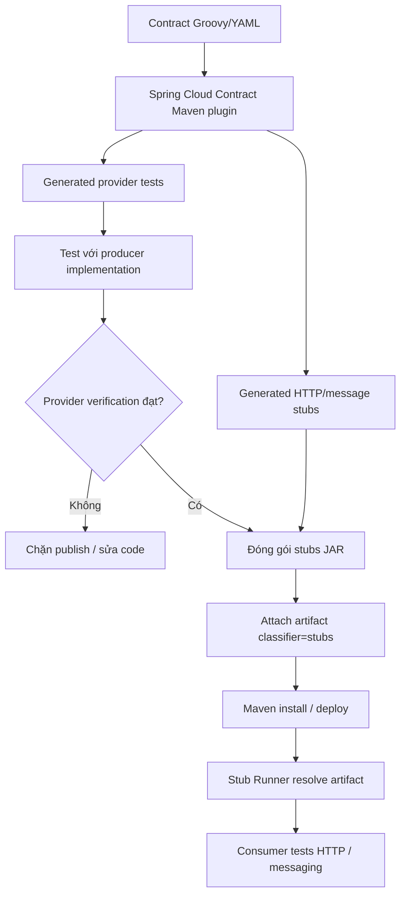
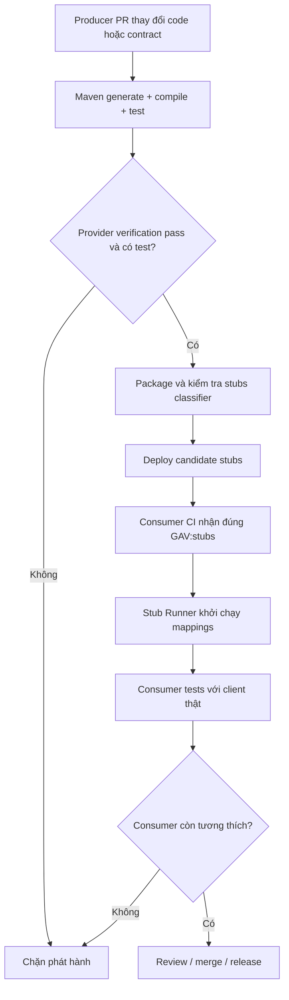

# Đính kèm artifact stubs và classifier trong Spring Cloud Contract với Maven

Trong **Spring Cloud Contract (SCC)**, producer mô tả giao diện HTTP hoặc thông điệp bằng **Groovy/YAML DSL**, tạo kiểm thử để xác minh implementation và phát hành các **stub** giúp consumer thử tích hợp bằng **Stub Runner**. Khi dùng **Maven**, câu hỏi không chỉ là “làm sao sinh stub?” mà còn là **“stub được đóng gói thành artifact nào, Maven nhận diện nó ra sao, và consumer lấy đúng bản đó bằng cách nào?”**

Đó là vai trò của **attached artifact** và **classifier**. Một dự án `order-producer` có thể phát hành hai JAR ở cùng một version: JAR ứng dụng để chạy dịch vụ, và **stubs JAR** chứa WireMock mappings/message stubs để kiểm thử consumer. Maven phân biệt chúng bằng classifier `stubs`. Nếu đóng gói đúng nhưng không **attach**, không `install` hoặc không `deploy`, consumer vẫn không lấy được stub; nếu attach sai classifier, Stub Runner có thể tìm không thấy artifact hoặc dùng nhầm bản cũ.

Bài thuộc chương **Tích hợp Maven** này tập trung vào **đính kèm artifact stubs và classifier**: khái niệm, cấu hình Maven plugin, quan hệ với vòng đời `verify → install → deploy`, kiểm tra file JAR và repository, cách Stub Runner dùng tọa độ artifact, rủi ro version trong CI và thực hành kiểm tra tương thích. Ví dụ xuyên suốt sử dụng `order-producer` cung cấp `GET /api/orders/1001` cho `checkout-consumer`.

## 1. Mục tiêu học tập và bức tranh tổng thể

Sau bài này, bạn cần làm được những việc sau:

1. Phân biệt **main artifact**, **stubs artifact** và **test artifact** trong Maven.
2. Giải thích ý nghĩa của `groupId`, `artifactId`, `version`, `type/extension` và `classifier`.
3. Hiểu **attach** là đưa artifact phụ vào danh sách artifact của cùng một Maven project, không phải chép file vào JAR ứng dụng.
4. Biết vai trò của `spring-cloud-contract-maven-plugin` đối với sinh test và stubs.
5. Kiểm tra stubs JAR có thật, chứa mappings phù hợp và được Maven cài/phát hành đúng tọa độ.
6. Cấu hình Stub Runner `LOCAL` hoặc `REMOTE` để consumer dùng đúng classifier `stubs`.
7. Thiết kế CI chỉ phát hành candidate stubs sau khi provider verification đạt.
8. Chẩn đoán lỗi “artifact not found”, classifier sai, version cũ hoặc JAR rỗng.

Luồng cần ghi nhớ:



Sơ đồ thể hiện **thứ tự kiểm soát chất lượng mong muốn**. Việc plugin có tự gắn các goal vào lifecycle ở phiên bản cụ thể hay không phải xác minh bằng **effective POM, log Maven và artifact cuối cùng**. Một JAR được sinh thành công không đồng nghĩa mọi provider test đã chạy.

## 2. Maven coordinate: thứ quyết định artifact nào được chọn

Một Maven artifact được nhận diện bằng các trường chính:

| Thành phần | Ví dụ | Ý nghĩa |
| --- | --- | --- |
| `groupId` | `com.example` | Nhóm sở hữu artifact |
| `artifactId` | `order-producer` | Định danh dự án/package |
| `version` | `1.4.0` | Bản cụ thể của producer và contract |
| `type` / extension | `jar` | Kiểu nội dung được resolve |
| `classifier` | `stubs` | Biến thể artifact trong **cùng** GAV |

**GAV** là `groupId:artifactId:version`. Khi cùng GAV có nhiều biến thể JAR, Maven dùng **classifier** để phân biệt.

Ví dụ:

```text
GAV = com.example:order-producer:1.4.0

Main artifact:
  com.example:order-producer:1.4.0
  file: order-producer-1.4.0.jar

Attached stubs artifact:
  com.example:order-producer:1.4.0:jar:stubs
  file: order-producer-1.4.0-stubs.jar

Optional test JAR:
  com.example:order-producer:1.4.0:jar:tests
  file: order-producer-1.4.0-tests.jar
```

Ở trên, thứ tự `groupId:artifactId:version:type:classifier` theo cách ghi thường dùng của công cụ Maven dependency. **Stub Runner `ids` sử dụng một cú pháp riêng có thêm cổng tùy chọn**, sẽ trình bày ở phần sau. Đừng sao chép nguyên tọa độ của một công cụ sang công cụ khác mà không kiểm tra định dạng.

### 2.1. Classifier là tên phân loại, không phải version

`stubs` **không** thay thế `version`. Hai artifact:

```text
com.example:order-producer:1.4.0:jar:stubs
com.example:order-producer:1.5.0:jar:stubs
```

là **hai bản stub khác nhau**; cả hai đều có classifier `stubs`. Khi producer đổi schema ở version 1.5.0, consumer test dùng stub 1.4.0 có thể vẫn xanh vì **chưa chạy với contract candidate mới**.

### 2.2. Classifier không phải Java package hoặc tên thư mục

Classifier là metadata của artifact Maven. Nó không yêu cầu đặt namespace Java là `com.example.stubs`, không tự đổi đường dẫn URL của WireMock, và không biến code producer thành một stub server.

Một project có thể có nhiều classifier phục vụ nhiều mục đích, nhưng đối với SCC/Stub Runner, **`stubs` là quy ước quan trọng để chọn đúng bộ stub**.

## 3. Main JAR, stubs JAR và tests JAR khác nhau thế nào?

| Artifact | Tên file ví dụ | Thường chứa gì? | Dùng để làm gì? |
| --- | --- | --- | --- |
| Main JAR | `order-producer-1.4.0.jar` | Classes/resources của ứng dụng | Chạy hoặc phân phối producer |
| Stubs JAR | `order-producer-1.4.0-stubs.jar` | WireMock mappings, contracts/message stub resources tùy cấu hình | Stub Runner hoặc consumer test |
| Tests JAR | `order-producer-1.4.0-tests.jar` | Test classes/resources khi `maven-jar-plugin:test-jar` được bật | Chia sẻ test code/fixtures theo chính sách dự án |

**Không nhầm `tests` với `stubs`.** Một JAR classifier `tests` có thể chứa `OrderServiceTest.class` nhưng không có WireMock mappings; Stub Runner cần bộ **stubs** đúng quy ước và cấu trúc.

Một stubs JAR thường **không chứa producer implementation**, database hoặc controller có khả năng chạy như dịch vụ production. WireMock mô phỏng response theo mapping, không gọi code runtime của producer.

### 3.1. Một classifier có thể thiếu mà main artifact vẫn thành công

Giả sử trong Maven repository tồn tại:

```text
order-producer-1.4.0.pom
order-producer-1.4.0.jar
```

nhưng không có `order-producer-1.4.0-stubs.jar`. Việc main JAR đã được cài hoặc deploy **không bảo đảm** stubs JAR tồn tại. Consumer yêu cầu classifier `stubs` sẽ không tự suy ra cách tạo stubs từ main JAR.

Đây là lý do cần **kiểm tra cả artifact phụ sau packaging và sau deploy**.

## 4. “Attach artifact” có nghĩa chính xác là gì?

Maven project có một **main artifact** theo `packaging` của project, ví dụ `jar`. Khi một plugin **attach** artifact phụ, nó đăng ký artifact đó vào tập kết quả build của **cùng project**, với metadata về file, type và classifier.

Kết quả mong muốn:

```text
Maven project: com.example:order-producer:1.4.0

Main:
  target/order-producer-1.4.0.jar
  classifier = none

Attached:
  target/order-producer-1.4.0-stubs.jar
  classifier = stubs
  type = jar
```

Khi lifecycle được cấu hình đúng:

- **`package`**: tạo file cần thiết và attach artifact trong build.
- **`install`**: cài main artifact, POM và các attached artifacts vào local repository.
- **`deploy`**: phát hành các artifact đã được cấu hình/attach lên remote repository.
- **Stub Runner**: resolve đúng stubs artifact từ repository phù hợp.

Đây là **mô hình lifecycle thông thường**, không có nghĩa bất cứ file nào tên `*-stubs.jar` trong `target/` đều được Maven tự attach. Việc attach cần đến từ plugin/configuration thực sự.

### 4.1. Không đồng nhất các thao tác

| Thao tác | Kết quả chính | Điều chưa chắc đã xảy ra |
| --- | --- | --- |
| Generate stubs | Sinh mappings và tài nguyên mẫu | Tạo JAR |
| Package stubs | Có file `*-stubs.jar` | Maven đã attach nó |
| Attach stubs | Maven biết artifact phụ thuộc project | Artifact đã nằm trong repository |
| Install | Maven local repository có bản artifact tương ứng | Remote repository đã nhận |
| Deploy | Artifact tới repository được cấu hình | Consumer CI đã chọn đúng version |
| Stub Runner resolve | Server stub có thể dùng artifact | Producer verification của chính bản đó đã pass |

**Bài kiểm thử tốt cần chứng minh đúng các bước mà pipeline công bố**, thay vì suy từ tên file.

## 5. Producer viết một contract HTTP để sinh stub

Tại `order-producer`, giả sử có tệp `src/test/resources/contracts/http/get-order.groovy`:

```groovy
import org.springframework.cloud.contract.spec.Contract

Contract.make {
    description 'Đọc đơn hàng 1001 trả JSON hợp lệ'

    request {
        method GET()
        url '/api/orders/1001'
        headers {
            header('Accept', 'application/json')
        }
    }

    response {
        status OK()
        headers {
            contentType(applicationJson())
        }
        body(
            id: 1001,
            status: 'CREATED',
            currency: 'VND'
        )
    }
}
```

Contract mô tả **một request/response**. Spring Cloud Contract có thể từ nó sinh:

1. Generated provider test gửi GET đến producer thật và assert 200/JSON.
2. WireMock mapping để trả response mẫu cho consumer.
3. Nội dung mà stubs JAR đóng gói cho việc phân phối.

YAML tương đương:

```yaml
description: "Đọc đơn hàng 1001 trả JSON hợp lệ"
request:
  method: GET
  url: /api/orders/1001
  headers:
    Accept: application/json
response:
  status: 200
  headers:
    Content-Type: application/json
  body:
    id: 1001
    status: CREATED
    currency: VND
```

**Chỉ nên để một phiên bản Groovy hoặc YAML của cùng kịch bản trong tập contracts được build quét.** Nếu giữ cả hai, có thể sinh duplicated tests hoặc mappings chồng lấp.

### 5.1. Giá trị mẫu và dữ liệu động

Nếu producer tạo `orderId` hoặc timestamp khác nhau ở mỗi request, có thể dùng matcher phù hợp để provider verification chấp nhận định dạng hợp lệ. Nhưng stubs JAR vẫn cần **response mẫu xác định** để consumer test dễ tái lập.

Đừng nhầm stubs JAR với một recorder lấy dữ liệu từ producer production. Stub thường được sinh **từ nội dung contract**, không tự động chụp tất cả traffic thực tế.

## 6. Cấu hình Spring Cloud Contract Maven plugin

Một khung `pom.xml` cho producer dùng Spring Boot/SCC:

```xml
<properties>
    <spring-cloud-contract.version>YOUR_COMPATIBLE_SCC_VERSION</spring-cloud-contract.version>
</properties>

<dependencies>
    <dependency>
        <groupId>org.springframework.cloud</groupId>
        <artifactId>spring-cloud-starter-contract-verifier</artifactId>
        <scope>test</scope>
    </dependency>
</dependencies>

<build>
    <plugins>
        <plugin>
            <groupId>org.springframework.cloud</groupId>
            <artifactId>spring-cloud-contract-maven-plugin</artifactId>
            <version>${spring-cloud-contract.version}</version>
            <extensions>true</extensions>
            <configuration>
                <baseClassForTests>com.example.order.contract.OrderContractBase</baseClassForTests>
            </configuration>
        </plugin>
    </plugins>
</build>
```

**Đây là đoạn cấu hình minh họa**, không phải toàn bộ POM độc lập có thể build ngay. Project cần quản lý version cho verifier dependency qua **BOM/dependency management tương thích** hoặc khai báo version rõ ràng; cũng cần Spring Boot, test framework, HTTP test mode và repository phù hợp.

Giải thích:

- `spring-cloud-contract-maven-plugin` hỗ trợ các bước tạo provider tests và stub artifacts theo plugin/lifecycle tích hợp.
- `extensions=true` là một phần thường gặp trong cấu hình Maven integration của SCC, cho phép plugin tham gia cơ chế extension/lifecycle thích hợp của Maven khi phiên bản hỗ trợ.
- `baseClassForTests` chỉ lớp cha dùng trong generated provider tests.
- `spring-cloud-starter-contract-verifier` cung cấp các thành phần test cần thiết theo phiên bản tương thích.

**Không dùng `YOUR_COMPATIBLE_SCC_VERSION` như literal trong build thật.** Chọn bản phù hợp với Spring Boot, Spring Cloud Release Train và Java/ Maven của dự án. Nếu plugin hiện tại dùng cách khai báo goal khác, phải điều chỉnh theo bản đang cài, không sao chép mù quáng.

### 6.1. Base class cho HTTP provider tests

Một lớp cha đơn giản dùng MockMvc:

```java
package com.example.order.contract;

import io.restassured.module.mockmvc.RestAssuredMockMvc;
import org.junit.jupiter.api.BeforeEach;
import org.springframework.beans.factory.annotation.Autowired;
import org.springframework.boot.test.autoconfigure.web.servlet.AutoConfigureMockMvc;
import org.springframework.boot.test.context.SpringBootTest;
import org.springframework.test.web.servlet.MockMvc;

@SpringBootTest
@AutoConfigureMockMvc(addFilters = true)
public abstract class OrderContractBase {

    @Autowired
    private MockMvc mockMvc;

    @BeforeEach
    public void setUpContractHttp() {
        RestAssuredMockMvc.mockMvc(mockMvc);
    }
}
```

Đây là **ví dụ cho generated tests dùng RestAssuredMockMvc và JUnit Jupiter**. Nếu producer dùng test mode/HTTP stack khác, cần cấu hình base class tương ứng. Kiểm tra generated source để biết lớp test thật sự kế thừa `OrderContractBase`.

### 6.2. Cần kiểm tra task/goal thực tế trong Maven

Các phiên bản SCC Maven plugin có thể cung cấp những goal như **sinh tests, sinh stubs, convert DSL hoặc hỗ trợ phân phối contracts**, đồng thời thay đổi cách binding vào Maven lifecycle. Không lấy tên goal trong một tutorial của bản khác làm bằng chứng build hiện tại có hành vi tương tự.

Khi cần chẩn đoán, dùng plugin help, effective POM và log Maven của project. Bằng chứng cuối vẫn là **generated tests đã chạy** và **artifact `stubs` có thật**.

## 7. Quan hệ với Maven lifecycle: verify, package, install, deploy

Những phase quan trọng:

| Maven phase | Mục đích khái quát | Việc SCC cần được xác minh |
| --- | --- | --- |
| `generate-test-sources` | Tạo nguồn test nếu plugin bind vào phase này | Generated contract tests có xuất hiện không |
| `test-compile` | Biên dịch test sources | Generated tests và base class compile không lỗi |
| `test` | Thực thi tests theo cấu hình Surefire/test framework | Provider contract tests có thực sự chạy không |
| `package` | Đóng gói artifact | Stubs JAR có được tạo/attach không |
| `verify` | Kiểm tra các tiêu chí sau packaging phù hợp | Test/gate có được chạy trước khi release không |
| `install` | Đưa artifacts của project vào Maven local repository | Có file classifier `stubs` không |
| `deploy` | Publish project artifacts lên remote repository | Repository có đúng classifier và version không |

**Lưu ý thứ tự lifecycle chuẩn:** Maven đi qua các phase theo thứ tự của lifecycle tương ứng, trong đó `package` đứng **trước** `verify`, rồi mới đến `install` và `deploy`. Vì vậy stubs JAR có thể được **tạo** trước khi mọi bước `verify` hoàn tất. Điều cần chặn là **đưa artifact chưa được xác minh thành bản phát hành đáng tin**, không nhất thiết phải cấm tạo file JAR trước khi verify.

### 7.1. Những lệnh thường dùng

```bash
# Sinh, biên dịch, chạy tests và đi qua verify theo cấu hình dự án
mvn -B -ntp clean verify

# Bao gồm lifecycle tới install; cài cả attached artifacts đã cấu hình
mvn -B -ntp clean install

# Bao gồm lifecycle tới deploy; publish khi có repository config hợp lệ
mvn -B -ntp clean deploy
```

`-B` bật batch mode; `-ntp` giảm log tiến trình tải dependency ở Maven version hỗ trợ. Đây là **lệnh để học viên chạy trong môi trường có POM đúng**, không phải các lệnh được thực thi trong quá trình soạn bài.

### 7.2. Generate không bằng verify

Giả sử contract parse thành công và plugin sinh test class. Nếu `GET /api/orders/1001` thật trả 500, generated provider test phải thất bại **khi được chạy**. Không thể kết luận producer đáp ứng chỉ vì task generation thành công.

Tương tự, một bản `*-stubs.jar` tồn tại không chứng minh Surefire/Failsafe đã phát hiện và chạy tất cả bài test contract. Kiểm tra số tests được run, skip và failure trong báo cáo Maven.

### 7.3. Cẩn thận với `-DskipTests` và `maven.test.skip`

Các lệnh như:

```bash
mvn clean install -DskipTests
mvn clean install -Dmaven.test.skip=true
```

có thể bỏ qua **thực thi test**, hoặc cả compilation test tùy option/plugin. Chúng hữu ích trong một số thao tác build không xác minh, nhưng **không dùng để phát hành stubs được quảng bá là đã kiểm chứng producer** nếu không có cổng provider verification độc lập bắt buộc.

Một pipeline đáng tin cần có điều kiện: **generated provider tests thực sự chạy và pass trên đúng commit** trước khi artifact đó được coi là candidate hợp lệ để consumer kiểm tra.

## 8. Plugin tự attach stubs hay phải attach thủ công?

Trong cách tích hợp **Spring Cloud Contract Maven plugin** thông dụng, plugin có thể **sinh, đóng gói và attach stubs JAR với classifier `stubs`** theo lifecycle/goal của phiên bản đang dùng. Khi đó **không cần tự thêm một plugin khác chỉ để attach cùng file lần nữa**.

Dấu hiệu build đã làm đúng:

```text
target/order-producer-1.4.0.jar
target/order-producer-1.4.0-stubs.jar

Sau mvn install:
~/.m2/repository/com/example/order-producer/1.4.0/
    order-producer-1.4.0.pom
    order-producer-1.4.0.jar
    order-producer-1.4.0-stubs.jar
```

Đường dẫn trên mô tả **kết quả kỳ vọng của một project có cấu hình stubs đầy đủ**, không bảo đảm chính xác với mọi custom build.

### 8.1. Khi nào attach thủ công có ý nghĩa?

Chỉ xem xét khi:

- Bạn **không dùng** cơ chế attach tự động của SCC plugin hoặc đã chủ động tạo stubs JAR bằng một quy trình khác.
- Có một JAR sẵn tại đường dẫn được quản lý trong build trước khi phase attach chạy.
- Tập stub cần phát hành tuân theo cùng quy ước artifact của consumer.
- Bạn đã xác minh không plugin nào **đang attach cùng classifier/type**.
- Bạn có integration test kiểm tra artifact được install/deploy đúng nội dung.

Nếu plugin đã attach `stubs` rồi, attach thêm artifact `stubs` cho cùng GAV/type có thể gây trùng, không xác định file nào được phát hành hoặc lỗi build. **Không chọn attach thủ công làm phương án mặc định để “sửa” một POM đang hoạt động.**

## 9. Ví dụ attach thủ công bằng build-helper — chỉ dùng khi thật sự cần

Maven `build-helper-maven-plugin` có goal `attach-artifact` để gắn một artifact phụ của project. Ví dụ **có điều kiện** sau giả định tệp `target/order-producer-1.4.0-stubs.jar` **đã được tạo trước phase package** bởi quy trình được kiểm soát và **SCC plugin chưa tự attach classifier `stubs`**:

```xml
<plugin>
    <groupId>org.codehaus.mojo</groupId>
    <artifactId>build-helper-maven-plugin</artifactId>
    <version>YOUR_COMPATIBLE_BUILD_HELPER_VERSION</version>
    <executions>
        <execution>
            <id>attach-manually-generated-stubs</id>
            <phase>package</phase>
            <goals>
                <goal>attach-artifact</goal>
            </goals>
            <configuration>
                <artifacts>
                    <artifact>
                        <file>${project.build.directory}/${project.build.finalName}-stubs.jar</file>
                        <type>jar</type>
                        <classifier>stubs</classifier>
                    </artifact>
                </artifacts>
            </configuration>
        </execution>
    </executions>
</plugin>
```

Đoạn trên là **một phương án cho pipeline tùy biến**, không phải yêu cầu bổ sung vào mọi POM SCC. Nếu JAR chưa tồn tại khi goal chạy, phase attach sẽ không thể làm công việc mong muốn. Phải bảo đảm producer task tạo JAR được bind **trước** goal attach. Nếu cả hai task nằm cùng phase, thứ tự thực thi các goal cũng phải được cấu hình và kiểm tra cụ thể.

### 9.1. Vì sao attach chỉ là metadata, không phải generate?

`attach-artifact` không tạo WireMock mappings, không sinh provider test và không tự build một JAR từ contract. Nó chỉ **gắn file đã tồn tại** vào danh sách artifact phụ của project.

Vì vậy, trình tự đúng là:

```text
contracts
   -> generate stubs mappings
   -> assemble valid stubs JAR
   -> attach with classifier=stubs
   -> install/deploy (sau quality gate)
```

Nếu nhảy từ bước “contracts” thẳng sang “attach” mà chưa có file JAR, cấu hình vẫn thiếu phần chính. Nếu thiếu provider verification, artifact có thể đúng định dạng Maven nhưng chưa đáng tin về mặt tương thích.

### 9.2. Kiểm chứng không bị double attach

Khi project đã dùng `spring-cloud-contract-maven-plugin`, trước khi thêm build-helper hãy kiểm tra:

1. `mvn clean package` có tạo file `*-stubs.jar` không?
2. `mvn install` có cài file classifier `stubs` không?
3. Log/effective POM cho biết plugin nào tạo và attach artifact?
4. Mappings bên trong JAR có khớp contract không?

Nếu cả bốn đã đúng, **không thêm attach-artifact trùng lặp**.

## 10. Kiểm tra thực tế stubs JAR trong `target/`

Sau khi build, trước tiên xem **file tồn tại**:

```text
target/
  order-producer-1.4.0.jar
  order-producer-1.4.0-stubs.jar
```

Sau đó liệt kê nội dung:

```bash
jar tf target/order-producer-1.4.0-stubs.jar
```

Những thành phần bạn muốn thấy thường là **các file mapping HTTP và contract/message stub resources**; cấu trúc chính xác phụ thuộc phiên bản SCC và cách đóng gói.

Ví dụ minh họa cấu trúc có thể gặp:

```text
META-INF/
  com.example/
    order-producer/
      1.4.0/
        mappings/
          get-order.json
        contracts/
          http/
            get-order.groovy
```

**Đường dẫn trên là mô hình để đọc, không phải cam kết về vị trí/tên file của mọi bản plugin.** Lấy nội dung JAR **thực tế** làm bằng chứng; nếu HTTP contract của bạn không sinh mapping, consumer Stub Runner có thể khởi động mà không phục vụ được request mong muốn.

### 10.1. Đừng chỉ kiểm tra tên file

Một JAR tên `order-producer-1.4.0-stubs.jar` vẫn có thể:

- Trống hoặc chỉ chứa metadata.
- Chứa mappings của build cũ.
- Thiếu một kịch bản lỗi quan trọng.
- Có hai mappings chồng lấp cho cùng request.
- Chứa media type hoặc response schema không đúng.
- Được tạo đúng nhưng **chưa attach** vào Maven project.

Cần kiểm tra cả **nội dung và tọa độ phân phối**.

### 10.2. Kiểm tra tại local repository sau install

```text
~/.m2/repository/com/example/order-producer/1.4.0/
  order-producer-1.4.0.pom
  order-producer-1.4.0.jar
  order-producer-1.4.0-stubs.jar
```

Có thể dùng Maven dependency plugin để thử resolve classifier:

```bash
mvn dependency:get -Dartifact=com.example:order-producer:1.4.0:jar:stubs
```

Trong cú pháp `dependency:get` này, `jar` chỉ type/extension, còn `stubs` là classifier. Nếu bạn bỏ `stubs`, Maven có thể resolve **main artifact** thay vì artifact stub. Cách truyền argument và plugin version cần kiểm tra nếu môi trường có khác biệt về shell/Maven.

**Đừng chỉ nhìn `~/.m2` rồi nghĩ artifact được publish remote.** Local install và remote deploy là hai thao tác riêng.

## 11. POM consumer: dùng classifier qua dependency và qua Stub Runner

Trong Maven, có thể tham chiếu tới artifact phụ bằng:

```xml
<dependency>
    <groupId>com.example</groupId>
    <artifactId>order-producer</artifactId>
    <version>1.4.0</version>
    <type>jar</type>
    <classifier>stubs</classifier>
    <scope>test</scope>
</dependency>
```

Đoạn này yêu cầu Maven đưa **stubs JAR** vào dependency resolution/test classpath theo cách project thiết lập. Nó **không tự chạy WireMock hoặc tự cấu hình Stub Runner**. Đây là một con đường hợp lý trong những setup classpath/manual inspection đặc thù.

Trong setup **Stub Runner LOCAL/REMOTE thông dụng**, consumer thường khai báo **tọa độ stub trong cấu hình Stub Runner** để nó tự resolve artifact, chứ **không nhất thiết thêm trực tiếp dependency `order-producer:stubs` vào POM consumer**.

### 11.1. Hai cách dùng không nên nhầm

| Cách tham chiếu | Ví dụ | Kết quả |
| --- | --- | --- |
| Maven dependency classifier | `<classifier>stubs</classifier>` | Resolve JAR thành dependency |
| Stub Runner `ids` | `com.example:order-producer:1.4.0:stubs:8085` | Stub Runner chọn artifact và chạy HTTP stub server |
| Maven dependency classifier `tests` | `<classifier>tests</classifier>` | Chọn test JAR, không phải contract stubs |
| Maven dependency không classifier | `com.example:order-producer:1.4.0` | Chọn main artifact theo cơ chế mặc định |

Thêm dependency trực tiếp **không sửa được lỗi client consumer đang gọi nhầm production URL**. Bài test vẫn phải đưa client vào đúng stub server và có assertion trên kết quả.

## 12. Stub Runner LOCAL: resolve từ Maven local repository

Ví dụ consumer Spring Boot test:

```java
import org.springframework.boot.test.context.SpringBootTest;
import org.springframework.cloud.contract.stubrunner.spring.AutoConfigureStubRunner;
import org.springframework.cloud.contract.stubrunner.spring.StubRunnerProperties;

@SpringBootTest(properties = {
    "order.api.base-url=http://localhost:8085"
})
@AutoConfigureStubRunner(
    ids = "com.example:order-producer:1.4.0:stubs:8085",
    stubsMode = StubRunnerProperties.StubsMode.LOCAL
)
class CheckoutConsumerContractTest {
    // Inject HTTP client thật của consumer, gọi /api/orders/1001
    // và assert dữ liệu DTO/error mapping theo hợp đồng.
}
```

Ở đây:

- `ids` chọn `groupId:artifactId:version:classifier:port` của Stub Runner theo cú pháp thông dụng.
- `LOCAL` yêu cầu artifact có sẵn trong local Maven repository.
- `8085` là cổng HTTP stub ví dụ; trong CI song song nên cân nhắc cổng động.
- `order.api.base-url` phải được client của consumer đọc để gọi WireMock do Stub Runner khởi động.
- Test chạy với implementation **consumer**; producer service thật không cần khởi động.

Nếu producer chưa `mvn install` stubs artifact hoặc classifier bị gắn sai, Stub Runner ở mode LOCAL không tự tạo JAR còn thiếu. Hãy kiểm tra local repository và tọa độ trước khi sửa code consumer.

### 12.1. Consumer test phải dùng client thật

Một test chỉ khởi động Stub Runner nhưng không gọi `OrderClient` thực tế thì chưa bảo vệ đường giao tiếp. Với API `GET /api/orders/1001`, cần assert consumer parse được `id`, `status`, `currency` và xử lý lỗi khi producer trả 4xx/5xx theo contract.

Đừng tạo một HTTP client thử nghiệm hoàn toàn khác rồi kết luận Feign/WebClient/RestClient production của consumer chắc chắn được cấu hình đúng.

## 13. Stub Runner REMOTE: tải stubs từ artifact repository

Khi producer và consumer nằm ở **hai repository**, local install trên máy producer không giúp consumer CI tự có artifact. Cần **deploy candidate stubs tới repository dùng chung** và để Stub Runner resolve đúng bản.

Ví dụ:

```java
@AutoConfigureStubRunner(
    ids = "com.example:order-producer:1.4.0:stubs:8085",
    stubsMode = StubRunnerProperties.StubsMode.REMOTE,
    repositoryRoot = "https://repo.example.org/maven-candidates"
)
```

`repo.example.org` là domain minh họa, không phải repository đang tồn tại. Trong dự án thật, URL, quyền truy cập và cách cung cấp credentials phải được kiểm soát theo hệ thống artifact của tổ chức.

### 13.1. Maven deploy cần repository được cấu hình

Một producer POM có thể chỉ định remote repository:

```xml
<distributionManagement>
    <repository>
        <id>company-releases</id>
        <url>https://repo.example.org/maven-releases</url>
    </repository>
    <snapshotRepository>
        <id>company-snapshots</id>
        <url>https://repo.example.org/maven-snapshots</url>
    </snapshotRepository>
</distributionManagement>
```

Đây là **snippet minh họa**, không bao gồm xác thực. Maven thường dùng cấu hình credentials cho repository ID trong `settings.xml` hoặc secret injection phù hợp. **Không commit mật khẩu/token vào POM, test source hoặc logs.**

Khi build được xác minh và pipeline cho phép deploy:

```bash
mvn -B -ntp clean deploy
```

Cần xác minh remote repository có đủ **POM, main artifact (khi có) và stubs classifier artifact** theo chính sách của dự án. Không coi thông báo deploy main JAR là bằng chứng classifier `stubs` đã lên remote nếu chưa kiểm tra.

### 13.2. Tránh dùng “latest” không kiểm soát

Một consumer dùng version tự chọn mới nhất có thể gặp thay đổi API ngoài dự kiến. Trong CI compatibility, tốt hơn là pin bản **candidate cụ thể** và ghi nhận producer commit. Như vậy khi fail, biết chính xác giao diện nào gây lỗi.

## 14. Build đa module Maven: stubs thuộc module nào?

Giả sử repository có cấu trúc:

```text
shop-platform/
  pom.xml
  order-producer/
    pom.xml
    src/test/resources/contracts/...
  checkout-consumer/
    pom.xml
```

Nơi **sở hữu hợp đồng producer** thường là nơi cần chạy Contract Verifier và phát hành stubs artifact tương ứng. Nếu parent `pom.xml` có `packaging=pom`, không nên kỳ vọng nó mặc nhiên tạo main JAR hoặc stubs JAR của module con.

Ví dụ:

```bash
mvn -pl order-producer -am clean verify
mvn -pl order-producer -am install
```

`-pl` chọn module; `-am` xây các module cần thiết trong reactor. Lệnh thứ hai sẽ đi qua các phase của lifecycle một lần nữa trong những module được chọn, trừ khi pipeline tái sử dụng outputs theo thiết kế.

Những câu hỏi cần giải đáp:

1. `spring-cloud-contract-maven-plugin` được áp dụng ở **module nào**?
2. `groupId/artifactId/version` của module phát hành stub là gì?
3. Base class test nằm trong module nào và đúng classpath không?
4. Stubs JAR được tạo và attach ở module producer hay nhầm vào module tổng hợp?
5. Consumer resolve tọa độ của **đúng module** chưa?

### 14.1. Parent POM và pluginManagement khác với plugins

Nếu parent chỉ khai báo plugin ở `<pluginManagement>`, các submodule thường cần **kích hoạt plugin** theo cách Maven quy định để goal chạy; plugin management chỉ quản lý cấu hình/phiên bản, không mặc nhiên thực thi mọi goal ở mọi module.

Đừng sửa đường dẫn contract hoặc copy file sang parent chỉ để sinh test. Kiểm tra effective POM của đúng module và ownership của artifact trước.

## 15. CI: chỉ phát hành stubs có bằng chứng producer verification

Một pipeline lý tưởng:



Điểm mấu chốt: **candidate version** phải gắn với build producer đã được xác minh. Nếu consumer dùng release 1.3.0 trong khi PR đang tạo 1.4.0, consumer test xanh không chứng minh 1.4.0 tương thích.

### 15.1. Một kế hoạch stage minh họa

```text
Stage 1 — Producer contract verification:
  mvn -B -ntp clean verify
  Assert: generated provider contract tests thực sự chạy

Stage 2 — Artifact validation:
  Check target/order-producer-1.4.0-stubs.jar
  Inspect JAR mappings và classifier
  Check artifact naming và version

Stage 3 — Install/deploy candidate:
  Maven install/deploy theo cấu hình repository và CI gate
  Record: producer commit, GAV, classifier, checksum nếu có

Stage 4 — Consumer compatibility:
  Stub Runner LOCAL/REMOTE resolve đúng candidate artifact
  Run HTTP/messaging consumer tests và assertions

Stage 5 — Release gate:
  Chặn nếu provider hoặc consumer không đạt
```

Đây là **quy trình khái niệm**, không phải lời hứa mọi project có POM và plugin config tương tự. Nếu Stage 3 chạy lệnh Maven lifecycle khiến kiểm thử chạy lại, đó là hành vi bình thường; điều kiện tối thiểu vẫn là **không publish khi kiểm thử thất bại hoặc bị skip trái phép**.

### 15.2. Cẩn thận với SNAPSHOT và cache

Với `1.4.0-SNAPSHOT`, cùng một tọa độ version có thể trỏ tới nội dung được cập nhật nhiều lần. Một consumer build khác thời điểm có thể resolve bản khác hoặc lấy cache cũ.

Các thực hành nên có:

- Gắn candidate artifact với producer commit/build ID.
- Khi release gate cần kết quả tái lập, dùng version candidate phân biệt hoặc pin checksum theo hệ thống artifact.
- Ghi lại timestamp/version thực được resolve trong consumer CI.
- Tránh overwriting release artifact đã được tiêu thụ.
- Không dùng `LATEST` hoặc khoảng version không kiểm soát trong cổng tương thích quan trọng.
- Khi debug, kiểm tra cache Maven/Stub Runner trước khi kết luận hợp đồng sai.

Không phải mọi SNAPSHOT là sai; vấn đề là **không biết chính xác nội dung artifact đã chạy**.

## 16. Messaging stubs cũng cần classifier và version đúng

Spring Cloud Contract còn hỗ trợ hợp đồng thông điệp. Ví dụ:

```groovy
import org.springframework.cloud.contract.spec.Contract

Contract.make {
    description 'OrderCreated v1 được phát khi tạo đơn'
    label 'order_created_v1'

    input {
        triggeredBy('publishOrderCreated()')
    }

    outputMessage {
        sentTo('orders.created')
        headers {
            messagingContentType(applicationJson())
        }
        body(
            eventId: 'EVT-1001',
            eventType: 'OrderCreated',
            schemaVersion: 1,
            orderId: 'ORD-1001'
        )
    }
}
```

Bộ message stub có thể được đóng gói trong **cùng stubs artifact `order-producer-1.4.0-stubs.jar`** theo cấu hình SCC. Consumer dùng Stub Runner và `StubTrigger` để phát message mẫu theo `label` khi có messaging integration phù hợp.

Ví dụ:

```java
import org.springframework.beans.factory.annotation.Autowired;
import org.springframework.cloud.contract.stubrunner.StubTrigger;

class NotificationConsumerContractTest {

    @Autowired
    private StubTrigger stubTrigger;

    void triggerExample() {
        stubTrigger.trigger("order_created_v1");
    }
}
```

Đây chỉ là **đoạn gọi trigger minh họa**, chưa phải JUnit test hoàn chỉnh. Test thực cần cấu hình Stub Runner, message transport/binder và listener cùng assertion về kết quả xử lý.

**Không nhầm stubs JAR chứa messaging contract với broker thật.** Nó không tự xác minh Kafka offsets, RabbitMQ ack/nack, retry/DLQ hoặc giao dịch database. Những hành vi đó cần integration tests phù hợp.

## 17. Classifier đúng nhưng nội dung sai vẫn có thể gây false green

Giả sử consumer resolve được `com.example:order-producer:1.4.0:stubs`, Stub Runner khởi động thành công và một bài test GET pass. Điều đó vẫn chưa chứng minh toàn bộ hợp đồng tương thích.

Các rủi ro:

| Rủi ro | Vì sao classifier không tự giải quyết |
| --- | --- |
| Provider test chưa chạy | Stub mô phỏng code đã cam kết nhưng implementation có thể khác |
| Thiếu contract cho error path | Stubs không có phản hồi 404/409/503 consumer cần |
| Stub version sai | Consumer test đang kiểm tra một build khác |
| JSON body mẫu quá lỏng | Consumer có thể không thấy kiểu/trường thực tế |
| Mapping chồng lấp | WireMock trả response không thuộc tình huống cần |
| Header request thiếu matcher | Consumer gửi header sai vẫn match |
| Test chỉ gọi WireMock thủ công | Không đi qua client production của consumer |
| HTTPS/gateway/auth ngoài test | Stub không thực thi hạ tầng thực |
| Message broker semantics | Stub không thực thi ack, retry và DLQ thật |

**Classifier là cơ chế định danh và phân phối, không phải bảo đảm chất lượng nội dung**. Chất lượng đến từ contract được review, provider verification, consumer tests và kiểm tra artifact/CI.

## 18. Troubleshooting: lỗi thường gặp với stubs JAR và classifier

| Triệu chứng | Nguyên nhân có thể | Cách kiểm tra |
| --- | --- | --- |
| `*-stubs.jar` không xuất hiện | Plugin chưa apply/bind hoặc không có contract | POM, effective POM, logs, nguồn contracts |
| JAR xuất hiện nhưng thiếu mappings | Sai contract directory hoặc generation không chạy | `jar tf` và generated output |
| `mvn install` không cài stubs JAR | File chưa attach, goal attach không chạy | Local repo, plugin execution/attachment |
| Remote có main JAR nhưng không có stubs JAR | Deploy không bao gồm attached artifact | Remote repository và deploy logs |
| Stub Runner `LOCAL` không tìm thấy | Local repo thiếu version/classifier | Kiểm tra `~/.m2` và coords |
| Stub Runner `REMOTE` không tải được | URL/credentials/permission/version sai | RepositoryRoot và Maven settings |
| Có `-tests.jar` nhưng không có `-stubs.jar` | Nhầm test-jar với stub artifact | Classifier và nội dung JAR |
| Duplicate classifier khi build | SCC plugin và build-helper cùng attach | Gỡ một đường attach, giữ source rõ |
| Consumer vẫn dùng release cũ | Candidate version không được truyền | Log artifact đã resolve |
| HTTP stub trả 404 bất ngờ | Mapping không match method/path/header/body | WireMock mappings/request journal |
| Messaging trigger không tới listener | Sai label/destination/binder | Contract, StubTrigger và transport |
| Provider và stub trả khác nhau | Contract cũ hoặc provider verification bị skip | Generated tests và producer build |
| Chỉ CI bị lỗi | Maven version, credentials, snapshot cache, timing | Build env và repository metadata |

### 18.1. Quy trình chẩn đoán có thứ tự

```text
1. Xác minh POM và plugin version của producer.
2. Kiểm tra contract Groovy/YAML có được phát hiện.
3. Kiểm tra generated provider tests có sinh và thực thi.
4. Kiểm tra file stubs JAR trong target.
5. Mở nội dung JAR và xác minh mappings/message resources.
6. Kiểm tra artifact đã attach và mvn install có tạo classifier=stubs.
7. Nếu REMOTE: kiểm tra deploy vào đúng repository/version.
8. Kiểm tra Stub Runner ids, mode, cổng và artifact thực tế.
9. Kiểm tra HTTP client/listener của consumer dùng stub thật.
10. Chạy lại consumer assertions và đối chiếu với producer candidate.
```

Đừng vội đổi classifier thành tên khác hoặc thêm dependency main JAR chỉ vì Stub Runner không resolve. **Gỡ lỗi từ tọa độ, file, nơi phân phối và log** sẽ tìm đúng nguyên nhân nhanh hơn.

## 19. So sánh ba cách cấu hình dễ nhầm lẫn

### 19.1. Chỉ có main JAR

```text
com.example:order-producer:1.4.0
  └── order-producer-1.4.0.jar
```

Producer có thể chạy bình thường; **chưa chắc** có stubs artifact cho consumer.

### 19.2. Có stubs JAR nhưng chưa attach/install

```text
target/order-producer-1.4.0-stubs.jar
Maven repository: chưa có file classifier=stubs
```

File build đã có nhưng Stub Runner `LOCAL` không resolve được từ repository vì **Maven chưa được yêu cầu attach/install theo đúng tọa độ**.

### 19.3. Có stubs classifier đúng và được phân phối

```text
com.example:order-producer:1.4.0:jar:stubs
  └── order-producer-1.4.0-stubs.jar
```

Stub Runner có thể resolve artifact. **Bước tiếp theo** là kiểm tra mappings, version và provider/consumer tests, không dừng ở việc resolve thành công.

## 20. Bài tập thực hành: từ contract đến classifier trong Maven repository

Chuẩn bị hai dự án Maven hoặc hai module: `order-producer` và `checkout-consumer`. Sử dụng bộ phiên bản Spring Boot, Spring Cloud Contract và Maven tương thích.

1. **Tạo contract:** Viết `get-order.groovy` cho `GET /api/orders/1001` trả JSON với `id`, `status`, `currency`. Tạo bản YAML tương đương ở nhánh riêng để so sánh.
2. **Cấu hình plugin:** Thêm `spring-cloud-contract-maven-plugin`, verifier dependency và `baseClassForTests` trong producer POM.
3. **Chạy provider verification:** Chạy `mvn clean verify`; xác nhận generated tests đã thực thi và pass, không chỉ có generated source.
4. **Thử lỗi:** Đổi producer trả `status=PAID` trong khi contract yêu cầu `CREATED`. Generated provider test phải fail; khôi phục code trước khi tiếp tục.
5. **Đóng gói stubs:** Chạy lifecycle package/install theo cấu hình; tìm file `order-producer-1.4.0-stubs.jar` trong `target`.
6. **Xem nội dung:** Dùng `jar tf` tìm WireMock mapping của kịch bản GET.
7. **Kiểm tra classifier:** Chạy `mvn install` và xác nhận local repository có `order-producer-1.4.0-stubs.jar` bên cạnh main JAR.
8. **Thử resolve:** Dùng `mvn dependency:get -Dartifact=com.example:order-producer:1.4.0:jar:stubs`.
9. **Phân biệt tests JAR:** Nếu dự án có `-tests.jar`, giải thích vì sao file đó không thay cho `-stubs.jar`.
10. **Xem attach mechanism:** Kiểm tra effective POM/log để xác định plugin nào attach stubs; **không** thêm `build-helper` nếu SCC plugin đã tự attach.
11. **Consumer LOCAL:** Dùng `@AutoConfigureStubRunner` với `com.example:order-producer:1.4.0:stubs:8085`, gọi HTTP client thật và assert response.
12. **Consumer error path:** Thêm contract 404 ở producer, phát hành lại candidate stub, kiểm tra consumer map `ORDER_NOT_FOUND`.
13. **REMOTE:** Trong môi trường có test repository, deploy candidate artifact rồi dùng Stub Runner `REMOTE` resolve version đó.
14. **Sai classifier có chủ đích:** Đổi cấu hình consumer sang classifier không tồn tại; xác nhận resolve fail, sau đó khôi phục.
15. **Sai version có chủ đích:** Cho consumer dùng artifact cũ; xem vì sao test xanh không chứng minh candidate mới tương thích.
16. **Multi-module:** Nếu dùng parent POM, kiểm tra module nào thực sự phát hành stubs JAR.
17. **CI:** Thiết lập gate provider verification → kiểm tra artifact → deploy candidate → consumer Stub Runner tests.
18. **Bảo mật:** Kiểm tra credentials repository chỉ được lấy từ cấu hình bảo mật, không ghi vào POM.
19. **Truy vết:** Lưu producer commit, candidate version và kết quả consumer tests với cùng artifact.

### 20.1. Bảng tự đánh giá

| Năng lực | Minh chứng đạt |
| --- | --- |
| Hiểu Maven coordinate | Đọc đúng GAV/type/classifier |
| Phân biệt JAR | Main, stubs và tests JAR có mục đích khác nhau |
| Hiểu attach | Biết artifact phụ được đăng ký vào Maven project |
| Tạo stubs | Generated mappings và stubs JAR có thật |
| Kiểm chứng producer | Generated tests chạy và fail khi API sai |
| Kiểm tra local repo | Có đúng `-stubs.jar` sau install |
| Kiểm tra remote repo | Deploy có classifier/version đúng |
| Cấu hình Stub Runner | LOCAL/REMOTE resolve đúng candidate artifact |
| Tránh double attach | Không attach trùng từ SCC plugin và build-helper |
| CI an toàn | Chặn publish khi verification fail |
| Phát hiện false green | Không dùng cached stub/version sai |

## 21. Tổng kết và checklist trước khi phát hành

**Artifact classifier `stubs` là cầu nối giữa phần kiểm thử producer và kiểm thử consumer trong Spring Cloud Contract với Maven.** Nó cho phép cùng một producer GAV phát hành **JAR ứng dụng** và **JAR stubs** mà không trộn code runtime với dữ liệu mô phỏng giao diện. Tuy nhiên cần đi qua **bốn điều kiện độc lập**:

1. **Contract hợp lệ:** Groovy/YAML DSL mô tả đúng behavior producer cam kết.
2. **Producer verification thật:** Generated tests chạy và pass trên đúng code/fixture.
3. **Artifact đúng:** Stubs JAR chứa mapping/message resources, được attach bằng classifier `stubs` và install/deploy tới repository dùng cho consumer.
4. **Consumer đúng version:** Stub Runner resolve **candidate artifact** và client/listener thật của consumer pass các assertions liên quan.

Trước khi kết luận pipeline đã bảo vệ API, hãy hỏi: **“Tệp `-stubs.jar` này thuộc producer commit nào, ai đã attach nó, repository nào đang lưu, consumer thực sự đã tải version nào và có bằng chứng producer tests đã chạy không?”**

Khi trả lời được những câu hỏi ấy, cơ chế **Maven classifier + attached artifact** mới trở thành một phần đáng tin của quy trình **Contract Verifier → stubs JAR → Stub Runner → CI**, giúp phát hiện sớm thay đổi API không tương thích giữa producer và consumer.
