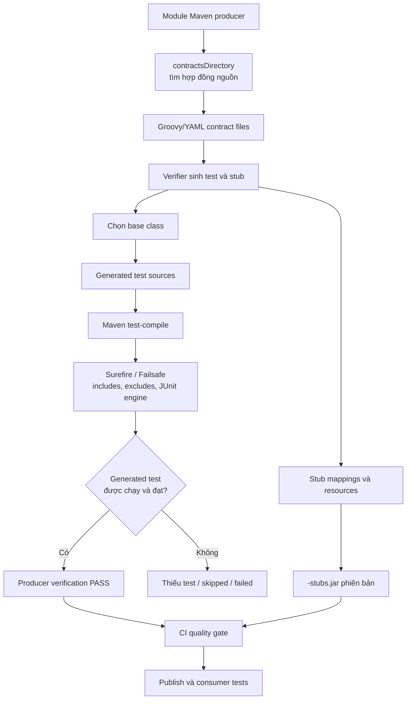

# Cấu hình base class, thư mục hợp đồng và bộ lọc

## 1. Vì sao ba cấu hình này quyết định chất lượng contract verification?

Trong **Spring Cloud Contract**, producer và consumer thống nhất hành vi HTTP hoặc thông điệp bằng hợp đồng **Groovy DSL/YAML DSL**. Spring Cloud Contract Verifier sinh kiểm thử để kiểm tra **producer thực**, đồng thời tạo stub để **Stub Runner** phục vụ consumer tests. Tích hợp **Maven** tốt không chỉ là thêm plugin rồi nhận `BUILD SUCCESS`: build cần đọc **đúng hợp đồng**, gắn **đúng base test**, và runner phải **thực thi đủ generated tests** trước khi CI phát hành stub.

Ba nhóm cấu hình trọng tâm:

- **Base class**: generated test kế thừa class nào để nhận Spring context, HTTP test adapter, fixture/mocks hoặc messaging trigger?
- **Thư mục hợp đồng**: plugin quét nguồn `.groovy`/`.yml` ở đâu và thuộc Maven module nào?
- **Bộ lọc**: hợp đồng nào được chọn để sinh mã, generated test nào được runner khám phá/chạy, test nào bị exclude hoặc skip?

Sau bài này, bạn sẽ biết cấu hình `contractsDirectory`, `baseClassForTests` và chiến lược nhiều base class, nhận diện ba tầng lọc khác nhau, sử dụng báo cáo Surefire/Failsafe để xác minh test thật sự chạy, rồi đặt quality gate trước khi publish stub.

**Thông điệp quan trọng:** “Sinh ra test” khác “biên dịch được test”, và cả hai vẫn khác “test đã chạy và đạt”.

## 2. Vòng đời từ hợp đồng nguồn tới test report



| Giai đoạn | Bằng chứng cần thu | Điều chưa được chứng minh |
|---|---|---|
| **Phát hiện hợp đồng** | Đúng file nguồn trong module producer | Test đã được tạo |
| **Sinh mã** | Generated Java/Kotlin test sources tồn tại | Compiler hoặc runner đã xử lý |
| **Biên dịch** | Test compilation hoàn thành | Test được JUnit phát hiện |
| **Runner thực thi** | Report chứa generated class/method, executed > 0 | Assertions đều đạt |
| **Đạt assertions** | Failures/errors/skipped phù hợp; kiểm tra response/message | Consumer xử lý stub đúng |
| **Đóng gói stub** | Có WireMock mappings/body files trong `-stubs.jar` | Producer đã được kiểm chứng nếu tests bị skip |

Trong CI phải đối chiếu **đúng generated contract tests**, không chỉ nhìn tổng số unit tests của toàn reactor build.

## 3. Bố trí thư mục hợp đồng trong Maven

Một producer có HTTP API và sự kiện message có thể sắp xếp:

```text
order-service/
├── pom.xml
└── src/
    ├── main/java/com/example/orders/
    │   ├── OrderApplication.java
    │   └── api/OrderController.java
    └── test/
        ├── java/com/example/orders/contract/
        │   ├── OrderContractBase.java
        │   └── OrderMessageContractBase.java
        └── resources/
            ├── contracts/
            │   ├── http/orders/
            │   │   ├── get-paid-order.groovy
            │   │   ├── get-order-not-found.yml
            │   │   └── create-invalid-order.groovy
            │   └── messaging/orders/
            │       └── order-paid.groovy
            └── contract-fixtures/
                └── seed-orders.sql
```

Thông thường, `src/test/resources/contracts` là thư mục nguồn mặc định được nhiều dự án Spring Cloud Contract sử dụng. Khi dự án có cấu hình riêng, hãy **chỉ rõ đường dẫn trong POM** và kiểm tra generator đã tìm thấy file. Các thư mục `target/generated-test-sources`, `target/stubs` hoặc `mappings` ở output build **không phải** vị trí để quản lý hợp đồng nguồn.

Quy ước tách `http` và `messaging` hữu ích vì hai nhóm có thể cần **base test hoàn toàn khác nhau**. Tên file nên phản ánh hành vi quan sát được: success, not-found, validation error hoặc event được phát.

### 3.1. Maven multi-module

```text
commerce-parent/
├── pom.xml
├── order-service/
│   ├── pom.xml
│   └── src/test/resources/contracts/...
└── checkout-service/
    ├── pom.xml
    └── src/test/java/...
```

Với plugin chạy trong `order-service`, `${project.basedir}` thông thường chỉ tới **module producer đó**, không phải root parent. Nếu parent POM cấu hình một đường dẫn tuyệt đối sai hoặc một child POM override plugin, generator có thể quét nhầm module.

Phân biệt `<pluginManagement>` (quản lý phiên bản/cấu hình) với `<plugins>` và các execution thực sự được áp dụng. Không nên coi build parent thành công là bằng chứng contract tests của `order-service` đã chạy.

## 4. Cấu hình Spring Cloud Contract Maven Plugin

Đoạn POM minh họa cho **producer dùng JUnit Jupiter và Rest Assured MockMvc**:

```xml
<properties>
    <spring-cloud-contract.version>REPLACE_WITH_COMPATIBLE_VERSION</spring-cloud-contract.version>
</properties>

<build>
    <plugins>
        <plugin>
            <groupId>org.springframework.cloud</groupId>
            <artifactId>spring-cloud-contract-maven-plugin</artifactId>
            <version>${spring-cloud-contract.version}</version>
            <extensions>true</extensions>
            <configuration>
                <contractsDirectory>
                    ${project.basedir}/src/test/resources/contracts
                </contractsDirectory>
                <baseClassForTests>
                    com.example.orders.contract.OrderContractBase
                </baseClassForTests>
                <testFramework>JUNIT5</testFramework>
                <testMode>MOCKMVC</testMode>
            </configuration>
        </plugin>
    </plugins>
</build>
```

**Cần lưu ý:**

1. `REPLACE_WITH_COMPATIBLE_VERSION` là **placeholder**; phải chọn phiên bản Spring Cloud Contract tương thích với Spring Boot/Cloud BOM của dự án.
2. `contractsDirectory` chỉ nguồn contract. `baseClassForTests` chỉ **fully qualified class name** (FQN) của base test do nhóm producer viết.
3. `testFramework` và `testMode` phải khớp mã test generated và test infrastructure: ví dụ `JUNIT5` + `MOCKMVC`.
4. `<extensions>true</extensions>` là cách cấu hình thường gặp; cần xác minh lifecycle/goals của **phiên bản plugin thực tế** qua log/build. Không dựa vào sự tồn tại của đoạn XML để kết luận plugin đã sinh test.
5. Đoạn trên **chưa phải POM đầy đủ**. Dependencies, test engine, Surefire/Failsafe và fixture/transport vẫn cần được cấu hình.
6. Nếu producer dùng WebFlux hoặc messaging thay vì Spring MVC, không sao chép `MOCKMVC` chỉ để generated tests compile; phải chọn mode và base test phù hợp.

### 4.1. Test dependencies

Ví dụ dependencies cho Spring MVC producer:

```xml
<dependencies>
    <dependency>
        <groupId>org.springframework.boot</groupId>
        <artifactId>spring-boot-starter-test</artifactId>
        <scope>test</scope>
    </dependency>
    <dependency>
        <groupId>io.rest-assured</groupId>
        <artifactId>spring-mock-mvc</artifactId>
        <scope>test</scope>
    </dependency>
</dependencies>
```

Spring Boot Test thường mang theo JUnit Jupiter và các công cụ test tương thích theo BOM của dự án. `spring-mock-mvc` là module Rest Assured cho MockMvc; nếu version không được quản lý trong dependency management, cần khai báo version phù hợp. Một runtime chỉ có JUnit 4 engine trong khi generated test dùng JUnit 5 có thể khiến **test không được chạy** dù source biên dịch.

## 5. `baseClassForTests` và vai trò của base test

Generated test dùng base class để khởi tạo môi trường **producer thật**. Một base class có thể đảm nhiệm:

- Start Spring application context và HTTP test adapter.
- Dựng dữ liệu/mocks theo kịch bản hợp đồng.
- Cung cấp helper method cho `execute(...)`/`byCommand(...)` nếu contract sử dụng.
- Cấu hình messaging verifier và trigger method cho message contracts.
- Dọn tài nguyên giữa các generated tests, tránh làm sai kết quả khi chạy theo thứ tự khác.

### 5.1. Ví dụ base class `MOCKMVC` với JUnit 5

```java
package com.example.orders.contract;

import io.restassured.module.mockmvc.RestAssuredMockMvc;
import org.junit.jupiter.api.AfterEach;
import org.junit.jupiter.api.BeforeEach;
import org.springframework.beans.factory.annotation.Autowired;
import org.springframework.boot.test.autoconfigure.web.servlet.AutoConfigureMockMvc;
import org.springframework.boot.test.context.SpringBootTest;
import org.springframework.web.context.WebApplicationContext;

@SpringBootTest(webEnvironment = SpringBootTest.WebEnvironment.MOCK)
@AutoConfigureMockMvc
public abstract class OrderContractBase {

    @Autowired
    protected WebApplicationContext context;

    @BeforeEach
    public void prepare() {
        RestAssuredMockMvc.webAppContextSetup(context);
        // Chuẩn bị fixture: order 42 ở state PAID, v.v.
    }

    @AfterEach
    public void cleanup() {
        RestAssuredMockMvc.reset();
        // Dọn database/cache/mock nếu test đã thay đổi chúng.
    }
}
```

Với `MOCKMVC`, Rest Assured MockMvc thường cho phép gửi request qua Spring MVC boundary mà không cần mở HTTP port thật. Điều này bảo vệ route, serialization, validation và exception advice **khi các thành phần ấy thực sự được nạp vào test context**. Base test không nên mock toàn bộ controller hoặc tự dựng response chỉ để vượt qua generated assertions.

**Phạm vi của ví dụ:** `OrderApplication`, fixture và repository cụ thể chưa được định nghĩa. Trong dự án thật, cần chuẩn bị dữ liệu sao cho `GET /api/orders/42` đúng kỳ vọng; nếu không, generated test có thể chạy nhưng trả `404` và thất bại.

### 5.2. FQN phải khớp source

POM:

```xml
<baseClassForTests>
    com.example.orders.contract.OrderContractBase
</baseClassForTests>
```

Java source:

```java
package com.example.orders.contract;

public abstract class OrderContractBase {
    // Shared test infrastructure.
}
```

Nếu bạn chuyển class sang `com.example.orders.testing` mà không sửa POM, generated test có thể gặp lỗi `cannot find symbol` hoặc `class not found` khi biên dịch. Base class cũng phải thuộc **test compile classpath** của module producer.

### 5.3. Base class không thay thế assertions

Base class có thể làm cho request chạy được, nhưng **contract** mới xác định expected request/response. Không nên:

- Hardcode endpoint hoặc response mock ở layer controller để luôn trả đúng sample.
- Bỏ assertion `status`/body khỏi contract khi fixture sai.
- Dựa vào database production hoặc thứ tự test trước đó để seed dữ liệu.
- Cho tất cả tests dùng chung static mutable state mà không cleanup.

## 6. `contractsDirectory` và đường dẫn tương đối

Ví dụ khai báo:

```xml
<contractsDirectory>
    ${project.basedir}/src/test/resources/contracts
</contractsDirectory>
```

Thư mục này chứa **contract nguồn**. Sau bước generate, output thường nằm trong những thư mục dưới `target/` tùy phiên bản/plugin:

```text
src/test/resources/contracts/
    ├── http/orders/get-paid-order.groovy
    └── http/orders/get-order-not-found.yml

target/
    ├── generated-test-sources/...  (generated test)
    ├── test-classes/...            (compiled test bytecode)
    ├── stubs/...                   (generated stub resources nếu có)
    └── surefire-reports/...        (test reports nếu runner chạy)
```

**Không đặt hợp đồng nguồn trong `target`**: `mvn clean` sẽ xóa output build trước khi generator tìm hợp đồng. Nếu dự án tải contracts từ nơi khác, bước tải phải rõ ràng và phải chạy **trước** generator, không lặng lẽ dựa vào cache cũ.

### 6.1. Những lỗi đường dẫn thường gặp

| Hiện tượng | Nguyên nhân có thể | Cách kiểm tra |
|---|---|---|
| Không có generated tests | `contractsDirectory` sai hoặc trống | Đối chiếu đường dẫn trong module đang chạy |
| Build parent xanh, module producer không có test | Plugin không được áp dụng ở child | Kiểm tra effective POM / reactor scope |
| Một file YAML không được xử lý | Sai extension/cú pháp/DSL | Đọc lỗi parser, xác minh plugin hỗ trợ định dạng |
| File ở `src/main/resources` | Ngoài nơi Verifier đang quét | Chuyển về nguồn contract được cấu hình |
| Chạy clean xong mất hết contracts | Nguồn đặt nhầm trong `target` | Quản lý nguồn dưới repository hoặc bước tải rõ |
| Test cũ tồn tại dù nguồn đổi | Generated output/cache từ build trước | Build sạch và so sánh generated sources |
| Module bị chọn nhầm với `-pl` | Reactor chạy module không sở hữu contract | Xác nhận `project.basedir` và module ownership |

### 6.2. Tổ chức source giúp giảm bộ lọc phức tạp

Một cấu trúc có ý nghĩa theo domain:

```text
contracts/
├── http/
│   ├── orders/
│   │   ├── get-paid-order.groovy
│   │   └── get-order-not-found.yml
│   └── checkout/
│       └── validate-checkout.groovy
└── messaging/
    └── orders/
        └── publish-order-paid.groovy
```

Đừng coi tên folder là bằng chứng generator chắc chắn phân package đúng như bạn tưởng. Tùy cách plugin xây package/regex, hãy xem **generated source thực tế** khi dùng base-class mappings.

## 7. Nhiều nhóm hợp đồng cần nhiều base classes

Một producer có thể vừa có HTTP REST vừa phát message. HTTP test cần MockMvc, còn messaging test có thể cần message verifier, test binder, trigger method và fixture riêng. Một base class chỉ khởi tạo MockMvc **không bảo đảm** messaging test chạy được.

### 7.1. `baseClassMappings`

Một dạng cấu hình thường gặp khi plugin hỗ trợ **regex chọn base class theo package contract**:

```xml
<configuration>
    <contractsDirectory>
        ${project.basedir}/src/test/resources/contracts
    </contractsDirectory>
    <testFramework>JUNIT5</testFramework>
    <baseClassMappings>
        <baseClassMapping>
            <contractPackageRegex>.*http.*</contractPackageRegex>
            <baseClassFQN>
                com.example.orders.contract.OrderContractBase
            </baseClassFQN>
        </baseClassMapping>
        <baseClassMapping>
            <contractPackageRegex>.*messaging.*</contractPackageRegex>
            <baseClassFQN>
                com.example.orders.contract.OrderMessageContractBase
            </baseClassFQN>
        </baseClassMapping>
    </baseClassMappings>
</configuration>
```

**Quan trọng:** regex, cách package contract được tạo từ đường dẫn, option được hỗ trợ và thứ tự ưu tiên mappings phụ thuộc **phiên bản Maven plugin**. Đây là đoạn minh họa chiến lược, cần kiểm chứng bằng **tên base class ở dòng `extends` của generated Java test**. Không mặc định `.*http.*` sẽ khớp chỉ vì file ở folder `http`.

Quy trình kiểm tra:

1. Phân loại contract theo giao diện.
2. Sử dụng regex không chồng lấn nếu có thể.
3. Generate tests từ một build sạch.
4. Mở generated sources và xác minh từng test kế thừa đúng base.
5. Biên dịch và chạy tests của cả HTTP lẫn messaging.

### 7.2. `packageWithBaseClasses` và quy ước

Một số cấu hình Spring Cloud Contract cho phép dùng `packageWithBaseClasses` kết hợp convention đặt tên base test. Đây là **chiến lược thay thế** cho việc liệt kê mappings tùy version. Khi chọn, hãy xác minh naming convention của plugin và generated `extends`, thay vì phỏng đoán từ folder source.

Không khai báo cùng lúc `baseClassForTests`, `baseClassMappings` và `packageWithBaseClasses` theo cách thiếu chính sách ưu tiên. Hãy chọn một chiến lược đơn giản, có kiểm tra bằng generated source.

### 7.3. Bộ lọc base class chồng lấn

Nếu cả hai nhánh nằm dưới `orders`, regex:

```xml
<contractPackageRegex>.*orders.*</contractPackageRegex>
```

có thể khớp **cả HTTP và messaging**. Khi message test bị gán nhầm `OrderContractBase` chỉ hỗ trợ MockMvc, generated source có thể compile lỗi do thiếu trigger hoặc test timeout vì không có message verifier. Tách pattern dựa trên **phần package thực tế** và kiểm tra từng nhóm.

## 8. Ba tầng lọc khác nhau trong Maven

| Tầng | Được cấu hình ở đâu? | Lọc cái gì? | Bẫy thường gặp |
|---|---|---|---|
| **Nguồn hợp đồng** | `contractsDirectory` và tùy chọn generator thực sự hỗ trợ | Những contract đi vào generator | Không sinh test cho file cần bảo vệ |
| **Chọn base class** | `baseClassForTests`/`baseClassMappings` | Cách generated test được setup | Chạy sai infrastructure hoặc thiếu trigger |
| **Chọn test để chạy** | Maven Surefire/Failsafe + JUnit engine + `-Dtest` | Class/method được thực thi | Có generated test nhưng report không có nó |

Đây là sự phân biệt rất quan trọng. `-Dtest=...` **không** thêm một file Groovy vào nguồn contract nếu plugin chưa phát hiện. Ngược lại, mở rộng `contractsDirectory` **không** bảo đảm Surefire sẽ chạy mọi generated class nếu bộ lọc runner loại chúng.

### 8.1. Tầng nguồn: không tự đoán tên tùy chọn include/exclude

Các phiên bản Verifier Maven Plugin có thể cung cấp cơ chế chọn hoặc bỏ file/hợp đồng. Tuy nhiên, **option filter của generator** không tự động trùng tên hay có ngữ nghĩa giống `<includes>` và `<excludes>` của Surefire. Khi muốn lọc ngay lúc generate:

- Kiểm tra các tham số plugin **của đúng version đang dùng**.
- Xác minh pattern áp lên **path, tên file hay contract package**.
- Kiểm tra số file/kịch bản đã được xử lý sau generation.
- Giới hạn filtering cho vòng debug khi phù hợp; trong release gate cần kiểm thử **tập contract đã công bố**.

Không thêm một option chưa được plugin hỗ trợ chỉ vì nó trông giống cấu hình của Maven test runner.

### 8.2. Lọc nguồn khác lọc runner

Ví dụ một contract `get-paid-order.groovy` không được nhìn thấy vì `contractsDirectory` sai: **không có generated test** để Surefire chọn. Ví dụ khác: generator sinh `ShouldReturnPaidOrderTest.java` nhưng Surefire chỉ include `**/*UnitTest.java`: test **đã sinh và có thể compile**, nhưng **không chạy**.

Hai lỗi này cần hai cách sửa khác nhau và có thể cùng tạo ra một dấu hiệu ngoài: `BUILD SUCCESS` với tổng test count vẫn cao nhờ các unit tests khác.

## 9. Surefire/Failsafe lọc generated test classes

### 9.1. Maven Surefire

Surefire thường thực thi tests ở phase `test`. Quy tắc nhận diện mặc định và include/exclude cụ thể phụ thuộc phiên bản/configuration. Ví dụ cấu hình include tường minh:

```xml
<plugin>
    <groupId>org.apache.maven.plugins</groupId>
    <artifactId>maven-surefire-plugin</artifactId>
    <version>REPLACE_WITH_COMPATIBLE_SUREFIRE_VERSION</version>
    <configuration>
        <includes>
            <include>**/*Test.java</include>
            <include>**/*Tests.java</include>
        </includes>
    </configuration>
</plugin>
```

**Không áp dụng máy móc.** Nếu generator đặt tên class khác pattern, includes này có thể loại test hợp đồng. Để quyết định pattern, phải kiểm tra **generated test class names thực tế**. `REPLACE_WITH_COMPATIBLE_SUREFIRE_VERSION` cũng chỉ là placeholder, không thể dùng nguyên văn.

### 9.2. Excludes có thể làm mất bằng chứng

```xml
<configuration>
    <excludes>
        <exclude>**/*ContractTest.java</exclude>
    </excludes>
</configuration>
```

Đoạn trên có thể cố ý tách nhóm integration tests; nhưng nếu Failsafe hoặc runner khác **không chạy chúng**, CI sẽ mất contract verification. Cần theo dõi cả **generated tests đã compile** và **báo cáo runner**.

### 9.3. Chạy riêng một generated class để debug

```bash
# Thay tên bằng class generated thực tế.
mvn -Dtest=ShouldReturnPaidOrderTest test
```

`-Dtest` chọn **test classes** cho Surefire, không lọc contract source tại generator. Nếu class name không khớp, cách build báo fail hoặc skip có thể phụ thuộc thiết lập `failIfNoSpecifiedTests`; phải đọc exit code và report, không chỉ xem lệnh được gọi.

Trong CI phát hành, **không thay full verification bằng `-Dtest` của một class**. Filter này thích hợp để debug nhanh, sau đó phải chạy toàn bộ contract tests.

### 9.4. Maven Failsafe cho integration tests

Maven Failsafe thường xử lý integration tests ở phase `integration-test` và `verify`. Khi thiết kế cho generated contract tests chạy bằng Failsafe:

1. Các generated class/method phải **khớp includes** của Failsafe.
2. Failsafe goals `integration-test` và `verify` phải được bind vào lifecycle phù hợp.
3. Không thể chỉ chạy `mvn test` rồi kết luận integration tests đã được kiểm chứng.
4. Xem `target/failsafe-reports` nếu dự án dùng Failsafe, song song với Surefire report.

Đừng tạo khoảng trống: excludes test khỏi Surefire nhưng lại **không đưa vào Failsafe**. Nếu project cố ý phân loại test, hãy lập một bảng class pattern → runner → Maven phase.

## 10. JUnit engine, skip flags và 0 generated tests

Với `<testFramework>JUNIT5</testFramework>`, generated tests cần engine JUnit Jupiter và Maven test plugin có khả năng dùng JUnit Platform. Nếu test class compile nhưng runtime không có engine phù hợp, runner có thể không tìm thấy test.

| Điều kiện | Điều có thể xảy ra |
|---|---|
| `-DskipTests` | Bỏ thực thi tests ở plugin hỗ trợ; compilation có thể vẫn diễn ra |
| `-Dmaven.test.skip=true` | Có thể bỏ cả test compilation và test execution |
| `-Dtest=SomeUnitTest` | Chỉ chạy tập test khớp filter |
| Surefire `<skipTests>true</skipTests>` | Test thuộc execution ấy bị bỏ qua |
| JUnit engine sai | Generated tests biên dịch nhưng runner không nhận diện đúng |
| Failsafe goals không chạy | Integration contract tests chưa được thực thi |
| CI chạy nhầm Maven module/profile | Tập hợp hợp đồng cần bảo vệ không được chạy |

Ví dụ không phù hợp làm producer verification gate:

```bash
mvn clean package -DskipTests
```

Lệnh trên có thể đóng gói ứng dụng và stubs nhưng **không cho bằng chứng generated producer tests đã thực thi**. Cũng không đủ nếu tổng report ghi 100 unit tests pass nhưng không có một generated contract test nào.

**Đếm test quan trọng hơn đếm file:** một file contract không nhất thiết tương ứng đúng một test class/method trong mọi cấu hình. Gate nên đối chiếu **các kịch bản quan trọng**, generated classes và report, thay vì mặc định “số contract files bằng số tests”.

## 11. Ví dụ đầy đủ: HTTP contract và base class

Giả sử `order-service` phải trả đơn đã thanh toán và phản hồi lỗi rõ ràng khi đơn không tồn tại.

### 11.1. Groovy contract cho HTTP 200

File ví dụ `src/test/resources/contracts/http/orders/get-paid-order.groovy`:

```groovy
import org.springframework.cloud.contract.spec.Contract

Contract.make {
    description 'Trả đơn hàng đã thanh toán'

    request {
        method GET()
        url '/api/orders/42'
        headers {
            header 'Accept', 'application/json'
        }
    }

    response {
        status OK()
        headers {
            contentType(applicationJson())
        }
        body(
            id: 42,
            state: 'PAID',
            currency: 'VND'
        )
    }
}
```

### 11.2. YAML contract cho HTTP 404

File ví dụ `src/test/resources/contracts/http/orders/get-order-not-found.yml`:

```yaml
description: Không tìm thấy đơn hàng
request:
  method: GET
  url: /api/orders/9999
  headers:
    Accept: application/json
response:
  status: 404
  headers:
    Content-Type: application/json
  body:
    code: ORDER_NOT_FOUND
    message: Order not found
```

Đây là **hai kịch bản khác nhau**, nên đặt cùng một thư mục có ý nghĩa. Chúng không trùng response và có thể dùng chung base test. Base class phải chuẩn bị order `42` đúng `PAID`, còn `9999` không tồn tại.

### 11.3. Đọc generated source để biết cấu hình có hiệu lực

Một test được sinh có logic tương đương sau (chỉ là **pseudocode minh họa**, không phải class sinh nguyên văn của mọi phiên bản):

```java
class ShouldReturnPaidOrderTest extends OrderContractBase {

    @Test
    void shouldReturnPaidOrder() {
        RestAssuredMockMvc.given()
            .header("Accept", "application/json")
            .when()
            .get("/api/orders/42")
            .then()
            .statusCode(200)
            .body("state", equalTo("PAID"));
    }
}
```

Đối chiếu:

- `extends OrderContractBase` có đúng với POM và loại contract không?
- Test dùng `MOCKMVC`, HTTP real-port hoặc message verifier theo đúng cách dự án chạy không?
- Generated test có những assertions cần bảo vệ như `status`, `state`, error `code`, headers không?
- Class/method tên gì, nằm trong package nào, **Surefire/Failsafe có chọn không**?
- Class đó có xuất hiện trong report sau khi `mvn verify` không?

Nếu source generated không đúng, **đừng sửa file dưới `target`**. Build sạch sẽ sinh lại và xóa sửa đổi. Hãy sửa hợp đồng, plugin configuration, base test hoặc code producer theo nguyên nhân.

### 11.4. Base test cần fixture thật hoặc mock đúng tầng

Với `MOCKMVC`, base test có thể seed DB test, `@Sql` hoặc mock dependency như repository/service ngoài cần kiểm soát. Không mock chính controller và trả JSON từ test theo cách bỏ qua HTTP converter/validation/advice của producer.

Ví dụ ý tưởng về fixture:

```text
BeforeEach:
  order 42  -> PAID, currency VND
  order 9999 -> không tồn tại

GET /api/orders/42:
  HTTP 200, JSON state PAID

GET /api/orders/9999:
  HTTP 404, JSON code ORDER_NOT_FOUND

AfterEach:
  Dọn record/cache/mock state do test thay đổi
```

Nếu generated test fail vì DB rỗng, sửa fixture. Không chỉnh expected response thành `404` chỉ để test xanh khi hợp đồng đang yêu cầu `200`.

## 12. Messaging contract cần một base class khác

Giả sử producer còn phát `OrderPaid` từ một lời gọi nghiệp vụ:

```groovy
import org.springframework.cloud.contract.spec.Contract

Contract.make {
    description 'Thanh toán thành công phát OrderPaid'
    label 'order_paid'

    input {
        triggeredBy('publishOrderPaidForContract()')
    }

    outputMessage {
        sentTo('orders.paid')
        headers {
            header('eventType', 'OrderPaid')
        }
        body(
            orderId: 42,
            state: 'PAID'
        )
    }
}
```

Nếu mapping gán kịch bản này sang `OrderMessageContractBase`, base test cần cung cấp method **đúng chữ ký**:

```java
public void publishOrderPaidForContract() {
    orderPaymentService.markOrderPaid(42L);
}
```

Đây chỉ là **method minh họa của base class**, không phải phương thức Spring Cloud Contract tự sinh. Nó phải gọi **luồng business/publisher thật** và có test infrastructure capture output message ở destination phù hợp. Tùy adapter/stack, có thể dùng `@AutoConfigureMessageVerifier`, Spring Cloud Stream test binder hoặc transport test khác.

**Không dùng cùng base class HTTP nếu nó không cung cấp message verifier/trigger**. Đồng thời không cho trigger chỉ gửi một message giả trực tiếp từ mã test nếu mục đích là kiểm tra business flow của producer.

## 13. Đọc báo cáo Maven và chứng minh test đã chạy

Đường dẫn thông dụng sau một build:

```text
target/
├── generated-test-sources/
│   └── ...              # vị trí phụ thuộc plugin/version
├── test-classes/
│   └── ...              # generated tests sau biên dịch
├── surefire-reports/
│   ├── TEST-*.xml
│   └── *.txt
└── failsafe-reports/
    └── ...              # nếu dự án thực sự dùng Failsafe
```

Không phải project nào cũng có cả hai nhóm reports hoặc cùng đường dẫn generated sources. Trước hết xác nhận runner nào đang chạy generated tests.

Một dòng report **minh họa**, không phải lệnh đã thực hiện:

```text
Running com.example.orders.contract.ShouldReturnPaidOrderTest
Tests run: 1, Failures: 0, Errors: 0, Skipped: 0
```

Với đúng generated class, báo cáo này cho thấy một test đã chạy và không báo lỗi. Nhưng một tóm tắt chung:

```text
Tests run: 124, Failures: 0, Errors: 0, Skipped: 0
```

**không chứng minh** có test hợp đồng, vì cả 124 test có thể là unit tests. CI cần đối chiếu **tên generated classes/methods** với danh sách hành vi cần bảo vệ.

### 13.1. Vì sao `failIfNoTests` không đủ?

Surefire có thể được cấu hình `failIfNoTests` để chặn khi không có test nào chạy. Nhưng nếu có nhiều unit tests thường, bộ lọc loại hết generated contract tests mà vẫn còn unit tests chạy, cổng `failIfNoTests` **không phát hiện được** mất contract verification.

Một gate tốt hơn phải kiểm tra một trong các dạng:

- Tập generated contract tests mong đợi xuất hiện trong reports.
- Danh sách kịch bản/contract group được kiểm chứng qua class/method reporting.
- Một kiểm tra riêng cho task/module **chỉ thực hiện contract tests**, với executed > 0 và không skipped.

Chọn cách phù hợp cấu hình dự án, nhưng không cố định quy tắc “một contract file tạo đúng một test” nếu generator/version thực tế không đảm bảo điều đó.

### 13.2. Maven lifecycle khi dùng Surefire/Failsafe

Một luồng build có thể đi qua:

```text
generate-test-sources
        ↓
test-compile
        ↓
test                 (Surefire)
        ↓
integration-test     (Failsafe nếu được cấu hình)
        ↓
verify               (Failsafe verify nếu được cấu hình)
```

Các phase và plugin goals cụ thể phải được cấu hình tương ứng với version/build. Không mặc định một `mvn test` chạy integration-test hoặc một `mvn package` đã publish stub. Khi cần bằng chứng toàn diện, lệnh tham khảo là:

```bash
mvn clean verify
```

Nhưng **mệnh lệnh không tự tạo bằng chứng**: vẫn phải xem plugin/test executions, report và các skip flags.

## 14. Maven profiles và môi trường build

### 14.1. Fast profile không phải release gate

Một profile `dev-fast` có thể cố ý giới hạn test để phát triển nhanh:

```bash
mvn -Pdev-fast test
```

Không được dùng kết quả này thay cho full verification nếu profile đã skip/lọc contract tests. Khi báo cáo CI nên lưu **tên profile, module, plugin/test versions** và mọi flag ảnh hưởng test execution.

### 14.2. Chạy đúng module producer

Trong reactor build:

```bash
# Minh họa: chọn order-service và những module phụ thuộc cần thiết.
mvn -pl order-service -am clean verify
```

`-pl` chọn module, `-am` đưa các module dependency vào reactor theo khả năng của Maven. Đừng kết luận mọi module trong reactor phải có contract tests; chỉ **module producer sở hữu các hợp đồng** cần xuất report tương ứng.

### 14.3. Effective POM để tìm cấu hình bị ghi đè

Nếu parent POM đặt plugin trong `<pluginManagement>` nhưng child thiếu plugin activation/execution, hãy xem **effective POM** ở đúng module:

```bash
# Câu lệnh tham khảo, không thực thi trong bài.
mvn help:effective-pom
```

Đối chiếu:

- Plugin Verifier có thực sự xuất hiện trong effective build config?
- `contractsDirectory` đã expand từ `project.basedir` nào?
- `baseClassForTests` hoặc base class mapping có bị child override?
- Surefire includes/excludes bị profile hoặc parent thay đổi?
- Plugin execution gắn vào phase mong đợi và có bị skip không?

Đừng tự sửa parent POM hoặc toàn bộ modules chỉ vì một child module lỗi; tập trung cấu hình có hiệu lực tại nơi sở hữu hợp đồng.

## 15. Mô hình lọc đúng cho local debug và CI chính

```text
Local debug:
    Sinh mã từ nguồn contract đúng
    Chạy một generated class để tìm lỗi
    Sửa contract/fixture/base class/code producer

Trước khi merge/release:
    Generate đủ các contract cần bảo vệ
    Compile đầy đủ
    Execute tất cả generated contract tests
    Kiểm tra tên class trong reports và fail/skip
    Chỉ sau đó mới publish stub artifact mới
```

| Công việc | Lọc có chấp nhận không? | Cần ghi rõ điều gì? |
|---|---|---|
| Debug một contract lỗi | **Có** | Tên class và giới hạn phạm vi test |
| Sửa một base class mapping | Có ở vòng đầu, sau đó chạy full suite | Các nhóm HTTP/messaging bị tác động |
| Merge gate | Không được bỏ các contract đã công bố | Tập generated tests đầy đủ |
| Publish `-stubs.jar` | Chỉ sau verification đầy đủ | Report và artifact version |
| Consumer CI với Stub Runner | Có thể chọn version cố định cho release | Resolved group/artifact/version/classifier |

Một bất thường cần báo động là số **generated contract tests giảm xuống 0** trong khi tổng số tests vẫn cao. Ngoài count, nên so sánh **contract source → generated class → report** cho những kịch bản quan trọng.

## 16. Ma trận chẩn đoán: sai nguồn, base hay bộ lọc?

| Triệu chứng | Tầng cần kiểm tra trước | Cách xác minh |
|---|---|---|
| Không có generated Java | Contract discovery/generator | Directory, module, plugin lifecycle |
| Một file Groovy bị bỏ qua | Source path, extension hoặc parse | File nằm trong `contractsDirectory`? |
| Test được sinh nhưng `cannot find symbol` | Base class FQN/test classpath | `extends` và package/class thực tế |
| Test dùng JUnit 5 nhưng runner không thấy | JUnit engine/Surefire | Annotation, runtime dependencies |
| Test compile nhưng Surefire report không có | Runner includes/excludes/skip | Class name thật, `-Dtest`, profile |
| HTTP contract trả `404` thay `200` | Base fixture hoặc producer | Seed order, controller mapping |
| Messaging test timeout | Trigger/message verifier/binder | Base class messaging, transport, destination |
| Test chạy riêng pass, chạy suite fail | Shared fixture/cache/mock | Setup/teardown, test isolation |
| Maven có `BUILD SUCCESS` nhưng 0 contract tests | Generator/runner filters | Không công nhận producer verification |
| Tổng unit tests pass nhưng thiếu generated class | Gating theo count quá rộng | Đối chiếu test report theo class |
| Chỉ `-Dtest=...` mới chạy generated class | Surefire default/include pattern | Cập nhật test selection có chủ đích |
| Profile release vô tình skip tests | Maven profile/flags | Effective config + CI command |
| Stub artifact được tạo nhưng producer trả sai | Tests không chạy hoặc thiếu assertions | Producer verification thật |
| Consumer nhận bản stub cũ | Coordinates/repository | Pin và kiểm tra version/classifier |
| Một message contract kế thừa HTTP base | Mapping regex chồng lấn | Kiểm tra `contractPackageRegex` và generated `extends` |

### 16.1. Trình tự sửa lỗi tiết kiệm thời gian

1. **Nguồn:** liệt kê contract đang mong đợi trong directory được giao.
2. **Plugin:** xác nhận Verifier goal thực sự chạy ở module producer.
3. **Generated source:** xem class/method được sinh và tên package.
4. **Base:** kiểm tra `extends`, `@BeforeEach`, mock/fixture hoặc message verifier.
5. **Compile:** xử lý lỗi dependency/test framework.
6. **Runner:** kiểm tra Surefire/Failsafe filters, JUnit engine và skip flags.
7. **Report:** đối chiếu generated classes đã executed/pass/fail/skipped.
8. **Publish:** chỉ đóng gói/phát hành stub khi chất lượng producer gate đạt.

Quy trình này ngăn việc sửa `-Dtest` trong khi nguyên nhân thực tế là **contract chưa bao giờ được generator tìm thấy**.

## 17. CI gate trước khi phát hành stub

```mermaid
sequenceDiagram
    participant Dev as Developer
    participant CI as Maven producer CI
    participant Repo as Artifact repository
    participant CC as Consumer CI
    Dev->>CI: Commit contract + code + POM
    CI->>CI: Chọn module và contractsDirectory
    CI->>CI: Generate tests, map base classes
    CI->>CI: Compile, execute Surefire/Failsafe
    CI->>CI: Đối chiếu generated tests với reports
    alt Các contract cần bảo vệ đã chạy và đạt
        CI->>Repo: Publish versioned -stubs.jar
        CC->>Repo: Resolve đúng version/classifier
        CC->>CC: Stub Runner + consumer tests
    else Test thiếu, skip hoặc fail
        CI-->>Dev: Chặn publish; giữ logs và reports
    end
```

**Quality gate tối thiểu:**

- Có những contract nguồn mà module producer chịu trách nhiệm.
- Plugin sinh generated tests tương ứng; không có parse errors.
- Generated classes kế thừa **đúng base test** và compile được.
- Runner thực thi đủ những generated tests cần bảo vệ; không bị excludes/skip.
- Assertions về status/body/header hoặc message destination/payload đạt.
- CI kiểm tra test reports, không chỉ mã exit 0 hoặc tổng unit test count.
- Stubs được đóng gói thành artifact đúng classifier/version **sau** producer verification.
- Consumer CI tải đúng stub version, chạy HTTP/message client thật bằng Stub Runner.

**Giới hạn:** việc publish stub sau verification không thay thế việc đánh giá compatibility với consumer hiện hữu; cả hai phía vẫn cần test khi đổi API schema, mã lỗi, tên topic hoặc semantics.

## 18. Bài thực hành: tìm vì sao Maven “xanh” nhưng không có contract tests

**Bối cảnh:** `order-service` có hai hợp đồng HTTP và một hợp đồng messaging. Maven Verifier đã được thêm vào POM nhưng `mvn test` báo thành công, Surefire report chỉ chứa các unit tests. Khi chạy riêng một generated class, Maven lại báo thiếu `OrderMessageContractBase`.

**Nhiệm vụ:**

1. Xác nhận `order-service/src/test/resources/contracts` chứa các file HTTP và messaging; `contractsDirectory` trỏ đúng module producer.
2. Kiểm tra `baseClassForTests` hoặc `baseClassMappings` và xác minh base class có mặt trong `src/test/java`.
3. Chạy build sạch bằng lệnh Maven phù hợp và tìm generated source đã được sinh.
4. Đọc `extends` của từng generated class. Sửa mapping nếu message contract bị gán vào HTTP base.
5. Kiểm tra `testFramework=JUNIT5`, JUnit Jupiter runtime engine và Surefire/Failsafe tương thích.
6. Đối chiếu các include/exclude patterns với **tên class generated thực tế**; bỏ điều kiện lọc gây mất test.
7. Đọc test report theo từng generated class, bảo đảm **executed > 0**, không skipped, failures/errors bằng 0.
8. Cố tình đổi output `state=PAID` thành `PENDING` trong producer test environment; contract HTTP phải fail nếu assertion đủ mạnh.
9. Cố tình bỏ message trigger hoặc đổi destination; messaging test phải fail nếu adapter/transport đúng.
10. Khôi phục các thay đổi thử nghiệm, chạy full producer verification và chỉ sau đó publish artifact `-stubs.jar`.
11. Dùng Stub Runner ở consumer CI để xác minh client deserialize response và xử lý lỗi đã công bố.

### 18.1. Bảng tự kiểm tra

| Câu hỏi | Trả lời |
|---|---|
| `contractsDirectory` trỏ tới nơi sinh Java test à? | **Không**; đó là nơi chứa contract nguồn |
| `baseClassForTests` có phải class do Verifier tự tạo không? | **Không**; nhóm producer phải cung cấp |
| `-Dtest=...` có thêm file Groovy mới vào generator không? | **Không**; nó lọc test runner |
| Có 100 unit tests pass nhưng không có generated tests, đã verify hợp đồng chưa? | **Chưa** |
| Một regex `.*orders.*` có thể khớp cả HTTP/messaging không? | **Có**, nếu package tương ứng chứa `orders` |
| Bật `-DskipTests` có thể làm build xanh dù contract không chạy không? | **Có** |
| `mvn test` mặc nhiên chạy Failsafe integration tests không? | **Không** |
| Mỗi contract file luôn tương ứng một generated method không? | **Không thể mặc định** |
| Sinh `-stubs.jar` có chứng minh producer đáp ứng contract chưa? | **Không** |

## 19. Checklist tích hợp Maven

- [ ] Plugin Spring Cloud Contract Maven áp dụng **ở đúng module producer**, version tương thích với Spring Boot/Cloud.
- [ ] `contractsDirectory` chỉ nguồn Groovy/YAML, không chỉ generated output hoặc module khác.
- [ ] Contract source có kịch bản HTTP success/error và messaging quan trọng với consumer.
- [ ] `baseClassForTests` dùng FQN tồn tại trên test compile classpath.
- [ ] Nếu nhiều base classes, mapping regex/convention được kiểm tra bằng **generated `extends`**.
- [ ] `testFramework`/`testMode` khớp đúng JUnit, MockMvc, WebFlux hoặc messaging infrastructure.
- [ ] Base test có fixture/mock và cleanup, không bỏ qua controller/publisher thật cần kiểm chứng.
- [ ] Generator phát hiện và sinh đủ kịch bản theo tập hợp contract đã công bố.
- [ ] Generated tests compile thành công.
- [ ] Surefire/Failsafe includes/excludes không vô tình loại generated classes.
- [ ] JUnit engine, profile, Maven phase và runner goals được cấu hình đồng bộ.
- [ ] Không dùng `-DskipTests`, `maven.test.skip` hoặc một `-Dtest` debug làm release gate.
- [ ] Test report chứng minh các **generated contract tests thực sự chạy và đạt**; không chỉ có unit tests pass.
- [ ] CI phát hiện khi tập generated contract tests biến mất hoặc bị skip.
- [ ] Stubs được phát hành với đúng version/classifier sau khi producer verification đạt.
- [ ] Consumer CI dùng Stub Runner với đúng artifact, chạy client thật và assert hành vi.
- [ ] Với multi-module, đã xác minh effective POM và plugin inheritance ở module sở hữu contract.
- [ ] Khi thay đổi base mapping hoặc filters, đã chạy full suite và thử tình huống lỗi có chủ đích.

**Ghi nhớ:** `contractsDirectory` xác định **những hợp đồng nào đi vào build**, base class xác định **môi trường mà generated tests dùng để gọi producer**, còn Surefire/Failsafe và bộ lọc quyết định **những test nào thật sự được chạy**. Chỉ khi có bằng chứng ở cả ba tầng và CI chặn phát hành stub nếu producer verification thiếu hoặc thất bại, tích hợp Maven mới giúp Spring Cloud Contract phát hiện thay đổi API không tương thích một cách đáng tin.
