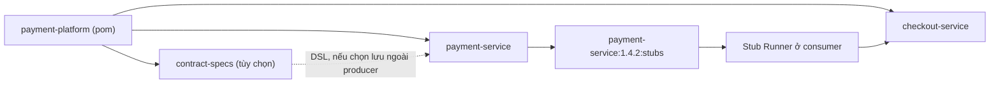
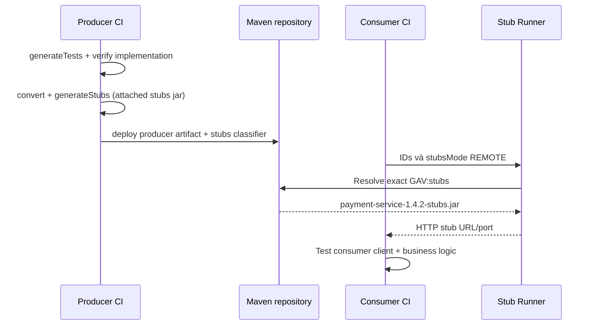
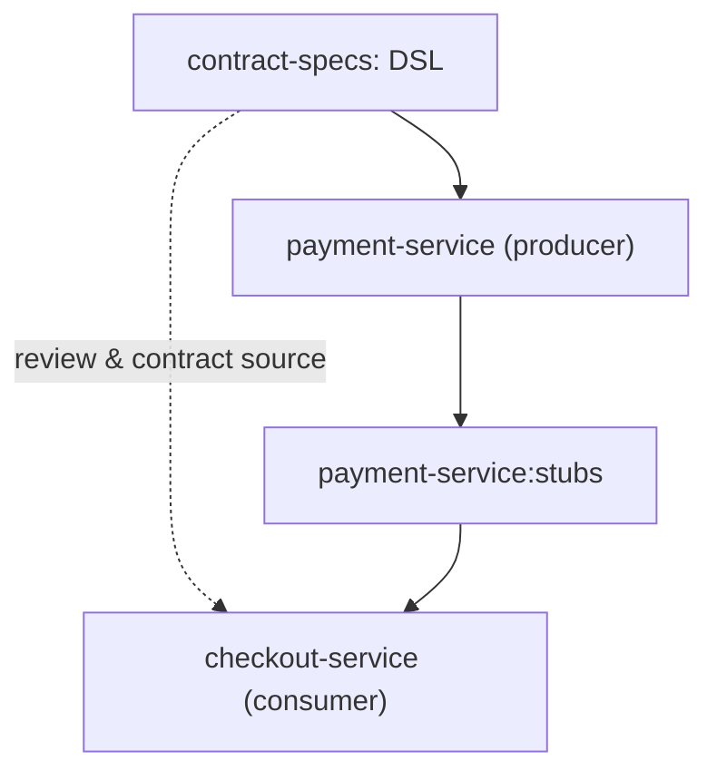
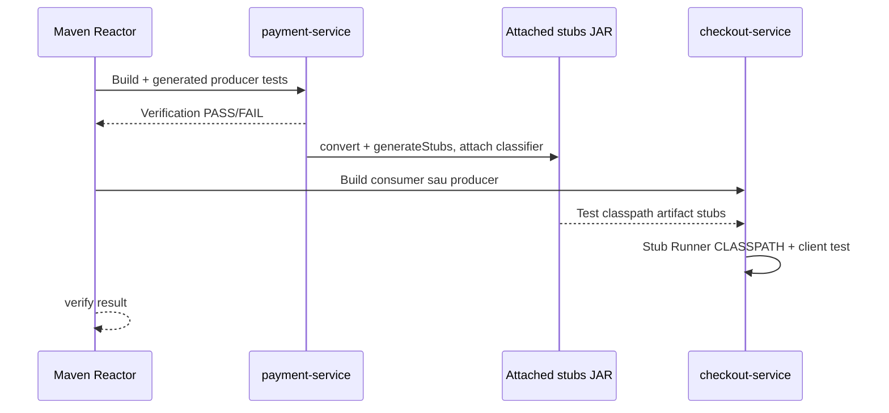
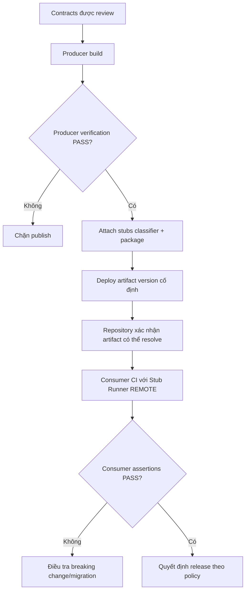

# Build nhiều module và thứ tự công bố phụ thuộc

## 1. Bài toán: producer, consumer và hợp đồng không luôn nằm cùng module

Trong một hệ thống sử dụng **Spring Cloud Contract (SCC)**, **producer** cung cấp API HTTP hoặc phát thông điệp, **consumer** sử dụng giao diện đó. Hai nhóm thống nhất hành vi bằng **Groovy/YAML DSL**. Producer sinh **verification tests**, tạo **stub artifact**; consumer dùng **Stub Runner** để tải stub rồi kiểm thử mã client. Khi kết nối với CI, quy trình này giúp phát hiện sớm thay đổi API không tương thích.

Trong một repository Maven nhiều module, tình huống thường gặp là:

- Module `payment-service` sở hữu controller, business logic và producer contract tests.
- Module `checkout-service` chứa HTTP client và logic consumer cần test với stub payment.
- Có thể có module `contract-specs` lưu DSL dùng chung hoặc được tải từ nguồn ngoài.
- Parent/aggregator `pom.xml` gom các module vào một **Maven Reactor build**.

Câu hỏi không chỉ là “module nào đứng trước trong file POM?”. Điều quan trọng hơn là:

1. **Maven dựa vào đâu để biết producer phải build trước consumer?**
2. **Khi nào stub JAR đã được sinh, đính kèm và có thể phân giải?**
3. **Khi nào chạy producer verification, consumer tests, `install` hoặc `deploy`?**
4. **Consumer có đang dùng stub đúng version hay vô tình dùng cache/stub cũ?**
5. **CI làm thế nào để không công bố contract/stub chưa được producer xác minh?**

Bài thuộc chương **Tích hợp Maven** trong mô-đun **SPRING_CLOUD_CONTRACT**. Trọng tâm là **Maven multi-module, Reactor, thứ tự build và thứ tự công bố phụ thuộc**, không phải chỉ chép plugin SCC vào một POM đơn lẻ.

### Mục tiêu học tập

Sau bài học bạn sẽ có thể:

- Phân biệt **parent**, **aggregator**, **module**, **dependency graph** và **artifact repository**.
- Giải thích thứ tự Maven Reactor và giới hạn của danh sách `<modules>`.
- Cấu hình SCC Maven plugin trong **đúng module producer** để sinh tests và stub JAR.
- Biết lúc nào phải chọn `CLASSPATH`, `LOCAL`, `REMOTE` hoặc `stubs://` cho consumer.
- Dùng `-pl`, `-am`, `-amd` và các lifecycle `verify`, `package`, `install`, `deploy` có chủ đích.
- Thiết kế CI nhiều module không phát hành artifact chưa qua verification và không mắc vòng phụ thuộc.
- Chẩn đoán các lỗi reactor order, missing classifier, stale artifact, `0 tests`, dependency cycle và parallel build.

> **Nguyên tắc:** Quan hệ giữa hai module được Maven Reactor hiểu qua **dependency/build reference được hiện thực hóa**. Chỉ viết tên producer trước consumer trong `<modules>` hoặc chỉ đặt phiên bản trong `dependencyManagement` **không đủ để mô tả mọi phụ thuộc**.

## 2. Bốn khái niệm phải phân biệt

| Khái niệm | Ví dụ | Vai trò |
|---|---|---|
| **Aggregator POM** | `payment-platform/pom.xml` với `<modules>` | Thu thập các module để Maven Reactor build |
| **Parent POM** | `<parent>com.acme:payment-platform:1.4.2</parent>` | Cho module kế thừa properties, plugin/dependency management |
| **Module dependency** | `checkout-service` có `<dependency>` đến artifact của `payment-service` | Tạo cạnh phụ thuộc được Reactor dùng để sắp xếp |
| **Maven artifact** | `com.acme.billing:payment-service:1.4.2:stubs` | Gói đã build, có thể được cài/công bố và nạp qua Stub Runner |

Một POM có thể đồng thời là **parent** và **aggregator**, nhưng hai vai trò không giống nhau:

- `<modules>` liệt kê **thư mục module tham gia build**.
- `<parent>` mô tả **kế thừa mô hình Maven**.
- `<dependencies>` khai báo **artifact thật sự cần**.
- `<dependencyManagement>` quy định phiên bản/thuộc tính mặc định **khi một module khai báo dependency**, không tự thêm dependency.

Một repository có cùng aggregator không buộc hai module Java phải phụ thuộc trực tiếp vào nhau. Ngược lại, một dependency có thể trỏ tới artifact **ngoài repository**, nhưng nếu artifact đó không phải project đang có trong Reactor, Maven cần phân giải qua local/remote repository.

### 2.1. Một repo, ba mô hình hợp tác

| Mô hình | Producer/consumer cùng Reactor? | Cách consumer lấy stubs |
|---|---|---|
| **Một Maven Reactor, khai báo stub dependency** | Có | `CLASSPATH` qua dependency classifier `stubs` |
| **Một Maven Reactor, dùng local installed stubs** | Có | `LOCAL`, nhưng phải bảo đảm producer đã `install` trước |
| **Nhiều repo hoặc pipeline tách biệt** | Thường không | `REMOTE` từ repository sau producer CI |
| **Một repo, dùng output thư mục trực tiếp** | Có thể | `stubs://` nếu được cấu hình rõ, không phải Maven artifact |

Các đường này có ưu/nhược điểm khác nhau. Không nên đổi `stubsMode` một cách tùy tiện chỉ để test qua: mode phải phản ánh **nguồn artifact thực sự**.

## 3. Kiến trúc minh họa: Maven aggregator và ba module

Giả sử cấu trúc:

```text
payment-platform/
├── pom.xml                         # aggregator/parent
├── contract-specs/                 # DSL dùng chung (tùy chọn)
│   └── pom.xml
├── payment-service/                # producer
│   ├── pom.xml
│   └── src/test/resources/contracts/...
└── checkout-service/               # consumer
    ├── pom.xml
    └── src/test/java/...           # Stub Runner tests
```

Mối quan hệ **mong muốn**:



Mũi tên ở sơ đồ biểu diễn **luồng trách nhiệm/đầu ra**, không phải tất cả cạnh đều là Maven `<dependency>`. Nếu module `checkout-service` không khai báo dependency Maven đến `payment-service`, Reactor **không tự suy ra** cạnh đó chỉ vì consumer tests dùng một Stub Runner ID nằm trong annotation.

### 3.1. Không tạo dependency cycle để “ép thứ tự”

Một phương án nguy hiểm:

```text
checkout-service  -> payment-service (artifact stub)
payment-service   -> checkout-service (muốn dùng DTO/client)
```

Khi cả hai đều khai báo Maven dependency trực tiếp, Reactor có thể báo **cyclic dependency** và không build được. Cách tổ chức tốt hơn là:

- Đặt DTO/schema/contract dùng chung vào module **độc lập** không phụ thuộc vào cả producer lẫn consumer; hoặc
- Tách tests và artifact publishing theo CI stage; hoặc
- Dùng stubs từ repository để tránh một module application phụ thuộc ngược lại module khác trong cùng vòng đời.

**Không** cố giải quyết cycle bằng cách đảo thứ tự `<modules>`. Vòng phụ thuộc vẫn là vòng phụ thuộc.

## 4. Maven Reactor thực sự sắp xếp module thế nào?

Maven Reactor:

1. Thu thập các project trong build được chọn.
2. Sắp xếp theo quan hệ phụ thuộc/build đã khai báo.
3. Build từng project theo thứ tự phù hợp.

Theo tài liệu chính thức của Apache Maven về multi-module, các quan hệ được Reactor xét bao gồm:

1. **Project dependency** đến một module khác trong build.
2. **Plugin declaration** trỏ tới plugin artifact là một module trong build.
3. **Plugin dependency** trỏ tới module khác trong build.
4. **Build extension** là một module trong build.
5. **Parent project** nằm trong build.
6. Cuối cùng, nếu không có quan hệ mạnh hơn, **thứ tự trong `<modules>`**.

`dependencyManagement` và `pluginManagement` **không tạo cạnh Reactor sort** nếu chưa có dependency/plugin thực sự được khai báo.

### 4.1. Hai cấu hình nhìn giống nhưng có ý nghĩa khác nhau

Ở parent POM:

```xml
<dependencyManagement>
    <dependencies>
        <dependency>
            <groupId>com.acme.billing</groupId>
            <artifactId>payment-service</artifactId>
            <version>1.4.2</version>
        </dependency>
    </dependencies>
</dependencyManagement>
```

Đây là **quản lý version**, không có nghĩa checkout đã phụ thuộc vào payment.

Ở `checkout-service/pom.xml`:

```xml
<dependencies>
    <dependency>
        <groupId>com.acme.billing</groupId>
        <artifactId>payment-service</artifactId>
        <version>1.4.2</version>
        <classifier>stubs</classifier>
        <type>jar</type>
        <scope>test</scope>
    </dependency>
</dependencies>
```

Đây là **dependency instantiated** đến một artifact của `payment-service`. Nếu `payment-service` thuộc Reactor được chọn, Maven có căn cứ sắp xếp producer **trước** consumer.

**Nhưng:** cạnh Maven không tự chứng minh `-stubs.jar` đã được gắn vào producer project. SCC plugin phải chạy các goals tương ứng và attach stub artifact trước khi consumer test cần nó.

### 4.2. Thứ tự `<modules>` chỉ là fallback

Ví dụ parent:

```xml
<modules>
    <module>checkout-service</module>
    <module>payment-service</module>
</modules>
```

Nếu checkout có dependency thật đến payment trong cùng Reactor, Maven vẫn cần build **payment trước checkout**, dù checkout được liệt kê trước. Ngược lại, nếu không có dependency giữa hai module, Maven thường giữ thứ tự trong `<modules>`, nhưng đó không phải cơ chế ổn định để phối hợp hai pipeline tách biệt hoặc reactor subset chỉ chọn một module.

### 4.3. Cần biết cái gì đang khiến Reactor sắp xếp

Hãy chạy trên **một project Maven thật đã có wrapper**:

```bash
./mvnw -pl :checkout-service -am validate
./mvnw -pl :checkout-service -am verify
```

`-pl` chọn project đích. `-am` thêm những project mà module đó **thực sự phụ thuộc** trong Reactor. Nếu `payment-service` không nằm trong dependency graph, `-am` không tự thêm nó chỉ vì trong mã test có string `"payment-service"`.

**Các lệnh là gợi ý người học sử dụng**, không phải lệnh đã được thực thi trong quá trình viết bài này.

## 5. Parent/aggregator POM: tập hợp module mà không làm mọi module chạy SCC

Một khung `payment-platform/pom.xml` minh họa:

```xml
<project xmlns="http://maven.apache.org/POM/4.0.0"
         xmlns:xsi="http://www.w3.org/2001/XMLSchema-instance"
         xsi:schemaLocation="
           http://maven.apache.org/POM/4.0.0
           https://maven.apache.org/xsd/maven-4.0.0.xsd">
    <modelVersion>4.0.0</modelVersion>
    <groupId>com.acme.billing</groupId>
    <artifactId>payment-platform</artifactId>
    <version>1.4.2</version>
    <packaging>pom</packaging>

    <modules>
        <module>contract-specs</module>
        <module>payment-service</module>
        <module>checkout-service</module>
    </modules>

    <properties>
        <java.version>17</java.version>
        <spring-cloud-contract.version>REPLACE_WITH_COMPATIBLE_VERSION</spring-cloud-contract.version>
    </properties>

    <build>
        <pluginManagement>
            <plugins>
                <plugin>
                    <groupId>org.springframework.cloud</groupId>
                    <artifactId>spring-cloud-contract-maven-plugin</artifactId>
                    <version>${spring-cloud-contract.version}</version>
                </plugin>
            </plugins>
        </pluginManagement>
    </build>
</project>
```

Các điểm quan trọng:

- `<packaging>pom</packaging>` là phù hợp cho aggregator/parent.
- `<modules>` xác định các module tham gia khi build từ root; đường dẫn theo thư mục thực tế.
- `<pluginManagement>` định nghĩa plugin version/config **để child chủ động dùng**, nhưng **không tự kích hoạt SCC** trong mọi module.
- Plugin SCC thường chỉ nên được kích hoạt ở **producer module sở hữu contracts**. Một consumer module thuần cần Stub Runner test dependency, không cần tự sinh producer verification tests.
- Placeholder `REPLACE_WITH_COMPATIBLE_VERSION` phải được thay bằng phiên bản Spring Boot/Cloud/SCC phù hợp. Đây là POM cấu trúc tối thiểu minh họa, chưa có dependency management và các plugin Java/JUnit đầy đủ.

Nếu `contract-specs` không phải module có thật hoặc nhóm lưu contracts trong producer, **bỏ nó khỏi danh sách** thay vì tạo module giả. Chủ đề multi-module không yêu cầu phải có riêng module contracts.

### 5.1. Kế thừa parent không giống tự động tham gia Reactor

Module có thể kế thừa một parent POM đã publish nhưng **không nằm trong `<modules>` của Reactor hiện tại**. Lúc đó Maven cần resolve parent từ `relativePath`/repository, còn việc build parent như một module chỉ xảy ra khi nó được chọn trong Reactor.

Ngược lại, một aggregator có thể gom các module không cùng parent. Phân biệt hai vai trò để không dựa vào inheritance như một cơ chế buộc producer chạy tests trước consumer một cách không có thật.

## 6. Producer POM: kích hoạt Spring Cloud Contract ở đúng module

Ở `payment-service/pom.xml`:

```xml
<project xmlns="http://maven.apache.org/POM/4.0.0">
    <modelVersion>4.0.0</modelVersion>

    <parent>
        <groupId>com.acme.billing</groupId>
        <artifactId>payment-platform</artifactId>
        <version>1.4.2</version>
        <relativePath>../pom.xml</relativePath>
    </parent>

    <artifactId>payment-service</artifactId>
    <packaging>jar</packaging>

    <dependencies>
        <dependency>
            <groupId>org.springframework.boot</groupId>
            <artifactId>spring-boot-starter-test</artifactId>
            <scope>test</scope>
        </dependency>
        <dependency>
            <groupId>org.springframework.cloud</groupId>
            <artifactId>spring-cloud-starter-contract-verifier</artifactId>
            <scope>test</scope>
        </dependency>
    </dependencies>

    <build>
        <plugins>
            <plugin>
                <groupId>org.springframework.cloud</groupId>
                <artifactId>spring-cloud-contract-maven-plugin</artifactId>
                <extensions>true</extensions>
                <executions>
                    <execution>
                        <id>generate-contract-artifacts</id>
                        <goals>
                            <goal>convert</goal>
                            <goal>generateStubs</goal>
                            <goal>generateTests</goal>
                        </goals>
                    </execution>
                </executions>
                <configuration>
                    <testFramework>JUNIT5</testFramework>
                    <testMode>MockMvc</testMode>
                    <baseClassForTests>
                        com.acme.payment.contract.ContractTestBase
                    </baseClassForTests>
                </configuration>
            </plugin>
        </plugins>
    </build>
</project>
```

Đây là **trích đoạn POM cho mạch giải thích**, chưa có mọi dependency, Java compiler setup, BOM, import và Spring Boot application configuration. Plugin version ở ví dụ được quản lý trong `<pluginManagement>` của parent. Nếu producer không thực sự kế thừa parent đó, phải khai báo plugin version riêng.

**Những điểm cần kiểm tra trên build cụ thể:**

- `generateTests` đọc contracts và sinh verification tests vào test sources.
- `convert` chuyển contracts thành mappings phục vụ stub.
- `generateStubs` đóng gói mappings vào stub JAR; goal này yêu cầu `convert` đã chạy.
- `testMode=MockMvc` phù hợp producer Spring MVC; WebFlux hoặc HTTP thực cần lựa chọn mode/base class khác.
- `baseClassForTests` phải tồn tại trong **producer test classpath**, có fixture và web context tương ứng.
- `spring-cloud-starter-contract-verifier` ở `test` scope, không cần đưa vào application runtime.

**Không nhầm Maven plugin với dependency**: khai báo `spring-cloud-starter-contract-verifier` không tự thực hiện goal `generateStubs`; ngược lại plugin sinh test nhưng thiếu test classpath phù hợp có thể dẫn đến compile/test failure.

### 6.1. Đặt contracts ở đâu?

Theo tài liệu SCC Maven plugin, đường dẫn mặc định là:

```text
payment-service/src/test/resources/contracts/
```

Ví dụ:

```text
payment-service/src/test/resources/contracts/payments/
  payment-captured.yml
  payment-not-found.yml
```

Nếu nhóm dùng thư mục khác, cần cấu hình `contractsDirectory` trong plugin và kiểm tra generated sources. Không suy đường dẫn Maven từ convention của Gradle `src/contractTest/resources/contracts`.

## 7. Contract HTTP và fixture trong producer

Contract mẫu:

```yaml
name: payment_captured
description: "Consumer tra cứu thanh toán đã capture"
request:
  method: GET
  url: /api/payments/PAY-42
  headers:
    Accept: application/json
response:
  status: 200
  headers:
    Content-Type: application/json
  body:
    paymentId: "PAY-42"
    state: CAPTURED
    amount: 150000
    currency: VND
```

Generated producer test sẽ yêu cầu application đáp ứng `GET /api/payments/PAY-42` và trả JSON/status đúng. Base class minh họa:

```java
@SpringBootTest
public abstract class ContractTestBase {
    @Autowired WebApplicationContext context;
    @Autowired PaymentContractFixtures fixtures;

    @BeforeEach
    void prepare() {
        fixtures.resetIsolatedTestPayments();
        fixtures.addCapturedPayment("PAY-42", 150000L);
        RestAssuredMockMvc.webAppContextSetup(context);
    }
}
```

`PaymentContractFixtures` là helper **do dự án cung cấp**, không phải API của SCC. Không bao giờ seed/reset trên production DB. Ví dụ này còn cần package/imports và Spring Boot configuration hợp lệ, nên không phải class độc lập có thể biên dịch ngay.

**Producer verification** là kiểm tra application code producer. **Consumer Stub Runner test** lại kiểm tra client của checkout với response mô phỏng; hai loại test không thay thế nhau.

## 8. Lifecycle Maven: tạo stub JAR và thời điểm sẵn sàng

Trong `spring-cloud-contract-maven-plugin`, các goals có vai trò phân biệt:

| Goal | Phase mặc định hoặc vai trò | Kết quả |
|---|---|---|
| `generateTests` | Gắn vào `generate-test-sources` | Sinh producer verification test sources |
| `convert` | Chuyển DSL sang JSON mappings trong vòng đời build | Stubs output để đóng gói |
| `generateStubs` | Theo plugin doc gắn mặc định với `package` | Tạo attached stub JAR, classifier mặc định `stubs` |
| Maven `test` | Chạy unit/generated tests theo Surefire khi test framework/discovery phù hợp | Test report |
| Maven `verify` | Chạy đến pha verify và các kiểm tra đã gắn | Gate xác minh trước phát hành |
| Maven `install` | Ghi Maven project artifacts vào local repo | Main JAR, attached stubs JAR nếu cấu hình đúng |
| Maven `deploy` | Gửi Maven artifacts lên remote repository | Main JAR và attached stubs JAR nếu plugin/lifecycle đã attach |

Một số plugin goal/lifecycle binding có thể khác theo SCC version hoặc `<executions>` tùy chỉnh. Hãy kiểm tra Maven execution plan và log để chắc chắn `convert` chạy trước `generateStubs` và generated tests được thực thi.

### 8.1. Lệnh thực hành cho producer trong Reactor

Từ aggregator root:

```bash
./mvnw -pl :payment-service -am clean verify
./mvnw -pl :payment-service -am clean install
```

- `-pl :payment-service`: chỉ định module đích theo artifactId.
- `-am`: thêm các **module phụ thuộc ngược lên** mà producer cần (parent/contract-specs nếu chúng thuộc Reactor và có quan hệ).
- `verify` chạy đến verify, **không cài artifacts vào local Maven repository**.
- `install` chạy tất cả phases trước đó và cài artifacts vào local repo, để consumer `LOCAL` dùng sau này.

Một ví dụ đầu ra nếu gói đã được attach:

```text
payment-service/target/payment-service-1.4.2.jar
payment-service/target/payment-service-1.4.2-stubs.jar

~/.m2/repository/com/acme/billing/payment-service/1.4.2/
  payment-service-1.4.2.pom
  payment-service-1.4.2.jar
  payment-service-1.4.2-stubs.jar
```

Tên file/layout trên là **điển hình**, có thể khác nếu plugin/build đã tùy chỉnh. Stub JAR chứa mappings/contract definitions theo layout được Stub Runner hỗ trợ. Đừng chỉ kiểm tra file `-stubs.jar` tồn tại mà bỏ qua **số lượng tests chạy và mappings bên trong**.

### 8.2. `package` và `verify` có gì khác trong chính sách phát hành?

Maven lifecycle tuần tự: `generate-test-sources → test-compile → test → package → verify → install → deploy` (các phase trung gian đã lược bớt). `generateStubs` có thể chạy trong `package` nên JAR sẵn sàng ở phase này.

Nhưng nếu tổ chức dùng **Failsafe integration tests** ở `integration-test`/`verify`, thì chỉ `package` hoặc `test` **chưa** có bằng chứng mọi gate đều đạt. Vì vậy release CI nên dùng `verify` và/hoặc `deploy` có các verification plugins đúng lifecycle; không chỉ dừng ở `generateStubs`.

### 8.3. Đừng dùng goal riêng như một lối tắt bỏ kiểm tra

```bash
./mvnw -pl :payment-service spring-cloud-contract:generateStubs
```

Lệnh goal đơn lẻ có thể không có output từ `convert` hoặc không chạy generated verification tests. Tài liệu plugin nêu `generateStubs` **phải có kết quả `convert` trước**. Để xây release gate, chọn lifecycle hoàn chỉnh và execution plan, không chỉ một goal riêng tách khỏi bối cảnh.

## 9. Thứ tự module nhìn từ consumer: hai kịch bản khác nhau

### Kịch bản A — Consumer có **test dependency** đến stub artifact

Ở `checkout-service/pom.xml` có dependency classifier `stubs`:

```xml
<dependency>
    <groupId>com.acme.billing</groupId>
    <artifactId>payment-service</artifactId>
    <version>1.4.2</version>
    <classifier>stubs</classifier>
    <type>jar</type>
    <scope>test</scope>
</dependency>
```

Điều này tạo cạnh Reactor nhận diện được nếu cả hai project đều được chọn. Maven có thể **build payment-service trước checkout-service**, giúp consumer có stub artifact qua test classpath khi plugin producer đóng gói/attach đúng lúc.

Consumer test có thể cấu hình:

```java
@AutoConfigureStubRunner(
    ids = "com.acme.billing:payment-service:1.4.2:stubs",
    stubsMode = StubRunnerProperties.StubsMode.CLASSPATH
)
```

Đây là một cách dùng **classpath stubs trong cùng Reactor**, tránh buộc phải `install` từ trước. Phải bảo đảm layout trong stub JAR phù hợp với classpath scanning của SCC và dependency được đưa vào **test classpath** thật. Nếu plugin SCC không attach stub artifact hoặc reactor build chỉ chạy đến phase trước `package`, dependency classifier có thể chưa phân giải được.

**Cẩn thận phụ thuộc bắc cầu:** stub JAR cùng GAV với producer main artifact nên POM producer có thể kéo theo các dependency ứng dụng không cần thiết khi consumer chỉ muốn mappings. SCC có tài liệu đề xuất **đánh dấu optional**, **tách artifactId** hoặc **exclusions** nếu cần. Không tự bật exclusions hàng loạt khi chưa xem Maven dependency tree.

### Kịch bản B — Consumer chỉ dùng Stub Runner `LOCAL/REMOTE`

Consumer có thể **không khai báo** `payment-service` trong `<dependencies>` mà chỉ viết:

```java
@AutoConfigureStubRunner(
    ids = "com.acme.billing:payment-service:1.4.2:stubs",
    stubsMode = StubRunnerProperties.StubsMode.LOCAL
)
```

Lúc này Stub Runner tự phân giải stub ở runtime test từ **Maven local repo**. Dòng string `ids = "..."` trong annotation **không phải Maven project dependency**; Reactor không dựa vào nó để tự chọn/build producer khi chạy:

```bash
./mvnw -pl :checkout-service -am test
```

Nếu `checkout-service` không có dependency Maven nào đến `payment-service`, `-am` **không thêm** producer chỉ vì annotation. Stub Runner có thể tải bản **cũ** đã có trong `~/.m2` hoặc báo thiếu artifact.

Khi dùng `LOCAL`, CI nên có giai đoạn **producer install đã xác minh** trước consumer test, hoặc chuyển sang `CLASSPATH` (có Maven test dependency) / `REMOTE` (tải version đã công bố) theo thiết kế.

**Kết luận:** `<modules>` là danh sách build; **Maven dependency** mới tạo ràng buộc build rõ; còn **Stub Runner ID** xác định artifact tại runtime test. Đừng nhầm ba khái niệm.


## 10. Kịch bản A chi tiết: một Reactor, `CLASSPATH` và dependency có classifier

Đây là mô hình phù hợp khi producer và consumer cùng repository, cùng được build từ một Maven aggregator, đồng thời muốn Maven **biết rõ dependency** giữa hai module ở phạm vi test.

### 10.1. POM của consumer

Ở `checkout-service/pom.xml`, ngoài dependency production của consumer, khai báo:

```xml
<dependencies>
    <dependency>
        <groupId>org.springframework.boot</groupId>
        <artifactId>spring-boot-starter-test</artifactId>
        <scope>test</scope>
    </dependency>
    <dependency>
        <groupId>org.springframework.cloud</groupId>
        <artifactId>spring-cloud-starter-contract-stub-runner</artifactId>
        <scope>test</scope>
    </dependency>

    <!-- Tạo cạnh Reactor tới payment-service,
         đồng thời đưa stub JAR vào test classpath. -->
    <dependency>
        <groupId>com.acme.billing</groupId>
        <artifactId>payment-service</artifactId>
        <version>1.4.2</version>
        <type>jar</type>
        <classifier>stubs</classifier>
        <scope>test</scope>
    </dependency>
</dependencies>
```

Maven Reactor nhận biết project `checkout-service` có dependency đến `payment-service` khi producer là module tham gia build. Classifier chọn **attached artifact** `-stubs.jar`. Nó không biến application JAR thành stub; plugin producer cần **sinh và attach** artifact.

### 10.2. Consumer test

```java
@SpringBootTest
@AutoConfigureStubRunner(
    ids = "com.acme.billing:payment-service:1.4.2:stubs",
    stubsMode = StubRunnerProperties.StubsMode.CLASSPATH
)
class CheckoutConsumerContractTest {

    @Autowired CheckoutService checkout;

    @Test
    void capturedPaymentAllowsCheckout() {
        var result = checkout.evaluate("PAY-42");
        assertEquals("READY", result.reason());
    }
}
```

Test này giả định `CheckoutService` gọi **HTTP client thật** được cấu hình trỏ tới stub URL của payment. Phải làm phần URL wiring bằng `@StubRunnerPort`, `StubFinder` hoặc service discovery tích hợp phù hợp; chỉ có annotation chưa chắc đã tự thay URL cứng của HTTP client.

### 10.3. Lệnh build

```bash
./mvnw -pl :checkout-service -am clean verify
```

Với dependency thật, Maven có căn cứ chọn và build `payment-service` trước `checkout-service`, trong đó producer sẽ chạy contract tests và attach stub artifact theo lifecycle đã cấu hình. Consumer test sau đó lấy artifact từ **classpath**.

**Kiểm tra ba điểm**: output reactor build order, test report producer và việc consumer Stub Runner nạp đúng JAR/mappings. Nếu consumer nhận lỗi `Could not find artifact ...:jar:stubs`, hãy xem producer có thực sự attach stub JAR ở phase `package` hay chưa, chứ không chỉ đảo thứ tự `<modules>`.

### 10.4. Hạn chế cần tính trước

- Một `<dependency>` tới producer stub có thể kéo **transitive dependencies** của producer vào consumer test classpath.
- Consumer test trở nên phụ thuộc vào kết quả producer build, khiến thời gian phản hồi CI tăng.
- Khi producer/consumer muốn phát hành độc lập, đây có thể không phải kiến trúc pipeline tối ưu.
- Nếu một module lại phụ thuộc ngược đến consumer, dễ tạo cycle.

Để giảm tác động transitive dependencies, dùng exclusions có mục tiêu hoặc tách artifact chuyên stubs theo tài liệu SCC; không tự thêm dependency cycle chỉ để sắp xếp Reactor.

## 11. Kịch bản B chi tiết: cùng repository nhưng dùng `LOCAL`

Nếu consumer **không có Maven dependency tới producer**, Stub Runner `LOCAL` lấy artifact từ local Maven repo. Vì vậy **phải làm rõ bước producer install trước consumer**.

### 11.1. Quy trình hai lệnh dễ hiểu

Tại root aggregator:

```bash
# Bước 1: verify + package + install producer artifact,
# gồm classifier stubs, vào Maven local repo.
./mvnw -pl :payment-service -am clean install

# Bước 2: test consumer với stubsMode LOCAL.
./mvnw -pl :checkout-service test
```

Lệnh đầu tiến qua lifecycle `test/package/verify/install` của producer và các upstream modules được chọn. Lệnh sau dùng Stub Runner `LOCAL` với ID đã pin version.

**Lợi ích:** không cần có Maven test dependency tới producer trong consumer POM. **Đổi lại**, thứ tự hai lệnh là một **ràng buộc CI/script**, không phải cạnh trong dependency graph. Nếu chỉ chạy lệnh consumer trên máy vừa cài stub cũ, test có thể xanh với artifact không phản ánh source hiện tại.

### 11.2. Một lệnh `clean install` từ aggregator có đủ không?

```bash
./mvnw clean install
```

Maven sẽ build các modules được chọn theo Reactor order. Nếu `payment-service` đứng trước `checkout-service` vì dependency thật hoặc fallback `<modules>`, `install` của producer có thể hoàn thành trước khi consumer tests chạy. Nhưng:

- Nếu **không có dependency** và chỉ dựa vào fallback module order, thay thứ tự module có thể làm test hỏng.
- Nếu chạy subset `-pl :checkout-service -am` mà không có cạnh producer, producer **không được chọn**.
- Nếu chạy với parallelism hoặc nhiều CI jobs, local repo/shared cache có thể khiến hành vi khó kiểm soát.
- Local artifact có thể đến từ một build khác nếu không dọn/version hóa rõ.

Vì vậy, với `LOCAL` và không có dependency graph, quy trình **hai stage có thứ tự** dễ audit hơn là tin vào tác dụng ngầm của aggregator.

### 11.3. `~/.m2` không phải artifact repository chia sẻ giữa jobs

Một runner CI mới thường không có stub đã `install` ở job trước. Nếu jobs chạy trên hosts/containers khác nhau, `LOCAL` chỉ hoạt động khi artifacts được chuyển/cài vào local repo của job consumer một cách rõ ràng.

Không nói “producer CI đã `install` thành công” là consumer CI có thể tải được nếu hai CI jobs không chia sẻ cùng local repo. Với pipeline tách biệt, dùng `REMOTE` hoặc truyền stub artifact qua CI artifacts để phân phối có kiểm soát.

## 12. Kịch bản C: producer `deploy` rồi consumer dùng `REMOTE`

Khi producer và consumer có **repository hoặc vòng đời phát hành độc lập**, cách thông dụng là:

1. Producer CI lấy contracts đã thỏa thuận.
2. Chạy generated producer verification trên đúng implementation.
3. Tạo và attach stub artifact classifier `stubs`.
4. Deploy artifact có **version xác định** lên Maven repository.
5. Consumer CI tải stub version đó qua Stub Runner `REMOTE`.
6. Chạy consumer HTTP/message tests và báo cáo tương thích.



### 12.1. Producer Maven deploy

Ví dụ từ root:

```bash
./mvnw -pl :payment-service -am clean deploy
```

`deploy` chạy các lifecycle phases trước đó, **trừ khi** bị cấu hình skip hoặc goal/plugin đặc biệt ghi đè. Phải xác minh Surefire/Failsafe thực sự chạy generated tests, stub JAR được attach và deploy plugin công bố đúng artifact.

**Lưu ý về `-am`:** lệnh này có thể chọn thêm parent hoặc modules mà producer phụ thuộc; `deploy` có thể **công bố cả các modules được chọn đó**, không chỉ producer. Nếu chính sách chỉ cho phép publish một module, hãy thiết kế module-level release job/target repository rõ ràng, thay vì xem `-pl ... -am deploy` là luôn publish đúng một artifact.

### 12.2. Consumer Stub Runner REMOTE

```java
@SpringBootTest
@AutoConfigureStubRunner(
    ids = "com.acme.billing:payment-service:1.4.2:stubs",
    stubsMode = StubRunnerProperties.StubsMode.REMOTE,
    repositoryRoot =
        "https://repo.example.org/repository/maven-releases/"
)
class CheckoutConsumerContractTest {
    // Gọi code HTTP client và business logic thật của consumer.
}
```

Địa chỉ repository là **nguồn Maven artifact**, không phải URL producer. Phải có permission/read credentials phù hợp, và HTTP client phải trỏ vào **stub URL** do Stub Runner khởi chạy, không gọi API thật.

### 12.3. Producer `deploy` và consumer `test` có thể chạy song song không?

Không nên chạy consumer test cho **artifact version mới** trước khi producer CI đã deploy thành công bản đó. Nếu consumer chạy quá sớm:

- Artifact chưa tồn tại, resolver trả 404.
- Resolver dùng cache bản cũ, tạo test xanh giả.
- Snapshot metadata đang cập nhật, hai jobs nhìn thấy build khác nhau.

Thiết kế một **dependency giữa các pipeline jobs**: consumer build chỉ được kích hoạt sau khi producer artifact đã được publish và có thể phân giải theo **version đã công bố**.

## 13. Contracts trong module riêng: tránh vòng phụ thuộc nguồn

Khi nhóm muốn chia sẻ contract definitions, có thể có module `contract-specs` độc lập:

```text
payment-platform/
  contract-specs/    # chỉ chứa DSL/schema, không phụ thuộc implementation
  payment-service/   # producer dùng DSL + triển khai API
  checkout-service/  # consumer test dùng stubs
```

Quy tắc quan hệ mong muốn:



Đây là **sơ đồ logic**, không phải lời khuyên biến tất cả mũi tên thành Maven dependency. Có thể:

- Producer đọc contracts từ `src/test/resources/contracts` trong chính module mình.
- Producer cấu hình SCC Maven plugin `contractDependency` hoặc nguồn contracts repository để đọc một artifact riêng; cần đúng `contractsMode`/`contractsPath` theo plugin version.
- Consumer chỉ dùng **stubs artifact đã được producer xác minh**, không nhất thiết cần phụ thuộc trực tiếp vào artifact contracts.
- Nếu consumer authors contracts trong một shared repo, cần quy trình review/migration để producer lấy đúng phiên bản và không phá vỡ consumer cũ.

### 13.1. Maven plugin source khác Maven dependency bình thường

Giả sử `contract-specs` đóng gói DSL trong Maven artifact; cấu hình SCC plugin ở producer có thể dùng `contractDependency` để chỉ định group/artifact/version của gói contracts đó. Cách **SCC plugin phân giải contracts** và cách **Maven Reactor sắp xếp module** là hai cơ chế liên quan nhưng không đồng nhất.

Nếu producer chỉ cấu hình một tham số plugin chứa tọa độ contract artifact mà không khai báo một **Maven dependency instantiated** hoặc plugin/build reference được Reactor hiểu, đừng kết luận `-am` chắc chắn tự thêm `contract-specs`. Cần:

1. Kiểm tra reactor build order.
2. Kiểm tra contract artifact đã được install/deploy hoặc có trên classpath đúng lúc generator chạy.
3. Kiểm tra plugin thực sự đọc đúng revision và sinh tests.
4. Nếu cần, tổ chức bước build contracts rõ ràng hoặc khai báo dependency hợp lệ **không tạo cycle**.

### 13.2. Không đặt consumer tests làm phụ thuộc của producer release

Một hướng sai dễ gặp:

```text
payment-service (producer) -> checkout-service (consumer)
checkout-service (consumer) -> payment-service (stubs)
```

Đó là cycle hoặc ghép chặt release của hai team. Thay vì vậy, **producer được xác minh trước khi phát hành stubs**; consumer có pipeline test riêng chạy sau khi artifact sẵn sàng. Đừng ép producer phụ thuộc vào consumer implementation chỉ để “chạy consumer tests trước deploy”.

## 14. Maven CLI cho multi-module: chọn đúng tập project

Các tùy chọn quan trọng được Apache Maven mô tả:

| Tùy chọn | Ý nghĩa | Ví dụ |
|---|---|---|
| `-pl`, `--projects` | Chọn projects tham gia | `-pl :payment-service` |
| `-am`, `--also-make` | Xây các project phụ thuộc mà project được chọn cần | `-pl :checkout-service -am` |
| `-amd`, `--also-make-dependents` | Xây các project đang phụ thuộc vào project được chọn | `-pl :payment-service -amd` |
| `-rf`, `--resume-from` | Tiếp tục reactor từ project | `-rf :checkout-service` |
| `-N`, `--non-recursive` | Chỉ build current project, không chạy Reactor modules | `-N validate` |
| `-fae`, `--fail-at-end` | Tiếp tục phần có thể, tổng hợp failures cuối cùng | `-fae verify` |
| `-ff`, `--fail-fast` | Dừng sớm khi có module failure (mặc định) | `-ff verify` |
| `-fn`, `--fail-never` | Không trả nonzero exit dù có failures | **Không dùng cho release gate** |

### 14.1. Ví dụ thực tế

```bash
# Kiểm tra producer cùng modules mà nó phụ thuộc:
./mvnw -pl :payment-service -am clean verify

# Test checkout cùng upstream dependencies có khai báo:
./mvnw -pl :checkout-service -am verify

# Từ payment, build thêm modules phụ thuộc vào nó:
./mvnw -pl :payment-service -amd verify

# Xem các project và tiến trình build, không skip tests:
./mvnw clean verify
```

`-amd` chỉ thêm modules có quan hệ **dependency thực sự**. Nếu `checkout-service` không có POM dependency đến `payment-service` mà chỉ dùng Stub Runner ID ở Java annotation, `-amd` có thể không chọn checkout.

### 14.2. `-rf` không tự cài upstream modules đã bỏ qua

Khi một reactor build thất bại ở consumer, bạn có thể dùng `-rf :checkout-service` để resume. Nhưng các module upstream bị bỏ qua ở lần chạy mới có thể **chưa có artifact trong local repo**, hoặc đã thay đổi source giữa hai lượt. Khi đó resume có thể lỗi resolution.

Trước khi resume, bảo đảm upstream artifacts đúng version đã có sẵn hoặc chạy lại với `-pl ... -am` trong một build tái lập. Đừng kết luận `-rf` là cơ chế sửa mọi lỗi missing stubs.

### 14.3. Có nên chạy Maven song song `-T`?

Tài liệu `generateStubs` Maven plugin ghi goal không được đánh dấu **thread-safe**. Nếu chưa kiểm chứng trên đúng phiên bản plugin và layout build, **không mặc định bật `-T 4`** cho reactor có SCC contract generation/publishing, nhất là khi nhiều modules chia sẻ output/repository state.

Nếu muốn tăng tốc CI, trước tiên tối ưu fixture, test execution và cách tách pipeline; chỉ bật parallel build khi có bằng chứng về tính độc lập và kết quả ổn định.

## 15. Version và classifier: loại artifact nào thực sự được công bố?

Với producer:

```text
groupId:    com.acme.billing
artifactId: payment-service
version:    1.4.2
```

Maven project có thể công bố:

```text
payment-service-1.4.2.pom
payment-service-1.4.2.jar
payment-service-1.4.2-stubs.jar
```

Stub JAR dùng **classifier** `stubs`, cùng `groupId`, `artifactId`, `version` với main JAR. Stub Runner có thể định danh bằng:

```text
com.acme.billing:payment-service:1.4.2:stubs
```

Đừng nhầm những thứ sau:

| Giá trị | Quyết định gì? |
|---|---|
| `1.4.2` | Phiên bản artifact |
| `stubs` | Classifier của stub JAR |
| `18081` trong Stub ID | Port HTTP stub server, **không nằm trong Maven artifact** |
| `target/stubs` | Thư mục output mapping/DSL trước đóng gói |
| `~/.m2/repository` | Maven local repository để lưu/pin artifacts |
| `https://repo...` | Maven remote repository của CI |
| URL producer/staging | HTTP service thật, **không phải nguồn artifact** |

### 15.1. Phiên bản cố định so với SNAPSHOT hoặc `+`

- **Version cụ thể, bất biến:** phù hợp release gate và kiểm thử tái lập.
- **SNAPSHOT:** có thể được publish nhiều lần trong cùng một version logic; cache có thể khiến consumer nạp build khác. Ghi timestamped artifact/checksum/commit khi cần audit.
- **`+` trong Stub Runner:** có thể phân giải artifact mới nhất, hữu ích với job forward-compatibility nhưng **không tái lập tuyệt đối** nếu repository thay đổi.

Trong CI, lưu lại **resolved stub version thực sự**, không chỉ string `+` trong annotation. Producer/consumer test xanh với bản cũ không tự chứng minh bản mới tương thích.

## 16. Stub artifact kéo theo dependency của producer

Khi consumer khai báo test dependency tới:

```xml
<dependency>
    <groupId>com.acme.billing</groupId>
    <artifactId>payment-service</artifactId>
    <version>1.4.2</version>
    <classifier>stubs</classifier>
    <scope>test</scope>
</dependency>
```

cùng GAV thường dùng chung **producer POM**. Vì vậy Maven có thể phân giải thêm các **transitive dependencies** của producer, trong khi consumer chỉ muốn WireMock mappings.

Tài liệu SCC nêu các lựa chọn:

1. **Đánh dấu application dependencies optional** khi quy tắc của dự án phù hợp.
2. **Tạo artifactId riêng cho stubs** với POM/phụ thuộc tối giản, nếu nhóm cần tách.
3. **Loại trừ transitive dependencies trên consumer** một cách có chủ đích.

Ví dụ consumer exclusion có mục tiêu:

```xml
<dependency>
    <groupId>com.acme.billing</groupId>
    <artifactId>payment-service</artifactId>
    <version>1.4.2</version>
    <classifier>stubs</classifier>
    <scope>test</scope>
    <exclusions>
        <exclusion>
            <groupId>org.example</groupId>
            <artifactId>unneeded-producer-library</artifactId>
        </exclusion>
    </exclusions>
</dependency>
```

Đây là **tọa độ minh họa**; chỉ exclude một dependency **thật sự không cần** sau khi xem `dependency:tree`. Nếu loại bỏ nhầm thư viện Stub Runner hoặc Jackson cần để test, consumer sẽ có lỗi classpath khó chẩn đoán.

**Tách artifactId** có thể giảm transitive dependencies nhưng đồng thời đổi tọa độ Stub Runner. Đừng đổi từ `payment-service:...:stubs` sang `payment-stubs:...` mà không cập nhật consumer CI và quy ước version.

## 17. Không bỏ qua producer verification bằng tùy chọn skip tests

Khi CI chỉ muốn “có JAR để publish nhanh”, có thể có người thử:

```bash
./mvnw -DskipTests deploy
./mvnw -Dmaven.test.skip=true deploy
```

Hai tùy chọn này làm **thay đổi ý nghĩa của release gate**:

- `-DskipTests` thường bỏ qua **thực thi** tests của Surefire/Failsafe tùy cấu hình.
- `-Dmaven.test.skip=true` thường bỏ qua **cả biên dịch và thực thi** tests; một số plugin cũng tôn trọng property này.
- SCC Maven plugin còn có các tham số skip riêng như `spring.cloud.contract.verifier.skip` và `spring.cloud.contract.verifier.jar.skip`, khác với Maven test runner.
- Nếu producer tests chưa chạy, stub JAR có thể được sinh/tải nhưng không có bằng chứng implementation producer tuân thủ hợp đồng.

**CI publishing không nên dùng các tùy chọn skip** trừ một luồng phát hành đặc biệt được nêu rõ “unverified/in progress” và có policy chấp nhận rủi ro.

### 17.1. Build thành công nhưng `0 tests` cũng không được coi là PASS

Nếu Surefire không tìm thấy generated JUnit tests do test naming/source path/test framework, Maven vẫn có thể báo `BUILD SUCCESS` tùy cấu hình. Hãy kiểm tra:

- `target/generated-test-sources` có test classes?
- `target/surefire-reports` và/hoặc `target/failsafe-reports` có báo số test thực chạy?
- `baseClassForTests` tồn tại và generated test có kế thừa đúng?
- Test engine JUnit 5 có trên classpath?
- Sai status/body ở producer có khiến build đỏ trong môi trường thử nghiệm?

**Chỉ dựa vào exit code của goal `generateTests` hoặc `generateStubs` là không đủ.**

## 18. CI nhiều module: hai kiểu pipeline và thứ tự công bố

### 18.1. Một pipeline Reactor có dependency stub rõ ràng



Điều kiện tiên quyết: consumer có **Maven dependency instantiated** đến stub producer (hoặc quan hệ được mô hình hóa đúng), SCC tạo attached artifact trong producer và CI chạy tới phases cần thiết. Kết quả Reactor verify **không tự publish lên Maven remote**.

### 18.2. Producer/consumer có pipeline release riêng



Mục tiêu của cách này là **không phụ thuộc local Maven cache giữa jobs**. Producer và consumer có thể làm việc độc lập, nhưng cần giữ artifact provenance: contract revision, producer commit, version/classifier, checksum và consumer test report.

### 18.3. Nên công bố hợp đồng hay stub trước?

- **Contract proposal** có thể được chia sẻ sớm để consumer/producer review.
- **Stub artifact chưa được producer xác minh** có thể dùng cho phát triển song song, nhưng phải ghi rõ trạng thái **in progress/unverified**, không dùng như bằng chứng implementation đúng.
- **Release stub đã được xác minh** nên công bố sau producer verification gate.
- **Consumer test** có thể chạy với version đã phát hành; khi muốn thử phiên bản mới, cần chỉ định version cụ thể và điều phối job sau publication.

Đừng nhầm **thứ tự trao đổi đề xuất hợp đồng** với **thứ tự release đã xác minh**. Phát triển song song có thể bắt đầu bằng contract/stub đề xuất, nhưng CI gate release phải thể hiện rõ mức bằng chứng thực tế.


## 19. Chẩn đoán lỗi reactor, artifact và publishing

Bảng dưới đây giúp phân biệt ba lớp lỗi thường bị gộp chung: **Reactor selection**, **stub artifact packaging** và **Stub Runner runtime resolution**.

| Triệu chứng | Nguyên nhân có thể | Kiểm tra/khắc phục |
|---|---|---|
| `-pl :checkout-service -am` không build payment | Consumer không khai báo Maven dependency tới producer | Xem dependency graph; Stub Runner ID không tạo cạnh Reactor |
| Maven build checkout trước payment | Không có cạnh dependency, fallback `<modules>` | Khai báo test dependency classifier hoặc tách CI stages |
| Reactor báo cycle | Payment và checkout phụ thuộc ngược nhau | Tách module contracts/DTO hoặc đổi workflow |
| `Could not find artifact ...:jar:stubs` | Producer chưa attach JAR, sai classifier/version hoặc phase chưa tới `package` | Kiểm tra `generateStubs`, goal execution và `target` |
| `generateTests` không sinh test | Sai `contractsDirectory`, DSL không hợp lệ hoặc plugin không chạy | Xem log plugin, source folder và generated sources |
| Generated tests có nhưng `0 tests` | Surefire/JUnit/test source configuration sai | Xem generated class, test engine và reports |
| Producer contract test trả `404` thay vì `200` | Fixture chưa có dữ liệu hoặc controller mapping sai | Dựng fixture test cô lập; xác minh đường request |
| `convert` không tạo mapping | Không thấy contracts hoặc matcher/DSL lỗi | Kiểm tra inputs và `target/stubs` |
| `generateStubs` chạy độc lập thất bại | Chưa chạy `convert` | Chạy lifecycle hoặc goal sequence phù hợp |
| `-stubs.jar` tồn tại nhưng rỗng | Sai nguồn contract hoặc output/cấu hình skip | Kiểm tra contents với `jar tf` |
| Consumer `CLASSPATH` không tìm stub | JAR không ở test classpath hoặc thiếu `META-INF` đúng layout | Kiểm tra Maven dependency:tree và JAR |
| Consumer `LOCAL` dùng gói cũ | Chưa `install` bản hiện tại hoặc local cache tồn tại | Pin version, chạy producer install đúng build |
| Consumer `REMOTE` trả 404 artifact | Chưa `deploy` đúng classifier/version hoặc URL sai | Kiểm tra repository metadata, build log |
| Consumer `REMOTE` trả 401/403 | Thiếu credentials/repository permission | Cấp CI secrets, không hard-code |
| `mvn deploy` upload main JAR nhưng không có stubs | SCC plugin chưa attach artifact hoặc execution bị skip | Kiểm tra goal `generateStubs` và deploy logs |
| Build `SUCCESS` sau `-DskipTests deploy` | Tests bị bỏ qua | Bỏ skip ở release gate và xác minh test report |
| `-rf :checkout-service` fail dependency resolution | Upstream đã bị bỏ khỏi resumed Reactor, chưa install | Build lại với `-pl ... -am` hoặc install upstream |
| CI chạy song song lỗi ngẫu nhiên | Shared `~/.m2`, ports hoặc plugin goal chưa thread-safe | Cô lập state; thử tuần tự, tắt `-T` khi cần |
| Gói `SNAPSHOT` thay đổi mà consumer CI vẫn xanh | Cache/version không cố định | Log resolved artifact/checksum, dùng release version bất biến |
| Consumer test xanh nhưng producer mới sai | Consumer dùng stub cũ hoặc producer verification chưa chạy | Xác minh commit/version và gate của producer |
| Deploy từ root ngoài chủ đích công bố cả module | `-am` chọn thêm parent/dependencies | Xem Reactor build plan và giới hạn quyền publishing |

### 19.1. Quy trình debug theo tầng

**Bước 1 — Reactor selection:** module nào được chọn? Lệnh có `-pl`, `-am`, `-amd` không? `Reactor Build Order` thực tế là gì?

**Bước 2 — Contract input:** plugin ở module producer đã đọc được những Groovy/YAML contracts nào? Có sai `contractsDirectory` không?

**Bước 3 — Producer tests:** generated tests có tồn tại, compile và **thực thi**? Đã seed fixture? Có bao nhiêu test PASS/FAIL?

**Bước 4 — Stub artifact:** `convert` đã sinh mappings? `generateStubs` tạo attached JAR `-stubs.jar`? JAR có nội dung/đường dẫn mà Stub Runner nhận diện?

**Bước 5 — Artifact distribution:** consumer dùng `CLASSPATH`, `LOCAL` hay `REMOTE`? Gói đã ở đúng test classpath/local repo/remote repo chưa? Version/classifier thực sự là gì?

**Bước 6 — Consumer behavior:** Stub Runner có khởi chạy stub? HTTP client thật đã gọi đúng stub URL chưa? Có assertions cho cả success và error path không?

**Không sửa contract hoặc thay status kỳ vọng chỉ để che lỗi Maven dependency resolution.** Lỗi xảy ra trước khi gọi HTTP thì chưa phải là bất tương thích API.

## 20. Bài tập tổng hợp: Maven multi-module cho inventory-service

### 20.1. Bối cảnh

Một mono-repo chứa:

```text
inventory-platform/
  pom.xml
  inventory-contracts/
    pom.xml
  inventory-service/
    pom.xml
  order-orchestrator/
    pom.xml
```

Tọa độ producer:

```text
com.acme.catalog:inventory-service:2.1.0
```

Producer cam kết:

- `GET /api/stock/SKU-100` → `200` với `sku: SKU-100`, `available: true` và `quantity: 8`.
- `GET /api/stock/SKU-404` → `404` với `code: SKU_NOT_FOUND`.

Consumer `order-orchestrator` cần kết quả `ACCEPTED` khi còn hàng, `UNKNOWN_SKU` khi không có sản phẩm.

### 20.2. Yêu cầu thực hành

1. Viết aggregator `pom.xml` với `<packaging>pom</packaging>` và ba modules đúng thư mục.
2. Giải thích vì sao việc đặt `inventory-service` trước `order-orchestrator` trong `<modules>` **chưa phải mô hình dependency đáng tin cậy** cho mọi kiểu build subset.
3. Viết POM producer có SCC plugin với `convert`, `generateStubs`, `generateTests`, `baseClassForTests` và test dependency Verifier.
4. Viết YAML contracts cho `SKU-100` và `SKU-404`, chuẩn bị fixture chỉ trên test database.
5. Viết consumer `<dependency>` tới `com.acme.catalog:inventory-service:2.1.0:stubs` ở scope `test`; giải thích tác động lên Reactor.
6. Viết `@AutoConfigureStubRunner` với `CLASSPATH`, gọi **InventoryHttpClient thật** và assert kết quả của OrderOrchestrator.
7. Nêu lệnh Maven build **consumer cùng upstream modules** trong một Reactor.
8. Thử một luồng `LOCAL` tách riêng hai lệnh producer `install` và consumer `test`.
9. Thiết kế quy trình `REMOTE` trong đó producer `deploy` trước và consumer tải đúng artifact version sau.
10. Giải thích tại sao `-DskipTests deploy` không đủ làm gate.
11. Nếu producer và consumer phụ thuộc qua lại, đề xuất cách tách vòng bằng module DTO/contract hoặc quy trình phân phối artifact.
12. Đề xuất các thông tin test report/provenance cần lưu để đối chiếu version.

### 20.3. Gợi ý contract thành công

```yaml
name: stock_available
description: "Kho còn tám đơn vị SKU-100"
request:
  method: GET
  url: /api/stock/SKU-100
response:
  status: 200
  headers:
    Content-Type: application/json
  body:
    sku: "SKU-100"
    available: true
    quantity: 8
```

### 20.4. Gợi ý consumer Maven dependency

```xml
<dependency>
    <groupId>com.acme.catalog</groupId>
    <artifactId>inventory-service</artifactId>
    <version>2.1.0</version>
    <type>jar</type>
    <classifier>stubs</classifier>
    <scope>test</scope>
</dependency>
```

### 20.5. Gợi ý ba lệnh build

```bash
# Mô hình CLASSPATH, có dependency Reactor:
./mvnw -pl :order-orchestrator -am clean verify

# Mô hình LOCAL, chủ động làm producer trước consumer:
./mvnw -pl :inventory-service -am clean install
./mvnw -pl :order-orchestrator test

# Mô hình REMOTE, producer xuất bản trước consumer:
./mvnw -pl :inventory-service -am clean deploy
# Sau khi artifact có mặt ở repository:
./mvnw -pl :order-orchestrator test
```

**Quan trọng:** Ba khối lệnh biểu diễn **ba chiến lược thay thế**, không phải chuỗi cần chạy nối tiếp bằng mọi giá. Nếu consumer POM đã khai báo test dependency classifier stubs để dùng `CLASSPATH`, muốn thử `LOCAL` hoặc `REMOTE` cần điều chỉnh profile/configuration thích hợp, tránh tình trạng một dependency Maven vẫn buộc reactor chọn producer trong khi bạn nghĩ đã tách pipeline.

Lệnh `-am deploy` có thể triển khai thêm upstream modules; trong CI thật phải quyết định phạm vi publish và quyền repository cụ thể.

### 20.6. Tiêu chí tự đánh giá

| Câu hỏi | Trả lời đạt |
|---|---|
| Maven dựa vào đâu để build producer trước consumer? | Dependency graph instantiated, không chỉ list order |
| `dependencyManagement` có tự tạo cạnh Reactor không? | **Không** |
| SCC plugin nên chạy ở đâu? | Module producer có contract/implementation cần xác minh |
| Goal nào sinh verification tests? | `generateTests` |
| Goal nào tạo stub mappings? | `convert` |
| Goal nào đóng gói stub JAR? | `generateStubs` |
| Khi nào artifact có ở `~/.m2`? | Sau `install` hoặc bước cài artifact tương ứng |
| Khi nào artifact có trên remote repo? | Sau `deploy` thành công theo repo config |
| Khi dùng `CLASSPATH`, consumer cần gì? | Stub JAR ở test classpath, layout hợp lệ |
| Stub Runner ID có tự tạo Reactor dependency không? | **Không** |
| `verify` có đồng nghĩa `deploy` không? | **Không** |
| Producer contract xanh chứng minh gì? | Implementation đáp ứng các tình huống đã kiểm tra trong test environment |

## 21. Các phản ví dụ và cách sửa

### Phản ví dụ A — Chỉ đổi thứ tự `<modules>`

```xml
<modules>
    <module>inventory-service</module>
    <module>order-orchestrator</module>
</modules>
```

Cách này có thể thay đổi fallback order, nhưng không làm `-pl :order-orchestrator -am` tự chọn producer nếu consumer không có dependency thật. **Sửa:** khai báo dependency classifier đúng hoặc orchestration bằng CI stages.

### Phản ví dụ B — Chỉ đặt artifact trong `dependencyManagement`

```xml
<dependencyManagement>
    <dependencies>
        <dependency>
            <groupId>com.acme.catalog</groupId>
            <artifactId>inventory-service</artifactId>
            <version>2.1.0</version>
        </dependency>
    </dependencies>
</dependencyManagement>
```

Đây chỉ là managed version. **Sửa:** consumer POM phải có `<dependency>` thật nếu muốn tạo cạnh Reactor.

### Phản ví dụ C — Publish khi chỉ sinh stub

```bash
./mvnw spring-cloud-contract:convert
./mvnw spring-cloud-contract:generateStubs
```

Hai lệnh có thể tạo output nhưng **không chứng minh generated producer tests đã được thực thi**. **Sửa:** dùng Maven lifecycle `verify` trước `install/deploy` và xác minh test report; không bỏ qua tests.

### Phản ví dụ D — Consumer LOCAL tự lấy stub hiện tại

```java
@AutoConfigureStubRunner(
    ids = "com.acme.catalog:inventory-service:2.1.0:stubs",
    stubsMode = StubRunnerProperties.StubsMode.LOCAL
)
```

Nếu CI không chạy producer `install` trước hoặc local repo là cache từ job cũ, consumer có thể chạy trên stub không phản ánh source hiện tại. **Sửa:** version bất biến, rõ dependency giữa stages, hoặc chuyển sang `CLASSPATH/REMOTE` phù hợp.

### Phản ví dụ E — Bật song song để chữa lỗi build chậm

```bash
./mvnw -T 4 clean deploy
```

Nếu plugin goal/stub generation không thread-safe hoặc môi trường test chia sẻ database, cổng hoặc repository state, song song có thể gây flaky. **Sửa:** thử tuần tự trước, xác minh plugin goal và isolation; chỉ bật parallelism khi có bằng chứng ổn định.

## 22. Checklist trước khi merge hoặc phát hành

- [ ] Aggregator `<modules>` liệt kê đúng các thư mục module thực tế.
- [ ] Phân biệt rõ parent inheritance và aggregator/reactor membership.
- [ ] Các Maven dependencies giữa modules được khai báo có chủ đích, không tạo cycle.
- [ ] Không dựa vào `dependencyManagement`/`pluginManagement` để tạo reactor order.
- [ ] SCC Maven plugin chỉ kích hoạt ở module producer thích hợp.
- [ ] Contracts được đọc từ đúng `contractsDirectory` hoặc nguồn ngoài đã pin revision.
- [ ] `generateTests` sinh code; Surefire/JUnit thực sự chạy tests, không phải `0 tests`.
- [ ] Base class/fixture của producer dùng test environment cô lập.
- [ ] `convert` tạo mappings và `generateStubs` attach stub JAR classifier `stubs`.
- [ ] Stub artifact có đúng `groupId:artifactId:version:classifier` và nội dung hợp lệ.
- [ ] Consumer test `CLASSPATH` có dependency classifier trong test scope khi cần reactor edge.
- [ ] Consumer `LOCAL` có producer `install` hoàn tất đúng version trước khi test.
- [ ] Consumer `REMOTE` chạy sau khi producer `deploy` và repository cho resolve artifact.
- [ ] `-pl/-am/-amd` được sử dụng theo graph thật; khi dùng `-rf` kiểm tra upstream artifacts.
- [ ] Release build không dùng `-DskipTests`, `maven.test.skip` hoặc SCC skip ngoài chủ đích.
- [ ] Không bật `-T` khi plugin generation/test state chưa được xác nhận thread-safe.
- [ ] Test reports gồm test counts, PASS/FAIL và không bỏ qua generated contract tests.
- [ ] Parent/contract modules chỉ được công bố khi thuộc chính sách phát hành.
- [ ] Repository credentials được cấp qua CI secrets, không hard-code trong POM/source.
- [ ] Release artifacts có version bất biến và commit/contract revision để truy vết.
- [ ] Consumer HTTP/messaging tests dùng Stub Runner đúng stub version và kiểm tra logic client thật.
- [ ] CI fail nếu thiếu artifact, thiếu mapping, sai compatibility hoặc producer verification đỏ.

## 23. Ghi nhớ và tài liệu tham khảo

**Build nhiều module và thứ tự công bố phụ thuộc** gồm hai quyết định độc lập nhưng phải khớp nhau:

1. **Maven Reactor order**: được quyết định bởi các quan hệ Maven đã khai báo trong tập modules được chọn; `<modules>` là fallback khi không có quan hệ mạnh hơn. **Stub Runner ID không phải reactor dependency**.
2. **Artifact release order**: producer **xác minh implementation**, tạo/attach stub JAR, rồi `install/deploy`; sau đó consumer mới lấy được đúng version qua `CLASSPATH`, `LOCAL` hoặc `REMOTE` và chạy tests.

Có thể phát triển song song với contract/stub “in progress”, nhưng không nên công bố chúng như bằng chứng producer đã xác minh. Trong CI release, hãy quản lý **artifact identity, version, classifier, plugin goals, test report và dependency giữa jobs** một cách tường minh.

**Tài liệu chính thức để đối chiếu với phiên bản Maven/Spring Cloud Contract của dự án:**

- [Apache Maven — Guide to Working with Multiple Modules (Reactor Sorting, CLI options)](https://maven.apache.org/guides/mini/guide-multiple-modules.html).
- [Apache Maven — Introduction to the Build Lifecycle](https://maven.apache.org/guides/introduction/introduction-to-the-lifecycle.html).
- [Spring Cloud Contract — Maven Project (plugin, contractsDirectory, tests)](https://docs.spring.io/spring-cloud-contract/docs/current/reference/html/maven-project.html).
- [Spring Cloud Contract Maven Plugin — Plugin Goals](https://docs.spring.io/spring-cloud-contract/docs/current/spring-cloud-contract-maven-plugin/plugin-info.html).
- [Spring Cloud Contract Maven Plugin — generateStubs goal, phase and classifier](https://docs.spring.io/spring-cloud-contract/docs/current/spring-cloud-contract-maven-plugin/generateStubs-mojo.html).
- [Spring Cloud Contract — Stub Runner Core](https://docs.spring.io/spring-cloud-contract/reference/project-features-stubrunner/stub-runner-core.html).
- [Spring Cloud Contract — stubs:// protocol for multi-module projects](https://docs.spring.io/spring-cloud-contract/reference/project-features-stubrunner/stub-runner-stubs-protocol.html).
- [Spring Cloud Contract — Working with Transitive Dependencies](https://docs.spring.io/spring-cloud-contract/reference/howto/how-to-work-with-transitivie.html).
- [Apache Maven Dependency Plugin — dependency:tree](https://maven.apache.org/plugins/maven-dependency-plugin/usage.html).


