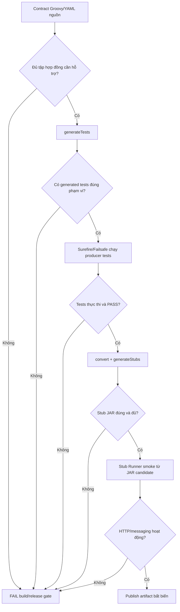
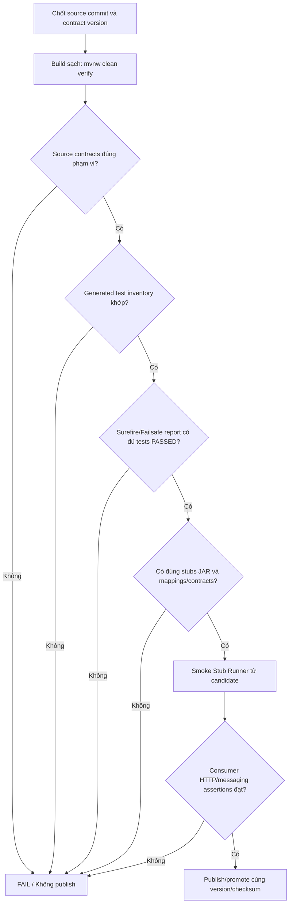

# Kiểm tra build không bỏ sót generated test hoặc stub artifact

## 1. Bài toán: `BUILD SUCCESS` chưa chắc bảo vệ được consumer

Giả sử `payment-service` là **producer** cung cấp HTTP API cho `checkout-service` và phát sự kiện cho `fulfillment-service`. Hai consumer có những kỳ vọng cụ thể:

- `GET /api/payments/PAY-1001` trả HTTP `200`, JSON có `status=PAID`, `amount=250000`, `currency=VND`.
- Khi thanh toán đã capture, producer phát sự kiện `PaymentCaptured` đến destination `payments.captured`.
- Với yêu cầu không hợp lệ, producer trả HTTP `409` kèm mã lỗi nghiệp vụ đã được thỏa thuận.

Nhóm mô tả những kỳ vọng ấy bằng **Spring Cloud Contract Groovy/YAML DSL**, dùng **Contract Verifier** sinh producer tests và đóng gói stubs để Checkout kiểm thử qua **Stub Runner**. Tất cả được kết hợp với Maven và CI nhằm phát hiện thay đổi API không tương thích.

Nhưng một ngày pipeline báo:

```text
[INFO] BUILD SUCCESS
[INFO] Tests run: 0, Failures: 0, Errors: 0, Skipped: 0
[INFO] No contracts found
```

Nếu nhóm chỉ nhìn dòng `BUILD SUCCESS`, bản phát hành có thể đã **không xác minh một contract nào**. Một tình huống khác: producer tests chạy đạt nhưng Maven không tạo `payment-service-1.4.2-stubs.jar`; consumer CI không tải được artifact. Hoặc JAR có đúng tên nhưng chỉ chứa mappings cũ hay bị thiếu file body.

**Mục tiêu của bài học:** thiết kế kiểm tra cho Maven build để phát hiện cả ba nhóm lỗi:

1. **Không có hoặc bỏ sót contract cần xử lý** (sai source, filter, `inProgress`/`ignored`).
2. **Generated tests không được sinh, biên dịch hoặc thực thi** (test engine, include patterns, skip, lifecycle).
3. **Stub artifact không được tạo hoặc không dùng được** (`convert`, `generateStubs`, classifier, nội dung JAR, repository, Stub Runner).

Trong bài này, các ví dụ tập trung vào **Maven + JUnit 5 + Spring Cloud Contract** với một ứng dụng Spring Boot. Phần Spock/Failsafe được trình bày như những biến thể cần cấu hình rõ theo phiên bản, không mặc định chúng giống JUnit/Surefire.

## 2. Năm mốc xác minh cần có bằng chứng riêng

Để tránh dùng từ “đã kiểm tra contract” quá chung chung, hãy tách:

| Mốc | Câu hỏi phải trả lời | Bằng chứng mong đợi |
| --- | --- | --- |
| **C1 — Contract source** | Maven đã đọc **đúng** Groovy/YAML từ repo/artifact đúng version chưa? | Đường dẫn/phiên bản nguồn, inventory những contract đang hỗ trợ. |
| **C2 — Generated test sources** | Plugin có sinh test cho những contract phải được xác minh không? | Tệp Java/Groovy trong generated-test-sources, tên lớp và kịch bản tương ứng. |
| **C3 — Executed tests** | Maven test engine đã **chạy** các test sinh ra chưa, hay chỉ biên dịch/skip? | Surefire/Failsafe reports, test count, failures, skipped, kết quả từng generated class. |
| **C4 — Generated stub contents** | Các mapping và messaging contract có được chuyển đổi/đóng gói không? | Generated mappings, file body, `META-INF/.../contracts` trong candidate JAR. |
| **C5 — Runnable/published stub** | Stub Runner có nạp được **đúng artifact** và consumer gọi được đúng hành vi không? | Stub Runner smoke test, artifact coordinates, version/checksum. |

Đây không phải năm tên task Maven mà là **năm điều kiện kiểm soát độc lập**. Bất kỳ mốc nào thiếu đều có thể tạo “xanh giả”.



**Không tự suy ra C3 đạt chỉ vì C2 đạt:** test có thể được sinh thành file trong `target/` nhưng bị bỏ qua bởi Surefire hoặc Failsafe. **Không tự suy ra C4/C5 đạt chỉ vì C3 đạt:** packaging có thể bị skip riêng, output sai vị trí hoặc artifact không chứa tài nguyên mà stub runtime cần.

## 3. Maven lifecycle và ba goal quan trọng của Spring Cloud Contract

Theo tài liệu plugin Maven của Spring Cloud Contract, các goal chính thường có phase binding mặc định:

| Goal | Phase Maven mặc định | Vai trò | Kiểm tra cần làm |
| --- | --- | --- | --- |
| `spring-cloud-contract:generateTests` | `generate-test-sources` | Sinh producer verification tests từ contracts. | Generated sources có tồn tại và hợp lệ không? |
| `spring-cloud-contract:convert` | `process-test-resources` | Chuyển DSL thành stub mappings. | Có mapping HTTP hoặc contract messaging tương ứng không? |
| `spring-cloud-contract:generateStubs` | `package` | Lấy kết quả chuyển đổi và tạo stub JAR (classifier mặc định `stubs`). | Artifact có nội dung và layout đúng không? |

**Tùy phiên bản và cách gắn plugin**, Maven plugin cũng cần cấu hình `<extensions>true</extensions>` và các dependency thích hợp. Những goal của plugin được mô tả là **không thread-safe** trong tài liệu goal tương ứng; đừng mặc định chạy build song song nhiều module dùng chung output mà không kiểm soát.

Một lifecycle thông dụng:

```text
validate
  ↓
generate-test-sources  ── generateTests
  ↓
process-test-resources ── convert
  ↓
test-compile           ── compile generated tests
  ↓
test                   ── Maven Surefire chạy producer tests
  ↓
package                ── generateStubs tạo classifier JAR
  ↓
verify                 ── các bước verify bổ sung nếu được cấu hình
  ↓
install / deploy       ── artifact vào Maven Local / remote repository
```

Lưu ý:

- Chạy `mvn generate-test-sources` **chỉ sinh mã test**, không kiểm chứng producer.
- Chạy `mvn test` thường đến phase thực thi test, nhưng **chưa đi tới `package`** để tạo stub JAR mới.
- Chạy `mvn package` hoặc `mvn verify` theo lifecycle phù hợp có thể sinh cả tests/stubs; phải xác minh **chúng thực sự được thực thi**, không bị skip.
- Chạy trực tiếp một goal, ví dụ `mvn spring-cloud-contract:generateStubs`, không có nghĩa mọi goal cần trước đó đã chạy; tài liệu plugin yêu cầu `convert` đã xử lý DSL trước khi đóng gói.
- `mvn install` lưu artifact vào **Maven Local**; `mvn deploy` đẩy lên remote repository đã cấu hình. **Không coi deploy thành công là bằng chứng producer tests đã chạy.**

Để xem thông số chính xác trong dự án đang dùng, Maven plugin cung cấp lệnh:

```bash
./mvnw spring-cloud-contract:help \
  -Ddetail=true -Dgoal=generateTests
./mvnw spring-cloud-contract:help \
  -Ddetail=true -Dgoal=generateStubs
```

Đó là lệnh tham khảo trên một **project đã có plugin và Maven Wrapper**; không phải lệnh đã được chạy trong bài soạn này. Khi đổi version Spring Cloud Contract, nên đối chiếu help của phiên bản thật thay vì copy một tên property từ tài liệu của bản khác.

## 4. Cấu trúc nguồn: một thay đổi nhỏ có thể khiến tất cả test biến mất

Một producer ví dụ:

```text
payment-service/
├── pom.xml
└── src/
    ├── main/java/com/example/payment/...
    └── test/
        ├── java/com/example/payment/contract/
        │   └── ContractBase.java
        └── resources/
            └── contracts/
                └── payment-service/
                    ├── http/
                    │   ├── get-paid-payment.groovy
                    │   ├── capture-payment.yml
                    │   └── payment-not-capturable.groovy
                    └── messaging/
                        └── payment-captured.groovy
```

Với Maven plugin Spring Cloud Contract, `contractsDirectory` có default thường là `src/test/resources/contracts`. Nếu team chuyển tệp sang `src/contractTest/resources/contracts` theo bố cục của Gradle mà không cập nhật Maven, plugin có thể không tìm thấy file nào.

Các lỗi tương tự:

- `contractsDirectory` trỏ sai module trong multi-module Maven.
- Contract nguồn nằm trong artifact bên ngoài nhưng `contractsPath` trỏ nhầm nhánh.
- `includedFiles`/`excludedFiles` vô tình lọc hết HTTP hoặc messaging contracts.
- Một contract được đánh dấu `inProgress()` nên có thể tạo stub nhưng không sinh producer test.
- Một nhóm contract bị `ignored()` hoặc `ignoredFiles` nên generated tests không còn chạy như gate yêu cầu.
- Tệp fixture được tham chiếu bằng `file(...)` không được đóng gói hoặc có đường dẫn tương đối sai.

**Tuyệt đối không “sửa” build mất contract bằng cách tắt `failOnNoContracts` nếu producer vẫn có cam kết cần kiểm tra.** Nếu một module thực sự không có contract, đó phải là ngoại lệ được phân loại riêng — không áp dụng chung policy cho mọi producer.

## 5. Ví dụ contract để kiểm tra đường đi của generated tests

Ta dùng một HTTP contract rõ ràng: `GET /api/payments/PAY-1001` trả giao dịch đã thanh toán.

### Groovy DSL

```groovy
import org.springframework.cloud.contract.spec.Contract

Contract.make {
    name 'get_paid_payment'
    description 'Tra cứu giao dịch đã thanh toán'

    request {
        method 'GET'
        urlPath '/api/payments/PAY-1001'
        headers {
            header 'Accept': 'application/json'
        }
    }

    response {
        status 200
        headers {
            contentType(applicationJson())
        }
        body([
            paymentId: 'PAY-1001',
            orderId: 'ORD-2001',
            status: 'PAID',
            amount: 250000,
            currency: 'VND'
        ])
    }
}
```

### YAML DSL tương đương

```yaml
name: get_paid_payment
description: Tra cứu giao dịch đã thanh toán
request:
  method: GET
  urlPath: /api/payments/PAY-1001
  headers:
    Accept: application/json
response:
  status: 200
  headers:
    Content-Type: application/json
  body:
    paymentId: PAY-1001
    orderId: ORD-2001
    status: PAID
    amount: 250000
    currency: VND
```

Hai đoạn trên mô tả **cùng một kịch bản**. Dự án thực nên chọn **một** bản làm nguồn chính để không sinh test/mapping trùng. Contract không chứa `localhost` hay port của test server; đó là chi tiết base class/test mode hoặc Stub Runner.

Nếu consumer còn phụ thuộc lỗi nghiệp vụ `409 PAYMENT_NOT_CAPTURABLE` và message `PaymentCaptured`, chúng cần contract riêng và **cùng có mặt trong inventory release**. Chỉ nhìn một contract GET thành công không chứng minh mọi hành vi đã được bảo vệ.

## 6. POM mẫu: cấu hình rõ test generation và no-contract guard

Một producer dùng Spring Boot, JUnit Jupiter và Spring Cloud Contract thường cần các mảnh cấu hình sau trong `pom.xml`. Đây là **các phần được ghép đúng vị trí trong POM của dự án**, không phải POM đầy đủ có thể chạy nguyên văn vì còn phụ thuộc Spring Boot parent/BOM, JDK và plugin versions.

### 6.1. Quản lý dependencies

```xml
<!-- Trong <dependencyManagement><dependencies> -->
<dependency>
    <groupId>org.springframework.cloud</groupId>
    <artifactId>spring-cloud-contract-dependencies</artifactId>
    <version>${spring-cloud-contract.version}</version>
    <type>pom</type>
    <scope>import</scope>
</dependency>

<!-- Trong <dependencies> -->
<dependency>
    <groupId>org.springframework.boot</groupId>
    <artifactId>spring-boot-starter-test</artifactId>
    <scope>test</scope>
</dependency>
<dependency>
    <groupId>org.springframework.cloud</groupId>
    <artifactId>spring-cloud-starter-contract-verifier</artifactId>
    <scope>test</scope>
</dependency>
```

Chọn biến `spring-cloud-contract.version` theo compatibility matrix của Spring Boot/Spring Cloud Contract đang dùng. Nếu ứng dụng dùng BOM quản lý test dependencies, không tự gắn version riêng cho mỗi artifact làm lệch classpath.

### 6.2. Plugin và guard

```xml
<!-- Trong <build><plugins> -->
<plugin>
    <groupId>org.springframework.cloud</groupId>
    <artifactId>spring-cloud-contract-maven-plugin</artifactId>
    <version>${spring-cloud-contract.version}</version>
    <extensions>true</extensions>
    <configuration>
        <contractsDirectory>
            ${project.basedir}/src/test/resources/contracts
        </contractsDirectory>
        <testFramework>JUNIT5</testFramework>
        <testMode>MOCKMVC</testMode>
        <baseClassForTests>
            com.example.payment.contract.ContractBase
        </baseClassForTests>
        <failOnNoContracts>true</failOnNoContracts>
        <failOnInProgress>true</failOnInProgress>
        <classifier>stubs</classifier>
    </configuration>
</plugin>
```

**Ý nghĩa thực tế:**

- `<extensions>true</extensions>` cho phép tích hợp của Maven plugin vào lifecycle theo hướng dẫn Spring Cloud Contract.
- `contractsDirectory` xác định nguồn contract, không phải thư mục `target/` để đọc generated tests.
- `testFramework=JUNIT5` chọn kiểu generated tests; `testMode=MOCKMVC` kiểm thử HTTP qua MockMvc. Khi cần HTTP socket thật, dùng `EXPLICIT` cùng Spring Boot RANDOM_PORT; WebFlux có `WEBTESTCLIENT` theo phiên bản.
- `baseClassForTests` trỏ đúng **lớp setup** mà tests được sinh sẽ kế thừa.
- `failOnNoContracts=true` chặn tình huống plugin không tìm thấy contract khi goal hỗ trợ thông số này. Tài liệu của plugin liệt kê mặc định thường là `true`, nhưng cấu hình tường minh giúp policy dễ review.
- `failOnInProgress=true` chặn phát hành ngầm những hành vi đang khai báo nhưng chưa được producer xác minh theo cơ chế phiên bản hỗ trợ.
- `classifier=stubs` xác định suffix mặc định của JAR stub trong goal đóng gói; không thay đổi GAV gốc của producer.

Đừng thêm `includedFiles` cho “build nhanh HTTP” vào **profile release** nếu producer còn messaging/legacy contracts được cam kết. Nếu dùng hai profile, mỗi profile phải có inventory và điều kiện pass rõ; **full compatibility gate** mới được phép công bố stub chính thức.

## 7. Base test và implementation phải thực sự được gọi

Một vấn đề khó thấy: generated test có thể tồn tại nhưng lớp base thiết lập sai, ví dụ chỉ stub luôn response trong test mà không gọi controller producer. Với `MOCKMVC`, có thể dùng base class khai báo:

```java
package com.example.payment.contract;

import io.restassured.module.mockmvc.RestAssuredMockMvc;
import org.junit.jupiter.api.BeforeEach;
import org.springframework.beans.factory.annotation.Autowired;
import org.springframework.boot.test.context.SpringBootTest;
import org.springframework.test.web.servlet.MockMvc;
import org.springframework.boot.test.autoconfigure.web.servlet.AutoConfigureMockMvc;

@SpringBootTest
@AutoConfigureMockMvc
public abstract class ContractBase {

    @Autowired
    MockMvc mockMvc;

    @BeforeEach
    void configureGeneratedTests() {
        RestAssuredMockMvc.mockMvc(mockMvc);
    }
}
```

Lớp base này giả định producer là ứng dụng Spring MVC có Spring Boot Test, MockMvc và `RestAssuredMockMvc` trên classpath. Test context phải có **fixture xác định** cho `PAY-1001`, ví dụ fake repository hoặc mock tại ranh giới truy cập dữ liệu.

Khi một contract GET thất bại, cần phân biệt:

- **Test setup lỗi:** fixture không có `PAY-1001`, application context không khởi động, base class không được tìm thấy.
- **Producer vi phạm contract:** controller trả `PENDING` thay vì `PAID`, sai status hoặc thiếu field.
- **Generator/test engine lỗi:** không có generated test nào chạy, nên hệ thống không phát hiện cả hai loại lỗi trên.

Đừng sửa contract thành `PENDING` chỉ để tránh test đỏ nếu producer đang phá vỡ một cam kết của consumer chưa được thỏa thuận đổi.

## 8. Guard số 1: có contract nguồn và đúng phạm vi

Maven plugin có những tham số quan trọng:

| Tham số | Vai trò | Sai lầm phổ biến |
| --- | --- | --- |
| `contractsDirectory` | Thư mục Groovy/YAML contract cục bộ. | Trỏ sai module hoặc nhầm nguồn Gradle. |
| `contractsMode` / `contractDependency` | Lấy contract từ artifact/repository ngoài khi được cấu hình. | Dùng version động hoặc thiếu quyền tải. |
| `contractsPath` | Chỉ định nhánh contract trong artifact tải về. | Sai path làm tập contract bằng 0. |
| `includedFiles` / `excludedFiles` | Lọc file contract được xử lý. | Lọc mất API legacy, messaging hoặc contract lỗi. |
| `failOnNoContracts` | Yêu cầu lỗi khi không tìm thấy contract/stub theo goal. | Vô tình tắt để làm build xanh. |
| `failOnInProgress` | Yêu cầu lỗi khi có contract đang in progress theo cơ chế kiểm tra. | Publish hành vi chưa được producer thực hiện. |
| `ignoredFiles` | Đánh dấu generated tests bị ignore trong một số cấu hình. | Nhầm “ignored” với “đã verified”. |

**Guard tối thiểu:** đảm bảo `failOnNoContracts=true` **và** có danh sách các kịch bản bắt buộc. Một JAR không rỗng vẫn có thể thiếu `payment-not-capturable` hoặc `payment-captured-event`, nên chỉ kiểm tra tổng số contract lớn hơn 0 chưa đủ.

Ví dụ inventory mong đợi của một producer:

```text
HTTP:
  get_paid_payment
  capture_payment_success
  capture_payment_rejected_by_state

MESSAGING:
  payment_captured_event

Policy:
  Không bỏ contract API v1 nếu còn consumer dùng.
  Không có contract inProgress/ignored trong release scope.
```

Đây là dữ liệu minh họa, không phải file inventory có sẵn. Trong CI thật, danh sách có thể được lưu trong một manifest do tổ chức quản lý hoặc suy ra từ registry/reviewed contracts; không chỉnh một list cứng riêng rẽ mà không có quy trình review khi thêm/bỏ contract.

## 9. Guard số 2: file generated tests phải xuất hiện

Tài liệu goal `generateTests` liệt kê thư mục mặc định Maven:

```text
target/generated-test-sources/contracts
```

Thư mục generated test resources thường là:

```text
target/generated-test-resources/contracts
```

Tên generated class, package và extension tùy cấu hình `JUNIT5/JUNIT/SPOCK`, tên contract, phiên bản plugin và base mappings. Không nhất thiết một contract file tương ứng đúng một Java test class; một file có thể chứa nhiều contract.

Sau khi chạy Maven, nên kiểm tra:

1. Plugin đã thực sự chạy goal `generateTests` không?
2. Trong generated-test-sources có file `.java` hoặc `.groovy` mong đợi không?
3. File sinh có đúng tên package/class và extends base class hợp lệ không?
4. Dữ liệu request/response trong generated tests có phản ánh contract nguồn không?
5. Những tệp đó có được thêm vào **test source roots** để Maven compiler nhìn thấy không?

### Vì sao nhìn file chưa đủ?

Một file Java được sinh ra nhưng test compile không tìm được `ContractBase` có thể khiến build fail rõ. Nguy hiểm hơn, generated sources tồn tại nhưng nằm ngoài test source roots mà Surefire quét; Maven vẫn chạy các unit tests khác rồi báo build xanh, trong khi **không test contract nào được thực thi**.

Tài liệu Spring Cloud Contract có hướng dẫn sử dụng `build-helper-maven-plugin` để thêm generated-test-sources vào test source roots khi IDE/Maven không nhận đúng. Đây chỉ là giải pháp cho **vấn đề source roots đã được xác minh**, không phải plugin bắt buộc cho mọi dự án.

Ví dụ cấu hình bổ sung khi thực sự cần:

```xml
<plugin>
    <groupId>org.codehaus.mojo</groupId>
    <artifactId>build-helper-maven-plugin</artifactId>
    <version>REPLACE_WITH_COMPATIBLE_VERSION</version>
    <executions>
        <execution>
            <id>add-generated-contract-tests</id>
            <phase>generate-test-sources</phase>
            <goals>
                <goal>add-test-source</goal>
            </goals>
            <configuration>
                <sources>
                    <source>
                        ${project.build.directory}/generated-test-sources/contracts
                    </source>
                </sources>
            </configuration>
        </execution>
    </executions>
</plugin>
```

**Không áp dụng bừa** khi SCC Maven plugin đã đưa generated sources vào source roots; thêm lặp có thể chỉ làm POM phức tạp hơn. Với Spock/Groovy, còn cần compiler/test source handling đúng cho `.groovy`; thêm thư mục Java mà bỏ Groovy compiler sẽ không giải quyết vấn đề.

## 10. Guard số 3: generated tests thực sự chạy bằng Surefire hoặc Failsafe

**Maven Surefire** thường chạy test ở phase `test`, còn **Maven Failsafe** thường dành cho integration tests ở các phase `integration-test` và `verify` khi được cấu hình. Spring Cloud Contract generated tests có thể chạy bằng Surefire; nếu dự án cố ý đặt tên theo quy ước integration test, phải cấu hình Failsafe phù hợp.

Một đoạn Maven Surefire dành cho **JUnit Jupiter**:

```xml
<plugin>
    <groupId>org.apache.maven.plugins</groupId>
    <artifactId>maven-surefire-plugin</artifactId>
    <version>REPLACE_WITH_COMPATIBLE_VERSION</version>
    <configuration>
        <failIfNoTests>true</failIfNoTests>
        <includes>
            <include>**/*Test.java</include>
            <include>**/*Tests.java</include>
        </includes>
    </configuration>
</plugin>
```

Đây là **mảnh cấu hình**, không nên sao chép nguyên xi nếu dự án còn naming conventions khác như `TestSomething`, `*TestCase` hoặc Spock `*Spec`. `includes` ở trên chỉ chọn hai dạng hậu tố; có thể làm **rớt test** nếu generated classes không khớp. Thông thường nên giữ các include patterns mặc định phù hợp hoặc mở rộng có chủ đích, thay vì thu hẹp để làm job nhanh.

**`failIfNoTests=true` chỉ bảo vệ trường hợp toàn bộ Surefire execution không tìm thấy test nào.** Nếu project có 70 unit tests thông thường nhưng **0 generated contract test**, Surefire vẫn thấy test và có thể thành công. Vì thế cần kiểm tra **một cách độc lập** số generated test classes/methods và danh sách test đã được thực thi trong reports.

### Failsafe cho integration naming khi cần

Ví dụ dự án cố ý tạo các producer tests tên `PaymentContractIT` và dùng Failsafe. Khi đó:

```xml
<plugin>
    <groupId>org.apache.maven.plugins</groupId>
    <artifactId>maven-failsafe-plugin</artifactId>
    <version>REPLACE_WITH_COMPATIBLE_VERSION</version>
    <executions>
        <execution>
            <goals>
                <goal>integration-test</goal>
                <goal>verify</goal>
            </goals>
        </execution>
    </executions>
    <configuration>
        <failIfNoTests>true</failIfNoTests>
        <includes>
            <include>**/*IT.java</include>
            <include>**/*ITCase.java</include>
        </includes>
    </configuration>
</plugin>
```

**Cấu hình này chỉ phù hợp khi module thật sự có integration tests theo các tên đó.** Nếu project không có bất kỳ `*IT`, bật `failIfNoTests` sẽ làm build fail mà không phải do Spring Cloud Contract. Đừng kích hoạt cả Surefire và Failsafe cùng chạy một generated class dẫn đến chạy hai lần không chủ ý; phân chia quy ước tên và phase rõ ràng.

### Nhìn vào báo cáo chứ không chỉ log tổng

Với Surefire, output thường nằm trong:

```text
target/surefire-reports/
├── TEST-com.example.payment.contract.GetPaidPaymentTest.xml
└── ...
```

Với Failsafe:

```text
target/failsafe-reports/
├── TEST-com.example.payment.contract.PaymentContractIT.xml
└── ...
```

Đường dẫn/class name chỉ là **minh họa**, không phải generated output được đảm bảo. Khi làm CI guard:

- Xác định **package/class names** của generated tests trong build hiện tại.
- Kiểm tra report XML của **những lớp đó**, không chỉ báo cáo của các unit tests khác.
- Đếm `tests`, `failures`, `errors` và `skipped` theo chính những lớp contract này.
- Chặn khi expected test missing, test count bằng 0, hoặc test bị skip ngoài policy.
- Đừng giả định số file contract bằng số method JUnit.

**Cách kiểm tra “có file generated” + “có test report của chính file ấy” là nền tảng chống xanh giả.**

## 11. Ba dạng skip khác nhau và hậu quả

| Cờ/cấu hình | Có thể làm gì? | Tác động tới release gate |
| --- | --- | --- |
| `-DskipTests` | Thường cho phép compile tests nhưng **bỏ thực thi** Surefire/Failsafe. | Không có producer verification đáng tin cậy. |
| `-Dmaven.test.skip=true` | Thường bỏ cả test compilation/execution (theo plugin hỗ trợ). | Generated tests có thể không được biên dịch. |
| `-Dspring.cloud.contract.verifier.skip=true` | Bỏ hoạt động của Contract Verifier plugin theo mục tiêu phiên bản. | Có thể không sinh mới tests/mappings/stubs. |
| `-Dspring.cloud.contract.verifier.jar.skip=true` | Bỏ **chỉ bước tạo stubs JAR** trong goal hỗ trợ `jarSkip`. | Producer tests có thể đạt nhưng không có artifact để publish. |
| `<failOnNoContracts>false</failOnNoContracts>` | Cho phép không có contract theo goal tương ứng. | Che lỗi nguồn/pattern sai nếu module phải có contracts. |
| `inProgress()` / `ignored()` | Có thể khiến hợp đồng không có producer test thực thi. | Có stub nhưng không được coi là verified. |
| Surefire `<excludes>`, test filtering | Test đã sinh nhưng không được test engine chọn. | “Có generated source” không bảo đảm đã chạy. |

**Không dùng cờ skip để làm một bản release tương thích API.** Một số tối ưu có thể phù hợp vòng build tạm nhưng release gate phải chạy lại từ source/contract được khóa, thu test report đầy đủ.

### Cảnh báo về incremental generation

Theo tài liệu Maven plugin, một số goal có tùy chọn:

- `incrementalContractTests`: chỉ tạo lại generated tests khi contract đổi theo cơ chế plugin.
- `incrementalContractStubs`: chỉ chuyển đổi stubs khi đầu vào đổi theo cơ chế plugin.
- `incrementalContractStubsJar`: chỉ tạo lại JAR khi stubs đổi.

**Incremental generation là tối ưu sinh mã/đóng gói, không phải chiến lược thay producer verification.** Khi controller đổi dù contract không đổi, vẫn phải chạy generated tests để phát hiện phá vỡ hành vi. Với release build, dùng workspace sạch hoặc quản lý cache đầu vào/đầu ra chặt chẽ; không lấy một JAR cũ còn trong `target/` rồi gắn version phát hành mới.

## 12. Guard số 4: candidate JAR có classifier và nội dung đúng

Sau `mvn -B clean verify` trong dự án đã cấu hình plugin, artifact thường có dạng:

```text
target/
├── payment-service-1.4.2.jar
├── payment-service-1.4.2-stubs.jar
├── generated-test-sources/
│   └── contracts/...
├── stubs/
│   └── .../mappings/...
└── surefire-reports/
    └── TEST-....xml
```

**Tên thư mục và tên file là minh họa**, phụ thuộc Maven `finalName`, plugin version, packaging và cấu hình output. Quan trọng là có **candidate stub artifact thật** mang classifier mong đợi, không chỉ ứng dụng JAR.

Từ JDK, kiểm tra bằng:

```bash
jar tf target/payment-service-1.4.2-stubs.jar
```

Một layout thường gặp:

```text
META-INF/
└── com.example/
    └── payment-service/
        └── 1.4.2/
            ├── contracts/
            │   ├── http/get-paid-payment.groovy
            │   └── messaging/payment-captured.groovy
            └── mappings/
                └── http/get-paid-payment.json
```

Đây là **cấu trúc minh họa** của artifact mà Stub Runner thường nhận biết từ `META-INF/<groupId>/<artifactId>/<version>/`. Có thể có các subfolder, file body hoặc định dạng khác theo plugin; không đặt rule cứng “một Groovy file phải có một mapping JSON” cho mọi loại contract, vì messaging có cách xử lý khác HTTP.

### Phân biệt ít nhất ba mức kiểm tra package

| Mức | Kiểm tra | Nếu chỉ dừng ở đây |
| --- | --- | --- |
| **File tồn tại** | `*-stubs.jar` có được tạo trong build candidate không? | JAR có thể rỗng hoặc sai classifier. |
| **Nội dung có cấu trúc** | Có entries dưới `contracts/`, `mappings/` và resources được tham chiếu không? | Mapping có thể vẫn sai matcher, status/body. |
| **Runtime hoạt động** | Stub Runner load đúng JAR và đáp ứng HTTP/message theo contract không? | Đây mới kiểm chứng loader/consumer; vẫn không thay producer verification. |

Khi có HTTP contracts đang hỗ trợ, JAR không có HTTP mappings phải bị chặn. Khi một producer **chỉ có messaging contracts**, JAR không có HTTP mapping vẫn có thể hợp lệ — nhưng phải có messaging contract/label/destination tương ứng và test thật.

### Kiểm tra mapping ngữ nghĩa

Một mapping WireMock rút gọn có thể như:

```json
{
  "request": {
    "method": "GET",
    "urlPath": "/api/payments/PAY-1001"
  },
  "response": {
    "status": 200,
    "headers": {
      "Content-Type": "application/json"
    },
    "jsonBody": {
      "paymentId": "PAY-1001",
      "orderId": "ORD-2001",
      "status": "PAID",
      "amount": 250000,
      "currency": "VND"
    }
  }
}
```

Đây là **ví dụ nội dung WireMock**, không phải byte output bắt buộc của mọi phiên bản generator. Generated mappings có thể dùng `body`, `jsonBody`, `base64Body` hoặc `bodyFileName`. Chấp nhận những biểu diễn hợp lệ khi runtime trả đúng dữ liệu, nhưng kiểm tra:

- HTTP method và path có khớp request consumer sẽ gửi không?
- Query/header/body matchers có quá rộng (ví dụ `.*` cho mọi ID) hoặc quá chặt không?
- Status, Content-Type, body và kiểu dữ liệu có phản ánh contract không?
- Có thể gọi khác ID/khác currency mà vẫn nhận happy-path stub ngoài ý muốn không?
- File `bodyFileName` có đúng vị trí mà WireMock loader đọc được không?
- Response body binary có giữ nguyên byte không?

**Đừng chỉ mở JAR bằng ZIP và xem tên file:** phải chạy một smoke test với chính artifact ứng viên.

## 13. Guard số 5: Stub Runner tải đúng candidate artifact

Sau khi candidate JAR có nội dung, consumer test cần nạp nó bằng **Stub Runner**. Ví dụ test phía Checkout:

```java
@SpringBootTest(properties = {
    "payment.base-url=http://localhost:6565"
})
@AutoConfigureStubRunner(
    ids = "com.example:payment-service:1.4.2:stubs:6565",
    stubsMode = StubRunnerProperties.StubsMode.LOCAL
)
class CheckoutPaymentStubTest {

    @Autowired
    PaymentClient paymentClient;

    @Test
    void parsesPaymentFromPublishedContractStub() {
        PaymentView payment = paymentClient.getPayment("PAY-1001");

        assertThat(payment.paymentId()).isEqualTo("PAY-1001");
        assertThat(payment.orderId()).isEqualTo("ORD-2001");
        assertThat(payment.status()).isEqualTo("PAID");
        assertThat(payment.currency()).isEqualTo("VND");
    }
}
```

Đây là **mảnh test minh họa**; project cần imports, `spring-cloud-starter-contract-stub-runner` trong test scope và các lớp `PaymentClient/PaymentView` thật. Nếu HTTP client dùng Reactor, test nên dùng `StepVerifier` hoặc block có timeout chỉ trong test. `PaymentClient` phải thực sự gửi HTTP đến stub server, không được mock luôn client đó.

### LOCAL là Maven Local của ai?

Với `StubsMode.LOCAL`, Stub Runner đọc artifact từ **local Maven repository của chính tiến trình/test container**. Một stub JAR vừa tạo ở `target/` **chưa tự động xuất hiện ở Maven Local**. Thông thường cần chạy phase `install` hoặc đưa candidate vào repository cô lập theo quy trình test:

```bash
./mvnw -B clean install
```

**Nhưng:** `install` không phải một thao tác “chỉ copy file”: nó chạy lifecycle đến phase install, có thể sinh lại artifacts và chạy lại tests. Nếu smoke suite kiểm tra cùng version mà Maven Local đã có JAR từ build cũ, nó có thể xanh giả. Trong CI:

1. Pin version candidate riêng cho commit/build.
2. Dùng Maven Local hoặc container filesystem **cô lập** cho job.
3. Kiểm tra tọa độ và đường dẫn thật Stub Runner đã resolve.
4. So checksum JAR đã sinh và artifact được Stub Runner tải.
5. Sau smoke, **publish/promote cùng candidate byte**; nếu một bước rebuild tạo file khác, cần đối chiếu lại trước phát hành.

Khi dùng repository từ xa, cấu hình `StubsMode.REMOTE` và `repositoryRoot`/credentials theo phiên bản. Release test không nên dùng version dynamic `+` hoặc `latest` vì cùng một commit Checkout có thể tải hai artifact khác nhau vào hai thời điểm.

### Negative test cũng cần thiết

Nếu contract chỉ áp dụng cho `PAY-1001`, hãy thử gọi `PAY-9999`. Nếu stub vẫn trả `PAID` ngoài ý định, mapping có thể quá rộng. Nhưng WireMock báo `404 No matching stub` **không phải bằng chứng producer thật cam kết HTTP `404 PAYMENT_NOT_FOUND`**. Muốn kiểm tra lỗi nghiệp vụ `404`, cần contract 404 riêng và producer test đã xác minh nó.

## 14. Có thể kiểm tra tự động số generated files bằng PowerShell

Trên môi trường CI dùng Windows PowerShell (hoặc PowerShell Core), một bước kiểm tra đơn giản sau khi Maven chạy:

```powershell
$generatedDir = "target/generated-test-sources/contracts"
$stubJar = "target/payment-service-1.4.2-stubs.jar"

if (-not (Test-Path -LiteralPath $generatedDir)) {
    throw "Không có thư mục generated contract tests"
}

$generatedSources = @(
    Get-ChildItem -LiteralPath $generatedDir -Recurse -File |
    Where-Object { $_.Extension -in @(".java", ".groovy") }
)

if ($generatedSources.Count -eq 0) {
    throw "Không có generated contract source nào"
}

if (-not (Test-Path -LiteralPath $stubJar)) {
    throw "Không có candidate stubs JAR"
}

$jarEntries = & jar tf $stubJar
if ($LASTEXITCODE -ne 0) {
    throw "Không đọc được candidate stubs JAR"
}

$httpMappings = @(
    $jarEntries | Where-Object {
        $_ -match "/mappings/.+\.json$"
    }
)
if ($httpMappings.Count -eq 0) {
    throw "Không có HTTP mapping (producer này yêu cầu HTTP contracts)"
}

Write-Output "Generated source files: $($generatedSources.Count)"
Write-Output "HTTP mappings: $($httpMappings.Count)"
```

**Đây là code để người học tham khảo, không phải script đã được chạy.** Đường dẫn JAR phải lấy từ artifact output thật nếu project đổi `finalName` hoặc version. Bộ kiểm tra chỉ phù hợp khi producer **bắt buộc có HTTP contracts**; không dùng `HTTP mappings > 0` làm tiêu chí cho một producer chỉ phát messaging events.

**Quan trọng:** script này mới kiểm tra file generated và JAR có mapping. Nó **không chứng minh generated tests đã thực thi**. CI phải có một guard riêng đọc Surefire/Failsafe XML reports, so sánh danh sách classes được sinh với những tests được chạy, và chặn khi thiếu. Không cộng tất cả unit tests của module rồi nhầm chúng thành producer contract tests.

### Kiểm tra số test thực thi phải theo generated classes

Ví dụ một build có:

```text
Generated test classes:
  GetPaidPaymentTest
  CapturePaymentTest
  PaymentNotCapturableTest

Surefire reports:
  PaymentServiceUnitTest       80 tests PASSED
  GetPaidPaymentTest           1 test PASSED
  CapturePaymentTest           MISSING
  PaymentNotCapturableTest     MISSING
```

Tổng số test thực thi là 81 nhưng **chưa thể coi full contract gate đạt**. Job phải FAIL vì hai generated classes vắng trong reports. Khi triển khai guard, nên dùng **tên lớp đầy đủ (FQN) và test report XML**, không ghép chuỗi tên class ngẫu nhiên rồi hy vọng trùng. Có những generated tests nhóm nhiều phương thức, Spock specs hoặc các test có dynamic names; đối chiếu theo engine/report thực của module.

Nếu muốn có kiểm soát mạnh hơn, lưu một **expected behavior manifest** theo contract name và kiểm tra mọi hành vi đều có producer verification + stub content tương ứng. Thay đổi manifest phải qua review khi thêm/bỏ cam kết API.

## 15. Maven Enforcer và kiểm tra artifact trong phase verify

Maven Enforcer thường được dùng để chặn các điều kiện build không hợp lệ. Một rule `requireFilesExist` có thể phát hiện **candidate JAR không được tạo**, nhưng không tự xác minh nó chứa mappings đúng hay đã chạy producer tests.

Ví dụ **mảnh plugin trong một project đã có Enforcer version tương thích**:

```xml
<plugin>
    <groupId>org.apache.maven.plugins</groupId>
    <artifactId>maven-enforcer-plugin</artifactId>
    <version>REPLACE_WITH_COMPATIBLE_VERSION</version>
    <executions>
        <execution>
            <id>verify-stubs-file</id>
            <phase>verify</phase>
            <goals>
                <goal>enforce</goal>
            </goals>
            <configuration>
                <rules>
                    <requireFilesExist>
                        <files>
                            <file>
                                ${project.build.directory}/${project.build.finalName}-stubs.jar
                            </file>
                        </files>
                    </requireFilesExist>
                </rules>
                <fail>true</fail>
            </configuration>
        </execution>
    </executions>
</plugin>
```

**Giới hạn:** cách dựng tên `${project.build.finalName}-stubs.jar` chỉ đúng nếu goal `generateStubs` dùng tên output theo quy ước đó. Khi dự án override classifier, plugin output path hoặc packaging, phải cập nhật đường dẫn kiểm tra. Nếu Enforcer chạy ở một module không tạo stub, rule sẽ chặn sai — cần đặt nó **chỉ ở producer module có artifact stub bắt buộc**.

Một rule file-existence không biết **test report của generated classes**, không kiểm tra `META-INF` và không chạy Stub Runner. Hãy coi nó là **guard có ích nhưng chưa đầy đủ**, kết hợp inventory, test report và runtime smoke.

## 16. Khi project dùng Spock hoặc naming conventions khác

Không phải mọi generated test đều là Java/JUnit:

- `testFramework=JUNIT5`: test class được sinh theo JUnit Jupiter, cần test engine trên classpath và Surefire/Failsafe tương thích.
- `testFramework=SPOCK`: plugin sinh Groovy specs, cần Spock dependencies và compiler/source set Groovy; Surefire phải nhận diện suffix như `*Spec` nếu cách đặt tên dùng suffix đó.
- `testFramework=JUNIT`: có thể là JUnit 4 trong những dòng plugin vẫn hỗ trợ, khác với JUnit 5.

Ví dụ **mở rộng includes** của Surefire khi dự án cố ý dùng Spock:

```xml
<configuration>
    <includes>
        <include>**/*Test.java</include>
        <include>**/*Tests.java</include>
        <include>**/*Spec.java</include>
    </includes>
    <failIfNoTests>true</failIfNoTests>
</configuration>
```

**Đừng copy mặc định giữa các phiên bản:** Spock specs là Groovy source, còn pattern trong tài liệu Maven có thể dùng `**/*Spec.*`. Kiểm tra file classes thực và test discovery trong Surefire của môi trường đang dùng; nếu dùng Spock 2 trên JUnit Platform, vẫn cần dependency và engine tương thích. Nếu report không có generated `Spec` dù nguồn `.groovy` có mặt, đó là lỗi của gate cần sửa chứ không phải lý do tắt `failIfNoTests`.

## 17. Multi-module Maven: kiểm tra đúng module, không chỉ root build

Một Maven reactor ví dụ:

```text
platform-parent/
├── pom.xml
├── payment-service/
│   ├── pom.xml
│   └── src/test/resources/contracts/...
├── inventory-service/
│   ├── pom.xml
│   └── src/test/resources/contracts/...
└── checkout-service/
    └── pom.xml
```

Nếu plugin Spring Cloud Contract được cấu hình ở `<pluginManagement>` của parent nhưng **không được khai báo ở module producer**, nó có thể không thực thi trong module đang cần. Nếu khai báo trong `<plugins>` chung nhưng không giới hạn, những module không có contract (như Checkout) có thể fail hoặc bị cấu hình skip toàn cục làm mất gate của Payment.

Gợi ý:

1. Producer module `payment-service` và `inventory-service` khai báo Contract Verifier plugin thật sự được kích hoạt.
2. Consumer module `checkout-service` chỉ dùng Stub Runner/test client theo nhu cầu, không tự publish stub như producer.
3. Các module producer có `failOnNoContracts` và test report guards **riêng**, không cộng số test ở reactor root.
4. Chốt GAV/classifier/contract scope theo module để không publish nhầm `inventory-service` stub dưới tọa độ Payment.
5. Không cho job skip một producer module có contract đang hỗ trợ chỉ vì muốn build một reactor subset.

Ví dụ chạy một module và những module nó phụ thuộc:

```bash
./mvnw -B -pl payment-service -am clean verify
```

Lệnh này giả định reactor có module `payment-service` và các dependency cần được build. Kết quả root reactor `SUCCESS` không thay thế việc kiểm tra báo cáo của **chính payment-service**. Một profile release có thể chọn tất cả producer modules, nhưng mỗi module vẫn cần artifact và inventory độc lập.

## 18. Các tình huống “xanh giả” phải thử nghiệm trong CI

| Tình huống cố ý gây lỗi | Điều CI phải phát hiện |
| --- | --- |
| Đổi `contractsDirectory` sang thư mục không tồn tại. | Plugin không thấy contract; failOnNoContracts và inventory thất bại. |
| Giữ 3 contracts, đặt `includedFiles` chỉ khớp 1. | Full gate phát hiện thiếu những behavior còn được hỗ trợ. |
| Đổi `GET /api/payments/PAY-1001` của producer trả `PENDING`. | Generated producer test GET phải **thực thi và thất bại**. |
| Bật `-DskipTests`. | Báo cáo thực thi contract tests thiếu; release gate phải fail. |
| Bật `spring.cloud.contract.verifier.jar.skip=true`. | Candidate `-stubs.jar` không được tạo; artifact guard fail. |
| Đổi Surefire includes để chỉ chạy `*UnitTest`. | Generated test report thiếu dù nhiều unit tests vẫn đạt. |
| Đánh dấu contract `inProgress()`. | Release gate chặn hoặc yêu cầu exception rõ, không coi stub là verified. |
| Xóa file body ngoài nhưng giữ mapping tham chiếu. | JAR inspection và Stub Runner runtime smoke phát hiện lỗi. |
| Đổi classifier từ `stubs` thành `sources`. | Tọa độ/filename mong đợi không khớp; Stub Runner tải thất bại. |
| Đưa mappings của version cũ vào package mới. | Kiểm tra hành vi, checksum/source/version và producer verification phát hiện bất nhất. |
| Có stub GET nhưng thiếu messaging contract. | Full inventory/StubTrigger label và producer messaging test gate fail. |

**Đây là thí nghiệm trên nhánh test/sandbox**, không nên phá artifact release đã được consumer sử dụng. Sau khi xác nhận gate hoạt động, phục hồi cấu hình và chạy lại. CI đáng tin là CI **biết thất bại khi một cơ chế bảo vệ bị cố ý tắt hoặc bỏ qua**.

## 19. Quy trình release gate cho Spring Cloud Contract + Maven

Một quy trình khuyến nghị:



Một pseudo-CI file **chỉ minh họa policy**, không phải cấu hình GitHub Actions/GitLab/Jenkins có thể chạy nguyên văn:

```yaml
jobs:
  producer-verify:
    command: "./mvnw -B -ntp clean verify"
    required:
      - expected_contracts_found
      - generated_sources_non_empty
      - generated_test_classes_executed
      - all_required_tests_passed
      - no_unapproved_skips_or_in_progress

  candidate-stub:
    needs: producer-verify
    required:
      - stub_jar_exists_with_classifier_stubs
      - expected_contracts_and_mappings_inside_jar
      - no_missing_body_resources
      - no_secrets_or_live_customer_data

  smoke:
    needs: candidate-stub
    required:
      - load_exact_candidate_in_stub_runner
      - positive_and_negative_http_requests
      - messaging_label_trigger_if_supported
      - consumer_business_assertions_passed

  publish:
    needs: smoke
    required:
      - same_source_and_contract_version
      - published_checksum_equals_candidate
      - release_version_is_immutable
```

### Lưu ý về install và deploy

Để Stub Runner tiêu thụ ở chế độ `LOCAL`, có thể cài artifact candidate vào một Maven Local repository cô lập của job. Để chia sẻ với CI khác, có thể upload candidate lên một test repository, chạy consumer smoke, rồi **promote chính artifact đó** tới release repository. Nếu pipeline chọn gọi `mvn deploy` sau một lần `mvn verify`, Maven có thể chạy lại lifecycle/packaging; cần xác minh artifact cuối được publish **chính là byte đã kiểm thử**, không chỉ cùng filename.

Version release nên bất biến. Đừng publish lại `1.4.2` với mappings mới để “sửa nhanh” một consumer test đỏ; hãy tăng version và cho consumer chọn bản mới theo quy trình.

## 20. Debug theo triệu chứng

| Triệu chứng | Nguyên nhân có thể | Hướng kiểm tra |
| --- | --- | --- |
| Build xanh, `target/generated-test-sources/contracts` trống | Sai nguồn contract, filter, goal bị skip. | Kiểm tra path, plugin output, failOnNoContracts. |
| Generated Java có nhưng không có XML report | Test engine hoặc Surefire includes không chọn; class không được compile. | Kiểm tra test source roots, JUnit engine, Surefire report. |
| Maven có 80 unit tests nhưng 0 contract tests | Guard chỉ đếm toàn module, không đếm generated classes. | Đối chiếu inventory generated test class với XML reports. |
| Test ở IDE chạy nhưng CI bỏ qua | Source roots/IDE setup khác Maven lifecycle, profile hoặc test filter khác. | Chạy Maven Wrapper đúng release command, kiểm tra effective POM. |
| `failIfNoTests=true` vẫn xanh dù thiếu contract | Surefire có unit tests khác. | Thêm guard riêng cho generated contract tests. |
| `mvn test` không tạo `-stubs.jar` | `generateStubs` thường gắn phase package sau test. | Chạy package/verify và kiểm tra goal execution. |
| Có `-stubs.jar` nhưng không có mappings | Convert không chạy, filter sai, jar lấy output cũ. | Kiểm tra `target/stubs`, JAR entries và clean build. |
| `jarSkip=true` gây thiếu artifact | Bỏ chỉ bước JAR. | Chặn cờ skip và yêu cầu artifact existence. |
| Stub Runner báo không tìm thấy artifact | JAR chưa install/deploy, GAV/classifier sai hoặc Maven Local khác. | Xác nhận repository, ID, classifier, version. |
| Stub Runner trả dữ liệu cũ | Local cache, version trùng với bản cũ hoặc JAR đóng gói cũ. | Pin candidate version và kiểm tra checksum/response. |
| Messaging contract có nhưng test không chạy | Test base/message verifier không được cấu hình, inProgress/ignored. | Kiểm tra generated messaging tests và reports. |
| Stub trả 404 không có JSON lỗi | Request không khớp mapping WireMock. | Kiểm tra request matcher, không nhầm contract nghiệp vụ 404. |
| Build fail vì Enforcer thiếu JAR ở parent | Rule chạy trong module không tạo stub. | Đặt rule theo producer module hoặc profile phù hợp. |

### Trình tự debug nhanh

1. **Source:** Maven đang đọc contract nào và từ version nào?
2. **Generator:** `generateTests`/`convert`/`generateStubs` có chạy trong lifecycle không?
3. **Test source:** generated sources có được biên dịch vào test classes không?
4. **Test execution:** chính generated classes có XML report và test count khác 0 không?
5. **Artifact:** `-stubs.jar` có tồn tại, đúng classifier/namespace và nội dung không?
6. **Runtime:** Stub Runner có nạp đúng candidate và trả HTTP/event đúng không?
7. **Publish:** artifact cuối có cùng version và checksum với candidate đã test không?

## 21. Bài thực hành: tạo ba guard độc lập cho Maven producer

Một `inventory-service` Spring Boot dùng Maven có những cam kết:

```text
Contract A: GET /api/inventory/SKU-001
            -> 200 + {"sku":"SKU-001","available":true,"quantity":12}

Contract B: GET /api/inventory/SKU-999
            -> 404 + {"code":"INVENTORY_NOT_FOUND"}

Contract C: InventoryReserved event
            -> destination inventory.reserved
            -> label inventory_reserved_001

groupId    = com.example
artifactId = inventory-service
version    = 2.3.0
classifier = stubs
```

**Yêu cầu thực hành:**

1. Viết Groovy hoặc YAML DSL cho contract A và B; contract C dùng messaging DSL với `triggeredBy`, `outputMessage.sentTo` và `label`.
2. Cấu hình `spring-cloud-contract-maven-plugin` với `<extensions>true</extensions>`, `contractsDirectory`, JUnit 5, base test class, `failOnNoContracts=true` và `failOnInProgress=true`.
3. Chạy Maven lifecycle để sinh test, rồi xác định **đường dẫn generated-test-sources** và tên các generated classes cho A, B, C.
4. Bổ sung Surefire `failIfNoTests=true`; giải thích vì sao riêng cờ này chưa đủ khi module có 50 unit tests bình thường.
5. Thiết kế một guard so khớp generated class names với Surefire/Failsafe XML reports. Điều gì xảy ra nếu contract C không có test executed?
6. Phân biệt kết quả `mvn test` và `mvn verify` đối với stub JAR; khi nào goal `generateStubs` được chạy?
7. Dùng `jar tf` kiểm tra artifact `inventory-service-2.3.0-stubs.jar`; cần có gì trong `contracts/` và `mappings/`?
8. Viết một Stub Runner smoke test với `com.example:inventory-service:2.3.0:stubs:6565`, kiểm tra `SKU-001` và hành vi lỗi `SKU-999`.
9. Thử `-DskipTests` hoặc `-Dspring.cloud.contract.verifier.jar.skip=true` trong nhánh thử, rồi chứng minh release gate tương ứng sẽ fail.
10. Thử đặt `includedFiles` chỉ chọn contract A. Vì sao build có một generated test và một mapping vẫn **không đủ** để bảo vệ mọi cam kết?
11. Dùng artifact candidate trong Maven Local riêng của CI, so checksum với file cuối ở repository phát hành; giải thích vì sao version release không nên bị ghi đè.
12. Nếu module Inventory chỉ có messaging mà không có HTTP, sửa policy kiểm tra package ra sao để không đòi hỏi HTTP mappings sai mục tiêu?

**Tiêu chí đạt:** lời giải bảo đảm **đúng nguồn contract → generated test tồn tại → producer tests thực sự chạy → stub artifact đúng và đủ → Stub Runner load được → publish cùng artifact đã xác minh**. Một lần `BUILD SUCCESS` hoặc một file `-stubs.jar` tồn tại không thể thay thế toàn bộ chuỗi này.

## 22. Ghi nhớ

- Maven plugin Spring Cloud Contract có các goal chính: `generateTests` (mặc định `generate-test-sources`), `convert` (mặc định `process-test-resources`), `generateStubs` (mặc định `package`).
- **Bật `failOnNoContracts` không bảo vệ mọi trường hợp 0 generated test.** Test có thể bị ignore/inProgress, không được test engine chọn hoặc bị skip.
- **`failIfNoTests` chỉ biết số test trong execution của Surefire/Failsafe**, không phân biệt contract tests với unit tests khác; phải đối chiếu generated classes với XML reports.
- Bỏ `jarSkip`/`skipTests` và incremental/cache sai cách có thể khiến build xanh nhưng không có verified stub artifact tương ứng.
- **Stub JAR cần đúng classifier `stubs`, đúng GAV, mappings, contracts, body resources** và phải qua Stub Runner smoke test từ chính candidate.
- Đối với Maven Local/remote, kiểm tra **artifact version/checksum** chứ không chỉ tên file; không ghi đè release đã dùng.
- Release gate nên có **inventory nguồn → test generation → test execution → package inspection → runtime smoke → publish**. Chỉ đánh dấu thành công khi mọi điều kiện bắt buộc đã đạt.

### Tài liệu tham khảo

- [Spring Cloud Contract — Maven Project](https://docs.spring.io/spring-cloud-contract/reference/maven-project.html): thiết lập plugin, generated test sources, base classes và Maven lifecycle.
- [Spring Cloud Contract — Maven Plugin Goals](https://docs.spring.io/spring-cloud-contract/docs/current/spring-cloud-contract-maven-plugin/plugin-info.html): danh sách goal và ý nghĩa `generateTests/convert/generateStubs`.
- [Spring Cloud Contract — generateTests Mojo](https://docs.spring.io/spring-cloud-contract/docs/current/spring-cloud-contract-maven-plugin/generateTests-mojo.html): `failOnNoContracts`, `failOnInProgress`, source paths, generated tests, skip flags.
- [Spring Cloud Contract — convert Mojo](https://docs.spring.io/spring-cloud-contract/docs/current/spring-cloud-contract-maven-plugin/convert-mojo.html): chuyển contract thành WireMock stub mappings.
- [Spring Cloud Contract — generateStubs Mojo](https://docs.spring.io/spring-cloud-contract/docs/current/spring-cloud-contract-maven-plugin/generateStubs-mojo.html): classifier, phase packaging, `jarSkip` và fail-on-empty.
- [Maven Surefire Plugin — Using Includes and Excludes](https://maven.apache.org/surefire/maven-surefire-plugin/examples/inclusion-exclusion.html): tên test được discovery và cách lọc test classes.
- [Maven Surefire Plugin — surefire:test](https://maven.apache.org/surefire/maven-surefire-plugin/test-mojo.html): `failIfNoTests`, test execution và reports.
- [Maven Failsafe Plugin — failsafe:verify](https://maven.apache.org/surefire/maven-failsafe-plugin/verify-mojo.html): các điều kiện của integration test.
- [Spring Cloud Contract — Stub Runner](https://docs.spring.io/spring-cloud-contract/reference/project-features-stubrunner.html): dùng stub artifacts để kiểm tra consumer.
