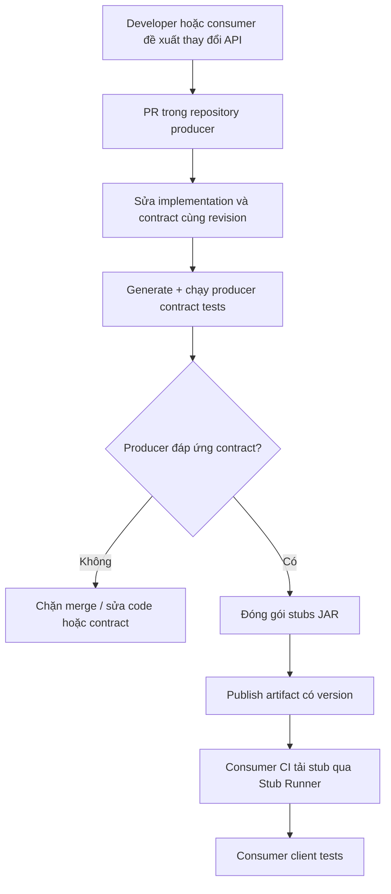
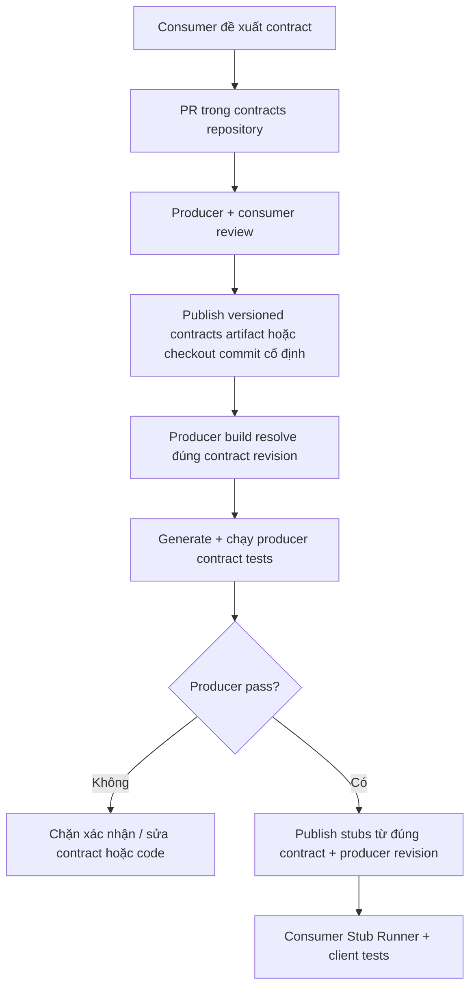
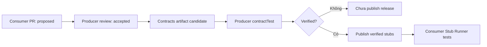
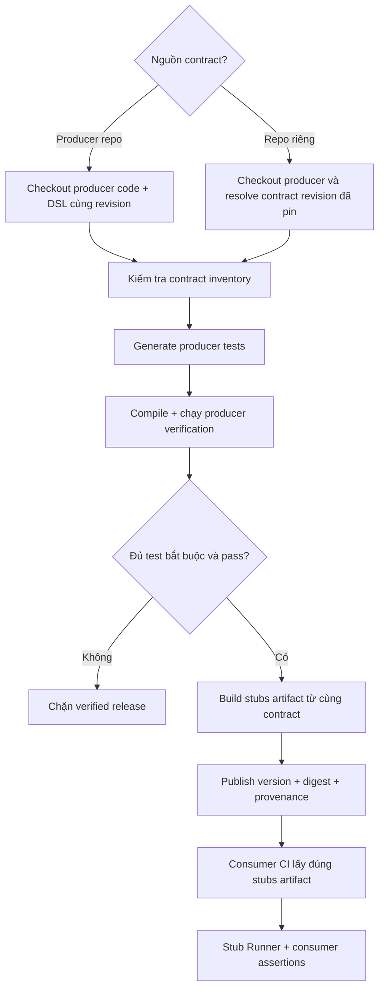

# Lưu hợp đồng cùng producer hoặc trong kho riêng

## 1. Chọn nơi lưu hợp đồng là một quyết định về quyền sở hữu

Trong **Spring Cloud Contract**, producer và consumer cùng dựa vào hợp đồng mô tả hành vi **HTTP** hoặc **thông điệp**. Hợp đồng có thể viết bằng **Groovy/YAML DSL**, được dùng để sinh **producer verification tests**, tạo **stub**, chạy **Stub Runner** phía consumer và tích hợp **CI** để phát hiện thay đổi API không tương thích.

Sau khi biết viết contract, nhóm phải trả lời một câu hỏi kiến trúc: **hợp đồng nên nằm trong repository mã nguồn của producer hay một repository độc lập?**

Ví dụ:

- `order-service` cung cấp `GET /api/orders/{id}`.
- `checkout-service` dùng HTTP client để xem trạng thái đơn hàng.
- `notification-service` nhận event `OrderConfirmed` từ producer.

Nếu contract ở **repository của order-service**, producer có thể sửa code và contract trong một pull request, rồi chạy verification ngay. Nếu contract ở **repository riêng**, nhiều consumer có thể đề xuất và review giao diện ở một nơi độc lập, nhưng phải phối hợp version, quyền truy cập và quy trình lấy contract vào build producer.

**Không có lựa chọn duy nhất cho mọi tổ chức.** Hai mô hình cùng có thể hoạt động với Spring Cloud Contract nếu nhóm giữ được nguyên tắc: contract có chủ sở hữu rõ, producer thực sự xác minh lời hứa, stub được sinh từ **cùng nguồn**, và consumer tải đúng artifact/version đã được kiểm chứng.

**Mục tiêu bài học:**

1. Phân biệt **source repository**, **contracts artifact** và **stubs artifact**.
2. So sánh lưu contract **cùng producer** với lưu trong **kho riêng** theo ownership, collaboration, release và CI.
3. Hiểu luồng hợp đồng đề xuất bởi consumer và được producer xác minh.
4. Tổ chức đường dẫn, version và cấu hình build nhận diện đúng contract.
5. Thiết kế release gate kết nối contract revision, producer verification, artifact publication và Stub Runner.
6. Chọn mô hình phù hợp cho tình huống thực tế, tránh sử dụng stub cũ và phá vỡ consumer.

## 2. Ba loại “kho” khác nhau: Git, contracts artifact và stubs artifact

Một sai lầm rất phổ biến là gọi tất cả chúng là “repository của contract”. Thực tế cần phân biệt:

| Thành phần | Lưu cái gì? | Ai dùng? | Vai trò |
| --- | --- | --- | --- |
| **Git source repository** | Tệp `.groovy`/`.yml`, mã nguồn, lịch sử PR/review | Developer, CI producer/consumer | **Nguồn có thể chỉnh sửa**, quản lý ownership và thay đổi |
| **Contracts artifact** | Bản đóng gói/version hóa của **DSL contract nguồn** | Producer build hoặc quy trình chia sẻ hợp đồng | Chuyển contract từ kho riêng sang nơi verifier có thể lấy |
| **Stubs artifact** | Mapping WireMock, file response và/hoặc nội dung messaging stub đã sinh | **Stub Runner ở consumer** | Phục vụ phản hồi/thông điệp mô phỏng khi consumer test |
| **Artifact registry** | Lưu và phân phối contracts/stubs JAR theo tọa độ | CI và build tools | Cung cấp release/version, access control, checksum |

Ví dụ tọa độ minh họa:

```text
Producer source:
  git: order-service.git @ revision 8c1e540

Source contract:
  src/test/resources/contracts/orders/get-confirmed-order.groovy

Contracts artifact riêng (nếu có):
  com.example.contracts:order-contracts:1.6.0

Producer stubs artifact:
  com.example:order-service:1.6.0:stubs

Producer executable artifact:
  com.example:order-service:1.6.0
```

Những tọa độ chỉ là ví dụ. **Contracts JAR và stubs JAR không phải cùng một artifact**: contracts JAR chứa DSL để tạo test/stub, còn stubs JAR cung cấp dữ liệu để Stub Runner dùng. Một producer-owned workflow có thể **không cần phát hành contracts JAR riêng** vì verifier đọc DSL trực tiếp từ source của producer.

### “Remote contracts” không có nghĩa “đọc Git tự động”

Trong Spring Cloud Contract, cấu hình như `contractsMode = REMOTE` thường liên quan tới **lấy contracts artifact từ một Maven-compatible repository**, tùy plugin/phiên bản. Nó **không tự động clone một Git URL bất kỳ**. Nếu tổ chức lưu DSL trong Git repository riêng, phải có cách:

- Publish DSL thành contracts artifact mà producer có thể resolve; **hoặc**
- Checkout/copy nguồn contract về một thư mục build được kiểm soát và cấu hình verifier đọc **đúng thư mục đó**.

Với hai hướng, cần ghi lại commit Git nào đã tạo input contract và bảo đảm producer tests dùng chính nội dung đó.

## 3. Mô hình A: lưu hợp đồng cùng repository producer

Producer sở hữu mã triển khai và DSL contract trong cùng Git repository. Ví dụ:

```text
order-service/
  build.gradle
  src/
    main/
      java/com/example/orders/...
    contractTest/
      java/com/example/orders/contract/OrderContractBase.java
      resources/
        contracts/
          orders/
            get-confirmed-order.groovy
            get-missing-order.yml
          messaging/
            order-confirmed.groovy
```

Đây là **layout minh họa cho Gradle**, dùng `src/contractTest/resources/contracts` theo một cấu hình plugin phổ biến. Với Maven có thể dùng `src/test/resources/contracts`. **Không coi mọi project đều có cùng default**; đường dẫn phải khớp `contractsDslDir` của Gradle hoặc cấu hình contract directory của Maven.

### Luồng phát triển producer-owned



**Ưu điểm:**

- **Atomic change:** cùng pull request có thể cập nhật code và contract, nên dễ review tính nhất quán.
- **Dễ debug:** một Git commit liên kết endpoint implementation, DSL và generated-test setup.
- **Ít hạ tầng bổ sung:** không cần một pipeline riêng để publish contracts artifact nguồn.
- **Ownership rõ:** producer chịu trách nhiệm giữ lời hứa HTTP/message mà mình phát hành.
- **Đơn giản với nhóm nhỏ:** ít bước đồng bộ version giữa source repo và contract repo.

**Nhược điểm:**

- Consumer muốn đề xuất contract có thể phải mở PR ở repository producer và được cấp quyền/được review từ nhóm đó.
- Các nhóm consumer có thể ít nhìn thấy thay đổi sắp tới nếu producer không chủ động truyền thông.
- Với nhiều producer repositories, khó có một vị trí duy nhất để tìm/so sánh tất cả API contracts nếu không có catalog/index.
- Nếu producer thay contract cùng code nhưng không chạy compatibility matrix của các consumer còn được hỗ trợ, vẫn có thể gây breaking change.

### Ai có quyền chấp nhận contract?

Với producer-owned contract, **producer thường là người merge/chấp thuận** vì họ chịu trách nhiệm implementation. Nhưng consumer phải có cơ hội review những phần mình phụ thuộc. Quy tắc thực dụng là: **producer sở hữu việc bảo đảm implementation**, consumer sở hữu việc diễn đạt những kỳ vọng cần được giữ; thay đổi phá vỡ phải theo policy compatibility/versioning của tổ chức.

Không xem việc contract nằm cùng producer như giấy phép xóa field/endpoint cũ mà không thông báo. Source cùng repository giúp giảm drift, **không tự đảm bảo backward compatibility**.

## 4. Mô hình B: lưu hợp đồng trong repository riêng

Một nhóm có thể muốn **contracts repository** độc lập:

```text
service-contracts/
  build.gradle
  contracts/
    order-service/
      checkout/
        get-confirmed-order.groovy
        get-missing-order.yml
      notifications/
        order-confirmed.groovy
    payment-service/
      checkout/
        payment-status.yml
```

Tên thư mục và cấu trúc là một **quy ước quản trị của tổ chức**, không phải một schema Git bắt buộc do Spring Cloud Contract áp đặt. Khi đưa vào verifier, cần biết rõ `contractsPath`/đường dẫn tương đương để lấy **chỉ nhóm contract dành cho producer đang build**, tránh kiểm chứng nhầm API của producer khác.

### Luồng với contracts repository tách biệt



**Ưu điểm:**

- Hợp đồng có chỗ đứng **độc lập** với implementation, thuận tiện cho trao đổi producer–consumer.
- Nhiều consumer có thể đề xuất kịch bản và nhìn thấy các yêu cầu trước khi producer đổi code.
- Dễ xây catalog và chính sách review thống nhất cho nhiều producer.
- Hỗ trợ tổ chức làm việc qua nhiều repository, nhiều nhóm hoặc các giai đoạn release khác nhau.
- Có thể version hóa một **contract candidate** trước khi code producer hoàn tất để thử nghiệm sớm.

**Nhược điểm:**

- **Hai nguồn thay đổi** phải được phối hợp: producer revision và contract revision không tự đồng bộ.
- Phát sinh build/publish cho contracts artifact hoặc job checkout một Git commit cố định.
- Có thể gặp tình trạng **consumer nhìn thấy contract mới nhưng producer chỉ mới pass bản cũ**.
- Ownership dễ mơ hồ: ai chịu trách nhiệm reject một contract chưa triển khai, ai phê duyệt breaking change, ai publish release?
- Quản lý permissions, dependency resolution, cache, artifact promotion và provenance phức tạp hơn.

**Nguyên tắc:** repository riêng có thể giúp consumer-driven collaboration, nhưng **merge hợp đồng không đồng nghĩa producer đã triển khai**. Hợp đồng mới chỉ trở thành một lời hứa producer đã xác minh khi generated producer tests tương ứng **thực sự chạy và pass trên code mục tiêu**.

## 5. So sánh hai mô hình để chọn đúng theo nhu cầu

| Tiêu chí | **Contract cùng producer** | **Contract repository riêng** |
| --- | --- | --- |
| Nguồn sự thật | Source trong repo producer | Source trong repo contracts độc lập |
| Người duyệt thay đổi chính | Producer, có review từ consumer | Producer và consumer theo ownership/policy |
| Sửa code + contract một lần | **Dễ**, chung một PR | Khó hơn, cần liên kết PR hoặc version |
| Consumer chủ động đề xuất hợp đồng | PR vào repo producer | **Thuận tiện**, PR vào kho chung |
| Nhiều consumer cùng thảo luận | Cần cơ chế review/catalog | **Tập trung** hơn |
| Rủi ro lệch contract và code | Vẫn có nếu verification không chạy | **Cao hơn** nếu không pin contract revision |
| Cần contracts artifact riêng | Thường **không** | Có thể cần nếu dùng `REMOTE` |
| Dễ bắt đầu cho một producer | **Rất phù hợp** | Có thêm chi phí quản trị |
| Audit quyền truy cập theo tổ chức | Theo repo producer | Có thể áp dụng policy tập trung |
| Release và CI | Đơn giản hơn về đầu vào | Cần phối hợp hai pipelines/revisions |
| Mở rộng tới nhiều team | Có thể cần catalog bổ sung | Hữu ích khi có ownership/process mạnh |

### Nên ưu tiên lưu cùng producer khi nào?

- Producer là nhóm nhỏ và có quyền kiểm soát toàn bộ vòng đời API.
- Consumer dễ tạo pull request hoặc gửi yêu cầu review tới repo producer.
- Code và contract thường thay đổi đồng thời, cần feedback nhanh.
- Đội chưa có artifact repository/contract publication pipeline ổn định.
- Muốn giảm số điểm đồng bộ để bắt đầu áp dụng **producer contract verification**.

### Nên cân nhắc repository riêng khi nào?

- Có nhiều consumer độc lập cùng đề xuất kỳ vọng với một hoặc nhiều producer.
- Tổ chức yêu cầu **review giao diện trước khi triển khai**, tách khỏi lịch code producer.
- Cần **catalog, ownership và versioning** thống nhất giữa các nhóm.
- Có hạ tầng đáng tin để publish contracts artifact, pin revision, quản lý credentials và audit.
- Nhóm sẵn sàng duy trì quy trình phân biệt **contract đề xuất**, **contract được producer chấp thuận** và **contract đã được producer xác minh**.

**Lựa chọn không nên dựa chỉ vào số microservices.** Một tổ chức có hàng chục dịch vụ nhưng quản trị theo đội sở hữu rõ ràng vẫn có thể dùng producer-owned repo. Một nhóm có hai dịch vụ nhưng nhiều bên thiết kế giao thức độc lập có thể hưởng lợi từ kho contract riêng.

## 6. Cấu hình đọc hợp đồng cùng producer

Giả sử `order-service` dùng Gradle Groovy DSL và đặt source tại `src/contractTest/resources/contracts`:

```groovy
plugins {
    id 'java'
    id 'org.springframework.cloud.contract' version 'REPLACE_WITH_COMPATIBLE_VERSION'
}

dependencies {
    testImplementation 'org.springframework.cloud:spring-cloud-starter-contract-verifier'
}

contracts {
    contractsDslDir = file('src/contractTest/resources/contracts')
    testFramework = 'JUNIT5'
    testMode = 'MockMvc'
    baseClassForTests = 'com.example.orders.contract.OrderContractBase'
    failOnNoContracts = true
}
```

**Đây là cấu hình minh họa.** Cần thêm repository, dependency management, Spring Boot/test dependencies và version Gradle/JDK/Spring Cloud Contract tương thích. Các thuộc tính và tên task cần được xác minh trên đúng phiên bản plugin. Với producer HTTP không chạy Spring MVC, test mode/base class phải chọn phù hợp runtime, chẳng hạn HTTP thực thay vì MockMvc.

Trong mô hình này, Gradle **không cần resolve contracts JAR từ một producer khác**; nó đọc DSL trực tiếp từ working tree của producer. Khi một PR đổi `OrderController` và `get-confirmed-order.groovy`, CI kiểm chứng **cùng commit** có hai thay đổi đó.

### Trình tự Gradle trong bài thực hành

```bash
# Chỉ minh họa lệnh; cần wrapper và plugin đã cấu hình.
./gradlew generateContractTests
./gradlew contractTest
./gradlew verifierStubsJar
```

`generateContractTests` chỉ sinh mã; `contractTest` mới nhằm **chạy producer verification**. `verifierStubsJar` đóng gói stub nhưng **không nên được publish dưới nhãn verified nếu producer tests chưa pass**. Nên kiểm tra task graph và báo cáo số test thực thi trong từng build thay vì suy rằng một task thành công bao hàm mọi bước.

### Maven producer-owned

Với Maven, DSL thường được đặt tại:

```text
src/test/resources/contracts/orders/get-confirmed-order.groovy
```

Maven plugin Spring Cloud Contract cần được cấu hình cho test base class và quá trình sinh verification tests/stubs. Trong pipeline đã nối lifecycle phù hợp, có thể chạy:

```bash
./mvnw -B clean verify
./mvnw -B install
```

Lệnh `install` không tự chứng minh có stubs JAR được attach nếu plugin chưa đóng gói đúng. Kiểm tra thực tế những artifact tạo ra và test reports. **Sự khác nhau về layout mặc định giữa Gradle và Maven không thay đổi nguyên tắc hợp đồng cùng revision producer.**

## 7. Lấy hợp đồng từ repository riêng: hai cách tổ chức

Một Git repository riêng vẫn cần được biến thành **đầu vào của producer verification**. Có hai con đường chủ đạo:

### Cách A — Publish contracts artifact vào Maven-compatible registry

```text
contracts.git @ commit CR-128
    → build/đóng gói DSL contracts JAR phiên bản 1.6.0
    → publish com.example.contracts:order-contracts:1.6.0

order-service.git @ commit P-542
    → resolve contracts artifact 1.6.0
    → chọn đường dẫn contracts dành cho order-service
    → sinh và chạy producer verification tests
    → nếu pass: sinh/publish order-service:1.6.0:stubs
```

Với một số phiên bản Spring Cloud Contract, Gradle hỗ trợ khung cấu hình giống:

```groovy
contracts {
    contractsMode = 'REMOTE'
    contractsRepositoryUrl = 'https://repo.example.org/maven-releases'
    contractDependency {
        stringNotation = 'com.example.contracts:order-contracts:1.6.0'
    }
    // Chọn subpath của producer nếu artifact chứa nhiều nhóm contracts.
    contractsPath = 'order-service'
}
```

**Version-specific:** `contractsMode`, `contractsRepositoryUrl`, `contractDependency` và `contractsPath` là những khái niệm được dùng trong cấu hình Spring Cloud Contract; tên property, kiểu extension, cấu trúc artifact và cách đường dẫn trong JAR được diễn giải phải đối chiếu **đúng bản Gradle plugin** trước khi sử dụng. Đoạn ví dụ thể hiện **ý định tích hợp**, không bảo đảm copy nguyên xi chạy được ở mọi nhánh.

Với Maven, cùng ý định có thể khai báo dưới plugin:

```xml
<configuration>
    <contractsMode>REMOTE</contractsMode>
    <contractsRepositoryUrl>https://repo.example.org/maven-releases</contractsRepositoryUrl>
    <contractDependency>
        <groupId>com.example.contracts</groupId>
        <artifactId>order-contracts</artifactId>
        <version>1.6.0</version>
    </contractDependency>
    <contractsPath>order-service</contractsPath>
    <baseClassForTests>com.example.orders.contract.OrderContractBase</baseClassForTests>
</configuration>
```

Đây là **trích đoạn configuration** bên trong `spring-cloud-contract-maven-plugin`, không phải một `pom.xml` hoàn chỉnh. Cần cấu hình dependency/plugin versions, test framework, repository credentials và packaging tương ứng. Với một số phiên bản, đường dẫn `contractsPath` có thể cần cấu trúc nested theo convention của artifact; hãy **mở đầu vào được resolve hoặc xem log generator** để chắc chắn plugin lấy đúng contracts.

### Cách B — Checkout một Git commit cố định và dùng LOCAL

CI có thể checkout contracts repo bên cạnh producer:

```text
ci-workspace/
  order-service/                # producer commit P-542
  checked-out-contracts/       # contracts commit CR-128
    order-service/
      get-confirmed-order.groovy
      order-confirmed.yml
```

Sau đó pipeline đưa đúng thư mục `checked-out-contracts/order-service` vào vùng input được plugin đọc hoặc cấu hình `contractsDslDir` trỏ tới đường dẫn ấy (theo quy tắc build tool). Phương án này không cần phát hành contracts JAR, nhưng cần:

1. **Pin contracts Git commit**, không checkout mặc định nhánh `main` tại mỗi lần chạy.
2. Đảm bảo đường dẫn input được cho phép và có mặt trong CI workspace.
3. Lưu cả `producerRevision` và `contractRevision` vào build metadata.
4. Không cho một process khác sửa source contract giữa generate và verify.
5. Kiểm tra test/stub được sinh từ **đúng nội dung vừa checkout**.

Phương án checkout có thể dễ thử trong monorepo hoặc CI hỗ trợ nhiều repositories, nhưng khó đóng băng nguồn khi task chạy trên máy developer thiếu checkout tương ứng. Vì vậy cần một script/build convention thống nhất, chứ không phụ thuộc vào thao tác copy file thủ công.

### Không trộn nguồn local và remote không có chủ đích

Một producer có thể vô tình vừa chứa contract cũ trong `src/test/resources/contracts`, vừa kéo contracts artifact mới từ registry. Nếu plugin quét cả hai hoặc fallback sang local không rõ ràng, generated tests có thể trùng hoặc sai kịch bản. Hãy xác định **một nguồn chính thức** và cấu hình plugin theo nguồn đó, có bước kiểm tra contract inventory.

## 8. Thiết kế cấu trúc kho riêng cho nhiều producer và consumer

Nếu repository riêng chứa hợp đồng của nhiều producer, cần tách **nhà cung cấp** khỏi **bên yêu cầu**:

```text
contracts-repo/
  contracts/
    order-service/
      checkout-service/
        get-confirmed-order.groovy
        get-missing-order.yml
      notification-service/
        order-confirmed.groovy
    payment-service/
      checkout-service/
        get-payment.yml
```

Một thư mục `order-service/checkout-service` có thể mang nghĩa “những kịch bản checkout cần order-service cam kết”, nhưng **đó chỉ là convention của ví dụ**. Spring Cloud Contract có các quy ước thư mục/`contractsPath` khác nhau giữa kiểu dùng và phiên bản. Không tự suy rằng plugin hiểu tên consumer chỉ vì thư mục mang tên đó.

### Đặt mỗi contract ở đâu?

| Contract | Producer được kiểm chứng | Consumer quan tâm | Nơi theo convention ví dụ |
| --- | --- | --- | --- |
| `GET /api/orders/42` | `order-service` | `checkout-service` | `order-service/checkout-service/get-confirmed-order.groovy` |
| `GET /api/orders/999` | `order-service` | `checkout-service` | `order-service/checkout-service/get-missing-order.yml` |
| `OrderConfirmed` event | `order-service` | `notification-service` | `order-service/notification-service/order-confirmed.groovy` |
| `GET /api/payments/900` | `payment-service` | `checkout-service` | `payment-service/checkout-service/get-payment.yml` |

Một hợp đồng có thể đáp ứng **nhiều consumer**; không cần nhân bản vô điều kiện theo tên consumer nếu các bên dùng cùng contract. Nhân bản dễ tạo drift: một bản thêm header nhưng bản khác quên cập nhật. Chỉ phân tách theo consumer khi có yêu cầu khác biệt thực sự hoặc quy trình ownership cần thiết.

### Metadata ngoài DSL và trách nhiệm của người duyệt

Nên có cách quản lý những thông tin không nhất thiết nằm trong Groovy/YAML DSL:

- Producer owner và những consumer liên quan.
- API/event version, mức ổn định (`candidate`/`accepted`/`verified`).
- Compatibility policy: có được thêm field, đổi status, bỏ trường hay không.
- Yêu cầu versioning/release; kế hoạch deprecation.
- Danh sách contract bắt buộc trong CI và người phê duyệt.

Những metadata ấy có thể nằm trong PR template, code owners, catalog hoặc CI, **không phải tệp riêng bắt buộc của Spring Cloud Contract**. Tránh để metadata trở thành một nguồn “lời hứa” thứ hai trái ngược với DSL.

## 9. Một hợp đồng HTTP giống nhau trong cả hai mô hình

Nơi lưu trữ **không được làm thay đổi ý nghĩa kiểm thử**. Giả sử consumer `checkout-service` cần:

```http
GET /api/orders/42 HTTP/1.1
Accept: application/json
```

Response:

```http
HTTP/1.1 200 OK
Content-Type: application/json

{"orderId":"ord-42","status":"CONFIRMED"}
```

### Groovy DSL

```groovy
import org.springframework.cloud.contract.spec.Contract

Contract.make {
    description 'Checkout tra cứu đơn đã xác nhận'
    request {
        method GET()
        url '/api/orders/42'
        headers {
            accept(applicationJson())
        }
    }
    response {
        status OK()
        headers {
            contentType(applicationJson())
        }
        body([
            orderId: 'ord-42',
            status: 'CONFIRMED'
        ])
    }
}
```

### YAML DSL thay thế

```yaml
description: Checkout tra cứu đơn đã xác nhận
request:
  method: GET
  url: /api/orders/42
  headers:
    Accept: application/json
response:
  status: 200
  headers:
    Content-Type: application/json
  body:
    orderId: "ord-42"
    status: "CONFIRMED"
```

**Đây là hai cách diễn đạt thay thế của một kịch bản**, không cần đặt cả hai tệp cùng nội dung trong nguồn được generator quét. Kịch bản còn đơn giản và dùng giá trị mẫu cố định; với ID/timestamp động có thể thêm matcher consumer/producer theo yêu cầu tương thích. Đừng khóa các giá trị ngẫu nhiên vào contract mà consumer không phụ thuộc.

### Khác nhau nằm ở đường đi vào build

**Cùng producer:**

```text
order-service.git @ revision P-542
  /src/.../contracts/get-confirmed-order.groovy
  /src/main/.../OrderController.java
  → producer verifier đọc trực tiếp DSL
```

**Kho riêng:**

```text
contracts.git @ revision C-128
  /order-service/checkout-service/get-confirmed-order.groovy
  → versioned contracts JAR hoặc checkout cố định
  → order-service.git @ P-542 resolve đúng C-128
  → producer verifier chạy
```

Trong cả hai, kết luận phải là: **producer code tại revision được kiểm thử đáp ứng đúng contract đã lấy làm đầu vào**. Contract nằm đâu trong Git không làm Java implementation tự đúng.

### Hợp đồng lỗi cũng cần được giữ

Nếu consumer xử lý lỗi `404 ORDER_NOT_FOUND`, cần một contract riêng mô tả đúng lỗi:

```yaml
description: Checkout không tìm thấy đơn hàng
request:
  method: GET
  url: /api/orders/999
response:
  status: 404
  headers:
    Content-Type: application/json
  body:
    code: "ORDER_NOT_FOUND"
```

Chuyển sang repository riêng mà vô tình chỉ copy hợp đồng `200` sẽ làm mất vùng bảo vệ `404`. Vì vậy quy trình migration phải có **kiểm tra inventory và generated tests/mappings**, không chỉ kiểm tra số tệp được copy.

## 10. Messaging contracts cũng cần được gắn đúng producer

Không phải chỉ HTTP contract mới cần chọn repository. Ví dụ `order-service` phát message sau khi đơn hàng xác nhận:

```groovy
import org.springframework.cloud.contract.spec.Contract

Contract.make {
    description 'Phát event OrderConfirmed'
    label 'order_confirmed'

    input {
        triggeredBy('confirmOrder()')
    }

    outputMessage {
        sentTo('orders.confirmed')
        headers {
            messagingContentType(applicationJson())
            header('eventType', 'OrderConfirmed')
        }
        body([
            orderId: 'ord-42',
            status: 'CONFIRMED'
        ])
    }
}
```

Nếu contract này nằm trong kho riêng, producer `order-service` vẫn phải lấy đúng version của nó, có base class thực thi `confirmOrder()` và adapter nhận output message. Consumer `notification-service` có thể dùng `StubRunner` và `StubTrigger` theo `label`, nhưng đó là **consumer-side test** — không chạy publisher thật của producer.

### Nguy cơ khi phân loại sai ở repository riêng

Giả sử kho contracts đặt `OrderConfirmed` dưới thư mục `notification-service` vì notification là consumer. Nếu producer build chỉ lấy `order-service/**`, contract event có thể bị **bỏ sót** trong producer verification. Vậy cần phân biệt:

- **Producer của event**: dịch vụ **phát** `OrderConfirmed`, được kiểm chứng output.
- **Consumer của event**: dịch vụ **nhận** event, dùng stub để kiểm tra listener.
- **Nơi lưu trong kho contracts**: một quy ước quản lý, phải map đúng tới cả hai luồng.

Với hệ thống có nhiều consumers cho cùng destination, cần xem chính sách tương thích của từng consumer, nhưng **không tạo nhiều phiên bản cạnh tranh của cùng event schema** mà không có mục đích rõ ràng.

## 11. Quy trình consumer-driven contract khi ở kho riêng

“Consumer-driven” nghĩa là những gì consumer cần có thể **định hình nội dung contract**, không có nghĩa consumer được đơn phương cam kết thay producer. Một quy trình rõ ràng thường gồm:

<escape>1.</escape> **Đề xuất:** Consumer tạo PR với contract mô tả request/response hoặc message mà mình thật sự cần, kèm một test consumer sử dụng stub ứng viên nếu khả thi.

<escape>2.</escape> **Review:** Producer kiểm tra endpoint/khả năng triển khai, compatibility và những consumer khác. Hai bên chỉnh lại tên field, method, status hoặc header cho rõ ràng.

<escape>3.</escape> **Chấp thuận nội dung:** Contract có thể được merge/publish thành **candidate version**. Đây là trạng thái “đã thống nhất yêu cầu”, **chưa phải** “producer đã triển khai”.

<escape>4.</escape> **Producer thực thi:** Producer lấy **đúng contract revision**, sửa code nếu cần và chạy generated producer verification tests.

<escape>5.</escape> **Xác minh:** Nếu producer test fail, release gate chặn; nếu pass và có số test thực thi hợp lệ, ghi lại revision, report và artifacts.

<escape>6.</escape> **Publish stubs:** Producer phát hành stubs JAR từ cùng nguồn hợp đồng đã verified. Consumer chạy Stub Runner với **đúng version** để xác minh client.

<escape>7.</escape> **Triển khai và theo dõi:** Producer triển khai artifact được xác minh; những consumer được hỗ trợ kiểm tra hành vi tương ứng. Theo dõi sự cố và kế hoạch deprecation.



**Điểm khác biệt về trạng thái:**

| Nhãn do tổ chức quản lý | Nghĩa chính xác | Có thể coi producer đã đáp ứng? |
| --- | --- | --- |
| `PROPOSED` | Consumer đề xuất hợp đồng | Chưa |
| `ACCEPTED` | Producer chấp thuận yêu cầu/thiết kế | Chưa nhất thiết |
| `VERIFIED` | Producer verification đã chạy và pass trên revision xác định | Có, **trong phạm vi test** |
| `PUBLISHED` | Artifact có thể tải được từ registry | **Không tự suy ra** verified nếu CI thiếu gate |
| `DEPLOYED` | Mã producer được triển khai | Phải đối chiếu artifact deploy với artifact đã verify |

Các nhãn ở bảng là **quy ước quy trình**, không phải những giá trị `status` mặc định trong Spring Cloud Contract DSL. Tránh đặt tên trạng thái mang ý nghĩa quá rộng và khiến người xem hiểu một contract đã verify trong khi chỉ mới được merge.

## 12. Quản lý version: contract, producer và stub không đồng nhất

Giả sử có:

```text
Contracts repo tag:           contracts/order-service/v2.1
Contracts Git revision:       C-128
Contracts artifact:           com.example.contracts:order-contracts:2.1.0
Producer Git revision:       P-542
Producer artifact:            com.example:order-service:1.6.0
Producer stubs artifact:      com.example:order-service:1.6.0:stubs
Consumer Git revision:       K-913
```

**Không bắt buộc** contracts artifact version và producer artifact version có cùng số. Một producer version có thể dùng contract version khác theo kế hoạch release, và một contract version có thể được nhiều producer builds liên tiếp đáp ứng. Điều bắt buộc là **liên kết giữa chúng có thể truy vết**.

### Bảng quan hệ phiên bản nên lưu trong CI

| Producer build | Contract revision đã verify | Test result | Stubs artifact | Có thể dùng làm bằng chứng release? |
| --- | --- | --- | --- | --- |
| `order-service 1.5.0` | `C-120` | PASS | `1.5.0:stubs` | Có, trong phạm vi được test |
| `order-service 1.6.0-rc1` | `C-128` | FAIL | Candidate chưa verified | **Không** |
| `order-service 1.6.0-rc2` | `C-128` | PASS | `1.6.0-rc2:stubs` | Có thể cho candidate compatibility |
| `order-service 1.6.0` | `C-128` | NOT RUN | `1.6.0:stubs` nếu đã tạo | **Chưa**, phải verify artifact mục tiêu |

Các revision và version chỉ là ví dụ. “PASS” không đồng nghĩa mọi hành vi production đã được kiểm tra; cần mô tả test mode, base class, fixture và những hợp đồng thực thi.

### Không dùng version động cho quyết định release

Một `contractDependency` dùng `LATEST` hoặc version range có thể lấy nội dung khác giữa hai lần chạy. Một stubs JAR có classifier `stubs` nhưng dùng cùng version bị ghi đè cũng có nguy cơ stale/cached mismatch.

Để release tái lập:

- Pin **contracts Git commit hoặc immutable artifact version/digest**.
- Pin **producer code revision hoặc artifact image/JAR digest**.
- Ghi lại **generated contract test report** và số kịch bản đã chạy.
- Pin **stubs artifact thực tế** mà consumer tải, không chỉ tên logic.
- Hạn chế ghi đè release artifacts trong registry và kiểm soát SNAPSHOT/candidate.

**Số version khớp chỉ là tín hiệu tiện theo dõi, không thay thế checksum/provenance.**

## 13. Thiết kế CI cho producer-owned và separate-contracts

Hai mô hình khác nhau ở cách lấy contract nguồn, nhưng **cổng producer verification** phải giữ cùng tiêu chuẩn:



### Cổng A — Đúng hợp đồng nguồn

Kiểm tra:

1. Hợp đồng đến từ **repo/commit/version nào**?
2. Plugin có được trỏ đúng `contractsDslDir`/`contractsPath` không?
3. Có hợp đồng của producer khác bị đọc nhầm không?
4. Bộ lọc như `ignoredFiles` có bỏ mất nhóm bắt buộc không?
5. Số và **danh sách** contract active có tương ứng inventory mong đợi không?

Đặc biệt với kho riêng chứa nhiều producer, một `contractsPath` không đúng có thể làm verifier sinh **0 tests** hoặc sinh tests cho producer khác. Nếu CI chỉ kiểm tra `BUILD SUCCESS`, lỗi chọn nguồn có thể không được phát hiện.

### Cổng B — Generated producer tests thực sự chạy

Việc generate code là **chưa đủ**. Cần biết:

- Test framework (JUnit 5/JUnit 4/Spock) và runner tương thích.
- Base class/test mode có gọi đúng controller/server hoặc publisher của producer.
- Test fixture được chuẩn bị và không vô tình mock chính behavior cần kiểm tra.
- Báo cáo `executed / failed / skipped` và những kịch bản bắt buộc.
- Khi implementation vi phạm contract (ví dụ đổi `status` thành `state`), test **có fail không**?

Với Gradle producer cấu hình đúng:

```bash
./gradlew clean contractTest
```

Với Maven producer cấu hình đúng:

```bash
./mvnw -B clean verify
```

Đây là lệnh **tham khảo cho người học**, không phải những lệnh đã chạy để viết bài. Tên task/goal và việc nối chúng vào lifecycle phụ thuộc plugin/version; cần kiểm tra report thật. Nếu project yêu cầu contract verification nhưng report hiển thị **0 test executed**, release gate nên báo thiếu bằng chứng, không mặc nhiên pass.

### Cổng C — Publication gắn với cùng nguồn đã verify

Quy trình đúng:

```text
Contract revision C-128 + producer revision P-542
  → generated tests và report PASS
  → stubs JAR được sinh từ C-128
  → producer build/stubs artifact có version và digest
  → publish vào registry theo policy bất biến
```

Không có cơ chế bắt buộc **mọi** build tool tự ngăn publish khi tests chưa chạy. Hãy đặt dependency/gate của pipeline hoặc publication stage một cách tường minh và kiểm tra artifact thực tế.

### Cổng D — Consumer dùng đúng stubs artifact

Một consumer Spring Boot có thể sử dụng:

```java
import org.springframework.cloud.contract.stubrunner.StubRunnerProperties;
import org.springframework.cloud.contract.stubrunner.spring.AutoConfigureStubRunner;

@AutoConfigureStubRunner(
    ids = "com.example:order-service:1.6.0:stubs:9090",
    stubsMode = StubRunnerProperties.StubsMode.REMOTE,
    repositoryRoot = "https://repo.example.org/maven-releases"
)
class CheckoutContractTest {
    // Client thật phải trỏ tới http://localhost:9090.
    // Test GET /api/orders/42 và các response lỗi cần bảo vệ.
}
```

Đây là cấu hình annotation **minh họa**; muốn chạy cần `@SpringBootTest` hoặc cơ chế test context thích hợp, dependency Stub Runner, repository thật, credentials và các assertions. Đừng dùng nguyên khung rồi coi một lớp không có `@Test` là consumer verification.

Consumer nên assert response có ý nghĩa, ví dụ đọc `status = CONFIRMED` hoặc error code `ORDER_NOT_FOUND`. Một WireMock 404 do **không có mapping** không thay thế response 404 nghiệp vụ mà contract cam kết.

## 14. Bảo mật, quyền sở hữu và kiểm soát artifact repository

Một kho contracts riêng có thể là điểm tập trung của nhiều nhóm, nên cần cân bằng khả năng cộng tác với **quyền thay đổi lời hứa API**.

### Phân quyền đề xuất

| Đối tượng | Hành động thường cần | Chính sách nên có |
| --- | --- | --- |
| Consumer developer | Đọc contract, đề xuất PR | Có thể đề xuất nhưng không đơn phương publish verified release |
| Producer owner | Review tính khả thi, xác nhận verification | Chủ sở hữu cuối cùng của behavior producer |
| CI contracts repo | Đóng gói/publish candidate contracts artifact | Token chỉ có quyền publish vào namespace tương ứng |
| CI producer | Đọc contracts artifact, publish stubs artifact sau verification | Quyền đọc contract + quyền ghi đúng producer group |
| CI consumer | Tải stubs artifact, chạy tests | **Read-only** tới registry là đủ |
| Release manager/platform | Quản lý promotion/retention | Audit artifact, policy immutable và rollback |

Đây là gợi ý governance, không phải RBAC mặc định do Spring Cloud Contract tạo. Một tổ chức nhỏ có thể dùng ít vai trò hơn, nhưng cần tránh token CI của consumer được phép **ghi đè** stubs artifact producer.

### Những điều cần tránh

- Đưa user/password của registry trực tiếp vào `build.gradle`, `pom.xml` hoặc `repositoryRoot` chứa credential.
- Commit token broker, private key, dữ liệu đơn hàng thật hoặc thông tin cá nhân vào contract/stub fixture.
- Cho mọi nhóm publish đè một release version không thể truy vết.
- Lấy contract qua HTTP/Git không kiểm soát TLS, credentials hoặc checksum.
- Log toàn bộ payload chứa thông tin nhạy cảm vào CI artifacts công khai.

**Credential và kết nối:** Dùng Gradle credentials properties, Maven `settings.xml`, environment variables hoặc secret store của CI; cấu hình URL registry qua HTTPS/đường mạng tin cậy. Với kho riêng của tổ chức, có thể cần chứng thực nội bộ và chính sách quyền đọc khác nhau cho consumer và producer.

### Stubs artifact không nên mang bí mật

Stub là dữ liệu mô phỏng có thể được nhiều nhóm dùng. Nếu contract chứa response JSON có số tài khoản, email thật hoặc token production, nó có thể bị đóng gói và lưu lâu dài. Hãy dùng **synthetic test data**, không dùng dữ liệu nhạy cảm trong body/headers trừ khi có quy trình xử lý phù hợp.

## 15. Branching, candidate và backward compatibility

Repository riêng thường có nhiều PR đang chạy song song; repo producer cũng có release branch. Nếu không quy định version, dễ gặp tình huống “contract mới đã merge nhưng code mới chưa sẵn sàng”.

### Một chuỗi phiên bản minh họa

```text
Ngày 1:
  contracts C-120: GET /api/orders/42 -> {orderId,status}
  producer P-500: verification PASS với C-120
  consumer dùng order-service:1.5.0:stubs

Ngày 2:
  consumer đề xuất thêm header X-Correlation-Id
  contracts candidate C-128 được review và publish
  producer P-500 chưa hỗ trợ, generated test với C-128 FAIL

Ngày 3:
  producer P-542 thêm header, verification PASS với C-128
  publish producer/stubs 1.6.0-rc
  consumer candidate tests PASS

Ngày 4:
  release producer 1.6.0; pin digest và ghi provenance
```

Ngày 2, contracts `C-128` là **yêu cầu đã được đề xuất/chấp thuận**, không phải bằng chứng `P-500` đã đáp ứng. Không gắn một badge “verified” cho toàn repository chỉ vì một branch producer cũ đã pass với revision khác.

### Thay đổi phá vỡ cần policy rõ

| Loại thay đổi | Rủi ro | Quy trình hợp lý |
| --- | --- | --- |
| Thêm response field | Có thể tương thích | Kiểm tra JSON deserializer strict của consumer |
| Đổi `status` sang `state` | Dễ phá vỡ | Giữ field cũ trong giai đoạn migration hoặc version API |
| Đổi HTTP `200` sang `204` | Có thể phá vỡ | Review consumer phụ thuộc body/status |
| Siết query/header bắt buộc | Dễ phá vỡ | Producer verify và consumer matrix |
| Đổi message destination hoặc `eventType` | Có thể làm consumer không nhận message | Messaging contract + broker integration |
| Xóa error code `ORDER_NOT_FOUND` | Có thể phá vỡ error handling | Contract lỗi và consumer assertions |

Nếu kho riêng có nhiều producer/consumer, breaking change review càng cần danh sách consumer đang hỗ trợ. **Một PR được merge không phải bằng chứng không có consumer bị ảnh hưởng**; cần chạy test matrix hoặc có kế hoạch deprecation được thống nhất.

### Branch, tag và release version

- **Branch**: thuận tiện cho phát triển, nhưng HEAD có thể thay đổi; không dùng branch name làm bằng chứng artifact bất biến.
- **Git tag**: giúp nhận diện release contracts; cần bảo vệ quyền di chuyển tag.
- **Artifact version/digest**: thuận tiện cho Gradle/Maven resolve và CI tái lập.
- **Candidate versions**: dùng để test sớm, không nên bị consumer hiểu nhầm là cam kết production đã verified.

Khi release, ghi rõ **producer nào đã pass với contract revision nào**, không chỉ tag chung của repository chứa hợp đồng cho nhiều producer.

## 16. Chuyển từ producer-owned sang kho riêng mà không mất coverage

Khi tổ chức mở rộng, có thể cần di chuyển contracts ra repository độc lập. Đây không nên là một lần “copy file rồi xóa bản cũ” không kiểm chứng.

### Kế hoạch di chuyển an toàn

1. **Kiểm kê:** Liệt kê contract active, source path, consumer liên quan, test framework/base class và expected test count theo nhóm.
2. **Chốt baseline:** Chạy producer verification trên revision hiện tại và lưu report, test inventory, stubs artifact/digest.
3. **Tạo repository riêng:** Chuyển DSL với path convention đã thống nhất, **không sửa nội dung ngữ nghĩa** chỉ để tổ chức folder.
4. **Chọn đường cung cấp input:** Contracts artifact `REMOTE` hoặc checkout Git commit cố định.
5. **Cấu hình producer build:** Trỏ đúng `contractsRepositoryUrl`/`contractDependency`/`contractsPath` hoặc `contractsDslDir` theo version plugin.
6. **So output:** Generate tests/stubs từ nguồn mới và so kịch bản, request/response, matchers, test base class và artifact output với baseline.
7. **Chạy lại producer verification:** Cùng implementation phải pass các contract đã chuyển, và negative smoke test phải fail khi cố tình tạo sai response.
8. **Consumer xác minh:** Dùng Stub Runner với stubs artifact mới; assert success/error HTTP hoặc messaging cases được bảo vệ.
9. **Cắt nguồn cũ:** Chỉ sau khi chứng minh nguồn mới đúng, ngừng quét DSL cũ; tránh double generation, duplicate mappings và source ambiguity.
10. **Ghi provenance:** Từ đây lưu cả producer revision lẫn contracts revision.

### Một vấn đề thường xuất hiện sau migration

Sau khi đổi `contractsDslDir` hoặc `contractsPath`, generated test class có thể đổi package, làm **`baseClassMappings` không match** và test kế thừa base class mặc định. HTTP tests có thể fail do MockMvc không được setup, messaging tests không có trigger/binder, hoặc test framework không tìm được class.

Khi ấy cần kiểm tra **package/path của generated tests**, regex mapping và test classpath. Đừng chỉnh contract DSL để chạy được nếu lỗi chỉ đến từ **bố cục repository và build configuration**.

### Có nên duy trì song song hai bản contract mãi mãi?

Không nên có **hai nguồn có quyền sửa độc lập** cho cùng một lời hứa trừ khi có cơ chế đồng bộ/đối chiếu rõ ràng. Một phương án tạm thời là giữ một nơi **read-only/mirror** rồi dùng CI so checksum trong giai đoạn migration. Sau khi cutover, chọn một nguồn chính thức; không để producer sửa bản nội bộ trong khi consumer đề xuất bản kho riêng mà không có liên kết.

## 17. Ma trận chẩn đoán những lỗi repository thường gặp

| Triệu chứng | Vùng nguyên nhân | Hành động kiểm tra |
| --- | --- | --- |
| Producer build không tìm thấy contracts JAR | Sai tọa độ, registry URL, version hoặc credentials | Kiểm tra `contractDependency` và artifact registry |
| Repository HTTP 401/403 | Thiếu quyền, token hết hạn | Kiểm tra CI secret, read-only permission và URL; không in credential |
| Repository HTTP 404 | Không có artifact/version/classifier yêu cầu | Xem publication manifest và đường dẫn Maven |
| Pull Git mới nhất làm producer test fail bất ngờ | Không pin contract revision | Checkout commit/tag bất biến hoặc dùng artifact version cố định |
| Generator thấy 0 contract | Sai `contractsPath`/`contractsDslDir` hoặc bộ lọc | Xem inventory, log discovery, task và pattern |
| Generator lấy contract của producer khác | Path/namespace trong artifact sai | Phân tách producer group, xác minh generated source |
| Có hai generated tests giống nhau | DSL bị quét từ cả repo nội bộ và repo riêng | Chỉ giữ một nguồn chính thức |
| Generated tests không compile sau migration | Base class mapping/package/classpath lệch | Xem generated extends, source set và FQN |
| Contract mới có nhưng stub cũ vẫn được dùng | Cache hoặc publication sai version | So tọa độ/digest và build ID |
| Consumer Stub Runner trả 404 mặc định | Không có mapping, request không match hoặc sai artifact | So request journal, mappings, port và version |
| Producer tests fail khi contract được chấp thuận | Implementation chưa đáp ứng candidate | Sửa producer hoặc thương lượng contract; không đổi báo cáo thành pass |
| Có stubs JAR dù không có producer test report | Pipeline publish không phụ thuộc verification | Chặn publication cho đến khi chạy đúng tests |
| Một consumer pass, consumer khác fail | Nhu cầu/phiên bản khác nhau | Chạy ma trận consumer còn được hỗ trợ |
| Contract dùng Kafka event nhưng test chỉ có HTTP mapping | Sai loại contract/adapter | Kiểm tra messaging DSL, verifier và StubTrigger |
| Release tag trỏ nội dung khác lần build trước | Artifact/tag không bất biến | Xác minh checksum, policy immutable và audit |

### Quy trình gỡ lỗi theo tầng

```text
1. Source:
   Đâu là nguồn contract chính thức? Commit/tag nào?

2. Resolution:
   Producer build thực sự lấy input nào? Tọa độ / path / checksum?

3. Generation:
   Những contract nào đã sinh ra tests và stubs?

4. Verification:
   Generated producer tests có compile, execute và pass không?

5. Packaging:
   Stubs JAR nào được tạo? Version/digest có tương ứng?

6. Consumer:
   Stub Runner tải artifact nào? Client có match đúng mapping?

7. Deployment:
   Producer được triển khai có đúng artifact đã verify không?
```

**Không nhảy thẳng từ lỗi “Stub Runner trả 404” sang sửa producer implementation.** Có thể consumer tải sai version hoặc mapping không có contract lỗi đó. Ngược lại, consumer pass với một stub đúng **không bác bỏ** failure của producer verification trên code mới.

## 18. Bài thực hành: lựa chọn kho lưu hợp đồng cho một hệ thống

### Bối cảnh

Nhóm có ba service:

- **`order-service`**: producer của API đơn hàng và event `OrderConfirmed`.
- **`checkout-service`**: consumer của HTTP API tra cứu đơn.
- **`notification-service`**: consumer của event `OrderConfirmed`.

Ban đầu, tất cả contract được lưu cùng repository `order-service`. Khi tổ chức mở rộng, consumer teams muốn tạo PR hợp đồng độc lập trước khi producer triển khai.

Những tình huống cần bảo vệ:

| Consumer | Contract | Tác dụng |
| --- | --- | --- |
| Checkout | `GET /api/orders/42` trả `200` và `status=CONFIRMED` | Đọc trạng thái đơn |
| Checkout | `GET /api/orders/999` trả `404 ORDER_NOT_FOUND` | Xử lý lỗi |
| Notification | `OrderConfirmed` tới `orders.confirmed` | Gửi notification |

### Nhiệm vụ A — Chọn mô hình

Cho hai phương án:

**Phương án A:** Giữ DSL trong `order-service.git`, consumer tạo PR vào repository producer.

**Phương án B:** Tạo `contracts.git`, CI publish `com.example.contracts:order-contracts:1.6.0`, producer resolve artifact để generate tests.

Hãy đánh giá:

1. Phương án nào dễ **sửa implementation và contract trong cùng PR**?
2. Phương án nào thuận lợi hơn khi **nhiều consumer muốn đề xuất contract trước**?
3. Phương án nào đòi hỏi **theo dõi hai source revisions**?
4. Cách nào giúp một developer checkout mã producer rồi chạy test không cần mạng/registry bổ sung, nếu dependencies đã có sẵn?
5. Cả hai phương án cần những cổng verification và publication nào?

**Gợi ý:** A mạnh ở atomic change/đơn giản, B mạnh ở trao đổi hợp đồng độc lập. **Cả A lẫn B đều cần producer verification và stub versioning**.

### Nhiệm vụ B — Tạo cây thư mục kho riêng

Nếu chọn B, đề xuất cây nguồn:

```text
contracts-repo/
  contracts/
    order-service/
      checkout-service/
        get-confirmed-order.groovy
        get-missing-order.yml
      notification-service/
        order-confirmed.groovy
```

Hãy xác định `contractsPath`/đường dẫn resolve tương đương để producer **chỉ** lấy hợp đồng của `order-service`. Với Spring Cloud Contract version cụ thể của bài lab, kiểm tra đường dẫn thực trong contracts artifact và generated tests để biết convention áp dụng đúng hay chưa.

### Nhiệm vụ C — Chạy thử hai revisions

Giả sử:

```text
Contract revision C-120:
  GET /api/orders/42 -> {orderId: "ord-42", status: "CONFIRMED"}

Contract revision C-128:
  GET /api/orders/42 -> {orderId: "ord-42", state: "CONFIRMED"}

Producer revision P-500:
  trả field status
```

Hãy dự đoán:

| Input xác minh | Producer code | Kết quả hợp lý |
| --- | --- | --- |
| Contract C-120 | P-500 | Pass nếu route/status/header/body đúng |
| Contract C-128 | P-500 | **Fail** nếu yêu cầu `state` nhưng producer chỉ trả `status` |
| Stub của C-128 | Checkout consumer cũ đọc `status` | Có nguy cơ fail hoặc đọc thiếu field |
| Consumer dùng stub C-120 nhưng producer deploy mã mới khác C-120 | Chưa rõ | Consumer pass **không đủ bằng chứng** producer mới tương thích |

Nếu consumer còn được hỗ trợ vẫn dùng `status`, có nên merge C-128 thành contract thay thế và phát hành ngay không? **Không nên nếu không có kế hoạch migration/versioning được các bên thống nhất.** Có thể cần giai đoạn producer trả cả hai field hoặc API version mới.

### Nhiệm vụ D — Soạn một provenance record

Sau khi producer P-542 pass với C-128, một CI manifest minh họa:

```yaml
service: order-service
producerRevision: P-542
contractSource:
  repository: contracts-repo
  revision: C-128
  artifact: "com.example.contracts:order-contracts:1.6.0"
verification:
  status: PASS
  executed: 8
  failed: 0
  skipped: 0
output:
  stubsArtifact: "com.example:order-service:1.6.0:stubs"
  sha256: "<computed-by-CI>"
```

Đây là **mẫu quản trị do bài thực hành đề xuất**, không phải file/metadata mặc định mà Spring Cloud Contract tự sinh. Thay số test và digest bằng kết quả thật từ pipeline; nếu verification chưa chạy, phải ghi `NOT_RUN` thay vì bịa `PASS`.

### Nhiệm vụ E — Thiết kế quality gates

Tạo hai cổng:

**Producer gate:** xác nhận source contract/version, generated tests active và đã chạy, test pass, stubs artifact đúng revision được publish.

**Consumer gate:** Stub Runner tải đúng stubs artifact/digest, HTTP client hoặc messaging listener thật được gọi, các nhánh thành công/lỗi được assert.

Sau đó thêm một integration test dùng broker thật nếu `OrderConfirmed` cần bảo vệ routing/serializer ngoài test binder.

### Kết quả học tập mong đợi

Người học giải thích được **vì sao nơi lưu trữ hợp đồng không quyết định tính đúng đắn của API**, và biết đánh giá chi phí phối hợp: repo producer thuận tiện cho atomic changes; repo riêng thuận lợi cho consumer proposals nhưng cần version, ownership, verification và release provenance rõ hơn.

## 19. Những sai lầm cần tránh khi tổ chức kho hợp đồng

### Sai lầm 1 — “Có một repository contract riêng thì API tự tương thích”

Repository riêng chỉ giúp **chia sẻ và quản lý source**. Nó không chạy producer implementation, không quyết định test mode và không bảo vệ tất cả consumer nếu pipeline không lấy/kiểm tra đúng contracts. **Contract review và producer verification là hai hành động khác nhau**.

### Sai lầm 2 — “Đã publish contracts JAR thì consumer chỉ cần dùng JAR đó”

Contracts JAR và stubs JAR có nhiệm vụ khác nhau. **Producer** thường đọc contracts artifact để generate tests/stubs; **consumer Stub Runner** thường cần stubs artifact do producer phát hành. Consumer test dùng contract DSL hay fixture tự viết có thể hữu ích, nhưng nếu thiếu producer verification cùng revision thì chưa chứng minh implementation.

### Sai lầm 3 — “Contract và code đều có version 1.6.0 nghĩa là giống nhau”

Version string có thể trùng nhưng bytes khác, nhất là snapshot hoặc artifact bị ghi đè. Cần **source revision, build ID, checksum/digest và test report** để liên kết chúng. Khi release, pin artifact đã kiểm tra; không chỉ truyền chữ `1.6.0` qua Slack rồi coi đủ bằng chứng.

### Sai lầm 4 — “Càng nhiều bản copy contract theo consumer càng tốt”

Sao chép một HTTP schema vào 5 thư mục consumer khác nhau dễ dẫn đến drift. Khi contract thực sự giống nhau, nên có **một nguồn chung** và chỉ thêm những kịch bản consumer-specific khi nhu cầu khác nhau. Nếu cần các phiên bản tương thích song song, phải version hóa rõ thay vì để bản copy khác nhau âm thầm.

### Sai lầm 5 — “Producer test pass một hợp đồng nghĩa là đã pass toàn bộ kho”

Một bộ lọc `contractsPath` hoặc `ignoredFiles` có thể bỏ sót hàng chục contract. CI nên biết **danh sách kịch bản bắt buộc** và đếm các tests thực thi, không chỉ check process exit code.

### Sai lầm 6 — “Stub pass nghĩa là producer hiện đã triển khai đúng”

WireMock phục vụ mẫu được nạp. Nó không gọi producer controller/service thật. Nếu producer đổi `status` thành `state` nhưng consumer vẫn dùng stub cũ, consumer test có thể vẫn xanh. Cần producer verification trên revision mục tiêu.

### Sai lầm 7 — “Kho riêng có thể merge mọi contract proposal vào release chính”

Một consumer có thể đề xuất một endpoint mới trước khi producer triển khai. Hãy giữ **candidate/accepted** tách với **verified/released**. Nếu không, consumer khác có thể tải artifact chứa lời hứa chưa tồn tại và hiểu nhầm là API đã sẵn sàng.

### Sai lầm 8 — “Di chuyển source không ảnh hưởng generated tests”

Thay path/folder có thể ảnh hưởng **package generated class**, `baseClassMappings`, `contractsPath`, test classpath hoặc packaging của stubs. Sau migration phải so test inventory, generated mappings và chạy lại verification, không chỉ so nội dung hai tệp DSL.

## 20. Checklist quyết định nơi lưu hợp đồng

- [ ] Biết **producer nào** chịu trách nhiệm mỗi HTTP endpoint hoặc message output.
- [ ] Xác định **consumer nào** dùng contract và ai có quyền review/chấp thuận thay đổi.
- [ ] Đã so ưu/nhược giữa **producer-owned** và **separate contracts repository** theo quy mô/team workflow.
- [ ] Nếu cùng producer, DSL và implementation có thể được thay đổi/test trên **cùng revision**.
- [ ] Nếu kho riêng, có quy tắc producer/consumer folder và tránh nhân bản schema không cần thiết.
- [ ] Biết rõ Git source repo khác **contracts artifact** và khác **stubs artifact**.
- [ ] Nếu dùng REMOTE, producer build lấy đúng contracts artifact từ registry, đúng version và `contractsPath`.
- [ ] Nếu checkout Git repo riêng, pipeline **pin commit**, không lấy branch HEAD trôi nổi để làm bằng chứng release.
- [ ] Đã xác minh `contractsDslDir`, `contractsPath` và bộ lọc source không làm mất hợp đồng bắt buộc.
- [ ] Producer verification **sinh, biên dịch, thực sự chạy và pass** trên code revision mục tiêu.
- [ ] Base class/test mode HTTP/messaging tương ứng runtime và không mock mất behavior phải bảo vệ.
- [ ] Không publish artifact dưới nhãn verified khi producer generated tests chưa chạy hoặc fail.
- [ ] Stubs JAR được tạo từ **đúng contract revision** đã qua producer verification.
- [ ] Các artifact có **group, artifact, version, classifier, build ID và digest** có thể truy vết.
- [ ] Registry có chính sách phân quyền, immutable release và quản lý credentials an toàn.
- [ ] Consumer Stub Runner tải đúng stubs artifact; client/listener thật được test với assertions có ý nghĩa.
- [ ] Những consumer/version còn được hỗ trợ có compatibility matrix hoặc quy trình deprecation rõ.
- [ ] Contract candidate được phân biệt với contract accepted, verified và deployed.
- [ ] Nếu migration repository, đã so source inventory, generated tests/stubs và chạy lại end-to-end contract workflow.
- [ ] Những yêu cầu ngoài phạm vi contract (DB transaction, broker delivery, security, idempotency) có integration/E2E tests riêng nếu cần.

## 21. Tài liệu tham khảo và cách áp dụng theo phiên bản

Khi triển khai trong dự án thực tế, nên đối chiếu tài liệu chính thức của **đúng phiên bản Spring Cloud Contract** đã khóa trong build:

- [Spring Cloud Contract — Reference](https://docs.spring.io/spring-cloud-contract/reference/): tổng quan Contract Verifier, Stub Runner, artifact workflow và cấu hình.
- [Spring Cloud Contract — Gradle Project](https://docs.spring.io/spring-cloud-contract/reference/gradle-project.html): Gradle plugin, local/remote contracts, source roots và tasks.
- [Spring Cloud Contract — Maven Project](https://docs.spring.io/spring-cloud-contract/reference/maven-project.html): Maven plugin, contract dependency và test generation.

Một số trang có thể đổi đường dẫn hoặc hiển thị phiên bản mới hơn dự án đang dùng. **Đừng sao chép máy móc property/DSL từ ví dụ của nhánh khác**: trước tiên kiểm tra plugin version, JDK/Spring Boot compatibility và generated output thực tế bằng một smoke test nhỏ.

**Ghi nhớ:** Lưu hợp đồng **cùng producer** giúp thay đổi mã và lời hứa trong một revision, đơn giản cho nhiều nhóm; lưu trong **kho riêng** giúp nhiều consumer cộng tác, review và version hóa giao diện độc lập. Không mô hình nào tự bảo đảm tính tương thích. Bằng chứng đáng tin luôn cần chuỗi **contract source xác định → producer verification đã thực thi → stubs artifact cùng nguồn và có provenance → consumer Stub Runner tests → artifact triển khai đúng phiên bản**. Chọn nơi lưu phù hợp với cách tổ chức nhóm, nhưng giữ nguyên chuỗi xác minh đó.
