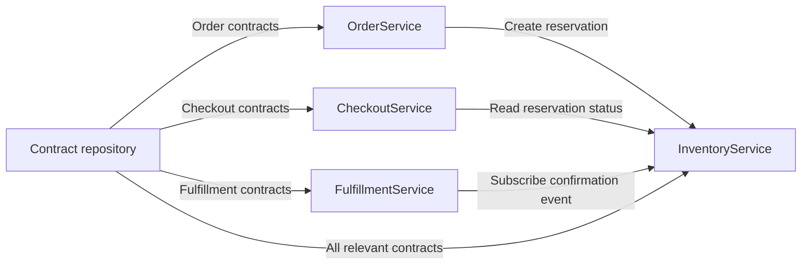
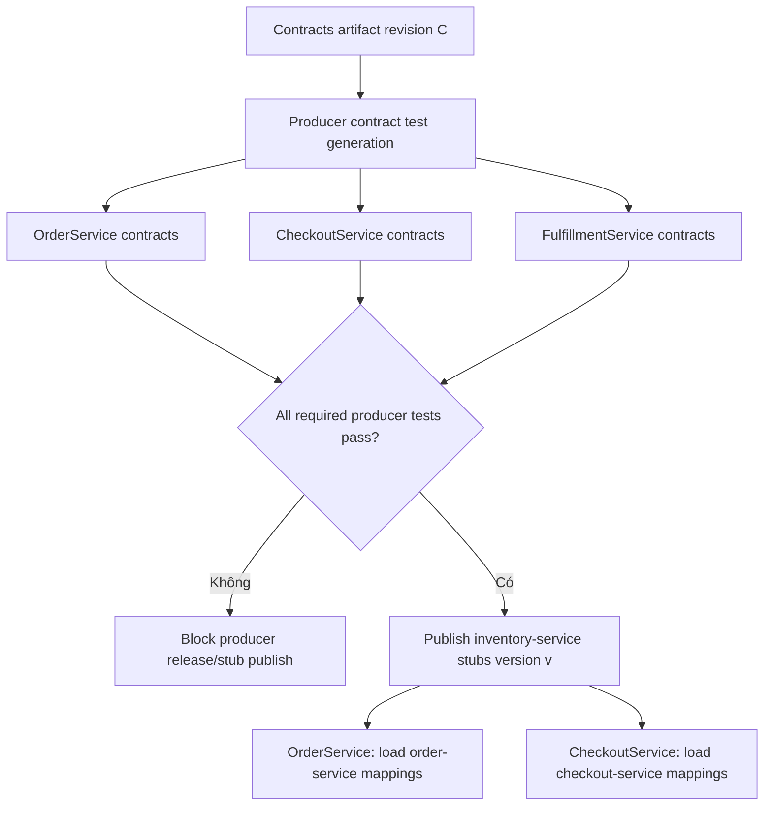
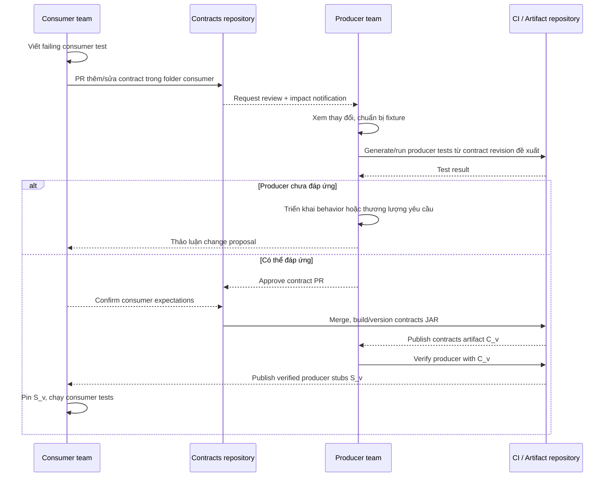
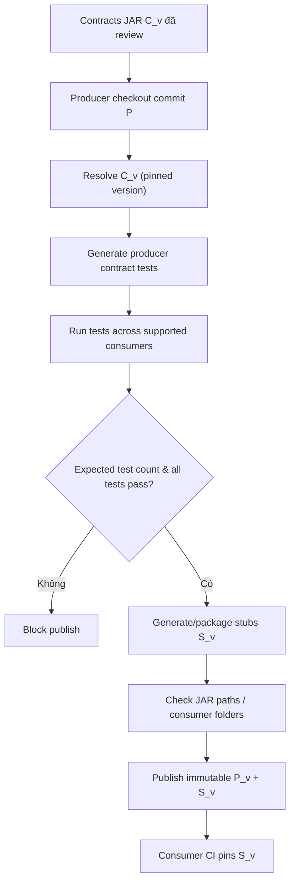

# Lưu hợp đồng theo consumer và nhu cầu hợp tác giữa nhóm

Một producer hiếm khi chỉ phục vụ một consumer. Ví dụ, `InventoryService` cung cấp thông tin giữ hàng cho `OrderService`, kiểm tra tồn kho cho `CheckoutService` và phát sự kiện cho `FulfillmentService`. Cùng một API có thể được ba nhóm sử dụng theo những cách khác nhau: nhóm đặt hàng dựa vào `reservationId`, nhóm thanh toán cần trạng thái `HELD`, còn nhóm hoàn tất đơn dựa vào sự kiện `reservation.confirmed`. Nếu tất cả contracts nằm lẫn trong một thư mục, rất khó trả lời **ai phụ thuộc vào field nào**, ai cần review thay đổi và những stubs nào cần cho từng nhóm.

Spring Cloud Contract hỗ trợ **Consumer-Driven Contract (CDC)**: consumer mô tả những hành vi mà mình cần, producer xác minh rằng implementation thật đáp ứng chúng, và stubs được đóng gói cho consumer kiểm thử độc lập. Hợp đồng có thể được lưu **cùng repository producer**, trong **kho hợp đồng chung** hoặc **repository Git/SCM riêng**, sau đó phát hành dưới dạng artifact để các nhóm cùng sử dụng.

Bài học thuộc chương **Kho hợp đồng và artifact** của module **SPRING_CLOUD_CONTRACT**. Module tập trung vào kiểm thử HTTP/message bằng **Groovy/YAML DSL**, sinh producer tests, phát hành stubs, dùng **Stub Runner** và tích hợp **CI** nhằm phát hiện thay đổi API không tương thích. Chủ đề này đi sâu vào **cách tổ chức contract theo consumer** và **quy trình cộng tác giữa nhóm**, thay vì chỉ nói cách tạo một JAR.

Sau bài học, bạn có thể:

- Phân biệt **consumer owner**, **producer owner** và **contract owner**.
- Chọn mô hình lưu contracts trong producer repository hay external/shared repository.
- Tổ chức thư mục theo `producer/consumer/capability` để truy vết phụ thuộc.
- Viết Groovy/YAML contracts có kịch bản cụ thể mà không nhân đôi những thỏa thuận chung.
- Bật `stubsPerConsumer`/`consumerName` để consumer chỉ nạp stubs liên quan.
- Phát hiện sự mâu thuẫn khi hai consumers mô tả response khác nhau cho cùng một request.
- Quản lý Pull Request, review, test, artifact version và quyền truy cập giữa các nhóm.
- Thiết kế cổng CI từ contract proposal đến producer verification rồi đến consumer Stub Runner.

## 1. Hợp đồng là thỏa thuận, không chỉ là file test

Một contract Spring Cloud Contract thể hiện **hành vi có thể quan sát qua ranh giới tích hợp**. Với HTTP, đó là method, URL, headers, request body, status và response body. Với messaging, đó có thể là trigger, destination, headers và payload.

Ví dụ `OrderService` gọi:

```http
POST /api/v1/reservations HTTP/1.1
Content-Type: application/json

{"sku":"SKU-001","quantity":2}
```

và mong nhận:

```http
HTTP/1.1 201 Created
Content-Type: application/json

{"reservationId":"RES-701","status":"HELD"}
```

Khi consumer nói “chúng tôi cần `reservationId` và trạng thái `HELD`”, đó là một phụ thuộc kỹ thuật có thể được đưa vào contract; producer cần duy trì hoặc phối hợp migration trước khi thay đổi.

**Ba khẳng định khác nhau:**

1. **Contract được hai nhóm chấp nhận:** có thỏa thuận hành vi mong đợi.
2. **Producer verification pass:** generated test thật sự kiểm implementation của producer và thấy nó đáp ứng.
3. **Consumer stub test pass:** consumer code gọi/nhận stub đúng và xử lý response theo thỏa thuận.

Chỉ có (1) chưa đảm bảo hai bên hoạt động đúng; chỉ có (3) chưa chứng minh implementation producer tương thích. Việc lưu contract theo consumer giúp **xác định chủ sở hữu từng nhu cầu**, nhưng vẫn cần cả verification và consumer tests.

### Ai quyết định điều gì?

| Vai trò | Trách nhiệm chính | Ví dụ |
| --- | --- | --- |
| **Consumer team** | Nêu nhu cầu thực tế, viết consumer tests, đề xuất contract | `OrderService` cần `reservationId` |
| **Producer team** | Đánh giá khả thi, xác minh implementation, công bố version | `InventoryService` bảo đảm `201` và field ID |
| **Contract/repository maintainers** | Quản lý convention, review policy, artifact build, quyền truy cập | Quản trị common contracts repo |
| **CI/release owners** | Bảo đảm producer tests chạy, stub build đúng revision, publish có provenance | Chặn release khi contract tests fail |

Không phải tổ chức nào cũng tách cả bốn nhóm. Điều quan trọng là **có người chịu trách nhiệm rõ ràng**; một PR contract không nên được merge chỉ vì JSON/Groovy parse thành công.

## 2. Vì sao phải nhóm contracts theo consumer?

Khi các nhóm phụ thuộc vào các phần khác nhau của cùng API, việc phân nhóm giúp:

- **Truy vết ảnh hưởng:** tìm nhanh consumer nào phụ thuộc `reservationId` hoặc `status`.
- **Review đúng người:** thay đổi trong thư mục `order-service` cần reviewer hiểu nhu cầu của OrderService.
- **Giảm nhiễu stub:** consumer không cần nạp mọi mapping của các nhóm khác.
- **Quản lý migration:** có thể giữ contract legacy khi consumer cũ chưa chuyển.
- **Quản lý quyền:** consumer được đề xuất contract mà không cần có quyền sửa toàn bộ mã producer.
- **Tăng khả năng tự phục vụ:** consumer có thể viết kịch bản mong muốn trước khi producer hoàn tất triển khai.

Tuy nhiên, đặt file vào thư mục `order-service` **không biến nội dung thành một API riêng dành cho OrderService**. Nếu cùng request trên một producer instance không có cơ chế phân biệt consumer, server không thể trả hai kết quả mâu thuẫn chỉ vì contract nằm trong hai folder khác nhau.

## 3. Ví dụ hệ thống nhiều consumer



Giả định:

| Consumer | Nhu cầu | Phần giao diện phụ thuộc |
| --- | --- | --- |
| `OrderService` | Tạo lượt giữ hàng | `POST /api/v1/reservations`, `201`, `reservationId` |
| `CheckoutService` | Đọc trạng thái trước thanh toán | `GET /api/v1/reservations/{id}`, `status` |
| `FulfillmentService` | Nhận thông báo giữ hàng đã xác nhận | `reservation.confirmed` message, `orderId` |

Trong repository, bạn có thể chia theo **consumer trước**, rồi chia theo capability hoặc protocol:

```text
contracts/
├── order-service/
│   └── reservation-create/
│       ├── create-success.groovy
│       └── create-insufficient-stock.groovy
├── checkout-service/
│   └── reservation-status/
│       ├── get-held.yml
│       └── get-expired.yml
└── fulfillment-service/
    └── messaging/
        └── reservation-confirmed.groovy
```

Đây là **cây con dưới root contracts đã được cấu hình**; cách xác định root thay đổi theo Maven/Gradle hoặc external repo. Không nên copy nguyên cây vào bất kỳ thư mục nào mà không xác nhận plugin có đọc root đó.

### Nguyên tắc đặt tên thư mục

1. Dùng **tên ứng dụng consumer ổn định**, ví dụ `order-service`, thay vì tên người hoặc tên sprint.
2. Nếu dự án dùng `stubsPerConsumer`, tên thư mục phải khớp `spring.application.name` hoặc `consumerName` đã cấu hình.
3. Đặt business capability phía dưới để dễ tìm, ví dụ `reservation-create`, `reservation-status`.
4. Dùng tên scenario rõ ràng, ví dụ `create-insufficient-stock`, không chỉ `case-007`.
5. Không đổi tên folder tùy tiện: bộ lọc Stub Runner có thể ngừng nạp các mapping liên quan.

## 4. Mô hình A: contracts nằm cùng repository của producer

Với producer dùng Maven theo quy ước phổ biến:

```text
inventory-service/
├── pom.xml
├── src/main/java/...
└── src/test/resources/contracts/
    ├── order-service/
    │   └── reservation-create/
    │       ├── create-success.groovy
    │       └── create-insufficient-stock.groovy
    ├── checkout-service/
    │   └── reservation-status/
    │       └── get-held.yml
    └── fulfillment-service/
        └── messaging/
            └── reservation-confirmed.groovy
```

Với **Spring Cloud Contract Gradle plugin theo quy ước source set `contractTest`**, root nguồn DSL thường là:

```text
inventory-service/src/contractTest/resources/contracts/
```

Không nhầm đường Maven với Gradle. Nếu dự án đã override `contractsDslDir` hoặc `contractsDirectory`, phải dùng giá trị thực của build.

**Ưu điểm của producer repository:**

- Code và contract thay đổi trong cùng commit.
- Producer CI dễ sinh và chạy contract tests trên implementation tương ứng.
- Ít hạ tầng hơn: không cần một kho contract riêng và resolver từ xa.
- Dễ rollback cả mã lẫn contract của cùng release.

**Nhược điểm:**

- Consumer có thể không có quyền truy cập repository producer.
- Consumer muốn đề xuất thay đổi cần tham gia quy trình PR của nhóm producer.
- Với nhiều producers, consumer phải tìm contracts ở nhiều repository.
- Trách nhiệm review và thời điểm release có thể bị producer chi phối nếu không có quy ước phối hợp.

Mô hình này thích hợp khi các nhóm đã có quyền truy cập chung, cùng lịch phát hành, hoặc số producers/consumers không quá lớn.

## 5. Mô hình B: kho contracts chung, tách khỏi producer code

Trong mô hình **external/common contracts repository**, các nhóm cùng quản lý hợp đồng tại một nơi mà **không cần truy cập source code producer**. Spring Cloud Contract có hướng dẫn riêng cho consumer-driven contracts ở external repository.

Một layout tham khảo khi producer có Maven coordinates `com.example:inventory-service`:

```text
shared-contracts/
├── pom.xml                 # Build/assembly cho contracts artifact
└── src/main/resources/contracts/
    └── com/
        └── example/
            └── inventory-service/
                ├── order-service/
                │   └── reservation-create/
                │       └── create-success.groovy
                ├── checkout-service/
                │   └── reservation-status/
                │       └── get-held.yml
                └── fulfillment-service/
                    └── messaging/
                        └── reservation-confirmed.groovy
```

**Giải thích path:**

- `com/example` đại diện cho `groupId` chia bằng dấu `/`.
- `inventory-service` đại diện cho producer `artifactId`.
- Các thư mục trực tiếp dưới producer xác định consumer.
- Các tầng dưới consumer chia theo nghiệp vụ/protocol, có thể thay đổi theo quy ước nhóm.

Đây là layout **nguồn của shared repository** được đề xuất cho việc đóng gói; khi build thành **contract JAR**, producer plugin phải trỏ tới đường dẫn **bên trong JAR** tương ứng. Spring Cloud Contract có ví dụ common repo đặt cây `com/example/server/client1` trong JAR, nên không nên nhầm root dự án `src/main/resources/contracts` với root giải nén mà plugin sẽ thấy.

### Sự khác biệt giữa Git repository và Maven repository

| Kho | Chứa gì? | Vai trò |
| --- | --- | --- |
| **Git/SCM contracts repository** | Contract sources, lịch sử PR, review, convention | Nơi nhóm cùng đề xuất/chấp nhận thỏa thuận |
| **Maven-compatible artifact repository** | Versioned contracts JAR, producer JAR, `*-stubs.jar` | Nơi build/test tải đúng artifact đã đóng gói |
| **Local Maven repository** | Artifact `mvn install` cho vòng dev | Thử nhanh trước khi publish remote |
| **Consumer test repository** | Mã consumer, Stub Runner configuration, test assertions | Xác minh consumer xử lý stub |

Một Git repo có thể lưu trực tiếp contracts/stubs theo cơ chế SCM của Spring Cloud Contract; nhưng thông thường trong hệ Java, Git được dùng để review nguồn và Nexus/Artifactory hoặc repository tương thích Maven dùng để phát hành artifact có phiên bản. **Không đồng nhất URL Git với Maven `repositoryRoot`** nếu không cấu hình đúng downloader/protocol.

## 6. Cùng request mà hai consumers muốn hai response khác nhau

Đây là nguồn xung đột quan trọng nhất khi lưu contract theo consumer.

Giả sử cả `OrderService` và `CheckoutService` gọi:

```http
GET /api/v1/reservations/RES-701 HTTP/1.1
Accept: application/json
```

Nhưng hợp đồng của OrderService yêu cầu:

```json
{"reservationId":"RES-701","status":"HELD"}
```

còn hợp đồng CheckoutService yêu cầu:

```json
{"reservationId":"RES-701","status":"CONFIRMED"}
```

Nếu cùng một request hoàn toàn giống nhau, cùng trạng thái tài nguyên và cùng thời điểm, producer **không thể bảo đảm cả hai kết quả đối lập**. Việc đặt hai file trong hai consumer folders chỉ giúp Stub Runner có thể **lọc stubs**, không tạo khả năng thực tế cho producer đoán consumer nào đang gọi.

Trước khi chấp nhận hai hợp đồng, hãy xác minh:

1. Hai responses có thực sự nói về **cùng trạng thái fixture** không?
2. Có thiếu một điều kiện request để phân biệt, như URL khác, query parameter, header, token/permission hoặc body?
3. Một consumer đang kiểm **snapshot trạng thái cũ**, còn consumer kia kiểm sau khi command xác nhận đã chạy?
4. Có phải nhu cầu khác nhau ở **field dùng để assert**, chứ không phải HTTP body toàn bộ?
5. Hai nhóm có đang đề xuất thay đổi version API khác nhau không?

### Giải pháp đúng cho sự khác biệt hợp lệ

Nếu khác trạng thái tài nguyên, sử dụng **request fixture khác**:

```text
GET /api/v1/reservations/RES-HELD      -> status HELD
GET /api/v1/reservations/RES-CONFIRMED -> status CONFIRMED
```

Nếu khác theo quyền, request phải có context authorization được producer xử lý một cách xác định, và cần test security phù hợp. Nếu khác theo version, dùng cơ chế API versioning có thỏa thuận. Nếu consumer chỉ cần một phần response, contract có thể assert **những field quan trọng** thay vì buộc mọi consumer phải yêu cầu JSON body khác nhau.

**Không dùng `stubsPerConsumer` để che hai hợp đồng vốn mâu thuẫn với hành vi producer thật.** Producer verification phải xác minh được các contract trên implementation và dữ liệu test thích hợp. Hợp đồng theo consumer là công cụ **quản lý sự phụ thuộc**, không phải phép thay thế logic nghiệp vụ.

## 7. Ví dụ contract riêng cho OrderService bằng Groovy DSL

Một contract ở:

```text
contracts/order-service/reservation-create/create-success.groovy
```

có thể mô tả tương tác:

```groovy
import org.springframework.cloud.contract.spec.Contract

Contract.make {
    name 'order_service_create_reservation_success'
    description '''
        Consumer: OrderService.
        Cần reservationId để liên kết lượt giữ hàng với đơn.
        Producer: InventoryService.
    '''

    request {
        method 'POST'
        url '/api/v1/reservations'
        headers {
            contentType(applicationJson())
        }
        body([
            sku     : 'SKU-001',
            quantity: 2
        ])
    }

    response {
        status 201
        headers {
            contentType(applicationJson())
        }
        body([
            reservationId: $(consumer('RES-701'),
                             producer(regex('RES-[0-9]+'))),
            status: 'HELD'
        ])
    }
}
```

Ý nghĩa:

- `description` ghi rõ consumer cần field nào và để làm gì; thông tin này giúp reviewer hiểu hậu quả nếu xóa field.
- `consumer('RES-701')` là giá trị mẫu cho stub consumer test.
- `producer(regex('RES-[0-9]+'))` là điều generated producer test cần kiểm trên ID động.
- `status = HELD` là một kỳ vọng nghiệp vụ cụ thể trong fixture thành công.

**Lưu ý:** mô tả consumer trong `description` có ý nghĩa với con người, nhưng chế độ `stubsPerConsumer` sử dụng **thư mục/path** và consumer name, không đọc câu “Consumer: OrderService” để tự lọc. Đặt đúng path mới quan trọng với cơ chế runtime.

### Contract kiểm nhánh lỗi khác cùng consumer

```groovy
import org.springframework.cloud.contract.spec.Contract

Contract.make {
    name 'order_service_create_insufficient_stock'
    description 'OrderService cần xử lý tình huống không đủ hàng'

    request {
        method 'POST'
        url '/api/v1/reservations'
        headers {
            contentType(applicationJson())
        }
        body([
            sku     : 'SKU-EMPTY',
            quantity: 2
        ])
    }

    response {
        status 409
        headers {
            contentType(applicationJson())
        }
        body([
            code: 'INSUFFICIENT_STOCK'
        ])
    }
}
```

Hai contract cùng thuộc OrderService nhưng match request **khác nhau**. Không dùng một matcher rộng đến mức `SKU-EMPTY` có thể nhận stub `201 HELD` hoặc ngược lại.

### Kiểm input quan trọng

Một file trong thư mục consumer chỉ có giá trị khi:

1. Producer plugin phát hiện được contract.
2. Generated test chạy trên producer implementation với fixture phù hợp.
3. Stub artifact đóng gói mapping tương ứng.
4. Consumer test thực sự gọi client code và xử lý `201`/`409`.

Một JSON mapping được sinh hoặc viết tay **chưa chứng minh điều 2**. CI cần chặn phát hành nếu generated producer test bị skip hoặc chạy 0 bài.

## 8. Ví dụ YAML DSL cho CheckoutService

Giả sử `CheckoutService` đọc một reservation đã được giữ hàng, với contract nguồn:

```text
contracts/checkout-service/reservation-status/get-held.yml
```

Nội dung:

```yaml
name: checkout_service_get_held_reservation
description: CheckoutService cần đọc trạng thái giữ hàng trước thanh toán
request:
  method: GET
  url: /api/v1/reservations/RES-701
  headers:
    Accept: application/json
response:
  status: 200
  headers:
    Content-Type: application/json
  body:
    reservationId: RES-701
    status: HELD
```

Đây là YAML DSL đơn giản với dữ liệu fixture xác định. Với ID hoặc timestamp động, hãy dùng **matcher YAML đúng phiên bản Spring Cloud Contract** thay vì sao chép cú pháp `$(consumer(...),producer(...))` của Groovy vào YAML một cách nguyên văn.

Hai consumer có thể cùng cần `status` nhưng các kịch bản khác nhau:

| Consumer | Request | Điều tối thiểu đang dựa vào |
| --- | --- | --- |
| `OrderService` | `POST /api/v1/reservations` | `201`, `reservationId`, `status=HELD` |
| `CheckoutService` | `GET /api/v1/reservations/RES-701` | `200`, `reservationId`, `status` |

Không cần copy contract POST của OrderService sang CheckoutService nếu CheckoutService không thực sự gửi request POST đó. **Mỗi folder nên phản ánh phụ thuộc thật**, không phải bản sao đầy đủ của API producer.

## 9. Điều gì nên nằm ở nhóm dùng chung?

Một hệ thống có thể có các quy tắc chung: chuẩn lỗi JSON, header trace, định dạng `reservationId` hoặc event schema. Tuy nhiên, **shared standards** và **executed contracts** không phải cùng một thứ.

| Loại nội dung | Nên lưu ở đâu? | Cách áp dụng |
| --- | --- | --- |
| Quy tắc chung về mã lỗi, định dạng ID | Tài liệu/API guidelines/schema dùng chung | Review, schema validation, helper |
| Contract của một consumer cụ thể | `contracts/<consumer>/<capability>/...` | Producer verification và stubs-per-consumer |
| Contract giống nhau và nhiều consumer đều phụ thuộc | Folder chung có quy ước **hoặc** mỗi consumer tham chiếu một nguồn hợp lệ | Cấu hình inclusion/runtime rõ ràng |
| Kịch bản test chịu lỗi riêng của consumer | Consumer test fixtures/manual stub | Không tự nhận là lời hứa producer |
| Contract messaging chung một topic nhiều producers | Có thể theo topic + filter producer thích hợp | Cấu hình `includedFiles`/base class mappings |

**Cẩn thận với `stubsPerConsumer`:** khi chế độ lọc được bật, chỉ những stub mappings có path phù hợp consumer name mới được đăng ký theo quy tắc của Stub Runner. Một mapping đặt trong folder `common` **không tự động được đưa vào mọi consumer**. Nếu muốn có common mappings, cần thiết kế việc package/đăng ký/inclusion phù hợp và chạy test xác minh.

### Đừng lạm dụng việc nhân bản hợp đồng

Nếu ba consumers đều copy cùng một file success:

```text
order-service/create-success.groovy
checkout-service/create-success.groovy
fulfillment-service/create-success.groovy
```

mà chỉ một consumer thực sự gọi POST, repository sẽ có **ba nguồn có thể lệch nhau theo thời gian**. Hãy cân nhắc thay bằng một contract có chủ sở hữu phù hợp và tập trung các conventions chung ở layer schema/helper; khi cần per-consumer audit rõ ràng, có thể giữ các contract riêng nhưng phải có kiểm tra phát hiện duplication/conflict.

Mục tiêu không phải tối thiểu hóa số file bất chấp mọi thứ, mà là **mỗi file thể hiện một cam kết đang được sử dụng và có chủ sở hữu rõ**.

## 10. `stubsPerConsumer` lọc HTTP stubs thế nào?

Spring Cloud Contract Stub Runner có chế độ **stubs per consumer**. Theo tài liệu, khi bật chế độ này, Stub Runner **không đăng ký tất cả HTTP stubs từ artifact**; nó lọc theo path mapping chứa folder tên consumer.

Ví dụ cấu trúc contract nguồn:

```text
contracts/
├── order-service/
│   ├── reservation-create/create-success.groovy
│   └── reservation-create/create-insufficient-stock.groovy
└── checkout-service/
    └── reservation-status/get-held.yml
```

Stub JAR phát hành theo quy ước có thể có:

```text
META-INF/
  com.example/
    inventory-service/
      1.4.2/
        contracts/
          order-service/...
          checkout-service/...
        mappings/
          order-service/...
          checkout-service/...
```

Cấu trúc `META-INF` trên là **bố cục minh họa** của artifact Spring Cloud Contract. Phải kiểm JAR thật sau build; nếu custom packaging làm mất thư mục consumer, lọc `stubsPerConsumer` có thể không hoạt động như dự kiến.

### Cấu hình bằng annotation

Ví dụ test ở `OrderService`:

```java
import org.springframework.boot.test.context.SpringBootTest;
import org.springframework.cloud.contract.stubrunner.spring.AutoConfigureStubRunner;
import org.springframework.cloud.contract.stubrunner.spring.StubRunnerProperties;

@SpringBootTest(properties = {
    "spring.application.name=order-service",
    "inventory.base-url=http://localhost:8090"
})
@AutoConfigureStubRunner(
    ids = "com.example:inventory-service:1.4.2:stubs:8090",
    stubsMode = StubRunnerProperties.StubsMode.LOCAL,
    stubsPerConsumer = true
)
class OrderServiceWithInventoryStubTest {
    // Test phải gọi client/service thật của OrderService.
}
```

Với giả định artifact `com.example:inventory-service:1.4.2:stubs` đã có trong Maven local, Stub Runner khởi động HTTP stub ở cổng `8090` và **lọc mappings theo `order-service`** nếu cấu trúc path đúng.

Không dùng cùng cổng khi các test chạy song song ngoài môi trường được cô lập. Với dự án có nhiều stubs, có thể để Stub Runner chọn cổng động rồi lấy URL bằng cơ chế tương ứng với version; không để client vẫn gọi hardcoded `8090`.

### Ghi đè consumer name rõ ràng

Nếu tên ứng dụng chạy test là `order-checkout-integration-test` nhưng folder trong artifact tên `order-service`, có thể chỉ định consumer name:

```java
@AutoConfigureStubRunner(
    ids = "com.example:inventory-service:1.4.2:stubs:8090",
    stubsMode = StubRunnerProperties.StubsMode.LOCAL,
    stubsPerConsumer = true,
    consumerName = "order-service"
)
```

Đây là **mảnh annotation**, không phải class đầy đủ. Các thuộc tính cũng có thể được cấu hình theo Spring properties, ví dụ:

```yaml
spring:
  application:
    name: order-service
  cloud:
    contract:
      stubrunner:
        stubs-per-consumer: true
        consumer-name: order-service
```

Tên property trong tài liệu có thể hiển thị dạng camelCase hoặc kebab-case; chọn cú pháp phù hợp cơ chế binding của release đang dùng và **chạy thử** vì phiên bản Spring Cloud Contract/Spring Boot có thể thay đổi.

### Điều quan trọng của bộ lọc

| Khi bật stubs-per-consumer | Kết quả kỳ vọng |
| --- | --- |
| Consumer name = `order-service` | Chỉ mapping có path consumer OrderService được đăng ký |
| Consumer name = `checkout-service` | Mapping của CheckoutService được chọn |
| Consumer name không trùng bất kỳ folder nào | Có thể không có mapping nào được đăng ký; test phải phát hiện |
| Mapping được đưa vào JAR mà mất đường dẫn consumer | Không đảm bảo mapping được chọn dù file vẫn tồn tại |
| Cả hai mappings cùng khớp nhưng ở hai consumer folders | Khi từng consumer chạy test riêng, lọc hạn chế xung đột stub |

**Cảnh báo:** tính năng này hướng đến **HTTP stub registration** như tài liệu nêu. Không mặc định nó áp dụng giống hệt cho Kafka/RabbitMQ messaging hoặc những custom stub downloaders; mỗi integration cần xác nhận riêng.

## 11. Producer phải verify contracts của *tất cả* consumers đang hỗ trợ

Điểm dễ nhầm: producer có thể nhận **một JAR contracts chứa nhiều consumer folders**, nhưng một consumer chỉ chạy stubs riêng cho mình. Producer không được chỉ xác minh folder của consumer có độ ưu tiên cao rồi tuyên bố phiên bản mới tương thích với tất cả.



**Nếu một consumer chưa triển khai thay đổi** mà producer muốn xóa field hoặc đổi endpoint, cần giữ contract tương ứng trong tập được verify cho đến khi kế hoạch migration cho phép loại bỏ.

Một phiên bản stubs nên **truy vết được** về:

- Producer Git commit/release build.
- Contracts revision hoặc contract artifact version.
- Tập contract tiêu thụ trong lần verify.
- Generated producer test count, executed count và kết quả.
- Stub JAR coordinates/checksum.

`stubsPerConsumer` giúp consumer test chỉ thấy mapping cần thiết; nó **không phải** cơ chế loại bớt nghĩa vụ tương thích của producer.

## 12. Đóng gói common contracts thành một artifact

Giả sử common repository tạo một JAR:

```text
com.example.contracts:platform-contracts:2.3.0
```

Bên trong có:

```text
com/
  example/
    inventory-service/
      order-service/...
      checkout-service/...
      fulfillment-service/...
    pricing-service/
      order-service/...
      billing-service/...
```

Đây là **hình dung cấu trúc bên trong contracts JAR** để plugin producer đọc; nó khác **stubs JAR**, nơi có `META-INF/.../contracts` và `mappings` đã được sinh cho một producer/version.

Phân biệt:

| Artifact | Mục đích | Thường do ai phát hành? |
| --- | --- | --- |
| **Contracts JAR** (ví dụ `platform-contracts:2.3.0`) | Nguồn DSL đã review cho nhiều producers/consumers | Common contracts repository CI |
| **Producer JAR** (ví dụ `inventory-service:1.4.2`) | Ứng dụng producer triển khai được | Producer CI |
| **Stub JAR** (ví dụ `inventory-service:1.4.2:stubs`) | Generated HTTP mappings/messaging contract definitions | Producer CI sau verification |

Một contracts JAR chung **không chứng minh producer đã đáp ứng hợp đồng**. Producer phải lấy đúng artifact revision, sinh/execute generated tests trên implementation thật, rồi phát hành stubs tương ứng.

### Producer Maven đọc contracts JAR từ repository

Ví dụ **mảnh cấu hình** trong producer `inventory-service/pom.xml`:

```xml
<plugin>
    <groupId>org.springframework.cloud</groupId>
    <artifactId>spring-cloud-contract-maven-plugin</artifactId>
    <version>VERSION_MANAGED_BY_PROJECT</version>
    <extensions>true</extensions>
    <configuration>
        <testFramework>JUNIT5</testFramework>
        <contractsMode>REMOTE</contractsMode>
        <contractsRepositoryUrl>
            https://artifacts.example.test/repository/contracts
        </contractsRepositoryUrl>
        <contractDependency>
            <groupId>com.example.contracts</groupId>
            <artifactId>platform-contracts</artifactId>
            <version>2.3.0</version>
        </contractDependency>
        <contractsPath>com/example/inventory-service</contractsPath>
        <baseClassForTests>
            com.example.inventory.ContractVerifierBase
        </baseClassForTests>
    </configuration>
</plugin>
```

**Đây không phải POM hoàn chỉnh**. `VERSION_MANAGED_BY_PROJECT` phải được thay bằng version Spring Cloud Contract tương thích. URL `artifacts.example.test` chỉ là tên miền giả cho ví dụ; dự án thật cần repository URL và credentials an toàn.

**Hai điểm cần kiểm:**

1. `contractDependency` chọn **artifact chứa DSL**, không phải JAR ứng dụng producer hoặc `*-stubs.jar` của consumer.
2. `contractsPath` chọn **đường bên trong artifact** nơi có contracts của producer này. Default trong tài liệu có liên quan `groupId/artifactId`; vì common JAR group/artifact có thể **khác producer coordinates**, nên ví dụ đặt rõ path.

Với LOCAL development, có thể dùng `contractsMode>LOCAL</contractsMode>` và cài artifact vào Maven local repository; cách phát hành qua REMOTE vẫn cần kiểm quyền repository và version cố định.

### Producer Gradle đọc artifact contracts tương ứng

Một ví dụ **mảnh cấu hình Gradle Groovy DSL**:

```groovy
plugins {
    id 'org.springframework.cloud.contract' version 'VERSION_COMPATIBLE'
}

contracts {
    contractDependency {
        stringNotation = 'com.example.contracts:platform-contracts:2.3.0:'
    }
    contractsMode = 'REMOTE'
    contractsPath = 'com/example/inventory-service'
    baseClassForTests = 'com.example.inventory.ContractVerifierBase'
}
```

Plugin/Gradle version và dependency management phải tương thích. Mảnh code không có `repositories`, Spring Boot plugin hoặc test dependencies. Đừng dùng version động `+` trong bước release cần tái lập.

**Lưu ý về phiên bản:** tên thuộc tính và API extension cần đối chiếu **reference version đang dùng**. Nếu dự án sử dụng convention plugin hoặc Gradle Kotlin DSL, cú pháp có thể khác. Không nên sao chép snippet đời cũ rồi bỏ qua warnings của toolchain.

## 13. Consumer-driven workflow: từ nhu cầu đến contract được xác minh

Khi contracts nằm trong shared repository, một cách hợp tác hiệu quả là **consumer đề xuất — producer xác minh — hai bên chấp thuận — CI phát hành**.



Sơ đồ mô tả **một quy trình phối hợp khả dĩ**, không phải chuỗi tự động được Spring Cloud Contract áp đặt. Tổ chức có thể chọn merge contract sau khi producer branch đã pass, rồi chạy lại verification với **artifact version đã được phát hành**. Bất biến bắt buộc là **không công bố stub được xem là verified khi producer chưa được kiểm bởi đúng contract revision**.

### Bước 1 — Consumer mô tả nhu cầu thực, không viết implementation giả định

`OrderService` cần tạo reservation để thanh toán. Consumer viết test cho client/service của mình:

```text
Given  sku=SKU-001, quantity=2
When   OrderService gọi InventoryService tạo reservation
Then   consumer nhận reservationId và status=HELD
And    OrderService lưu ID để bước thanh toán tiếp theo sử dụng
```

Consumer đề xuất contract `contracts/order-service/reservation-create/create-success.groovy` trong một PR. Hãy giải thích **tại sao** field cần thiết, không chỉ nói “thêm field để test xanh”.

### Bước 2 — Producer kiểm tính khả thi và compatibility

Producer reviewer cần hỏi:

- API thật có hỗ trợ HTTP method/path/request format đó không?
- Payload/error shape có phù hợp tiêu chuẩn chung không?
- Có thay đổi phá vỡ consumer hiện tại không?
- Fixture của generated test có thể tái lập không?
- ID/timestamp động có matcher thích hợp không?
- Có hai contracts với request overlap hoặc kết quả mâu thuẫn không?
- Nếu là message, event schema và destination có được producer phát thực không?

Nếu chưa hỗ trợ, producer có thể bổ sung implementation trên branch và chạy generated tests từ **revision contract trong PR** trước khi đồng ý merge.

### Bước 3 — Cả hai phía chấp nhận thỏa thuận

Việc consumer test pass với stub được sinh từ PR **không đủ để producer chấp nhận**; một stub chỉ phản ánh DSL. Ngược lại, producer test pass nhưng consumer không dùng được response cũng chưa chứng minh tích hợp trọn vẹn.

Thông thường, PR cần ít nhất một người nắm nghiệp vụ consumer và một người nắm API producer review, cùng với bot check định dạng và khả năng tương thích. Quy tắc này là **chính sách tổ chức**, không phải tính năng tự động của DSL.

### Bước 4 — Phát hành contracts artifact và producer stubs

Sau khi PR được chấp nhận:

1. Contracts repository gắn version và publish **contracts JAR** bất biến.
2. Producer lấy **đúng artifact version**, sinh và thực thi generated tests.
3. Chỉ khi producer verification đạt mới publish producer release và `*-stubs.jar` cùng build.
4. Consumer nâng version stub có chủ đích và chạy test qua Stub Runner.
5. CI lưu revision và test reports để rollback hoặc điều tra sự cố.

**Không lấy branch `main` động từ repo contract trong khi producer publish release**, vì cùng producer commit có thể được verify với hai tập contract khác nhau ở các thời điểm khác nhau.

## 14. Mẫu thông tin nên có trong Pull Request hợp đồng

Ngoài diff Groovy/YAML, một PR nên trả lời:

| Trường | Ví dụ | Lợi ích |
| --- | --- | --- |
| Producer | `InventoryService` | Xác định nhóm cần review |
| Consumer | `OrderService` | Xác định nhóm phụ thuộc |
| Capability | `reservation-create` | Phân loại nghiệp vụ |
| Contract file | `order-service/reservation-create/create-success.groovy` | Dễ tìm artifact nguồn |
| Lý do thay đổi | Cần lưu `reservationId` cho thanh toán | Đánh giá ảnh hưởng |
| Request/response | `POST → 201 HELD` | Review API behavior |
| Backward compatibility | Không xóa field cũ | Bảo vệ consumers khác |
| Producer verification | Pass với mã branch/proposed revision | Chứng cứ khả thi |
| Consumer test | Pass với generated candidate stub | Chứng cứ sử dụng được |
| Migration/deprecation | Consumer cũ giữ endpoint đến mốc thỏa thuận | Không xóa sớm |
| Owner/reviewer | Nhóm Order và Inventory | Quy trách nhiệm rõ |

**Không nên yêu cầu mỗi PR sửa toàn bộ producer API documentation thủ công** nếu dự án đã có automation tạo docs từ nguồn được thống nhất; tuy nhiên nội dung hợp đồng vẫn cần review ngữ nghĩa. Việc đạt JSON schema validation không chứng minh behavior hợp lý.

### CODEOWNERS hoặc nhãn review

Một tổ chức có thể cấu hình code ownership theo nhóm đường dẫn, ví dụ:

```text
# Ví dụ pseudo-CODEOWNERS, thay bằng team handles thật.
/src/main/resources/contracts/com/example/inventory-service/  @inventory-team
/src/main/resources/contracts/com/example/inventory-service/order-service/ @inventory-team @order-team
/src/main/resources/contracts/com/example/inventory-service/checkout-service/ @inventory-team @checkout-team
```

Đây là ví dụ **quy ước review**, không phải quy tắc được Spring Cloud Contract tự thực thi. Cú pháp/hiệu lực approval phụ thuộc Git hosting và branch protection của tổ chức; với nhiều rule chồng nhau, cách xử lý ownership có thể khác nhau. Nên kiểm một PR thật để chắc reviewer mong đợi đã được yêu cầu.

## 15. Khi nhiều consumers cùng sửa một endpoint

Giả sử CheckoutService yêu cầu thêm `expiresAt` vào `GET /reservations/{id}`, còn OrderService vẫn dùng `reservationId` và `status`. Đây không nhất thiết là conflict.

Một response producer có thể mở rộng:

```json
{
  "reservationId": "RES-701",
  "status": "HELD",
  "expiresAt": "2026-12-01T10:30:00Z"
}
```

Tuy vậy, liệu việc thêm field có **backward-compatible** hay không phụ thuộc cách consumer deserialize:

- Nếu consumer parser bỏ qua unknown fields, thường ít rủi ro.
- Nếu consumer dùng strict JSON schema hoặc fail on unknown properties, thêm field cũng có thể làm hỏng.
- Nếu field có ý nghĩa thời gian, cần thống nhất timezone/format/nullable.
- Nếu consumer dựa vào mối quan hệ `expiresAt > createdAt`, một regex timestamp riêng lẻ chưa chứng minh logic đó.

Vì vậy cần chạy **consumer tests với stub version mới** trước release, không chỉ xem diff để đánh giá tương thích.

### Khi muốn xóa field cũ

Giả sử producer muốn bỏ `reservationId` vì chuyển sang `holdId`. Việc đổi này có thể phá OrderService, kể cả khi CheckoutService không dùng trường cũ.

Một migration có kiểm soát:

1. Thêm `holdId` **cùng tồn tại** với `reservationId`, nếu API cho phép.
2. Producer verify contracts cũ và mới.
3. Phát hành stubs version mới để consumers cập nhật.
4. OrderService chuyển sang dùng `holdId` và cập nhật contract của mình.
5. Kiểm trên mọi môi trường rằng không consumer nào còn dựa `reservationId`.
6. Đặt mốc deprecation và chỉ xóa field cũ khi chính sách compatibility cho phép.

Không xóa ngay contract cũ khỏi folder OrderService chỉ vì một consumer khác đã migrate. Mục đích của **lưu theo consumer** là chính xác hóa phần còn cần duy trì.

## 16. Quản lý phiên bản: contracts artifact khác producer/stub artifact

Khi contracts ở shared repository, có thể có **hai nhịp version khác nhau**:

| Artifact | Ví dụ | Nguồn và vai trò |
| --- | --- | --- |
| Contracts JAR | `com.example.contracts:platform-contracts:2.3.0` | Tập hợp DSL đã review từ common repo |
| Producer application | `com.example:inventory-service:1.4.2` | Mã InventoryService đã build |
| Producer stubs | `com.example:inventory-service:1.4.2:stubs` | Stub sinh từ contract được producer version 1.4.2 xác minh |
| Consumer application | `com.example:order-service:2.8.0` | Mã OrderService |

Không bắt buộc version contracts JAR bằng version producer JAR, vì một common artifact có thể chứa hợp đồng của **nhiều producer**. Nhưng phải có **manifest/provenance** liên kết từng producer build với contract revision đã được dùng.

Một metadata record **minh họa**:

```yaml
producer:
  coordinates: com.example:inventory-service:1.4.2
  commit: EXAMPLE_PRODUCER_COMMIT
contracts:
  coordinates: com.example.contracts:platform-contracts:2.3.0
  revision: EXAMPLE_CONTRACTS_COMMIT
  path: com/example/inventory-service
verification:
  generatedTests: 12
  executedTests: 12
  failedTests: 0
  result: PASS
stubs:
  coordinates: com.example:inventory-service:1.4.2:stubs
  sha256: EXAMPLE_SHA256_REPLACE_IN_REAL_RELEASE
```

Đây **không phải schema bắt buộc của Spring Cloud Contract**, và các giá trị là placeholder minh họa. CI phải lấy commit SHA, test counts, checksum từ dữ liệu build thật, không sao chép số `12` như chứng cứ release.

### Release artifacts phải bất biến

Giả sử phiên bản `1.4.2:stubs` hôm nay được tạo từ contract version `2.3.0`, nhưng ngày mai người khác upload lại JAR `1.4.2:stubs` từ contract `2.3.1`. Consumer cùng code/version sẽ nhận hai hành vi khác nhau, làm mất khả năng tái lập.

Các quy tắc cần có:

- Không ghi đè artifact release ổn định.
- Thay đổi contract hoặc mapping cần tạo artifact version mới.
- Với snapshot, ghi lại **resolved build/timestamp** và kiểm cache nếu cần tái lập.
- Pin version trong producer verification và consumer release tests.
- Không dùng `+`/`latest` ở cổng release cần tái lập; chỉ dùng ở job kiểm thử khả năng tương thích tương lai tách riêng nếu muốn.
- Giữ test report và checksum tương ứng với artifact đã publish.

## 17. Git/SCM làm kho contracts và stubs

Spring Cloud Contract có hỗ trợ dùng Git để lưu contracts/stubs theo một **quy ước đường dẫn** và giao thức resolver dành riêng. Tài liệu mô tả URL được tiền tố bằng `git://` để chọn SCM downloader, ví dụ kiểu `git://https://...`.

Một bố cục SCM-based stub storage minh họa:

```text
META-INF/
  com.example/
    inventory-service/
      1.4.2/
        contracts/
          order-service/...
          checkout-service/...
        mappings/
          order-service/...
          checkout-service/...
```

Trong chế độ này:

- `contracts` là nguồn DSL theo quy ước SCM/artifact.
- `mappings` là HTTP mappings do plugin sinh, thường giữ lại cấu trúc consumer.
- Producer/Stub Runner cần downloader được cấu hình đúng **protocol và location**.
- CI muốn đẩy stub lên SCM phải cấu hình **push task/goal** phù hợp; đừng mặc định generator tự push lên remote.

**Quan trọng:** một repo Git dùng để **đề xuất contract PR** và một repo Git dùng để **lưu generated mappings/stubs theo META-INF convention** có thể là cùng repo hoặc hai repo khác nhau. Đây là lựa chọn tổ chức, nhưng cần phân biệt nguồn DSL đã review với output generated.

Nếu dùng Git để tải artifacts:

1. Chọn commit/tag/release revision cố định cho các build cần tái lập.
2. Đặt quyền đọc/ghi/branch protection hợp lý.
3. Không nhét credentials vào URL/source files.
4. Kiểm protocol syntax, branch/tag selection và behavior downloader của version hiện dùng.
5. Kiểm được producer verification và consumer Stub Runner với cùng revision/artifact.

Không suy rằng một đường dẫn `git://https://...` là URL Git clone thông thường mà mọi công cụ hỗ trợ; nó là quy ước riêng của Spring Cloud Contract trong các adapter tương ứng.

## 18. Messaging contracts: đôi khi nhóm theo topic quan trọng hơn producer

Với messaging, cùng một topic có thể được nhiều producer phát và nhiều consumer nhận. Nếu chỉ chia theo producer, một schema của cùng event/topic có thể bị lặp trong nhiều nơi.

Ví dụ:

```text
contracts/
├── http/
│   └── inventory-service/
│       ├── order-service/...
│       └── checkout-service/...
└── messaging/
    └── reservation-events/
        ├── fulfillment-service/...
        └── analytics-service/...
```

Đây là **quy ước tổ chức đề xuất**, không mặc định Spring Cloud Contract tự tìm mọi topic khi contracts đặt theo cấu trúc này. Tài liệu hướng dẫn common repo có giải pháp **“messaging contracts per topic rather than per producer”** bằng cách cấu hình **includedFiles** và `contractsPath` (Maven) hoặc task tải/lọc contracts trước generation (Gradle).

Khi dùng cấu trúc theo topic, phải trả lời:

- Producer nào chịu trách nhiệm phát event này?
- Có versioned event schema hay registry riêng không?
- Contract nào cần generated test của producer A và producer B?
- Consumer nào đang thực sự xử lý event?
- `label` hoặc destination nào được Stub Runner dùng để trigger?
- Có cần base class khác cho HTTP và messaging tests không?

**Đừng kỳ vọng `stubsPerConsumer` HTTP sẽ tự giải quyết message broker routing.** Với Kafka, RabbitMQ, Integration hay Stream, cần adapter và test phù hợp từng framework.

## 19. CI cho shared contracts repository: kiểm cú pháp chưa đủ

Một PR hợp đồng có thể parse hợp lệ nhưng không phục vụ consumer nào, trùng request matcher với file khác hoặc làm producer hiện tại fail. CI ở **common contracts repository** nên thực hiện những kiểm tra phù hợp:

| Kiểm tra | Mục đích | Hệ thống thực thi |
| --- | --- | --- |
| YAML/Groovy DSL parsing | Bắt lỗi cấu trúc | Contract build/plugin |
| Tên producer/consumer folders | Không làm mất đường lọc stubs | Convention validator/review |
| Contract naming và scenario identity | Tránh file trùng hoặc khó truy vết | Validator/review |
| Kiểm overlap/mapping conflict | Phát hiện hai stubs cùng khớp request nhưng trả khác nhau | Build/consumer smoke tests |
| Package contract JAR | Bảo đảm root và file path đúng | Shared-repo CI |
| Producer compatibility | Kiểm implementation thật | Producer CI, có thể được kích hoạt từ PR |
| Consumer behavior | Kiểm client/logic consumer | Consumer CI |
| Artifact provenance | Ghi revision được publish | CI release/repository metadata |

**Không nên gọi một PR “compatible” chỉ vì DSL parse thành công.** Compatibility là thuộc tính của một **tập consumers đang hỗ trợ**, producer implementation và phiên bản triển khai dự kiến.

### Kiểm đường dẫn trong JAR

Giả sử shared contracts CI tạo:

```text
platform-contracts-2.3.0.jar
```

Có thể dùng JDK:

```bash
jar tf platform-contracts-2.3.0.jar
```

Kiểm bên trong có:

```text
com/example/inventory-service/order-service/...
com/example/inventory-service/checkout-service/...
com/example/inventory-service/fulfillment-service/...
```

Đừng chỉ kiểm JAR tồn tại. Nếu folder producer bị đóng gói sâu thêm một tầng `src/main/resources/contracts` ngoài ý muốn, `contractsPath` của producer sẽ không tìm được DSL mặc dù artifact vẫn có file.

### Một smoke test có giá trị hơn việc chỉ liệt kê file

1. Producer tải đúng contracts artifact version.
2. Plugin sinh test từ folder producer mong đợi.
3. Test runner chạy và fail khi cố ý phá một response quan trọng.
4. Stub JAR được sinh và đóng gói.
5. Stub Runner với `consumerName=order-service` chỉ nạp mapping OrderService.
6. Consumer code thật gửi request được mapping tương ứng xử lý.
7. Consumer test với `consumerName=checkout-service` không vô tình nhận những mapping chỉ thuộc OrderService.

Với hai consumer cùng gọi một endpoint, test phải dùng dữ liệu request/fixture **không mâu thuẫn** hoặc có cơ chế phân biệt hợp lệ.

## 20. CI cho producer: không được chọn mỗi consumer “dễ pass”

Sau khi common contracts repository phát hành revision `C_v`, producer `InventoryService` cần chạy contract tests cho **mọi consumer mà bản release tuyên bố còn hỗ trợ**.



Một bước build Maven hoặc Gradle tiêu biểu, tùy producer:

```bash
# Maven producer khi plugin đã cấu hình:
mvn -B -ntp clean verify

# Hoặc Gradle producer đã nối contractTest vào verification lifecycle:
./gradlew clean check
```

Hai lệnh là **lựa chọn theo build tool**, không phải bắt buộc chạy cả hai trên cùng dự án. Cần đọc test reports để phân biệt:

- Generator tìm thấy contracts.
- Generated tests được tạo.
- Generated tests được compile và **thực sự chạy**.
- Fixtures và assertions đi qua implementation đúng.
- Test count phù hợp với tập contracts đã cam kết.
- Build **fail** khi một contract của consumer hiện tại bị vi phạm.

Một producer CI xanh với 0 generated tests, hoặc chỉ load folder `order-service` trong khi vẫn quảng bá tương thích với `checkout-service`, chưa đủ để publish release.

## 21. CI cho consumer: lọc đúng stubs và kiểm code thật

Sau khi producer đã verify và publish `inventory-service:1.4.2:stubs`, OrderService có thể dùng Stub Runner để kiểm client code.

Kiểm thử nên:

1. Resolve đúng JAR stub version `1.4.2`.
2. Bật `stubsPerConsumer=true` và xác định `consumerName=order-service`.
3. Bảo đảm HTTP base URL của client thật trỏ tới stub port được khởi động.
4. Gọi service/client **thật** của consumer thay vì chỉ gửi RestAssured trực tiếp đến WireMock.
5. Assert kết quả nghiệp vụ hoặc side effect quan trọng.
6. Verify request thực sự đến stub với method/path/headers/body phù hợp.
7. Kiểm nhánh lỗi hoặc fallback đã thỏa thuận.

Đừng chỉ assert `Stub Runner started` hoặc một request `curl` trả `201`. Đó chỉ là kiểm tra stub server; consumer logic vẫn có thể dùng mock, cache hoặc hardcode response.

### Kiểm mapping chỉ của consumer đang chạy

Trong test-local WireMock, có thể xem mappings active:

```bash
curl http://127.0.0.1:8090/__admin/mappings
```

Nếu bật stubs-per-consumer nhưng danh sách vẫn chứa mapping của `checkout-service`, cần kiểm:

- `consumerName` có khớp folder path không?
- Artifact JAR có giữ được cấu trúc `mappings/order-service/...` không?
- Runtime có nạp mapping viết tay từ test setup ngoài artifact không?
- Stub Runner có thực sự đang dùng artifact/version bạn nghĩ không?
- Có nhiều WireMock instances dùng chung port/journal trong quá trình test không?

Một mapping còn active có thể đến từ runtime registration hoặc test khác; hãy dùng **instance cô lập** và đối chiếu artifact để không nhầm.

## 22. Làm sao biết consumer nào sẽ bị ảnh hưởng khi producer thay đổi?

Giả sử producer muốn đổi:

```text
GET /api/v1/reservations/{id}
Response field: status
New response field: reservationState
```

Để đánh giá ảnh hưởng:

1. Tìm contracts chứa `status` trong các consumer folders.
2. Lập bảng **consumer / endpoint / field / scenario / version**.
3. Kiểm producer tests hiện tại cho những contracts này.
4. Không tự gỡ assertion của consumer chưa đồng ý migration.
5. Phát hành stub candidate (không ghi đè release) để consumers thử trước.
6. Nhờ từng consumer xác nhận code mới deserialize/đọc field như mong đợi.
7. Chỉ đổi hợp đồng chính thức hoặc loại bỏ field cũ khi release policy cho phép.

Ví dụ impact matrix:

| Consumer | Điều đang cần | Thay đổi producer | Rủi ro |
| --- | --- | --- | --- |
| `OrderService` | `reservationId` + `status` | Xóa `status` | **Breaking** nếu code cần |
| `CheckoutService` | `status` trước thanh toán | Đổi sang `reservationState` | **Breaking** nếu chưa migrate |
| `FulfillmentService` | `reservation.confirmed` message | Chỉ sửa HTTP GET field | Có thể không ảnh hưởng, nhưng vẫn kiểm event contract |

**Giới hạn của tìm kiếm trong contracts:** một consumer có thể phụ thuộc giao diện nhưng chưa viết contract đầy đủ, hoặc một field được dùng gián tiếp qua DTO/shared library. Vì vậy “không tìm thấy contract” **không phải bằng chứng chắc chắn không consumer nào sử dụng**. Kết hợp contract repository, code search của consumer và telemetry/version adoption nếu hệ thống có.

## 23. Hợp tác giữa nhóm không được phụ thuộc vào một người giữ khóa repository

Shared repository phát huy giá trị khi các consumer có thể đề xuất thay đổi và producer có thể phản hồi sớm. Một số quy tắc vận hành:

- Mọi consumer có quyền **đọc** nguồn hợp đồng liên quan và lịch sử release.
- Consumer gửi PR vào folder mình sở hữu, không sửa tùy ý folder nhóm khác.
- Producer reviewer duyệt phần cam kết có tác động implementation và compatibility.
- Repository maintainer chịu trách nhiệm convention, packaging, quyền publish.
- CI service account có quyền publish artifact theo nhánh/tag bảo vệ; developer thông thường không upload đè release.
- Hợp đồng chứa **dữ liệu thử nghiệm**, không đưa credentials hoặc thông tin cá nhân từ môi trường thật.
- Thay đổi breaking có deprecation plan, deadline và danh sách consumers được liên hệ.

Một chính sách review **có thể** yêu cầu đồng thời producer approval và consumer approval. Với thay đổi không ảnh hưởng API hoặc chỉ sửa mô tả, đội ngũ có thể dùng quy trình nhẹ hơn; nhưng phải định nghĩa rõ.

### Khi các đội có lịch phát hành khác nhau

Ví dụ OrderService phát hành hằng ngày, InventoryService hằng tuần, còn CheckoutService phát hành hai tuần một lần. Một contract mới có thể được consumer đề xuất hôm nay nhưng producer chưa deploy.

Để tránh gây gián đoạn:

1. Consumer triển khai code theo kiểu tương thích với giao diện cũ hoặc feature flag phù hợp.
2. Hợp đồng mới được đưa vào PR/revision candidate có trạng thái rõ.
3. Producer xác minh và triển khai phần hỗ trợ trong release phù hợp.
4. Publish verified stub version gắn với producer release đó.
5. Consumer nâng dependency stub và kiểm integration.
6. Chỉ bật nhánh client dùng giao diện mới khi môi trường đích thực sự có producer version hỗ trợ.

**Stub compatibility với một release candidate không bảo đảm producer đã triển khai trong production.** Cần deployment metadata và smoke test theo môi trường khi tính tương thích ở runtime có tác động lớn.

## 24. Những lỗi thường gặp khi tổ chức contracts theo consumer

| Triệu chứng | Nguyên nhân có thể | Cách xử lý |
| --- | --- | --- |
| Producer không sinh test từ common repo | Sai `contractsPath` hoặc JAR layout | Xem JAR contents và config artifact |
| Consumer không tìm thấy stub | Sai version/classifier/repository mode | Pin tọa độ và kiểm `Stub Runner` logs |
| `stubsPerConsumer` bật nhưng không có mapping | Folder consumer không khớp `consumerName` | Đồng bộ tên/thử với mapping active |
| Một consumer thấy mapping của nhóm khác | Chưa bật filter, custom path, runtime registration | Kiểm config và JAR path |
| Hai mappings cùng match nhưng trả khác | Contract trùng/mâu thuẫn hoặc fallback rộng | Review matcher, fixture và priority |
| Producer pass khi consumer B bị phá | Producer chỉ verify folder A hoặc generated tests bị skip | Chạy toàn bộ supported contracts + kiểm test count |
| Consumer test pass nhưng code không gọi stub | Test gọi HTTP trực tiếp, mock client hoặc cache | Gọi service thật, verify journal |
| Shared contract PR merge nhưng producer chưa hỗ trợ | Thiếu producer approval/verification gate | Bổ sung PR gate theo producer revision |
| Cùng contracts JAR version có nội dung khác | Repository cho overwrite hoặc snapshot cache | Release bất biến, checksum, provenance |
| Một field bị xóa vì “không có test” | Hợp đồng thiếu coverage hoặc consumer bị bỏ sót | Inventory consumers và code-level impact analysis |
| Đổi tên consumer service làm stub rỗng | ConsumerName và folder path không còn khớp | Migration folder/name và kiểm stubs-per-consumer |
| Branch mới lấy contracts `latest` rồi CI lúc xanh lúc đỏ | External dependency không pin version | Dùng release candidate/version SHA cố định |
| Git downloader không đọc repository | Thiếu `git://` convention hoặc auth/version support | Kiểm docs/plugin protocol và credentials |
| Messaging topic contract không được producer test | Filter `includedFiles` sai hoặc base class mapping sai | Kiểm generated tests theo topic/producers |
| PR có YAML hợp lệ nhưng sai nghiệp vụ | Chỉ chạy lint, không có domain reviewer | Require producer/consumer review và test |

## 25. Checklist áp dụng cho kho hợp đồng có nhiều consumer

- [ ] Danh sách producers và consumers có owner rõ ràng.
- [ ] Đã chọn mô hình producer repo hay shared external contracts repo theo nhu cầu truy cập/review.
- [ ] Đường dẫn contract theo consumer thống nhất, đúng tên ứng dụng của Stub Runner.
- [ ] Cấu trúc path trong contracts JAR phản ánh đúng `groupId/artifactId` của producer.
- [ ] Groovy/YAML DSL thực sự mô tả phụ thuộc consumer đang sử dụng.
- [ ] Tên contract/scenario cụ thể, không trùng lặp hoặc mâu thuẫn vô ý.
- [ ] Có quyết định rõ về shared conventions và common mappings khi bật `stubsPerConsumer`.
- [ ] Đã kiểm HTTP contract và messaging contract có loader/adapter phù hợp.
- [ ] PR yêu cầu consumer/producer review khi thay đổi giao diện.
- [ ] Producer CI lấy đúng pinned contracts artifact/revision.
- [ ] Generated producer tests chạy đủ cho các consumers đang hỗ trợ.
- [ ] Có gate phát hiện 0 generated/executed tests hoặc test bị skip.
- [ ] Stubs JAR được sinh từ **cùng revision** mà producer đã verify.
- [ ] Stub artifact giữ được thư mục consumer để `stubsPerConsumer` lọc đúng.
- [ ] Consumer CI pin stub version và gọi mã consumer thật.
- [ ] Có smoke test mapping active theo `consumerName`.
- [ ] Có quy trình phát hành release bất biến, lưu provenance/checksum.
- [ ] Có impact matrix và migration/deprecation khi xóa field/endpoint.
- [ ] Mỗi artifact/contract được truy vết tới PR, commit, owner và CI run.
- [ ] Secrets, thông tin nhạy cảm và dữ liệu production không nằm trong contracts.
- [ ] Khi môi trường triển khai lệch build đã verify, có integration/deployment check riêng.

### Bài tập thực hành

Bạn quản lý **shared contracts repository** cho `InventoryService` có hai HTTP consumers `OrderService`, `CheckoutService` và một message consumer `FulfillmentService`. Các yêu cầu:

```text
OrderService:
  POST /api/v1/reservations
  body {"sku":"SKU-001","quantity":2}
  -> 201 {"reservationId":"RES-701","status":"HELD"}

CheckoutService:
  GET /api/v1/reservations/RES-701
  -> 200 {"reservationId":"RES-701","status":"HELD"}

FulfillmentService:
  message reservation.confirmed
  -> payload chứa orderId và reservationId
```

**Yêu cầu:**

1. Tạo cây thư mục theo `com/example/inventory-service/<consumer>/<capability>` trong shared repository; phân biệt root source với root bên trong JAR.
2. Viết Groovy contract của OrderService, có request mẫu và ID matcher cho producer.
3. Viết YAML DSL của CheckoutService; giữ request/response xác định và không copy nhầm matcher Groovy.
4. Viết một messaging contract cho FulfillmentService; chỉ rõ trigger, destination, payload và cơ chế adapter cần test.
5. Dựng quy tắc PR: nhóm nào đề xuất, ai review, khi nào bắt buộc producer verification.
6. Đóng gói contracts thành artifact `com.example.contracts:platform-contracts:2.3.0`; dùng `jar tf` xem tree bên trong.
7. Cấu hình Maven hoặc Gradle producer tải **đúng** artifact version, đặt `contractsPath= com/example/inventory-service`, chạy generated producer tests.
8. Cố ý đổi producer trả `200` thay vì `201` cho OrderService; xác minh CI **fail** ở đúng consumer contract.
9. Tạo stub JAR `com.example:inventory-service:1.4.2:stubs` sau khi producer test pass.
10. Ở OrderService, bật `stubsPerConsumer=true` và consumer name `order-service`; kiểm chỉ mappings phù hợp được đăng ký.
11. Thử đổi consumer name thành tên không tồn tại; giải thích vì sao test cần fail chứ không tự lặng lẽ bỏ qua.
12. Tạo hai contracts với **cùng request nhưng trái ngược response**; phân tích vì sao chỉ tách thư mục chưa giải quyết xung đột producer và cách sửa request/fixture.
13. Mô phỏng producer muốn xóa `status`. Lập impact matrix cho OrderService, CheckoutService và FulfillmentService.
14. Lập manifest minh họa liên kết Git producer commit, contracts revision, generated test count và checksum stubs artifact.
15. Viết cổng CI chặn publish nếu producer verification không chạy hoặc nếu contract/stubs artifact đã bị thay bằng cùng version khác nội dung.
16. Thảo luận chọn lưu trong producer repo hay shared repo với tổ chức có ba nhóm, các quyền truy cập khác nhau và lịch release không trùng nhau.

**Tiêu chí hoàn thành:** người học có thể chứng minh **contract nào thuộc nhu cầu consumer nào**, **producer build nào đã xác minh contract revision nào**, **stub nào được phát hành tương ứng**, và **thay đổi API nào có thể phá consumer nào**. Từ đó, hợp đồng trở thành công cụ hợp tác và quản lý tương thích, không chỉ là tệp mô phỏng response.

## Tài liệu tham khảo

- [Spring Cloud Contract — Consumer-Driven Contracts with Contracts in an External Repository](https://docs.spring.io/spring-cloud-contract/reference/using/cdc-external-repo.html): luồng PR, producer/consumer flow và contracts JAR riêng.
- [Spring Cloud Contract — Common Repository with Contracts](https://docs.spring.io/spring-cloud-contract/reference/howto/how-to-common-repo-with-contracts.html): cây `groupId/artifactId/consumer`, `contractsPath` và xử lý topic messaging.
- [Spring Cloud Contract — Stubs Per Consumer](https://docs.spring.io/spring-cloud-contract/reference/project-features-stubrunner/stub-runner-stubs-per-consumer.html): lọc mappings theo consumer name/path.
- [Spring Cloud Contract — Stub Runner Common Properties](https://docs.spring.io/spring-cloud-contract/reference/project-features-stubrunner/stub-runner-common.html): `stubsPerConsumer`, `consumerName` và `ids`.
- [Spring Cloud Contract — Maven Project](https://docs.spring.io/spring-cloud-contract/reference/maven-project.html): `contractDependency`, `contractsPath` và cấu hình repository.
- [Spring Cloud Contract — Gradle Project](https://docs.spring.io/spring-cloud-contract/reference/gradle-project.html): Gradle source sets, contract dependency và generated tests.
- [Spring Cloud Contract — Git Storage for Contracts and Stubs](https://docs.spring.io/spring-cloud-contract/reference/howto/how-to-use-git-as-storage.html): quy ước SCM và `git://`.
- [Spring Cloud Contract — Reference](https://docs.spring.io/spring-cloud-contract/reference/): tổng quan CDC, Contract Verifier và Stub Runner.
