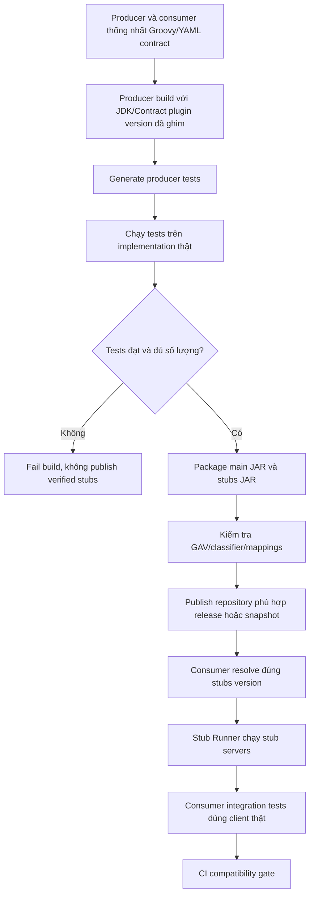

# Quy ước group ID, artifact ID, version và classifier

Trong kiểm thử hợp đồng (*contract testing*), **producer** có thể phát hành một ứng dụng để chạy trong môi trường thật và đồng thời phát hành một bộ **stubs** để **consumer** kiểm thử độc lập. Hai artifact thường có cùng **group ID, artifact ID và version**, nhưng khác **classifier**. Chỉ một sai sót ở một thành phần tọa độ cũng có thể khiến **Spring Cloud Contract Stub Runner** tải nhầm artifact, không tìm thấy mappings hoặc chạy hợp đồng của phiên bản không tương thích.

Ví dụ, **Order Service** công bố một HTTP API trả thông tin đơn hàng cho **Checkout Service** và một event `ORDER_PAID` cho **Billing Service**. Spring Cloud Contract Verifier đọc các hợp đồng **Groovy/YAML DSL**, sinh producer tests, tạo stubs và đóng gói một artifact mà các consumer có thể dùng trong CI. Muốn quy trình đó có thể tái hiện, nhóm phải đặt tên và phát hành artifact theo một quy ước ổn định.

Bài thuộc chương **Kho hợp đồng và artifact** trong lộ trình **SPRING_CLOUD_CONTRACT**. Trọng tâm là giải thích rõ **`groupId`**, **`artifactId`**, **`version`**, **`classifier`** và **`extension`**, cách chúng xuất hiện trong Maven repository và `Stub Runner ids`, cách quản lý **release/SNAPSHOT**, và cách phân biệt **contract source artifact**, **application artifact** với **stubs artifact** để ngăn những thay đổi API không tương thích lọt qua CI.

## 1. Maven artifact là gì?

Trong Maven, một artifact là một đơn vị có thể lưu, tải và truy xuất từ repository nhờ **tọa độ** (*coordinates*). Artifact thường là file `.jar`, `.pom` hoặc `.war`, nhưng không bị giới hạn ở những định dạng này.

Tọa độ đơn giản nhất được viết:

```text
groupId:artifactId:version
```

Với nhiều biến thể của cùng bản build, cần xét thêm:

```text
groupId:artifactId:version:classifier:extension
```

**Chú ý:** dòng thứ hai chỉ là **cách mô tả các thuộc tính**, không phải một cú pháp dependency hay Stub Runner có thể copy nguyên xi vào mọi công cụ. Maven dependency XML dùng các trường `groupId`, `artifactId`, `version`, `classifier`, `type`; Stub Runner lại có chuỗi `ids` với **cổng ở cuối**. Cần giữ rõ ngữ cảnh.

### 1.1. Năm thành phần và vai trò

| Thành phần | Ví dụ | Ý nghĩa |
|---|---|---|
| **`groupId`** | `com.example.commerce` | Không gian tên của nhóm phát hành artifact |
| **`artifactId`** | `order-service` | Tên module hoặc sản phẩm được phát hành |
| **`version`** | `1.4.0` | Bản phát hành cụ thể của module |
| **`classifier`** | `stubs` | Phân biệt biến thể của cùng `groupId:artifactId:version` |
| **`extension`** | `jar` | Định dạng file artifact |

Ví dụ trong bài:

```text
com.example.commerce:order-service:1.4.0
com.example.commerce:order-service:1.4.0:stubs
```

Cách đọc:

- Dòng đầu thường trỏ tới **main artifact** của Order Service nếu không có classifier.
- Dòng sau định danh **artifact stubs** cùng version, có classifier `stubs`.
- Trong cả hai trường hợp, extension thường là `jar`.
- Không có nghĩa hai file chứa cùng một tập byte hoặc có cùng mục đích.

**Vấn đề cần tránh:** xem `stubs` là một phần của `artifactId` rồi đổi tên artifact thành `order-service-stubs` mà không có chủ đích. Một artifactId như vậy có thể hợp lệ nếu nhóm tự thiết kế, nhưng nó **khác** với cơ chế classifier `stubs` mặc định được Spring Cloud Contract/Stub Runner sử dụng trong nhiều cấu hình.

## 2. Quy ước đặt `groupId`

`groupId` xác định **namespace** của artifact. Hướng dẫn Maven khuyến khích dùng cấu trúc tương tự package Java: **tên miền do tổ chức kiểm soát, viết đảo ngược**.

Ví dụ minh họa:

```text
com.example
com.example.commerce
com.example.commerce.orders
```

Với một tổ chức giả định sở hữu domain `example.com`, tên `com.example.commerce` diễn đạt namespace của các dịch vụ thương mại. Đây không phải định danh có sẵn của Spring Cloud Contract; nhóm tự thiết kế theo chính sách artifact repository.

### 2.1. Tiêu chí chọn group ID tốt

- **Ổn định:** không đổi mỗi lần chuyển nhóm chịu trách nhiệm hoặc đổi tên dự án nội bộ.
- **Có chủ sở hữu:** không sử dụng namespace không được tổ chức kiểm soát.
- **Dễ phân nhóm:** có thể chia theo domain sản phẩm/đơn vị nếu đủ lớn.
- **Không quá chi tiết:** tránh tạo groupId mới cho từng branch, môi trường hoặc từng pull request.
- **Không nhúng secret:** groupId là metadata được hiển thị trong build logs và repository.
- **Thống nhất:** application JAR và stubs JAR của cùng module thông thường dùng cùng groupId.

### 2.2. Một số trường hợp nên tránh

| Cách đặt tên | Vấn đề | Hướng tốt hơn |
|---|---|---|
| `test` hoặc `spring` | Quá chung, khó xác định chủ sở hữu | `com.example.commerce` |
| `team-a-2026` | Phụ thuộc tổ chức nội bộ/thời điểm | Namespace sản phẩm ổn định |
| `dev.com.example` cho mọi bản dev | Nhầm môi trường vào groupId | Giữ groupId, phân biệt bằng version/repository |
| `com.example.order-service` và đổi mỗi sprint | Tọa độ trôi liên tục | Chọn quy tắc versioning và tên module ổn định |
| GroupId producer khác nhau giữa main và stubs mà không có lý do | Stub Runner không thể suy tọa độ từ module producer | Dùng cùng groupId/GAV theo quy ước, hoặc tài liệu hóa mapping |

**Không bắt buộc** mọi module của một tổ chức phải chung groupId. Một công ty có thể dùng nhiều namespaces có lý do rõ ràng. Điều quan trọng là **consumer có thể xác định đúng producer artifact** và CI có thể tra cứu theo một quy tắc ổn định.

## 3. Quy ước đặt `artifactId`

`artifactId` là tên module được công bố trong repository. Maven khuyến khích đặt tên đơn giản bằng **chữ thường, chữ số và dấu gạch nối**.

Ví dụ:

```text
order-service
inventory-service
billing-service
checkout-api-client
shared-contract-model
```

### 3.1. Artifact ID là tên của ai?

Trong producer–consumer contract testing:

- `order-service` là **artifactId của producer** đang phát hành stubs.
- `checkout-service` là tên **consumer** sử dụng stubs.
- `billing-service` là một consumer khác nhận event từ Order Service.
- `get_paid_order_200` hoặc `billing_order_paid_v1` là **tên kịch bản hợp đồng**, không phải artifactId.

Khi Checkout khai báo Stub Runner tải stubs của Order Service, `artifactId` trong `ids` phải là **`order-service`**, không phải `checkout-service`.

### 3.2. Không nhầm artifact ID với Spring application name

Một producer có thể có:

```yaml
spring:
  application:
    name: orders-api
```

nhưng POM khai báo:

```xml
<artifactId>order-service</artifactId>
```

Hai giá trị **không buộc phải giống nhau**:

- `artifactId` thuộc Maven coordinates và quá trình resolve artifact.
- `spring.application.name` là định danh ứng dụng trong Spring Boot/Spring Cloud context.
- Trong tính năng `stubsPerConsumer`, tên ứng dụng ở **phía consumer** có thể được dùng để chọn nhánh mappings, nhưng điều này không đổi artifactId của producer.

Nếu muốn chúng giống nhau để dễ quản lý, đó là **quy ước nội bộ**, không phải điều kiện Maven bắt buộc.

## 4. Quy ước đặt `version`

`version` cho phép producer và consumer biết **bộ hợp đồng của bản build nào** đang được dùng. Các ví dụ:

```text
1.4.0
1.4.1
1.5.0
2.0.0
1.5.0-SNAPSHOT
2.0.0-rc1
```

Maven không bắt buộc tất cả version phải theo Semantic Versioning, nhưng dự án nên có **chính sách versioning nhất quán**. Một cách quản lý phổ biến là:

| Tình huống | Ví dụ | Điều cần hiểu |
|---|---|---|
| Bản phát hành ổn định | `1.4.0` | Không nên thay nội dung artifact sau khi release |
| Sửa lỗi không làm thay đổi hợp đồng phá vỡ | `1.4.1` | Theo chính sách versioning của tổ chức |
| Bổ sung tương thích ngược | `1.5.0` | Consumer cần kiểm tra kịch bản mới khi liên quan |
| Thay đổi có thể phá vỡ API | `2.0.0` | Cần migration/review consumer và chiến lược API riêng |
| Bản đang phát triển | `1.5.0-SNAPSHOT` | Có thể thay đổi theo build, cần cẩn thận cache |
| Bản pre-release | `2.0.0-rc1` | Chỉ rõ đây chưa phải release cuối |

**Lưu ý quan trọng:** số version không tự chứng minh compatibility. Một producer có thể thay đổi payload trong bản patch; một bản major mới cũng có thể giữ tương thích một số API. **Contract tests** mới là bằng chứng thực tế cho những kỳ vọng đã được mô tả.

### 4.1. Release và SNAPSHOT khác nhau

- **Release `1.4.0`:** theo thông lệ nên được xem là *immutable* — đã publish thì không overwrite cùng coordinates bằng nội dung mới.
- **`1.5.0-SNAPSHOT`:** có thể được publish nhiều lần trong quá trình phát triển; Maven remote repositories thường có metadata giúp phân giải các bản snapshot theo thời gian.
- **Version dạng `+` trong Stub Runner:** có một số phiên bản cho phép yêu cầu chọn bản mới nhất; tiện cho thử nghiệm nhưng làm CI khó tái lập nếu không ghi nhận version đã resolve.
- **Version range:** chỉ dùng khi phiên bản Stub Runner/resolver hỗ trợ và pipeline có lý do rõ ràng; không thay bằng version chính xác trong release gates.

Nếu Checkout kiểm thử với stubs `1.4.0` trong khi production định nâng Order Service lên `1.5.0`, kết quả xanh với stubs cũ **không chứng minh** Checkout tương thích với bản mới.

### 4.2. Version artifact và version API là hai thứ khác nhau

| Tên version | Ví dụ | Ý nghĩa |
|---|---|---|
| **Producer artifact version** | `1.4.0` | Bản build Order Service |
| **HTTP API version** | `/api/v2/orders` hoặc `X-Api-Version: 2` | Phiên bản giao thức phía consumer nhìn thấy |
| **Message schema version** | `eventVersion: 2` | Quy ước payload của event |
| **Contract case version** | `billing_order_paid_v1` | Tên/nhãn kịch bản test |
| **Spring Cloud Contract plugin version** | Một version trong Maven plugin | Phiên bản công cụ generate, **không** phải version producer |

Một producer artifact `1.4.0` có thể triển khai HTTP API v2, hoặc phát message schema v1. Không dùng version của stubs JAR để thay thế các quy định về API/schema evolution.

## 5. Quy ước `classifier` và `extension`

Classifier phân biệt **các biến thể cùng groupId, artifactId và version**. Maven có thể lưu:

```text
order-service-1.4.0.jar
order-service-1.4.0-stubs.jar
order-service-1.4.0-sources.jar
order-service-1.4.0-javadoc.jar
```

Trong ví dụ:

- Main JAR: **không có classifier**.
- Stubs JAR: classifier **`stubs`**.
- Sources JAR: classifier **`sources`**.
- Javadoc JAR: classifier **`javadoc`**.

Chúng không phải bốn phiên bản producer khác nhau; chúng là những artifacts cùng GAV, nhưng có classifier khác.

### 5.1. `extension` không phải classifier

Các thuộc tính:

```text
groupId    = com.example.commerce
artifactId = order-service
version    = 1.4.0
classifier = stubs
extension  = jar
```

đưa đến tên file thường gặp:

```text
order-service-1.4.0-stubs.jar
```

**`jar` là extension**, còn **`stubs` là classifier**. Không gọi `stubs` là packaging type và không dùng `type=stubs` trong Maven dependency trừ khi dự án thực sự có type mapping tùy biến được chứng minh.

### 5.2. Nếu classifier khác `stubs`?

Spring Cloud Contract Stub Runner có cấu hình **default classifier `stubs`** trong các phiên bản được tài liệu mô tả. Một dự án có thể có biến thể classifier riêng nếu tooling/build phù hợp, nhưng khi đó **producer publication và consumer resolution phải thống nhất chính xác**.

Ví dụ nếu artifact được publish với classifier `contract-stubs` nhưng consumer vẫn tìm `stubs`, Maven có thể báo không tìm thấy artifact hoặc Stub Runner không tải được mappings.

Chỉ thay đổi classifier khi có lý do rõ, tài liệu hóa cho tất cả consumers và có pipeline kiểm tra publication thực sự.

## 6. Ví dụ một producer phát hành hai artifact

POM producer:

```xml
<project>
    <!-- Các phần bắt buộc khác của POM được lược bớt. -->
    <modelVersion>4.0.0</modelVersion>
    <groupId>com.example.commerce</groupId>
    <artifactId>order-service</artifactId>
    <version>1.4.0</version>
    <packaging>jar</packaging>
</project>
```

Khi Maven/Spring Boot/Spring Cloud Contract plugin đã được cấu hình đầy đủ, build có thể tạo:

```text
target/
├── order-service-1.4.0.jar
└── order-service-1.4.0-stubs.jar
```

| Artifact | Tọa độ logic | Dùng ở đâu? |
|---|---|---|
| Main application JAR | `com.example.commerce:order-service:1.4.0` | Chạy Order Service thật |
| Attached stubs JAR | `com.example.commerce:order-service:1.4.0:stubs` | Stub Runner của Checkout/Billing |

**POM rút gọn trên không tự tạo stubs JAR.** Để có stubs, producer vẫn cần Groovy/YAML contracts, Spring Cloud Contract Verifier/plugin và quy trình generate/package thích hợp. Nếu chỉ thấy main JAR thì đừng đổi tên file thành `-stubs.jar`; phải kiểm tra plugin và stub mappings.

### 6.1. Application artifact có thể không phải executable

Một main artifact có thể là ordinary Java JAR hoặc Spring Boot executable JAR tùy plugin packaging. `order-service-1.4.0.jar` **không tự động có nghĩa** nó luôn chạy được bằng `java -jar`.

Ngược lại, stubs JAR không có nhiệm vụ chạy controller/business service. **Stub Runner** dùng dữ liệu mappings/contracts để tạo server mô phỏng. Không triển khai `-stubs.jar` như một producer application trong production.

## 7. Đường dẫn trong Maven repository

Một Maven repository tuân thủ layout thông thường dùng **groupId dạng thư mục**, tiếp theo artifactId và version.

Với:

```text
com.example.commerce:order-service:1.4.0:stubs
```

đường dẫn thường gặp:

```text
com/example/commerce/order-service/1.4.0/
├── order-service-1.4.0.pom
├── order-service-1.4.0.jar
└── order-service-1.4.0-stubs.jar
```

### 7.1. Vì sao dấu chấm trong `groupId` thành dấu slash?

`com.example.commerce` là namespace; trong **Maven repository path** nó thường được chia thành ba đoạn:

```text
com/example/commerce
```

Điều này **khác** cách một số stubs JAR chứa metadata nội bộ, có thể dùng một path như:

```text
META-INF/com.example.commerce/order-service/1.4.0/
```

**Đừng tự suy một thành đường dẫn kia.** Layout bên **ngoài repository** do Maven quy định; layout **bên trong stubs JAR** do Spring Cloud Contract plugin và version/cấu hình artifact quyết định.

### 7.2. Phân biệt file name và identity

Một file được đặt tên `order-service-1.4.0-stubs.jar` **chưa chứng minh** nó đã được publish dưới tọa độ đúng. Một script có thể sao chép và đổi tên file mà không tạo Maven metadata phù hợp.

Hãy xác nhận:

1. `groupId`, `artifactId`, `version` trong POM/publication.
2. `classifier` của artifact attach là `stubs`.
3. Extension là `jar`.
4. Maven repository có file và metadata tương ứng.
5. Stub Runner có thể resolve bằng **đúng tọa độ đã công bố**.
6. Bên trong archive có contracts/mappings mà consumer dự kiến dùng.

**Không xây workflow dựa vào việc tìm kiếm file tên gần giống** khi có thể resolve qua Maven coordinates và repository policy.

## 8. Bên trong stubs JAR: contract và mapping

Một sơ đồ minh họa cho artifact Order Service:

```text
order-service-1.4.0-stubs.jar
└── META-INF/
    └── com.example.commerce/
        └── order-service/
            └── 1.4.0/
                ├── contracts/
                │   ├── checkout-service/
                │   │   └── get_paid_order_200.groovy
                │   └── billing-service/
                │       └── order_paid_event_v1.groovy
                └── mappings/
                    └── checkout-service/
                        └── checkout_get_paid_order_200.json
```

**Đây là cấu trúc minh họa, không bảo đảm byte-for-byte ở mọi Spring Cloud Contract version.** Một số cấu hình có thể lưu thêm response body files, message contracts hoặc thay đổi cấu trúc thư mục. Điều quan trọng là Stub Runner tìm được mappings và metadata tương ứng với bộ contracts đã công bố.

Trong repository **bên ngoài** có tọa độ Maven. Bên trong JAR có **stub definitions**. Cùng một tên `order-service` có thể xuất hiện ở cả hai, nhưng phục vụ các công cụ khác nhau.

### 8.1. Kiểm tra archive thực tế

Trên máy có JDK và producer build đúng:

```bash
jar tf target/order-service-1.4.0-stubs.jar
```

Lệnh giúp tìm những entries như `contracts/` và `mappings/`. Tên và path thực tế phải được đối chiếu với output của plugin version đang dùng, thay vì cố sửa bài kiểm thử theo sơ đồ minh họa.

Nếu archive không có mappings:

- Contract source directory có bị đặt sai?
- Plugin có nhận diện Groovy/YAML files?
- Goal convert/generate stubs có chạy?
- Artifact có bị publish trước khi plugin hoàn tất?
- Test đang tải một classifier khác?

Một stubs JAR rỗng hoặc sai thư mục có thể được Maven resolve thành công nhưng **consumer vẫn không có response mapping để dùng**.

## 9. Ví dụ hợp đồng nguồn và mối liên hệ tới artifact

Groovy DSL mô tả kịch bản HTTP Checkout:

```groovy
import org.springframework.cloud.contract.spec.Contract

Contract.make {
    name 'checkout_get_paid_order_200'

    request {
        method GET()
        url '/api/orders/ORDER-42'
        headers {
            header 'Accept', 'application/json'
        }
    }

    response {
        status OK()
        headers {
            contentType(applicationJson())
        }
        body(
            id: 'ORDER-42',
            status: 'PAID',
            totalAmount: 125000
        )
    }
}
```

YAML DSL mô tả **kịch bản khác**, đơn hàng không tồn tại:

```yaml
name: checkout_get_missing_order_404
request:
  method: GET
  url: /api/orders/ORDER-MISSING
  headers:
    Accept: application/json
response:
  status: 404
  headers:
    Content-Type: application/json
  body:
    code: ORDER_NOT_FOUND
```

Producer nên chạy generated tests để chứng minh implementation thật trả đúng `200`/`404` theo fixtures. Chỉ sau đó mới xem stubs artifact là bản **đã được verification**.

### 9.1. Contract name không phải artifact ID

- `checkout_get_paid_order_200`: định danh một **kịch bản**.
- `checkout-service`: một **consumer**.
- `com.example.commerce:order-service:1.4.0:stubs`: định danh **stubs artifact producer**.
- `ORDER-42`: dữ liệu kiểm thử trong body/path.

Đừng thay `artifactId` bằng contract name hoặc consumer name. Nếu đặt một stubs JAR riêng cho từng contract không có chủ đích, consumer pipeline sẽ rất khó quản lý tọa độ và version.

## 10. Stub Runner `ids`: có **port** ở cuối

Spring Cloud Contract Stub Runner dùng dạng Ivy-like notation để chọn stubs:

```text
groupId:artifactId:version:classifier:port
```

Ví dụ:

```text
com.example.commerce:order-service:1.4.0:stubs:8085
```

Cách diễn giải:

| Vị trí | Giá trị | Nghĩa |
|---|---|---|
| 1 | `com.example.commerce` | Group của **producer artifact** |
| 2 | `order-service` | Artifact ID của producer |
| 3 | `1.4.0` | Version stubs |
| 4 | `stubs` | Classifier stubs |
| 5 | `8085` | Cổng **WireMock HTTP stub server** |

**Port không thuộc Maven artifact coordinates.** Thay `8085` thành `8090` không tạo một artifact khác trong Maven repository; chỉ thay cách Stub Runner mở HTTP server trên môi trường test.

### 10.1. Các phần có thể lược bỏ

Trong tài liệu Stub Runner, `version`, `classifier` và `port` có thể được bỏ qua theo các quy tắc mặc định của phiên bản. Một số bản mặc định:

- `classifier` là `stubs`.
- Bỏ port sẽ chọn cổng ngẫu nhiên trong khoảng cấu hình.
- Bỏ version sẽ dùng cơ chế tìm bản mới nhất như `+`.

Để **CI tái hiện được**, nên **chỉ rõ version và classifier**, còn port có thể để động khi test framework có khả năng lấy port thực tế. Đừng dựa vào “latest” cho release gate mà không lưu version đã resolve.

### 10.2. Maven dependency không dùng port

Một Maven dependency mô tả stubs artifact có dạng:

```xml
<dependency>
    <groupId>com.example.commerce</groupId>
    <artifactId>order-service</artifactId>
    <version>1.4.0</version>
    <classifier>stubs</classifier>
    <type>jar</type>
    <scope>test</scope>
</dependency>
```

Đây là **artifact dependency**: nó không tự khởi động WireMock server. `scope=test` là lựa chọn minh họa nếu muốn đưa stubs lên classpath kiểm thử. Với Stub Runner `LOCAL` hoặc `REMOTE`, có thể **không cần khai báo dependency stubs tường minh** trong POM consumer vì Stub Runner tự resolve theo `ids`.

**Không có trường `<port>8085</port>` trong Maven dependency.** Port là thuộc tính của stub server runtime.

## 11. Ví dụ Stub Runner trong consumer

Giả sử Checkout dùng JUnit/Spring Boot Test và nhận stubs đã cài trong Maven local repository:

```java
import org.springframework.boot.test.context.SpringBootTest;
import org.springframework.cloud.contract.stubrunner.spring.AutoConfigureStubRunner;
import org.springframework.cloud.contract.stubrunner.spring.StubRunnerProperties;

@SpringBootTest(
    properties = "clients.order.base-url=http://localhost:8085"
)
@AutoConfigureStubRunner(
    ids = "com.example.commerce:order-service:1.4.0:stubs:8085",
    stubsMode = StubRunnerProperties.StubsMode.LOCAL
)
class CheckoutOrderClientContractTest {
    // Inject client thật của Checkout và thêm @Test.
    // Client gọi GET /api/orders/ORDER-42.
    // Assert id, status, totalAmount theo hợp đồng.
}
```

Đây là **khung kiểm thử**, không phải một JUnit test hoàn chỉnh. Property `clients.order.base-url` do ứng dụng Checkout định nghĩa, không phải một property tiêu chuẩn mà Stub Runner tự tạo. Nếu sử dụng cổng động, phải cấu hình client dựa trên URL do `StubFinder`/Stub Runner cung cấp thay vì hard-code `8085`.

### 11.1. Các chế độ resolve stubs

| Chế độ | Nguồn | Khi phù hợp |
|---|---|---|
| **`LOCAL`** | Maven local repository (ví dụ `~/.m2/repository`) | Developer vừa build và install producer stubs |
| **`REMOTE`** | Repository được cấu hình trong `repositoryRoot` | CI hoặc nhóm khác tải stubs từ Artifactory/Nexus |
| **`CLASSPATH`** | Resources/artifacts hiện diện trên test classpath theo cơ chế version hỗ trợ | Một số bài test không cần Maven remote |

Thường có property `spring.cloud.contract.stubrunner.stubs-mode` và `spring.cloud.contract.stubrunner.repository-root` tương đương với các cách cấu hình annotation. **Tên annotation, packages và properties cần được đối chiếu với phiên bản thực tế.**

### 11.2. Ví dụ đọc stubs từ remote Maven repository

```java
@AutoConfigureStubRunner(
    ids = "com.example.commerce:order-service:1.4.0:stubs:8085",
    repositoryRoot = "https://repo.example.test/repository/maven-releases",
    stubsMode = StubRunnerProperties.StubsMode.REMOTE
)
```

Đây là mẫu giả định repository nội bộ có endpoint hỗ trợ Maven artifact resolution. Không để access token/password trong annotation hoặc commit vào Git; dùng Maven settings/CI secrets và các cấu hình Stub Runner tương ứng.

## 12. Contracts artifact **khác** stubs artifact

Một tổ chức có thể lưu **hợp đồng nguồn** trong một project hoặc repository riêng, thay vì đặt toàn bộ contracts dưới `src/test/resources/contracts` của producer. Khi đó có thể xuất hiện **một artifact thứ ba**.

| Loại artifact | Ví dụ tọa độ | Chứa gì? | Ai sử dụng? |
|---|---|---|---|
| **Application** | `com.example.commerce:order-service:1.4.0` | Mã chạy producer | Runtime/deploy |
| **Stubs** | `com.example.commerce:order-service:1.4.0:stubs` | Mappings/contracts cho Stub Runner | Consumer test |
| **Contracts source** | `com.example.contracts:order-contracts:2026.11` | Groovy/YAML DSL được quản lý độc lập | Producer Contract Verifier plugin |

Ví dụ thứ ba là **quy ước giả định**, không phải classifier bắt buộc mà Spring Cloud Contract luôn tạo. Một đội có thể publish contract source như một JAR có GAV riêng hoặc lưu trực tiếp trên Git; mỗi cách cần cấu hình downloader và version tương ứng.

### 12.1. Với contracts nằm trong Maven artifact

Trong một số Spring Cloud Contract Maven plugin versions, có thể sử dụng:

- `contractDependency`: chỉ định artifact chứa hợp đồng.
- `contractsPath`: đường dẫn tới contracts trong artifact.
- `contractsMode`: cách tải contracts.
- `contractsRepositoryUrl`: URL kho lưu contracts khi khác repository mặc định.

Ví dụ rút gọn về cấu trúc POM:

```xml
<plugin>
    <groupId>org.springframework.cloud</groupId>
    <artifactId>spring-cloud-contract-maven-plugin</artifactId>
    <version>CONTRACT_PLUGIN_VERSION_PHU_HOP</version>
    <extensions>true</extensions>
    <configuration>
        <baseClassForTests>
            com.example.order.contract.OrderContractBase
        </baseClassForTests>
        <contractDependency>
            <groupId>com.example.contracts</groupId>
            <artifactId>order-contracts</artifactId>
            <version>2026.11</version>
        </contractDependency>
        <contractsPath>com/example/commerce/order-service</contractsPath>
    </configuration>
</plugin>
```

**Đây là mẫu điều hướng, không phải cấu hình chắc chắn chạy với mọi plugin version.** Phải thay `CONTRACT_PLUGIN_VERSION_PHU_HOP`; `contractsPath` phải trùng đường dẫn thực tế trong contracts artifact. Có thể phải đặt thêm `contractsMode`, repository URL, classifier hoặc dependency metadata tùy cách artifact được xuất bản.

### 12.2. Giữ liên hệ giữa contract source version và producer version

Nếu source contract là `order-contracts:2026.11` và producer phát hành `order-service:1.4.0`, cần ghi lại:

```text
Producer build:       order-service:1.4.0
Contracts source:     order-contracts:2026.11
Generated stubs:      order-service:1.4.0:stubs
Producer test result: PASS
Commit / pipeline ID: build-1842
```

Không bắt buộc hai version phải bằng nhau khi hợp đồng nằm ở project độc lập, nhưng **phải truy vết** được producer build đã dùng **chính xác bản contract source nào**. Nếu không, consumer có thể dùng stubs của một contract chưa từng được kiểm chứng trên producer build thực.

## 13. Repository: local, remote và Git không giống nhau

Các nơi lưu trữ phổ biến:

| Kho lưu | Ví dụ | Công dụng |
|---|---|---|
| **Maven local** | `~/.m2/repository` | Cache/artifacts trên máy developer hoặc CI worker |
| **Maven remote releases** | `https://repo.example.test/repository/maven-releases` | Phát hành release artifacts |
| **Maven remote snapshots** | `https://repo.example.test/repository/maven-snapshots` | Các bản đang phát triển |
| **Git contracts repo** | Một Git URL chứa Groovy/YAML contracts | Review/thay đổi nguồn hợp đồng |
| **Git stubs repo** | Repository lưu stubs theo layout được downloader hỗ trợ | Dùng khi không có Maven artifact repo |
| **Thư mục test `stubs://`** | Đường dẫn local/classpath theo giao thức Stub Runner | Tái sử dụng stubs trong một workspace, tùy phiên bản |

**Không thay một URL Git thông thường vào Maven `repositoryRoot` rồi giả định Stub Runner đọc được.** Một số phiên bản hỗ trợ protocol dạng `git://` với downloader riêng, hoặc `stubs://` để lấy từ một vị trí filesystem/classpath. Cơ chế này **khác** với Aether/Maven remote resolution. Hãy chọn phương thức đúng và xác minh cách plugin/Stub Runner phiên bản đó hiểu đường dẫn.

### 13.1. Maven local: `install` không phải `deploy`

- `mvn install`: đưa artifact vào **Maven local repository** trên máy chạy.
- `mvn deploy`: đưa artifact lên **remote repository** đã cấu hình và được phép publish.
- Stub Runner `LOCAL`: tìm nguồn local tương ứng.
- Stub Runner `REMOTE`: tải từ remote repository được khai báo.
- Consumer chạy ở máy khác **không tự nhìn thấy** local `~/.m2` của developer.

Nếu build producer trong CI chạy `install` trên runner A, consumer job trên runner B không tự có stubs JAR trừ khi artifact được publish, chuyển qua CI artifacts hoặc cache/volume được quản lý đúng.

## 14. Maven `distributionManagement` cho phát hành

Một POM producer có thể mô tả nơi deploy bản release và snapshot:

```xml
<distributionManagement>
    <repository>
        <id>company-releases</id>
        <url>https://repo.example.test/repository/maven-releases</url>
    </repository>
    <snapshotRepository>
        <id>company-snapshots</id>
        <url>https://repo.example.test/repository/maven-snapshots</url>
    </snapshotRepository>
</distributionManagement>
```

Đây là các URL **giả định**, không phải nơi lưu thực. Có thể dùng Nexus, Artifactory hoặc repository compatible với Maven layout.

Trong `~/.m2/settings.xml` hoặc CI Maven settings, credentials cần khớp **`id` repository** và được cung cấp an toàn. Không để username/password cố định trong POM đã commit. `distributionManagement` quyết định nơi **deploy** artifacts; nó không tự cấu hình mọi repository cần thiết khi **resolve** dependencies/stubs. Consumer Stub Runner có thể cần `repositoryRoot`, mirror và Maven settings phù hợp.

### 14.1. Deploy phải gắn stubs classifier đúng

Một `mvn deploy` báo thành công **chưa đủ** nếu publication chỉ có main JAR và thiếu attached stubs JAR. Cần kiểm tra repository có:

```text
order-service-1.4.0.pom
order-service-1.4.0.jar
order-service-1.4.0-stubs.jar
```

Đối với Spring Boot/Contract plugin đa module, phải kiểm tra **module producer** và version artifact cụ thể, không chỉ xem một module khác vừa deploy thành công.

### 14.2. Version release bất biến là chính sách cần thực thi

Không chỉ nói “không overwrite release”; hãy cấu hình artifact repository để **từ chối redeploy** cùng tọa độ release nếu tổ chức dùng immutable releases. Khi xảy ra hotfix, publish version mới như `1.4.1`, không thay byte của `1.4.0-stubs.jar` rồi hy vọng mọi consumer tự đổi.

Với SNAPSHOT, ghi commit/build metadata và dùng cache policy rõ, vì hai lần tải cùng baseVersion `1.5.0-SNAPSHOT` có thể ra nội dung khác theo timestamp và metadata.

## 15. Ví dụ nhận diện file theo Maven repository layout

Repository root giả định:

```text
https://repo.example.test/repository/maven-releases/
```

Khi resolve GAV:

```text
com.example.commerce:order-service:1.4.0
```

path file main có thể là:

```text
com/example/commerce/order-service/1.4.0/order-service-1.4.0.jar
```

và stubs file:

```text
com/example/commerce/order-service/1.4.0/order-service-1.4.0-stubs.jar
```

Chúng khác **classifier** chứ không phải nằm ở hai nhóm repository ngẫu nhiên.

Với SNAPSHOT từ remote repository, file có thể mang **timestamp và build number**, trong khi Maven `baseVersion` vẫn là `1.5.0-SNAPSHOT`. Đừng tự nối URL snapshot filename theo giả định; để Maven/Stub Runner resolver đọc `maven-metadata.xml` hoặc dùng công cụ phù hợp với kho.

### 15.1. Kiểm tra sự hiện diện bằng Maven, không đoán URL

Một cách kiểm tra dependency resolution cho stubs JAR là dùng Maven Dependency Plugin khi dự án đã cấu hình repositories:

```bash
./mvnw dependency:get \
  -Dartifact=com.example.commerce:order-service:1.4.0:jar:stubs
```

**Lưu ý thứ tự của Maven Dependency Plugin** ở ví dụ này là `groupId:artifactId:version:type:classifier`, khác chuỗi Stub Runner `groupId:artifactId:version:classifier:port`. Hãy kiểm tra cú pháp đúng với phiên bản Maven Dependency Plugin được dùng.

Đoạn lệnh chỉ minh họa ý tưởng **kiểm tra artifact tồn tại và có thể tải**, không khẳng định nội dung JAR đúng hoặc producer tests đã chạy.

### 15.2. So sánh ba cách ghi thường gặp

| Công cụ | Ví dụ | Trường cuối có nghĩa gì? |
|---|---|---|
| **Maven POM dependency** | `<classifier>stubs</classifier>`, `<type>jar</type>` | Không có port |
| **Maven Dependency Plugin `dependency:get`** | `com.example.commerce:order-service:1.4.0:jar:stubs` | `stubs` là classifier |
| **Spring Cloud Contract Stub Runner `ids`** | `com.example.commerce:order-service:1.4.0:stubs:8085` | `8085` là stub server port |

Đây là lỗi rất phổ biến: copy chuỗi Stub Runner `ids` vào tham số `-Dartifact` của Maven Dependency Plugin, khiến Maven hiểu **`stubs` là type** và **`8085` là classifier**.

## 16. Nhiều consumer và tên thư mục contract

Ví dụ Order Service có hai consumer:

```text
src/test/resources/contracts/
├── checkout-service/
│   └── get_paid_order_200.groovy
└── billing-service/
    └── order_paid_event_v1.groovy
```

Có thể giữ **một** stubs artifact:

```text
com.example.commerce:order-service:1.4.0:stubs
```

cho cả hai consumers. Cấu hình `stubsPerConsumer` (khi phiên bản hỗ trợ) có thể lọc mappings theo **consumer name trong đường dẫn** thay vì tạo một `artifactId` mới cho mỗi consumer.

### 16.1. Ba trục tách biệt

- **Producer artifact identity:** `com.example.commerce:order-service`.
- **Version của producer artifact:** `1.4.0`.
- **Consumer selection:** `checkout-service` hoặc `billing-service`.

Nếu Checkout test thất bại vì chọn sai consumer directory, **không giải quyết bằng cách đổi artifactId producer**. Hãy sửa tên thư mục hợp đồng/`consumerName` và xác minh mappings thật sự được Stub Runner đăng ký.

## 17. Chính sách thay đổi và tương thích hợp đồng

Nhóm nên quy định ai được thay đổi từng thành phần:

| Thuộc tính | Khi thay đổi | Kiểm soát |
|---|---|---|
| `groupId` | Di chuyển namespace/chủ sở hữu artifact | Migration của Maven dependencies, Stub Runner ids và repository |
| `artifactId` | Đổi module hoặc tách/gộp producer | Cập nhật consumers, CI và phát hành chuyển tiếp |
| `version` | Mỗi producer release/build mới | Ghim version mục tiêu, chạy consumer compatibility tests |
| `classifier` | Đổi dạng artifact được nạp | Kiểm tra consumer resolution và publication |
| `extension` | Đổi định dạng archive | Tooling phải có khả năng đọc |
| API path/schema/header | Thay đổi giao diện | Producer contract verification và consumer stub tests |
| Contract source version | Khi hợp đồng nằm ở artifact độc lập | Ghi provenance vào producer build |
| Stub server port | Cấu hình môi trường test | Không đổi GAV; cập nhật client test URL |

### 17.1. Tác động của thay đổi API

Giả sử Billing phụ thuộc:

```json
{
  "orderId": "ORDER-42",
  "totalAmount": 125000,
  "currency": "VND"
}
```

Producer đổi `totalAmount` thành `amount` ở bản `1.5.0`. Nếu hợp đồng `1.4.0` vẫn yêu cầu `totalAmount`, generated producer tests cần phát hiện khi implementation mới không đáp ứng cam kết, hoặc consumer tests khi dùng stubs `1.5.0` có thể bộc lộ sự không tương thích.

Đổi version artifact **không tự sửa consumer code**. Cần review contract, áp dụng migration hoặc versioning API có chủ đích. Đó là lý do version và classifier phải giúp CI xác định **bản nào thực sự đang được kiểm tra**.

### 17.2. Không overwrite artifacts chỉ để sửa contract

Nếu phát hiện stubs `1.4.0` có mapping sai:

1. Xác minh lỗi nguồn contract, generated mapping hay publication.
2. Sửa DSL hoặc cấu hình producer.
3. Chạy lại generated producer tests.
4. Phát hành một version mới như `1.4.1` nếu đang theo chính sách immutable release.
5. Cho consumers nâng test target lên `1.4.1`.
6. Giữ traceability tới commit/build và lý do sửa.

Nếu artifact chưa phát hành chính thức và đang là snapshot, có thể thay build snapshot theo chính sách, nhưng phải kiểm tra cache và version đã resolve.

## 18. Các tình huống Maven/Stub Runner dễ nhầm

| Triệu chứng | Nguyên nhân có thể | Cách xử lý |
|---|---|---|
| Stub Runner báo không tìm thấy artifact | Sai groupId/artifactId/version/classifier | Kiểm tra Maven coordinates đầy đủ |
| Maven resolve main JAR, Stub Runner không có mappings | Đang tải artifact **không classifier** | Yêu cầu `stubs` classifier |
| File `-stubs.jar` có ở máy producer nhưng CI không tải được | Chỉ `install` local, chưa `deploy` remote | Publish đúng repository; cấu hình `REMOTE` |
| `dependency:get` không tìm thấy JAR | Sai thứ tự type/classifier trong CLI | Dùng `:jar:stubs` ở cuối |
| Consumer test chạy trên version cũ | `ids` ghim version cũ hoặc cache snapshot | Kiểm tra requested/resolved version và artifact content |
| Hai build cùng `1.4.0` cho nội dung khác | Release artifact bị overwrite | Enforce immutable releases, phát hành version mới |
| Snapshot lúc được lúc không | Metadata/cache/publishing không nhất quán | Xác minh Maven metadata, repository policy |
| Stub Runner tải đúng JAR nhưng mọi request `404` | Không có mapping hoặc request không khớp | Mở archive, xem mapping, path/header/body |
| `404` do unmatched request bị hiểu là lỗi nghiệp vụ | WireMock default response | Assert mã lỗi JSON theo contract |
| Stubs JAR có contracts nhưng không có mappings | Plugin convert/packaging sai hoặc message-only | Phân biệt HTTP/message stubs; xem logs |
| `stubsPerConsumer` không chọn mapping | Tên thư mục không khớp consumer name | Kiểm tra artifact path và effective config |
| Multi-module deploy thiếu stubs | Publication không attach classifier của producer module | Kiểm tra module-specific artifacts |
| Artifact URL đúng nhưng bị `401/403` | Credentials/quyền repository | Dùng Maven settings/CI secrets, không hard-code |
| Maven version mới nhưng plugin cũ | Dependency/BOM và plugin lệch compatibility | Ghim và đối chiếu Spring Boot/Cloud/Contract versions |
| Producer tests không chạy nhưng JAR đã publish | Test bị skip hoặc pipeline thiếu release gate | Bắt buộc kiểm tra reports trước deploy |
| Maven repository layout bị tự đổi | Repo URL trỏ sai endpoint hoặc upload không theo Maven format | Sửa Maven-compatible path/metadata |

### 18.1. Quy trình chẩn đoán theo thứ tự

1. **Tọa độ:** ghi chính xác `groupId, artifactId, version, classifier, extension`.
2. **Nguồn:** artifact đang ở local hay remote repository?
3. **Publication:** repository chứa đúng `-stubs.jar` và POM metadata chưa?
4. **Nội dung:** archive có mappings/contracts hợp lệ không?
5. **Stub Runner:** `ids` đúng và `stubsMode` phù hợp chưa?
6. **Runtime:** stub server port đúng, request client có khớp mapping?
7. **Producer verification:** generated tests có thực sự chạy/đạt trong build phát hành không?
8. **Consumer:** client thật đang test với version nào và xử lý response thế nào?
9. **Cache:** có khả năng resolver lấy bản snapshot cũ không?
10. **Traceability:** commit/build nào đã tạo artifact mà test đang dùng?

Không bắt đầu bằng việc sửa controller producer khi lỗi là `artifact not found`. Đó là vấn đề **tọa độ/repository**, không phải nghiệp vụ.

## 19. CI: version và artifact provenance

Một pipeline có thể tổ chức như sau:



### 19.1. Những giá trị CI nên ghi nhận

```text
module             = order-service
producerGroupId    = com.example.commerce
producerArtifactId = order-service
producerVersion    = 1.4.0
stubsClassifier    = stubs
stubsExtension     = jar
producerCommit     = <commit-sha-cua-build>
producerTests      = PASS
stubsPublication   = VERIFIED
consumerTestTarget = com.example.commerce:order-service:1.4.0:stubs
```

Ví dụ này **không phải file metadata mà Maven tự sinh**. Đó là những trường nên có trong build logs/artifact provenance nếu tổ chức cần kiểm toán và tái hiện lỗi.

Đừng công bố **`producerTests=PASS`** chỉ vì đã tạo `order-service-1.4.0-stubs.jar`. Phải dựa trên test report và thực thi generated tests thật.

### 19.2. Checklist trước khi publish

- [ ] `groupId` là namespace đã phê duyệt, không phụ thuộc môi trường tạm.
- [ ] `artifactId` phản ánh producer module ổn định.
- [ ] `version` được xác định rõ; release không bị overwrite.
- [ ] Stubs JAR có classifier `stubs` và extension `jar`.
- [ ] Application JAR và stubs JAR đến từ cùng producer build.
- [ ] Contracts nguồn đã được plugin nhận diện.
- [ ] Generated producer tests tồn tại, được chạy và đạt.
- [ ] Không dùng `skipTests` trong verified release pipeline.
- [ ] Stubs archive có mappings/contracts mong đợi.
- [ ] Maven publication có attached stubs artifact và metadata chính xác.
- [ ] Remote repository URL/quyền truy cập phù hợp CI/consumer.
- [ ] Consumer dùng đúng Stub Runner `ids`, `stubsMode` và version.
- [ ] Không hard-code repository credentials hoặc token trong code.
- [ ] Không có dữ liệu cá nhân thật/secret trong stub payload.
- [ ] Test reports và producer commit/build ID có thể truy vết.

## 20. Bài thực hành: Order Service phát hành stubs cho Checkout

Bối cảnh: một producer Maven `order-service` cung cấp API đơn hàng; một consumer `checkout-service` dùng Stub Runner để kiểm tra client. Mục tiêu là chọn đúng tọa độ, không tải nhầm main JAR, và chạy CI có thể tái hiện.

### Bước A — thống nhất định danh

Chọn:

```text
groupId    = com.example.commerce
artifactId = order-service
version    = 1.4.0
classifier = stubs
extension  = jar
```

Giải thích:

1. Tại sao `groupId` phản ánh namespace tổ chức?
2. Tại sao `artifactId` là producer chứ không phải consumer?
3. Tại sao `stubs` là classifier và `jar` là extension?
4. Vì sao port `8085` không thuộc tọa độ trên?

### Bước B — chuẩn bị hợp đồng

1. Viết Groovy contract `GET /api/orders/ORDER-42` trả `200`.
2. Viết YAML contract `GET /api/orders/ORDER-MISSING` trả `404 ORDER_NOT_FOUND`.
3. Đặt hai contract ở source directory được plugin sử dụng.
4. Chuẩn bị fixture producer để hai generated tests có dữ liệu xác định.
5. Không duplicate cùng một kịch bản ở cả Groovy lẫn YAML.

### Bước C — sinh tests và artifact

1. Cấu hình Spring Cloud Contract Maven plugin và base class thích hợp.
2. Chạy Maven lifecycle của producer, bảo đảm generated tests **thực sự chạy**.
3. Sau khi tests đạt, xác nhận cả main JAR và stubs JAR đã được tạo.
4. Dùng `jar tf` để xem mappings/contracts trong stubs JAR.
5. Đọc các thông số GAV/classifier của artifact publication thay vì chỉ nhìn tên file.

### Bước D — sử dụng Maven local

1. Cài artifacts vào Maven local repository bằng `./mvnw install` sau verification.
2. Xác nhận path `com/example/commerce/order-service/1.4.0/` có đúng JAR.
3. Cho Checkout dùng Stub Runner `LOCAL` với `ids=com.example.commerce:order-service:1.4.0:stubs:8085`.
4. Cấu hình client thật của Checkout gọi cổng `8085`.
5. Assert response thành công và body lỗi nghiệp vụ.

### Bước E — thử các lỗi tọa độ

1. Thử bỏ classifier trong Maven dependency và quan sát artifact được resolve.
2. Thử copy chuỗi Stub Runner `ids` vào `dependency:get`; giải thích vì sao thứ tự `type/classifier` khác.
3. Thử dùng `artifactId=checkout-service` thay cho producer.
4. Thử chỉ publish main JAR vào repository test, xác nhận consumer thiếu stubs.
5. Khôi phục tọa độ đúng và chạy lại.

### Bước F — đưa vào CI

1. Ghim producer version và Spring Cloud Contract plugin version.
2. Chặn publish nếu producer contract tests không chạy hoặc fail.
3. Publish stubs classifier artifact cùng main artifact.
4. Consumer resolve từ repository test/remote và chạy Stub Runner tests.
5. Ghi lại producer commit, artifact version và test reports.
6. Nếu phát hành bản mới, chạy consumer tests với **version mục tiêu**, không chỉ bản cũ.

**Tiêu chí hoàn thành:** người học xác định đúng `groupId`, `artifactId`, `version`, `classifier` và `extension`; phân biệt Maven Dependency Plugin notation với Stub Runner `ids`; kiểm tra nội dung repository; và giải thích được vì sao một stubs artifact chỉ đáng tin khi producer tests đã đạt.

## 21. Câu hỏi tự kiểm tra

1. **`groupId` dùng để làm gì?** Nhận diện namespace tổ chức/nhóm phát hành trong Maven.
2. **`artifactId` nên là Order Service hay Checkout Service khi tải stubs của Order?** Order Service.
3. **`version` của stubs artifact có thường trùng main artifact không?** Có, khi chúng cùng producer build.
4. **Classifier `stubs` có phải extension `jar` không?** Không, chúng là hai thuộc tính khác nhau.
5. **Hai JAR khác classifier có thể cùng `groupId:artifactId:version` không?** Có.
6. **`order-service-1.4.0-stubs.jar` có tự chạy ứng dụng producer không?** Thông thường không; Stub Runner nạp mappings.
7. **`groupId=com.example.commerce` xuất hiện trong Maven repository path như thế nào?** Thường là `com/example/commerce`.
8. **Có được dùng groupId kiểu `test` mãi cho sản phẩm không?** Không nên, vì namespace quá chung.
9. **Version SNAPSHOT khác release ở đâu?** Snapshot có thể thay đổi theo build/metadata, release nên bất biến.
10. **Có thể để Stub Runner tự chọn version bằng `+` không?** Một số bản hỗ trợ, nhưng không nên dùng không kiểm soát trong CI release gate.
11. **`groupId:artifactId:version:classifier:port` là cú pháp của công cụ nào?** Spring Cloud Contract Stub Runner `ids`.
12. **Port `8085` có thuộc Maven artifact identity không?** Không.
13. **Trong `dependency:get`, `jar` và `stubs` nằm ở đâu?** Thường `group:artifact:version:jar:stubs`.
14. **Vì sao đổi tên main JAR thành `-stubs.jar` không có tác dụng?** Không tạo mappings/contracts cần cho Stub Runner.
15. **`install` và `deploy` khác nhau ở đâu?** Một bên đưa vào local Maven, bên kia phát hành lên remote repository.
16. **`stubsMode=REMOTE` cần gì?** Repository URL đúng, artifact đã publish và quyền truy cập.
17. **Contract source JAR có buộc cùng GAV với producer không?** Không nếu được tổ chức/phát hành riêng, nhưng phải truy vết bản contract được verify.
18. **`spring.application.name` có bắt buộc bằng `artifactId` không?** Không.
19. **Consumer name khác artifactId producer như thế nào?** Consumer name chọn bộ hợp đồng liên quan, artifactId chọn producer artifact.
20. **Tại sao test xanh với stubs version cũ chưa chứng minh tương thích với producer version mới?** Vì bộ contract/mappings đã thay đổi.
21. **Một JAR có thể resolve thành công nhưng vẫn không có HTTP response stub không?** Có nếu mappings thiếu hoặc request không khớp.
22. **Trước publish verified stubs cần bằng chứng gì?** Generated producer tests thực sự chạy và đạt trên implementation thật.
23. **Tại sao cần quản lý repository secrets riêng?** Không để credentials lộ trong POM, source code, logs hay artifacts.
24. **Vì sao release repository nên không cho overwrite cùng coordinates?** Đảm bảo tái hiện cùng version được cùng artifact content.
25. **Khi thay đổi classifier, cần cập nhật những đâu?** Producer packaging/publication, Maven coordinates và Stub Runner consumer config.

## 22. Tài liệu tham khảo và giới hạn phiên bản

Các tài liệu chính thức để xác minh quy ước và cú pháp theo phiên bản:

- [Apache Maven — Maven Artifacts](https://maven.apache.org/repositories/artifacts.html)
- [Apache Maven — Naming Conventions](https://maven.apache.org/guides/mini/guide-naming-conventions.html)
- [Apache Maven — Repository Layout](https://maven.apache.org/repository/layout.html)
- [Apache Maven — Repository Metadata](https://maven.apache.org/repositories/metadata.html)
- [Spring Cloud Contract — Stub Runner Common Properties](https://docs.spring.io/spring-cloud-contract/reference/project-features-stubrunner/stub-runner-common.html)
- [Spring Cloud Contract — Stub Runner Core](https://docs.spring.io/spring-cloud-contract/reference/project-features-stubrunner/stub-runner-core.html)
- [Spring Cloud Contract — Maven Project](https://docs.spring.io/spring-cloud-contract/reference/maven-project.html)
- [Spring Cloud Contract — Fetching Stubs or Contract Definitions From a Location](https://docs.spring.io/spring-cloud-contract/reference/project-features-stubrunner/stub-runner-stubs-protocol.html)

Maven coordinates và Stub Runner `ids` có quy tắc khác nhau ở **classifier/type/port**. Những cấu hình như `contractDependency`, `contractsMode`, `repositoryRoot`, cách tổ chức archive, tên annotation và cách xử lý SNAPSHOT cần được đối chiếu với **đúng Spring Cloud Contract plugin/Stub Runner version** đang dùng, không ghép tùy ý các bản tài liệu khác dòng.

## Kết luận

**`groupId` xác định namespace, `artifactId` xác định module producer, `version` xác định bản build, `classifier` phân biệt stubs với main artifact, còn `extension` biểu thị định dạng file**. Cùng một producer có thể công bố `order-service-1.4.0.jar` để chạy ứng dụng và `order-service-1.4.0-stubs.jar` để consumer sử dụng qua Stub Runner; chúng **không thể thay thế nhau**.

Muốn kho hợp đồng và artifact đáng tin cậy, nhóm cần một quy ước tên ổn định, version release bất biến, nguồn contracts có thể truy vết, publication chứa đúng classifier, và CI chạy **generated producer verification** trước khi phát hành verified stubs. Khi consumer resolve đúng GAV/classifier/version và kiểm thử qua client thật, Spring Cloud Contract giúp phát hiện thay đổi API hoặc thông điệp không tương thích một cách có thể tái hiện.
