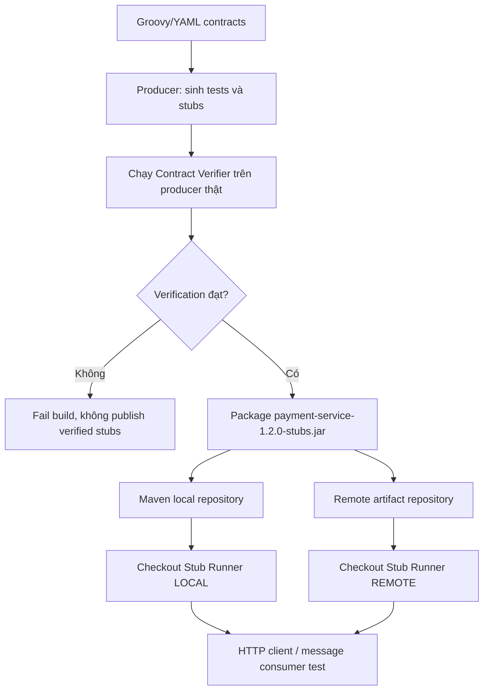
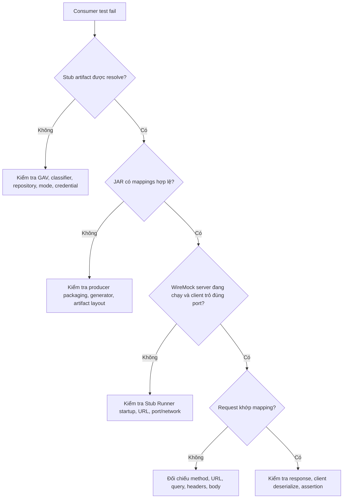
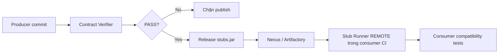

# Kho Maven cục bộ và kho artifact từ xa

## 1. Bối cảnh: một producer, nhiều consumer và nhu cầu chia sẻ hợp đồng

Giả sử **Payment Service** cung cấp API cho **Checkout Service** và **Reporting Service**. Các nhóm phát triển làm việc ở những repository, máy tính và pipeline CI khác nhau. Checkout cần kiểm tra HTTP client của mình khi Payment Service chưa khởi động, còn Reporting muốn bảo đảm các trường dữ liệu báo cáo vẫn tương thích.

Với **Spring Cloud Contract**, hai nhóm có thể thỏa thuận hành vi HTTP hoặc thông điệp bằng **Groovy/YAML DSL**. Producer sinh **generated tests** để kiểm tra implementation thật, đồng thời đóng gói các HTTP stub mappings hoặc thông tin stub messaging. Consumer dùng **Stub Runner** để tải và chạy stub, từ đó phát hiện những thay đổi API không tương thích trước khi các dịch vụ được triển khai cùng nhau.

Nảy sinh câu hỏi: **Hợp đồng và stub được lưu ở đâu để các nhóm khác nhau tải đúng phiên bản?**

- Trên máy developer, kết quả build thường được cài vào **Maven local repository**.
- Trong CI hoặc doanh nghiệp, các artifact đã được chấp nhận thường được **publish lên kho từ xa** như Nexus hoặc Artifactory.
- Trong repository mã nguồn, tệp Groovy/YAML là **nguồn định nghĩa hợp đồng**, chưa phải JAR có thể phân phối.
- Một Gradle build cache hoặc thư mục `build/` không đồng nghĩa với một Maven artifact repository.

Bài thuộc chương **Kho hợp đồng và artifact**, tập trung vào cách các nguồn lưu trữ này liên hệ với nhau và cách sử dụng chúng đúng trong Spring Cloud Contract.

### Kết quả học tập

Sau bài này, bạn có thể:

1. Phân biệt Maven local, kho artifact từ xa, repository hợp đồng và build cache.
2. Đọc chính xác Maven coordinates: `groupId`, `artifactId`, `version`, `classifier`.
3. Đóng gói/cài stub tại producer bằng Maven hoặc Gradle và kiểm tra đường dẫn artifact.
4. Cấu hình Stub Runner theo `LOCAL`, `REMOTE`, `CLASSPATH`.
5. Thiết lập `repository-root`, quyền truy cập và version cụ thể cho CI.
6. Phân biệt lỗi thiếu artifact, sai classifier, tải nhầm version với request không khớp WireMock.
7. Thiết kế quy trình **verify → package → publish → consume** có thể tái lập.

## 2. Bốn nơi lưu trữ dễ bị nhầm

| Nơi lưu trữ | Chứa gì? | Ai thường sử dụng? | Có tự chứng minh producer đúng hợp đồng? |
| --- | --- | --- | --- |
| **Repository mã nguồn hợp đồng** | `*.groovy`, `*.yml`, `*.yaml` | Producer/consumer cùng review | Không |
| **Maven local repository** | JAR, POM và metadata Maven trên một máy | Developer, build local, một CI runner | Không |
| **Maven artifact repository từ xa** | Versioned JAR/POM/metadata trên server | Nhiều nhóm, nhiều pipeline, Stub Runner | Không |
| **Gradle build cache** | Outputs của task có cache key tương ứng | Gradle builds và CI | Không |

Điều quyết định độ tin cậy không phải artifact nằm ở đâu, mà là **quy trình producer verification đã chạy và đạt trước khi bản stub được công bố như bản đã xác minh**.



**Lưu ý:** `install`/ `publishToMavenLocal` dùng kho local, còn `deploy`/ `publish` thường đẩy lên kho từ xa **khi đã cấu hình publication phù hợp**. Các lệnh đó không tự cam kết rằng test đã chạy: pipeline phải bắt buộc bước verification trước publishing.

## 3. Maven coordinates: tìm đúng artifact trước khi tải

Maven định danh một artifact bằng các thành phần:

```text
groupId : artifactId : version : classifier : extension
com.example : payment-service : 1.2.0 : stubs : jar
```

Trong Spring Cloud Contract, một stub artifact phổ biến có classifier **`stubs`**. Nếu bỏ classifier, trình quản lý dependency có thể tải **application JAR thông thường** thay vì file chứa stub mappings.

| Trường | Giá trị ví dụ | Ý nghĩa |
| --- | --- | --- |
| `groupId` | `com.example` | Namespace của producer |
| `artifactId` | `payment-service` | Module của producer |
| `version` | `1.2.0` | Version cần tái lập |
| `classifier` | `stubs` | Biến thể JAR phục vụ Stub Runner |
| `extension` | `jar` | Kiểu artifact |

Với Maven repository layout chuẩn, đường dẫn tương đối là:

```text
com/example/payment-service/1.2.0/
  payment-service-1.2.0.pom
  payment-service-1.2.0.jar
  payment-service-1.2.0-stubs.jar
```

Đường dẫn trên minh họa các artifact **có thể** cùng tồn tại nếu publication của dự án bao gồm application JAR và stub classifier. `-stubs.jar` là một artifact riêng, có thể cùng version với application nhưng không đồng nghĩa hai file có cùng nội dung.

### 3.1. Cú pháp `ids` của Stub Runner

Một cách khai báo thường thấy:

```text
com.example:payment-service:1.2.0:stubs:8091
```

Trong ngữ cảnh Stub Runner, phần cuối `8091` là **port HTTP stub server**, không phải extension Maven. Các ví dụ `ids` ngắn hơn có thể lược bớt classifier hoặc port theo hỗ trợ của phiên bản Stub Runner. Để giảm nhập nhằng ở CI, nên đặt tường minh version, classifier và port khi cần cố định.

**Producer ID không phải consumer ID.** `Checkout Service` vẫn tải artifact có `artifactId=payment-service`, vì Payment Service là nơi phát hành API/stub.

### 3.2. Phân biệt `-stubs.jar` với artifact chứa nguồn hợp đồng

Một JAR stubs do Spring Cloud Contract đóng gói thường có **mappings** và có thể kèm **contracts** trong đường dẫn chuẩn dưới `META-INF`. Tổ chức khác có thể phát hành một **contracts artifact riêng** (classifier do nhóm quy định) hoặc giữ nguồn hợp đồng trong repository SCM.

Không suy rằng mọi dự án đều tự có `payment-service-1.2.0-contracts.jar`. Nếu cần artifact chứa nguồn hợp đồng độc lập, nó phải được **cấu hình đóng gói và publish** rõ ràng, cùng một quy ước coordinates có tài liệu.

## 4. Từ Groovy/YAML DSL đến stub artifact

Ví dụ hợp đồng HTTP của Payment Service:

```groovy
import org.springframework.cloud.contract.spec.Contract

Contract.make {
    description 'Lay trang thai thanh toan theo paymentId'

    request {
        method GET()
        url '/api/payments/42'
        headers {
            header('Accept', 'application/json')
        }
    }

    response {
        status OK()
        headers {
            contentType(applicationJson())
        }
        body(
            paymentId: 42,
            status: 'PAID',
            currency: 'VND'
        )
    }
}
```

Quy trình producer:

1. Lưu contract vào thư mục DSL của project, ví dụ `src/test/resources/contracts/`.
2. Cấu hình Spring Cloud Contract Gradle/Maven plugin cùng **test base class** tương ứng.
3. Sinh producer tests và HTTP stub mappings từ nguồn hợp đồng.
4. **Chạy generated producer tests** để so sánh request/response thực với hợp đồng.
5. Nếu pass, đóng gói stub classifier theo cấu hình build.
6. Cài vào local Maven hoặc deploy/publish lên repository từ xa.

Tệp chứa mapping WireMock thường là JSON. Một sơ đồ bên trong artifact có dạng:

```text
META-INF/
  com.example/
    payment-service/
      1.2.0/
        contracts/
          get_payment.groovy
        mappings/
          get_payment.json
```

Đây là **sơ đồ minh họa**, không phải cam kết về tên mapping do generator tạo ra. Các directory trung gian/nhóm consumer và tên file có thể khác tùy phiên bản/configuration. Khi stub không khớp, cần **kiểm tra nội dung JAR được publish**, không chỉ thấy JAR tồn tại.

## 5. Maven local repository là gì?

Trên máy developer, đường dẫn Maven local thông thường:

```text
Linux/macOS: ~/.m2/repository
Windows:      %USERPROFILE%\.m2\repository
```

Đường dẫn thực tế có thể được cấu hình lại bằng `settings.xml`, `maven.repo.local` hoặc thiết lập công cụ/CI. Gradle cũng có thể cài artifact Maven qua `publishToMavenLocal`.

Maven local lưu:

- Artifact được chính developer **install/publish local**.
- Các dependency đã được tải khi Maven/Gradle sử dụng repository local tương ứng.
- Metadata đi kèm artifact theo cơ chế resolver.

**Không phải kho chia sẻ cho toàn công ty.** Hai máy hoặc hai container khác nhau không tự cùng thấy `~/.m2/repository` của nhau.

### 5.1. Cài stub artifact vào kho local bằng Maven

Với producer đã cấu hình plugin và test dependencies đúng:

```bash
# Chạy trong repository producer ở môi trường thực hành.
./mvnw clean verify

# Khi producer verification đã đạt, cài artifacts vào Maven local.
./mvnw install
```

Sau đó kiểm tra thư mục:

```text
~/.m2/repository/com/example/payment-service/1.2.0/
```

Nếu chỉ có `payment-service-1.2.0.jar` nhưng thiếu `payment-service-1.2.0-stubs.jar`, khả năng là **plugin chưa sinh/attach/đóng gói stub classifier** theo lifecycle. Đừng giải quyết bằng cách đổi Stub Runner từ `stubs` sang classifier khác khi producer chưa thực sự publish đúng artifact.

**Chú ý:** `install` thường đi qua các phase Maven trước đó, nhưng pipeline vẫn cần xem kết quả thực thi generated tests và không được bỏ qua việc kiểm chứng bằng các cờ `skipTests`/`maven.test.skip`. Việc một artifact đã nằm trong local repository **không tự chứng minh** nó được tạo từ build pass.

### 5.2. Maven plugin ở producer: ví dụ cấu hình

```xml
<!-- Đoạn trong pom.xml của producer, chưa phải POM hoàn chỉnh. -->
<plugin>
    <groupId>org.springframework.cloud</groupId>
    <artifactId>spring-cloud-contract-maven-plugin</artifactId>
    <version>${spring-cloud-contract.version}</version>
    <extensions>true</extensions>
    <configuration>
        <testFramework>JUNIT5</testFramework>
        <testMode>MOCKMVC</testMode>
        <baseClassForTests>com.example.payment.contract.PaymentContractBase</baseClassForTests>
    </configuration>
</plugin>
```

Property `${spring-cloud-contract.version}` phải tồn tại và tương thích với các dependency Spring Boot/Spring Cloud; POM cũng cần dependency Spring Cloud Contract Verifier và các test dependencies liên quan. Plugin không tự làm cho `PaymentContractBase` có trong source: nhóm phải viết lớp base và chuẩn bị fixture/MockMvc hoặc test mode tương ứng.

## 6. Maven remote repository khác gì Maven local?

Kho artifact từ xa là server có thể quản lý version, quyền truy cập, metadata và chính sách retention. Thường gặp:

- **Sonatype Nexus Repository**.
- **JFrog Artifactory**.
- Một Maven-compatible repository nội bộ hoặc dịch vụ lưu artifact do tổ chức quản lý.

Ví dụ URL minh họa:

```text
https://repo.example.test/repository/maven-releases/
https://repo.example.test/repository/maven-snapshots/
```

Tên miền `example.test` dành cho ví dụ; phải thay bằng URL repository thật. Thông thường tổ chức tách **releases** và **snapshots**, nhưng đường dẫn và policy cụ thể phụ thuộc Nexus/Artifactory.

### 6.1. Maven có thể đọc từ nhiều repository

Một Maven project có thể khai báo hoặc nhận repository từ `settings.xml`, parent POM và build configuration. Tuy nhiên:

- **Dependency resolution** là hành động **tải/đọc** artifact.
- **Deployment** là hành động **publish/ghi** artifact.
- `repositories` hoặc mirror không tự thay thế `distributionManagement` khi Maven Deploy Plugin cần biết kho đích.
- Một repository có quyền đọc không có nghĩa tài khoản đó được phép publish.

Phân biệt hai vai trò này giúp tránh lỗi “máy tôi tải được JAR nhưng `mvn deploy` trả `401`/`403`”.

## 7. Publish stub từ Maven lên remote repository

Một phần `pom.xml` minh họa nơi publish:

```xml
<distributionManagement>
    <repository>
        <id>internal-releases</id>
        <url>https://repo.example.test/repository/maven-releases/</url>
    </repository>
    <snapshotRepository>
        <id>internal-snapshots</id>
        <url>https://repo.example.test/repository/maven-snapshots/</url>
    </snapshotRepository>
</distributionManagement>
```

Trong file Maven `settings.xml` do developer/CI quản lý, có thể cấu hình credentials cho **server ID** tương ứng:

```xml
<settings xmlns="http://maven.apache.org/SETTINGS/1.2.0">
    <servers>
        <server>
            <id>internal-releases</id>
            <username>${env.REPO_USER}</username>
            <password>${env.REPO_PASSWORD}</password>
        </server>
        <server>
            <id>internal-snapshots</id>
            <username>${env.REPO_USER}</username>
            <password>${env.REPO_PASSWORD}</password>
        </server>
    </servers>
</settings>
```

Đây là **cấu hình minh họa**: đường dẫn `settings.xml` và cơ chế cung cấp secrets trong CI tùy môi trường. Maven có hỗ trợ các biểu thức môi trường theo phiên bản/cấu hình; cần đảm bảo biến môi trường tồn tại và credentials được quản lý an toàn. **Không commit giá trị mật khẩu hoặc token thật vào POM/settings của repository mã nguồn.**

Lệnh publish minh họa:

```bash
# Producer build cần được cấu hình để verify contracts và attach stubs.
./mvnw clean verify

# Chỉ thực hiện sau khi producer verification PASS.
./mvnw deploy
```

Thao tác `deploy` chỉ đưa artifact có trong publication/lifecycle tới kho đích. **Không thể tự suy rằng mọi bản `deploy` đã chạy generated tests**, vì CI có thể bật cờ skip, override plugin goal hoặc chạy một lifecycle rút gọn.

### 7.1. Release và snapshot có chính sách khác nhau

| Loại version | Ví dụ | Mục đích | Lưu ý |
| --- | --- | --- | --- |
| Release | `1.2.0` | Thỏa thuận version ổn định giữa producer/consumer | Nên có chính sách immutable, không ghi đè |
| Snapshot | `1.3.0-SNAPSHOT` | Thử tích hợp trước release | Có thể thay đổi theo lần deploy, cần hiểu update policy/metadata |
| Dynamic version | `+` trong một số Stub Runner configurations | Khám phá bản mới nhất | Không tái lập; tránh dùng làm baseline CI |

Nexus/Artifactory thường có policy riêng cho snapshot retention và ghi đè release. **Một version không phải bằng chứng tương thích:** consumer phải chạy test trên stub của version định dùng, còn producer phải kiểm chứng đúng source của artifact đó.

## 8. Publish bằng Gradle và `maven-publish`

Nếu producer sử dụng Gradle, có thể tạo publication chứa application JAR và artifact `verifierStubsJar` (nếu task này được plugin phiên bản đang dùng cung cấp).

Ví dụ **đoạn cấu hình trong `build.gradle` Groovy DSL**:

```groovy
plugins {
    id 'java'
    id 'maven-publish'
    id 'org.springframework.cloud.contract' version '<compatible-scc-version>'
}

group = 'com.example'
version = '1.2.0'

publishing {
    publications {
        maven(MavenPublication) {
            from components.java
            artifact(tasks.named('verifierStubsJar'))
        }
    }

    repositories {
        maven {
            url = uri('https://repo.example.test/repository/maven-releases/')
            credentials {
                username = providers.environmentVariable('REPO_USER').orNull
                password = providers.environmentVariable('REPO_PASSWORD').orNull
            }
        }
    }
}
```

**Cần thay** `<compatible-scc-version>` bằng một release Spring Cloud Contract plugin có thật, phù hợp Spring Boot/Cloud của project. Đây chưa phải project hoàn chỉnh: còn cần dependencies, cấu hình test base, nguồn contracts và cách Spring Cloud Contract plugin tạo `verifierStubsJar`. Nếu phiên bản plugin đặt tên task hoặc publication khác, phải xem `./gradlew tasks --all` và tài liệu plugin của đúng phiên bản.

Lệnh minh họa:

```bash
# Producer phải xác minh contracts trên code thực trước.
./gradlew clean check

# Cài publication vào Maven local.
./gradlew publishToMavenLocal

# Sau khi verification đã đạt mới publish lên kho từ xa.
./gradlew publish
```

**Không mặc định `publish` phụ thuộc `check`.** Pipeline phải bảo đảm `check` (bao gồm generated producer tests) đã chạy, hoặc build logic phải cấu hình dependency/gate tương ứng. `publishToMavenLocal` và `publish` không tự đảm bảo artifact đã được xác minh.

### 8.1. Khi dùng Gradle để consumer tải Maven artifact

Maven-compatible repository dùng được cho cả Maven lẫn Gradle. Producer có thể publish bằng Gradle, consumer chạy Stub Runner trong Spring/JUnit và tải artifact từ cùng Nexus/Artifactory.

Ngược lại, producer publish bằng Maven cũng có thể được Gradle consumer tải. **Định dạng repository/artifact** là điểm giao nhau; không yêu cầu producer và consumer dùng cùng build tool.

## 9. Stub Runner ở chế độ LOCAL

Trong consumer `Checkout Service`, một test Spring Boot có thể khởi động stub của Payment Service từ **Maven local repository**:

```java
import org.junit.jupiter.api.Test;
import org.springframework.boot.test.context.SpringBootTest;
import org.springframework.cloud.contract.stubrunner.spring.AutoConfigureStubRunner;
import org.springframework.cloud.contract.stubrunner.spring.StubRunnerProperties;

@SpringBootTest(properties = {
    "payment.client.base-url=http://localhost:8091"
})
@AutoConfigureStubRunner(
    ids = "com.example:payment-service:1.2.0:stubs:8091",
    stubsMode = StubRunnerProperties.StubsMode.LOCAL
)
class PaymentClientContractTest {

    @Test
    void checkoutReadsPaymentFromStub() {
        // Gọi PaymentClient thật đến localhost:8091.
        // Kiểm tra client giải mã status=PAID, currency=VND.
    }
}
```

Đây là **khung minh họa**, chưa phải test hoàn chỉnh: phần thân cần sử dụng HTTP client thực, stub JAR phải có trong local repository, và các test dependencies phải được khai báo. Dùng port `8091` chỉ thuận tiện cho ví dụ; với nhiều job chạy song song, cân nhắc port động cùng `StubFinder`.

### 9.1. LOCAL cần những gì?

1. Maven local của **tiến trình chạy test consumer** có artifact đúng GAV/classifier.
2. Stub Runner đang ở mode `LOCAL`, không `REMOTE`.
3. Stub JAR có mappings theo layout mà phiên bản Stub Runner hỗ trợ.
4. Consumer test đang gọi đúng HTTP stub port.
5. URL, method, headers và body thực sự khớp mapping.

**Một tệp stub JAR trong thư mục `build/libs` chưa chắc được Stub Runner LOCAL tìm thấy.** Nó cần ở vị trí artifact repository local tương ứng hoặc được cung cấp qua cơ chế mode khác.

## 10. Stub Runner REMOTE và `repository-root`

Trong CI, các job thường chạy trên runner/container sạch, không chia sẻ `~/.m2/repository`. Khi đó dùng remote repository phù hợp hơn:

```yaml
spring:
  cloud:
    contract:
      stubrunner:
        stubs-mode: REMOTE
        repository-root: "https://repo.example.test/repository/maven-releases/"
        ids:
          - "com.example:payment-service:1.2.0:stubs:8091"
```

`repository-root` ở đây là URL tới **Maven-compatible artifact repository** chứa stub artifact của producer. Nó **không phải** HTTP base URL của Payment Service và cũng không phải nơi WireMock nhận request.

Một ứng dụng consumer cần cấu hình **riêng** URL gọi stub:

```yaml
payment:
  client:
    base-url: "http://localhost:8091"
```

Hai cấu hình thực hiện hai việc khác nhau:

| Thuộc tính | Tác dụng |
| --- | --- |
| `stubrunner.repository-root` | Nơi Stub Runner **tải** JAR |
| `stubrunner.ids` | **Producer/version/classifier/port** cần tải và chạy |
| `payment.client.base-url` | Nơi HTTP client của consumer **gửi request** |

Nếu dùng Docker/Kubernetes, `localhost` được hiểu trong **chính container của consumer**. URL phải được đổi thành hostname/service/port mà consumer thực sự truy cập được tới stub server.

### 10.1. Remote repository private và secrets

Stub Runner hỗ trợ những property xác thực phù hợp với repository của nó theo phiên bản, thường thấy trong các ví dụ:

```yaml
spring:
  cloud:
    contract:
      stubrunner:
        stubs-mode: REMOTE
        repository-root: "https://repo.example.test/repository/maven-releases/"
        username: "${STUB_REPO_USER}"
        password: "${STUB_REPO_PASSWORD}"
```

**Không dùng ví dụ trên như cấu hình hoàn chỉnh khi thiếu `ids`**; cần kết hợp các `ids` ở ví dụ trước. Hai biến môi trường là placeholders. Cơ chế secret injection phải được bảo vệ bởi CI/orchestrator; không ghi credentials thật vào Markdown, log, Docker image hoặc Git.

Nếu kho của tổ chức dùng token/bearer, proxy đặc biệt hoặc `settings.xml` nội bộ, hãy kiểm tra resolver và thuộc tính được **phiên bản Stub Runner** hỗ trợ. Không suy rằng mọi kiểu authentication của Maven đều tự truyền nguyên vẹn cho Stub Runner.

### 10.2. REMOTE không biến Stub Runner thành proxy

Quy trình `REMOTE`:

1. Stub Runner truy cập artifact repository và tải JAR.
2. Kiểm tra/nạp các mappings trong JAR.
3. Khởi động HTTP stub server như WireMock.
4. Consumer gửi HTTP request tới **stub server**, không tới Maven repository.

Sự khác biệt này quan trọng trong chẩn đoán: lỗi HTTP `401` khi tải JAR là **lỗi truy cập kho artifact**, trong khi HTTP `401` do WireMock trả về `/api/payments/42` là **một phản hồi stub** hoặc vấn đề request mapping.

## 11. `CLASSPATH` là lựa chọn thứ ba

Stub Runner cũng hỗ trợ mode `CLASSPATH` trong những cấu hình phù hợp: nó tìm stub resources có mặt trên classpath của ứng dụng/test thay vì đi tải theo cơ chế `LOCAL` hoặc `REMOTE`.

| `stubs-mode` | Nguồn tìm stub | Điều kiện cần |
| --- | --- | --- |
| `CLASSPATH` | Resource trên classpath | Stub resources/JAR được đưa đúng vào classpath |
| `LOCAL` | Maven local repository | Artifact đã được install/publish local |
| `REMOTE` | Maven-compatible remote repository | URL, credentials, version và mạng đúng |

**Đừng coi `CLASSPATH` là synonym của `LOCAL`**. Một dependency chỉ được tải vào cache Maven local chưa chắc nằm trên test classpath. Ngược lại, một stub artifact đã nằm trên classpath có thể hoạt động theo `CLASSPATH` mà không cần Stub Runner đi resolve nó từ GAV ở runtime.

Khi project có nhiều module/consumer, nên chọn mode tường minh thay vì dựa vào default có thể khác giữa cách chạy và phiên bản.

## 12. Source contracts từ đâu? Không nhầm với stub artifact

Có ít nhất hai mô hình cộng tác:

### 12.1. Hợp đồng nằm trong repository producer

```text
payment-service/
  src/test/resources/contracts/
    checkout-service/
      get_payment.groovy
    reporting-service/
      payment_summary.yml
```

Producer sở hữu source contracts, review PR với consumer, sinh tests/stubs và publish artifact. Đây là mô hình đơn giản khi số nhóm nhỏ và producer quản lý tốt thay đổi.

### 12.2. Hợp đồng nằm trong repository hoặc artifact chung

```text
contracts-repository/
  payment-service/
    checkout-service/
      get_payment.groovy
    reporting-service/
      payment_summary.yml
  inventory-service/
    checkout-service/
      get_stock.yml
```

Một pipeline có thể lấy nguồn DSL theo **SCM revision** hoặc **Maven artifact version**, đưa vào bước generator của producer và đóng gói stubs sau verification.

**Không phải cứ cấu hình `stubrunner.repository-root` là generator tự tải contract source.** `repository-root` của Stub Runner phục vụ **tìm stubs khi tiêu thụ**. Việc lấy contracts cho producer thuộc **cấu hình nguồn contracts của build plugin/contract repository**; nó có thể dùng các property riêng như repository URL, contract dependency, mode hoặc path tùy phiên bản.

Khi dùng hợp đồng bên ngoài:

1. Xác định rõ producer nào sở hữu contract.
2. Ghim contract revision/artifact coordinates để build tái lập.
3. Không để một URL/branch mutable thay đổi source DSL âm thầm giữa hai CI runs.
4. Đảm bảo bước lấy contracts được ghi nhận và chạy trước generator.
5. Lưu provenance: contract revision, producer commit và stub artifact version tương ứng.

### 12.3. Vì sao lưu cả source contract và stub mappings?

| Thành phần | Phục vụ |
| --- | --- |
| Groovy/YAML contract | Tra cứu kỳ vọng, review thay đổi, sinh verification và stub |
| Generated producer test | Chạy assertion trên implementation producer |
| WireMock mapping / message stub metadata | Consumer chạy qua Stub Runner |
| Application JAR | Chạy producer thật |
| Stub artifact versioned | Phân phối stub đã được tạo/kiểm chứng |

Nếu chỉ phát hành WireMock mappings tự viết mà **không có producer verification**, consumer có thể test xanh với response giả nhưng producer thật không còn đáp ứng hợp đồng. Đó là khác biệt giữa **stub mocking thuần** và **contract testing hai phía**.

## 13. Phát hành version đúng: release, snapshot, classifier

Một nguyên tắc đáng áp dụng:

**Producer commit + bộ hợp đồng + phiên bản công cụ → producer verification → stub artifact versioned.**

Với một release, nên giữ mối liên hệ kiểm tra được giữa:

```text
Payment Service commit       = abc123...
Spring Cloud Contract plugin = phiên bản đã khóa
Contract source revision     = ghi trong CI metadata
Artifact Maven               = com.example:payment-service:1.2.0:stubs
Consumer tested artifact     = chính tọa độ trên
```

Các giá trị commit/version ở đây là **minh họa**, không mô tả một artifact có thật.

### 13.1. Tại sao tránh `+` trong CI phát hành?

Một cấu hình dynamic:

```text
com.example:payment-service:+:stubs
```

có thể nhận các phiên bản khác nhau ở hai thời điểm. Nó hữu ích khi thử bản mới nhất, nhưng không đảm bảo test hôm nay dùng cùng JAR như test ngày mai. Trong release pipeline nên ưu tiên version có thể truy vết và được pin.

### 13.2. SNAPSHOT có thể thay đổi mà tên version không đổi

Với `1.3.0-SNAPSHOT`, repository có thể lưu nhiều lần publish và metadata chọn timestamped snapshot thích hợp. Khi debug, cần ghi lại **artifact thực tế đã resolve**, không chỉ tên version mong muốn. Caching/update policy có thể làm một máy dùng snapshot khác máy còn lại.

Khi sản xuất artifact ổn định cho nhiều consumer, release immutable giúp giảm nguy cơ “cùng GAV nhưng byte khác nhau”.

### 13.3. Checksum là kiểm tra toàn vẹn, không phải kiểm tra hợp đồng

Repository có thể dùng hash/checksum để xác nhận tệp tải về không hỏng hoặc không bị thay đổi bất ngờ trong quá trình truyền. Nhưng một JAR nguyên vẹn vẫn có thể chứa **mapping sai nghiệp vụ** nếu producer verification bị skip. Cả hai lớp kiểm tra cần tồn tại.

## 14. Local Maven trong Docker và CI: không chia sẻ filesystem mặc định

Một lỗi thường gặp:

1. Developer chạy `./mvnw install` trên máy host.
2. Container Stub Runner khởi động với `stubs-mode=LOCAL`.
3. Container báo không tìm thấy `payment-service-1.2.0-stubs.jar`.

Nguyên nhân: `~/.m2/repository` của **container** thường khác của host.

Có hai cách:

- **Mount** thư mục chứa Maven local vào đúng đường dẫn mà tiến trình trong container sử dụng; giới hạn quyền đọc và không mount toàn bộ secrets không cần thiết.
- **Dùng REMOTE**: publish artifact lên kho từ xa và cấp quyền tải trong mạng test.

Nếu chọn mount, cần xác minh **user, home directory và Maven local repository location** của image. Một lệnh Docker với volume sai mount point có thể chạy được nhưng Stub Runner vẫn không tìm thấy artifact.

### 14.1. Không lạm dụng Docker bind mount

Không nên mount nguyên thư mục home chứa credential/token vào container dùng chung chỉ để truyền một stub JAR. Khi cần, ưu tiên một thư mục Maven local chỉ chứa artifact thử nghiệm hoặc dùng remote repository với quyền **read-only** được giới hạn.

### 14.2. CI runner sạch nên có chiến lược rõ ràng

| Kiểu runner | Chiến lược phù hợp |
| --- | --- |
| Máy developer | `LOCAL` cho vòng thử nhanh, sau khi install |
| CI runner tạm thời | `REMOTE` với version pin và credential read-only |
| Một build multi-module tích hợp sẵn stubs | `CLASSPATH` nếu project đã cấu hình |
| Container cô lập không truy cập Internet | Mount local repository đã chuẩn bị hoặc mirror nội bộ |
| Pipeline nhiều dịch vụ | Kho artifact chung; metadata build ghi version từng producer |

**Đừng dùng Gradle build cache làm Maven repository thay thế.** Build cache chỉ lưu task outputs dưới cache keys; Stub Runner vẫn cần nguồn artifact theo mode đã chọn.

## 15. Chẩn đoán: artifact tải được nhưng stub vẫn không hoạt động

Đường đi cần xác minh theo thứ tự:



| Triệu chứng | Khả năng nguyên nhân | Bước kiểm tra |
| --- | --- | --- |
| `LOCAL` không tìm thấy stub | Artifact chỉ có ở `build/libs`, chưa install hoặc sai Maven local | Xem đúng local repository của process |
| `REMOTE` trả `401`/`403` lúc tải | Sai quyền/credentials repository | Kiểm tra repository server ID, token và scope quyền |
| `REMOTE` trả `404` lúc tải | GAV/version/classifier sai hoặc artifact chưa publish | Xem URL Maven layout/metadata |
| Tải đúng POM nhưng thiếu stubs JAR | Publication chỉ có application JAR | Kiểm tra classifier `stubs` trong kho |
| JAR có nhưng không có mappings | Producer chưa generate/attach đúng | Xem nội dung JAR và build tasks |
| WireMock trả `404` | Request không match **hoặc** stub có chủ đích trả `404` | Kiểm tra request journal, body lỗi và mapping |
| Consumer nhận body cũ | Artifact version cũ, snapshot cache hoặc publication bị ghi đè | Ghi lại resolved version/checksum |
| Stub server không khởi động | Port trùng hoặc dependency mismatch | Xem startup log và Stub Runner port |
| Local chạy được, CI fail | CI không có `~/.m2`, chưa cấp remote auth, network khác | So sánh mode, repository config và runtime user |
| Consumer test xanh nhưng producer sai | Stub được sinh từ bản cũ hoặc verification không chạy | Chạy generated producer tests của source hiện tại |

### 15.1. Một HTTP 404 có thể đến từ hai nơi khác nhau

**Trường hợp A — artifact 404:** Stub Runner đang tải:

```text
https://repo.example.test/repository/maven-releases/com/example/
payment-service/1.2.0/payment-service-1.2.0-stubs.jar
```

Repository trả `404` vì không có JAR ở tọa độ đó. Kiểm tra publication.

**Trường hợp B — WireMock 404:** Stub đã tải và chạy, nhưng:

```http
GET /api/payments/999
```

không có mapping phù hợp hoặc có mapping `404` nghiệp vụ. Kiểm tra WireMock request matching và response body.

Hai lỗi có **cùng mã HTTP nhưng ở hai giai đoạn khác nhau**; thay đổi `repository-root` không sửa được request URL sai ở consumer, và thêm mapping không sửa được artifact bị thiếu trong Nexus.

## 16. Cách kiểm tra nội dung JAR mà không đoán

Sau khi build và install/deploy, người vận hành có thể kiểm tra danh sách file của artifact đã lấy về:

```bash
# Thay đường dẫn bằng đường dẫn thực tới stub artifact.
jar tf ~/.m2/repository/com/example/payment-service/1.2.0/payment-service-1.2.0-stubs.jar
```

Tìm các đường dẫn contracts/mappings tương ứng trong namespace `META-INF`. Nếu cần kiểm tra URL và response, hãy đọc mapping JSON **trong JAR** hoặc dữ liệu WireMock server đã nạp. Không chỉ nhìn tên JAR và đoán rằng mọi contract đều nằm trong đó.

**Giới hạn thực hành:** Tên mapping có thể được generator đặt dựa trên DSL path, package hoặc metadata; tên JSON trong tài liệu chỉ là minh họa. Với messaging, phần xử lý stub không nhất thiết là HTTP mapping WireMock; còn cần message adapter/binder phù hợp.

## 17. Quy trình CI nhiều bước và các quyền cần cấp

Một pipeline có thể tách:

| Giai đoạn | Nhiệm vụ | Quyền repository |
| --- | --- | --- |
| Producer PR | Sinh và chạy Contract Verifier | Thường chỉ cần đọc dependencies/contracts |
| Producer release | Build, verify, package rồi publish `-stubs.jar` | Ghi vào kho release/snapshot theo policy |
| Consumer CI | Tải đúng producer stubs qua Stub Runner | Chỉ đọc artifact cần thiết |
| Integration/E2E | Kiểm tra phối hợp dịch vụ thật theo yêu cầu | Quyền hạ tầng test riêng, không mặc định quyền publish |

**Không cần cấp credential publish của producer cho consumer CI**. Với môi trường tổ chức, dùng service account riêng, giới hạn scope và xoay vòng token.

Một luồng release nên có:

1. **Pin versions** của Spring Boot, Spring Cloud Contract, plugin Maven/Gradle và nguồn contracts.
2. **Build producer**, sinh tests/stubs.
3. **Verify producer**, kiểm tra generated tests thực sự được chạy, không bị `skip`/`NO-SOURCE` vô tình.
4. **Package stubs**, kiểm tra classifier và layout.
5. **Publish artifact** chỉ sau khi verification đạt; gắn đúng release version.
6. **Consumer resolve** từ repository đã chọn, không dựa vào artifact chưa publish ở máy developer.
7. **Chạy Stub Runner tests** với HTTP client/consumer handler thật.
8. **Lưu metadata**, gồm producer commit, artifact coordinates, nguồn contracts và test results.



### 17.1. Điểm đặt gate quan trọng hơn tên lệnh

Một pipeline chạy `./mvnw deploy -DskipTests` hoặc `./gradlew publish` ngay trên PR có thể publish stub chưa được xác minh, tùy cách cấu hình. Ngược lại, **tách riêng job publish** và chỉ chạy job đó khi producer verification đạt giúp đảm bảo điều kiện rõ ràng hơn.

Tùy hệ thống CI, có thể lưu verification results làm dependency/gate cho job publish hoặc cấu hình task graph có ràng buộc thích hợp. Không cần giả định một lệnh build tool tự bảo vệ toàn bộ quy trình phát hành.

## 18. Tương thích, bảo mật và quyền riêng tư

Repository từ xa là **đường phân phối artifact**; vẫn phải có các chính sách:

- **Artifact integrity:** checksum, nguồn publish đáng tin và audit log.
- **Least privilege:** producer publisher chỉ được ghi vào repository phù hợp; consumer chỉ đọc.
- **Immutable releases:** hạn chế overwrite GAV release để không thay đổi nội dung cùng version.
- **Secret management:** credentials không xuất hiện trong SCM, logs, stub mappings hoặc response fixture.
- **Dependency hygiene:** kiểm tra plugin/dependencies và repository mirror; tránh dependency confusion khi dùng groupId nội bộ.
- **Data hygiene:** hợp đồng và stub dùng ID/email/token thử nghiệm, không đóng gói PII thực.
- **Retention:** có kế hoạch xóa snapshot cũ nhưng vẫn giữ những release cần tái lập.
- **Traceability:** lưu contract revision và producer artifact version tương ứng.

**Một stub JAR có thể chứa dữ liệu nhạy cảm** nếu nguồn hợp đồng từng ghi thật vào `request.body`/`response.body`; bảo mật repository không thay thế việc làm sạch fixture trước khi publish.

## 19. Bài thực hành: local sang remote không làm thay đổi hợp đồng

Giả sử `Shipping Service` (producer) đã có các hợp đồng HTTP cho `GET /api/shipments/12`. `Storefront Service` (consumer) muốn kiểm thử response:

```json
{
  "shipmentId": 12,
  "status": "IN_TRANSIT",
  "carrier": "FASTSHIP"
}
```

Artifact dự kiến:

```text
com.example:shipping-service:2.4.0:stubs
```

### 19.1. Các yêu cầu

1. Viết đường dẫn Maven local của `shipping-service-2.4.0-stubs.jar`.
2. Đề xuất quy trình cài artifact bằng Maven hoặc Gradle sau producer verification.
3. Viết cấu hình Stub Runner `LOCAL` chạy port `8093`.
4. Chuyển sang `REMOTE` với Nexus `https://repo.example.test/repository/maven-releases/`.
5. Giải thích vì sao CI chạy trong Docker có thể không tìm thấy artifact local dù máy developer tìm được.
6. Phân biệt lỗi `404` khi tải JAR với `404` do WireMock không tìm thấy mapping.
7. Đề xuất cách tránh dùng nhầm snapshot khi release Storefront.
8. Nếu `Shipping Service` đổi `carrier` từ string sang object, hai phía producer/consumer phải kiểm tra thế nào?

### 19.2. Gợi ý đường dẫn

```text
~/.m2/repository/com/example/shipping-service/2.4.0/
  shipping-service-2.4.0-stubs.jar
```

### 19.3. Gợi ý `LOCAL`

```yaml
spring:
  cloud:
    contract:
      stubrunner:
        stubs-mode: LOCAL
        ids:
          - "com.example:shipping-service:2.4.0:stubs:8093"
```

### 19.4. Gợi ý `REMOTE`

```yaml
spring:
  cloud:
    contract:
      stubrunner:
        stubs-mode: REMOTE
        repository-root: "https://repo.example.test/repository/maven-releases/"
        ids:
          - "com.example:shipping-service:2.4.0:stubs:8093"
```

Với cả hai chế độ, URL của `ShippingClient` trong môi trường test phải trỏ tới HTTP stub server đang chạy ở port `8093` (hoặc port được Stub Runner cấp). **Đổi nguồn tải JAR không tự đổi địa chỉ mà HTTP client phải gọi.**

### 19.5. Gợi ý trả lời

| Câu | Ý chính |
| --- | --- |
| 2 | Chạy producer verification rồi `install`/`publishToMavenLocal`; kiểm tra classifier thực sự có |
| 5 | Container có filesystem, home và Maven local riêng; cần mount đúng hoặc dùng REMOTE |
| 6 | Artifact 404 ở Nexus khác WireMock 404 ở request nghiệp vụ |
| 7 | Pin release immutable `2.4.0`, không phụ thuộc `+`/`SNAPSHOT` trong baseline |
| 8 | Thay kiểu `carrier` có thể phá consumer DTO; sửa contract theo thỏa thuận, producer verification và consumer Stub Runner tests phải cùng phát hiện |

### 19.6. Kiểm thử âm tính có chủ đích

Thử thay `ids` từ `shipping-service:2.4.0:stubs` thành một version không tồn tại. Stub Runner phải **không tải được artifact** và test không được âm thầm gọi Shipping Service production. Sau đó khôi phục ID đúng, nhưng cố tình gửi sai URL: lúc này artifact đã tải thành công, vấn đề nằm ở **request matching**.

Việc thử hai lỗi riêng biệt giúp nhóm chẩn đoán nhanh hơn nhiều so với chỉ xem một dòng “HTTP 404”.

## 20. Checklist trước khi merge hoặc publish

- Hợp đồng nằm ở đâu: repository producer, repository chung hay artifact riêng? Có ghim revision?
- Stub artifact có đúng `groupId:artifactId:version:stubs` và chứa mapping/metadata phù hợp?
- Producer verification đã chạy thực sự và đạt trước khi install/deploy/publish?
- `LOCAL` đang trỏ đúng Maven local của **process đang chạy**, không giả định chia sẻ giữa host/container?
- `REMOTE` có đúng `repository-root`, version và quyền đọc?
- Đã phân biệt repository **tải artifact** với URL **HTTP stub server**?
- Có tránh version động/`SNAPSHOT` khi cần tái lập release?
- Maven `distributionManagement` và credentials có khớp server ID, Gradle `maven-publish` có attach stubs classifier?
- Các secret được inject an toàn, không viết cứng trong POM/YAML/build logs?
- CI không publish từ job chưa verify hoặc bị skip tests?
- Consumer Stub Runner đang chạy artifact **đúng version đã được producer xác minh**, và client test thực sự gửi request?
- Khi lỗi, đã xác định đó là artifact resolution, mapping load, port/network hay request mismatch?

**Tài liệu chính thức để đối chiếu theo phiên bản dự án:**

- [Spring Cloud Contract — Stub Runner](https://docs.spring.io/spring-cloud-contract/reference/project-features-stubrunner.html).
- [Spring Cloud Contract — Stub Runner Core](https://docs.spring.io/spring-cloud-contract/reference/project-features-stubrunner/stub-runner-core.html).
- [Spring Cloud Contract — Publishing Stubs as JARs](https://docs.spring.io/spring-cloud-contract/reference/project-features-stubrunner/stub-runner-publishing-stubs-as-jars.html).
- [Spring Cloud Contract — Gradle Project](https://docs.spring.io/spring-cloud-contract/reference/gradle-project.html).
- [Maven — Introduction to Repositories](https://maven.apache.org/guides/introduction/introduction-to-repositories.html).
- [Maven — Settings Reference](https://maven.apache.org/settings.html).
- [Gradle — Maven Publish Plugin](https://docs.gradle.org/current/userguide/publishing_maven.html).

**Ghi nhớ:** **Maven local** giúp thử nhanh stub trên máy đang chạy; **Maven artifact repository từ xa** giúp nhiều nhóm và CI tải cùng artifact versioned. **Hợp đồng Groovy/YAML** là nguồn cam kết, **`-stubs.jar`** là sản phẩm phân phối, còn **Stub Runner** tải và chạy sản phẩm đó bằng `LOCAL`, `REMOTE` hoặc `CLASSPATH`. Bất kể nguồn lưu trữ, luôn chạy **producer verification trước khi publish**, dùng classifier/version chính xác và kiểm tra rằng consumer thật sự đang gọi đúng stub server. Có artifact không đồng nghĩa đã có bảo đảm tương thích API.
