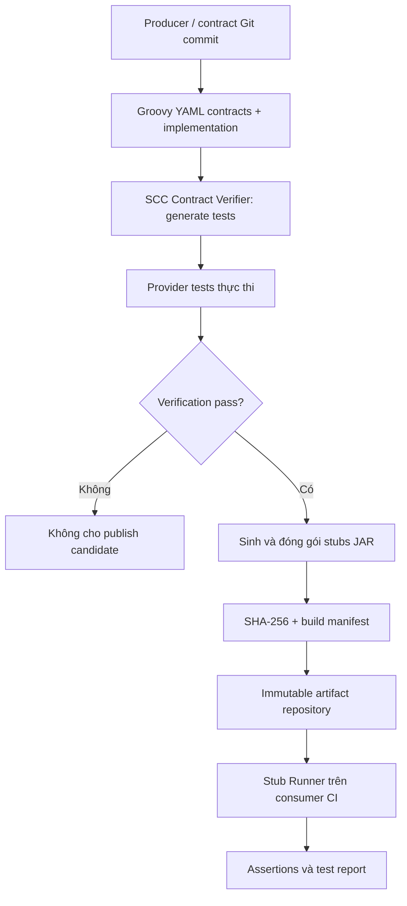
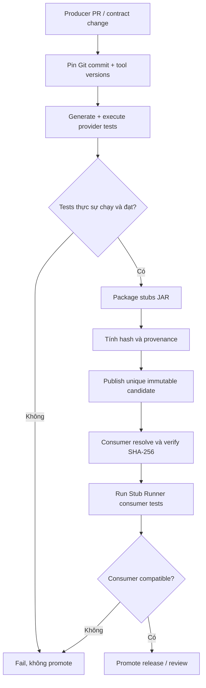

# Ghim phiên bản bất biến để tái lập kết quả kiểm thử Spring Cloud Contract

Trong hệ thống microservices, một bộ kiểm thử consumer có thể chạy xanh hôm nay và đỏ vào ngày mai dù không thay đổi một dòng code. Nguyên nhân đôi khi không nằm ở consumer, mà do **stubs JAR được tải về đã thay đổi**: Stub Runner lấy bản `LATEST`, SNAPSHOT được publish lại, cache của Maven giữ bản cũ, hoặc cùng một tọa độ artifact bị ghi đè trong repository.

Với **Spring Cloud Contract (SCC)**, producer khai báo hành vi HTTP hoặc thông điệp bằng **Groovy/YAML DSL**, sinh provider verification tests, đóng gói stubs và cho consumer kiểm thử bằng **Stub Runner**. Để kết quả có thể tái lập, cả hai phía phải thống nhất **đúng artifact nào đã được sử dụng**, **nội dung của artifact ấy có bất biến không** và **artifact sinh từ phiên bản code/contract nào**.

Bài thuộc chương **Kho hợp đồng và artifact**, với đề tài **Ghim phiên bản bất biến để tái lập kết quả kiểm thử**, hướng dẫn quản lý Maven coordinates, classifier, repository release/SNAPSHOT, hash nội dung, provenance, cấu hình Stub Runner, khóa phiên bản nhiều producer và CI phát hành candidate. Ví dụ xuyên suốt: `order-producer` cung cấp API đơn hàng và phát `OrderCreated`; `checkout-consumer` kiểm thử bằng stubs.

## 1. Hai điều kiện khác nhau: phiên bản cố định và nội dung không thay đổi

Giả sử consumer đang cấu hình:

```text
Order stub = com.example:order-producer:1.4.0:stubs
GET /api/orders/1001 -> {"id":1001,"status":"CREATED"}
```

Nếu repository cho phép upload lại `order-producer-1.4.0-stubs.jar` bằng một file khác, cùng chuỗi version `1.4.0` có thể trả:

```json
{"id":"ORD-1001","state":"CREATED"}
```

Consumer đã **pin version**, nhưng không pin được **bytes**. Bài test có thể thay đổi kết quả khi cache bị làm mới.

Muốn bảo đảm khả năng tái lập, cần:

1. **Pin tọa độ:** chọn một version cụ thể, không dùng wildcard/version động.
2. **Bảo đảm immutability:** repository không cho phép overwrite artifact đã phát hành ở coordinate đó.
3. **Kiểm tra nội dung:** lưu SHA-256 của JAR đã xác minh và so với file consumer thực tải.
4. **Ghi provenance:** lưu producer commit, contract source revision, build ID, plugin/toolchain và kết quả provider verification.
5. **Đóng băng các đầu vào test khác:** consumer revision, cấu hình, test data và hạ tầng quyết định hành vi.

**Version pinning là điều kiện cần, không phải điều kiện đủ cho content immutability.**

### 1.1. Ví dụ test thay đổi không do consumer code

```text
Ngày A:
  checkout-consumer commit: 7b62e9a
  Stub version: 1.4.0
  SHA-256: HASH_A
  Kết quả: PASS

Ngày B:
  checkout-consumer commit: 7b62e9a
  Stub version: 1.4.0
  SHA-256: HASH_B
  Kết quả: FAIL
```

Nếu `HASH_A` và `HASH_B` khác nhau, không được nói “cùng đầu vào test” dù version giống nhau. Phải điều tra nguồn artifact, cache/mirror, redeploy hoặc pipeline phát hành.

## 2. Tọa độ Maven: GAV, type và classifier

Một stubs artifact của producer có thể được định danh bằng:

```text
groupId    = com.example
artifactId = order-producer
version    = 2.4.0-rc.20261124.7
type       = jar
classifier = stubs
```

Khi ghi theo cú pháp thường dùng của Maven dependency plugin:

```text
com.example:order-producer:2.4.0-rc.20261124.7:jar:stubs
```

Tên file ví dụ:

```text
order-producer-2.4.0-rc.20261124.7-stubs.jar
```

| Biến thể | Classifier | Công dụng |
| --- | --- | --- |
| `order-producer-2.4.0-rc.20261124.7.jar` | Không có | Main application JAR |
| `order-producer-2.4.0-rc.20261124.7-stubs.jar` | `stubs` | HTTP mappings/message stubs |
| `order-producer-2.4.0-rc.20261124.7-tests.jar` | `tests` (nếu cấu hình) | Compiled test classes/fixtures |
| `order-producer-2.4.0-rc.20261124.7.pom` | POM | Metadata để resolve artifact |

**Không thay `stubs` bằng `tests` hoặc bỏ classifier** khi muốn tải contract stubs. Main JAR có thể chạy producer nhưng không tự có dữ liệu WireMock, còn test JAR không thay thế message/HTTP stub mappings.

### 2.1. GAV chưa cho biết repository nào đã phục vụ file

Cùng một coordinate có thể xuất hiện ở nhiều repository hoặc Maven mirrors. Nếu repositories quản lý không nhất quán, file trả về có thể khác nhau. Ghi cả **repository ID/URL logic** và **digest** trong provenance; không đưa username/token vào URL lưu trong logs.

### 2.2. Các version trong hệ thống không nhất thiết giống nhau

```text
Producer Maven version: 2.4.0-rc.20261124.7
Event schemaVersion:   1
Consumer app version:  3.2.0
SCC plugin version:    version do build quản lý
```

Producer artifact version giúp chọn một build. `schemaVersion` trong payload giúp consumer hiểu định dạng event. Hai loại version có thể tiến hóa độc lập; pin artifact không tự bảo đảm schema backward-compatible.

## 3. Ba lớp nguồn gốc: contract Git, producer build và stubs bytes

Stubs JAR được tạo qua một chuỗi:



Có hai mô hình phổ biến:

- **Contracts nằm cùng producer repository:** Git commit xác định cả code và contract.
- **Contracts nằm ở repository riêng:** cần khóa **contract revision** ngoài producer commit. Không chỉ ghi `branch=main`.

Git branch hoặc tag không được bảo vệ có thể di chuyển. **Commit SHA đầy đủ** định danh revision cụ thể; tuy nhiên chỉ ghi commit SHA vẫn không chứng minh JAR đã được build thật từ revision ấy. Cần provenance từ CI, artifact digest và quyền publish đáng tin.

### 3.1. Provenance không đồng nghĩa với tính hợp lệ học thuật

Một artifact có nguồn gốc xác định vẫn có thể chứa contract sai hoặc thiếu trường hợp lỗi. Để tin artifact:

- Generated tests phải được sinh và chạy với implementation producer thật.
- Có test count/coverage theo contract dự kiến.
- Stubs JAR phải chứa mappings đúng.
- Consumer cần kiểm tra những trường hợp mình phụ thuộc.
- CI phải chặn publish khi provider verification thất bại.

Pin version đảm bảo **điều kiện test không đổi**, không tự khiến một contract không đầy đủ trở nên đầy đủ.

## 4. Release bất biến, SNAPSHOT thay đổi và dynamic versions

| Phương án | Ví dụ | Có tái lập chắc chắn không? | Dùng khi nào? |
| --- | --- | --- | --- |
| Candidate release duy nhất + no-redeploy | `2.4.0-rc.20261124.7` | Có nền tảng tốt nếu cả bytes/hash được kiểm soát | PR/release compatibility gate |
| Release cố định + no-redeploy | `2.4.0` | Có nền tảng tốt nếu repo thật sự bất biến | Test với release đã công bố |
| Maven SNAPSHOT | `2.4.1-SNAPSHOT` | Không mặc nhiên; metadata có thể chuyển build | Development nhanh |
| Dynamic version | `+`, `LATEST` hoặc range nếu công cụ hỗ trợ | Không; bản chọn có thể đổi | Job khám phá candidate mới |
| Git branch/HEAD | `main` | Không; revision thay đổi | Định vị dòng phát triển, không phải lock |

### 4.1. Vì sao SNAPSHOT có thể làm kết quả thay đổi?

Một base version `2.4.1-SNAPSHOT` ở Maven repository có thể được resolve bằng metadata tới một timestamped snapshot:

```text
Tại thời điểm A:
  2.4.1-SNAPSHOT -> 2.4.1-20261124.030000-3

Tại thời điểm B:
  2.4.1-SNAPSHOT -> 2.4.1-20261124.071500-4
```

Các tên trên chỉ là ví dụ. Tùy metadata/cache, consumer có thể lấy bản khác cho cùng base version. Một số môi trường hỗ trợ chọn snapshot cụ thể theo timestamp nhưng cú pháp resolution không đồng nhất giữa Maven, plugin và Stub Runner. **Ứng dụng thực tế nên ưu tiên candidate version duy nhất, không thể ghi đè và kèm hash**, thay vì suy đoán timestamp snapshot đã tự động khóa mọi thứ.

### 4.2. Version động có lợi ích nhưng phải tách giai đoạn

Một job có thể có mục tiêu: *“tìm stubs mới nhất rồi thử xem consumer còn tương thích không”*. Đây là **compatibility discovery** và chủ ý thay đổi input.

Một job khác có mục tiêu: *“chạy lại đúng candidate đã kiểm tra hôm qua”*. Đây là **reproducible verification** và phải dùng version đã chốt.

Thiết kế đúng:

```text
Discovery:
  find latest candidate
  record resolved GAV + SHA-256

Verification:
  use exactly that GAV + SHA-256
  execute consumer tests
  save manifest and result
```

Không ghi `tested order-producer latest` trong report mà không lưu bản “latest” thực sự được chọn.

## 5. Repository bất biến cần được thực thi bằng cấu hình và quyền

Không được giả định mọi repository tự cấm upload lại chỉ vì version không chứa `SNAPSHOT`. Một chính sách đáng tin có thể gồm:

- Tách **snapshot repository** với **candidate/release repositories**.
- **No-redeploy** cho mọi GAV/type/classifier đã có trong candidate/release.
- Giới hạn tài khoản CI được phép publish; không dùng cùng quyền cho mọi developer.
- Phân quyền xóa/overwrite nghiêm ngặt và bật audit trail.
- Kiểm soát retention để không tự xóa artifact còn cần cho việc replay.
- Ghi provenance/manifest vào nơi có quyền truy cập phù hợp.
- Kiểm tra mirror/cache/proxy để tránh lấy bytes cũ hoặc sai nguồn.
- Khi thu hồi artifact lỗi, dùng version mới và quy trình revoke có dấu vết, không bí mật ghi đè bản cũ.

Ví dụ phân loại repository:

```text
maven-snapshots   -> mutable, dev builds
maven-candidates  -> unique RC versions, reject redeploy
maven-releases    -> immutable, reject redeploy
```

Tên repository là minh họa, không phải tên chuẩn của một nhà cung cấp. Maven/Nexus/Artifactory hoặc dịch vụ artifact khác có cấu hình chính sách riêng. **Phải kiểm tra chính sách thực đang được bật**, không chỉ viết quy tắc trong wiki.

### 5.1. Thử no-redeploy ở môi trường an toàn

Trong **test repository riêng**, publish một candidate artifact. Thử publish **file khác** bằng cùng coordinate và kiểm tra server từ chối. Không làm bài thử overwrite lên production repository hoặc kho dùng chung.

### 5.2. Immutability và retention phải đi cùng nhau

Một artifact không cho ghi đè nhưng bị dọn dẹp sau 30 ngày cũng không thể dùng để replay kiểm thử sáu tháng sau. Cần có retention phù hợp với vòng đời hỗ trợ consumer và yêu cầu audit. Nếu cần xóa do pháp lý/an ninh, ghi rõ lý do và chấp nhận giới hạn khả năng replay.

## 6. Maven producer: tạo stubs JAR sau khi kiểm chứng contract

Một HTTP contract trong producer:

```groovy
import org.springframework.cloud.contract.spec.Contract

Contract.make {
    description 'GET đơn hàng 1001 trả JSON hợp lệ'
    request {
        method GET()
        url '/api/orders/1001'
        headers {
            header('Accept', 'application/json')
        }
    }
    response {
        status OK()
        headers {
            contentType(applicationJson())
        }
        body(
            id: 1001,
            status: 'CREATED',
            currency: 'VND'
        )
    }
}
```

YAML DSL tương đương:

```yaml
description: "GET đơn hàng 1001 trả JSON hợp lệ"
request:
  method: GET
  url: /api/orders/1001
  headers:
    Accept: application/json
response:
  status: 200
  headers:
    Content-Type: application/json
  body:
    id: 1001
    status: CREATED
    currency: VND
```

Hai ví dụ mô tả **một kịch bản**; trong build học tập chọn **một DSL** để không sinh test/mapping trùng.

Một cấu hình Maven plugin đơn giản:

```xml
<plugin>
    <groupId>org.springframework.cloud</groupId>
    <artifactId>spring-cloud-contract-maven-plugin</artifactId>
    <version>${spring-cloud-contract.version}</version>
    <extensions>true</extensions>
    <configuration>
        <baseClassForTests>com.example.order.contract.OrderContractBase</baseClassForTests>
    </configuration>
</plugin>
```

Đây **không phải toàn bộ POM**. Producer phải quản lý phiên bản plugin/Verifier/BOM tương thích, dependencies, test framework và base class. Để kiểm chứng:

```bash
mvn -B -ntp clean verify
```

Sau đó nếu packaging đã cấu hình stubs classifier đúng:

```bash
mvn -B -ntp clean install
```

`install` chạy lifecycle cần thiết của Maven đến phase install, không phải thao tác chỉ sao chép JAR. Cần xem Surefire/Failsafe reports và đảm bảo provider generated tests được sinh/chạy, không bị skip. **Một `BUILD SUCCESS` với 0 contract test không thể coi là verification đầy đủ.**

### 6.1. Sinh stubs khác với thực thi provider tests

Contract Verifier có thể sinh provider tests và stub mappings từ cùng một contract. Nhưng stubs JAR có thể được đóng gói dù implementation thực chưa trả đúng response nếu pipeline bỏ qua kiểm chứng. Vì vậy **gating publish** phải dựa trên test execution thực tế, không chỉ việc JAR đã xuất hiện trong `target/`.

### 6.2. Ghim công cụ sinh cũng là một phần provenance

Lưu version:

- Spring Cloud Contract Maven/Gradle plugin.
- Spring Boot/Spring Cloud BOM.
- JDK, Maven hoặc Gradle Wrapper.
- HTTP/message test framework.
- Source code commit và contract source revision.

Hai lần build cùng contract nhưng dùng generator khác version có thể tạo output khác. Một artifact immutable giúp consumer replay đúng stub bytes dù source generator sau này thay đổi.

## 7. Kiểm tra stubs artifact trước và sau khi install

File mong đợi:

```text
target/order-producer-2.4.0-rc.20261124.7-stubs.jar
```

Liệt kê nội dung:

```bash
jar tf target/order-producer-2.4.0-rc.20261124.7-stubs.jar
```

Stubs JAR phải chứa các mappings/message resources thực tế phù hợp kịch bản. Đường dẫn bên trong JAR phụ thuộc plugin version/cấu hình; **không hardcode một bố cục duy nhất** rồi kết luận plugin lỗi nếu file ở thư mục khác.

Sau `mvn install`, local repository có thể chứa:

```text
~/.m2/repository/com/example/order-producer/2.4.0-rc.20261124.7/
    order-producer-2.4.0-rc.20261124.7.pom
    order-producer-2.4.0-rc.20261124.7.jar
    order-producer-2.4.0-rc.20261124.7-stubs.jar
```

Nếu chỉ có main JAR, cần kiểm tra SCC plugin đã package và **attach** stubs với classifier `stubs` chưa. Không sửa consumer để tải main JAR thay thế.

### 7.1. Kiểm tra đúng classifier qua Maven

```bash
mvn dependency:get \
  -Dartifact=com.example:order-producer:2.4.0-rc.20261124.7:jar:stubs
```

Với Maven dependency plugin, thứ tự là `groupId:artifactId:version:type:classifier`. Stub Runner `ids` có định dạng khác, thường thêm **cổng** ở cuối.

### 7.2. Artifact đúng tên nhưng sai nội dung

Một file `*-stubs.jar` có thể:

- Chỉ chứa metadata hoặc không có mapping cho endpoint quan trọng.
- Chứa dữ liệu generated từ contract cũ.
- Có hai mappings chồng lấp dẫn đến response khó dự đoán.
- Có response body không tương thích schema.
- Có classifier đúng nhưng không đi cùng provider verification của cùng producer commit.

**Checksum và nguồn gốc giúp biết file nào đã được dùng; chúng không tự kiểm tra nội dung hợp đồng có đúng nghiệp vụ hay không.**

## 8. SHA-256: khóa bytes, không chỉ khóa tên file

Trên Linux/macOS:

```bash
sha256sum target/order-producer-2.4.0-rc.20261124.7-stubs.jar
```

Trên Windows PowerShell:

```powershell
Get-FileHash -Algorithm SHA256 -LiteralPath "target/order-producer-2.4.0-rc.20261124.7-stubs.jar"
```

Digest SHA-256 trả về 64 ký tự hex. Trong pipeline, cần **so sánh hash tính từ file consumer nhận** với hash được producer CI tin cậy ghi và bảo vệ trong manifest. Không coi hai hash lấy từ cùng một file đã bị thay là xác minh độc lập.

### 8.1. Integrity không phải authenticity

- **Integrity:** bytes nhận được có giống bytes đã ghi trong manifest?
- **Authenticity/provenance:** manifest và artifact thật sự đến từ nguồn build được tin cậy?
- **Contract correctness:** producer có đáp ứng nội dung contract không?

SHA-256 hỗ trợ câu đầu. Hai câu sau cần quyền publish, CI provenance, signing/attestation nếu có, và provider verification tests.

### 8.2. Digest để bảo vệ khỏi cache/mirror sai nguồn

Nếu local cache có JAR cùng GAV nhưng hash khác manifest, test nên **fail trước khi chạy consumer assertions**. Nếu không, consumer test có thể kiểm tra một artifact sai mà vẫn báo PASS.

Không “sửa” mismatch bằng cách tự động cập nhật expected hash từ file vừa download; điều đó sẽ biến bước xác minh thành bước **chấp nhận bất kỳ nội dung nào**.

## 9. Stub Runner LOCAL và giới hạn của Maven cache

Ví dụ consumer:

```java
import org.springframework.boot.test.context.SpringBootTest;
import org.springframework.cloud.contract.stubrunner.spring.AutoConfigureStubRunner;
import org.springframework.cloud.contract.stubrunner.spring.StubRunnerProperties;

@SpringBootTest(properties = {
    "order.api.base-url=http://localhost:8085"
})
@AutoConfigureStubRunner(
    ids = "com.example:order-producer:2.4.0-rc.20261124.7:stubs:8085",
    stubsMode = StubRunnerProperties.StubsMode.LOCAL
)
class OrderConsumerContractTest {
    // Gọi HTTP client thật của consumer và assert DTO/error mapping.
}
```

LOCAL phù hợp khi candidate stubs đã được `install` vào local Maven repository của job. Nhưng có rủi ro:

- Cache `~/.m2` giữ JAR từ một build khác.
- Developer cài lại artifact cùng version vào local repo.
- CI worker tái sử dụng cache cũ khi candidate version không thay.
- Client vô tình gọi localhost port của một process khác.
- Test không ghi phiên bản artifact thực sự đã resolve.

**Cách giảm rủi ro:** mỗi build candidate dùng version duy nhất, CI có local Maven repo riêng nếu cần, xác minh hash sau resolve và ghi Stub Runner URL/version thực tế.

### 9.1. Không xóa cache như cách sửa duy nhất

Xóa cache có thể giúp debug nhưng không biến repository mutable thành immutable. Khi cache được làm mới, artifact vẫn có thể thay. Cần giải quyết nguyên nhân ở **repository policy và version scheme**.

## 10. Stub Runner REMOTE với repository candidate

Ví dụ:

```java
@AutoConfigureStubRunner(
    ids = "com.example:order-producer:2.4.0-rc.20261124.7:stubs:8085",
    stubsMode = StubRunnerProperties.StubsMode.REMOTE,
    repositoryRoot = "https://repo.example.org/maven-candidates"
)
```

`repo.example.org` là domain minh họa, không phải repository đang được truy cập. Một job REMOTE đáng tin cần:

1. Candidate version được pin cụ thể và không được redeploy.
2. Repository Root/ID đúng nguồn.
3. Quyền truy cập được cấp qua secrets, không hardcode token trong code hoặc log.
4. Resolver ghi nhận artifact đã tải về.
5. File thực tải có SHA-256 giống manifest.
6. Client thực sự gọi WireMock do Stub Runner khởi động, không gọi server production.
7. Không fallback sang version khác nếu candidate chưa sẵn sàng.

### 10.1. Đừng nhầm khóa version với khóa port

`ids` thường có dạng:

```text
groupId:artifactId:version:classifier:port
```

`8085` trong ví dụ là **cổng stub server**, không phải phần tạo ra artifact identity. Khi chạy CI song song, cổng động có thể tốt hơn; việc thay cổng không có nghĩa artifact đã đổi. Cần lấy URL đúng để cấu hình client.

### 10.2. Version động phục vụ discovery, không phục vụ replay

Một số phiên bản Stub Runner hỗ trợ ký hiệu version động như `+`. Không dùng cách này trong **reproducibility gate**; nếu dùng cho việc phát hiện release mới, ghi **resolved version** trước khi chuyển sang bước test cố định.

## 11. Khóa phiên bản trong manifest kiểm thử

Một ví dụ về **file manifest do CI tự quản lý**, không phải file Stub Runner tự đọc:

```yaml
manifestVersion: 1
producer:
  name: order-producer
  gitCommit: REPLACE_WITH_FULL_PRODUCER_SHA
  contractSourceCommit: REPLACE_WITH_CONTRACT_SHA
  ciBuildId: producer-build-107
  providerVerification: PASSED
  stubsArtifact:
    repositoryId: maven-candidates
    repositoryUrl: https://repo.example.org/maven-candidates
    groupId: com.example
    artifactId: order-producer
    version: 2.4.0-rc.20261124.7
    extension: jar
    classifier: stubs
    sha256: REPLACE_WITH_64_HEX_SHA256
consumer:
  name: checkout-consumer
  gitCommit: REPLACE_WITH_FULL_CONSUMER_SHA
  ciBuildId: consumer-build-221
  stubRunnerMode: REMOTE
```

Những giá trị `REPLACE_WITH...` là placeholders; CI phải lấy từ **nguồn thật đã được xác minh**. `providerVerification: PASSED` chỉ có ý nghĩa nếu stage upstream có bằng chứng generated tests chạy và không bị skip.

Manifest nên liên kết được:

```text
Consumer test report
  -> consumer Git commit
  -> Stub Runner ids + mode + repository
  -> resolved stubs GAV:classifier
  -> stubs JAR SHA-256
  -> producer/contract Git commit
  -> provider verification build report
```

### 11.1. Manifest lưu ở đâu?

- CI report artifacts được giữ lại theo retention phù hợp.
- Một provenance/artifact metadata store có quyền bảo vệ.
- Link từ pull request hoặc release record tới manifest đã lưu.

Không lưu password, personal access token hoặc URL có embedded credentials trong manifest. Nếu dùng checksum/signature, cần bảo vệ nguồn của giá trị expected, không chỉ giữ kèm chính JAR tại cùng vị trí mutable.

## 12. CI: producer xác minh xong mới phân phối candidate



Điều cần kiểm tra ở các gate:

| Gate | Bằng chứng |
| --- | --- |
| Provider verification | Generated tests có số lượng kỳ vọng, run/pass |
| Artifact packaging | `-stubs.jar` tồn tại, có mappings |
| Coordinate | GAV/type/classifier cố định, candidate version duy nhất |
| Repository immutability | No-redeploy và quyền publish có hiệu lực |
| Integrity | Hash consumer tải khớp trusted manifest |
| Consumer execution | Client/listener thực sự đi qua Stub Runner |
| Consumer assertions | DTO, headers, error handling đúng contract |
| Traceability | Consumer report trỏ lại producer build và artifact bytes |

Một pipeline chỉ gọi `mvn clean verify` mà **không chạy consumer tests với candidate stubs** chưa chứng minh consumer tương thích. Ngược lại, consumer test pass với stub release cũ chưa chứng minh producer candidate an toàn.

### 12.1. Maven phase: package, verify, install và deploy

```bash
mvn -B -ntp clean verify
mvn -B -ntp clean install
mvn -B -ntp clean deploy
```

Đây là các lệnh minh họa, không nhất thiết chạy liên tiếp trong một pipeline thực. Maven lifecycle đi qua `package` trước `verify`, rồi mới tới `install` và `deploy`. **JAR có thể được tạo trước khi verify hoàn tất**, nhưng cần chặn việc **publish/release** cho tới khi verification pass.

Nếu chạy một command khác làm Maven build lại giữa stage test và stage deploy, artifact bytes có thể khác. Cần chủ động kiểm chứng **file cuối cùng được publish chính là file đã được kiểm tra**, hoặc có compare/reverification phù hợp.

### 12.2. Đừng skip tests để phát hành nhanh

```bash
mvn clean deploy -DskipTests
```

Một lệnh như vậy có thể bỏ qua provider assertions. Nếu tổ chức muốn tách build/test/publish thành stages, việc deploy có thể dùng cơ chế publish artifact có sẵn **sau khi** stage verification đã pass và được chứng minh là cùng bytes. Không coi “plugin generation pass” hoặc “stubs JAR tồn tại” là bằng chứng tương đương provider test execution.

## 13. Promotion: build once, test exact bytes, promote safely

Một anti-pattern:

```text
PR build:
  source revision A
  stubs JAR digest HASH_A
  consumer tests PASS

Release job:
  checkout branch mới nhất
  build lại
  stubs JAR digest HASH_B
  publish như artifact đã được test
```

Ngay cả khi source không thay, timestamp, zip metadata, tool versions hoặc version trong POM có thể làm file JAR khác bytes. Cần minh bạch rằng bản release được **rebuild** chứ không phải **promote đúng file đã test**.

Hai phương án:

1. **Promote exact candidate bytes** nếu release coordinate được thiết kế cố định ngay từ đầu.
2. **Rebuild/repackage release riêng**, rồi kiểm tra lại hash/provenance và chạy producer/consumer verification cần thiết cho chính artifact release.

Không khẳng định đổi version từ `2.4.0-rc.20261124.7` thành `2.4.0` nhưng giữ mọi bytes giống nhau: nội dung JAR/POM có thể chứa build metadata/version.

### 13.1. Release đã lỗi thì phải làm gì?

Đừng âm thầm overwrite `2.4.0:jar:stubs`. Hãy:

- Tạo version sửa lỗi mới.
- Lưu quan hệ `supersedes` hoặc `revoked` trong release metadata.
- Chạy lại provider verification và consumer candidate tests.
- Khi buộc phải gỡ artifact vì an ninh, ghi audit và thông báo giới hạn replay.

## 14. Nhiều producer: phải khóa cả ma trận dependency

`checkout-consumer` có thể phụ thuộc `order-producer`, `inventory-producer` và `payment-producer`. Một lock manifest:

```yaml
consumer: checkout-consumer
stubs:
  - service: order-producer
    groupId: com.example
    artifactId: order-producer
    version: 2.4.0-rc.20261124.7
    classifier: stubs
    sha256: HASH_ORDER_FROM_VERIFIED_CI
  - service: inventory-producer
    groupId: com.example
    artifactId: inventory-producer
    version: 3.1.2
    classifier: stubs
    sha256: HASH_INVENTORY_FROM_VERIFIED_CI
  - service: payment-producer
    groupId: com.example
    artifactId: payment-producer
    version: 1.9.4
    classifier: stubs
    sha256: HASH_PAYMENT_FROM_VERIFIED_CI
```

**Đây là cấu trúc minh họa**, không tự được Stub Runner parse. CI phải chuyển nó thành `ids`/configuration thực tế và đối chiếu resolved artifacts.

Nếu chỉ ghim Order nhưng Inventory vẫn dùng version động, việc chạy lại consumer test có thể khác kết quả do Inventory. Lockfile cần giữ **tất cả artifact ảnh hưởng use case**, không chỉ producer mà pull request đang sửa.

### 14.1. BOM/Gradle locking không tự khóa mọi Stub Runner dependency

BOM hoặc dependency management có thể kiểm soát phiên bản thư viện Java, nhưng một `@AutoConfigureStubRunner(ids="...:+:stubs")` được viết cố định vẫn có thể dùng dynamic version. Nếu Stub Runner tự tải JAR từ Maven repository, cần khóa ở **điểm Stub Runner resolve**, không giả định Gradle dependency locking tự áp dụng lên quá trình ấy.

### 14.2. Nhiều stub servers không nên trộn mappings

Hai producer có thể cùng có path `GET /api/items/1001`. Dùng server/base URL tương ứng từng producer thay vì nạp lẫn mappings vào một WireMock server nếu điều đó tạo collision. Đúng version nhưng sai server vẫn cho kết quả không đáng tin.

## 15. Gradle cũng cần khóa version và artifact source

Producer dùng Gradle với SCC plugin có thể tạo artifact stubs và publish vào Maven-compatible repository. Consumer Gradle vẫn phải:

- Pin version stubs ở nơi cấu hình Stub Runner.
- Pin version Gradle Wrapper, SCC plugin và Spring Boot dependencies.
- Kiểm tra artifact digest sau resolve.
- Ghi provenance của producer build và consumer test.
- Dùng candidate version cố định thay vì dynamic selectors.
- Đảm bảo test dùng đúng stubs artifact, không cache của job khác.

Ví dụ một biến cấu hình Gradle Groovy DSL:

```groovy
ext {
    orderStubVersion = '2.4.0-rc.20261124.7'
}
```

Biến này **chưa có tác dụng** nếu không được truyền thực sự vào configuration của Stub Runner. Không đưa một constant vào build file chỉ để nói “đã pin” trong khi annotation/test property vẫn dùng `+`.

## 16. Tái lập kết quả khác với tái lập bản build

Hai khái niệm:

- **Reproducible build:** cùng source/toolchain/inputs có thể tạo lại artifact bytes giống nhau, khi build được thiết kế phù hợp.
- **Reproducible test:** cùng code, artifact bytes, fixture và environment inputs tạo ra kết quả kiểm thử có thể tái hiện.

Một consumer có thể **replay test** bằng stubs JAR immutable từ repository dù producer build chưa bảo đảm byte-for-byte reproducibility. Ngược lại, một JAR build tái lập hoàn toàn vẫn có test flaky nếu phụ thuộc vào random data, thời gian, broker state hoặc race conditions.

### 16.1. Các biến môi trường cần cân nhắc khóa

| Biến | Khi nào ảnh hưởng? |
| --- | --- |
| JDK version | Reflection, serialization, TLS hoặc test framework |
| Spring Boot/SCC version | Generated mappings và runtime behavior |
| Maven/Gradle version | Build plugin resolution và lifecycle |
| Timezone/locale | Ngày giờ, số tiền, sorting, formatting |
| Container image digest | OS/broker/database libraries |
| Random seed | IDs, test data, thứ tự thử nghiệm |
| Stub server port | Test chạy song song hoặc hardcoded URL |
| Database/queue state | Async tests nhận dữ liệu cũ |
| External services | Network latency, rate limit, outages |

Không cần khóa mọi biến ở cùng mức với mọi bài test; hãy ưu tiên những biến ảnh hưởng đến **hành vi đang được assert**.

## 17. Messaging stubs: khóa schema nhưng không khóa được broker semantics

Một contract message:

```groovy
import org.springframework.cloud.contract.spec.Contract

Contract.make {
    description 'OrderCreated event v1'
    label 'order_created_v1'

    input {
        triggeredBy('publishOrderCreated()')
    }

    outputMessage {
        sentTo('orders.created')
        headers {
            messagingContentType(applicationJson())
        }
        body(
            eventId: 'EVT-1001',
            eventType: 'OrderCreated',
            schemaVersion: 1,
            orderId: 'ORD-1001'
        )
    }
}
```

Một immutable stubs JAR có thể giúp `notification-consumer` nhận cùng mẫu message qua Stub Runner/StubTrigger trong nhiều lần chạy. Nhưng nó **không tự chứng minh**:

- Kafka offset commit, consumer group rebalance, partition ordering.
- RabbitMQ ack/nack, queue bindings và DLQ.
- Broker redelivery, retry/backoff và retention.
- Database transaction/outbox và idempotency.
- Header metadata do binder/broker production thêm hoặc thay đổi.

Nếu consumer phụ thuộc các hành vi ấy, cần broker/database integration tests với phiên bản/configuration được kiểm soát. **Pin stubs là bảo vệ dữ liệu hợp đồng, không phải bảo đảm delivery semantics của hệ thống thật.**

## 18. Troubleshooting: vẫn có kết quả khác dù version giống nhau

| Triệu chứng | Nguyên nhân có thể | Hướng kiểm tra |
| --- | --- | --- |
| Cùng GAV nhưng SHA-256 khác | Repository redeploy/mirror/cache sai | Đối chiếu hash, server audit, nguồn artifact |
| Stub Runner lấy release cũ | LOCAL cache hoặc REMOTE candidate không được pin | Log resolved version, repo, digest |
| SNAPSHOT test thay đổi theo ngày | Maven metadata trỏ build mới | Candidate immutable version |
| Test “latest” bỗng fail | Dynamic selection chọn release mới | Ghi resolved version và tái chạy fixed |
| JAR đúng classifier nhưng thiếu mappings | Packaging hoặc contract directory sai | `jar tf` và generated output |
| Provider build xanh nhưng 0 test | Plugin không quét contract hoặc test skip | Kiểm tra test reports/count |
| Consumer test xanh nhưng API mới hỏng | Stubs artifact cũ | Kiểm tra producer commit/candidate build |
| Same hash nhưng test flaky | Clock/random/concurrency/state | Cố định fixture và environment |
| Consumer gọi server thật | Base URL hoặc dynamic port wiring sai | WireMock request journal và logs |
| Remote repo không resolve | URL, quyền, metadata, mirror | Repository settings, no secrets in logs |
| Version trong BOM đã đổi nhưng stub không đổi | `ids` hardcoded | Pin/reconfigure tại resolver |
| Artifact hash đúng nhưng chưa tin cậy | Manifest/CI identity không được bảo vệ | Provenance, signing, publish permissions |

### 18.1. Quy trình chẩn đoán có thứ tự

```text
1. Ghi consumer Git commit và test command thực sự.
2. Đọc Stub Runner ids, stubsMode, repositoryRoot.
3. Xác định resolved GAV/type/classifier, URL và port.
4. Tính SHA-256 của stubs JAR đã chạy.
5. So sánh với trusted producer CI manifest.
6. Kiểm tra nội dung mapping và contract version.
7. Xác nhận provider verification cùng source revision pass.
8. Xác nhận client/listener thật đã đi qua stub server/binder.
9. Kiểm tra toolchain, timezone, test data và async state.
10. Chỉ sau đó điều tra thay đổi business logic/contract.
```

Không nới mọi regex hoặc sửa expected body khi chưa biết artifact đã đổi. Nếu nguyên nhân là repository bị ghi đè, việc sửa matcher chỉ che dấu rủi ro phân phối.

## 19. Những hiểu lầm thường gặp

**“Đã ghi version 2.4.0 thì artifact chắc chắn immutable.”** Không nếu kho cho phép redeploy cùng GAV/classifier.

**“Maven SNAPSHOT chỉ có một file cho mỗi version.”** Không; metadata có thể chuyển sang build snapshot mới.

**“Dùng `+` giúp test luôn đúng.”** Nó có thể giúp phát hiện bản mới nhưng không hỗ trợ replay ổn định.

**“Git tag là đủ cho nguồn gốc.”** Tag có thể di chuyển nếu không được bảo vệ; ghi commit SHA và build provenance.

**“Checksum đúng tức producer code đúng.”** Hash xác minh bytes so với nguồn kỳ vọng, không thay thế provider verification.

**“Consumer đã pass với release 2.3.0 thì ứng dụng tương thích candidate 2.4.0.”** Không; phải chạy candidate stubs mới.

**“Promote bằng rebuild cũng như copy artifact đã test.”** Không chắc; output có thể đổi bytes/version metadata.

**“BOM pin phiên bản stub tự động.”** Không nếu Stub Runner `ids` dùng một nguồn version khác.

**“Một version stubs đủ bảo vệ toàn bộ microservices.”** Không; consumer có thể phụ thuộc nhiều producers và environment.

**“Artifact immutable đảm bảo test không flaky.”** Không; race, time, random và external state vẫn ảnh hưởng.

## 20. Thực hành kiểm tra khả năng tái lập

Trong một **repository test dùng riêng cho bài tập**, thực hiện:

1. Tạo Groovy/YAML HTTP contract GET đơn hàng, chọn một DSL thực thi.
2. Sinh và chạy provider tests; thử đổi `status=CREATED` thành `PAID` để thấy fail.
3. Chọn candidate version duy nhất như `2.4.0-rc.20261124.7`.
4. Đóng gói `-stubs.jar`; liệt kê mappings bằng `jar tf`.
5. Tính SHA-256 và lưu cùng producer Git commit/build ID.
6. Publish tới repository candidate cấu hình no-redeploy.
7. Thử redeploy file khác với cùng coordinate **trên test repo**, xác nhận server từ chối.
8. Cho consumer Stub Runner REMOTE dùng version cố định.
9. Tính hash trên consumer runner và đối chiếu trusted manifest trước khi chạy tests.
10. Gọi HTTP client thật; assert JSON data và error handling của consumer.
11. Thử sửa version thành `+` trong job discovery; ghi bản được resolve.
12. Chuyển version được resolve thành input cố định cho job verification.
13. Thử dùng một `-SNAPSHOT` trên test repo và quan sát base version không nhất thiết trỏ mãi tới một build.
14. Thử cache chứa file cùng GAV nhưng hash khác; pipeline phải fail.
15. Chạy lại cùng consumer commit và artifact hash sau khi chuyển CI worker; so sánh kết quả.
16. Thêm inventory/payment stubs vào lock manifest để kiểm soát ma trận dependency.
17. Tái tạo một bug có chủ đích chỉ bằng consumer commit + manifest + toolchain.
18. Kiểm tra promotion: release cuối là exact candidate bytes hoặc đã được compare/reverify.
19. Lưu report cùng đủ tọa độ, checksum và producer verification build link.

### 20.1. Một skeleton kiểm tra checksum

```bash
# Expected digest phải đến từ trusted manifest của producer CI.
EXPECTED_SHA256="REPLACE_WITH_64_HEX_DIGITS"
ACTUAL_SHA256=$(sha256sum "order-producer-stubs.jar" | cut -d ' ' -f 1)

if [ "$ACTUAL_SHA256" != "$EXPECTED_SHA256" ]; then
  echo "ERROR: stubs digest mismatch"
  exit 1
fi
```

Đây là code minh họa: script thực tế phải kiểm tra file tồn tại, lỗi lệnh, nguồn manifest, resolved coordinate và điều kiện CI. Không tự lấy expected hash từ chính file vừa download.

### 20.2. Bảng tự đánh giá

| Năng lực | Bằng chứng đạt |
| --- | --- |
| Pin identity | Biết GAV/type/classifier/repository |
| Immutability | Test chính sách no-redeploy an toàn |
| SNAPSHOT | Hiểu Maven metadata và tính mutable |
| Integrity | So sánh SHA-256 với trusted manifest |
| Provenance | Liên kết producer commit, test build, stubs JAR |
| Stub Runner | LOCAL/REMOTE dùng đúng artifact |
| Multi-producer | Có lock manifest cho mọi dependency quan trọng |
| CI | Không publish khi provider tests fail |
| Promotion | Phân biệt copy verified bytes với rebuild |
| Debug | Tìm được khác biệt artifact/cache/environment |
| Replay | Chạy lại cùng consumer revision và stubs hash |

## 21. Kết luận: version pin chỉ đáng tin khi nội dung bất biến

Trong **Spring Cloud Contract**, stubs JAR là cầu nối giữa **provider verification** và **consumer tests với Stub Runner**. Để hai phía có thể chạy lại cùng một kịch bản sau vài tuần hoặc vài tháng, cần hơn một số version được ghi trong annotation.

Cần phối hợp **bốn lớp bảo vệ**:

1. **Định danh cố định:** pin group/artifact/version/type/classifier và repository.
2. **Bảo vệ bytes:** repository cấm overwrite, lưu/check SHA-256 và provenance của CI.
3. **Bảo vệ vòng đời:** provider tests thực sự pass, publish đúng candidate và không âm thầm rebuild thành artifact khác sau khi consumer đã test.
4. **Bảo vệ môi trường:** giữ ổn định toolchain, các producer dependencies khác, fixture và cấu hình quan trọng.

**Câu hỏi cuối trước khi tin một kết quả xanh:** *“Nếu chạy lại consumer commit này sau ba tháng, ta có thể tải chính xác cùng stubs JAR, xác minh đúng SHA-256 và biết producer build nào đã tạo ra nó hay không?”*

Khi trả lời được câu hỏi ấy, việc **ghim phiên bản bất biến** mới thực sự giúp **tái lập kết quả kiểm thử, điều tra regression và phát hiện sớm thay đổi API không tương thích** giữa producer và consumer.
