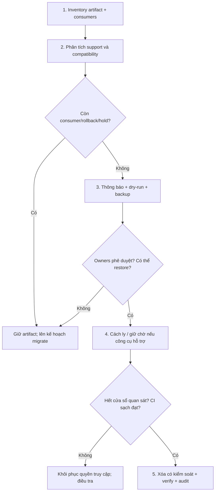

# Xóa artifact cũ mà không làm hỏng consumer còn dùng

## 1. Bối cảnh: vì sao xóa một stub JAR có thể làm hỏng hệ thống kiểm thử?

Trong **Spring Cloud Contract** (module `SPRING_CLOUD_CONTRACT`), producer và consumer thống nhất hành vi **HTTP** hoặc **thông điệp** bằng hợp đồng **Groovy/YAML DSL**. Contract Verifier sinh kiểm thử ở phía producer để xác minh API/message thực tế. Các hợp đồng được chuyển thành stub, đóng gói, phát hành theo phiên bản; consumer dùng **Stub Runner** để kiểm thử mã tích hợp trong CI mà không cần chạy producer thật.

Sau nhiều lần phát hành, kho Maven-compatible như **Nexus**, **Artifactory** hoặc kho artifact nội bộ có thể chứa hàng trăm phiên bản. Nhóm vận hành muốn xóa artifact cũ để tiết kiệm dung lượng, giảm chi phí bảo trì và hạn chế tích tụ dữ liệu không cần thiết. Nhưng nếu một consumer vẫn tải `orders-producer:1.4.2:stubs`, xóa phiên bản ấy có thể gây lỗi:

- CI của consumer không tải được stub sau khi runner được tạo mới.
- Một branch bảo trì hoặc phiên bản ứng dụng cũ không còn tái lập được kiểm thử hợp đồng.
- Một nhóm chưa nâng cấp bị buộc dùng stub mới, làm lộ incompatibility chưa được xử lý.
- Một pipeline rollback cần dựng lại môi trường kiểm thử nhưng artifact đã mất.
- Người phát triển vẫn chạy thành công nhờ cache Maven cục bộ, trong khi CI sạch thất bại.
- Producer và consumer bị đánh giá “không tương thích” do thiếu artifact, dù API thực tế chưa thay đổi.

**Mục tiêu không phải giữ mọi phiên bản mãi mãi**, mà là **chỉ xóa khi có đủ bằng chứng không còn consumer được hỗ trợ cần phiên bản đó**, có cơ chế khôi phục và có kiểm tra sau thao tác.

**Nguyên tắc trung tâm:** *“Không thấy lượt tải” không đồng nghĩa “không còn ai sử dụng”.* Consumer có thể lấy artifact từ cache, từ classpath, từ bản mirror hoặc chỉ được chạy khi cần hotfix.

### Mục tiêu học tập

Sau bài này, bạn có thể:

1. Định danh đúng artifact và phân biệt **contract nguồn**, **stub JAR** và **application JAR**.
2. Tìm consumer phụ thuộc vào một stub version, kể cả dependency **được khai báo trong Stub Runner IDs**.
3. Đề xuất retention policy có tính đến consumer còn hỗ trợ, rollback, branch bảo trì và audit.
4. Xây dựng kế hoạch **migration → validation → quarantine/hold → deletion → verification**.
5. Thiết kế CI gate và bằng chứng để tránh xóa nhầm phiên bản.
6. Phân biệt xóa bản `SNAPSHOT`, bản thử nghiệm và bản release bất biến.
7. Chuẩn bị cách khôi phục khi xóa nhầm mà không làm sai lệch tính bất biến của artifact.

## 2. Hiểu chính xác loại artifact đang định xóa

Trong một Maven repository, cùng một producer có thể phát hành nhiều loại file:

| Loại | Ví dụ | Vai trò | Rủi ro khi xóa |
| --- | --- | --- | --- |
| Application JAR | `orders-producer-1.4.2.jar` | Binary của producer thật | Ảnh hưởng deploy/rollback runtime |
| Stub JAR | `orders-producer-1.4.2-stubs.jar` | Hợp đồng và HTTP/message stubs cho consumer | Ảnh hưởng Stub Runner, consumer tests |
| Contract-only artifact | JAR nguồn DSL theo quy ước của nhóm | Producer lấy hợp đồng từ kho trung tâm | Ảnh hưởng generation/verification |
| POM | `orders-producer-1.4.2.pom` | Maven metadata/dependencies | Ảnh hưởng resolution, kể cả khi JAR còn |
| Checksum/signature | `.sha1`, `.sha256`, `.asc` nếu có | Kiểm tra toàn vẹn/xác thực | Làm suy giảm kiểm chứng artifact |
| Repository metadata | `maven-metadata.xml` theo vị trí thích hợp | Hỗ trợ tìm versions/snapshots | Có thể phá resolution nếu chỉnh thủ công |

Một stub artifact điển hình có tọa độ:

```text
groupId    = com.example
artifactId = orders-producer
version    = 1.4.2
type       = jar
classifier = stubs
```

**GAV** (groupId, artifactId, version) vẫn **chưa đủ** để phân biệt application JAR với stub JAR. Khi đánh giá xóa, cần biết **classifier** và **repository** cụ thể. Với Spring Cloud Contract, consumer Stub Runner thường dùng định danh:

```text
com.example:orders-producer:1.4.2:stubs
```

Nếu muốn cố định cổng WireMock trong một ví dụ Stub Runner:

```text
com.example:orders-producer:1.4.2:stubs:8090
```

`8090` là **cổng chạy stub**, không phải phần của artifact lưu trong repository.

### 2.1. Vị trí trong Maven repository khác nội dung bên trong JAR

Một đường dẫn Maven repository thường có dạng:

```text
com/example/orders-producer/1.4.2/
  orders-producer-1.4.2.pom
  orders-producer-1.4.2.jar
  orders-producer-1.4.2-stubs.jar
  ... checksum/signature nếu repository có ...
```

Trong khi đó, nội dung của stub JAR có thể theo bố cục:

```text
META-INF/com.example/orders-producer/1.4.2/
  contracts/
    orders/get_order_success.groovy
    orders/get_order_not_found.yml
  mappings/
    orders/<generated-mapping>.json
```

Đây là **mẫu mô tả cấu trúc phổ biến**; tên file mapping/đường dẫn có thể phụ thuộc plugin version và cấu hình. Đường dẫn trong Maven repository dùng `com/example`, còn ví dụ `META-INF` dùng `com.example` là một thành phần thư mục. Hai cách biểu diễn **không được trộn** khi thao tác repository.

### 2.2. Xóa một classifier khác xóa cả version

Nếu thao tác dọn dẹp xóa **toàn bộ version directory**, nó có thể xóa luôn application JAR, POM, stubs, signatures và các classifier khác. Đó là thay đổi có phạm vi lớn hơn “xóa stub cũ”.

Nếu thao tác chỉ xóa file `-stubs.jar`, repository vẫn có thể ghi nhận version tồn tại qua POM và application JAR. Consumer cần classifier `stubs` vẫn không tải được. **Không dùng việc GAV vẫn hiện trên giao diện repository làm bằng chứng rằng stub còn tồn tại.**

Trước mọi kế hoạch, ghi rõ: *repository nào, groupId nào, artifactId nào, version nào, type/classifier nào, và thao tác ảnh hưởng tập file/metadata nào*.

## 3. Consumer nào có thể còn cần phiên bản cũ?

Một phiên bản stub có thể được sử dụng bởi nhiều nhóm và nhiều loại môi trường hơn bạn nghĩ:

| Consumer hoặc quy trình | Cách phụ thuộc | Vì sao dễ bỏ sót? |
| --- | --- | --- |
| CI của consumer chính | `@AutoConfigureStubRunner(ids=...)` | Version nằm trong annotation, không phải Maven dependency trực tiếp |
| Consumer khác dùng JUnit/Gradle | Config `stubrunner.ids` | Nằm trong `application-test.yml`, test properties hoặc Gradle script |
| Nhóm dùng Stub Runner Boot/Docker | Biến môi trường `STUBRUNNER_IDS` | Khai báo trong CI template/Helm chart, không ở producer repository |
| Consumer có messaging stub | `StubTrigger.trigger(label)` với artifact version cụ thể | Chỉ tìm HTTP mapping sẽ bỏ qua hợp đồng message |
| Branch hotfix/bảo trì | Pinned stub version cũ | Main branch đã nâng cấp nhưng branch còn được hỗ trợ |
| Bản release LTS của consumer | Dự án duy trì compatibility tests | Chỉ chạy theo lịch hoặc khi có sự cố |
| Developer offline | `LOCAL` trong `~/.m2` | Có thể pass nhờ cache, dù repository đã mất |
| Consumer ngoài JVM | Standalone Stub Runner trong test namespace | Không nhất thiết có Maven `pom.xml` |
| Shared test environment | Cấu hình runtime tải stub từ repository | Không xuất hiện trong dependency graph của developer |
| Disaster recovery/rollback job | Tái tạo CI kiểm tra bản cũ | Rất hiếm chạy nhưng quan trọng |

Ví dụ Spring Boot consumer:

```java
@AutoConfigureStubRunner(
    ids = "com.example:orders-producer:1.4.2:stubs:8090",
    stubsMode = StubRunnerProperties.StubsMode.REMOTE,
    repositoryRoot = "https://repo.example.invalid/maven-releases"
)
class CheckoutConsumerContractTest {
    // Test gọi HTTP client thực của Checkout tới stub.
}
```

Repository URL trong ví dụ là placeholder không thể tải artifact thật. **Quan trọng:** phiên bản `1.4.2` nằm trong **Stub Runner IDs**, nên việc tìm một dependency kiểu `orders-producer` trong `pom.xml` có thể không phát hiện consumer này.

### 3.1. Dạng cấu hình động trong properties

```yaml
stubrunner:
  ids:
    - com.example:orders-producer:1.4.2:stubs:8090
  stubs-mode: REMOTE
  repository-root: https://repo.example.invalid/maven-releases
```

Tên property/binding có thể khác giữa phiên bản hoặc cách khởi động; block này minh họa **nơi người dùng có thể ghim version**. Khi audit, phải xem **effective configuration** sau khi áp dụng profile, CI environment variables và build templates, không chỉ source YAML mặc định.

### 3.2. Dependency graph không phải toàn bộ sự thật

Lệnh Maven:

```bash
./mvnw -B dependency:tree
```

có thể giúp tìm dependencies Maven. Nhưng Stub Runner có thể **tải artifact theo tọa độ được cung cấp lúc chạy**, nên artifact không nhất thiết là dependency tĩnh nằm trong tree. Kết hợp **search configuration**, **repository audit logs**, **CI provenance** và xác nhận của owners mới có được bức tranh đầy đủ.

## 4. Vì sao “không có download mới” không đủ để kết luận đã bỏ?

Giả sử kho artifact ghi nhận không ai tải `orders-producer:1.4.2:stubs` trong 30 ngày. Có ít nhất sáu khả năng:

1. Mọi consumer đã chuyển qua version mới.
2. Consumer vẫn dùng nhưng lấy từ Maven cache hoặc proxy mirror.
3. Pipeline chỉ chạy cuối tháng/quý.
4. Branch bảo trì chưa có commit gần đây.
5. Log retention ngắn hơn thời gian quan sát mong muốn.
6. Có consumer bên ngoài tổ chức tải qua một repository proxy khác.

**Kết luận đúng:** không thấy download là **tín hiệu phụ trợ**, không phải chứng cứ đủ để xóa.

### 4.1. Nguồn bằng chứng nên kết hợp

| Bằng chứng | Ưu điểm | Giới hạn |
| --- | --- | --- |
| Search `Stub Runner IDs` trong active repos | Thấy reference cụ thể theo version | Có thể bỏ qua config sinh ra động hoặc repo ngoài phạm vi |
| Effective CI/Helm/environment config | Thấy version thực sự được chọn lúc chạy | Có thể có secrets/templates hoặc overrides không dễ tra |
| Repository download log | Quan sát truy cập thực | Cache/mirror khiến không có request tới nguồn |
| CI test reports/artifact manifests | Chỉ ra version dùng trong run cụ thể | Không chứng minh các job hiếm khi chạy đã được kiểm tra |
| Danh sách supported releases/branches | Tính đến bảo trì và rollback | Cần cập nhật bởi team owners |
| Xác nhận chính thức từ consumer owner | Hiểu nhu cầu tương lai, SLA, lịch release | Cần giữ evidence và deadline xác nhận |
| Chạy lại consumer tests trên stub mới | Có bằng chứng về tương thích | Chỉ bao phủ những test đã thực thi |

**Không nên** xóa chỉ theo một nguồn. Tốt hơn là xây dựng một **consumer–artifact usage inventory** có người sở hữu và ngày xác minh.

### 4.2. Bản kiểm kê mẫu

| Consumer | Owner | Branch/release còn hỗ trợ | Stub version đang cần | Nguồn xác nhận | Trạng thái |
| --- | --- | --- | --- | --- | --- |
| checkout-web | Checkout Team | `main` | `1.5.0` | CI config + last successful run | Đã chuyển |
| checkout-web | Checkout Team | `release/2025-lts` | `1.4.2` | Release branch + owner | **Còn cần** |
| inventory-sync | Inventory Team | `main` | `1.4.2` | Stub Runner Boot template | **Còn cần** |
| billing-reports | Billing Team | `main` | `1.5.0` | Test report | Đã chuyển |
| legacy-mobile-gateway | Mobile Team | Không còn hỗ trợ | `1.3.9` | Decommission record | Ứng viên xóa sau kiểm tra |

Đây là **tình huống giả định phục vụ bài học**. Bảng cho thấy dù mọi consumer trên `main` đã chuyển sang `1.5.0`, một branch bảo trì còn dùng `1.4.2` vẫn có thể làm việc xóa trở nên không an toàn.

## 5. Thiết lập chính sách giữ artifact trước khi xóa

Không có một số ngày lưu trữ **mặc định đúng cho mọi nhóm**. Retention phụ thuộc SLA hỗ trợ phiên bản, khoảng thời gian rollback, yêu cầu tái lập CI, bảo mật, chi phí và pháp lý.

Một chính sách nên phân biệt ít nhất:

| Loại artifact | Chính sách gợi ý về nguyên tắc | Điều kiện quan trọng |
| --- | --- | --- |
| Release stub còn consumer được hỗ trợ | **Giữ** | Dù ít hoặc không có download gần đây |
| Release stub dùng cho rollback/LTS | **Giữ** đến hết thời gian hỗ trợ và hold | Có bằng chứng hết nhu cầu rollback mới xét xóa |
| Release stub đã thay thế, không còn reference | **Ứng viên** | Vẫn cần kiểm tra owner và cửa sổ quan sát |
| Snapshot/build tạm | Có thể dùng TTL ngắn hơn | Phải loại trừ snapshot được pin trong CI/hotfix |
| Artifact lỗi hoặc chứa secret | Xử lý theo incident/security policy | Có thể phải thu hồi khẩn, thông báo consumer và bảo toàn bằng chứng |
| Artifact thuộc legal/audit hold | **Không xóa** | Dù đã vượt TTL thông thường |

### 5.1. Release bất biến và snapshot thay đổi

Một **release** như `1.4.2` nên được xem là **bất biến**: cùng tọa độ sẽ có cùng nội dung. Nếu xóa rồi upload một file khác dưới cùng version để “khôi phục”, bạn có thể tạo ra môi trường có nhiều cache trả kết quả khác nhau.

Một `SNAPSHOT` có cơ chế metadata và bản timestamped snapshot, thường được thiết kế cho phát triển liên tục. Dù có thể dọn nhanh hơn, không nên xóa snapshot đang được pin trong một job cần tái lập hoặc trong quy trình điều tra lỗi.

**Nguyên tắc:** lên kế hoạch retention theo **version thực tế được consumer resolve** và provenance, không chỉ theo tên thư mục chứa chuỗi `SNAPSHOT`.

### 5.2. Chính sách giữ theo tập phụ thuộc

Có thể mô hình hóa tập phiên bản cần bảo vệ:

```text
ProtectedVersions =
    versions referenced by supported consumers
  ∪ versions required by rollback/disaster recovery
  ∪ versions under release/support/security/legal hold
  ∪ versions currently in active migration windows
```

Một artifact chỉ được xét làm **ứng viên xóa** khi version của nó **không** nằm trong tập trên và đã qua thời gian chờ/duyệt thích hợp.

Một policy lưu trữ kiểu “giữ 3 bản gần nhất” có thể hữu ích cho **snapshot thử nghiệm**, nhưng **không đủ cho release stubs**: một consumer LTS có thể cần bản cũ hơn ba phiên bản gần nhất.

## 6. Xác định “còn dùng” theo hợp đồng hỗ trợ

Không thể coi một consumer “không còn dùng” chỉ vì nhóm đã merge code nâng cấp stub version lên `main`. Cần xét:

- **Phiên bản consumer đang còn được hỗ trợ**: branch release và hotfix.
- **Chu kỳ chạy của pipeline**: hằng ngày, hằng tuần hoặc chỉ khi phát hành.
- **Khả năng rebuild**: team có cần tái dựng một release cũ không?
- **Kế hoạch rolling upgrade**: producer mới có phải tương thích consumer cũ trong khoảng chuyển tiếp không?
- **Yêu cầu audit**: giữ stub hoặc lưu cách tái tạo có kiểm chứng.
- **Quyền truy cập và kết nối repo**: consumer trong mạng tách biệt hoặc đối tác bên ngoài.

### 6.1. API compatibility và artifact availability là hai vấn đề riêng

Một producer mới có thể tương thích về HTTP schema nhưng **consumer test vẫn fail** vì stub JAR cũ bị xóa. Ngược lại, giữ artifact cũ mãi mãi không làm consumer tự tương thích với API mới.

| Kiểm tra | Câu hỏi |
| --- | --- |
| **Khả dụng của artifact** | Consumer có tải được version đã ghim không? |
| **Tương thích hợp đồng** | Consumer hiện tại có xử lý được stub của producer ứng viên không? |
| **Tính đúng của producer** | Generated producer tests có đạt với mã producer thật không? |
| **Khả năng triển khai/rollback** | Có thể tái lập quá trình thử nghiệm cho phiên bản còn hỗ trợ không? |

Chỉ khi bốn câu hỏi phù hợp với kế hoạch hỗ trợ, việc ngừng lưu trữ mới đáng cân nhắc.

## 7. Quy trình năm bước để loại bỏ artifact cũ an toàn



Đây là **mô hình vận hành gợi ý**, không phải một thao tác tự động bắt buộc trong Spring Cloud Contract. Chính sách xóa của Nexus/Artifactory, quyền phê duyệt và cách backup phải theo hệ thống quản trị artifact thực tế.

### Bước 1: Kiểm kê đúng mục tiêu

Tạo một bản ghi chứa:

```yaml
artifact:
  repository: maven-releases
  groupId: com.example
  artifactId: orders-producer
  version: 1.4.2
  extension: jar
  classifier: stubs
  checksum: "SHA256_DO_BO_PHAN_BUILD_CUNG_CAP"
owner: Orders Platform
reason: Dự kiến hết vòng đời hỗ trợ
status: PROPOSED_ONLY
```

Đây là **ví dụ tài liệu nội bộ/dry-run**, không phải format mà Nexus/Artifactory bắt buộc hỗ trợ. Không dùng checksum placeholder để xác thực file thật; phải lấy digest thực từ artifact có nguồn gốc đã biết.

Ở giai đoạn này **không xóa file nào**. Thu thập toàn bộ reference của consumer và biến thể classifier/metadata liên quan.

### Bước 2: Phân tích và chuyển các consumer còn dùng

Với mỗi consumer:

1. Ghi rõ `owner` và release/branch đang hỗ trợ.
2. Xác định version stub hiện tại, lấy từ cấu hình có hiệu lực.
3. Thống nhất target version hoặc quyết định kết thúc hỗ trợ.
4. Chạy consumer tests với stub version mới; nếu fail, xử lý incompatibility.
5. Xác nhận pipeline trên branch được hỗ trợ đã cập nhật.
6. Chờ qua kỳ chạy phù hợp và lưu lại bằng chứng.

**Không ép consumer nâng cấp bằng cách xóa trước**. Khi một client đang phụ thuộc vào schema cũ, nó cần kế hoạch migration và compatibility test, không phải lỗi `artifact not found`.

### Bước 3: Thông báo, dry-run và lưu khả năng khôi phục

Một kế hoạch đề nghị xóa nên có:

- Danh sách **chính xác** artifact coordinates cần ảnh hưởng.
- Consumer list và evidence không còn reference.
- Ngày chốt, thời gian giữ chờ, người phê duyệt.
- Bản backup/artifact copy có **checksum trùng với bản gốc**.
- Quy trình restore được thử trên môi trường kiểm soát.
- Kế hoạch phản ứng nếu có consumer mới báo phụ thuộc.

Chỉ dùng tính năng **dry-run/preview** của repository cleanup policy nếu có; đọc kỹ **phạm vi filter** trước khi bật. Một policy trên cả repository có thể ảnh hưởng nhiều group/artifact ngoài phạm vi dự định.

### Bước 4: Ngừng dùng trước khi xóa

Một số tổ chức triển khai **deprecation notice** hoặc **quarantine/hold**:

- Đánh dấu version sắp hết hỗ trợ.
- Thông báo các owners và chốt migration deadline.
- Tạm dừng tạo dependency mới vào version đó bằng chính sách CI/code review.
- Trong môi trường test riêng, kiểm tra “cold build” có còn tải version đó không.
- Nếu repository hỗ trợ cách ly mềm, áp dụng theo chính sách và theo dõi phản ứng.

**Không bắt buộc phải chặn download ở môi trường đang hoạt động** để “thử xem có ai còn dùng”: hành động này có thể gây gián đoạn thực tế. Ưu tiên kiểm tra thụ động và diễn tập trên bản mirror/test repository cô lập. Chỉ thực hiện deny/disable access khi đã có change plan, thông báo và rollback.

### Bước 5: Xóa được phê duyệt và xác minh hậu kiểm

Khi mọi điều kiện đạt, đội quản trị thực hiện thao tác có kiểm soát qua tính năng cleanup/API chính thức của repository. Cần:

1. Kiểm tra lại **repository + tọa độ + classifier + checksum** ngay trước thao tác.
2. Đảm bảo không có consumer/rollback/security/legal hold mới.
3. Xóa **đúng phạm vi** đã phê duyệt; không dùng wildcard quá rộng.
4. Ghi audit: ai, lúc nào, vì sao, danh sách artifact nào bị ảnh hưởng.
5. Chạy thử lại các consumer được hỗ trợ trên môi trường **không dựa vào cache cũ**.
6. Xác minh những artifacts phải giữ vẫn tải được.
7. Giữ backup đến khi hết cửa sổ khôi phục đã được quy định.

**Không xóa trực tiếp file blob dưới storage của Nexus/Artifactory** bằng lệnh hệ điều hành. Repository manager thường có metadata, index, checksum, GC và cơ chế tham chiếu riêng; thao tác ngoài API có thể làm kho không nhất quán.

## 8. Maven coordinates và lệnh kiểm tra an toàn

Các lệnh trong bài dùng để **quan sát**, không thực hiện xóa artifact. Chúng chỉ chạy được khi Maven/JDK và repository tương ứng đã được cấu hình.

### 8.1. Thử tải đúng artifact và classifier

Maven Dependency Plugin nhận tham số `artifact` theo dạng:

```text
groupId:artifactId:version:packaging:classifier
```

Ví dụ:

```bash
./mvnw -B dependency:get \
  -Dartifact=com.example:orders-producer:1.4.2:jar:stubs
```

Trong lệnh này, `jar` là **packaging/extension** và `stubs` là **classifier**. Đây là cú pháp tham số của Maven Dependency Plugin, **khác thứ tự trình bày trong Stub Runner IDs**. Không viết nhầm `com.example:orders-producer:1.4.2:stubs:jar` khi dùng `dependency:get`.

Lệnh có thể **tải về cache** cục bộ, nên phép kiểm tra “có artifact” cần đặt trên runner sạch/được cô lập hoặc dùng repository metadata API khi không muốn thay đổi cache. Nếu chạy thành công do file đã có trong `~/.m2`, nó **không chứng minh** repository từ xa còn artifact.

### 8.2. Kiểm tra nội dung JAR

```bash
jar tf "$HOME/.m2/repository/com/example/orders-producer/1.4.2/orders-producer-1.4.2-stubs.jar"
```

Kiểm tra có thư mục `META-INF/.../contracts` và `.../mappings` cho các kịch bản HTTP/messaging cần bảo vệ. **Không sửa JAR** để “khắc phục” sự cố retention; cần xử lý theo nguồn build và provenance đã được xác minh.

### 8.3. Kiểm tra consumer code và config

Những chỗ đáng kiểm kê:

```text
@AutoConfigureStubRunner(ids = ...)
stubrunner.ids
STUBRUNNER_IDS
stubsMode / stubs-mode / STUBRUNNER_STUBS_MODE
repositoryRoot / repository-root
application-test.yml
CI workflow / shared pipeline template / Helm values
release branches / archived-but-supported test jobs
```

Đây là **gợi ý điểm tìm kiếm**, không phải một lệnh quét tự động toàn tổ chức. Ngoài mã nguồn cần xem cấu hình đã được inject khi pipeline chạy và các consumer không phải Java.

## 9. Trường hợp nhạy cảm: producer đổi contract nhưng consumer chưa nâng cấp

Giả sử Orders Producer phát hành:

- `1.4.2`: response `GET /api/orders/ord-1001` có `id`, `status`.
- `1.5.0`: response thêm `currency`, thay đổi một quy tắc status.

Consumer Checkout cũ dùng DTO nghiêm ngặt và chỉ được kiểm thử với stub `1.4.2`. Khi thử `1.5.0`, consumer test fail vì xử lý field mới hoặc enum khác.

**Hướng xử lý sai:** xóa `1.4.2` để buộc tất cả pipeline dùng `1.5.0`.

**Hướng xử lý đúng:**

1. Xác định consumer nào cần hỗ trợ.
2. Chạy consumer tests với `1.5.0`, ghi nhận lỗi tương thích thật.
3. Thỏa thuận producer sửa theo hướng backward-compatible hoặc consumer nâng cấp.
4. Giữ `1.4.2` cho branch/rollback trong thời gian chuyển tiếp.
5. Chỉ loại `1.4.2` khi đã kết thúc hỗ trợ và vượt qua các cổng retention.

### 9.1. Ma trận phiên bản

| Consumer | Stub `1.4.2` | Stub `1.5.0` | Quyết định |
| --- | --- | --- | --- |
| Checkout v2.0 (còn hỗ trợ) | PASS | FAIL | **Giữ `1.4.2`**, xử lý compatibility |
| Checkout v2.1 | PASS | PASS | Có thể chuyển lên `1.5.0` |
| Inventory v3.0 | PASS | PASS | Có thể chuyển lên `1.5.0` |
| Billing v1.8 (đã EOL) | PASS | Chưa kiểm tra | Không tự quyết: xem chính sách EOL/rollback |

Ma trận này là **ví dụ minh họa**, không đại diện cho kết quả test thật. Chỉ khi consumer đang hỗ trợ đã có bản nâng cấp hoặc chính thức kết thúc hỗ trợ, phiên bản cũ mới có thể tiến vào nhóm ứng viên.

## 10. Stub Runner LOCAL, REMOTE và CLASSPATH ảnh hưởng tới điều tra thế nào?

| Stubs mode | Nguồn stub | Khi xóa khỏi remote repository | Bẫy khi kiểm chứng |
| --- | --- | --- | --- |
| `REMOTE` | Repository Maven-compatible | Cold build có thể không resolve artifact | CI đang dùng proxy/cached repository |
| `LOCAL` | Local Maven repository | Máy có cache vẫn chạy, runner sạch có thể fail | “Máy tôi vẫn pass” là bằng chứng sai |
| `CLASSPATH` | Stub có sẵn trên test classpath | Test có thể tiếp tục chạy nếu bản JAR được đóng gói sẵn | Artifact có thể vẫn đang được phân phối qua nguồn khác |

Một bài test với `LOCAL` thành công **không chứng minh** version đã hết người dùng hay bản remote có thể xóa. Ngược lại, việc xóa version khỏi repository remote **không ngay lập tức làm mọi test fail**; những môi trường dùng cache có thể che mất tác động nhiều tuần.

### 10.1. Kiểm thử từ môi trường sạch

Đối với **dry-run validation** của kế hoạch dọn dẹp:

1. Tạo một job/runner thử nghiệm không có stub artifact được cache sẵn.
2. Chạy các consumer tests **đã được chuyển sang version được giữ**.
3. Xác nhận Stub Runner resolve artifact từ repository còn hoạt động.
4. Giữ output chỉ ra GAV, classifier, nguồn và test result.
5. Nếu một consumer còn yêu cầu version dự kiến xóa, **dừng kế hoạch** và điều tra.

Không nên xóa cache toàn máy của developer hoặc trên shared runner chỉ để thử; dùng **Maven local repository riêng cho job** hoặc container/build agent cô lập.

## 11. Vì sao xóa metadata thủ công có thể nguy hiểm?

Maven repository có thể quản lý POM, checksum, snapshot metadata, repository indexes và cả các artifact classifiers. Khi dọn, cần hiểu phạm vi xóa:

- Xóa riêng `-stubs.jar` không tương đương xóa release version.
- Xóa version directory có thể ảnh hưởng producer application JAR, POM và nhiều consumer không liên quan Spring Cloud Contract.
- Xóa `maven-metadata.xml` thủ công có thể làm ảnh hưởng cơ chế resolve version/snapshot.
- Xóa blob vật lý mà không cập nhật metadata của repository manager có thể gây dữ liệu mồ côi hoặc link hỏng.
- Repository proxy/cache có thể giữ bản cũ thêm một khoảng thời gian sau thao tác; kết quả trên từng máy sẽ không đồng bộ ngay.

Do đó **không sử dụng lệnh xóa file hệ điều hành trực tiếp trên backing storage**. Hãy dùng công cụ cleanup chính thức, có dry-run nếu hỗ trợ, backup và quyền hạn được kiểm soát.

### 11.1. Nexus và Artifactory: khái niệm chung, không trộn API

**Nexus Repository** và **JFrog Artifactory** đều hỗ trợ quản lý Maven artifacts nhưng có **mô hình permission, retention/cleanup và API cụ thể khác nhau**. Không nên copy một URL xóa của hệ thống này rồi dùng cho hệ thống kia.

Trong bài chỉ nêu **quy trình an toàn, không cung cấp lệnh DELETE thật** vì thao tác phụ thuộc cấu hình và quyền của từng tổ chức:

```text
repo = maven-releases
coordinate = com.example:orders-producer:1.4.2:jar:stubs
proposed_action = DELETE_AFTER_APPROVAL
dry_run_result = exact artifact candidates and affected files
approval = required
backup_sha256 = verified
delete_execution = repository manager official operation
post_checks = required
```

Người quản trị cần kiểm tra liệu API/chính sách của công cụ xóa **asset**, **component/version** hay **toàn bộ thư mục**; đây là các phạm vi rất khác nhau.

## 12. Cách tổ chức deprecation và thông báo migration

Trước khi xóa artifact, producer nên công bố kế hoạch để consumer owners có cơ hội cập nhật.

Một thông báo cần rõ:

- Tọa độ artifact/version dự kiến ngừng lưu trữ.
- Lý do: EOL, chuyển repository, retention, security hoặc thay thế API.
- Phiên bản stub mới và tiêu chí tương thích.
- Cách thử lại consumer test với Stub Runner.
- Thời hạn phản hồi và contact owner.
- Kế hoạch hỗ trợ branch LTS/rollback.
- Thời gian bắt đầu cleanup sau khi được phê duyệt.

**Mẫu thông báo nội bộ** (ví dụ):

> Nhóm Orders đề xuất ngừng lưu `com.example:orders-producer:1.4.2:stubs` sau khi các consumer còn được hỗ trợ chuyển sang `1.5.0` và test hợp đồng đạt. Vui lòng xác nhận mọi branch/hotfix vẫn cần `1.4.2` trước hạn phản hồi do nhóm vận hành công bố. Sẽ không xóa trước khi có bằng chứng migration, kiểm tra rollback và phê duyệt retention.

Từ “đề xuất” quan trọng: **không biến đề xuất thành cam kết xóa tự động** khi chưa có inventory đầy đủ.

### 12.1. Tránh thay đổi “ngầm”

Các cách sau dễ làm mất khả năng tái lập:

- Ghi đè release `1.4.2` bằng stub mới nhưng giữ cùng version.
- Chuyển bí mật một repository alias sang kho khác có cùng tên file nhưng nội dung khác.
- Xóa version cũ, sau đó yêu cầu consumer dùng `+` hoặc “latest” để tự tìm version tồn tại.
- Chỉnh cùng lúc matcher/request/response để test cũ vừa khớp mà không review contract semantics.

Mỗi thay đổi như vậy có thể khiến test xanh nhưng không còn kiểm chứng thỏa thuận mà consumer ban đầu phụ thuộc.

## 13. Khôi phục nếu xóa nhầm

Kể cả khi có quy trình tốt, một artifact vẫn có thể bị xóa nhầm do sai scope, nhầm classifier hoặc inventory thiếu.

### 13.1. Dấu hiệu sau xóa

| Triệu chứng | Ý nghĩa có thể | Việc cần làm |
| --- | --- | --- |
| Consumer CI báo `Could not find artifact ...:stubs` | Version stub không còn resolve | Dừng cleanup, xác minh coordinate và khôi phục nếu cần |
| Developer local pass, CI sạch fail | Cache che lỗi remote | Kiểm tra repository/proxy và local Maven cache |
| Stub Runner Boot không khởi động | Một trong các IDs yêu cầu version đã mất | Kiểm tra danh sách stubs và bản cần tải |
| Một branch LTS mới fail sau nhiều tuần | Branch sử dụng ít, chưa được inventory | Mở lại support inventory, khôi phục artifact |
| Maven resolve POM nhưng thiếu JAR classifier | Xóa asset `stubs` chứ chưa xóa GAV | Kiểm tra chính xác classifier/extension |

### 13.2. Quy trình phục hồi

1. **Đóng băng các thao tác cleanup liên quan**.
2. Xác định artifact bị mất: repository, GAV, classifier, extension và checksum.
3. Lấy bản sao từ **backup bất biến/được xác thực** hoặc build archive có provenance.
4. So sánh checksum với artifact gốc đã ghi trước xóa; không tự dựng một JAR “giống nội dung” rồi ghi đè tùy tiện.
5. Khôi phục theo cơ chế repository manager được tổ chức phê duyệt.
6. Kiểm tra artifact có thể được **resolve từ môi trường sạch**.
7. Chạy producer/consumer verification liên quan và test trên branch bị ảnh hưởng.
8. Ghi incident, bổ sung consumer bị bỏ sót vào inventory và điều chỉnh policy.

Nếu không có backup artifact gốc, có thể **tái build từ source commit và dependencies cố định**, nhưng byte-for-byte reproducibility không tự bảo đảm. Không khẳng định bản build lại là **cùng artifact** khi checksum khác; cần đánh giá provenance và áp dụng quy trình version/release phù hợp.

### 13.3. Khôi phục quyền sử dụng không đồng nghĩa khôi phục tính tương thích

Sau khi JAR tải được, consumer tests vẫn có thể fail do thay đổi môi trường, library version hoặc API. Cần tách hai câu hỏi:

- **Artifact đã trở lại và có checksum đúng chưa?**
- **Consumer được hỗ trợ còn chạy tốt với artifact đó không?**

Không kết luận incident đã hoàn tất chỉ khi repository trả HTTP 200 cho yêu cầu download.

## 14. Thiết kế retention gate trong CI

Một hệ thống CI có thể **tự động đề xuất** artifact ứng viên nhưng không tự động xóa release quan trọng chỉ từ tuổi file. Gate nên lấy từ nhiều nguồn bằng chứng.

### 14.1. Những điều kiện tối thiểu

| Điều kiện | Nếu không thỏa |
| --- | --- |
| Artifact có tọa độ chính xác, classifier/extension đúng | **Block** |
| Không thuộc protected versions/rollback/legal hold | **Block** |
| Mọi supported consumer owner đã xác nhận | **Block** |
| Không còn active CI/config reference trong tập đã kiểm kê | **Block** |
| Consumer tests đã migrate và chạy trên artifact được giữ | **Block** |
| Có backup/checksum và phương án restore đã kiểm tra | **Block** |
| Có phê duyệt và cửa sổ chờ phù hợp | **Block** |
| Dry-run ảnh hưởng đúng tài nguyên dự kiến | **Block** |

### 14.2. Pseudocode kiểm tra quyết định

```text
function eligibleForDeletion(candidate):
    assert candidate.repository is explicitly selected
    assert candidate.groupId, artifactId, version are nonempty
    assert candidate.classifier == "stubs" if deleting stub only

    if candidate.inProtectedVersions: return BLOCKED
    if candidate.hasActiveConsumerReference: return BLOCKED
    if candidate.hasLtsOrRollbackDependency: return BLOCKED
    if candidate.underAuditOrLegalHold: return BLOCKED
    if not candidate.ownersApproved: return BLOCKED
    if not candidate.migrationTestsPassed: return BLOCKED
    if not candidate.backupChecksumVerified: return BLOCKED
    if not candidate.dryRunScopeMatchesApproval: return BLOCKED
    if not candidate.observationWindowElapsed: return BLOCKED

    return READY_FOR_MANUAL_APPROVAL
```

Mã trên là **pseudocode quyết định**, không phải script xóa. Kết quả vẫn là `READY_FOR_MANUAL_APPROVAL` vì thao tác phá hủy cần bước thực thi được kiểm soát theo chính sách repository.

### 14.3. Không chạy xóa hàng loạt từ log download

Ví dụ rule nguy hiểm:

```text
DELETE every stub artifact with lastDownload > 30 days
```

Rule này bỏ qua cache, branch LTS, rollback, release support và legal hold. Nếu hệ thống quản trị vẫn cần tự động dọn snapshot, cần một **policy riêng** có điều kiện rõ ràng, phạm vi repository hẹp và bằng chứng rằng consumer không ghim những snapshot đó.

## 15. Phát hiện reference khi consumer dùng Groovy/YAML và messaging

Không chỉ các HTTP stubs mới có người dùng. Contract messaging có thể chứa:

```groovy
import org.springframework.cloud.contract.spec.Contract

Contract.make {
    name 'order_created_event'
    label 'order_created'

    input {
        triggeredBy('publishOrderCreated()')
    }

    outputMessage {
        sentTo('orders.events')
        body([
            eventType: 'ORDER_CREATED',
            orderId  : 'ord-1001'
        ])
        headers {
            messagingContentType(applicationJson())
        }
    }
}
```

Consumer có thể:

```java
assertThat(stubTrigger.trigger("order_created")).isTrue();
```

Nếu artifact `1.4.2:stubs` chứa event này còn `1.5.0` đã đổi `label` hoặc payload, consumer messaging test có thể fail khi migrate.

### 15.1. Vì sao chỉ đếm HTTP mappings chưa đủ?

Messaging contracts có thể được phân phối trong phần `contracts` của stub artifact mà không có một file **WireMock HTTP mapping JSON** tương ứng. Khi kiểm kê phiên bản cần giữ, phải xác định:

- Có consumer dùng nhãn `order_created` hay không.
- Consumer nào nhận destination `orders.events`.
- Stub version nào chứa hợp đồng message mà consumer đang trông đợi.
- Test binding và message converter có hoạt động với version thay thế không.

Đừng xóa vì “stub JAR chỉ có vài mapping HTTP” mà bỏ qua các message labels trong contract.

### 15.2. Lịch sử label cũng có thể là phụ thuộc kiểm thử

Đổi `label 'order_created'` thành `label 'orders.order_created'` không tự đổi message wire schema, nhưng làm test gọi `StubTrigger.trigger("order_created")` có thể không tìm thấy kịch bản. Vì vậy khi nâng version để xóa bản cũ, phải kiểm tra cả **giao diện kích hoạt stub**, không chỉ payload/schema của event.

## 16. Mô hình quyết định theo tình huống cụ thể

Giả sử trong một chương trình dọn repository, nhóm có ba bản:

```text
com.example:orders-producer:1.3.9:stubs
com.example:orders-producer:1.4.2:stubs
com.example:orders-producer:1.5.0:stubs
```

Inventory xác nhận (giả định):

| Version | Consumer được hỗ trợ | Lý do bảo vệ | Hành động |
| --- | --- | --- | --- |
| `1.3.9` | Không | Không còn rollback/audit hold, owners phê duyệt | **Ứng viên** sau dry-run/backup |
| `1.4.2` | Checkout LTS, Inventory | Branch bảo trì và message tests vẫn dùng | **Giữ** |
| `1.5.0` | Checkout main, Billing | Version mới đang phát hành | **Giữ** |

Nếu quota storage không đủ, đội vận hành có thể muốn xóa bản `1.4.2` vì nó cũ hơn. Nhưng đó là bản đang được sử dụng, nên cần **ưu tiên dọn những ứng viên không còn tham chiếu**, tối ưu lưu trữ và lên kế hoạch nâng cấp consumer; không xóa ngược logic chỉ vì mốc thời gian.

### 16.1. Sau khi Checkout LTS nâng cấp

Giả sử Checkout LTS đã dùng `1.5.0` và consumer tests đạt, nhưng Inventory vẫn dùng `1.4.2`:

```text
Checkout LTS: 1.5.0  -> migrated
Inventory:    1.4.2  -> still active
Decision: RETAIN 1.4.2
```

**Một consumer còn cần là đủ để block việc xóa** theo nguyên tắc không làm hỏng consumer còn được hỗ trợ.

### 16.2. Sau khi tất cả nâng cấp

Chỉ khi Inventory cũng nâng cấp và support/rollback hold hết hiệu lực:

```text
All supported consumers: migrated
LTS/rollback: cleared
Compliance hold: none
Owners: approved
Cold CI builds: pass
Backup/checksum: verified
Dry-run: exact target
Decision: ELIGIBLE FOR CONTROLLED DELETION
```

**Eligible** không phải “đã xóa”: còn phải thực hiện quy trình phê duyệt và kiểm chứng hậu thao tác.

## 17. Bài thực hành: đề xuất xóa stub của Payments Producer

### 17.1. Đề bài

Kho artifact có:

```text
com.example:payments-producer:2.1.0:stubs
com.example:payments-producer:2.2.0:stubs
com.example:payments-producer:2.3.0:stubs
```

Các consumer:

| Consumer | Branch đang hỗ trợ | Stub version |
| --- | --- | --- |
| checkout-service | `main` | `2.3.0` |
| checkout-service | `release/lts` | `2.1.0` |
| settlement-service | `main` | `2.2.0` |
| reconciliation-service | `main` | `2.3.0` |

Repository log cho thấy **không có download `2.1.0` trong 60 ngày**, nhưng Checkout LTS có thể được rebuild khi cần. Nhóm vận hành định giữ hai bản mới nhất và xóa `2.1.0`.

### 17.2. Câu hỏi

1. Có được xóa `2.1.0` chỉ theo rule “giữ hai bản mới nhất” không?
2. Vì sao không có download 60 ngày chưa chứng minh artifact không còn dùng?
3. Với `2.2.0`, consumer nào phải xác nhận và chạy test trước khi xóa?
4. Khi Checkout LTS nâng lên `2.3.0`, cần thu thập bằng chứng nào?
5. Nếu `2.1.0` có thông tin thanh toán nhạy cảm trong fixture, phải xử lý thế nào?
6. Sau khi xóa nhầm, vì sao không nên upload một JAR mới có nội dung khác dưới tọa độ release cũ?
7. Khi nào một branch đã EOL vẫn có thể khiến artifact phải được giữ?

### 17.3. Đáp án định hướng

**Câu 1:** Không. Checkout LTS còn hỗ trợ và ghim `2.1.0`. Rule “giữ hai bản mới nhất” không phải chính sách retention đầy đủ cho release stubs.

**Câu 2:** Có thể dùng Maven cache, proxy hoặc branch LTS chỉ chạy khi cần hotfix. Download log là một nguồn bằng chứng, không phải toàn bộ usage.

**Câu 3:** Settlement Service hiện dùng `2.2.0`; cần có migration + compatibility tests với stub mới, cùng kiểm tra rollback/support hold.

**Câu 4:** Lưu commit nâng cấp, config thực tế, CI run trên branch LTS, artifact/version đã resolve, producer verification của stub mới, owner approval và kết quả kiểm tra ở runner sạch.

**Câu 5:** Mở quy trình bảo mật dữ liệu/incident. Có thể phải thu hồi artifact khẩn và giảm rủi ro lộ dữ liệu, đồng thời thông báo consumers và lưu bằng chứng theo policy. Không xóa im lặng khi chưa đánh giá impact.

**Câu 6:** Release phải bất biến. Nội dung khác dưới cùng tọa độ gây cache/provenance không nhất quán. Chỉ restore bản gốc đã xác thực checksum hoặc tiến hành phát hành bản sửa theo quy trình phù hợp.

**Câu 7:** Khi còn yêu cầu audit, legal hold, khả năng tái lập sự cố hay rollback được thỏa thuận, dù branch không nhận feature mới.

### 17.4. Bài tập thêm: lập phiếu đề xuất

Hãy lập một bảng trước cleanup có các cột:

```text
Artifact coordinate | Repository | Classifier | Checksum
Consumer | Branch/LTS support | Stub version used
Owner approval | CI verification run | Rollback hold
Backup location | Observation window | Decision
```

Điền đầy đủ cho `2.1.0`, `2.2.0` và `2.3.0`. Bản có **bất kỳ trường “còn phụ thuộc” hoặc “chưa xác minh” nào** nên được đánh dấu `BLOCKED` thay vì phê duyệt tự động.

## 18. Các lỗi quản trị artifact thường gặp

| Sai lầm | Hệ quả | Cách phòng tránh |
| --- | --- | --- |
| Xóa theo tuổi file duy nhất | Làm hỏng branch LTS hoặc consumer ít chạy | Kết hợp usage inventory + support policy |
| Chỉ tìm `pom.xml` | Bỏ sót Stub Runner IDs trong annotation/env | Quét source, CI templates, effective runtime config |
| Coi không có download là không sử dụng | Cache/proxy che reference | Tìm owners và test cold builds |
| Xóa whole version khi chỉ muốn xóa stub | Mất application JAR, POM, classifier khác | Kiểm tra scope của repository operation |
| Xóa `maven-metadata.xml` thủ công | Resolution lỗi hoặc repository inconsistent | Dùng cleanup/API chính thức |
| Ghi đè release cũ sau xóa | Mất tính bất biến, cache phân kỳ | Backup checksum và restore cùng artifact |
| Dùng dynamic version `+` để né artifact cũ | CI thiếu tái lập, thử nhầm API mới | Ghim version và migration có kiểm tra |
| Bỏ qua message contracts | Consumer `StubTrigger` mất label | Inventory cả HTTP và messaging |
| Chạy CI với `LOCAL` cache sẵn | Test pass dù remote artifact đã mất | Runner sạch/local repo cô lập |
| Không thông báo owners | Consumer bất ngờ fail sau cleanup | Deprecation notice, deadline, approval |
| Không giữ backup | Xóa nhầm không thể khôi phục nhanh | Backup và restore drill |
| Chỉ test một consumer trên main | Bỏ sót branch release/hotfix | Ma trận supported consumers và branches |
| Dùng wildcard cleanup rộng | Xóa nhiều group/artifact ngoài mục tiêu | Dry-run exact scope, review target list |
| Xem artifact availability là API compatibility | Không phát hiện breaking schema change | Chạy producer/consumer contract verification |

## 19. Checklist trước và sau khi xóa artifact

### Trước khi duyệt

- [ ] Xác định đúng repository, groupId, artifactId, version, extension và classifier.
- [ ] Phân biệt application JAR, contract-only JAR và `-stubs.jar`.
- [ ] Đã kiểm kê mọi supported consumers, gồm branch LTS và hotfix.
- [ ] Đã tìm reference trong `@AutoConfigureStubRunner`, `stubrunner.ids`, env và pipeline templates.
- [ ] Đã đánh giá cả consumer HTTP lẫn messaging `label`/`StubTrigger`.
- [ ] Không còn active consumer dùng artifact dự kiến xóa.
- [ ] Các consumer đã migrate đều có test result với stub version mới.
- [ ] Đã xem xét yêu cầu rollback, incident reproducibility, legal/security hold.
- [ ] Repository access logs chỉ dùng như bằng chứng bổ sung, không phải tiêu chí duy nhất.
- [ ] Có approval từ artifact owner và các consumer owners liên quan.
- [ ] Có backup nguyên bản với checksum/provenance được xác minh.
- [ ] Dry-run trả đúng danh sách tài nguyên sẽ bị ảnh hưởng.
- [ ] Cửa sổ thông báo và quan sát đã kết thúc theo chính sách.

### Khi thực hiện và sau thao tác

- [ ] Thao tác qua repository manager chính thức, không xóa file blob thô.
- [ ] Quyền thực thi được giới hạn cho người/job được phê duyệt.
- [ ] Ghi đầy đủ audit record và thời điểm thao tác.
- [ ] Không tác động application JAR/POM/classifiers ngoài phạm vi.
- [ ] Các stub versions còn hỗ trợ vẫn resolve được từ runner sạch.
- [ ] Consumer contract tests còn hỗ trợ đã chạy đạt với artifact được giữ.
- [ ] Có cách rollback/restore đã thử và không ghi đè nội dung release khác.
- [ ] Backup được giữ đến hết thời gian phục hồi.
- [ ] Inventory và retention policy được cập nhật sau cleanup.
- [ ] Nếu phát hiện consumer bị ảnh hưởng, dừng cleanup tiếp theo và xử lý incident.

### Tài liệu tham khảo

- [Spring Cloud Contract — Stub Runner Core](https://docs.spring.io/spring-cloud-contract/reference/project-features-stubrunner/stub-runner-core.html): cách Stub Runner tìm, tải và chạy artifact.
- [Spring Cloud Contract — Stub Runner Common](https://docs.spring.io/spring-cloud-contract/reference/project-features-stubrunner/stub-runner-common.html): IDs, repository root và các stubs modes.
- [Spring Cloud Contract — Maven Project](https://docs.spring.io/spring-cloud-contract/reference/maven-project.html): sinh tests, chuyển đổi hợp đồng và đóng gói stub.
- [Apache Maven — Introduction to Repositories](https://maven.apache.org/guides/introduction/introduction-to-repositories.html): repository local/remote và quá trình resolve artifact.
- [Maven Dependency Plugin — dependency:get](https://maven.apache.org/plugins/maven-dependency-plugin/get-mojo.html): kiểm tra artifact theo tọa độ Maven.
- [Sonatype Nexus Repository Documentation](https://help.sonatype.com/en/sonatype-nexus-repository.html): tham khảo cleanup/retention theo phiên bản Nexus thực tế.
- [JFrog Artifactory Documentation](https://jfrog.com/help/r/jfrog-artifactory-documentation/jfrog-artifactory): tham khảo quản trị artifact và chính sách lưu trữ theo phiên bản Artifactory thực tế.

**Ghi nhớ:** xóa artifact cũ là thay đổi có thể phá vỡ **khả năng kiểm thử và tái lập tích hợp của consumer**, ngay cả khi API producer đang chạy bình thường. Chỉ xóa khi biết **ai còn dùng phiên bản nào**, đã hoàn tất migration và compatibility checks, hết các ràng buộc support/rollback/hold, có backup chính xác và đã kiểm tra phạm vi thao tác. Giữ stub theo phiên bản không phải lãng phí vô điều kiện; đó là một phần của khả năng kiểm chứng hợp đồng producer–consumer trong CI.
