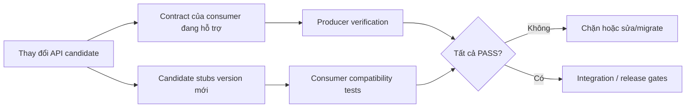
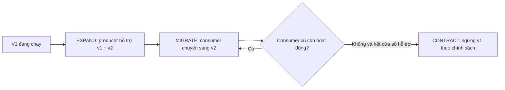
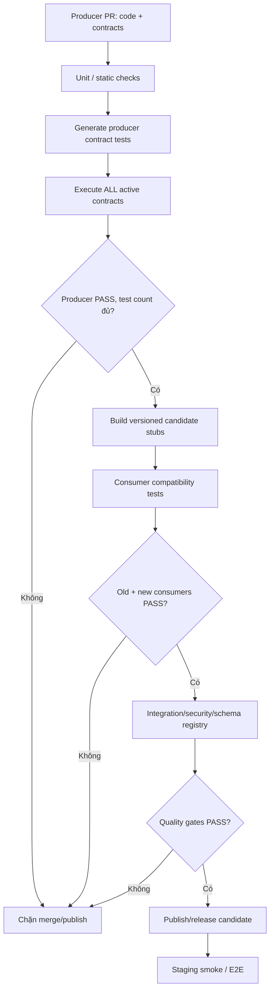

# Thay đổi tương thích và thay đổi phá vỡ hợp đồng

> **Chương:** Phiên bản và tương thích  
> **Module:** `SPRING_CLOUD_CONTRACT` — học kiểm thử hợp đồng giữa producer và consumer bằng Groovy/YAML DSL cho HTTP và thông điệp; sinh test phía cung cấp, phát hành stub, dùng Stub Runner và đưa kiểm tra tương thích vào CI.
>
> **Câu hỏi xuyên suốt:** Khi một service thay đổi API, làm thế nào biết consumer cũ vẫn hoạt động, và làm thế nào chứng minh điều đó trước khi triển khai?

## Mục tiêu học tập

Sau bài này, bạn có thể:

1. Phân biệt **thay đổi tương thích ngược (backward-compatible)**, **thay đổi phá vỡ hợp đồng (breaking change)** và **thay đổi có điều kiện**, xét theo hành vi consumer thực sự phụ thuộc.
2. Phân loại các thay đổi HTTP về URL, method, request/response body, headers, status, authentication, dữ liệu động và ngữ nghĩa nghiệp vụ.
3. Phân tích ảnh hưởng của thay đổi với **messaging contracts**: event type, payload, headers, destination, schema version và consumer cũ.
4. Dùng Spring Cloud Contract **Groovy/YAML DSL** để diễn đạt hợp đồng v1 và v2 mà không tạo các stubs mâu thuẫn cho cùng request.
5. Hiểu vì sao **producer verification** với những contract còn hiệu lực và **consumer Stub Runner tests** dùng đúng candidate stub version phải đi cùng nhau.
6. Áp dụng chiến lược **expand → migrate → contract** và version API khi một breaking change không thể tránh.
7. Dùng `stubsPerConsumer` có kiểm soát, biết khác biệt giữa lọc stubs của một consumer với bảo vệ toàn bộ consumer của producer.
8. Thiết kế compatibility gates trong CI, có regression/negative cases và chính sách quản lý stub artifact.
9. Đánh giá một đề xuất thay đổi qua ma trận rủi ro và xây kế hoạch triển khai/rollback thực tế.

## 1. Vì sao một thay đổi nhỏ có thể phá cả hệ thống?

Giả sử hệ thống có:

- `checkout-service` gọi `inventory-service` để kiểm tra tồn kho trước khi đặt hàng.
- `catalog-service` cũng gọi `inventory-service` nhưng hiển thị tồn kho theo cách riêng.
- `inventory-service` là **producer** của HTTP API chung.
- Consumer và producer có thể được triển khai **không cùng ngày**, vì mỗi service có pipeline phát hành độc lập.

Hợp đồng hiện hành:

```http
GET /api/v1/stock/SKU-001 HTTP/1.1
Accept: application/json
```

Response:

```http
HTTP/1.1 200 OK
Content-Type: application/json

{
  "sku": "SKU-001",
  "available": true,
  "quantity": 4
}
```

Một developer muốn đổi tên trường `quantity` thành `availableUnits` cho rõ nghĩa:

```json
{
  "sku": "SKU-001",
  "available": true,
  "availableUnits": 4
}
```

Với producer, đây có vẻ chỉ là một lần đổi tên. Nhưng client cũ có thể đang đọc:

```java
int remaining = response.quantity();
if (remaining >= requestedQuantity) {
    checkoutService.acceptOrder();
}
```

Khi `quantity` biến mất, client có thể parse lỗi, nhận mặc định `0`, hoặc đưa ra quyết định sai. **Đó là breaking change đối với consumer phụ thuộc trường ấy.**

Tương tự, nếu producer đổi `available: true` thành `available: "true"`, mắt người thấy giá trị giống nhau nhưng kiểu wire format đã đổi từ JSON boolean sang string. Consumer strict sẽ bị phá; consumer permissive có thể âm thầm ép kiểu, làm lỗi khó thấy.

### 1.1. Tương thích là một quan hệ, không phải nhãn tuyệt đối

Một thay đổi được coi là tương thích khi **mọi consumer đang được hỗ trợ tiếp tục hoạt động theo hợp đồng họ phụ thuộc**. Điều đó phụ thuộc:

- Consumer gọi những endpoint, method, headers và media types nào.
- Consumer đọc/kiểm tra những trường response nào và kiểm tra chặt đến đâu.
- Consumer có xử lý unknown fields, null, enum mới và error status không.
- Producer duy trì behavior cũ trong giai đoạn rollout hay không.
- Những phiên bản consumer nào còn hoạt động trên thực tế.

Vì vậy, không thể chỉ nhìn diff OpenAPI, JSON hoặc số phiên bản rồi kết luận chắc chắn. Contract tests cung cấp **bằng chứng có giới hạn nhưng kiểm tra được**.



## 2. Định nghĩa ba nhóm thay đổi

| Nhóm | Định nghĩa thực dụng | Ví dụ | Hành động |
| --- | --- | --- | --- |
| **Tương thích (compatible)** | Consumer được hỗ trợ vẫn dùng behavior cũ như trước | Thêm endpoint mới nhưng giữ nguyên endpoint cũ | Chạy test và tiếp tục rollout |
| **Phá vỡ (breaking)** | Một consumer còn được hỗ trợ phải sửa code/cấu hình để hoạt động | Xóa `quantity` hoặc đổi `GET` thành `POST` | Chặn, duy trì v1 hoặc thương lượng migration |
| **Có điều kiện (potentially breaking)** | An toàn với một số consumer nhưng không phải tất cả | Thêm response field, thêm enum value, thay thứ tự array | Xác minh consumer behaviors; không phán đoán bằng mắt |

### 2.1. Backward và forward compatibility

- **Backward compatibility của producer mới:** producer candidate tiếp tục đáp ứng yêu cầu của **consumer cũ**.
- **Forward compatibility của consumer:** consumer hiện tại có khả năng tiếp nhận response từ producer tương lai trong giới hạn đã thiết kế (ví dụ bỏ qua unknown optional fields).
- **Full compatibility:** cả hai chiều theo một tập quy tắc cụ thể, thường cần trong trao đổi schema/event phức tạp.

Trong Spring Cloud Contract, mục tiêu thường gặp nhất là bảo vệ **producer mới trước những hợp đồng của consumer đang hoạt động**. Consumer-side Stub Runner giúp kiểm tra client có hiểu **stub contract đã chọn**.

### 2.2. Chỉ đổi version không làm API an toàn

Tên artifact `inventory-service:2.0.0` không có năng lực tự làm consumer v1 tương thích. Semantic Versioning (SemVer) là **quy ước truyền thông về độ lớn của thay đổi**, không phải bằng chứng kiểm thử.

Ngay cả khi chuẩn của team nói breaking change phải tăng major version, producer vẫn cần giữ phiên bản cũ trong một thời gian nếu consumer cũ chưa nâng cấp.

## 3. Ma trận thay đổi HTTP: request

**Request là những gì producer cần chấp nhận từ client hiện hành.** Nếu server mới đòi client cũ gửi thêm thứ gì đó, khả năng phá vỡ là cao.

| Thay đổi trong producer | Đánh giá mặc định | Giải thích |
| --- | --- | --- |
| Thêm endpoint mới | Thường tương thích | Endpoint cũ còn giữ |
| Xóa endpoint đã có | **Breaking** | Client cũ nhận 404/405 |
| Đổi `GET /stock` thành `POST /stock` | **Breaking** | Đổi method, có thể đổi tính an toàn/idempotency |
| Chuyển `/api/v1/...` sang `/api/v2/...` và bỏ v1 | **Breaking** | Client cũ tiếp tục gọi path cũ |
| Thêm **optional** query parameter | Thường tương thích | Server mới vẫn chấp nhận request không có tham số |
| Biến query parameter optional thành required | **Breaking** | Request cũ có thể 400 |
| Thêm trường JSON request **optional** | Thường tương thích | Server xử lý request cũ thiếu trường |
| Thêm trường JSON request required, không có default | **Breaking** | Client cũ không gửi trường ấy |
| Đổi tên hoặc kiểu trường request | **Breaking** | Decoder/validation thay đổi |
| Thắt chặt validation của input đã được chấp nhận | Có thể breaking | Payload cũ nay bị từ chối |
| Đổi body từ JSON sang XML | **Breaking** | Media type và serializer khác |
| Bắt buộc thêm header `X-Tenant-Id` | **Breaking** nếu client cũ thiếu | Yêu cầu đầu vào mới |
| Thay auth scope/token format bắt buộc | Có thể breaking | Client cũ có thể bị 401/403 |

**Ví dụ:** producer bắt đầu yêu cầu `region` trong POST request:

```json
{
  "sku": "SKU-001",
  "units": 2,
  "region": "VN"
}
```

Nếu request v1 chỉ gồm `sku` và `units`, mọi consumer cũ sẽ không gửi `region`. Một cách **mở rộng tương thích** là cho phép thiếu `region` và áp dụng default được thống nhất, sau đó mới yêu cầu ở endpoint v2 hoặc sau migration.

## 4. Ma trận thay đổi HTTP: response

Response là thứ consumer nhận; các lỗi thường nằm ở **hình dạng, ý nghĩa và kỳ vọng xử lý**.

| Thay đổi response | Đánh giá mặc định | Điều cần xác minh |
| --- | --- | --- |
| Thêm field mới không bắt buộc | **Có điều kiện** | Consumer có bỏ qua unknown fields không? |
| Bỏ field đang được dùng | **Breaking** | Consumer parse/logic có phụ thuộc nó |
| Đổi `quantity: 4` → `"4"` | **Breaking** về schema | JSON number thành JSON string |
| Đổi `available: true` → `"true"` | **Breaking** về schema | Boolean thành string |
| Đổi field sang `null` | Có thể breaking | Consumer có hỗ trợ null không? |
| Đổi một field từ non-null sang optional/absent | Có thể breaking | Client có yêu cầu trường đó luôn tồn tại |
| Thay tên field (`quantity` → `availableUnits`) | **Breaking** nếu xóa tên cũ | Client cũ vẫn đọc `quantity` |
| Thay `200` bằng `204` | **Breaking** khi client cần body | Không còn payload |
| Đổi `200` sang `201` | Có thể breaking | Client có so status chính xác không? |
| Thêm giá trị enum `BACKORDERED` | Có điều kiện | Client có xử lý enum mở hay switch exhaustive? |
| Đổi đơn vị `quantity` hoặc `price` | **Breaking ngữ nghĩa** | JSON shape có thể không thay |
| Đổi timezone/format timestamp | Có thể breaking | Client parse và ý nghĩa thời gian |
| Đổi thứ tự array có ý nghĩa nghiệp vụ | Có thể breaking | Client có dựa vào thứ tự không |
| Đổi error code/body khi gặp lỗi | Có thể breaking | Logic fallback/error handling của consumer |

### 4.1. Thêm field không mặc nhiên luôn an toàn

Giả sử producer mới trả:

```json
{
  "sku": "SKU-001",
  "available": true,
  "quantity": 4,
  "warehouse": "HCM-01"
}
```

Đa số client được thiết kế để **bỏ qua unknown JSON fields** có thể tiếp tục hoạt động. Nhưng client sử dụng JSON schema strict, deserializer `FAIL_ON_UNKNOWN_PROPERTIES`, signature/hash từ toàn bộ payload hoặc snapshot equality có thể thất bại.

Do đó **"thêm response field là compatible" chỉ là giả thiết**, phải kiểm tra với consumer đang được hỗ trợ. Cấu hình deserializer của mỗi stack/ngôn ngữ có thể khác nhau.

### 4.2. Một thay đổi không đổi JSON vẫn có thể breaking

Producer giữ nguyên:

```json
{"sku":"SKU-001","available":true,"quantity":4}
```

nhưng đổi ý nghĩa `quantity` từ **số đơn vị còn bán được** sang **tổng số trong kho kể cả hàng đã giữ chỗ**. Consumer có thể cho phép checkout vượt tồn kho thực mà mọi schema assertion vẫn PASS.

Tương tự, thay đổi quy tắc làm tròn tiền, vùng thời gian, cách phân trang, giá trị mặc định hoặc thứ tự xử lý cũng có thể phá vỡ **hợp đồng ngữ nghĩa**.

**Muốn bảo vệ, contract cần các ví dụ nghiệp vụ đủ đặc trưng** và nên có unit/integration tests của logic tương ứng. Một matcher chỉ kiểm tra `by_type` không thể chứng minh phép tính kinh doanh đúng.

## 5. Header, content negotiation và error behavior cũng là hợp đồng

Các contract HTTP không chỉ là JSON body.

### 5.1. Accept khác Content-Type

- `Accept` trong **request** nói client chấp nhận kiểu response nào.
- `Content-Type` trong **request** cho biết kiểu body client gửi.
- `Content-Type` trong **response** là kiểu dữ liệu server thực trả.

Nếu client cũ gửi `Accept: application/json`, producer không được âm thầm chuyển mọi response sang `application/xml`. Nếu producer bắt buộc request body phải dùng media type mới, client cũ có thể nhận `415 Unsupported Media Type`. Nếu producer không thể tạo response phù hợp `Accept`, client có thể nhận `406 Not Acceptable`.

Thay đổi media type nên được mô tả bằng contract và kiểm chứng ở producer/consumer.

### 5.2. Đổi mã lỗi phá vỡ luồng fallback

Ví dụ consumer xử lý inventory chưa tìm thấy bằng mã `404` và body:

```json
{
  "code": "SKU_NOT_FOUND",
  "message": "Stock item not found"
}
```

Nếu producer mới trả `200` với `available: false`, client cũ có thể không chạy logic báo lỗi như trước. Nếu producer đổi `code` thành `NOT_FOUND` nhưng status vẫn 404, logic consumer so code có thể hỏng.

**Error contracts là hợp đồng thực sự**, không phải phần phụ của success response. Khi API có 400, 401, 403, 404, 409, 429, 503 quan trọng, hãy mô tả các trường hợp mà consumer phụ thuộc.

### 5.3. Authorization và caching

- Bắt thêm token, audience, role hoặc tenant có thể phá consumer cũ.
- Bỏ/thay `ETag`, `Cache-Control` hoặc header ảnh hưởng caching có thể gây lỗi dù JSON vẫn đúng.
- Đổi `Location` header sau `201` có thể phá client dùng URL vừa tạo.
- HTTP behavior sau gateway/proxy có thể khác test MockMvc standalone; security/integration test là bằng chứng bổ sung.

## 6. Ví dụ hợp đồng v1 bằng YAML DSL

Ta sẽ giữ một HTTP contract v1 có thể kiểm chứng. Producer `inventory-service` phục vụ `checkout-service`.

File `src/test/resources/contracts/checkout-service/stock_available_v1.yml` nếu dự án dùng Maven và chọn cách nhóm theo consumer:

```yaml
name: stock_available_v1
description: "Checkout doc ton kho tu API v1"

request:
  method: GET
  url: /api/v1/stock/SKU-001
  headers:
    Accept: application/json

response:
  status: 200
  headers:
    Content-Type: application/json
  body:
    sku: SKU-001
    available: true
    quantity: 4
```

Trong Gradle plugin hiện đại, nguồn contract mặc định thường nằm dưới `src/contractTest/resources/contracts`; đừng sao chép vị trí Maven sang Gradle rồi giả định plugin luôn tìm thấy. Nếu dự án định cấu hình đường dẫn riêng, dùng đường dẫn đó.

### 6.1. Producer code trước thay đổi

```java
@RestController
@RequestMapping("/api/v1/stock")
class InventoryV1Controller {

    @GetMapping(
        path = "/{sku}",
        produces = MediaType.APPLICATION_JSON_VALUE
    )
    public StockV1 get(@PathVariable String sku) {
        if (!"SKU-001".equals(sku)) {
            throw new ResponseStatusException(
                HttpStatus.NOT_FOUND, "SKU not found"
            );
        }
        return new StockV1(sku, true, 4);
    }

    record StockV1(String sku, boolean available, int quantity) {}
}
```

Đây là controller học tập: khi dùng trong một project, thêm imports Spring MVC, JDK 17+, lớp Boot app và cấu hình test thích hợp. Nó chưa cam kết error body cho trường hợp không tồn tại; chỉ success contract v1 được mô tả ở trên.

Producer verification phải dùng **controller/service thật** trong môi trường test, không mock cả controller rồi trả fixture từ hợp đồng.

### 6.2. Đổi field và giữ nguyên path là breaking

Giả sử developer thay response của `GET /api/v1/stock/SKU-001` thành:

```json
{
  "sku": "SKU-001",
  "availability": "IN_STOCK",
  "availableUnits": 4
}
```

Contract v1 vẫn yêu cầu `available` và `quantity`. **Generated producer test phải thất bại** vì implementation mới không đáp ứng lời hứa cũ.

Nếu developer **sửa chính contract v1** sang output mới để test xanh, producer verification chỉ chứng minh nó đáp ứng **lời hứa mới**, không chứng minh checkout cũ không bị phá. Thay đổi contract cần có review CDC của consumer đang hỗ trợ.

## 7. Dùng Groovy DSL khi muốn diễn đạt cùng hợp đồng

Bản Groovy tương đương với YAML v1:

```groovy
org.springframework.cloud.contract.spec.Contract.make {
    name 'stock_available_v1'

    request {
        method 'GET'
        url '/api/v1/stock/SKU-001'
        headers {
            header 'Accept': 'application/json'
        }
    }

    response {
        status 200
        headers {
            contentType(applicationJson())
        }
        body(
            sku: 'SKU-001',
            available: true,
            quantity: 4
        )
    }
}
```

**Không đặt đồng thời bản YAML và Groovy cho cùng interaction** trong thư mục contract được plugin quét; việc đó có thể tạo test/stub trùng lặp.

Các điểm tương ứng:

| Mục đích | YAML | Groovy |
| --- | --- | --- |
| Method | `request.method: GET` | `method 'GET'` |
| URL | `request.url` | `url '/api/v1/...'` |
| Request header | `request.headers.Accept` | `header 'Accept': 'application/json'` |
| Response status | `response.status: 200` | `status 200` |
| Response JSON | `response.body` | `body(sku: ..., quantity: ...)` |
| Dynamic field matcher | `response.matchers.body` | `response.bodyMatchers { ... }` |

Việc chọn DSL không tự quyết định compatibility. **Bản chất hành vi mà contract kiểm tra** mới quyết định liệu breaking change có bị phát hiện.

## 8. Mở rộng tương thích: giữ field cũ và thêm field mới

Nếu mục tiêu là làm rõ số lượng tồn kho, producer có thể **duy trì schema cũ** trong một giai đoạn:

```json
{
  "sku": "SKU-001",
  "available": true,
  "quantity": 4,
  "availableUnits": 4
}
```

Đây là chiến lược **expand**, chưa xóa `quantity`. Nhưng cần hai điều kiện:

1. Các trường cũ **vẫn giữ kiểu và ý nghĩa**, không chỉ giữ tên.
2. Consumer cũ **chấp nhận field mới** hoặc đã có cấu hình để bỏ qua unknown field.

### 8.1. Kiểm tra giả thiết tolerant reader

Một DTO cũ:

```java
public record StockV1(
    String sku,
    boolean available,
    int quantity
) {}
```

Với Jackson, cách xử lý unknown properties phụ thuộc mapper/configuration của ứng dụng. Có thể viết một test cụ thể để xác nhận không lỗi với `availableUnits`:

```java
@Test
void v1ClientBoQuaFieldMoiNeuDuocCauHinh() throws Exception {
    String candidateJson = """
        {
          "sku":"SKU-001",
          "available":true,
          "quantity":4,
          "availableUnits":4
        }
        """;

    ObjectMapper mapper = new ObjectMapper()
        .configure(
            DeserializationFeature.FAIL_ON_UNKNOWN_PROPERTIES,
            false
        );

    StockV1 stock = mapper.readValue(candidateJson, StockV1.class);
    assertEquals(4, stock.quantity());
    assertTrue(stock.available());
}
```

Đây là **unit test trình bày ý tưởng tolerant reader** dùng Jackson 2 API, JUnit 5 và các imports tương ứng. Trong ứng dụng thật, phải kiểm tra **ObjectMapper mà HTTP client thực sự sử dụng**, không chỉ một mapper vừa tạo trong test.

**Không kết luận rằng Spring Cloud Contract mặc định luôn bỏ qua mọi extra response field.** Tùy contract DSL, matcher, generated assertion và consumer serializer, độ nghiêm ngặt có thể khác. Hãy chạy **producer verification của contract cũ** và **consumer test với candidate response**.

### 8.2. Tránh matcher quá rộng để "sửa" lỗi

Một anti-pattern là đổi contract response thành:

```yaml
response:
  status: 200
  body:
    quantity: 4
  matchers:
    body:
      - path: $.quantity
        type: by_regex
        value: '.*'
```

Nếu `quantity` phải là **số nguyên có nghĩa**, matcher `.*` hoặc chỉ kiểm tra tồn tại có thể che lỗi schema và logic. Nên giữ equality cho fixture có giá trị cụ thể, hoặc dùng matcher kiểu/định dạng **có chủ đích** khi dữ liệu thật sự động.

## 9. Khi phải phá schema: giới thiệu v2 song song v1

Giả sử team quyết định `available` và `quantity` phải được thay bằng mô hình mới có phân loại tồn kho. Thay vì sửa ngay response v1, tạo endpoint mới:

```http
GET /api/v2/stock/SKU-001 HTTP/1.1
Accept: application/json
```

Response v2:

```json
{
  "sku": "SKU-001",
  "availability": "IN_STOCK",
  "availableUnits": 4,
  "warehouse": "HCM-01"
}
```

Hợp đồng mới `stock_available_v2.yml`:

```yaml
name: stock_available_v2
description: "Consumer da nang cap dung API v2"

request:
  method: GET
  url: /api/v2/stock/SKU-001
  headers:
    Accept: application/json

response:
  status: 200
  headers:
    Content-Type: application/json
  body:
    sku: SKU-001
    availability: IN_STOCK
    availableUnits: 4
    warehouse: HCM-01
```

**Điều quan trọng:** contract v2 có **URL khác**, nên WireMock stubs không phải hai mappings cho cùng request đang đòi response mâu thuẫn. Producer mới vẫn phải phục vụ cả v1 và v2 trong giai đoạn chuyển tiếp.

### 9.1. Cách triển khai đồng thời hai endpoint

```java
@RestController
class InventoryCompatibilityController {

    private final InventoryService inventory;

    InventoryCompatibilityController(InventoryService inventory) {
        this.inventory = inventory;
    }

    @GetMapping(
        path = "/api/v1/stock/{sku}",
        produces = MediaType.APPLICATION_JSON_VALUE
    )
    StockV1 v1(@PathVariable String sku) {
        StockData data = inventory.find(sku);
        return new StockV1(
            data.sku(), data.available(), data.availableUnits()
        );
    }

    @GetMapping(
        path = "/api/v2/stock/{sku}",
        produces = MediaType.APPLICATION_JSON_VALUE
    )
    StockV2 v2(@PathVariable String sku) {
        StockData data = inventory.find(sku);
        return new StockV2(
            data.sku(), data.availabilityCode(),
            data.availableUnits(), data.warehouse()
        );
    }

    record StockV1(String sku, boolean available, int quantity) {}

    record StockV2(
        String sku, String availability,
        int availableUnits, String warehouse
    ) {}
}
```

`InventoryService` và `StockData` là domain types **minh họa**, cần triển khai trong project thật. Đảm bảo mapping từ v2 domain sang v1 schema có thể giữ đúng ngữ nghĩa cũ; ví dụ nếu xuất hiện `RESERVED`, quy tắc ánh xạ `available` cần được thiết kế, không tự gán một boolean sai.

**Tạo hai contract v1 và v2 không đủ** nếu producer implementation bỏ endpoint v1. Contract Verifier phải chạy **cả hai**.

### 9.2. Có nhất thiết dùng URL /v2 không?

Không. Những lựa chọn khác có thể là:

- Version ở URL: `/api/v1`, `/api/v2`.
- Version qua vendor media type: `Accept: application/vnd.inventory.v2+json`.
- Version qua header được thiết kế rõ ràng.

Mỗi lựa chọn phải có **request matcher phân biệt được** để producer và Stub Runner không trả hai schemas khác nhau cho cùng request. Đừng tạo hai contracts với cùng method, path, headers và body mà đòi hai responses mâu thuẫn.

## 10. Các trường hợp breaking tinh vi cần kiểm chứng riêng

### 10.1. Nullable và giá trị mặc định

Các cấu trúc sau **không tương đương**:

```json
{"quantity": 0}
```

```json
{"quantity": null}
```

```json
{}
```

Consumer có thể diễn giải `0` là hết hàng, `null` là chưa xác định và thiếu field là lỗi dữ liệu. Trong Java, dùng `int` primitive có thể khiến giá trị thiếu trở thành `0` trong một số cấu hình deserialize, che mất sự khác biệt. Với field bắt buộc, nên test đủ **presence, nullability, type và business semantics**.

### 10.2. Enum mở rộng

Producer thêm `availability: "BACKORDERED"` bên cạnh `IN_STOCK` và `OUT_OF_STOCK`. Với consumer có:

```java
switch (availability) {
    case "IN_STOCK" -> allowCheckout();
    case "OUT_OF_STOCK" -> denyCheckout();
    default -> throw new IllegalStateException("Unknown status");
}
```

thì enum value mới có thể làm client lỗi. Nếu muốn enum có thể mở rộng, giao kèo và client phải thống nhất cách xử lý unknown values **từ trước**. Đừng tự suy việc thêm enum là compatible.

### 10.3. Pagination và sắp xếp

Đổi default `pageSize` từ 100 sang 20, thay sort từ tăng dần sang giảm dần hoặc đổi cách tính `nextPageToken` có thể phá consumer dù field names không đổi. Hãy mô tả được **behavior** trong contract hoặc test tích hợp ở tầng phù hợp.

### 10.4. Lỗi/throttle/rate limit

Producer mới trả `429 Too Many Requests` cho trường hợp trước kia trả `200`. Đây có thể là thay đổi chính sách vận hành hợp lý, nhưng consumer cũ không có retry/backoff có thể thất bại. Nếu hành vi 429 là một phần API công khai, cần contract và consumer resilience tests tương ứng.

### 10.5. Phát sinh side effects

Đổi `GET` từ thao tác đọc sang thao tác có side effect là thay đổi phá vỡ **tính an toàn HTTP**, dù response giống hệt. Contract mô tả request/response có thể không bắt được mọi side effect; cần unit/integration tests về semantics.

## 11. Messaging contracts: backward compatibility không chỉ là JSON

Giả sử `order-service` phát thông điệp `OrderAccepted` vào `orders.events`, consumer `billing-service` và `notification-service` lắng nghe.

Payload v1:

```json
{
  "eventType": "OrderAccepted",
  "schemaVersion": 1,
  "orderId": "ORD-1001",
  "amount": 240000,
  "currency": "VND"
}
```

Một Spring Cloud Contract YAML messaging example:

```yaml
name: order_accepted_v1
label: order_accepted
input:
  triggeredBy: publishOrderAccepted()
outputMessage:
  sentTo: orders.events
  headers:
    contentType: application/json
    eventType: OrderAccepted
  body:
    eventType: OrderAccepted
    schemaVersion: 1
    orderId: ORD-1001
    amount: 240000
    currency: VND
```

Đây là ví dụ producer có một `publishOrderAccepted()` trong base test và message verifier integration. Để chạy cần messaging adapter/binder phù hợp và `@AutoConfigureMessageVerifier`; contract không tự tạo Kafka topic hoặc broker.

### 11.1. Ma trận thay đổi messaging

| Thay đổi | Rủi ro | Vì sao |
| --- | --- | --- |
| Thêm metadata field tùy chọn | Có điều kiện | Consumer strict có thể từ chối unknown field |
| Xóa `orderId` | **Breaking** | Consumer cần khóa định danh |
| Đổi `amount` thành `total` và xóa `amount` | **Breaking** | Handler cũ đọc `amount` |
| Đổi `amount` từ number sang string | **Breaking** | Schema/decoder thay đổi |
| Đổi đơn vị `amount` từ đồng sang xu | **Breaking ngữ nghĩa** | Giá trị số nhìn hợp lệ nhưng sai nghĩa |
| Đổi `eventType` | **Breaking** nếu consumer routing theo loại sự kiện | Handler có thể không chạy |
| Đổi destination `orders.events` | **Breaking** nếu binding cũ không theo | Consumer không nhận message |
| Đổi `contentType`/encoding | Có thể breaking | Deserializer không đọc được |
| Thêm event type mới trên cùng topic | Có điều kiện | Consumer có lọc/ignore event không biết không |
| Đổi `schemaVersion` mà không hỗ trợ version cũ | Có thể breaking | Event cũ/new không được xử lý |
| Thay ordering, key/partition | Có thể breaking | Consumer dựa vào thứ tự theo order |
| Đổi retry/duplicate guarantees | Có thể breaking | Consumer idempotency assumptions |

### 11.2. Event mới và event cũ có thể cùng tồn tại

Với message broker, event v1 có thể còn trong topic/queue để được xử lý sau rollout. Consumer mới cần được thiết kế để đọc **cả event cũ được lưu trữ** lẫn event mới trong cửa sổ chuyển tiếp, nếu hệ thống có replay/backlog.

Có thể dùng chiến lược:

- Giữ `OrderAccepted` v1; thêm field tùy chọn và kiểm tra consumer tolerant.
- Phát **event type mới** hoặc schema version mới khi thay đổi không tương thích.
- Giữ handler xử lý v1 và v2 trong giai đoạn backlog còn tồn.
- Viết message contracts cho **từng version được cam kết**.
- Có integration tests với broker/schema registry thực khi các rủi ro về serialization/partition/retention quan trọng.

**Spring Cloud Contract không tự là schema registry**. Nếu hệ thống dùng Avro/Protobuf/JSON Schema, quy tắc compatibility và registry checks là một cổng bổ sung, không nên nhập nhằng với contract DSL verification.

## 12. Lựa chọn matcher để không làm yếu hợp đồng

Có những field thực sự động: `requestId`, `traceId` hoặc `occurredAt`. Khi producer sinh UUID mới, việc so một UUID cố định sẽ thất bại dù API vẫn tương thích.

Ví dụ response YAML với matcher:

```yaml
response:
  status: 200
  headers:
    Content-Type: application/json
  body:
    sku: SKU-001
    available: true
    quantity: 4
    requestId: 55145a90-f0a1-4c47-bcdf-550d89023902
  matchers:
    body:
      - path: $.requestId
        type: by_regex
        predefined: uuid
```

Đoạn này là **khối response thay thế** cho một API có field `requestId`; không thêm cùng một khóa `response` lần hai vào file YAML hoàn chỉnh.

Matcher chỉ cho `requestId` được thay đổi theo UUID. Những bất biến `available` và `quantity` vẫn được kiểm tra bằng giá trị kỳ vọng.

### 12.1. Đừng dùng matcher kiểu thay cho business assertions

Nếu `quantity` là một số có thể thay đổi nhưng contract yêu cầu nó không âm, matcher `by_type` chỉ xác nhận JSON number chứ **không chứng minh lớn hơn hoặc bằng 0**.

Tùy độ phức tạp, có thể dùng:

- Contract với nhiều fixture đại diện các giá trị quan trọng.
- Matcher cụ thể/`by_command` và custom helper khi framework hỗ trợ.
- Unit/integration tests của producer cho công thức nghiệp vụ.
- Consumer tests kiểm tra phản ứng với giá trị biên.

**Chỉ "mọi field đều có kiểu" không có nghĩa tương thích ngữ nghĩa.**

### 12.2. Matcher của request và response phục vụ hai mục tiêu

Trong Groovy DSL, matcher của **request** giúp stub phía consumer nhận những request có giá trị động nhưng đúng pattern. Matcher của **response** giúp producer generated test chấp nhận những response động hợp lệ.

Đừng nhầm chiều của `consumer(...)` và `producer(...)` trong DSL. Với YAML, dùng `request.matchers` và `response.matchers` ở đúng phía; từng matcher phải tham chiếu tới field phù hợp trong body mẫu.

## 13. Nhiều consumer và stubsPerConsumer

Một producer có thể phục vụ `checkout-service` và `catalog-service`. Checkout cần `available`/`quantity`, còn catalog cần metadata hiển thị. Không phải consumer nào cũng phụ thuộc toàn bộ response fields.

Spring Cloud Contract hỗ trợ tổ chức contract theo thư mục consumer và **lọc stubs khi consumer test** dùng `stubsPerConsumer`.

Cấu trúc ví dụ:

```text
contracts/
├── checkout-service/
│   ├── stock_available_v1.yml
│   └── stock_unavailable_v1.yml
└── catalog-service/
    ├── stock_display.yml
    └── stock_not_found.yml
```

Ví dụ consumer `checkout-service` dùng Stub Runner:

```java
@SpringBootTest(
    properties = "inventory.base-url=http://localhost:8090"
)
@AutoConfigureStubRunner(
    ids = "com.example:inventory-service:1.8.0:stubs:8090",
    stubsMode = StubRunnerProperties.StubsMode.LOCAL,
    stubsPerConsumer = true,
    consumerName = "checkout-service"
)
class CheckoutInventoryContractTest {
    // @Autowired CheckoutService checkout;
    // @Test xác nhận client checkout xử lý stubs của mình.
}
```

Đây là **test configuration minh họa**, cần imports/dependencies và HTTP client thật. Cổng 8090 chỉ là ví dụ; trong CI chạy song song nên ưu tiên port động và `StubFinder.findStubUrl(...)` hoặc cơ chế inject port.

### 13.1. stubsPerConsumer làm được gì?

- Lọc những mapping/stubs được đăng ký khi test **một consumer** dựa vào thư mục/consumer name.
- Tránh đưa quá nhiều stubs không liên quan vào cùng một WireMock server.
- Làm rõ những scenarios consumer nào thực sự sử dụng.

### 13.2. Điều stubsPerConsumer **không** làm

- Không cho producer được phép bỏ những hợp đồng đã chấp nhận của consumer khác.
- Không làm hai response mâu thuẫn cho **cùng request** trở nên đúng trong production.
- Không bảo đảm producer thật biết client đang thuộc nhóm nào nếu request không có dấu hiệu phân biệt.
- Không tự đồng bộ deploy các consumer đang dùng các version khác nhau.

Tài liệu chính thức nêu vấn đề hai consumer muốn hai responses khác nhau cho cùng endpoint. **Một producer không thể trả đồng thời hai response trái ngược cho cùng request trong cùng điều kiện.** Cần thiết kế request phân biệt hoặc trả một schema chung đáp ứng đúng các cam kết có thể cùng tồn tại.

### 13.3. Hợp đồng được lọc không phải toàn bộ nghĩa vụ tương thích

Nếu producer CI chỉ chạy contract của `checkout-service`, trong khi `catalog-service` vẫn đang hoạt động, những thay đổi phá catalog có thể lọt qua. Producer nên kiểm chứng **toàn bộ tập hợp hợp đồng còn được hỗ trợ**; lọc stubs là để consumer test gọn hơn, không phải để bỏ bảo vệ consumer khác.

## 14. Stub artifact version và API version là hai khái niệm

Một stub artifact có thể có tọa độ:

```text
com.example:inventory-service:1.8.0:stubs
com.example:inventory-service:2.0.0:stubs
```

Trong khi chính artifact `2.0.0` vẫn có thể chứa **hai endpoint v1 và v2**. Vì vậy:

- **Artifact version**: phiên bản build/package có contracts/stubs được phát hành.
- **HTTP API version**: giao diện công khai như `/api/v1`, `/api/v2` hoặc vendor media type.
- **Consumer application version**: bản checkout/catalog triển khai và hành vi gọi API của nó.
- **Schema/event version**: cấu trúc message được producer/consumer cam kết.
- **Contract repository revision**: tập hợp DSL definitions được dùng khi sinh test/stubs.

Không có quy tắc luôn buộc những version này phải bằng nhau.

### 14.1. Pin stub version trong quality gate

Với consumer release, nên sử dụng version cụ thể như:

```text
com.example:inventory-service:2.0.0-RC1:stubs
```

Một số cơ chế tải stub cho phép version động, ví dụ `+`. Điều đó hữu ích cho một pipeline theo dõi latest candidate, nhưng **không tái lập** nếu repository có phiên bản mới sau đó.

Trong CI, cần ghi nhận **artifact thực sự đã được tải**, commit/build producer đã verify nó và version consumer test đã chạy.

### 14.2. LOCAL và REMOTE không cùng ý nghĩa

- `LOCAL` lấy stubs từ Maven local repository của chính runner.
- `REMOTE` tải qua Maven-compatible artifact repository khi được cấu hình.
- Producer chạy `mvn install` trên runner A không tự làm artifact xuất hiện trong `~/.m2` của runner B.
- Khi dùng Gradle, cần cấu hình publication stubs artifact đúng plugin/version; **tạo stub JAR không có nghĩa đã publish và verify code producer**.

Chỉ phát hành artifact được gắn metadata/verifier result rõ ràng, không dùng tên "verified" cho build đã bỏ qua test.

## 15. Quy trình expand → migrate → contract

Khi phải thay schema v1, một chiến lược triển khai an toàn là **mở rộng trước, chuyển dần consumer, rồi mới loại bỏ phần cũ**.



### Giai đoạn 1 — Expand

- Producer thêm endpoint/media type/schema v2, vẫn trả v1 đúng như trước.
- Producer CI chạy **cả v1 và v2 contract tests**.
- Publish stubs candidate có version.
- Consumer cũ tiếp tục dùng v1, không phải deploy cùng producer.
- Nếu thêm field v1, kiểm tra thật các client cũ có bỏ qua unknown fields hay không.

### Giai đoạn 2 — Migrate

- Consumer chạy contract tests với stub candidate của producer mới.
- Consumer triển khai hỗ trợ v2, có thể tạm hỗ trợ cả v1/v2 nếu cần rollback.
- Theo dõi usage của v1 bằng logs/metrics không chứa dữ liệu nhạy cảm.
- Với events, xử lý backlog v1 và new events v2 trong khoảng chuyển tiếp.
- Kiểm tra compatibility ở nhiều nhịp deploy; không ép hai service deploy đồng thời nếu có thể tránh.

### Giai đoạn 3 — Contract

- Khi consumer v1 không còn trong **phạm vi hỗ trợ** và cửa sổ rollback/deprecation đã hết, producer mới gỡ v1.
- Xóa/retire hợp đồng v1 **qua review có chứng cứ**, không chỉ vì test mới PASS.
- Điều chỉnh API docs, stub packages, dashboards và chính sách release.
- Kiểm tra xem mobile/offline/partner clients còn dùng v1 không; chúng có thể cập nhật chậm hơn microservice nội bộ.

### 15.1. Rollback phải được thiết kế từ trước

Nếu producer đã xóa v1 nhưng một consumer cũ cần rollback, hệ thống có thể không hoạt động sau rollback. Vì vậy phải xác định **giai đoạn hai version cùng tồn tại** và thời điểm thật sự được phép ngừng hỗ trợ.

**API versioning không thay thế chiến lược vận hành.** Nó chỉ tạo công cụ để các phiên bản có thể cùng tồn tại.

## 16. Producer verification với hợp đồng còn hiệu lực

Tại producer, các YAML/Groovy contracts phải sinh generated tests gọi **implementation producer thật** trong phạm vi test đã chọn. Với HTTP, có thể dùng:

- RestAssuredMockMvc standalone khi controller/logic là ranh giới cần kiểm tra.
- MVC slice hoặc `@SpringBootTest` + MockMvc khi custom converters, advice, security/filter ảnh hưởng contract.
- Embedded HTTP server khi cần xác minh hành vi qua HTTP socket.

Một base class tối giản cho ví dụ controller ở mục 6:

```java
package com.example.inventory;

import io.restassured.module.mockmvc.RestAssuredMockMvc;
import org.junit.jupiter.api.BeforeEach;

public abstract class ContractTestBase {

    @BeforeEach
    public void setup() {
        RestAssuredMockMvc.standaloneSetup(
            new InventoryV1Controller()
        );
    }
}
```

Đây là **mẫu một endpoint v1**. Khi producer có cả v1 và v2, phải dựng các controller/services tương ứng trong base test hoặc dùng Spring context thích hợp. Không copy nguyên lớp này rồi kỳ vọng contract v2 được verify nếu v2 controller chưa được đăng ký.

### 16.1. Producer side cần kiểm tra điều gì?

- Hợp đồng v1 còn được plugin phát hiện và generated test chạy.
- Hợp đồng v2 được phát hiện và có test riêng.
- Code producer trả đúng status/headers/JSON body của từng contract.
- Nếu có trường động, matcher kiểm tra được định dạng nhưng không nới rộng bất biến.
- Một breaking change được thử có chủ đích làm generated test fail.
- Không có contract quan trọng bị xóa/skip để "sửa" build.

**Đọc generated test reports**, vì `BUILD SUCCESS` khi chạy 0 tests hoặc bỏ qua producer verification không có giá trị bảo vệ compatibility.

## 17. Consumer tests với Stub Runner: xác nhận ứng dụng đọc được contract

Consumer phải chạy **HTTP client thật**, không chỉ assert stub server trả đúng status.

Ví dụ JUnit test với stub candidate:

```java
@SpringBootTest(
    properties = "inventory.base-url=http://localhost:8090"
)
@AutoConfigureStubRunner(
    ids = "com.example:inventory-service:2.0.0-RC1:stubs:8090",
    stubsMode = StubRunnerProperties.StubsMode.LOCAL
)
class CheckoutCandidateCompatibilityTest {

    @Autowired
    InventoryClient client;

    @Test
    void shouldReadV2StockResponse() {
        StockV2 stock = client.fetchV2("SKU-001");

        assertEquals("SKU-001", stock.sku());
        assertEquals("IN_STOCK", stock.availability());
        assertEquals(4, stock.availableUnits());
    }
}
```

Đây là **snippet consumer test**, cần imports, Spring Boot test/stub runner dependencies, `InventoryClient`/`StockV2` và stub artifact phù hợp. Port 8090 là ví dụ cố định, có nguy cơ trùng khi CI chạy song song; trong project thật ưu tiên lấy URL động từ `StubFinder`.

### 17.1. Đừng chỉ kiểm tra stub mới với consumer mới

Để phát hiện breaking change cho consumer cũ, cần **một compatibility run** dùng consumer còn được hỗ trợ hoặc những contract mà consumer ấy yêu cầu, với **candidate producer/stubs**.

Tình huống nguy hiểm:

1. Consumer v1 chạy tốt với `inventory-service:1.8.0:stubs`.
2. Producer v2 xóa field `quantity`.
3. Consumer test vẫn pin artifact v1 → PASS.
4. Producer v2 được deploy → consumer v1 gặp lỗi thực tế.

Cách bảo vệ: producer verification của **v1 contract** phải fail khi xóa `quantity`; ngoài ra cross-service compatibility test dùng **candidate stubs v2** (bao gồm các hợp đồng cần giữ) để kiểm tra hành vi client cũ khi cần.

### 17.2. Stubs không tự chứng minh producer code

Stub Runner đọc mappings được đóng gói; nó **không tự khởi động implementation producer**. Vì vậy:

- Producer verification PASS là điều kiện trước khi gọi stubs là "verified".
- Consumer test PASS chỉ cho thấy client xử lý **stubs được chọn**.
- Integration/E2E tests vẫn cần thiết cho network, auth, DB/broker và hành vi phân tán.

## 18. Quality gate CI cho khả năng tương thích

Một pipeline lý tưởng liên kết contract definitions với **producer candidate** và các **consumer đang được hỗ trợ**.



### 18.1. Gate ở producer

- Có manifest/tập contracts cho tất cả consumer còn hỗ trợ.
- Plugin thực sự sinh và **thực thi generated tests**, không chấp nhận 0 contract tests ngoài dự kiến.
- Không còn `skipped` không được phê duyệt.
- Generated test fail khi producer vi phạm một required field.
- Không hạ matcher từ equality xuống `.*` để che lỗi.
- Mọi thay đổi schema công khai đều được review bởi những owner liên quan.

Với dự án Maven đã cấu hình Spring Cloud Contract:

```bash
mvn clean verify
```

Với dự án Gradle đã cấu hình plugin/source set:

```bash
./gradlew clean build
```

Đây là **lệnh tham khảo**; hiệu lực gate phụ thuộc plugin/task wiring và test reports thực tế. Không chạy `-DskipTests` hay `-x contractTest` để phát hành verified stubs.

### 18.2. Gate ở consumer

- Chạy unit và consumer stub tests với **client/handler thật**.
- Pin stub candidate version đang được xem xét.
- Test success, error, field required, unknown optional field và enum boundary khi có rủi ro.
- Kiểm tra consumer v1 còn hoạt động nếu producer candidate dự định giữ v1.
- Đọc log Stub Runner để biết artifact nào thực sự được tải.
- Với message contract, kiểm tra listener xử lý đúng event v1/v2 và test broker integration riêng nếu schema/serialization thay đổi.

### 18.3. Release gate và thông tin truy vết

Một bản ghi kiểm chứng tối thiểu:

```yaml
producer:
  artifact: com.example:inventory-service
  candidate: 2.0.0-RC1
  commit: "<producer-commit>"
  contractVerification: PASS
  activeContractCases: 12
  skipped: 0

consumers:
  - application: checkout-service
    version: 4.6.0
    stubArtifact: com.example:inventory-service:2.0.0-RC1:stubs
    compatibility: PASS
  - application: catalog-service
    version: 3.2.0
    stubArtifact: com.example:inventory-service:2.0.0-RC1:stubs
    compatibility: PASS
```

Đây là **manifest minh họa**, không phải file tự sinh của Spring Cloud Contract. Trong CI thực tế, các giá trị phải lấy từ artifacts/test reports thật; không hard-code `PASS` mà chưa chạy verification.

### 18.4. Không biến compatibility gate thành E2E toàn hệ thống

Contract suite nên phản hồi nhanh và chỉ rõ lỗi giao diện. Bổ sung một số integration/E2E tests cho:

- Auth/gateway/TLS.
- Persistence/migrations.
- Kafka/RabbitMQ/JMS encoding và delivery.
- Service discovery, timeouts, traffic routing.
- Hành trình nghiệp vụ tổng thể.

Đừng dùng E2E để thay thế hàng chục contract assertions cụ thể; một E2E success path có thể không chạm nhánh lỗi hoặc field consumer ít dùng.

## 19. Kiểm tra độ nhạy bằng những thay đổi cố ý

Một cách đánh giá quality gate là **thử làm hỏng hợp đồng trong branch thực hành** rồi xem test có đỏ không.

### Kịch bản A — Xóa field bắt buộc

- Giữ contract v1 `quantity: 4`.
- Đổi code producer để không gửi `quantity`.
- Kỳ vọng: **producer verification FAIL**.
- Nếu build vẫn PASS: kiểm tra plugin, generated tests, assertions và khả năng tests bị skip.

### Kịch bản B — Đổi kiểu dữ liệu

- Producer đổi `available: true` thành `available: "true"`.
- Contract vẫn dùng JSON boolean.
- Kỳ vọng: schema/type assertion FAIL hoặc có thêm strict compatibility test phát hiện.
- Nếu test không đỏ: xem cách matcher và JSON assertion sinh ra hoạt động; không vội kết luận thay đổi an toàn.

### Kịch bản C — Thêm field vào response

- Producer thêm `warehouse` nhưng giữ các trường cũ.
- Chạy producer verification v1 và consumer tests với **candidate response**.
- Nếu consumer strict fail, thay đổi **chưa tương thích với consumer ấy**, dù field mới không làm mất dữ liệu.

### Kịch bản D — Đổi ngữ nghĩa nhưng giữ JSON

- Producer vẫn trả `quantity: 4`, nhưng bốn đơn vị là **đã đặt trước** chứ không phải còn bán được.
- Schema-based verification có thể PASS nếu fixtures không bao phủ.
- Bổ sung business-level contract example hoặc integration test kiểm tra quy tắc tồn kho.

### Kịch bản E — Stub drift

- Consumer test dùng `inventory-service:1.8.0:stubs`.
- Producer candidate là `2.0.0-RC1`.
- Kết quả consumer test PASS với 1.8.0 **không** chứng minh candidate tương thích. Sửa pipeline để kiểm tra candidate hoặc old contract set.

**Không đưa thay đổi cố ý phá vào main branch/release.** Thực hiện trong branch thực hành, đọc log rồi phục hồi code.

## 20. Quan sát trước khi ngừng phiên bản cũ

Contract tests phản ánh **những consumer/behaviors đã được liệt kê**. Trong môi trường thực tế còn có:

- Mobile app cập nhật chậm.
- Bên thứ ba dùng API ngoài repository.
- Batch job chạy hàng tuần/tháng.
- Consumer tạm offline, đến khi khởi động mới gọi API.
- Message backlog/replay dữ liệu cũ.

Trước khi xóa v1, cần kiểm tra:

1. Danh sách consumer và chính sách hỗ trợ.
2. Logs/metrics theo API version, có xét traffic hiếm.
3. Ngày hết hạn hỗ trợ/deprecation được thông báo.
4. Rollback window cho producer/consumer.
5. Broker retention/backlog và khả năng decode event schema cũ.
6. Hợp đồng/test mới bảo đảm behavior v2.
7. Sự chấp thuận của owner hoặc policy governance.

**Không kết luận "không còn consumer v1" chỉ vì một ngày không có traffic** hoặc vì không có contract test nào thất bại. Missing coverage không phải bằng chứng không có phụ thuộc.

## 21. Bảng quyết định nhanh

| Đề xuất | Hướng xử lý ưu tiên | Quality gate |
| --- | --- | --- |
| Thêm field response mới | Kiểm tra tolerant readers, giữ field cũ | Consumer candidate tests + producer verification |
| Xóa `quantity` | Duy trì v1 hoặc tạo v2 | V1 contracts còn active phải PASS |
| Thêm request header required | Giữ default/optional trong giai đoạn chuyển tiếp | Old request contract tests |
| Thêm enum value | Thiết kế unknown-case handling | Consumer contract/robustness tests |
| Đổi error code `SKU_NOT_FOUND` | Migrate handler hoặc API v2 | Error contracts của consumer |
| Đổi `/api/v1` → `/api/v2` | Chạy song song v1/v2 | Producer verifies cả hai |
| Thay event `amount` → `total` | Version event, giữ consumer backlog | Message contracts v1/v2 + broker integration |
| Đổi partition key Kafka | Xác minh ordering semantics | Broker integration/consumer ordering tests |
| Thay semantic `quantity` | Review business contract và fixtures | Business/unit/integration regression |
| Gỡ v1 sau migration | Có chứng cứ usage/retirement | Release governance, rollback plan |

## 22. Bài tập thực hành

**Bài 1 — Phân loại HTTP changes.** Với các thay đổi sau, hãy ghi *compatible*, *breaking* hoặc *conditional* và giải thích theo hành vi của checkout: thêm `warehouse`, xóa `quantity`, chuyển `quantity` thành string, thêm query parameter optional, bắt header `X-Tenant-Id`, đổi status 200 sang 204.

**Bài 2 — Giữ lời hứa v1.** Dùng `stock_available_v1.yml` ở mục 6. Viết producer controller trả đúng v1. Cố ý xóa field `available` và quan sát generated test. Vì sao sửa contract theo implementation sai không chứng minh backward compatibility?

**Bài 3 — Groovy/YAML.** Chuyển v1 YAML sang Groovy DSL. Nêu cách tránh sinh hai stub mappings trùng request khi cả hai file chứa cùng interaction.

**Bài 4 — Optional request field.** Producer muốn nhận thêm `region`. Thiết kế request xử lý được cả khi consumer cũ không gửi `region` và khi consumer mới có gửi; xây hai kịch bản test phù hợp.

**Bài 5 — Response field có điều kiện.** Tạo một consumer DTO strict và một tolerant reader cho response có thêm `warehouse`. Kiểm tra sự khác biệt và đề xuất cách xác nhận tương thích ở client thật.

**Bài 6 — V2 song song.** Viết `stock_available_v2.yml` cho `GET /api/v2/stock/SKU-001` và một producer route v2. Vì sao phải giữ producer verification của cả contract v1 và v2 trong giai đoạn migrate?

**Bài 7 — Error compatibility.** Consumer phụ thuộc `404` và `code: SKU_NOT_FOUND`. Producer đổi code thành `NOT_FOUND`. Đề xuất contract regression và một migration strategy tránh phá client cũ.

**Bài 8 — Messaging.** `order-service` đổi event `amount` thành `total`. Thiết kế cách phát/đọc v1/v2 trong cửa sổ backlog còn tồn; nêu những test cần ngoài Spring Cloud Contract khi có Kafka.

**Bài 9 — Nhiều consumer.** `checkout-service` và `catalog-service` dùng cùng inventory producer. Giải thích `stubsPerConsumer` giúp mỗi test suite ra sao và vì sao producer vẫn cần verify tất cả active contracts.

**Bài 10 — Version drift.** Checkout test PASS với `1.8.0:stubs`, producer deploy `2.0.0`. Chỉ ra bằng chứng nào còn thiếu và cách đưa candidate artifacts vào pipeline.

**Bài 11 — Semantic breaking.** Producer không thay schema nhưng thay `quantity` thành "tồn kho bao gồm hàng giữ chỗ". Loại test nào sẽ phát hiện điều này, và vì sao matcher kiểu dữ liệu có thể không đủ?

**Bài 12 — Thiết kế release.** Lập timeline expand–migrate–contract có producer v1/v2, checkout v1/v2, catalogue v1, một client mobile cũ và rollback window. Xác định thời điểm được ngừng v1.

### Gợi ý đáp án

1. Thêm field: conditional; xóa/đổi kiểu `quantity`: breaking; optional query parameter: thường compatible; required header và 204 không body: breaking với client cũ phụ thuộc hành vi trước.
2. Giữ contract cũ, generated producer test phải đỏ khi xóa required field. Thay lời hứa để hợp code sai chỉ che mất consumer compatibility.
3. Dùng một file DSL cho cùng interaction; nếu có v1/v2 responses khác nhau, request phải phân biệt được.
4. Dùng default cho `region` bị thiếu hoặc chấp nhận giá trị optional; test cả hai requests.
5. Kiểm tra đúng deserializer/HTTP client thực tế, không dựa vào giả thiết mọi client bỏ unknown fields.
6. V1 cần phục vụ consumer chưa nâng cấp; v2 dành consumer mới; test cả hai trước khi ngừng v1.
7. Giữ code lỗi cũ cho v1 hoặc version hóa error API; đổi consumer trước khi xóa behavior cũ.
8. Giữ event v1/decoder v1 trong khoảng backlog; message contracts kiểm tra shape, broker integration kiểm tra routing/serialization/ordering.
9. Lọc stubs theo consumer nhưng producer không được bỏ những consumer đang được hỗ trợ.
10. Cần producer verification v1 contract và consumer compatibility run với candidate stubs thực sự.
11. Unit/integration/business contract fixtures cho semantics tồn kho; kiểm tra JSON number chỉ là kiểm tra wire type.
12. Chỉ gỡ v1 khi không còn consumer được hỗ trợ phụ thuộc, backlog/rollback window hết và có phê duyệt policy.

## 23. Checklist review thay đổi API

**Trước khi sửa producer:**

- [ ] Đã biết những consumer (service/mobile/partner/batch) đang được hỗ trợ?
- [ ] Đã xác định HTTP method/path, headers, status, field, nullability, enum và error behavior mà họ phụ thuộc?
- [ ] Đã đánh giá thay đổi schema **và ngữ nghĩa**?
- [ ] Đã quyết định compatible/conditional/breaking với bằng chứng hoặc giả thiết rõ ràng?
- [ ] Đã chọn plan expand–migrate–contract hoặc version API nếu cần?

**Trong pull request:**

- [ ] Contract cũ còn active và được producer verification thực thi?
- [ ] Contract mới có test, request/response không bị mâu thuẫn với mapping cũ?
- [ ] Matcher động chỉ nới field thật sự động?
- [ ] Error cases và messaging behavior quan trọng được cập nhật?
- [ ] Consumer owner đã review thay đổi có rủi ro?
- [ ] Generated tests thực sự chạy; không có 0 tests hoặc skipped ngoài dự kiến?

**Trước release:**

- [ ] Stubs candidate đã được producer verify và gắn version/commit?
- [ ] Consumer tests đã chạy với **đúng candidate stubs**?
- [ ] Các consumer còn dùng v1 được bảo vệ?
- [ ] Có integration/security/broker tests cho những rủi ro ngoài contract?
- [ ] Có rollback/deprecation/support window?
- [ ] Không bỏ v1 chỉ vì thiếu traffic/thiếu test?

## 24. Tổng kết

**Thay đổi tương thích** là thay đổi cho phép **mọi consumer còn được hỗ trợ** tiếp tục sử dụng lời hứa cũ; **breaking change** buộc một consumer phải sửa code/cấu hình hoặc bị lỗi. Tính tương thích phụ thuộc cả **HTTP wire format, headers, status, kiểu dữ liệu, lỗi, enum, semantics và message events**, chứ không chỉ tên field hay số version.

Trong Spring Cloud Contract, sự bảo vệ cốt lõi gồm: **giữ active contracts của consumer cũ**, chạy **producer Contract Verifier** trên implementation candidate, phát hành **versioned stubs** chỉ sau khi verification đạt và chạy **consumer Stub Runner tests với candidate thật**. `stubsPerConsumer` giúp lọc scenarios khi test một consumer, nhưng không thay nghĩa vụ hỗ trợ các consumer khác.

Khi thay đổi không thể tương thích ngay, dùng **expand → migrate → contract**: producer hỗ trợ đồng thời v1 và v2, consumer nâng cấp theo nhịp riêng, chỉ ngừng v1 sau khi đã có chứng cứ và kế hoạch rollback. Contract tests phát hiện sớm phần lớn lỗi phá giao diện; integration/E2E tests bổ sung bằng chứng về security, broker, dữ liệu và triển khai thật.

## Tài liệu tham khảo

- [Spring Cloud Contract — Consumer Driven Contracts](https://docs.spring.io/spring-cloud-contract/reference/getting-started/cdc.html) — hợp đồng do consumer yêu cầu và quy trình producer verification.
- [Spring Cloud Contract — Dynamic Properties](https://docs.spring.io/spring-cloud-contract/reference/project-features-contract/dsl-dynamic-properties.html) — response/request matchers cho giá trị động, YAML/Groovy DSL.
- [Spring Cloud Contract — Stubs Per Consumer](https://docs.spring.io/spring-cloud-contract/reference/project-features-stubrunner/stub-runner-stubs-per-consumer.html) — tổ chức contract theo consumer và lọc stubs bằng `stubsPerConsumer`.
- [Spring Cloud Contract — Stub Runner Core](https://docs.spring.io/spring-cloud-contract/reference/project-features-stubrunner/stub-runner-core.html) — tải và chạy versioned HTTP/message stubs phía consumer.
- [Spring Cloud Contract — Contract DSL](https://docs.spring.io/spring-cloud-contract/reference/project-features-contract.html) — mô tả HTTP/message behavior bằng DSL.
- [Spring Cloud Contract — Messaging](https://docs.spring.io/spring-cloud-contract/reference/project-features-messaging.html) — `input`/`outputMessage`, producer verification và message stubs.
- [Semantic Versioning 2.0.0](https://semver.org/) — quy ước version, không thay thế compatibility tests.
