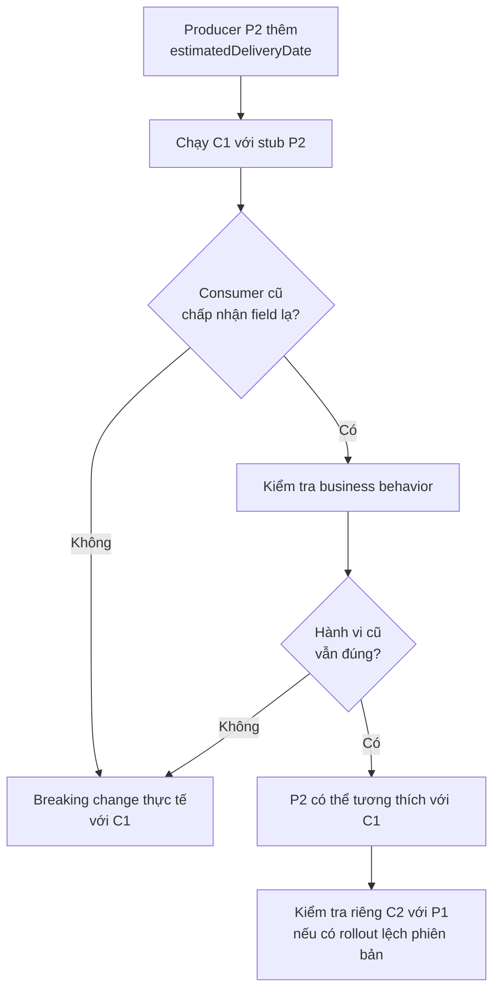
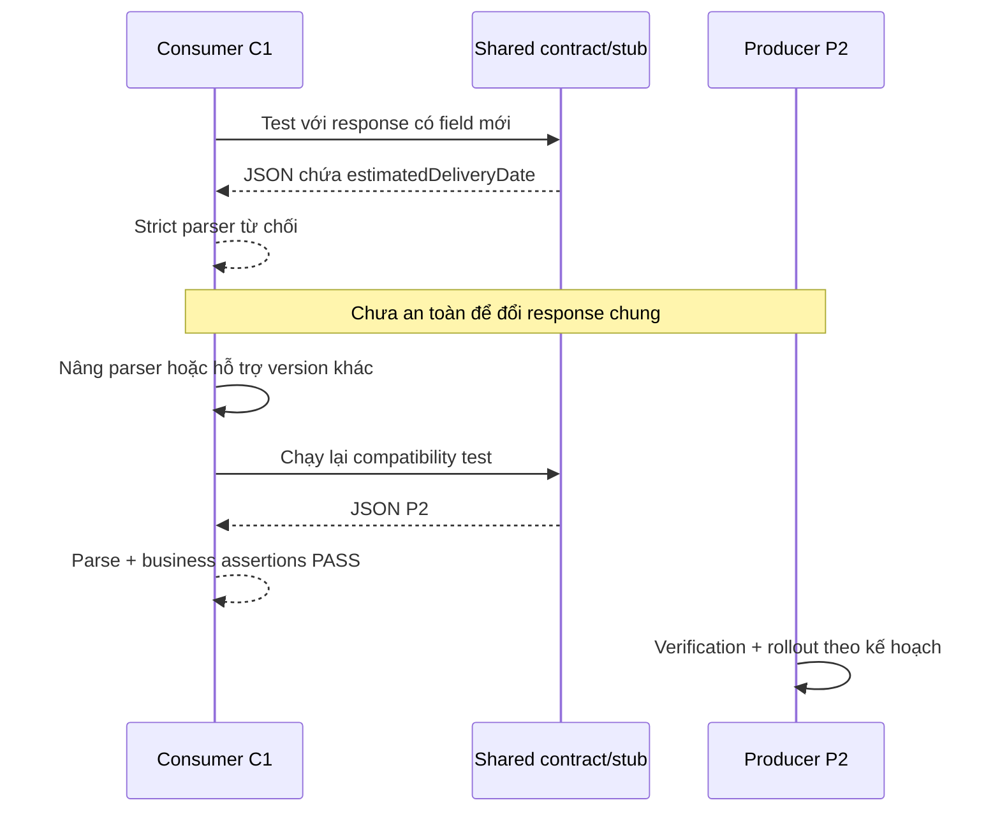
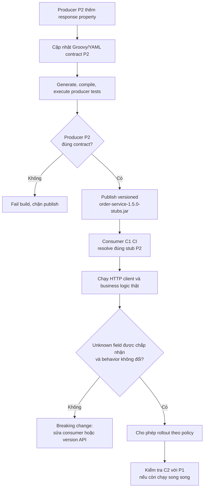

# Thêm trường response và mức ràng buộc thực tế của consumer

## 1. “Chỉ thêm một field” có luôn tương thích ngược?

Khi phát triển API, producer thường cần mở rộng JSON response để cung cấp thêm dữ liệu. Ví dụ `order-service` trả thông tin đơn hàng và nhóm muốn bổ sung `estimatedDeliveryDate`. Nhìn qua, đây là một thay đổi **additive**: không xóa field cũ, không đổi HTTP status, cũng không sửa endpoint.

Tuy nhiên, **tính tương thích không chỉ được quyết định bởi cấu trúc response mới**, mà còn bởi **những giả định và hành vi thực tế của từng consumer**. Consumer chỉ đọc các field cần thiết và bỏ qua field lạ có thể tiếp tục hoạt động bình thường. Consumer kiểm tra JSON có **đúng ba key**, dùng parser nghiêm ngặt hoặc ký toàn bộ payload theo byte có thể bị hỏng ngay khi xuất hiện key thứ tư.

Trong module **Spring Cloud Contract**, chúng ta dùng **Groovy/YAML DSL** để mô tả giao diện producer–consumer, sinh **producer contract tests**, đóng gói **stub**, kiểm tra các consumer bằng **Stub Runner** và tích hợp CI nhằm phát hiện thay đổi API không tương thích. Bài này thuộc chương **Phiên bản và tương thích**, tập trung vào câu hỏi:

> **Khi thêm một trường response, consumer hiện hữu bị ràng buộc bởi đúng những gì, và kiểm tra thế nào để không coi một thay đổi “có vẻ an toàn” là chắc chắn tương thích?**

Sau bài học, bạn có thể:

1. Phân biệt **tương thích cấu trúc** với **tương thích hành vi** khi response có thêm trường.
2. Nhận biết strict/lenient deserialization, JSON Schema và assertion có thể làm thay đổi mức ràng buộc của consumer.
3. Viết contract Groovy/YAML cho response trước/sau khi mở rộng.
4. Dùng stub **phiên bản mới** để kiểm tra **mã consumer cũ** bằng client thật; tránh bài test “xanh giả”.
5. Phân biệt yêu cầu từ **consumer cũ** với kỳ vọng của **consumer mới** cần field được bổ sung.
6. Thiết kế ma trận tương thích và CI gate trước khi thay đổi API hoặc phát hành artifact mới.

## 2. Ví dụ xuyên suốt: `GET /api/orders/42`

Phiên bản producer `1.4.0` trả:

```http
GET /api/orders/42
Accept: application/json

HTTP/1.1 200 OK
Content-Type: application/json
```

```json
{
  "id": 42,
  "state": "PAID",
  "currency": "VND"
}
```

Consumer `checkout-service` phiên bản cũ chỉ cần:

- `id` để đối chiếu đơn hàng;
- `state` để quyết định có thể xuất biên lai hay chưa;
- `currency` để hiển thị đơn vị tiền tệ.

Producer `1.5.0` muốn thêm ngày giao dự kiến:

```json
{
  "id": 42,
  "state": "PAID",
  "currency": "VND",
  "estimatedDeliveryDate": "2026-12-01"
}
```

Đây là thay đổi **thêm property vào JSON object ở response**. Nó *có khả năng* tương thích với consumer cũ, nhưng chưa đủ bằng chứng để khẳng định tất cả consumer đều an toàn.

### 2.1. Không nhầm “thêm trường” với các thay đổi khác

| Thay đổi | Phân loại sơ bộ | Nguy cơ thường gặp |
|---|---|---|
| Thêm `estimatedDeliveryDate` kiểu string | Additive property | Strict parser/assertion không chấp nhận key lạ |
| Đổi `id` từ number thành string | Đổi kiểu field hiện hữu | DTO, validation, so sánh số có thể lỗi |
| Đổi `state` từ `PAID` thành `SETTLED` | Đổi giá trị/semantic hiện hữu | Consumer mapping enum/business branch sai |
| Đổi `currency` thành `currencyCode` | Đổi tên và xóa field cũ | Consumer không còn nhận dữ liệu bắt buộc |
| Đổi response từ object sang array | Đổi cấu trúc root | Deserializer/DTO không còn tương thích |
| Thêm phần tử vào array | Thay đổi cardinality | Consumer dùng index, giả định số lượng cố định |
| Thêm field nhưng bỏ field cũ | Không phải additive thuần túy | Consumer cũ có thể bị phá vỡ |
| Thêm field chứa dữ liệu nhạy cảm | Additive về hình thức | Có thể vi phạm bảo mật/riêng tư dù client parse được |

**Kết luận sơ bộ:** chỉ có trường hợp thêm property mà **mọi cam kết và dữ liệu cũ vẫn giữ nguyên** mới được xem xét như một thay đổi có tính tương thích. Dù vậy, consumer vẫn có thể ràng buộc hình dạng JSON chặt hơn dự kiến.

## 3. Tương thích là quan hệ giữa hai phiên bản cụ thể

Hãy phân biệt:

- **Producer P1**: trả ba field `id`, `state`, `currency`.
- **Producer P2**: trả cả ba field đó **và thêm** `estimatedDeliveryDate`.
- **Consumer C1-lenient**: chỉ đọc ba field cũ, bỏ qua unknown fields.
- **Consumer C1-strict**: từ chối response có field chưa khai báo.
- **Consumer C2-required**: đã được sửa để **yêu cầu** `estimatedDeliveryDate` có giá trị.

### 3.1. Ma trận tương thích cần chạy

| Consumer × Producer | P1: ba field | P2: thêm field | Lý do |
|---|---|---|---|
| **C1-lenient** | Thường hoạt động | **Có thể hoạt động** | Không phụ thuộc field mới, chấp nhận unknown property |
| **C1-strict** | Hoạt động | **Có thể lỗi** | Strict deserialization hoặc exact-key assertion |
| **C2-required** | **Có thể lỗi** | Hoạt động nếu field hợp lệ | Consumer mới giả định producer luôn có field mới |
| **C2-optional/fallback** | Có thể hoạt động | Có thể hoạt động | Xử lý cả thiếu field và có field |

Ma trận trên là **dự đoán cần kiểm chứng bằng test**, không phải bảng chân lý cho mọi codebase. Ngoài parser, kết quả còn phụ thuộc code business, schema validation, caching, transform, metrics và side effects mà consumer thực hiện.

Đặc biệt, hai chiều cần được kiểm tra **riêng**:

1. **Producer mới → Consumer cũ:** consumer cũ có chịu được trường dư không?
2. **Producer cũ → Consumer mới:** consumer mới có chịu được trường chưa xuất hiện không?

Không thể suy ra chiều thứ hai từ chiều thứ nhất. Trường mới có thể là **tùy chọn đối với consumer cũ** nhưng lại bị một phiên bản consumer mới dùng như dữ liệu **bắt buộc**.



## 4. “Mức ràng buộc thực tế” nghĩa là gì?

Một consumer có thể bị ràng buộc bởi **nhiều tầng hơn DTO**:

| Tầng consumer | Ví dụ ràng buộc | Khi producer thêm property |
|---|---|---|
| JSON decoder | Không cho unknown fields | Deserialize thất bại |
| DTO/mapping | Chỉ lấy `id/state/currency`, bỏ extras | Thường vẫn parse được |
| JSON Schema | `additionalProperties: false` | Validation thất bại |
| Assertion | JSON phải đúng toàn bộ cấu trúc cũ | Test/logic báo sai |
| Logic nghiệp vụ | Chọn behavior theo một field cụ thể | Có thể không bị ảnh hưởng nếu field cũ giữ nguyên |
| Chuyển tiếp dữ liệu | Consumer reserialize nguyên payload | Extra field có thể rò ra downstream |
| Chữ ký/hashing | Hash toàn bộ JSON bytes | Hash/chữ ký thay đổi |
| Cache và kích thước | Giới hạn response hoặc field length | Có thể vượt giới hạn |
| Quan sát/bảo mật | Log/hiển thị mọi key | Có thể lộ dữ liệu nhạy cảm |

Do đó, cụm từ **“consumer chỉ cần ba trường”** phải dựa trên **mã thực tế và kiểm thử hành vi**, không chỉ dựa vào phát biểu “nhóm checkout không dùng ngày giao hàng”.

### 4.1. Mức ràng buộc tối thiểu nên được nói rõ

Với consumer `checkout-service`, một tập cam kết tương đối bền vững là:

```text
GET /api/orders/42 trả HTTP 200 và JSON object.
id       tồn tại và là JSON number, bằng 42.
state    tồn tại và là JSON string, bằng "PAID".
currency tồn tại và là JSON string, bằng "VND".
Các property khác không được làm thay đổi ý nghĩa của ba field này.
Consumer bỏ qua những property không được nó sử dụng.
```

Tập cam kết đó **không đòi JSON chỉ có đúng ba key**. Đó là cách giảm coupling với chi tiết không có giá trị nghiệp vụ đối với consumer này.

Nhưng nếu consumer thuộc loại **đòi schema đóng**, ví dụ hệ thống pháp lý, serializer ký dữ liệu hoặc một protocol yêu cầu exact fields, ràng buộc chặt có thể **đúng chủ đích**. Khi đó phải ghi nhận đây là một dependency thực, chứ không “sửa test cho xanh” để tự coi thay đổi là tương thích.

## 5. Groovy DSL cho response trước và sau khi thêm trường

### 5.1. Hợp đồng producer P1

```groovy
import org.springframework.cloud.contract.spec.Contract

Contract.make {
    description 'Đọc đơn hàng với các trường cơ bản'

    request {
        method GET()
        url '/api/orders/42'
        headers {
            header 'Accept', 'application/json'
        }
    }

    response {
        status OK()
        headers {
            contentType(applicationJson())
        }
        body(
            id: 42,
            state: 'PAID',
            currency: 'VND'
        )
    }
}
```

### 5.2. Hợp đồng producer P2

```groovy
import org.springframework.cloud.contract.spec.Contract

Contract.make {
    description 'Đơn hàng có thêm ngày giao dự kiến'

    request {
        method GET()
        url '/api/orders/42'
        headers {
            header 'Accept', 'application/json'
        }
    }

    response {
        status OK()
        headers {
            contentType(applicationJson())
        }
        body(
            id: 42,
            state: 'PAID',
            currency: 'VND',
            estimatedDeliveryDate: '2026-12-01'
        )
    }
}
```

Hai đoạn đại diện cho **hai phiên bản của cùng một kịch bản**, không nên đồng thời thêm cả P1 và P2 với cùng điều kiện request nhưng response khác nhau vào cùng một tập WireMock mappings. Nếu làm vậy, cả hai mapping có thể khớp `GET /api/orders/42` và consumer test sẽ phụ thuộc vào priority/order không mong muốn.

**Producer contract verification:** P2 phải thực sự trả ba field cũ đúng kiểu/giá trị và thêm `estimatedDeliveryDate`. Generated test cần chạy với **code P2**, không chỉ sinh stub. Producer test xanh chứng minh một phần tính đúng đắn của P2, **chưa chứng minh mọi consumer cũ chấp nhận P2**.

### 5.3. YAML DSL cho P2

```yaml
description: Đơn hàng có thêm ngày giao dự kiến
request:
  method: GET
  url: /api/orders/42
  headers:
    Accept: application/json
response:
  status: 200
  headers:
    Content-Type: application/json
  body:
    id: 42
    state: PAID
    currency: VND
    estimatedDeliveryDate: "2026-12-01"
```

Ở đây `id` là number; `state`, `currency` và `estimatedDeliveryDate` là string. Dùng dấu nháy cho ngày tháng giúp tránh cách YAML parser suy diễn scalar theo quy tắc/phiên bản khác nhau. Đây là **biểu diễn tương đương** với Groovy P2; chỉ chọn một DSL cho nguồn hợp đồng thực tế để tránh trùng mapping.

### 5.4. Những ràng buộc contract không nên tự bỏ

Với P2, hãy giữ rõ:

- HTTP `200` và `Content-Type: application/json`.
- `id`, `state`, `currency` đúng kiểu và semantic cũ.
- `estimatedDeliveryDate` có tên, kiểu và quy tắc format đã thống nhất.
- Hành vi lỗi `400`/`404`/`409` nếu consumer đang dựa vào chúng.
- Các nhánh response tương ứng với request headers/query parameters, không tạo mapping quá rộng.

**Không đổi hoặc xóa trường cũ chỉ vì consumer phiên bản mới không cần nó** nếu vẫn có consumer cũ đang phụ thuộc.

## 6. Đừng nhầm contract producer với mức strictness của consumer

Hợp đồng P2 khai báo **một response mẫu có bốn trường**. Verifier có thể sinh assertions từ response body và các matcher. Tuy nhiên:

1. **Producer generated test** kiểm tra output của producer P2 so với contract P2.
2. **WireMock stub** trả response mẫu cho client consumer.
3. **Consumer test** chạy code parser/client/business của consumer đối với stub đó.

Đây là **ba phép kiểm tra khác nhau**. Việc producer test P2 đạt không bảo đảm consumer C1 bỏ qua unknown field. Tương tự, việc consumer test với stub P1 đạt **không nói gì** về khả năng chịu field thứ tư ở P2.

### 6.1. “Kiểm tra một vài JSONPath” có đồng nghĩa cho phép thêm field?

Không thể suy ra điều đó một cách máy móc. Ví dụ một test chỉ assert:

```java
assertThat(json.at("/id").asLong()).isEqualTo(42L);
assertThat(json.at("/state").asText()).isEqualTo("PAID");
assertThat(json.at("/currency").asText()).isEqualTo("VND");
```

đã không kiểm tra tập key đầy đủ. Nhưng **đường đi thực sự của consumer** có thể còn một DTO deserializer hoặc validator khác vốn từ chối property lạ.

Đoạn trên chỉ là **trích code minh họa** (giả định `json` là Jackson `JsonNode`). Dù JSONPath hoặc assertion lỏng cho phép thêm field, **điều đó chưa bảo đảm client production làm vậy**.

### 6.2. Cẩn trọng khi thêm `bodyMatchers`

Spring Cloud Contract hỗ trợ các matcher phía response như regex, type và JSONPath tùy DSL/phiên bản, ví dụ mô tả dữ liệu động thay vì khóa một ID ngẫu nhiên. Nhưng:

- Matcher **không tự động định nghĩa** chính sách bỏ qua unknown fields của consumer.
- Trường nằm trong response body contract vẫn có thể tạo assertion khác trong generated producer test, tùy generator và cấu hình.
- Khi thay đổi matcher, phải đọc **generated test thực tế** để biết mức strictness đang được áp dụng.
- Một matcher `.*` cho `state` có thể khiến producer trả `FAILED` thay vì `PAID` mà vẫn pass, làm mất ý nghĩa nghiệp vụ.

Đối với bài này, cách kiểm chứng chính xác nhất là chạy **consumer client thật với stub P2**, không suy luận tính tương thích chỉ từ Groovy/YAML matcher syntax.

## 7. Jackson: consumer bỏ qua field lạ hay ném lỗi?

Giả sử ứng dụng Java dùng Jackson để deserialize JSON thành DTO:

```java
package com.example.checkout.dto;

public record OrderView(
    long id,
    String state,
    String currency
) {}
```

Khi JSON P2 chứa `estimatedDeliveryDate` nhưng DTO trên chỉ khai báo ba property, hành vi phụ thuộc **ObjectMapper được cấu hình như thế nào**.

### 7.1. Thử chế độ strict có chủ đích

```java
import com.fasterxml.jackson.databind.DeserializationFeature;
import com.fasterxml.jackson.databind.ObjectMapper;
import com.fasterxml.jackson.databind.exc.UnrecognizedPropertyException;
import org.junit.jupiter.api.Test;

import static org.assertj.core.api.Assertions.assertThatThrownBy;

class StrictOrderViewTest {

    private final ObjectMapper strictMapper = new ObjectMapper()
        .configure(DeserializationFeature.FAIL_ON_UNKNOWN_PROPERTIES, true);

    @Test
    void shouldRejectAddedFieldInStrictMode() {
        String json = """
            {
              "id": 42,
              "state": "PAID",
              "currency": "VND",
              "estimatedDeliveryDate": "2026-12-01"
            }
            """;

        assertThatThrownBy(() ->
            strictMapper.readValue(json, OrderView.class))
            .isInstanceOf(UnrecognizedPropertyException.class);
    }
}
```

Test này **chủ động bật chế độ strict**. Đừng suy ra Spring Boot luôn bật option đó: nhiều cấu hình Spring Boot mặc định **không fail với unknown JSON properties**, trong khi một `ObjectMapper` tự khởi tạo hoặc stack khác có thể có chính sách khác. Phải kiểm tra **instance mapper/decoder thực sự được WebClient, RestClient hoặc HTTP library của consumer sử dụng**.

### 7.2. Consumer muốn rõ ràng cho phép field dư

Jackson hỗ trợ annotation:

```java
import com.fasterxml.jackson.annotation.JsonIgnoreProperties;

@JsonIgnoreProperties(ignoreUnknown = true)
public record OrderView(
    long id,
    String state,
    String currency
) {}
```

Với DTO này, mapper của Jackson thông dụng có thể bỏ qua `estimatedDeliveryDate` và vẫn tạo `OrderView(42, "PAID", "VND")`. Đây là **quyết định hợp đồng ở consumer**: consumer chỉ phụ thuộc ba property và cho phép producer bổ sung property khác mà không đổi ý nghĩa của chúng.

Một cách khác là cấu hình chính ObjectMapper:

```java
ObjectMapper mapper = new ObjectMapper()
    .configure(DeserializationFeature.FAIL_ON_UNKNOWN_PROPERTIES, false);
```

Không thay đổi **global ObjectMapper** của toàn ứng dụng chỉ để sửa một test nếu những API khác có yêu cầu strictness khác. Hãy chọn chính sách ở phạm vi thích hợp, xem xét hậu quả đối với những endpoint đang đòi validation nghiêm ngặt.

### 7.3. Test lenient trực tiếp với payload P2

```java
import com.fasterxml.jackson.databind.ObjectMapper;
import org.junit.jupiter.api.Test;

import static org.assertj.core.api.Assertions.assertThat;

class LenientOrderViewTest {

    private final ObjectMapper mapper = new ObjectMapper();

    @Test
    void oldDtoCanIgnoreTheNewField() throws Exception {
        String json = """
            {
              "id": 42,
              "state": "PAID",
              "currency": "VND",
              "estimatedDeliveryDate": "2026-12-01"
            }
            """;

        OrderView order = mapper.readValue(json, OrderView.class);
        assertThat(order.id()).isEqualTo(42L);
        assertThat(order.state()).isEqualTo("PAID");
        assertThat(order.currency()).isEqualTo("VND");
    }
}
```

Ví dụ giả định `OrderView` đã có `@JsonIgnoreProperties(ignoreUnknown = true)` như mục 7.2. Nếu **đồng thời dùng class record không có annotation và ObjectMapper strict**, test này phải fail: đó là khác biệt chính sách cần nắm, không phải kết quả thất thường.

**Quan trọng:** đây vẫn là **unit test của deserializer**, chưa kiểm tra đường đi HTTP thật, timeout, headers, error decoder hoặc logic checkout. Consumer contract test đầy đủ cần dùng **HTTP client production** với stub P2.

## 8. JSON Schema có thể ràng buộc chặt hơn DTO

Ngay cả khi Jackson của một client bỏ qua field lạ, một lớp validation độc lập vẫn có thể từ chối response mới.

Ví dụ JSON Schema sau mô tả ba trường cũ và **không cho phép property ngoài danh sách**:

```json
{
  "type": "object",
  "required": ["id", "state", "currency"],
  "properties": {
    "id": {"type": "integer"},
    "state": {"type": "string"},
    "currency": {"type": "string"}
  },
  "additionalProperties": false
}
```

Với schema này:

- JSON P1 với đúng ba property có thể đạt.
- JSON P2 thêm `estimatedDeliveryDate` **không đạt** vì vi phạm `additionalProperties: false`.

Nếu consumer chấp nhận extensibility, một schema mở có thể **bỏ thuộc tính `additionalProperties` hoặc đặt chính sách cho phép property bổ sung**, tùy dialect và cách validation của hệ thống. Không được tự thay chính sách nếu consumer có lý do chính đáng để reject field lạ.

### 8.1. OpenAPI document không đồng nghĩa parser runtime

Một tài liệu OpenAPI có thể mô tả response schema, nhưng consumer runtime có thể:

- Sinh client từ schema với unknown-field handling khác.
- Deserialize bằng Jackson theo cấu hình riêng.
- Chạy JSON Schema validator thực sự trước khi xử lý DTO.
- Chỉ dùng schema để sinh documentation và không validate runtime.

**Không kết luận consumer sẽ reject/accept chỉ từ một file mô tả.** Phải quan sát **client được build và deploy thực sự**, cùng các validation/interceptor có trên đường đi.

### 8.2. Một bản hợp đồng response đóng có thể là cố ý

Trong một số API, property lạ có thể là dấu hiệu một version sai, dữ liệu bị rò rỉ hoặc sai tiêu chuẩn trao đổi. Khi một consumer có yêu cầu exact schema, thêm field có thể là **breaking change theo hợp đồng của chính consumer ấy**.

Giải pháp khi đó không phải luôn “nới validation”; có thể cần:

1. Consumer triển khai khả năng bỏ qua unknown fields sau đánh giá rủi ro.
2. Producer hỗ trợ format/version cũ song song.
3. API versioning hoặc media-type negotiation rõ ràng.
4. Rollout có phối hợp, không đổi response đối với consumer chưa sẵn sàng.

## 9. Exact JSON equality và assertion theo trường

Hãy nhìn hai cách kiểm tra JSON response:

### 9.1. Kiểm tra exact shape

Một dạng kiểm tra với JSONAssert:

```java
import org.skyscreamer.jsonassert.JSONAssert;
import org.skyscreamer.jsonassert.JSONCompareMode;

String expected = """
    {"id":42,"state":"PAID","currency":"VND"}
    """;

String actual = """
    {"id":42,"state":"PAID","currency":"VND",
     "estimatedDeliveryDate":"2026-12-01"}
    """;

// Trong test thực tế: JSONAssert.assertEquals(expected, actual, STRICT)
// sẽ fail vì actual có field không xuất hiện trong expected.
JSONAssert.assertEquals(expected, actual, JSONCompareMode.STRICT);
```

Snippet trên **minh họa một assertion có chủ đích thất bại**, không phải một bài test hoàn chỉnh phải chạy đạt. Chế độ `STRICT` kiểm tra chặt cấu trúc/tập key và cả thứ tự array theo quy tắc thư viện; phù hợp khi đó thực sự là giao diện được cam kết.

### 9.2. Kiểm tra subset mà consumer dùng

Khi contract của consumer chỉ phụ thuộc ba property:

```java
import com.fasterxml.jackson.databind.JsonNode;
import com.fasterxml.jackson.databind.ObjectMapper;

JsonNode actual = new ObjectMapper().readTree("""
    {"id":42,"state":"PAID","currency":"VND",
     "estimatedDeliveryDate":"2026-12-01"}
    """);

assertThat(actual.path("id").asLong()).isEqualTo(42L);
assertThat(actual.path("state").asText()).isEqualTo("PAID");
assertThat(actual.path("currency").asText()).isEqualTo("VND");
```

Kiểu assertion này **không từ chối field bổ sung**. Nhưng nó cũng **không đảm bảo** HTTP client thật hoặc business consumer chấp nhận field; vẫn cần kiểm thử ở ranh giới client thực tế.

### 9.3. Không nới lỏng tất cả để chấp nhận một field mới

Cho phép unknown JSON fields không có nghĩa:

- Chấp nhận `state=FAILED` thay vì `PAID` trong tình huống thanh toán thành công.
- Chấp nhận `id="42"` nếu consumer cần JSON number.
- Chấp nhận `currency=null` nếu logic không xử lý được null.
- Chấp nhận HTTP `404` khi contract mong `200`.
- Bỏ qua những phần tử array bị thiếu/đổi thứ tự khi consumer phụ thuộc vào chúng.

**Quy tắc thiết kế:** chỉ nới ràng buộc cho những gì consumer **thực sự không phụ thuộc**; giữ assertions mạnh cho phần dữ liệu mang ý nghĩa nghiệp vụ.

## 10. Khi field mới có thể vắng mặt hoặc bằng `null`

Thêm một property không chỉ có “có” và “không”. Với `estimatedDeliveryDate`, producer có thể trả:

| Tình huống | JSON | Ý nghĩa có thể có |
|---|---|---|
| Chưa biết ngày | Không có `estimatedDeliveryDate` | Field tùy chọn/vắng mặt |
| Chưa biết ngày | `"estimatedDeliveryDate": null` | Có key nhưng giá trị null |
| Đã có ngày | `"estimatedDeliveryDate": "2026-12-01"` | ISO date string |
| Lỗi định dạng | `"estimatedDeliveryDate": 20261201` | Kiểu number thay vì string |
| Lỗi semantic | `"estimatedDeliveryDate": ""` | String rỗng; có thể không hợp lệ |

**Missing, `null` và chuỗi rỗng không tự động tương đương.** Một consumer có thể:

- Dùng `Optional<LocalDate>` hoặc nullable field.
- Yêu cầu ISO-8601 date và reject chuỗi rỗng.
- Phân biệt “không có ước tính” và “ước tính bị xóa”.
- Cache một DTO có giá trị mặc định khi không có field.

### 10.1. Consumer mới cần fallback rõ ràng

Nếu C2 muốn hiển thị ngày giao, nhưng có thể gặp producer P1 trong quá trình rollout, nên thiết kế logic:

```java
public record OrderViewV2(
    long id,
    String state,
    String currency,
    String estimatedDeliveryDate
) {
    public String deliveryLabel() {
        return estimatedDeliveryDate == null
            || estimatedDeliveryDate.isBlank()
            ? "Chưa có ngày giao dự kiến"
            : estimatedDeliveryDate;
    }
}
```

Ví dụ này giả định vắng field được Jackson biểu diễn bằng `null` trong record, và business cho phép fallback. Trong hệ thống production, nên xác thực **định dạng ngày** và chính sách timezone/calendar thay vì dùng string tùy tiện.

Nếu requirement của C2 **thực sự bắt buộc có ngày giao**, fallback không thể tùy tiện che lỗi; khi đó cần đảm bảo **producer P2 được triển khai trước C2** ở mọi tuyến mà C2 có thể gọi, hoặc version negotiation rõ ràng.

### 10.2. Tương thích cần kiểm tra cả bản ghi cũ

Ngay cả sau khi P2 deploy, không phải mọi order có thể xác định `estimatedDeliveryDate`. API cần mô tả:

- Field có bắt buộc trong **mọi** response không?
- Với dữ liệu cũ, field bị **omit** hay trả `null`?
- Với trạng thái `CANCELLED`, có còn ý nghĩa không?
- Giá trị date được chuẩn hóa ra sao?

Producer contract test nên có **ít nhất một kịch bản có field mới**, và nếu API cam kết optional, thêm kịch bản **không có** hoặc **null** theo chính sách. Consumer C2 cần kiểm tra cả hai; chỉ thử order `42` có ngày giao là chưa đủ.

## 11. Kiểm thử consumer thực tế với Stub Runner P2

Sau khi producer phát hành stub P2 với classifier `stubs`, consumer cũ nên chạy cùng **source code/client thực tế** nhưng với **stub artifact mới**.

Ví dụ:

```text
P1 artifact: com.example:order-service:1.4.0:stubs
P2 artifact: com.example:order-service:1.5.0:stubs

Consumer C1 đang deploy: checkout-service 2.3.0

Mục tiêu test:
  Chạy C1 client/code với P2 stub 1.5.0,
  nhận response có estimatedDeliveryDate,
  xác minh C1 vẫn xử lý order 42 đúng.
```

### 11.1. Một HTTP client consumer Java

Ví dụ dùng Spring `RestClient` (Spring Framework 6.1+):

```java
package com.example.checkout.client;

import java.net.URI;
import org.springframework.web.client.RestClient;

public final class OrderClient {
    private final RestClient http;

    public OrderClient(RestClient.Builder builder, URI baseUrl) {
        this.http = builder.baseUrl(baseUrl.toString()).build();
    }

    public OrderView findById(long id) {
        return http.get()
            .uri("/api/orders/{id}", id)
            .retrieve()
            .body(OrderView.class);
    }
}
```

Trong ví dụ, `OrderView` là DTO cũ đã chọn `@JsonIgnoreProperties(ignoreUnknown = true)` ở mục 7.2. Test cần dùng **chính code HTTP client mà checkout-service thật sử dụng**; nếu tạo một RestClient khác với converter/configuration khác, kết quả có thể không phản ánh production.

### 11.2. Consumer contract test dùng Stub Runner version mới

```java
package com.example.checkout.contract;

import com.example.checkout.client.OrderClient;
import com.example.checkout.dto.OrderView;
import java.net.URI;
import org.junit.jupiter.api.Test;
import org.springframework.beans.factory.annotation.Autowired;
import org.springframework.boot.test.context.SpringBootTest;
import org.springframework.cloud.contract.stubrunner.StubRunnerProperties;
import org.springframework.cloud.contract.stubrunner.spring.AutoConfigureStubRunner;
import org.springframework.cloud.contract.stubrunner.spring.StubRunnerPort;
import org.springframework.web.client.RestClient;

import static org.assertj.core.api.Assertions.assertThat;

@SpringBootTest
@AutoConfigureStubRunner(
    ids = "com.example:order-service:1.5.0:stubs",
    stubsMode = StubRunnerProperties.StubsMode.LOCAL
)
class ExistingConsumerAgainstNewProducerStubTest {

    @Autowired
    RestClient.Builder restClientBuilder;

    @StubRunnerPort("com.example:order-service")
    int orderStubPort;

    @Test
    void oldConsumerMustTolerateAnExtraResponseProperty() {
        OrderClient client = new OrderClient(
            restClientBuilder,
            URI.create("http://localhost:" + orderStubPort)
        );

        OrderView order = client.findById(42L);
        assertThat(order.id()).isEqualTo(42L);
        assertThat(order.state()).isEqualTo("PAID");
        assertThat(order.currency()).isEqualTo("VND");

        // Hãy bổ sung assertion lên quyết định checkout/receipt thật
        // nếu consumer phụ thuộc vào những hành vi nghiệp vụ đó.
    }
}
```

**Giới hạn của đoạn mẫu:**

- Test giả định producer đã **install** stub `1.5.0` vào Maven local repository; với CI lấy artifact từ xa cần `REMOTE`, `repositoryRoot` và credentials theo version/cấu hình phù hợp.
- `OrderClient` và `OrderView` thuộc dự án consumer, không phải thư viện Spring Cloud Contract. Spring Boot test cần `RestClient.Builder` bean có cấu hình tương thích.
- Port là **runtime port của Stub Runner**, không phải port của producer production. Nếu consumer có bean HTTP client được khởi tạo lúc Spring context start, cần truyền base URL vào configuration **trước khi bean được tạo**, không tự đổi sau đó.
- Để chắc chắn đây là bài test **trường mới**, phải xác minh stub `1.5.0` thực sự trả `estimatedDeliveryDate`; nếu vô tình resolve `1.4.0` thì test có thể đạt mà chưa kiểm tra điều cần kiểm tra.
- Nếu ứng dụng consumer dùng **WebClient/reactive**, phải subscribe và đợi publisher hoàn tất, ví dụ dùng StepVerifier; chỉ tạo `Mono` chưa thực sự gọi HTTP.

### 11.3. Cần assert cả business behavior của consumer

Một test chỉ kiểm tra Jackson parse được DTO chưa đủ nếu consumer:

- Dùng `state=PAID` để bật chức năng xuất biên lai.
- Gọi hệ thống vận chuyển khi có ngày giao dự kiến.
- Chuyển tiếp JSON sang một hệ thống downstream.
- Ghi log toàn bộ response hoặc tái serialize DTO.

Vì vậy, ở mức contract test thật nên gọi **điểm tích hợp của consumer** để kiểm tra quyết định nghiệp vụ liên quan. Ví dụ, sau khi đọc order P2, quy tắc “đơn PAID có thể xuất biên lai” vẫn phải đúng dù có field mới.

## 12. Test P1 và P2 theo hai hướng để tránh false confidence

### 12.1. C1 cũ nhận P2 mới

Mục đích: phát hiện thay đổi additive có phá vỡ consumer cũ không.

```text
Consumer code : checkout-service C1 (đang chạy)
Stub artifact : order-service P2 (sắp phát hành)
Expected      : C1 vẫn đọc được id/state/currency
               và hoàn thành checkout behavior cũ.
```

Đây là bài kiểm tra **phải có** trước khi gọi thay đổi là tương thích với C1.

### 12.2. C2 mới nhận P1 cũ

Mục đích: consumer mới có chịu được việc field chưa xuất hiện khi hệ thống deploy lệch phiên bản không.

```text
Consumer code : checkout-service C2 (đang chuẩn bị deploy)
Stub artifact : order-service P1 (còn có thể tồn tại)
Expected      : C2 không ném NPE/deserialization error;
               dùng fallback nếu API và nghiệp vụ cho phép.
```

Nếu C2 cần `estimatedDeliveryDate` bắt buộc và không có fallback, hai phiên bản **không tương thích theo chiều này**. Cần bảo đảm mọi đường gọi của C2 đều đi đến P2, hoặc giữ C2 sau bước producer rollout, hoặc dùng versioned contract.

### 12.3. Đừng tự cho rằng C1 strict là “sai”

Nếu C1 strict được thiết kế theo một hợp đồng đóng đã công bố, thì P2 thêm field là breaking change **đối với C1 hiện hữu**. Có thể đề xuất nâng C1 để bỏ qua unknown fields, nhưng chỉ coi rollout an toàn **sau khi tất cả C1 cần hỗ trợ đã được cập nhật hoặc có phương án giữ response cũ**.

## 13. “Field bổ sung” không nên ngầm đổi semantic cũ

Một thay đổi có thể giữ nguyên schema cũ nhưng vẫn làm thay đổi cách consumer ra quyết định.

Ví dụ trước đây:

```json
{
  "id": 42,
  "state": "PAID",
  "currency": "VND"
}
```

Sau thay đổi:

```json
{
  "id": 42,
  "state": "PAID",
  "currency": "VND",
  "paymentStatus": "REVERSED"
}
```

Về cấu trúc, đây vẫn là additive. Nhưng hai trường `state=PAID` và `paymentStatus=REVERSED` có thể tạo **mâu thuẫn nghiệp vụ** hoặc làm C2 hiểu sai đơn. Nếu producer thay đổi ý nghĩa `state` một cách âm thầm, việc parser C1 bỏ qua `paymentStatus` và vẫn xử lý `PAID` có thể là rủi ro thực tế.

Do đó cần xem:

1. Ý nghĩa field cũ có được giữ nguyên?
2. Giá trị của field mới có tương thích với invariant nghiệp vụ?
3. Consumer cũ không đọc field mới có còn đưa ra quyết định đúng không?
4. Consumer khác có reserialize/transmit toàn bộ payload hoặc sử dụng signed JSON không?
5. Data governance và security có cho phép công bố trường mới không?

**Tương thích không đồng nghĩa chỉ deserialize thành công.** Cần đánh giá behavior, invariants và downstream effects.

## 14. Chiến lược rollout khi còn consumer strict

### 14.1. Trường hợp mọi consumer cũ cho phép unknown fields

Một rollout tương đối đơn giản:

1. Producer mô tả response P2 và generated contract tests.
2. Chạy regression/consumer tests của các consumer quan trọng **với stub P2**.
3. Đánh giá schema, log, data governance và hành vi.
4. Khi tất cả gate đạt, publish/deploy P2.
5. Consumer C2 có thể triển khai sau, ưu tiên coi field mới là optional trong giai đoạn chuyển tiếp.

### 14.2. Có consumer strict

Nếu C1 từ chối field lạ:



Phương án:

- **Consumer-first:** cập nhật C1 cho phép field lạ trước, sau đó producer thêm field.
- **Parallel versions:** giữ endpoint `/v1` trả schema cũ, `/v2` trả schema mới.
- **Content negotiation:** dùng Accept/media type hoặc API version header đã được công bố và kiểm chứng.
- **Feature/tenant gating:** chỉ trả field mới cho consumer đã sẵn sàng nếu được thiết kế như một giao diện ổn định, có test cho từng nhánh.

Không triển khai gating bằng logic nhận diện ngẫu nhiên theo user-agent nếu các consumer chưa thống nhất contract. Mọi nhánh response theo version/header phải được mô tả và kiểm chứng rõ.

### 14.3. Không áp dụng quy tắc SemVer máy móc

Theo thông lệ SemVer, thêm field response thường được xem là ứng viên cho bản minor khi tương thích ngược, nhưng **không có quy tắc tăng số phiên bản nào tự chứng minh tính tương thích của consumer**. Nếu C1 strict bị phá, thay đổi vẫn là breaking change đối với C1 dù producer đặt tên `1.5.0`.

Nếu vẫn có P1 đang chạy trong quá trình deployment, consumer C2 cần xem xét fallback. Phiên bản app, stub artifact và deployment thực tế nên được liên kết để biết **test đã chạy với giao diện nào**.

## 15. Kiểm thử trong CI bằng đúng stub phiên bản mới

Một pipeline phù hợp với Spring Cloud Contract:



### 15.1. Vì sao không kiểm tra bằng stub cũ?

Nếu consumer C1 test với `order-service:1.4.0:stubs`, response **chưa có field mới**. Bài test không thể phát hiện C1 strict bị hỏng bởi P2. Vì vậy:

- Consumer compatibility test cho thay đổi P2 phải dùng **stub artifact P2**, hoặc fixture chứa chính field mới trong kiểm thử bổ sung.
- Pin `group:artifact:version:classifier`, ví dụ `com.example:order-service:1.5.0:stubs`.
- Ghi lại **resolved version**, vì ký hiệu `+` hoặc SNAPSHOT không bảo đảm mọi CI run dùng cùng artifact.
- Kiểm tra mapping/body trong JAR thật sự có `estimatedDeliveryDate`, không chỉ dựa vào tên phiên bản.
- Nếu P2 chưa publish, có thể dùng stubs từ build candidate/CI artifact có provenance rõ và chuyển sang artifact version cuối sau khi verification đạt.

### 15.2. Bằng chứng phải có ở cả producer và consumer

| Gate | Điều phải chứng minh | Sai lầm cần tránh |
|---|---|---|
| Producer contract verification | P2 trả đúng ba field cũ và field mới theo contract | Chỉ generate source/stub rồi không chạy tests |
| Artifact packaging | Stub P2 chứa WireMock mappings/body mới | Consumer vô tình resolve artifact cũ |
| Consumer C1 compatibility | Parser và logic C1 thật xử lý được response P2 | Chỉ kiểm tra Jackson unit test khác mapper production |
| Consumer C2 rollout | C2 xử lý được response P1 nếu còn tương tác P1 | Giả định field mới luôn có |
| Observability | Log/report ghi đúng versions, test class và environment | Chỉ nhìn “BUILD SUCCESS” |

**Cần tránh false positive:** một consumer test chỉ assert `HTTP 200` hoặc trực tiếp kiểm tra WireMock mapping không chứng minh consumer parse JSON thành công. Test phải gọi **HTTP client thật**, sau đó kiểm tra output/business behavior.

## 16. Khi consumer-driven contract không liệt kê field mới

Trong cách làm **consumer-driven contract testing**, mỗi consumer thường mô tả **những phần giao diện mình thật sự cần**. Nếu C1 chỉ dùng `id` và `state`, contract của C1 có thể chỉ nhắc đến những field đó, hoặc ràng buộc schema theo policy cho phép field bổ sung.

Đây là một lựa chọn khác với **producer contract P2** muốn mô tả toàn bộ response mới. Hai thứ không mâu thuẫn nếu được tổ chức rõ:

| Câu hỏi | Producer-focused contract | Consumer-focused contract |
|---|---|---|
| Ai định nghĩa? | Producer và nhóm API, có review từ consumers | Consumer nêu dependency của mình, producer chấp thuận |
| Cần bảo vệ gì? | Những field/status mà producer cam kết cho phiên bản API | Những field/hành vi mà consumer thực sự sử dụng |
| Có phải assert mọi field? | Tùy phạm vi/schema/contract version | Không nhất thiết; thường chọn phần consumer cần |
| Thêm field có tương thích? | Phụ thuộc cam kết schema và generated assertions | Phụ thuộc strictness parser và logic consumer |

**Không nhầm “contract chỉ assert ba field” với “consumer chắc chắn bỏ qua field thứ tư”.** Test consumer phải chạy payload P2 qua pipeline thật để kiểm tra điều đó.

### 16.1. Rà soát yêu cầu consumer thực tế

Khi thảo luận thay đổi với đội consumer, hỏi:

1. Client sử dụng Java DTO, TypeScript interface, schema validator, protobuf/Avro, JSONPath hay raw JSON?
2. Unknown properties được bỏ qua, từ chối hay chuyển tiếp?
3. Có kiểm tra tập key/byte/JSON string đúng nguyên dạng không?
4. Logic có phụ thuộc semantic của những field cũ và output mapping không?
5. Có consumer cũ không còn phát triển nhưng vẫn đang chạy?
6. Producer và consumer có thể deploy ở những thời điểm khác nhau không?
7. Có endpoint hoặc version negotiation để giữ response cũ nếu cần không?

Không dựa hoàn toàn vào tài liệu SDK nếu runtime đang dùng bản đã tùy biến; **bằng chứng kiểm thử integration với client thực tế quan trọng hơn suy đoán**.

## 17. Những biến thể dễ bị bỏ qua khi thêm trường

| Biến thể | Nguy cơ | Test bổ sung |
|---|---|---|
| Field mới trong object lồng nhau | Validator ở nested DTO strict | Trả nested object có field dư |
| Field mới trên **mỗi phần tử array** | Element deserializer strict | Danh sách một và nhiều phần tử |
| Field mới chứa giá trị `null` | Consumer dereference không kiểm tra null | Missing, null và non-null |
| Field mới dùng ISO date | Parsing/timezone không nhất quán | Ngày hợp lệ, sai định dạng, DST nếu có thời gian |
| Field mới rất dài | Giới hạn payload/log/cache | Boundary size phù hợp |
| Field mới có giá trị nhạy cảm | Ghi log/chuyển tiếp ngoài ý định | Security/privacy review |
| Field mới trùng với alias/case-insensitive mapping | Overwrite field trong mapper | Test tên key/alias đúng cấu hình |
| Response được ký/hashing toàn bộ | Thay đổi bytes làm chữ ký khác | Test signature/canonicalization |
| Consumer chuyển tiếp response sang downstream | Field mới vượt qua biên dữ liệu | Assert output/serialization sau mapping |
| Schema có `additionalProperties: false` | Validation reject | Test schema với P2 JSON |

Nếu test chỉ dùng một object phẳng, bạn có thể chưa bảo vệ những vấn đề ở nested arrays hoặc một proxy thực sự xử lý JSON. Không cần tạo mọi tổ hợp ngẫu nhiên; chọn kịch bản theo **dependency đã xác minh** của consumer.

## 18. Bài thực hành: một field thêm mới phá vỡ consumer cũ

**Bối cảnh:** `order-service P2` bổ sung `estimatedDeliveryDate` vào response `GET /api/orders/42`. `checkout-service C1` đang dùng DTO chỉ có `id/state/currency`. Nhóm producer khẳng định đây là non-breaking change; nhưng sau rollout, một consumer báo lỗi deserialization.

### 18.1. Nhiệm vụ

1. Viết contract P1 với ba field và contract P2 có thêm `estimatedDeliveryDate`, giữ nguyên method/path/status/các field cũ.
2. Chạy producer verification cho P2. Xác nhận generated tests **được thực thi và đạt**, không chỉ sinh test sources.
3. Đóng gói stub P2 thành `com.example:order-service:1.5.0:stubs`; kiểm tra JAR chứa response mẫu có field mới.
4. Chạy consumer C1 với **stub P1** để có kết quả baseline. Ghi nhận test pass.
5. Giữ nguyên source C1, đổi consumer test sang **stub P2** và chạy lại với HTTP client thật.
6. Nếu test fail, kiểm tra strictness của ObjectMapper, schema validator, JSONAssert exact equality và business logic.
7. Thử cấu hình Jackson strict `FAIL_ON_UNKNOWN_PROPERTIES=true` với DTO cũ; xác nhận vì sao field mới bị reject.
8. Thử `@JsonIgnoreProperties(ignoreUnknown = true)` ở DTO nếu consumer contract cho phép; xác minh C1 đọc đủ ba field và hành vi xuất biên lai vẫn đúng.
9. Nếu C1 có schema `additionalProperties: false` vì yêu cầu nghiệp vụ, thảo luận phương án giữ API version cũ thay vì sửa policy thiếu đánh giá.
10. Tạo consumer C2 dùng field ngày giao; kiểm tra C2 nhận P1 (field missing) và P2 (field có giá trị) theo fallback/rollout đã thiết kế.
11. Bổ sung tình huống P2 trả field `null` hoặc không trả field cho order cũ; đánh giá chính sách optional.
12. Đưa ma trận C1/P1, C1/P2, C2/P1, C2/P2 cần hỗ trợ vào CI với artifact version và test report rõ ràng.

### 18.2. Thí nghiệm có chủ đích

| Thay đổi thử nghiệm | Kỳ vọng |
|---|---|
| Thêm `estimatedDeliveryDate`, C1 lenient | Test với stub P2 đạt nếu business không đổi |
| Thêm `estimatedDeliveryDate`, C1 strict | Test với stub P2 báo lỗi unknown property/schema |
| Đổi `state=PAID` sang `FAILED` | Test nghiệp vụ C1 phải fail dù parser lenient |
| Đổi `id=42` number thành string | Test kiểu dữ liệu hoặc mapping phù hợp phải phát hiện |
| C2 yêu cầu field mới khi chạy với P1 | Thất bại hoặc dùng fallback có chủ đích |
| Test C1 dùng nhầm stub P1 thay vì P2 | Có nguy cơ false confidence; phải kiểm tra artifact |
| C1 dùng exact JSON assertion | Có thể fail dù chỉ thêm field |
| C1 bỏ qua mọi field và chỉ assert status 200 | Có thể pass giả khi response semantic đã sai |

### 18.3. Câu hỏi tự đánh giá

| Câu hỏi | Đáp án |
|---|---|
| Thêm property response có luôn non-breaking không? | **Không**; tùy parser/schema/logic consumer |
| Consumer cũ chỉ khai báo ba field có chắc parse được bốn field không? | **Không**; tùy strictness thực tế |
| Producer test P2 pass đã chứng minh C1 tương thích chưa? | **Chưa**; phải kiểm tra consumer C1 với P2 |
| C1 test với stub P1 có phát hiện field mới P2 không? | **Không** |
| `additionalProperties: false` có thể chặn field mới không? | **Có** |
| Bỏ qua unknown fields có cho phép đổi `state` semantic không? | **Không** |
| C2 cần field mới có chắc chạy được với P1 không? | **Không**; cần optional/fallback hoặc rollout |
| `null` và missing field có mặc nhiên giống nhau không? | **Không** |
| SemVer minor có tự đảm bảo tương thích không? | **Không** |
| Stub Runner consumer pass có thay producer generated tests không? | **Không** |

## 19. Checklist trước khi công bố một field response mới

- [ ] Đã ghi rõ **producer version cũ/mới**, path, status, headers và response schema thay đổi.
- [ ] Thay đổi thật sự chỉ **thêm** property, không xóa/đổi kiểu hay semantic field cũ.
- [ ] Có mô tả loại, format, giá trị null/missing và ý nghĩa của field mới.
- [ ] Đã xác định consumer đang deploy và công nghệ parser/schema validator mà họ thực sự dùng.
- [ ] Đã kiểm tra strict/lenient deserialization và exact-key assertions của consumer cũ.
- [ ] Contract P2 Groovy/YAML mô tả response mới; generated producer tests chạy và đạt.
- [ ] Stub P2 được tạo và publish dưới đúng version/classifier, response mẫu thực sự có field mới.
- [ ] Consumer C1 được chạy với **stub P2**, không chỉ P1 hoặc một fixture thủ công đã cũ.
- [ ] Consumer test dùng HTTP client và business behavior thật, không chỉ assert status 200.
- [ ] Assertions của consumer vẫn chặt với field đang dùng như `id`, `state`, `currency`.
- [ ] Nếu C2 có thể gọi P1, đã test missing/optional field và fallback hoặc version negotiation phù hợp.
- [ ] Nếu C1 strict, có kế hoạch nâng C1 trước, giữ response v1 hoặc version hóa API.
- [ ] Đã đánh giá nested field, array, signed payload, logging, response size và dữ liệu nhạy cảm khi liên quan.
- [ ] CI dùng artifact version cố định, ghi resolved version và đối chiếu báo cáo producer/consumer.
- [ ] Không kết luận tương thích chỉ nhờ JSON Schema/OpenAPI, tên minor version hoặc việc stub trả HTTP 200.
- [ ] Có phương án rollback và hỗ trợ consumer chưa thể nâng cấp trong thời gian chuyển tiếp.

**Ghi nhớ:** **Thêm field vào response là thay đổi có *khả năng* tương thích ngược, không phải lời bảo đảm.** Mức ràng buộc thực tế nằm ở parser, schema, assertions và business logic của **từng consumer đang chạy**. Hãy giữ nguyên cam kết của các field cũ, dùng hợp đồng Spring Cloud Contract để xác minh producer, phát hành stub P2 có phiên bản, và **chạy client consumer cũ với chính stub P2** trước khi kết luận một thay đổi API là an toàn.
