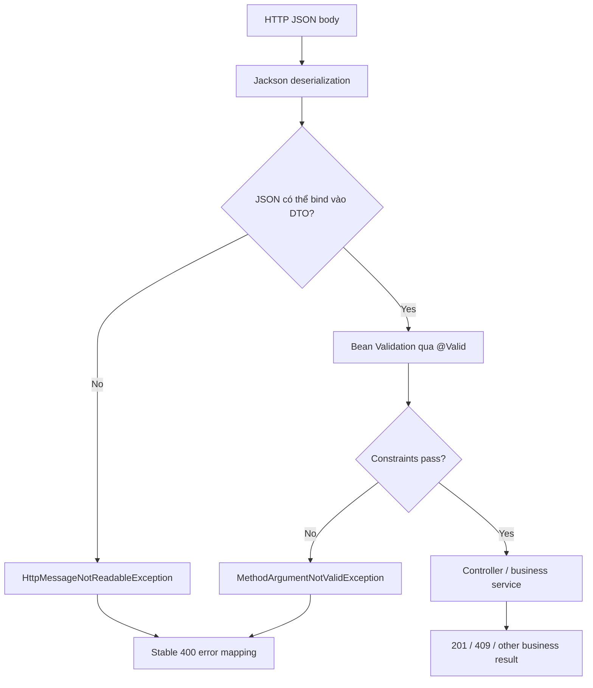
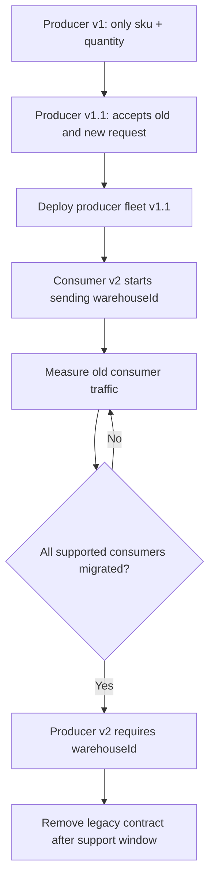
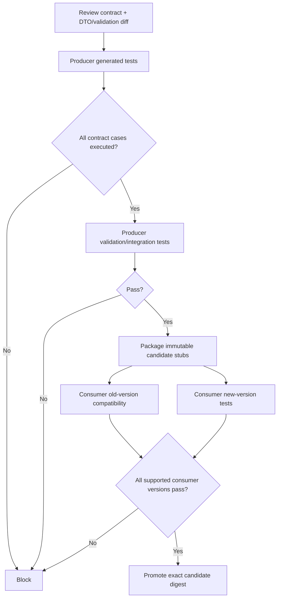

# Thay đổi trường bắt buộc, giá trị null và quy tắc validation

Một API có thể giữ nguyên HTTP method, URL và status code nhưng vẫn **phá tương thích** khi thay đổi cách xử lý một trường JSON. Ví dụ, `OrderService` trước đây gửi `sku` và `quantity`; sau một lần nâng cấp, `InventoryService` bắt đầu yêu cầu thêm `warehouseId`. Những consumer cũ vẫn gửi request hợp lệ theo phiên bản trước nhưng nay nhận `400 Bad Request`. Một thay đổi khác có vẻ nhỏ hơn: producer trước đây trả `"deliveryNote": null`, sau đó bỏ hẳn trường này khỏi JSON. Consumer dùng binding bắt buộc hoặc phân biệt hai trạng thái có thể thay đổi hành vi.

Trong **Spring Cloud Contract (SCC)**, các khác biệt này cần được mô tả rõ bằng Groovy/YAML DSL và kiểm tra trên cả hai phía. Producer verification chứng minh implementation đáp ứng contract; consumer Stub Runner tests giúp kiểm client với request/response mẫu. Bài học này tập trung vào **field presence**, **nullability** và **validation rules** khi tiến hóa API, nhằm phát hiện thay đổi không tương thích trước khi phát hành.

Đây là nội dung thuộc chương **Phiên bản và tương thích** của module **SPRING_CLOUD_CONTRACT**. Module hướng dẫn kiểm thử hợp đồng giữa producer và consumer, định nghĩa hành vi HTTP hoặc thông điệp bằng Groovy/YAML DSL, sinh test phía cung cấp, phát hành stub, dùng Stub Runner và tích hợp CI để phát hiện thay đổi API không tương thích.

Sau bài, bạn có thể:

- Phân biệt trường **bị thiếu**, trường có giá trị **JSON null**, chuỗi rỗng, chuỗi chỉ có khoảng trắng và giá trị hợp lệ.
- Đánh giá tác động của việc thêm/bỏ trường bắt buộc ở request và response.
- Hiểu cách Bean Validation và Jackson xử lý giá trị thiếu/null/type mismatch.
- Viết contracts riêng cho valid, missing, null và invalid values.
- Dùng Contract Verifier để phát hiện producer thay đổi validation ngoài thỏa thuận.
- Dùng Stub Runner để kiểm consumer xử lý null, field vắng mặt và dữ liệu cũ.
- Xây quy trình **expand → migrate → contract** để triển khai thay đổi mà không làm ngừng consumer cũ.
- Lập compatibility matrix giữa producer/consumer versions và đưa các trường hợp bắt buộc vào CI.

## 1. Kịch bản xuyên suốt

`OrderService` gửi yêu cầu giữ hàng tới `InventoryService`:

```http
POST /api/v1/reservations HTTP/1.1
Content-Type: application/json

{
  "sku": "SKU-001",
  "quantity": 2
}
```

Producer trả:

```http
HTTP/1.1 201 Created
Content-Type: application/json

{
  "reservationId": "RES-2001",
  "status": "HELD",
  "deliveryNote": null
}
```

Giả sử hợp đồng ban đầu quy định:

| Trường | Hướng | Quy tắc ban đầu |
| --- | --- | --- |
| `sku` | Request | Bắt buộc, không null, không rỗng, tối đa 32 ký tự |
| `quantity` | Request | Bắt buộc, số nguyên dương |
| `deliveryNote` | Request | Không bắt buộc; có thể bị thiếu hoặc null; nếu có nội dung thì tối đa 120 ký tự |
| `reservationId` | Response | Luôn có giá trị, dạng `RES-[0-9]+` |
| `status` | Response | Bắt buộc, ví dụ `HELD` |
| `deliveryNote` | Response | Luôn hiện diện; có thể là JSON null nếu không có ghi chú |

Chúng ta sẽ kiểm chứng cả request và response. Cần nhớ rằng **request validation thuộc producer** vì producer nhận request; còn cách consumer serialize request và deserialize response thuộc trách nhiệm consumer.

## 2. Bốn trạng thái không được đánh đồng

JSON có sự khác biệt giữa một property không xuất hiện và một property xuất hiện với giá trị null.

| Dữ liệu JSON | Trạng thái | Ý nghĩa có thể có |
| --- | --- | --- |
| `{}` | Trường bị thiếu | Client không gửi property |
| `{"deliveryNote": null}` | Trường hiện diện, giá trị null | Client gửi property nhưng không có giá trị |
| `{"deliveryNote": ""}` | Chuỗi rỗng | Client gửi một chuỗi có độ dài 0 |
| `{"deliveryNote": "   "}` | Chuỗi khoảng trắng | Client gửi chuỗi không có nội dung hữu ích |
| `{"deliveryNote": "Giao sau 18h"}` | Chuỗi có nội dung | Client gửi giá trị |

Với một trường chuỗi, `null` không phải `""`. Với một trường số, `0` không phải `null`. Với một mảng, `[]` không phải `null` và cũng không phải trường bị thiếu.

### Ví dụ: optional không có nghĩa là chấp nhận mọi giá trị

`deliveryNote` là optional và nullable, nhưng business rule quy định nếu người dùng nhập thì nội dung phải có ít nhất một ký tự không phải khoảng trắng. Do đó:

| Input | Kết quả theo policy bài lab |
| --- | --- |
| Không có `deliveryNote` | Chấp nhận |
| `"deliveryNote": null` | Chấp nhận |
| `"deliveryNote": ""` | Từ chối `400` |
| `"deliveryNote": "   "` | Từ chối `400` |
| `"deliveryNote": "Giao sau 18h"` | Chấp nhận |
| Chuỗi dài hơn 120 ký tự | Từ chối `400` |

Nếu API của bạn coi chuỗi rỗng là một cách biểu diễn “không có ghi chú”, hãy ghi rõ và kiểm thử chính sách đó. Không để behavior phụ thuộc tình cờ vào cách Jackson hoặc client serializer xử lý chuỗi.

## 3. Request và response có hướng tương thích khác nhau

Một thay đổi cần được đánh giá từ **góc nhìn của bên gửi và bên nhận**, không chỉ nhìn DTO producer.

### Request: producer là bên nhận

Consumer cũ có thể không biết trường mới. Nếu producer bắt đầu yêu cầu trường đó, request cũ bị từ chối.

| Thay đổi ở request producer | Tác động phổ biến |
| --- | --- |
| Thêm trường optional | Thường tương thích với consumer cũ |
| Thêm trường required | **Breaking** với consumer chưa gửi trường |
| Optional → required | **Breaking** với request cũ thiếu/null |
| Required → optional | Mở rộng tập input; thường tương thích, nhưng có thể đổi business semantics |
| Cho phép null → cấm null | Có thể breaking với consumer gửi null |
| Cho phép empty → cấm empty | Có thể breaking với consumer đang gửi chuỗi rỗng |
| Tăng giới hạn tối đa | Thường mở rộng input hợp lệ |
| Giảm giới hạn tối đa | **Breaking** với consumer gửi giá trị dài hơn |
| Nới enum/giá trị cho phép | Có thể mở rộng input; cần kiểm business logic |
| Siết enum/giá trị cho phép | Có thể breaking với consumer đang gửi giá trị cũ |

### Response: producer là bên gửi

Consumer cũ có thể phụ thuộc vào shape và giá trị producer trả về.

| Thay đổi ở response producer | Tác động phổ biến |
| --- | --- |
| Thêm trường mới | Thường additive với consumer tolerant; có thể phá strict deserializer |
| Bỏ trường đang có | **Breaking** với consumer đọc trường đó |
| Trường luôn có giá trị → có thể null | **Breaking** với consumer giả định non-null |
| Trường hiện diện null → bỏ hẳn khi null | Có thể breaking với consumer phân biệt null và absent |
| Đổi tên field | **Breaking** |
| Đổi kiểu string → number/object | Thường **breaking** |
| Thêm enum value | Có thể phá consumer switch/enum deserializer strict |
| Giảm độ chính xác hoặc đổi format | Có thể đổi semantics dù tên field giữ nguyên |

“Thêm trường response” thường được gọi là thay đổi additive, nhưng chỉ tương thích nếu consumer chấp nhận unknown fields hoặc cấu hình deserializer phù hợp. Không thể mặc định mọi consumer đều tolerant.

## 4. Mô hình validation trong Spring

Với Spring MVC, request JSON thường đi qua các bước:



Hai lớp lỗi quan trọng:

- **Binding/deserialization error:** JSON sai cú pháp, không chuyển được kiểu hoặc không đọc được body. Spring thường phát sinh `HttpMessageNotReadableException`.
- **Bean Validation error:** JSON đã bind vào DTO, nhưng vi phạm `@NotNull`, `@NotBlank`, `@Positive`, `@Size`... Với `@Valid @RequestBody`, Spring MVC thường phát sinh `MethodArgumentNotValidException`.

Nếu chỉ xử lý `MethodArgumentNotValidException`, bạn có thể bỏ sót lỗi JSON type mismatch. API nên có error response ổn định cho cả hai loại theo policy của tổ chức.

## 5. DTO: dùng kiểu nullable để nhận biết dữ liệu thiếu/null

Tạo request DTO:

```java
package com.example.inventory.dto;

import jakarta.validation.constraints.NotBlank;
import jakarta.validation.constraints.NotNull;
import jakarta.validation.constraints.Pattern;
import jakarta.validation.constraints.Positive;
import jakarta.validation.constraints.Size;

public record ReservationRequest(
    @NotBlank
    @Size(max = 32)
    String sku,

    @NotNull
    @Positive
    Integer quantity,

    @Size(max = 120)
    @Pattern(regexp = "(?s).*\\S.*")
    String deliveryNote
) {
}
```

Giải thích:

- `sku` dùng `@NotBlank` để từ chối null, empty và whitespace-only; `@Size` giới hạn độ dài.
- `quantity` dùng `Integer` thay vì primitive `int`. Khi JSON thiếu/null, wrapper có thể biểu diễn null để `@NotNull` từ chối rõ ràng. `@Positive` từ chối 0 và số âm.
- `deliveryNote` không có `@NotNull`/`@NotBlank`, nên null/missing được chấp nhận. `@Size` và `@Pattern` áp dụng khi giá trị khác null; empty/whitespace-only không thỏa regex.

**Lưu ý:** Bean Validation constraints như `@Pattern` và `@Size` thường coi null là hợp lệ; chúng không thay `@NotNull`. Hãy kiểm tra semantics của constraint mà bạn dùng.

### Vì sao không dùng primitive int?

Nếu dùng:

```java
public record ReservationRequest(
    String sku,
    int quantity
) {}
```

thì property `quantity` bị thiếu có thể được bind thành giá trị mặc định `0` tùy cấu hình/binding path. Điều đó làm khó phân biệt “không gửi quantity” và “gửi quantity=0”. Dùng `Integer` + `@NotNull` giúp thể hiện trạng thái thiếu/null rõ hơn.

### Có phân biệt được missing và explicit null không?

Với DTO record thông thường, cả:

```json
{"sku":"SKU-001","quantity":2}
```

và:

```json
{"sku":"SKU-001","quantity":2,"deliveryNote":null}
```

thường đều bind `deliveryNote` thành `null`. Nếu business rule cần phân biệt hai trường hợp, DTO nullable thông thường **không giữ được thông tin presence**. Bạn cần một cách biểu diễn presence riêng, chẳng hạn đọc `JsonNode`/`JsonNullable<T>` hoặc custom deserializer và kiểm tra explicit property presence. Đừng cố phân biệt bằng `@NotNull` vì nó chỉ nhìn giá trị sau binding.

## 6. Response DTO và cam kết null/absent

Trong bài lab, response luôn có `deliveryNote`. Khi không có ghi chú, JSON phải chứa explicit null:

```java
package com.example.inventory.dto;

import com.fasterxml.jackson.annotation.JsonInclude;

@JsonInclude(JsonInclude.Include.ALWAYS)
public record ReservationResponse(
    String reservationId,
    String status,
    String deliveryNote
) {
}
```

`JsonInclude(ALWAYS)` làm rõ ý định ở DTO này ngay cả khi application có cấu hình Jackson toàn cục loại bỏ null fields. Nếu API muốn **bỏ trường khi null**, chọn policy `NON_NULL` và viết contract kiểm field vắng mặt tương ứng. Không được để serializer toàn cục vô tình quyết định API schema.

### Hai response không tương đương

Response A:

```json
{
  "reservationId": "RES-2001",
  "status": "HELD",
  "deliveryNote": null
}
```

Response B:

```json
{
  "reservationId": "RES-2001",
  "status": "HELD"
}
```

Một consumer có thể:

- Dùng `containsKey("deliveryNote")` để kiểm property hiện diện.
- Bind response vào DTO có `String deliveryNote` và nhận null cho cả absent lẫn explicit null.
- Dùng JSON Schema yêu cầu property có mặt nhưng cho phép type `string|null`.

Do đó, “Java field vẫn là null” không chứng minh JSON wire format giữ nguyên. **Contract phải kiểm hình dạng JSON được serialize thực tế.**

## 7. Controller và error response ổn định

Tạo error DTO:

```java
package com.example.inventory.dto;

public record ValidationError(
    String code,
    String field
) {
}
```

Controller:

```java
package com.example.inventory;

import com.example.inventory.dto.ReservationRequest;
import com.example.inventory.dto.ReservationResponse;
import com.example.inventory.dto.ValidationError;
import jakarta.validation.Valid;
import org.springframework.http.HttpStatus;
import org.springframework.http.ResponseEntity;
import org.springframework.web.bind.annotation.*;

@RestController
@RequestMapping("/api/v1/reservations")
public class ReservationController {

    private final ReservationService service;

    public ReservationController(ReservationService service) {
        this.service = service;
    }

    @PostMapping
    public ResponseEntity<?> create(
            @Valid @RequestBody ReservationRequest request) {

        if ("SKU-EMPTY".equals(request.sku())) {
            return ResponseEntity.status(HttpStatus.CONFLICT)
                .body(new ValidationError(
                    "INSUFFICIENT_STOCK", "sku"));
        }

        ReservationResponse response = new ReservationResponse(
            "RES-2001",
            "HELD",
            request.deliveryNote()
        );
        return ResponseEntity.status(HttpStatus.CREATED).body(response);
    }
}
```

`RES-2001` được cố định để bài lab tập trung vào field presence. Một producer thật cần tạo ID theo nghiệp vụ, lưu reservation và bảo đảm concurrency/idempotency phù hợp.

Exception handler:

```java
package com.example.inventory;

import com.example.inventory.dto.ValidationError;
import org.springframework.http.HttpStatus;
import org.springframework.http.ResponseEntity;
import org.springframework.http.converter.HttpMessageNotReadableException;
import org.springframework.web.bind.MethodArgumentNotValidException;
import org.springframework.web.bind.annotation.ExceptionHandler;
import org.springframework.web.bind.annotation.RestControllerAdvice;

@RestControllerAdvice
public class ApiValidationAdvice {

    @ExceptionHandler(MethodArgumentNotValidException.class)
    ResponseEntity<ValidationError> handleValidation(
            MethodArgumentNotValidException exception) {
        String field = exception.getBindingResult()
            .getFieldErrors()
            .stream()
            .map(error -> error.getField())
            .sorted()
            .findFirst()
            .orElse("request");

        return ResponseEntity.badRequest()
            .body(new ValidationError("INVALID_REQUEST", field));
    }

    @ExceptionHandler(HttpMessageNotReadableException.class)
    ResponseEntity<ValidationError> handleUnreadable(
            HttpMessageNotReadableException exception) {
        return ResponseEntity.status(HttpStatus.BAD_REQUEST)
            .body(new ValidationError("MALFORMED_REQUEST", "request"));
    }
}
```

Trong ứng dụng thực, nên chuẩn hóa thứ tự chọn field, error code và response schema theo API policy. Không đưa raw exception message vào response công khai vì nội dung có thể thay đổi theo framework/Jackson version và có thể tiết lộ chi tiết nội bộ.

### Phân biệt validation và business rule

- `quantity=null` hoặc `quantity<=0` là lỗi input/validation → `400` trong policy lab.
- `SKU-EMPTY` có định dạng hợp lệ nhưng không đủ hàng → `409` business conflict.
- JSON sai kiểu như `"quantity":"many"` có thể lỗi khi Jackson bind trước Bean Validation → handler `HttpMessageNotReadableException`.

Đừng trả cùng một error code cho mọi tình huống nếu consumer cần hành vi khác nhau.

## 8. Viết contract cho trường optional bị thiếu

Tạo contract `reservation-without-delivery-note.groovy`:

```groovy
import org.springframework.cloud.contract.spec.Contract

Contract.make {
    name 'reservation_without_delivery_note'

    request {
        method 'POST'
        url '/api/v1/reservations'
        headers {
            contentType(applicationJson())
        }
        body([
            sku: 'SKU-001',
            quantity: 2
        ])
    }

    response {
        status 201
        headers {
            contentType(applicationJson())
        }
        body([
            reservationId: 'RES-2001',
            status: 'HELD',
            deliveryNote: null
        ])
    }
}
```

Trong request body **không có key `deliveryNote`**. Response vẫn có key ấy với giá trị null theo policy đã chọn. Producer generated test sẽ gửi request không có field và kiểm response JSON.

## 9. Viết contract cho trường optional có explicit null

Tạo `reservation-with-null-delivery-note.groovy`:

```groovy
import org.springframework.cloud.contract.spec.Contract

Contract.make {
    name 'reservation_with_null_delivery_note'

    request {
        method 'POST'
        url '/api/v1/reservations'
        headers {
            contentType(applicationJson())
        }
        body([
            sku: 'SKU-001',
            quantity: 2,
            deliveryNote: null
        ])
    }

    response {
        status 201
        headers {
            contentType(applicationJson())
        }
        body([
            reservationId: 'RES-2001',
            status: 'HELD',
            deliveryNote: null
        ])
    }
}
```

Contract này khác contract ở mục trước: request có key `deliveryNote` và giá trị null. Cả hai cùng được chấp nhận, nhưng là **hai trường hợp wire-level khác nhau**. Giữ hai contracts nếu API cam kết hỗ trợ cả hai.

## 10. Viết contract cho trường bắt buộc bị thiếu

Tạo `reservation-without-quantity.groovy`:

```groovy
import org.springframework.cloud.contract.spec.Contract

Contract.make {
    name 'reservation_without_quantity'

    request {
        method 'POST'
        url '/api/v1/reservations'
        headers {
            contentType(applicationJson())
        }
        body([
            sku: 'SKU-001'
        ])
    }

    response {
        status 400
        headers {
            contentType(applicationJson())
        }
        body([
            code: 'INVALID_REQUEST',
            field: 'quantity'
        ])
    }
}
```

Request không gửi `quantity`. DTO dùng `Integer`, nên binding cho ra null; `@NotNull` tạo validation error. Producer generated test kiểm cả status và error response.

## 11. Viết contract cho trường bắt buộc explicit null

Tạo `reservation-null-quantity.groovy`:

```groovy
import org.springframework.cloud.contract.spec.Contract

Contract.make {
    name 'reservation_null_quantity'

    request {
        method 'POST'
        url '/api/v1/reservations'
        headers {
            contentType(applicationJson())
        }
        body([
            sku: 'SKU-001',
            quantity: null
        ])
    }

    response {
        status 400
        headers {
            contentType(applicationJson())
        }
        body([
            code: 'INVALID_REQUEST',
            field: 'quantity'
        ])
    }
}
```

Hai request missing/null đều bị từ chối, nhưng chúng vẫn là hai cases riêng. Nếu policy chỉ cần bảo đảm cả hai đều không hợp lệ, có thể dùng test parametrized ở một test suite khác; tuy nhiên contract riêng giúp producer verification và stub mapping thể hiện rõ từng wire input.

## 12. Viết contract cho empty và whitespace-only

Tạo `reservation-empty-delivery-note.groovy`:

```groovy
import org.springframework.cloud.contract.spec.Contract

Contract.make {
    name 'reservation_empty_delivery_note'

    request {
        method 'POST'
        url '/api/v1/reservations'
        headers {
            contentType(applicationJson())
        }
        body([
            sku: 'SKU-001',
            quantity: 2,
            deliveryNote: ''
        ])
    }

    response {
        status 400
        headers {
            contentType(applicationJson())
        }
        body([
            code: 'INVALID_REQUEST',
            field: 'deliveryNote'
        ])
    }
}
```

Tạo contract tương tự với `deliveryNote: '   '` để kiểm whitespace-only. `@Pattern(regexp = "(?s).*\\S.*")` trong DTO từ chối cả chuỗi rỗng và chuỗi chỉ có khoảng trắng, kể cả khi có xuống dòng; `@Size(max=120)` kiểm độ dài. Đừng giả định `@NotNull` hoặc `@Size` một mình sẽ từ chối empty string.

### Contract cho giá trị hợp lệ có ghi chú

Tạo `reservation-with-delivery-note.groovy` với request:

```groovy
body([
    sku: 'SKU-001',
    quantity: 2,
    deliveryNote: 'Giao sau 18h'
])
```

và response:

```groovy
body([
    reservationId: 'RES-2001',
    status: 'HELD',
    deliveryNote: 'Giao sau 18h'
])
```

Đây là **các mảnh body** minh họa; đặt chúng vào `request`/`response` trong một `Contract.make` hoàn chỉnh như các contract trước. Generated producer test phải xác nhận producer giữ lại giá trị đã nhận, không âm thầm bỏ field.

## 13. Những trường hợp cần cân nhắc thêm

| Input | Câu hỏi cần quyết định | Test gợi ý |
| --- | --- | --- |
| `sku` bị thiếu | Có trả `400` và chỉ rõ field? | Missing required field |
| `sku: null` | Có cùng policy với missing? | Explicit null |
| `sku: ""` | `@NotBlank` có từ chối? | Empty string |
| `sku: "   "` | Có trim trước validation không? | Whitespace-only |
| `sku` vượt 32 ký tự | Có trả lỗi giới hạn? | Max length + max+1 |
| `quantity` là 0 | Có trả lỗi positive? | Boundary value 0 |
| `quantity` là số âm | Có trả lỗi? | Negative value |
| `quantity` là số thập phân | Jackson có bind vào Integer? | Type mismatch |
| `quantity` là chuỗi `"2"` | Jackson coercion policy là gì? | Strict/lenient binding |
| `deliveryNote` vượt 120 | Có trả `400`? | Boundary max+1 |
| Field không biết `unexpected` | Ignore hay reject? | Unknown-property policy |
| Enum mới | Consumer cũ có xử lý? | Forward compatibility |

Không cần viết contract cho mọi chuỗi ngẫu nhiên. Chọn boundary cases dựa trên API semantics và rủi ro compatibility.

## 14. Tạo ma trận contract cho field presence

Trước khi chạy generated tests, hãy liệt kê những request/response cases thực sự là một phần của API:

| Scenario | Request field | Expected status | Response |
| --- | --- | ---: | --- |
| Success không có note | `deliveryNote` absent | 201 | `deliveryNote: null` |
| Success explicit null | `deliveryNote: null` | 201 | `deliveryNote: null` |
| Success có note | Chuỗi hợp lệ | 201 | Giữ nội dung note |
| Thiếu quantity | `quantity` absent | 400 | `INVALID_REQUEST/quantity` |
| Quantity null | `quantity: null` | 400 | `INVALID_REQUEST/quantity` |
| Quantity zero | `quantity: 0` | 400 | `INVALID_REQUEST/quantity` |
| Empty note | `deliveryNote: ""` | 400 | `INVALID_REQUEST/deliveryNote` |
| Blank sku | `sku: "   "` | 400 | `INVALID_REQUEST/sku` |
| SKU hết hàng | Giá trị hợp lệ `SKU-EMPTY` | 409 | `INSUFFICIENT_STOCK` |

Mỗi contract là một **kịch bản độc lập**. Đừng dùng một contract matcher rộng để gộp các input missing/null/empty nếu chúng có ý nghĩa khác nhau.

### Contract kiểm trường null ở response

Contract success không có note yêu cầu response:

```groovy
body([
    reservationId: 'RES-2001',
    status: 'HELD',
    deliveryNote: null
])
```

Nếu producer serializer bỏ trường `deliveryNote`, generated test phải phát hiện khác biệt. Đây là cách kiểm **wire representation**, không chỉ giá trị Java trong DTO.

## 15. Cấu hình producer test và chạy Contract Verifier

Producer cần:

- `spring-boot-starter-web`
- `spring-boot-starter-validation`
- `spring-cloud-starter-contract-verifier` ở test scope
- `spring-boot-starter-test`
- `spring-cloud-contract-maven-plugin` với version tương thích

Mảnh dependencies:

```xml
<dependency>
    <groupId>org.springframework.boot</groupId>
    <artifactId>spring-boot-starter-validation</artifactId>
</dependency>

<dependency>
    <groupId>org.springframework.cloud</groupId>
    <artifactId>spring-cloud-starter-contract-verifier</artifactId>
    <scope>test</scope>
</dependency>
```

Maven plugin có thể dùng JUnit 5 và MockMvc base class:

```xml
<plugin>
    <groupId>org.springframework.cloud</groupId>
    <artifactId>spring-cloud-contract-maven-plugin</artifactId>
    <version>${spring-cloud-contract.version}</version>
    <extensions>true</extensions>
    <configuration>
        <testFramework>JUNIT5</testFramework>
        <testMode>MOCKMVC</testMode>
        <baseClassForTests>
            com.example.inventory.ContractVerifierBase
        </baseClassForTests>
        <contractsDirectory>
            ${project.basedir}/src/test/resources/contracts
        </contractsDirectory>
    </configuration>
</plugin>
```

Đây là fragment POM; cần quản lý Spring Boot/Spring Cloud BOM và JUnit/RestAssured dependencies theo version thực. `ContractVerifierBase` phải khởi tạo `RestAssuredMockMvc` với Spring `WebApplicationContext` như cách dự án đã chọn.

Chạy:

```bash
mvn -B -ntp clean verify
```

### Bằng chứng phải kiểm

1. Plugin phát hiện tất cả contract files trong source directory.
2. Generated tests được tạo cho success, null, missing và invalid cases.
3. Tests compile với base class và validation dependencies.
4. Tests thực sự execute trên controller/application context.
5. Producer trả đúng status và body cho từng input.
6. Test reports của đúng build có executed count lớn hơn 0, không fail.

Không coi `BUILD SUCCESS` là bằng chứng duy nhất. Nếu contract directory rỗng hoặc tests bị skip, pipeline có thể xanh mà không kiểm field compatibility.

### Negative control

Tạm đổi DTO:

```java
@NotNull
@Positive
Integer quantity
```

thành primitive:

```java
int quantity
```

Sau đó chạy producer tests với contract missing/null quantity. Tùy Jackson creator/binding configuration, missing/null có thể bị xử lý khác (ví dụ giá trị mặc định hoặc deserialization failure); điều quan trọng là **producer phải tiếp tục đáp ứng status/error body đã cam kết**. Nếu behavior thay đổi, test phải fail. Khôi phục wrapper type sau thử nghiệm.

## 16. Consumer DTO và serializer cũng là một phần của contract

Producer tests kiểm request được gửi tới producer bởi generated tests. Nhưng trong consumer thực, serializer của `OrderService` quyết định field nào xuất hiện trên wire.

Ví dụ DTO:

```java
package com.example.order.dto;

import com.fasterxml.jackson.annotation.JsonInclude;

@JsonInclude(JsonInclude.Include.ALWAYS)
public record ReservationRequest(
    String sku,
    Integer quantity,
    String deliveryNote
) {
}
```

Với policy `ALWAYS`, `deliveryNote=null` sẽ được serialize thành explicit null. Nếu consumer cần **bỏ field khi null**, có thể dùng `NON_NULL` ở DTO hoặc serializer config có kiểm soát. Hai lựa chọn tạo JSON khác nhau.

### Tạo request không có deliveryNote

Một cách rõ ràng là tạo body map không có key:

```java
Map<String, Object> requestWithoutNote = Map.of(
    "sku", "SKU-001",
    "quantity", 2
);
```

### Tạo request có explicit null

`Map.of` không chấp nhận null values. Dùng map mutable:

```java
Map<String, Object> requestWithNullNote = new java.util.LinkedHashMap<>();
requestWithNullNote.put("sku", "SKU-001");
requestWithNullNote.put("quantity", 2);
requestWithNullNote.put("deliveryNote", null);
```

Trong production code, chọn một DTO/presence model thể hiện đúng semantics; map ở đây chỉ để bài lab chứng minh khác biệt giữa absent và explicit null.

## 17. Viết consumer client và kiểm wire shape

Client có thể nhận một body object/map để gửi tới producer stub:

```java
package com.example.order;

import com.fasterxml.jackson.databind.JsonNode;
import java.util.Map;
import org.springframework.http.MediaType;
import org.springframework.stereotype.Component;
import org.springframework.web.client.RestClient;

@Component
public class InventoryHttpClient {

    private final RestClient restClient;

    public InventoryHttpClient(RestClient restClient) {
        this.restClient = restClient;
    }

    public JsonNode reserve(Map<String, Object> request) {
        return restClient.post()
            .uri("/api/v1/reservations")
            .contentType(MediaType.APPLICATION_JSON)
            .body(request)
            .retrieve()
            .body(JsonNode.class);
    }
}
```

Client trả `JsonNode` trong bài lab để có thể kiểm presence trực tiếp. Ứng dụng thực thường map sang DTO/domain type; khi cần phân biệt absent và null, hãy chọn một kiểu giữ được thông tin đó (ví dụ JsonNode hoặc JsonNullable) thay vì vô tình làm mất distinction.

### Response DTO nếu consumer không cần phân biệt absent/null

```java
public record ReservationResponse(
    String reservationId,
    String status,
    String deliveryNote
) {
}
```

DTO này tiện lợi nhưng cả response absent và explicit null có thể đều thành `deliveryNote == null`. Nếu API yêu cầu consumer nhận biết hai trạng thái, DTO này không đủ.

## 18. Consumer test với Stub Runner

Consumer dùng artifact stubs đã được producer cài vào Maven local:

```java
import java.util.Map;
import org.junit.jupiter.api.Test;
import org.springframework.beans.factory.annotation.Autowired;
import org.springframework.boot.test.context.SpringBootTest;
import org.springframework.cloud.contract.stubrunner.spring.AutoConfigureStubRunner;
import org.springframework.cloud.contract.stubrunner.spring.StubRunnerProperties;
import com.fasterxml.jackson.databind.JsonNode;

import static org.assertj.core.api.Assertions.assertThat;

@SpringBootTest(properties = {
    "inventory.base-url=http://127.0.0.1:8090"
})
@AutoConfigureStubRunner(
    ids = "com.example:inventory-service:1.0.0-SNAPSHOT:stubs:8090",
    stubsMode = StubRunnerProperties.StubsMode.LOCAL
)
class InventoryFieldCompatibilityTest {

    @Autowired
    InventoryHttpClient inventoryClient;

    @Test
    void sendsRequestWithoutOptionalField() {
        Map<String, Object> request = Map.of(
            "sku", "SKU-001",
            "quantity", 2
        );

        JsonNode response = inventoryClient.reserve(request);

        assertThat(response.path("status").asText()).isEqualTo("HELD");
        assertThat(response.has("deliveryNote")).isTrue();
        assertThat(response.get("deliveryNote").isNull()).isTrue();
    }

    @Test
    void sendsRequestWithExplicitNull() {
        Map<String, Object> request = new java.util.LinkedHashMap<>();
        request.put("sku", "SKU-001");
        request.put("quantity", 2);
        request.put("deliveryNote", null);

        JsonNode response = inventoryClient.reserve(request);

        assertThat(response.has("deliveryNote")).isTrue();
        assertThat(response.get("deliveryNote").isNull()).isTrue();
    }
}
```

Ví dụ cần dùng cùng Spring Boot/Stub Runner dependencies của consumer. Các mapping success không có note và explicit null phải tồn tại trong stub artifact; nếu WireMock mapping không phân biệt đúng body, kiểm generated mappings và request matching.

### Kiểm thêm request thực sự được gửi

Nếu muốn chứng minh consumer test đã gọi đúng stub, verify request journal của WireMock sau khi gọi client. Điều này giúp phát hiện test bị mock hoặc cache. Với nhiều Stub Runner instances, journal phải lấy từ đúng port/server.

## 19. Consumer cũ và producer mới: strict hay tolerant?

Một consumer có thể deserialize response theo nhiều chính sách:

| Kiểu xử lý | Khi producer thêm field | Khi field trở thành null |
| --- | --- | --- |
| Jackson DTO mặc định, unknown fields không fail | Thường bỏ qua field mới | Field Java nullable nhận null |
| Jackson strict unknown-property | Có thể fail nếu không có field tương ứng | Phụ thuộc nullability/constructor |
| DTO field primitive | Field absent/null có thể thành default hoặc fail tùy creator/config | Có nguy cơ mất phân biệt null |
| Kotlin non-null property | Có thể fail nếu field bắt buộc thiếu/null | Thường fail khi null không được phép |
| JSON Schema validation strict | Theo schema: additionalProperties/required/type | Phải cho phép kiểu `string|null` nếu muốn |
| JsonNode/JsonNullable | Có thể phân biệt presence và null | Có thể giữ nguyên trạng thái |

Đừng giả định một framework binding policy áp dụng giống nhau cho Java record, Kotlin data class, generated client và JSON Schema validator. Hãy viết consumer tests bằng **cấu hình thực của ứng dụng**.

### Consumer nên chịu được điều gì?

- Bỏ qua unknown response fields nếu API policy yêu cầu forward compatibility.
- Xử lý nullable fields theo schema thay vì gọi `trim()`/`length()` khi chưa null-check.
- Không giả định enum chỉ có một tập giá trị cố định nếu producer có thể mở rộng.
- Có fallback có chủ ý cho optional fields mới.
- Phân biệt business default với default kỹ thuật do Jackson tự điền.

Tolerant không có nghĩa là chấp nhận mọi dữ liệu sai. Ví dụ consumer có thể bỏ qua một field response không biết, nhưng vẫn phải từ chối một `reservationId` sai định dạng nếu nó là dữ liệu cốt lõi.

## 20. Các validation annotations không đồng nghĩa với nhau

| Constraint | Từ chối null? | Từ chối empty string? | Từ chối whitespace-only? |
| --- | --- | --- | --- |
| `@NotNull` | Có | Không áp dụng riêng | Không áp dụng riêng |
| `@NotEmpty` | Có | Có | Không |
| `@NotBlank` | Có | Có | Có |
| `@Size(min=1)` | Không | Có | Không |
| `@Pattern(...)` | Không | Tùy regex | Tùy regex |
| `@Positive` | Không | Không áp dụng | Không áp dụng |
| `@Min(1)` | Không | Không áp dụng | Không áp dụng |

Các constraint dạng giới hạn thường để null đi qua; muốn field bắt buộc, kết hợp `@NotNull`. Ví dụ:

```java
@NotNull
@Positive
Integer quantity;
```

### Ví dụ những thay đổi có thể làm API breaking

Trước:

```java
@Size(max = 120)
String deliveryNote;
```

Sau:

```java
@NotBlank
@Size(max = 60)
String deliveryNote;
```

Thay đổi này có hai tác động:

1. Null/missing không còn hợp lệ nếu `@NotBlank` được thêm.
2. Giá trị từ 61 đến 120 ký tự trước đây hợp lệ nay bị từ chối.

Đó là **hai thay đổi validation độc lập**; một contract chỉ kiểm empty string có thể không phát hiện giới hạn độ dài bị siết. Hãy có boundary tests ở `60` và `61`, cùng cases missing/null.

### Chú ý với nested objects và collections

- Constraint trên field nested chỉ được chạy khi cascade validation được bật bằng `@Valid`.
- `@NotEmpty` trên list từ chối list rỗng nhưng không định nghĩa từng item hợp lệ.
- `@Size(max=10)` trên list kiểm số phần tử, không kiểm nội dung.
- Nếu field là list các DTO, dùng `@Valid` ở collection để validate từng item theo đúng policy.

Ví dụ:

```java
public record ReservationRequest(
    @NotNull
    @Size(min = 1, max = 10)
    List<@Valid ReservationLine> lines
) {}
```

Nếu API thêm validation cho từng line item, các consumer trước đây gửi item thiếu field có thể bắt đầu nhận `400`. Cần contract/test cho cả list empty, missing, null, item invalid và số lượng boundary.

## 21. Jackson coercion và unknown fields: đừng để mặc định thành API policy

Jackson có thể được cấu hình để:

- Bỏ qua hoặc từ chối JSON properties không biết.
- Coerce chuỗi số sang number hoặc từ chối.
- Xử lý empty string thành null cho một số target types tùy cấu hình.
- Bao gồm hoặc loại bỏ null fields khi serialize.
- Chọn cách xử lý null cho primitive/wrapper/constructor parameters.

Các mặc định có thể thay đổi theo Spring Boot/Jackson version và application customizers. Vì vậy contract nên mô tả **wire behavior mà API cam kết**, còn producer/consumer tests phải chạy với ObjectMapper thật của ứng dụng.

### Ví dụ unknown field

Consumer gửi:

```json
{
  "sku": "SKU-001",
  "quantity": 2,
  "clientTrace": "order-9001"
}
```

Nếu producer bỏ qua `clientTrace`, request có thể vẫn được chấp nhận. Nếu bật strict unknown-property handling, nó có thể bị từ chối. Cả hai chính sách đều có thể hợp lý, nhưng phải được thống nhất. Một producer vô tình đổi từ tolerant sang strict có thể làm consumer cũ bị lỗi dù không đổi fields đã biết.

### Ví dụ numeric coercion

Hai request:

```json
{"sku":"SKU-001","quantity":2}
```

```json
{"sku":"SKU-001","quantity":"2"}
```

Không giả định chúng luôn có cùng kết quả. Nếu API muốn `quantity` là JSON number, hãy kiểm kiểu ở contract và cấu hình deserialization; đừng dựa vào việc Jackson hiện tại tình cờ coerce được chuỗi số.

### Contract chỉ kiểm ví dụ, không thay thế toàn bộ validation suite

Một Groovy contract với `quantity: 2` chứng minh producer xử lý **giá trị 2** đúng. Nó không tự chứng minh mọi số dương đều hợp lệ, mọi số âm đều bị từ chối hoặc giới hạn max được áp dụng. Với boundary values, hãy viết nhiều contracts hoặc validation tests có parametrization.

## 22. YAML DSL cũng phải giữ khác biệt missing và null

YAML contract có thể diễn tả request không có field:

```yaml
name: reservation_without_delivery_note
request:
  method: POST
  url: /api/v1/reservations
  headers:
    Content-Type: application/json
  body:
    sku: SKU-001
    quantity: 2
response:
  status: 201
  body:
    reservationId: RES-2001
    status: HELD
    deliveryNote: null
```

Và request có explicit null:

```yaml
name: reservation_with_null_delivery_note
request:
  method: POST
  url: /api/v1/reservations
  headers:
    Content-Type: application/json
  body:
    sku: SKU-001
    quantity: 2
    deliveryNote: null
response:
  status: 201
  body:
    reservationId: RES-2001
    status: HELD
    deliveryNote: null
```

Trong YAML thứ hai, key `deliveryNote` hiện diện và giá trị là null. Trong YAML thứ nhất, key ấy không xuất hiện trong request body. Khi dùng YAML DSL, hãy xác minh generated test/mapping trên đúng SCC version để chắc parser giữ nguyên distinction. Không tự thêm một matcher rộng khiến cả hai request bị nhập làm một.

## 23. OpenAPI/JSON Schema: required và nullable là hai chiều riêng

Một schema có thể yêu cầu property phải hiện diện nhưng cho phép giá trị null. Ngược lại, property không nằm trong danh sách required có thể bị thiếu nhưng nếu có thì vẫn phải là string không null.

### OpenAPI 3.1 minh họa

```yaml
type: object
required:
  - sku
  - quantity
  - deliveryNote
properties:
  sku:
    type: string
    minLength: 1
    maxLength: 32
  quantity:
    type: integer
    minimum: 1
  deliveryNote:
    type:
      - string
      - 'null'
    maxLength: 120
```

Ở schema này, `deliveryNote` **required về presence** nhưng nullable về value. Nếu muốn field optional nhưng nullable, bỏ `deliveryNote` khỏi `required`. Nếu muốn optional nhưng không null, giữ nó ngoài `required` và để `type: string`.

### OpenAPI 3.0 có cú pháp nullable khác

```yaml
type: object
required:
  - sku
  - quantity
properties:
  deliveryNote:
    type: string
    nullable: true
    maxLength: 120
```

`nullable: true` là cách biểu diễn quen thuộc trong OpenAPI 3.0; OpenAPI 3.1 theo JSON Schema vocabulary và thường dùng type union. Đừng copy schema 3.1 sang tooling chỉ hỗ trợ 3.0 hoặc ngược lại mà không kiểm validator.

### Ma trận required/nullable

| Required list | Schema type | Missing | Explicit null |
| --- | --- | --- | --- |
| Có field | `string` | Invalid | Invalid |
| Có field | `string \| null` | Invalid | Valid |
| Không có field | `string` | Valid | Invalid nếu field được gửi |
| Không có field | `string \| null` | Valid | Valid |

Đây là cách nghĩ rõ ràng hơn câu “field optional”. Trong API design, hãy nói riêng **presence** và **nullability**.

## 24. Validation rule changes và mức độ tương thích

Khi sửa constraint, hãy so tập input được chấp nhận trước và sau.

| Thay đổi | Tập input mới | Rủi ro tương thích |
| --- | --- | --- |
| Thêm `@NotNull` | Hẹp hơn | Consumer cũ gửi missing/null bị từ chối |
| Thêm `@NotBlank` | Hẹp hơn | Consumer gửi null/empty/whitespace bị từ chối |
| `@Size(max=120)` → `max=60` | Hẹp hơn | Giá trị dài 61–120 bị từ chối |
| `@Min(0)` → `@Positive` | Hẹp hơn | Giá trị 0 bị từ chối |
| Regex mở rộng | Rộng hơn | Thường tương thích về acceptance; cần kiểm semantics |
| Cho phép null | Rộng hơn | Consumer có thể bắt đầu gửi null; logic downstream cần xử lý |
| Cho phép field unknown | Rộng hơn | Có thể mở rộng interoperability, nhưng cần security review |
| Bắt đầu reject unknown field | Hẹp hơn | Consumer có custom fields bị từ chối |

Nới validation không tự động là thay đổi vô hại. Ví dụ cho phép một field không còn kiểm soát có thể tạo input không hợp lệ cho database hoặc làm lộ behavior không mong muốn. Compatibility và business/security policy cần được đánh giá cùng nhau.

### Validation của response cũng có thể đổi

Producer thường không dùng Bean Validation để validate response trước khi serialize, nhưng response schema vẫn có constraints: required fields, non-null guarantee, format, enum, min/max. Contract Verifier kiểm producer thực tế trả đúng response sample/assertions; consumer tests kiểm cách consumer sử dụng dữ liệu ấy.

Nếu producer bắt đầu trả `deliveryNote=null` trong khi consumer code gọi `response.deliveryNote().trim()`, đây là regression ở **consumer null handling**. Nếu producer bắt đầu bỏ field response, contract yêu cầu presence phải fail ở producer verification.

## 25. Chiến lược expand → migrate → contract

Khi cần thêm một trường bắt buộc hoặc siết validation, cách an toàn thường là **mở rộng trước, chuyển consumer, rồi mới loại bỏ behavior cũ**. Không bắt producer và mọi consumer phát hành cùng một thời điểm.

Giả sử muốn thêm `warehouseId` vào request giữ hàng. Phiên bản cũ chỉ có `sku` và `quantity`; phiên bản mới muốn yêu cầu `warehouseId`.

### Giai đoạn 0 — Baseline

Producer chấp nhận:

```json
{
  "sku": "SKU-001",
  "quantity": 2
}
```

Consumer cũ chưa biết `warehouseId`. Contracts hiện tại kiểm request cũ.

### Giai đoạn 1 — Expand producer

Producer thêm field nhưng **chưa bắt buộc**:

```java
public record ReservationRequest(
    @NotBlank String sku,
    @NotNull @Positive Integer quantity,
    @Size(max = 32) String warehouseId
) {}
```

Nếu `warehouseId` null/missing, producer dùng routing/default policy đã thống nhất. Nếu có giá trị, producer xác thực và sử dụng nó. Cần contract cho cả request cũ lẫn request mới.

Phát hành producer trước để mọi instance đang phục vụ đều chấp nhận cả hai dạng. Trong rolling deployment, nếu consumer mới gửi field trong khi một producer instance cũ chưa hỗ trợ, request vẫn có thể fail; vì thế phải hoàn tất producer rollout trước khi bật consumer gửi field mới.

### Giai đoạn 2 — Migrate consumers

Consumer mới bắt đầu gửi `warehouseId`:

```json
{
  "sku": "SKU-001",
  "quantity": 2,
  "warehouseId": "WH-HCM-01"
}
```

Producer đã expand nên chấp nhận request mới. Consumer CI kiểm với producer stub version có mapping cho cả dạng mới; producer CI vẫn giữ contract legacy để đảm bảo request cũ còn hoạt động trong thời gian migration.

Theo dõi:

- Consumer versions đang gửi request cũ/mới.
- Số request không có `warehouseId`.
- Lỗi validation/routing theo producer instance.
- Những consumer còn được hỗ trợ nhưng chưa nâng cấp.

### Giai đoạn 3 — Contract producer

Chỉ sau khi mọi consumer được hỗ trợ đã migrate hoặc hết thời gian hỗ trợ, producer mới có thể:

- Đổi `warehouseId` thành `@NotBlank`/required.
- Loại bỏ default behavior legacy.
- Xóa contract request cũ.
- Công bố version/breaking-change theo policy.

Nếu vẫn còn consumer cũ, không siết field chỉ vì dashboard cho thấy đa số traffic đã chuyển; cần căn cứ **support policy** và danh sách client còn hợp lệ.

### Sơ đồ rollout



Đây là chiến lược triển khai, không phải bảo đảm tự động do SemVer hay SCC tạo ra. CI và release governance phải kiểm từng giai đoạn.

## 26. Nếu không thể giữ cả request cũ và mới?

Đôi khi business semantics của field mới không có default hợp lệ. Ví dụ `warehouseId` quyết định nơi lưu hàng và không thể suy ra an toàn từ `sku`. Khi đó không nên giả vờ đây là additive change.

Các lựa chọn:

1. **Tạo endpoint/version mới:** `/api/v2/reservations` yêu cầu `warehouseId`; giữ v1 trong thời gian hỗ trợ.
2. **Dùng media type/version header:** nếu tổ chức có versioning convention và gateway/consumer hỗ trợ.
3. **Tạo request schema mới:** có thể giữ cùng URL nhưng version semantics phải được định tuyến rõ, tránh một server đoán version từ field thiếu.
4. **Major release có migration window:** thông báo deprecation, cung cấp thời gian nâng cấp và contract cho từng version.

Đừng âm thầm đổi `400` behavior cho request cũ thành `409` hoặc default sang một kho bất kỳ. Đó là thay đổi business semantics có thể gây sai dữ liệu, không chỉ thay đổi schema.

## 27. Response evolution: producer triển khai trước consumer

Giả sử producer muốn thêm `estimatedDeliveryAt` vào response:

```json
{
  "reservationId": "RES-2001",
  "status": "HELD",
  "deliveryNote": null,
  "estimatedDeliveryAt": "2026-12-01T10:00:00Z"
}
```

Quy trình an toàn:

1. Producer thêm field theo hướng **additive**, giữ nguyên các fields cũ.
2. Contract producer kiểm response mới và đảm bảo fields cũ vẫn giữ semantics.
3. Kiểm các consumer cũ với response có field mới, nhất là strict unknown-property deserializers.
4. Deploy producer fleet trước.
5. Deploy consumer mới đọc `estimatedDeliveryAt` như một field optional trong giai đoạn đầu.
6. Khi mọi producer instance đều cung cấp giá trị ổn định, consumer mới có thể bắt đầu dựa vào nó theo policy.
7. Nếu sau này field trở thành bắt buộc/non-null, tạo contract và versioning decision tương ứng.

### Consumer không nên giả định field mới luôn có

Consumer mới có thể nhận response từ producer cũ trong rolling upgrade hoặc rollback. Một fallback có chủ ý:

```java
Instant estimated = response.estimatedDeliveryAt() != null
    ? response.estimatedDeliveryAt()
    : fallbackDeliveryEstimate();
```

Fallback phải có business meaning được duyệt. Nếu không có fallback an toàn, consumer cần kiểm producer rollout trước khi bật code path mới.

## 28. Nullability evolution ở response

Giả sử response trước đây cam kết `deliveryNote` luôn là string, kể cả khi không có ghi chú producer trả chuỗi rỗng. Nay producer muốn trả null hoặc bỏ field.

Đây có thể là breaking change với consumer:

```java
// Consumer cũ
String normalized = response.deliveryNote().trim();
```

Khi giá trị thành null, consumer có thể gặp `NullPointerException`.

### Thứ tự thay đổi an toàn

1. **Mở rộng consumer trước:** consumer xử lý cả string và null/absent.
2. **Kiểm consumer versions:** mọi consumer còn được hỗ trợ phải tolerant.
3. **Mở rộng producer:** contract cho phép null/absent theo policy mới; producer phát hành field behavior mới.
4. **Theo dõi:** kiểm logs/metrics và request/response samples đã làm sạch.
5. **Thu gọn contract cũ:** chỉ sau khi consumer support window cho behavior cũ kết thúc.

Nếu consumer cũ không thể sửa và field mới sẽ null, cần giữ behavior cũ, version API hoặc triển khai adapter/translation layer cho consumer đó.

### Null và absent có thể là hai lần migration khác nhau

Ví dụ producer:

```java
@JsonInclude(JsonInclude.Include.ALWAYS)
String deliveryNote;
```

sau đó đổi:

```java
@JsonInclude(JsonInclude.Include.NON_NULL)
String deliveryNote;
```

Giá trị Java vẫn null nhưng wire output thay từ `"deliveryNote": null` sang **không có key**. Contract kiểm explicit null phải được cập nhật/giữ lại theo compatibility policy. Consumer dùng `JsonNode.has` hoặc JSON Schema required có thể nhận thấy sự khác biệt.

## 29. Consumer-driven contracts và producer-owned contracts phối hợp ra sao?

Trong SCC, contract được dùng để sinh producer tests và stubs cho consumer. Với field validation, cần xác định **ai sở hữu kỳ vọng**:

- Consumer-driven contract mô tả request mà consumer thực sự gửi và response mà consumer cần.
- Producer-owned contract có thể bổ sung các trường hợp validation/error mà producer cam kết cho toàn bộ clients.
- Consumer tests kiểm cách consumer xử lý các response variants.
- Producer tests kiểm implementation thực tế đáp ứng từng request/response scenario.

Một consumer thường chỉ gửi `quantity=2`. Contract ấy không đủ để chứng minh producer từ chối `quantity=0`. Nếu validation là public API behavior, producer cần thêm negative contracts/test cases.

### Ma trận ownership

| Scenario | Producer contract/test | Consumer test |
| --- | --- | --- |
| Request hợp lệ cũ không có field mới | Bắt buộc nếu giữ backward compatibility | Client cũ/legacy payload |
| Request mới có field optional | Bắt buộc | Client mới gửi field |
| Request field missing/null bị từ chối | Producer kiểm status/error schema | Consumer xử lý lỗi nếu có thể phát sinh |
| Response field null | Producer kiểm wire representation | Consumer kiểm null handling |
| Response field absent | Producer kiểm absent nếu policy chọn | Consumer kiểm missing handling |
| Response thêm field mới | Producer kiểm field và giữ fields cũ | Consumer cũ tolerant/strict policy |
| Validation boundary | Producer kiểm các biên | Consumer gửi values hợp lệ theo schema |

Đừng chỉ dựa vào consumer happy path để kết luận validation producer đã được kiểm đầy đủ.

## 30. Compatibility matrix giữa producer và consumer versions

Giả sử:

- `P1`: producer cũ chỉ hỗ trợ `sku` và `quantity`.
- `P2-expand`: producer mới hỗ trợ cả request cũ và request có `warehouseId`.
- `C1`: consumer cũ không gửi `warehouseId`.
- `C2`: consumer mới gửi `warehouseId`.

Ma trận:

| Consumer / Producer | P1 cũ | P2-expand |
| --- | --- | --- |
| C1 gửi request cũ | Pass dự kiến | Pass dự kiến |
| C2 gửi request mới | **Không tương thích** | Pass dự kiến |

Vì vậy thứ tự deploy là **P2-expand trước, C2 sau**. Trong giai đoạn rollback, giữ P2-expand còn hỗ trợ request cũ; không vội phát hành producer chỉ chấp nhận field mới nếu C1 vẫn còn được hỗ trợ.

### Khi contract version thay đổi

Mỗi candidate stub artifact nên gắn với producer/contracts revision xác định. Consumer compatibility matrix phải dùng đúng artifact candidate, không dùng `latest` hoặc một snapshot có thể bị overwrite. Có thể chạy nhiều CI jobs, mỗi job resolve một producer version cụ thể.

Ví dụ:

```text
Consumer build C1
  -> Stub Runner: inventory-service:1.0.0:stubs
  -> verify legacy request behavior

Consumer build C2
  -> Stub Runner: inventory-service:1.1.0-rc.2:stubs
  -> verify warehouseId request behavior
```

Đây là minh họa tọa độ, không phải version release thực. Nếu cần kiểm C1 với P2 candidate, chạy thêm job C1 → P2-expand. Không suy compatibility của C1 chỉ từ C2 tests.

## 31. Versioning: contract version, producer version và consumer version

Ba khái niệm có liên quan nhưng không nhất thiết trùng nhau:

| Version | Đại diện cho | Ví dụ |
| --- | --- | --- |
| Producer artifact version | Bản build của service producer | `inventory-service:1.1.0` |
| Stub artifact version | Bản stubs phát hành cho consumer | `inventory-service:1.1.0:stubs` |
| Contract source revision/version | Nội dung contract được review | Git commit/tag hoặc contracts artifact version |
| Consumer artifact version | Bản build của consumer | `order-service:2.4.0` |
| HTTP API version | Version semantics endpoint/schema | `/api/v1`, `/api/v2` hoặc media type |

Không bắt buộc mọi contract thay đổi nhỏ đều tăng HTTP URL version. Nhưng thay đổi breaking phải có chiến lược rõ: major release, endpoint version mới, thời gian deprecation hoặc một migration plan được tổ chức chấp thuận.

### SemVer không tự xác định compatibility

Một team có thể tăng minor version nhưng vô tình thêm `@NotNull` vào request; điều đó vẫn có thể phá consumer cũ. Một team có thể tăng major version dù chỉ thêm optional field để đồng bộ chính sách nội bộ. SemVer là **quy ước phát hành**; bằng chứng tương thích phải đến từ contract tests và compatibility matrix.

## 32. CI/CD gate cho required/null/validation changes

Một pipeline đáng tin nên kiểm cả producer và consumer:



### Những gate nên có

1. **Contract inventory:** không được vô tình mất contracts hoặc generated tests về missing/null/invalid fields.
2. **Producer generated tests:** status/body/matcher đúng với implementation.
3. **Validation boundary tests:** min/max, null, missing, empty, type mismatch.
4. **Serialization tests:** response field absent/null/non-null đúng policy.
5. **Consumer compatibility:** consumer versions đang được hỗ trợ đọc response mới và gửi request được producer chấp nhận.
6. **Artifact identity:** producer commit, contract revision, plugin versions và stub digest được ghi.
7. **Fail-closed release:** thiếu report, skipped mandatory suite hoặc `UNKNOWN` đều chặn promotion.

### Candidate trước stable publication

Consumer tests có thể chạy trên candidate artifact trong CI/staging. Chỉ sau khi tất cả required gates pass mới promote chính candidate bytes ấy thành release. Nếu release job build lại JAR khác, cần verify lại hoặc dùng repository promotion bảo đảm bytes không đổi.

### Không để skip flags làm vô hiệu validation gate

Kiểm tra các trường hợp:

- Maven `-DskipTests` hoặc profile loại contract tests.
- Gradle `-x contractTest` hoặc task graph không gọi generated suite.
- CI `continue-on-error` trên producer verification.
- Publish job dùng `if: always()`.
- Test reports cũ còn trong workspace và gate chỉ kiểm file tồn tại.
- Consumer job resolve `latest` thay vì candidate version/digest.

Không publish stable stub nếu tests bắt buộc chưa thực sự chạy.

## 33. Troubleshooting khi thay đổi required/null/validation

| Triệu chứng | Nguyên nhân có thể | Cách xác minh |
| --- | --- | --- |
| Missing field vẫn pass producer test | Contract chưa có missing scenario hoặc test bị skip | Kiểm contract inventory và report generated test |
| Explicit null và absent cho kết quả giống nhau | DTO binding gộp cả hai thành null | Dùng JsonNode/JsonNullable hoặc custom presence model nếu cần phân biệt |
| Empty string vẫn được chấp nhận | Chỉ dùng @Size hoặc @NotNull | Kiểm @NotBlank/@Pattern và boundary tests |
| Whitespace-only vẫn pass | Validation không dùng constraint phù hợp | Test chuỗi space/tab theo policy |
| Missing Integer trả 0 | Primitive hoặc Jackson creator behavior | Dùng wrapper + @NotNull và test actual ObjectMapper |
| String "2" bind thành integer | Jackson coercion policy | Viết test type mismatch, cấu hình coercion nếu cần |
| Response null field bị mất | Jackson NON_NULL/global serializer setting | Kiểm raw JSON và @JsonInclude |
| Consumer cũ NPE sau deploy | Response field có thể null hoặc absent | Kiểm DTO nullability và fallback |
| Consumer mới fail với producer cũ | Consumer giả định field mới luôn có | Producer-first rollout hoặc fallback/version gate |
| Producer v2 reject consumer cũ | Thêm required field/siết validation quá sớm | Expand phase, giữ legacy acceptance |
| Stub mapping không match null body | Request mapping/body matcher không giữ presence | Kiểm generated mapping và request journal |
| Consumer strict deserializer fail khi thêm field | Unknown-property policy | Kiểm ObjectMapper/JSON Schema config và compatibility tests |
| Contract pass nhưng giá trị vượt max vẫn được chấp nhận | Chỉ test một sample value | Thêm boundary tests max/max+1 |
| Error response đổi message gây test fail | Contract kiểm raw framework message | Dùng stable error code/field, tránh raw exception text |
| CI xanh dù không còn contract | Gate không kiểm số tests/contract inventory | Fail khi generated test count bằng 0 |
| Consumer test dùng stub cũ | Snapshot/latest/cache/version sai | Pin coordinates, log resolved version và checksum |

### Quy trình xử lý

1. Xác định lỗi xảy ra ở **JSON binding**, **Bean Validation**, **business logic**, **serialization** hay **consumer deserialization**.
2. Ghi request/response raw đã làm sạch; giữ distinction giữa missing, null, empty và whitespace.
3. Kiểm DTO Java/Kotlin và ObjectMapper config thực tế.
4. Kiểm contract scenario có biểu diễn đúng trường hợp lỗi không.
5. Đọc generated producer tests và stub mappings.
6. Chạy consumer với đúng stub artifact/version.
7. Thêm negative control để chứng minh gate bắt được behavior sai.
8. Cập nhật versioning/migration plan nếu thay đổi làm hẹp input/output compatibility.

## 34. Checklist trước khi thay đổi schema hoặc validation

### Contract semantics

- [ ] Đã định nghĩa rõ trường nào required và trường nào optional.
- [ ] Đã định nghĩa nullability độc lập với required/presence.
- [ ] Đã quyết định empty string và whitespace-only được chấp nhận hay từ chối.
- [ ] Đã định nghĩa kiểu JSON chính xác: string, integer, number, array, object.
- [ ] Đã ghi min/max, pattern, enum và các boundary values.
- [ ] Đã xác định unknown fields được ignore hay reject.
- [ ] Đã xác định response field khi không có giá trị là null hay absent.

### Producer

- [ ] DTO dùng wrapper types khi cần phân biệt null/missing.
- [ ] Bean Validation annotations phù hợp semantics; hiểu constraint nào cho null đi qua.
- [ ] Controller kích hoạt validation bằng `@Valid` khi cần.
- [ ] Binding errors và validation errors có response schema ổn định.
- [ ] Jackson serializer giữ đúng null/absent behavior.
- [ ] Contracts có cases valid, missing, explicit null, empty và invalid theo policy.
- [ ] Generated tests thực thi trên producer implementation thật.
- [ ] Có boundary tests cho min/max và type mismatch.

### Consumer

- [ ] Request serializer gửi đúng absent/null theo API contract.
- [ ] Response DTO/deserializer chịu được nullable fields đã cam kết.
- [ ] Unknown response fields được xử lý theo forward-compatibility policy.
- [ ] Consumer mới có fallback hoặc rollout dependency khi producer cũ còn hoạt động.
- [ ] Consumer tests dùng đúng Stub Runner artifact/version.
- [ ] Có test cho consumer versions cũ nếu còn nằm trong support window.

### Versioning và release

- [ ] Đã đánh giá tác động tới mọi consumers được hỗ trợ.
- [ ] Required request field mới có expand/migrate/contract plan hoặc API version mới.
- [ ] Producer rollout hoàn tất trước khi consumer bắt đầu gửi field mới.
- [ ] Response field mới được producer phát hành trước consumer phụ thuộc vào nó.
- [ ] Không bỏ null/field cũ trước khi consumer migration hoàn tất.
- [ ] Compatibility matrix có những cặp producer/consumer versions thực tế.
- [ ] CI kiểm số tests thực thi và chặn khi mandatory suites bị skip.
- [ ] Stub candidate có version, contract revision và digest rõ ràng.
- [ ] Release promotion dùng chính artifact đã qua producer/consumer gates.

## 35. Bài tập thực hành

Bạn được giao nâng cấp API `InventoryService`. Phiên bản cũ nhận:

```json
{
  "sku": "SKU-001",
  "quantity": 2
}
```

Response:

```json
{
  "reservationId": "RES-2001",
  "status": "HELD",
  "deliveryNote": null
}
```

Phiên bản mới dự kiến thêm `warehouseId`, siết validation `sku`, và thay đổi cách biểu diễn `deliveryNote`. Hãy hoàn thành các nhiệm vụ:

1. Viết bảng phân loại request fields: required, nullable, empty allowed, min/max.
2. Viết Groovy contract cho request không có `deliveryNote` và request explicit null.
3. Viết contract cho thiếu `quantity` và `quantity=null`; xác nhận cả hai trả error schema ổn định.
4. Viết contract cho `quantity=0`, `quantity=-1`, `sku=""` và `sku` chỉ có whitespace.
5. Thêm `@NotNull`, `@Positive`, `@NotBlank`, `@Size` và constraint optional cho `deliveryNote`; giải thích vì sao mỗi annotation được chọn.
6. Dùng `Integer` thay `int` cho quantity; thử negative control với primitive và ghi kết quả binding thực tế.
7. Cấu hình response serializer để `deliveryNote` luôn hiện diện với null; sau đó đổi thử sang NON_NULL và chứng minh producer contract phát hiện wire shape khác.
8. Viết YAML DSL tương ứng cho một scenario missing và một scenario explicit null.
9. Viết consumer test dùng Stub Runner, parse response bằng `JsonNode` và kiểm `has("deliveryNote")` cùng `isNull()`.
10. Viết một consumer test dùng DTO thông thường; giải thích vì sao DTO nullable không phân biệt absent/null.
11. Tạo contract mới cho `warehouseId` optional trong giai đoạn expand; giữ contract legacy không có field.
12. Triển khai producer version expand chấp nhận cả request cũ và mới.
13. Viết consumer version mới gửi `warehouseId` và kiểm với candidate stub.
14. Lập compatibility matrix giữa producer cũ/expand và consumer cũ/mới.
15. Thiết kế rollout producer-first, consumer-second; nêu điều kiện khi nào mới được siết `warehouseId` thành required.
16. Mô phỏng producer siết `@Size(max=120)` thành `max=60`; viết tests cho 60 và 61 ký tự.
17. Mô phỏng producer thêm response field mới; kiểm consumer cũ với strict và tolerant deserialization.
18. Mô phỏng response field chuyển từ non-null sang nullable; cập nhật consumer null handling trước khi phát hành producer.
19. Tạo CI gates cho generated tests, validation boundary tests, consumer compatibility và artifact checksum.
20. Thêm negative control: xóa một contract missing/null hoặc skip generated tests; CI phải block release.
21. Viết một migration note ghi producer version, consumer support window, deprecation date và cách rollback.

### Tiêu chí hoàn thành

Bạn phải chứng minh được:

- Missing, explicit null, empty và whitespace-only được phân biệt theo policy.
- Producer generated tests phát hiện khi implementation thay đổi status, error body, field presence hoặc validation.
- Consumer tests dùng đúng stub artifact và deserialize response theo semantics đã thống nhất.
- Mọi thay đổi làm hẹp tập request hợp lệ đều có compatibility/migration plan.
- Không có release được công bố nếu producer/consumer gates bắt buộc chưa thực sự chạy.

## Tài liệu tham khảo

- [Spring Cloud Contract — Reference](https://docs.spring.io/spring-cloud-contract/reference/): contract DSL, producer verification, stub generation và Stub Runner.
- [Spring Cloud Contract — HTTP Contracts](https://docs.spring.io/spring-cloud-contract/reference/project-features-contract/http.html): request/response bodies, matchers và HTTP contract definitions.
- [Spring Cloud Contract — Maven Project](https://docs.spring.io/spring-cloud-contract/reference/maven-project.html): Contract Verifier Maven plugin và generated tests.
- [Spring Cloud Contract — Stub Runner](https://docs.spring.io/spring-cloud-contract/reference/project-features-stubrunner.html): consumer-side stubs và artifact versions.
- [Spring Framework — Bean Validation](https://docs.spring.io/spring-framework/reference/core/validation/beanvalidation.html): tích hợp Jakarta Bean Validation.
- [Jakarta Bean Validation Specification](https://jakarta.ee/specifications/bean-validation/): semantics của constraints và validation.
- [Jackson Annotations — JsonInclude](https://javadoc.io/doc/com.fasterxml.jackson.core/jackson-annotations/latest/com/fasterxml/jackson/annotation/JsonInclude.html): chính sách serialize null/empty values.
- [OpenAPI Specification 3.1](https://spec.openapis.org/oas/v3.1.0.html): schema, required properties và nullable types qua JSON Schema.
- [OpenAPI Specification 3.0](https://spec.openapis.org/oas/v3.0.3.html): required properties và nullable.
- [JSON Schema — Understanding JSON Schema](https://json-schema.org/understanding-json-schema/): required, type unions và validation keywords.
- [Semantic Versioning](https://semver.org/): quy ước versioning và breaking changes.
- [Maven — Build Lifecycle](https://maven.apache.org/guides/introduction/introduction-to-the-lifecycle.html): test, verify, install và deploy phases.
