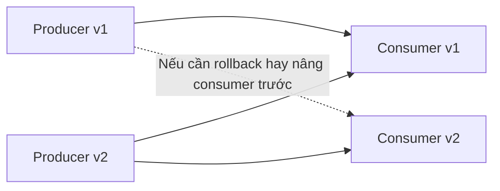
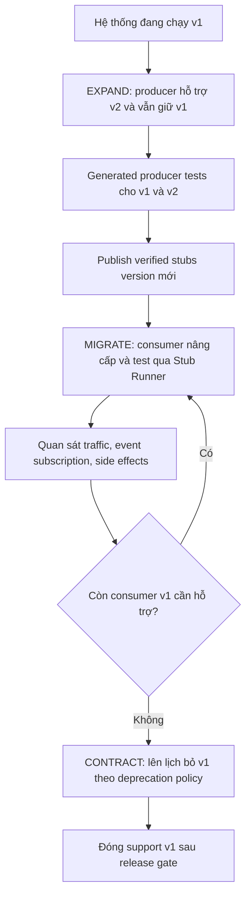
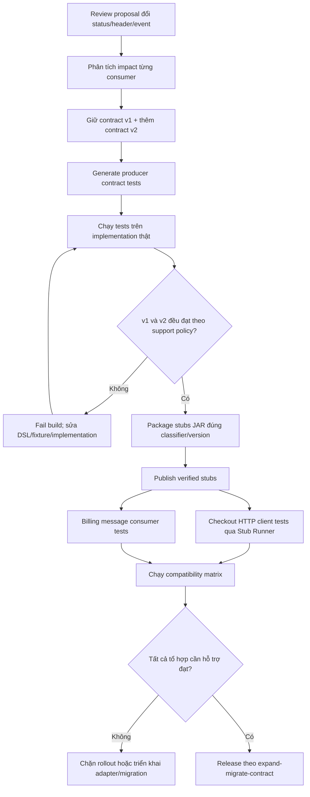

# Thay đổi mã trạng thái, header hoặc kiểu thông điệp

Một producer có thể giữ nguyên URL và JSON body nhưng vẫn phá vỡ consumer khi đổi **HTTP status**, thay đổi **response header**, hoặc đổi **loại sự kiện** mà consumer đang xử lý. Ví dụ, **Order Service** chuyển `201 Created` thành `202 Accepted`, bỏ header `Location` hoặc đổi event `ORDER_PAID` thành `PAYMENT_COMPLETED`. **Checkout Service** và **Billing Service** có thể ngừng hoạt động dù endpoint vẫn tồn tại và cả hai ứng dụng đều build thành công.

Trong lộ trình **SPRING_CLOUD_CONTRACT**, nhóm dùng **Spring Cloud Contract** để mô tả hành vi HTTP hoặc thông điệp bằng **Groovy/YAML DSL**, sinh producer tests, đóng gói stub, sử dụng **Stub Runner** trong consumer tests và tích hợp **CI** nhằm phát hiện thay đổi API không tương thích. Vì vậy, mã trạng thái, header, message type và destination là **giao diện có thể quan sát**, không nên xem là chi tiết triển khai được thay đổi mà không đánh giá tác động.

Bài học thuộc chương **Phiên bản và tương thích**. Mục tiêu là phân tích rủi ro khi thay đổi **status/header/message type**, lập **ma trận tương thích producer–consumer**, viết contracts bảo vệ hành vi cũ/mới, xây dựng chiến lược **expand–migrate–contract**, và xác minh những thay đổi qua producer verification cùng consumer stubs.

## 1. Khi nào một thay đổi là không tương thích?

Một thay đổi được xem là **breaking đối với một consumer cụ thể** khi consumer đó không còn thực hiện đúng chức năng theo giao diện producer mới cung cấp.

Ví dụ:

- Checkout v1 chấp nhận duy nhất `201 Created` rồi lấy `id` để chuyển sang thanh toán.
- Order Service v2 trả `202 Accepted` với `operationId` vì chuyển sang xử lý bất đồng bộ.
- Checkout vẫn gọi đúng endpoint nhưng không nhận được order ID như mong đợi.

Một ví dụ messaging:

- Billing v1 chỉ subscribe `orders.events` và dispatch `ORDER_PAID`.
- Order Service v2 chỉ phát `PAYMENT_COMPLETED` sang `payments.events`.
- Billing không nhận được message, hoặc nếu nhận được cũng có thể bỏ qua kiểu chưa biết.

**Không phải mọi thay đổi status/header đều breaking.** Kết luận tùy theo phần giao diện consumer sử dụng, phương thức parse, retry/fallback và những phiên bản được cam kết hỗ trợ. Nhưng nếu chưa kiểm tra, không nên giả định một thay đổi nhỏ là an toàn.

### 1.1. Các tầng của hợp đồng

| Tầng giao tiếp | Ví dụ thay đổi | Khả năng ảnh hưởng |
|---|---|---|
| HTTP method/path | `POST /api/orders` → `PUT /api/orders/{id}` | Consumer gọi sai route |
| HTTP status | `201` → `202` | Client phân loại sai hoặc hiểu sai thời điểm hoàn tất |
| Response header | Bỏ `Location` | Client không còn URI tài nguyên/operation |
| Request header | Bắt buộc `X-Api-Version` | Consumer cũ bị từ chối |
| Content negotiation | JSON → XML/CBOR | Decoder không còn hỗ trợ |
| JSON shape | `totalAmount` → `amount.value` | DTO hoặc business mapping lỗi |
| Message type | `ORDER_PAID` → `PAYMENT_COMPLETED` | Handler routing không khớp |
| Destination | `orders.events` → `payments.events` | Consumer không subscribe đúng topic/queue |
| Message headers | Đổi `eventType` hoặc `contentType` | Routing/serialization lỗi |
| Schema format | JSON → Avro/Protobuf | Cần decoder/schema reader khác |
| Delivery semantics | Phát hai lần/thay thứ tự | Idempotency và workflow bị ảnh hưởng |

### 1.2. Backward và forward compatibility

- **Backward compatibility:** producer mới vẫn đáp ứng những kỳ vọng mà consumer cũ đang dùng.
- **Forward compatibility:** consumer mới có thể làm việc với producer cũ khi hệ thống yêu cầu rollback hoặc triển khai lệch nhịp.

Không nên giả định producer và tất cả consumers được deploy đồng thời. Nếu một consumer chưa nâng cấp, tổ hợp **producer v2 + consumer v1** thường là phép kiểm tra quan trọng nhất.



Các mũi tên chỉ những **tổ hợp cần đánh giá**, không khẳng định tất cả đều đạt. Kết quả thực tế phụ thuộc contract và compatibility tests.

## 2. HTTP status là một phần của hành vi nghiệp vụ

HTTP status không phải chỉ là một số. Nó cho client biết request đã được xử lý thế nào.

Ví dụ tạo đơn hàng thành công theo API v1:

```http
POST /api/v1/orders
Content-Type: application/json
Accept: application/json

{"sku":"SKU-42","quantity":2}
```

Producer trả:

```http
HTTP/1.1 201 Created
Location: /api/v1/orders/ORDER-42
Content-Type: application/json

{"id":"ORDER-42","status":"CREATED"}
```

Checkout có thể dùng cả `201`, `Location` và `id`. Nếu một trong ba biến mất, consumer vẫn có thể nhận status nhóm `2xx` nhưng xử lý sai.

### 2.1. Các thay đổi status dễ gây bất tương thích

| Thay đổi | Khác biệt đáng chú ý | Điều consumer có thể làm sai |
|---|---|---|
| `200 OK` → `201 Created` | Semantics tạo tài nguyên | Nhánh code chỉ chấp nhận `200` |
| `201 Created` → `202 Accepted` | Chấp nhận xử lý, chưa bảo đảm hoàn tất | Dùng tài nguyên khi chưa tồn tại |
| `200 OK` → `204 No Content` | Không có response body | Parse JSON từ body không có |
| `404 Not Found` → `200 OK` + lỗi trong body | Đổi cách báo tài nguyên không tồn tại | Không đi vào error handling |
| `400 Bad Request` → `422 Unprocessable Content` | Phân loại validation khác | Client chỉ map `400` |
| `429 Too Many Requests` → `503 Service Unavailable` | Ngữ nghĩa rate-limit khác unavailable | Retry policy bị thay đổi |
| `500 Internal Server Error` → `503` | Lỗi có thể tạm thời | Tăng số lần retry ngoài ý muốn |
| `401 Unauthorized` → `403 Forbidden` | Authentication khác authorization | Client refresh token sai |
| `200` → `206 Partial Content` | Trả một phần representation | Coi dữ liệu thiếu là hoàn chỉnh |
| `301` → `308` | Redirect semantics, bảo toàn method theo chuẩn | Một số HTTP clients xử lý khác |

**Hai response đều là `2xx` không đồng nghĩa cùng nghĩa nghiệp vụ.** Đặc biệt, `202 Accepted` không hứa rằng công việc đã hoàn tất.

### 2.2. `204` không giống JSON null hay object rỗng

Hãy phân biệt:

- `204 No Content`: không có response content.
- `200 OK` với body zero-length: HTTP body trống.
- `200 OK` với body `null`: một giá trị JSON null.
- `200 OK` với body `{}`: một JSON object rỗng.
- `200 OK` với body `[]`: một JSON array rỗng.

Nếu Checkout v1 mong body `{"status":"CANCELLED"}` nhưng producer v2 trả `204`, client có thể lỗi deserialize. Không thể coi các trường hợp trên là tương đương chỉ vì “không có dữ liệu đáng kể”.

## 3. Case study: chuyển từ `201 Created` sang `202 Accepted`

**API v1:** tạo đơn đồng bộ.

```http
HTTP/1.1 201 Created
Location: /api/v1/orders/ORDER-42
Content-Type: application/json

{"id":"ORDER-42","status":"CREATED"}
```

**API v2:** tiếp nhận yêu cầu tạo đơn bất đồng bộ.

```http
HTTP/1.1 202 Accepted
Location: /api/order-operations/OP-42
Content-Type: application/json

{"operationId":"OP-42","status":"PENDING"}
```

Checkout v1 có thể:

1. Yêu cầu status đúng `201`.
2. Đọc `id` trong JSON.
3. Điều hướng sang bước thanh toán.
4. Không biết `operationId` hoặc trạng thái `PENDING` là gì.

Ngay cả khi client được sửa để chấp nhận mọi `2xx`, nó vẫn có thể dùng `OP-42` như một order ID, dẫn đến lỗi nghiệp vụ. **Đây là thay đổi về workflow, không chỉ về mã status.**

### 3.1. Giữ tương thích trong quá trình chuyển đổi

Nếu chưa thể nâng cấp tất cả consumers:

- Giữ `POST /api/v1/orders` trả `201` như contract cũ.
- Thêm `POST /api/v2/orders` trả `202` và operation ID.
- Bổ sung contract và test cho truy vấn trạng thái operation/callback.
- Cho Checkout v2 thực hiện workflow bất đồng bộ.
- Đo lưu lượng API v1 và hoàn tất quá trình deprecation trước khi bỏ hỗ trợ.
- Tránh đổi behavior của v1 tại chỗ rồi yêu cầu consumer tự thích nghi.

Nếu dùng **media type/header versioning** thay vì path versioning, cần bảo đảm request matchers phân biệt v1/v2. Không viết hai stub mappings cùng khớp một request nhưng trả hai response khác nhau.

## 4. Contract Groovy DSL bảo vệ status và header v1

Một hợp đồng phía producer cho Checkout v1:

```groovy
import org.springframework.cloud.contract.spec.Contract

Contract.make {
    name 'checkout_create_order_v1_201'

    request {
        method POST()
        url '/api/v1/orders'
        headers {
            contentType(applicationJson())
            header 'Accept', 'application/json'
        }
        body(
            sku: 'SKU-42',
            quantity: 2
        )
    }

    response {
        status CREATED()
        headers {
            contentType(applicationJson())
            header 'Location', '/api/v1/orders/ORDER-42'
        }
        body(
            id: 'ORDER-42',
            status: 'CREATED'
        )
    }
}
```

Hợp đồng trên bảo vệ:

- Method/path `POST /api/v1/orders`.
- Request content type và JSON body có `quantity` là số.
- HTTP status `201 Created`.
- Header `Location` chỉ đến tài nguyên order.
- Body response có `id` và `status`.

Khi Contract Verifier sinh producer tests và chạy trên implementation thật, việc đổi `201` thành `202` hoặc bỏ `Location` phải bị phát hiện **nếu generated assertions tương ứng được sinh và chạy**. Hãy kiểm tra generated test source thay vì đoán rằng chỉ có DSL thì test đã thực hiện.

### 4.1. Vấn đề của `Location`

Header `Location` không phải dữ liệu trang trí. Ở v1 nó chỉ đến **order resource**, còn ở v2 có thể chỉ đến **operation status resource**. Một regex `.*` cho Location sẽ không bảo vệ sự khác biệt này.

Nếu URI chứa ID động, có thể dùng fixture/ID generator cố định hoặc matcher đúng pattern mà phiên bản DSL hỗ trợ. Khi mối liên hệ giữa body ID và Location quan trọng, cần assertion đảm bảo **hai giá trị tương quan**, không chỉ match hai regex độc lập.

## 5. Hợp đồng v2: tách request để hai phiên bản cùng tồn tại

Ví dụ contract cho v2:

```groovy
import org.springframework.cloud.contract.spec.Contract

Contract.make {
    name 'checkout_create_order_v2_202'

    request {
        method POST()
        url '/api/v2/orders'
        headers {
            contentType(applicationJson())
            header 'Accept', 'application/json'
        }
        body(
            sku: 'SKU-42',
            quantity: 2
        )
    }

    response {
        status ACCEPTED()
        headers {
            contentType(applicationJson())
            header 'Location', '/api/order-operations/OP-42'
        }
        body(
            operationId: 'OP-42',
            status: 'PENDING'
        )
    }
}
```

Ở giai đoạn chuyển tiếp producer cần đáp ứng **cả contract v1 và contract v2**. Trước khi phát hành verified stubs, CI phải chạy generated tests cho cả hai kịch bản.

Không nên để contract v1 và v2 cùng yêu cầu chính xác `POST /api/orders` với headers/body giống nhau nhưng response trái nhau. Stub Runner/WireMock không tự suy version consumer. Phải có **path, header, Accept media type hoặc request matcher** phân biệt rõ.

### 5.1. YAML DSL cho lỗi validation v2

Một case khác, không duplicate kịch bản Groovy thành công:

```yaml
name: checkout_create_order_v2_invalid_quantity_422
description: V2 công bố lỗi validation bằng HTTP 422
request:
  method: POST
  url: /api/v2/orders
  headers:
    Content-Type: application/json
    Accept: application/json
  body:
    sku: SKU-42
    quantity: -1
response:
  status: 422
  headers:
    Content-Type: application/json
  body:
    code: INVALID_QUANTITY
    field: quantity
```

Nếu API v1 còn trả `400` cho lỗi tương tự, hãy giữ một contract v1 riêng và phân biệt request theo version. **Không thay 400 thành 422 trong toàn hệ thống** chỉ vì framework/controller version mới dùng cách phân loại khác.

## 6. Headers: thay đổi nhỏ có thể gây lỗi lớn

Headers truyền metadata ảnh hưởng serialization, cache, security, retry, routing và correlation.

| Header | Thay đổi | Rủi ro |
|---|---|---|
| `Content-Type` | JSON → XML/CBOR/Avro | Decoder không còn tương thích |
| `Accept` | Producer yêu cầu media type khác | Client cũ nhận `406` hoặc response ngoài khả năng parse |
| `Location` | Bỏ hoặc chuyển từ order URI sang operation URI | Client không biết lấy kết quả ở đâu |
| `Retry-After` | Bỏ hoặc đổi semantics | Rate-limit/backoff không còn đúng |
| `ETag` | Thay format hoặc không phát | Conditional request/cache có thể lỗi |
| `Cache-Control` | `private` → `public` | Rủi ro cache dữ liệu nhạy cảm |
| `Vary` | Bỏ khi representation phụ thuộc `Accept` | Cache có thể trộn các phiên bản representation |
| `WWW-Authenticate` | Thay challenge/scheme | Auth client xử lý sai |
| `X-Correlation-Id` | Đổi tên hoặc ngừng gửi | Mất trace correlation |
| `X-Api-Version` | Trở thành header bắt buộc | Client cũ không gửi sẽ bị reject |
| `Idempotency-Key` | Bỏ hỗ trợ | Retry POST có thể tạo side effects trùng |

Tên HTTP header **không phân biệt chữ hoa/chữ thường**: `Content-Type` và `content-type` là một tên theo semantics HTTP. Ngược lại, giá trị header có các quy tắc riêng; không tùy tiện chuyển mọi giá trị sang lowercase.

### 6.1. Vắng mặt, rỗng và thay giá trị không giống nhau

- **Header vắng mặt:** consumer không nhận metadata đó.
- **Header tồn tại nhưng giá trị rỗng:** không đồng nghĩa có giá trị hợp lệ.
- **Header có giá trị mới:** có thể hợp lệ hoặc thay đổi giao thức.
- **Header được thêm:** nhiều khi tương thích, nhưng vẫn có thể ảnh hưởng caching hoặc proxy.
- **Header có nhiều giá trị:** consumer phải hiểu cách kết hợp và parse theo định nghĩa header đó.

Ví dụ nếu Billing dựa trên header `eventType`, việc chuyển header đó vào body có thể làm handler bỏ qua message ngay cả khi payload vẫn đầy đủ.

### 6.2. `Retry-After` không có nghĩa luôn là một số mili giây

Với HTTP, `Retry-After` có thể biểu diễn **số giây** hoặc **HTTP-date**. Nếu producer đổi cách biểu diễn, consumer phải parse theo chuẩn. Không được coi `Retry-After: 2` là **2 mili giây**.

Đổi từ `429` sang `503` có thể khiến policy retry của consumer đổi hướng. Cần test **status + header + retry budget**, không chỉ một giá trị đơn lẻ.

## 7. `Content-Type` và `Accept` phải được xem cùng nhau

`Content-Type` mô tả dữ liệu đang được gửi; `Accept` mô tả representation client chấp nhận.

Ví dụ:

```http
GET /api/v1/orders/ORDER-42
Accept: application/json
```

```http
HTTP/1.1 200 OK
Content-Type: application/json

{"id":"ORDER-42","totalAmount":125000}
```

Nếu producer bất ngờ trả `application/xml` hoặc chuyển sang binary format trong khi client chỉ có JSON decoder, consumer có thể hỏng dù HTTP vẫn trả `200`.

### 7.1. Versioning bằng media type

Một lựa chọn thay vì version path:

```http
GET /api/orders/ORDER-42
Accept: application/vnd.example.order.v1+json
```

và:

```http
GET /api/orders/ORDER-42
Accept: application/vnd.example.order.v2+json
```

Producer có thể trả representation tương ứng với từng Accept nếu controller/gateway thực sự hỗ trợ content negotiation. Khi đó:

1. Contract v1 dùng Accept v1.
2. Contract v2 dùng Accept v2.
3. Response có Content-Type phù hợp.
4. WireMock mappings phải match Accept để không chồng lấn.
5. Cache trung gian phải tôn trọng `Vary: Accept` khi cần.
6. Consumer test phải parse đúng format được nhận.

**Spring Cloud Contract không tự bật API versioning**. Nó xác minh những gì implementation công bố. Chọn path, header hay media-type versioning phải là quyết định thiết kế API của hệ thống.

### 7.2. Tránh matcher quá cứng hoặc quá rộng

`application/json; charset=utf-8` và `application/json` thường đều được decoder JSON chấp nhận, nhưng có cách viết header khác. Nên xác định assertion dựa trên **semantics mà consumer thực sự phụ thuộc**, thay vì yêu cầu byte-for-byte không cần thiết.

Ngược lại, regex cho phép mọi Content-Type sẽ bỏ sót thay đổi sang XML hoặc binary format mà client không hiểu. Mục tiêu là **phát hiện breaking changes**, không phải làm test xanh bằng matcher lỏng.

## 8. Bắt buộc request header mới cũng có thể breaking

Giả sử Inventory v2 yêu cầu:

```http
GET /api/inventory/SKU-42
X-Tenant-Id: TENANT-42
```

Nhưng Checkout v1 không gửi header này. Nếu producer bắt buộc ngay lập tức, consumer cũ có thể bị reject.

Một kế hoạch migration phù hợp:

1. Xác định vì sao header mới là bắt buộc.
2. Nếu an toàn về nghiệp vụ và security, producer hỗ trợ tạm cả đường cũ và mới.
3. Cập nhật consumer để gửi header mới.
4. Chạy consumer tests với producer stubs phiên bản mục tiêu.
5. Đo lưu lượng từ consumer cũ.
6. Bật strict validation chỉ sau khi đủ điều kiện, hoặc version hóa API nếu không thể hỗ trợ cũ.

**Không nới quy tắc bảo mật chỉ để giữ contract xanh.** Nếu header là điều kiện xác thực/tenant isolation bắt buộc, cần migration có kế hoạch, versioned interface hoặc phối hợp deployment theo chính sách security.

## 9. Viết contract bảo vệ headers được sử dụng

Ví dụ một HTTP contract cần bảo vệ media type, correlation và cache policy:

```groovy
import org.springframework.cloud.contract.spec.Contract

Contract.make {
    name 'checkout_get_order_v1_with_headers'

    request {
        method GET()
        url '/api/v1/orders/ORDER-42'
        headers {
            header 'Accept', 'application/json'
        }
    }

    response {
        status OK()
        headers {
            contentType(applicationJson())
            header 'X-Correlation-Id', 'CORR-42'
            header 'Cache-Control', 'private, no-store'
        }
        body(
            id: 'ORDER-42',
            status: 'PAID',
            totalAmount: 125000
        )
    }
}
```

Nếu consumer thực sự phụ thuộc Cache-Control hoặc correlation ID, contract phải kiểm tra chúng. Nếu một header không thuộc giao diện mà consumer sử dụng, việc khóa cứng một giá trị bất kỳ cũng có thể tạo false positives.

### 9.1. Dữ liệu động phải dùng matcher hoặc fixture có chủ đích

Header correlation ID, ETag và timestamp có thể thay đổi ở mỗi request. Một test khóa cứng `CORR-42` có thể dùng fixture cố định; nếu muốn chấp nhận giá trị động cần matcher theo đúng DSL/version.

Không tự tạo matcher API chưa được Contract Verifier hỗ trợ. Nếu cần chứng minh `response X-Correlation-Id` bằng `request X-Correlation-Id`, hai regex độc lập **chưa bảo đảm quan hệ**. Bổ sung integration assertion phù hợp hoặc cơ chế dynamic value matcher của phiên bản đang dùng.

## 10. “Kiểu thông điệp” trong messaging nghĩa là gì?

Khác HTTP status, loại thông điệp có thể nằm ở nhiều lớp:

1. **Business event/command name**: `ORDER_PAID`, `RESERVE_STOCK`.
2. **Message header**: `eventType=ORDER_PAID`.
3. **JSON body field**: `"eventType":"ORDER_PAID"`.
4. **Envelope metadata**: ví dụ CloudEvents `type`.
5. **Serialization/media type**: JSON, Avro, Protobuf.
6. **Schema version**: `eventVersion=1` hoặc `2`.
7. **Destination/topic/queue**: `orders.events`.
8. **Record key/partition semantics**: đặc biệt trong Kafka.

Không nên gộp tất cả vào một tên `messageType` mơ hồ rồi kết luận đã kiểm tra đủ. Thay đổi bất kỳ lớp nào đều có thể gây lỗi cho consumer khác nhau.

### 10.1. Message v1 của Order Service

Body JSON:

```json
{
  "eventId": "EVT-42",
  "eventType": "ORDER_PAID",
  "eventVersion": 1,
  "orderId": "ORDER-42",
  "totalAmount": 125000,
  "currency": "VND"
}
```

Metadata:

```text
destination = orders.events
contentType = application/json
eventType   = ORDER_PAID
```

Billing có thể route bằng header `eventType` hoặc trường body, tùy code. Không được giả định header không quan trọng vì body có cùng giá trị.

### 10.2. Message v2 được đề xuất

```json
{
  "eventId": "EVT-42-V2",
  "eventType": "PAYMENT_COMPLETED",
  "eventVersion": 2,
  "orderId": "ORDER-42",
  "amount": {
    "value": 125000,
    "currency": "VND"
  }
}
```

Và destination mới `payments.events`.

Đề xuất này gồm **nhiều breaking changes độc lập**:

- Đổi event type.
- Đổi destination.
- Chuyển `totalAmount` và `currency` vào object `amount`.
- Tăng schema/event version.
- Có thể đổi header routing.

Nếu Billing v1 chỉ subscribe `orders.events`, nó không nhận được event. Nếu nó nhận qua route khác, có thể bỏ qua `PAYMENT_COMPLETED` hoặc deserialize lỗi. Cần kiểm tra cả **delivery path** và **handler logic**, không chỉ JSON validity.

## 11. Groovy message contract cho kiểu v1

Một outbound-only message contract:

```groovy
import org.springframework.cloud.contract.spec.Contract

Contract.make {
    name 'billing_order_paid_v1'
    label 'billing_order_paid_event_v1'

    input {
        triggeredBy('publishOrderPaid()')
    }

    outputMessage {
        sentTo('orders.events')
        headers {
            header('contentType', 'application/json')
            header('eventType', 'ORDER_PAID')
        }
        body(
            eventId: 'EVT-42',
            eventType: 'ORDER_PAID',
            eventVersion: 1,
            orderId: 'ORDER-42',
            totalAmount: 125000,
            currency: 'VND'
        )
    }
}
```

Producer verification cần base test hook `publishOrderPaid()` để kích hoạt **implementation thật**, message verifier/binder phù hợp để quan sát output, và assertions với destination, headers, body.

Nếu producer bỏ hoàn toàn `ORDER_PAID`, generated producer test v1 phải fail **nếu test được sinh và chạy đúng**. Trái lại, consumer dùng Stub Runner trigger label `billing_order_paid_event_v1` chỉ nhận **message mẫu từ stubs artifact**; nó không gọi logic Order Service thật.

### 11.1. Header/body type và destination đều quan trọng

Một test chỉ kiểm tra body `eventType=ORDER_PAID` có thể bỏ sót việc producer:

- Gửi event tới sai destination.
- Đổi header `eventType` mà dispatcher sử dụng.
- Chuyển Content-Type sang Avro trong khi consumer chỉ có JSON decoder.
- Đổi partition key gây thay đổi ordering.
- Bỏ correlation ID cần cho saga/workflow.

Contract DSL có thể bảo vệ nhiều thuộc tính, nhưng broker-specific guarantees cần integration tests tương ứng.

## 12. Message contract v2 và triển khai hai loại cùng lúc

Một contract mới cho v2:

```groovy
import org.springframework.cloud.contract.spec.Contract

Contract.make {
    name 'billing_payment_completed_v2'
    label 'billing_payment_completed_event_v2'

    input {
        triggeredBy('publishPaymentCompleted()')
    }

    outputMessage {
        sentTo('payments.events')
        headers {
            header('contentType', 'application/json')
            header('eventType', 'PAYMENT_COMPLETED')
        }
        body(
            eventId: 'EVT-42-V2',
            eventType: 'PAYMENT_COMPLETED',
            eventVersion: 2,
            orderId: 'ORDER-42',
            amount: [
                value: 125000,
                currency: 'VND'
            ]
        )
    }
}
```

Để chuyển đổi, producer có thể duy trì v1 và bổ sung v2; mỗi contract cần được kiểm chứng bằng generated tests. Nhưng nếu cả hai messages cùng biểu diễn một giao dịch, **dual publish có thể dẫn đến ghi nhận thanh toán hai lần** nếu consumer nhận cả hai.

### 12.1. Những câu hỏi phải giải quyết khi dual publish

- Có phát v1 và v2 cho cùng một business event hay chỉ một trong hai?
- Event IDs/correlation IDs có đủ để deduplicate?
- Billing có subscribe cả hai topics trong giai đoạn migration không?
- Message ordering và partition key có giữ semantics cần thiết?
- Consumer có giải mã được headers/serialization của cả hai?
- Khi rollback producer, consumer v2 có còn nhận event tương thích?
- Khi nào được ngừng phát v1, và dùng dữ liệu quan sát nào để xác nhận?

Không xem dual publish là “bản sao vô hại” cho sự kiện có side effects tài chính.

### 12.2. Ví dụ YAML DSL cho một command khác

Một contract riêng, không duplicate Groovy event v2:

```yaml
name: inventory_reserve_stock_command_v1
label: inventory_reserve_stock_v1
input:
  triggeredBy: publishReserveStock()
outputMessage:
  sentTo: inventory.commands
  headers:
    contentType: application/json
    commandType: RESERVE_STOCK
  body:
    commandId: CMD-42
    commandType: RESERVE_STOCK
    orderId: ORDER-42
    sku: SKU-42
    quantity: 2
```

Nếu command type đổi thành `STOCK_RESERVATION_REQUESTED` mà Inventory handler chỉ biết `RESERVE_STOCK`, consumer sẽ bỏ qua hoặc báo lỗi. Cần versioning/migration tương tự event.

Cú pháp YAML message DSL, header conversion và binder support phụ thuộc version Spring Cloud Contract. Khi áp dụng phải kiểm tra generated tests/stubs. Không nạp hai DSL mô tả chính xác cùng kịch bản nếu không có mục đích.

## 13. Schema evolution: thêm một trường vẫn có thể không an toàn

| Thay đổi payload | Tác động thường gặp | Điều kiện để an toàn |
|---|---|---|
| Thêm trường JSON tùy chọn | Thường có thể tương thích | Consumer bỏ qua unknown fields |
| Thêm trường request bắt buộc | Thường phá vỡ client cũ | Producer có default/adapter |
| Xóa trường consumer dùng | Breaking | Consumer đã migrate |
| Đổi tên trường | Breaking | Alias/dual-field hoặc API version mới |
| `125000` → `"125000"` | Number thành String | Parser/schema phải xử lý rõ |
| `null` → missing | Có thể breaking | Consumer hiểu cả hai nếu được cam kết |
| `[]` → `null` | Có thể breaking | Collection handling khác |
| Timestamp đổi format/timezone | Có thể breaking | Parser và semantics được cập nhật |
| Enum có giá trị mới | Có thể breaking | Consumer không dùng exhaustive switch cứng |
| Avro đổi field không có default phù hợp | Có thể breaking | Reader/writer compatibility |
| Protobuf đổi field number | Breaking | Phải giữ quy tắc field number/reserved |

Không chỉ hỏi “JSON có hợp lệ không”, mà phải hỏi “**consumer cũ sẽ parse và sử dụng như thế nào?**”.

### 13.1. Kiểm tra kiểu dữ liệu

Groovy DSL có thể dùng các matcher:

```groovy
response {
    status OK()
    body(
        orderId: 'ORDER-42',
        totalAmount: 125000
    )
    bodyMatchers {
        jsonPath('$.orderId', byEquality())
        jsonPath('$.totalAmount', byEquality())
    }
}
```

Đây là ví dụ theo Groovy DSL. Hãy kiểm tra generated assertions của version plugin để biết kiểu JSON number/string có được bảo vệ đúng như kỳ vọng; khi cần có thể bổ sung Jackson `JsonNode.isNumber()` và `isTextual()` ở producer integration test.

Regex `[0-9]+` chỉ mô tả một dạng chuỗi, không đủ để khẳng định field là **JSON number**.

### 13.2. Avro/Protobuf cần công cụ schema riêng

Contract DSL không tự thay thế **Schema Registry compatibility checks**:

- Avro reader/writer schema và default values ảnh hưởng backward compatibility.
- Protobuf phải giữ field numbers và tuân thủ quy tắc reserved fields.
- Header content type, encoding và schema ID có thể quyết định cách consumer giải mã.
- Kafka/RabbitMQ partitioning, ack/retry, dead-letter và order semantics thuộc integration tests.

Kết hợp **schema checks + producer message contracts + consumer handler tests**, không kết luận an toàn chỉ từ body map của Groovy DSL.

## 14. Không có contract cho một thuộc tính thì test có thể không phát hiện lỗi

Ví dụ:

```groovy
response {
    status OK()
    body(id: 'ORDER-42')
}
```

Một contract chỉ kiểm tra status và `id` có thể vẫn pass khi producer đổi:

- Header `Content-Type`.
- Header `Location`.
- `totalAmount`.
- Cache behavior.
- Message type của một workflow khác.

Vì các thuộc tính đó **không được mô tả**, test không có nghĩa vụ bảo vệ chúng. Tương tự, nếu message contract chỉ assert `orderId` mà bỏ `sentTo` và `eventType`, một thay đổi routing có thể không bị phát hiện.

Cần:

1. Tìm hiểu consumer **thực sự dùng gì**.
2. Đưa các phụ thuộc đó vào contracts.
3. Kiểm tra generated test có assertions tương ứng.
4. Bổ sung integration tests khi DSL không diễn đạt đủ.
5. Tránh matcher quá lỏng `.*` che mất breaking changes.
6. Tránh khóa cứng dữ liệu không quan trọng làm test giòn.

## 15. Ma trận producer–consumer compatibility

Giả sử:

- **P1:** Order Service v1, tạo order bằng `201` và phát `ORDER_PAID`.
- **P2:** Order Service v2, thêm `202` và `PAYMENT_COMPLETED`.
- **C1:** Checkout/Billing phiên bản cũ.
- **C2:** Checkout/Billing phiên bản mới.

| Tổ hợp | Có tương thích không? | Cần chứng minh |
|---|---|---|
| **P1 + C1** | Baseline đã hỗ trợ | Contract v1 và consumer tests |
| **P2 + C1** | **Không mặc định** | P2 giữ behavior/format v1 hoặc có adapter |
| **P2 + C2** | Mục tiêu triển khai mới | Contract v2 và client/handler tests |
| **P1 + C2** | Tùy rollback policy | C2 hiểu v1 khi producer bị rollback không? |

Nếu công ty deploy producer trước consumer, phải kiểm tra **P2 + C1**. Nếu nâng consumer trước hoặc cần rollback producer, có thể phải kiểm tra thêm **P1 + C2**.

### 15.1. Tác động khác nhau trên từng consumer

| Thay đổi P2 | Checkout v1 | Billing v1 |
|---|---|---|
| `201` → `202` | Có thể breaking | Không ảnh hưởng nếu không gọi API |
| Bỏ `Location` | Breaking nếu dùng URI | Không ảnh hưởng |
| Đổi `ORDER_PAID` → `PAYMENT_COMPLETED` | Không ảnh hưởng nếu không nghe event | Breaking |
| Đổi `orders.events` → `payments.events` | Không ảnh hưởng | Breaking vì không subscribe |
| Thêm `traceId` | Có thể an toàn | Có thể an toàn nếu decoder bỏ qua |
| Bỏ `currency` | Không ảnh hưởng nếu không dùng | Breaking nếu cần tạo hóa đơn |

Tương thích **theo consumer**, không chỉ theo producer artifact version.

## 16. Lộ trình expand → migrate → contract



### 16.1. EXPAND

Producer bổ sung hành vi mới mà **không xóa hợp đồng cũ**:

- Giữ `POST /api/v1/orders` trả `201`.
- Thêm `POST /api/v2/orders` trả `202`.
- Giữ `ORDER_PAID` tại `orders.events`.
- Bổ sung `PAYMENT_COMPLETED` tại destination mới.
- Có tests cho status/headers/message types của cả hai versions.

### 16.2. MIGRATE

Consumer được nâng cấp lần lượt:

- Checkout v2 hiểu `202` và operation workflow.
- Billing v2 parse `PAYMENT_COMPLETED`.
- Test consumer dùng **stubs artifact của producer version sẽ deploy**.
- Kiểm tra header/contentType/schema version mới.
- Nếu dual subscription, kiểm tra idempotency/dedup.
- Dùng canary/feature flag nếu kiến trúc hỗ trợ.
- Ghi nhận consumers còn dùng v1.

### 16.3. CONTRACT

Chỉ bỏ v1 khi:

- Có danh sách consumer owners và trạng thái migration.
- Đã thông báo deprecation window.
- Không còn consumer bắt buộc cần v1.
- Rollback strategy không đòi hỗ trợ v1.
- Monitoring xác nhận không còn lưu lượng/handler quan trọng dùng v1.
- CI đã cập nhật test matrix theo support policy.
- Hợp đồng/stubs cũ vẫn có thể truy vết khi điều tra lịch sử.

**Không xóa v1 chỉ vì test của consumer v2 xanh.** Điều đó chưa chứng minh mọi client ngoài thực tế đều đã nâng cấp.

## 17. Phân biệt version artifact, API và schema

| Khái niệm | Ví dụ | Mục đích |
|---|---|---|
| Producer artifact version | `order-service:1.5.0` | Bản build producer |
| Stubs artifact version | `order-service:1.5.0:stubs` | Stubs cùng producer build |
| HTTP API version | `/api/v1` hoặc `/api/v2` | Version representation/hành vi |
| Message schema version | `eventVersion=2` | Phiên bản payload |
| Message type | `PAYMENT_COMPLETED` | Phân loại nghiệp vụ/dispatch |
| Contract name/label | `billing_payment_completed_event_v2` | Định danh kịch bản |
| Plugin version | Spring Cloud Contract version trong Maven/Gradle | Năng lực DSL/generation |
| Consumer version | `billing-service:2.3.0` | Bản code xử lý event |

Một producer artifact v1.5.0 có thể giữ **cả hai API v1/v2** và **hai loại events**. Không suy rằng artifact version và API/schema version phải bằng nhau.

### 17.1. Ghim version Stub Runner cho CI

```java
import org.springframework.boot.test.context.SpringBootTest;
import org.springframework.cloud.contract.stubrunner.spring.AutoConfigureStubRunner;
import org.springframework.cloud.contract.stubrunner.spring.StubRunnerProperties;

@SpringBootTest(
    properties = "clients.order.base-url=http://localhost:8085"
)
@AutoConfigureStubRunner(
    ids = "com.example:order-service:1.5.0:stubs:8085",
    stubsMode = StubRunnerProperties.StubsMode.LOCAL
)
class CheckoutOrderClientContractTest {
    // Inject OrderClient thật; thêm @Test kiểm tra 201/202 theo API version.
}
```

Chuỗi `ids` là `groupId:artifactId:version:classifier:port`; `8085` là **stub server port**, không thuộc Maven artifact identity. `clients.order.base-url` là property do Checkout tự định nghĩa.

Ví dụ này là **khung cấu hình**, không phải class JUnit hoàn chỉnh. `LOCAL` đòi stubs artifact đã được `install` vào Maven local repository. Với `REMOTE` cần repository URL, quyền truy cập và version artifact phù hợp.

### 17.2. Vì sao không dùng latest tùy ý?

Nếu consumer CI dùng một version động hoặc snapshot thay đổi, cùng một commit consumer có thể test trên hai bộ stubs khác nhau giữa các ngày. Điều đó khiến kết quả khó tái hiện.

Hãy ghi:

- Requested và resolved producer stubs version.
- Classifier `stubs`.
- Producer commit/build ID.
- Spring Cloud Contract plugin version.
- Consumer version.
- Những ô compatibility matrix được kiểm tra.

Release artifacts nên được coi là **immutable**. Khi sửa hợp đồng đã phát hành, dùng version mới thay vì overwrite cùng coordinates.

## 18. Consumer HTTP test phải kiểm tra ngữ nghĩa, không chỉ `2xx`

Một client viết:

```java
if (response.statusCode() >= 200 && response.statusCode() < 300) {
    return parseOrder(response.body());
}
```

có thể sai nếu `202` chứa operation ID thay vì order ID. Dải `2xx` không bảo đảm body cùng shape.

Ví dụ client v1 chỉ chấp nhận `201`:

```java
OrderCreated parseCreateOrderResponse(int status, JsonNode body) {
    if (status != 201) {
        throw new IllegalStateException("Expected created order");
    }
    String id = body.path("id").asText(null);
    if (id == null || id.isBlank()) {
        throw new IllegalStateException("Missing order id");
    }
    return new OrderCreated(id);
}
```

Một thiết kế client v2 có thể phân biệt outcomes:

```java
sealed interface CreateOrderOutcome
    permits CreatedOrder, AcceptedOperation {}

record CreatedOrder(String orderId)
    implements CreateOrderOutcome {}

record AcceptedOperation(String operationId)
    implements CreateOrderOutcome {}
```

Đây là ví dụ **Java 17+**, không phải API có sẵn của Spring Cloud Contract. Consumer v2 cần xử lý `AcceptedOperation` bằng polling/callback hoặc workflow tương ứng, không gọi payment ngay như một order đã được tạo.

Test cần bảo vệ:

1. `201` trả `CreatedOrder` và đúng `Location`.
2. `202` trả `AcceptedOperation`.
3. Thiếu `operationId` được phát hiện là response sai schema.
4. Không dùng operation ID như order ID.
5. `409`/`422` có error mapping riêng.
6. Nếu rollback cần thiết, consumer mới vẫn có thể hiểu response v1.

## 19. Consumer message test cần assert handler và side effect

Với Billing, không chỉ kiểm tra event stub có `ORDER_PAID` hay `PAYMENT_COMPLETED`. Cần xem handler thật nhận và xử lý thế nào:

1. Chuẩn bị consumer listener/test context.
2. Cấu hình binder/broker phù hợp.
3. Stub Runner dùng đúng stubs artifact và message label.
4. Trigger label với message type cần kiểm tra.
5. Chờ side effect với deadline rõ.
6. Assert invoice/payment state theo `orderId`, `eventId` hoặc correlation key.
7. Kiểm tra không có double charge/duplicate invoice khi hai versions được phát cùng lúc.
8. Reset broker/DB state giữa tests.

**StubTrigger trả thành công không chứng minh consumer đã xử lý message.** Phải kiểm tra side effect hoặc trạng thái handler quan sát được.

### 19.1. Những negative cases đáng kiểm tra

- Header `eventType` khác với body `eventType`.
- Header `contentType` vắng mặt hoặc đổi sang encoding khác.
- Destination mới chưa có subscription.
- Consumer gặp enum/event type chưa biết.
- Payload thiếu `orderId`.
- Version schema mới chứa field type khác.
- Duplicate `eventId` hoặc message redelivery.
- Event đến không theo thứ tự mà workflow yêu cầu.

Những bài này có thể thuộc consumer integration/resilience tests thay vì producer contract; phải xác định phạm vi rõ.

## 20. CI cho thay đổi status, header và message type



### 20.1. Bằng chứng CI cần có

| Bằng chứng | Dùng để kiểm tra |
|---|---|
| Contract DSL nguồn | Cam kết API/message rõ ràng |
| Generated tests | Plugin đã đọc contracts |
| Surefire/Failsafe report | Producer tests **thực sự chạy**, không skip |
| Stubs artifact metadata | Consumer tải đúng producer GAV/classifier/version |
| Producer build/commit | Artifact có thể truy vết |
| Consumer test reports | Client/handler thật đáp ứng phiên bản mục tiêu |
| Compatibility matrix | Các tổ hợp deploy được hỗ trợ đã test |
| Schema Registry checks | Avro/Protobuf compatibility |
| Broker integration tests | Routing, conversion, delivery semantics |
| Rollout metrics | Có thể loại bỏ v1 an toàn hay chưa |

### 20.2. Maven commands tham khảo

Trong một project producer đã cấu hình plugin:

```bash
./mvnw clean verify
jar tf target/order-service-1.5.0-stubs.jar
```

Đây là lệnh **người học cần chạy trong project của mình**, không phải kết quả đã thực thi. Tên file, thư mục, plugin goals và phiên bản phụ thuộc build. Nếu cần cài artifacts vào Maven local repository sau verification, có thể dùng `./mvnw install`.

**Không dùng `-DskipTests`** rồi đánh dấu stubs artifact là đã được producer xác minh. Sinh ra JAR không đồng nghĩa generated tests đã chạy.

## 21. Mutation testing cho thay đổi breaking

Một cách đánh giá chất lượng hợp đồng là **cố ý làm sai implementation ở một nhánh test** rồi xem tests có phát hiện không.

| Thay đổi cố ý | Test cần thất bại |
|---|---|
| `201` → `202` trên endpoint v1 | Producer contract status assertion |
| Bỏ `Location` của v1 | Header assertion |
| `Content-Type` → `text/plain` | Header/consumer decoder test |
| `totalAmount` number → String | JSON type assertion |
| `ORDER_PAID` → `PAYMENT_COMPLETED` mà không giữ v1 | Message contract v1 |
| `orders.events` → `payments.events` | Destination assertion |
| Bỏ `orderId` | Message body assertion |
| Gửi cả v1 và v2 gây double processing | Consumer idempotency integration test |
| Client dùng mọi `2xx` như order created | Consumer workflow test |

Sau khi xác nhận test fail đúng nguyên nhân, **khôi phục implementation** và chạy lại. Nếu test vẫn xanh dù đã làm sai status/header/event type cần bảo vệ, phải đọc generated source và test report; có thể contract không assert, plugin chưa generate hoặc Surefire không chạy test đó.

## 22. Những lỗi thường gặp

| Triệu chứng | Nguyên nhân | Hướng xử lý |
|---|---|---|
| Checkout v1 lỗi sau producer deploy | `201` đã thành `202` | So sánh contract/status và semantics |
| HTTP `2xx` nhưng consumer parse lỗi | V2 dùng `operationId` thay `id` | Cập nhật DTO/workflow, không chỉ nới status |
| Client không tìm được URI | Bỏ/đổi `Location` | Kiểm tra header contract và API version |
| Client báo unsupported media type | Content-Type/Accept đổi | Content negotiation và decoder |
| Request cũ bị reject | Header version/tenant mới trở thành bắt buộc | Migration/compatibility adapter hoặc API v2 |
| Retry bất thường | `429` đổi thành `503` hoặc mất Retry-After | Retry policy tests |
| Billing không nhận event | Destination đổi | Topic/binder/subscription |
| Billing bỏ qua event | Header/body event type đổi | Handler dispatch |
| Message deserialize lỗi | JSON/Avro/Protobuf schema đổi | Schema compatibility checks |
| Double payment/invoice | Dual publish thiếu dedup | Idempotency và side-effect tests |
| Producer tests xanh khi bỏ Location | Contract không assert hoặc tests skip | Generated assertions/test report |
| Consumer nhận stub cũ | Artifact version/cache sai | GAV/classifier/resolved version |
| Stub Runner trả `404` mặc định | Request không match mapping | Method/path/headers/body |
| Hai stubs v1/v2 cùng match | Không version hóa request selector | Tách path/media type/header |
| Tests flaky | DB/broker state dùng chung, async race | Isolation, fixture, timeout |
| Chỉ CI fail | Khác JDK/plugin/binder version hoặc cache | Ghim versions, kiểm tra reports |

### 22.1. Chẩn đoán có thứ tự

1. Xác định **producer version** và **consumer version** thực tế.
2. Ghi lại HTTP request/status/headers/body hoặc message destination/headers/payload.
3. So với contract mà consumer phụ thuộc.
4. Kiểm tra generated producer tests được sinh và chạy.
5. Kiểm tra stubs artifact version/classifier và nội dung.
6. Chạy consumer test qua Stub Runner trên version mục tiêu.
7. Với messaging, kiểm tra broker/binder/serializer/schema registry.
8. Kiểm tra state fixture, timing và idempotency.
9. Xem có giữ đủ v1 trong support window không.
10. Quyết định rollback, adapter, nâng consumer hoặc API/message versioning.

Đừng sửa status/matcher chỉ để test xanh khi chưa xác định hành vi cam kết.

## 23. Bài thực hành: chuyển Order Service từ v1 sang v2

Bối cảnh: Checkout v1 cần `201 Created` và header `Location` khi tạo đơn. Billing v1 cần `ORDER_PAID` trên `orders.events`. Nhóm muốn chuyển sang `202 Accepted` và `PAYMENT_COMPLETED` trên `payments.events`.

### Phần A — baseline v1

1. Viết contract Groovy cho `POST /api/v1/orders` trả `201`, `Location` và body `id/status`.
2. Viết contract message Groovy có label ổn định cho `ORDER_PAID`.
3. Seed producer fixture và chạy generated producer tests.
4. Consumer tests chạy qua Stub Runner với stubs v1.
5. Lưu baseline reports và artifact coordinates.

### Phần B — thiết kế v2

1. Bổ sung `POST /api/v2/orders` trả `202` và `operationId`.
2. Định nghĩa cách consumer lấy operation status/callback.
3. Thiết kế `PAYMENT_COMPLETED` v2 với schema `amount.value/currency`.
4. Định nghĩa destination `payments.events`, serialization, headers.
5. Lập compatibility matrix P1/C1, P2/C1, P1/C2, P2/C2.

### Phần C — producer mở rộng

1. Giữ route `v1` và event `ORDER_PAID` trong support window.
2. Thêm route `v2` và event `PAYMENT_COMPLETED`.
3. Có contract tests cho cả hai versions.
4. Kiểm tra các trường headers quan trọng.
5. Chạy producer tests; cố ý làm sai `201` của v1 để xem test fail.
6. Khôi phục implementation và xác nhận suite đạt.

### Phần D — consumer migration

1. Checkout v1 phải còn làm việc với P2 trong giai đoạn hỗ trợ.
2. Checkout v2 xử lý `202 Accepted` đúng semantics.
3. Billing v1 vẫn nhận event v1.
4. Billing v2 nhận/deserialize/handle event v2.
5. Kiểm tra dual-subscription và dedup nếu cần.
6. Nếu rollback được yêu cầu, kiểm tra C2 với P1.

### Phần E — CI và deprecation

1. Đóng gói stubs artifact từ build producer đã verification.
2. Ghim version stubs cho consumer tests.
3. Chạy ma trận compatibility theo support policy.
4. Lưu producer commit/build ID và schema version.
5. Chỉ deploy P2 khi release gate đạt.
6. Không bỏ v1 cho đến khi usage/deprecation plan cho phép.

**Tiêu chí hoàn thành:** giải thích được vì sao `201` → `202` là thay đổi ngữ nghĩa, tại sao bỏ `Location` hoặc đổi eventType/destination gây breaking, và cách duy trì hợp đồng cũ/mới trong thời gian consumer nâng cấp.

## 24. Checklist trước khi merge

- [ ] Đã xác định producers và consumers liên quan.
- [ ] Đã phân loại thay đổi status/header/message type/destination/schema.
- [ ] Đã kiểm tra semantics, không chỉ diff các chuỗi.
- [ ] Các contract v1 còn cần hỗ trợ vẫn được giữ.
- [ ] Contract v2 có request selector khác v1 khi cần.
- [ ] Headers được consumer sử dụng đều được bảo vệ.
- [ ] Event type, destination và content type được kiểm tra.
- [ ] Generated producer tests chạy thật, không skip.
- [ ] Stubs JAR từ cùng producer build có GAV/classifier/version rõ.
- [ ] Consumer tests chạy qua HTTP/message clients thật.
- [ ] Compatibility matrix đã được thực thi theo rollout policy.
- [ ] Dual events có cơ chế dedup/idempotency.
- [ ] Avro/Protobuf schema compatibility checks được chạy khi cần.
- [ ] Không có token/PII production trong contracts/stubs.
- [ ] Có kế hoạch rollout, rollback và deprecation.
- [ ] Release artifacts immutable, snapshot có provenance.
- [ ] Fixture/broker/DB state được cô lập.
- [ ] Mutation test chứng minh assertions quan trọng không bị bỏ sót.

## 25. Câu hỏi tự kiểm tra

1. **Đổi `201` thành `202` có thể breaking vì sao?** `202` chỉ chấp nhận xử lý, chưa bảo đảm tài nguyên đã tạo.
2. **`204` có nghĩa gì cho JSON deserializer?** Không có response content để parse.
3. **`404` default của WireMock khác lỗi nghiệp vụ như thế nào?** Request có thể không match mapping, không có body lỗi theo contract.
4. **Tại sao bỏ `Location` có thể phá vỡ client?** Client có thể cần URI được trả để tiếp tục workflow.
5. **`Content-Type` và `Accept` khác gì?** Một bên mô tả representation đang gửi, một bên mô tả representation client muốn nhận.
6. **Tên HTTP headers có phân biệt chữ hoa/thường không?** Không; giá trị có quy tắc riêng.
7. **`Retry-After` chỉ có thể là số mili giây không?** Không; có thể là giây hoặc HTTP-date.
8. **Vì sao `201` → `202` không sửa bằng cách chấp nhận mọi `2xx`?** Workflow và response shape có thể thay đổi.
9. **Thêm một request header bắt buộc có thể gây lỗi gì?** Client cũ không gửi và bị reject.
10. **`ORDER_PAID` → `PAYMENT_COMPLETED` phá vỡ phần nào?** Handler dispatch/event schema và có thể destination.
11. **Đổi destination có thể hỏng dù body không đổi không?** Có, consumer không subscribe đúng.
12. **Message type có thể nằm ở đâu?** Header, body, envelope hoặc framework metadata.
13. **Event schema version và producer artifact version có bắt buộc bằng nhau không?** Không.
14. **Thêm field JSON luôn tương thích không?** Không; tùy parser/schema và consumer.
15. **JSON number và JSON string có khác nhau không?** Có, ảnh hưởng type checking/deserialize.
16. **`triggeredBy` trong message contract dùng làm gì?** Kích hoạt producer thật trong verification test.
17. **Stub Runner trigger label có chạy producer thật không?** Không, dùng message stub sample.
18. **Producer tests xanh đã đủ bảo đảm mọi consumer an toàn chưa?** Chưa; cần consumer tests và coverage phù hợp.
19. **EXPAND/MIGRATE/CONTRACT là gì?** Bổ sung hỗ trợ mới và giữ cũ, chuyển consumers, rồi loại cũ có kiểm soát.
20. **Vì sao dual publish có nguy cơ?** Có thể tạo duplicate side effects.
21. **Tại sao phải ghim version stubs artifact?** Để kiểm thử có thể tái hiện.
22. **Chỉ assert HTTP `2xx` có bảo vệ business semantics không?** Không.
23. **Làm sao biết generated producer tests đã chạy?** Xem test reports và số tests thực thi.
24. **Khi nào cần schema registry compatibility test?** Khi format/schema như Avro/Protobuf yêu cầu.
25. **Trước khi bỏ v1 cần bằng chứng gì?** Consumers đã migrate, usage và rollback/deprecation policy cho phép.

## 26. Tài liệu tham khảo và giới hạn phiên bản

Nguồn tham khảo theo chuẩn và tài liệu framework:

- [RFC 9110 — HTTP Semantics](https://www.rfc-editor.org/rfc/rfc9110)
- [Spring Cloud Contract — Reference](https://docs.spring.io/spring-cloud-contract/reference/)
- [Spring Cloud Contract — Contract DSL](https://docs.spring.io/spring-cloud-contract/reference/)
- [Spring Cloud Contract — Messaging](https://docs.spring.io/spring-cloud-contract/reference/)
- [Spring Cloud Contract — Stub Runner](https://docs.spring.io/spring-cloud-contract/reference/)
- [Apache Avro Specification](https://avro.apache.org/docs/current/specification/)
- [Protocol Buffers — Updating a Message Type](https://protobuf.dev/programming-guides/proto3/#updating)

**Lưu ý phiên bản:** Groovy/YAML DSL, các matcher API, message binder integration, Maven/Gradle plugin behavior và test mode có thể khác giữa Spring Cloud Contract versions. Các ví dụ trong bài là patterns để học; khi áp dụng vào project thật phải kiểm tra **generated tests**, **stubs archive**, **effective configuration** và hành vi của producer/consumer với những versions đã ghim.

## Kết luận

**Thay đổi mã trạng thái, header hoặc kiểu thông điệp có thể phá vỡ hợp đồng ngay cả khi URL và phần lớn JSON body không đổi.** `201` → `202` có thể đổi quy trình đồng bộ sang bất đồng bộ; bỏ `Location` làm mất URI quan trọng; `Content-Type` quyết định decoder; đổi `ORDER_PAID` thành `PAYMENT_COMPLETED` hoặc chuyển destination có thể khiến consumer không nhận hay không xử lý event.

Để kiểm soát rủi ro, cần mô tả rõ những thuộc tính mà consumer phụ thuộc bằng **Groovy/YAML contracts**, chạy **generated producer tests** trên implementation thật, phát hành **verified stubs JAR**, kiểm thử consumer với **Stub Runner**, lập **ma trận tương thích giữa các phiên bản** và triển khai theo chiến lược **expand–migrate–contract**. Khi CI bảo vệ cả status, headers, message type, payload semantics và những tổ hợp producer–consumer còn hỗ trợ, nhóm có thể phát hiện breaking changes trước khi chúng gây lỗi trong production.
