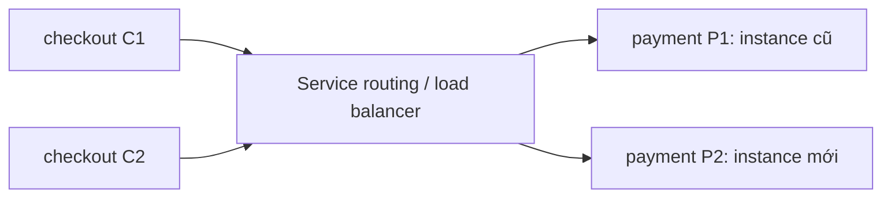
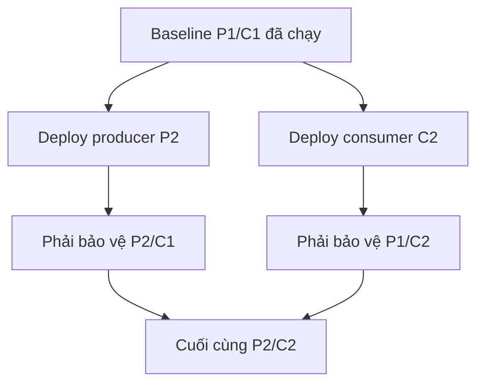
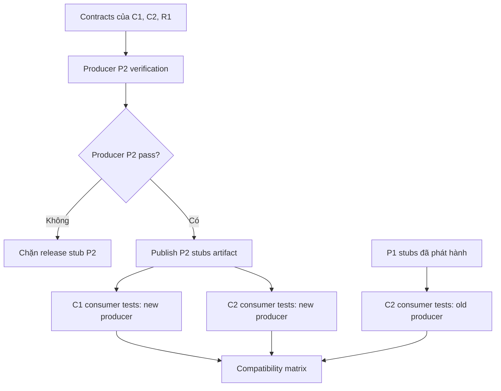
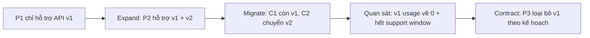
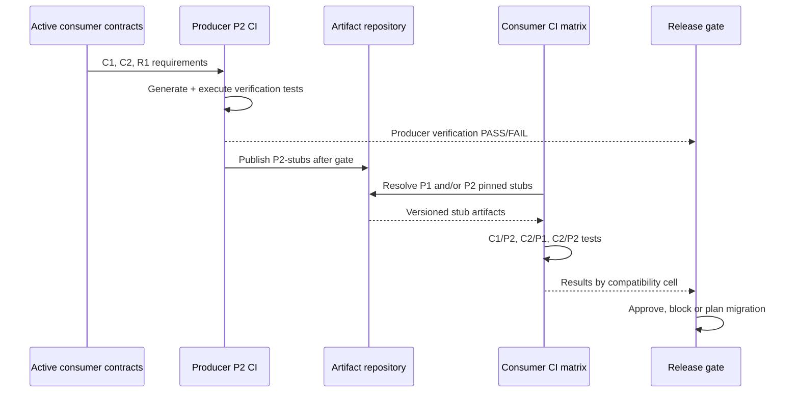

# Nhiều phiên bản producer và consumer cùng tồn tại

## 1. Vì sao bài toán tương thích không chỉ có “phiên bản mới nhất”?

Trong một hệ thống microservices, **producer** cung cấp API HTTP hoặc phát sự kiện, còn **consumer** gọi API hoặc nhận thông điệp. **Spring Cloud Contract (SCC)** giúp các bên thỏa thuận hành vi bằng **Groovy/YAML DSL**, sinh **producer verification tests**, đóng gói **stub artifact**, cho consumer dùng **Stub Runner** và kiểm tra trong **CI** để phát hiện sớm thay đổi API không tương thích.

Trong thực tế, nhiều phiên bản thường **cùng tồn tại**:

- Một số instance producer `payment-service 1.4.2` vẫn phục vụ traffic khi `1.5.0` đang rolling deploy.
- `checkout-service 2.8.0` chưa nâng cấp cùng lúc với `checkout-service 3.0.0`.
- `reporting-service 1.9.0` và `notification-service 4.2.0` vẫn cần những trường dữ liệu khác nhau.
- Mobile client, batch job hoặc đối tác bên ngoài có thể còn dùng hợp đồng cũ nhiều tuần hoặc nhiều tháng.
- Message trong Kafka/RabbitMQ có thể được tạo ở phiên bản cũ nhưng chỉ được tiêu thụ sau khi consumer nâng cấp.

Câu hỏi “producer mới có chạy đúng contract mới không?” là **chưa đủ**. Cần hỏi:

> Trong **khoảng thời gian triển khai chồng lấn**, **những phiên bản consumer nào** có thể gọi hoặc nhận sự kiện từ **những phiên bản producer nào**, và mỗi cặp có được kiểm thử đúng hành vi mà consumer thật sự sử dụng hay chưa?

Bài thuộc chương **Phiên bản và tương thích** của mô-đun **SPRING_CLOUD_CONTRACT**. Trọng tâm là **thiết kế, kiểm thử và triển khai an toàn khi nhiều phiên bản producer và consumer cùng hoạt động**, không phải một danh sách quy tắc SemVer cứng nhắc.

### Mục tiêu học tập

Sau bài này, bạn có thể:

1. Phân biệt **backward** và **forward compatibility** theo hướng producer–consumer.
2. Phân biệt **version của ứng dụng**, **version API**, **version contract** và **version stub artifact**.
3. Đánh giá các thay đổi HTTP/message có nguy cơ phá vỡ consumer, kể cả khi schema nhìn có vẻ “chỉ thêm trường”.
4. Thiết kế **ma trận các cặp phiên bản cần hỗ trợ**, không nhất thiết kiểm thử mọi tổ hợp trên đời.
5. Dùng SCC producer verification và Stub Runner để kiểm tra đúng các cặp phiên bản, với version artifact có thể truy vết.
6. Tổ chức **stubs per consumer** khi các consumer dùng những phần hợp đồng khác nhau.
7. Thiết kế **expand → migrate → contract**, rolling/canary deployment và CI gates cho thay đổi bất tương thích.
8. Nhận diện giới hạn của stub testing đối với môi trường production, dữ liệu lịch sử, broker và nhiều instance.

> **Giới hạn cần nhớ:** Một stub JAR mô phỏng **một tập tình huống đã định nghĩa**. Test xanh với gói stub không tự chứng minh mọi producer version đang chạy, mọi API path hay mọi message còn tồn tại đều tương thích.

## 2. Hai chiều tương thích: định nghĩa theo mốc thời gian

Để tránh nhầm thuật ngữ, trong bài dùng cách định nghĩa **cụ thể theo cặp phiên bản**:

- **Producer mới ↔ consumer cũ:** producer phiên bản **P2** vẫn phục vụ đúng nhu cầu của consumer phiên bản **C1**. Đây là một dạng **backward compatibility của producer đối với consumer cũ**.
- **Consumer mới ↔ producer cũ:** consumer phiên bản **C2** vẫn hoạt động khi gọi producer phiên bản **P1**. Đây là khả năng **consumer tiến lên trước producer** trong rolling deployment, thường được gọi là **forward compatibility** ở góc nhìn migration.
- **Producer mới ↔ consumer mới:** cả hai đều nâng cấp; có thể hỗ trợ tính năng mới nhưng **không đủ** làm bằng chứng cho các cặp hỗn hợp.

Tên “backward” và “forward” đôi khi được dùng khác nhau trong tiêu chuẩn dữ liệu/schema registry. Vì thế, trong thảo luận kỹ thuật nên luôn **viết cặp chính xác** `P2→C1` hoặc `C2→P1` để tránh hiểu lầm.

| Cặp | Câu hỏi thực tế | Vì sao quan trọng |
|---|---|---|
| `P1 + C1` | Trạng thái cũ đang chạy ổn không? | Mốc baseline |
| `P2 + C1` | Producer mới có làm consumer cũ hỏng? | Rolling deploy producer trước |
| `P1 + C2` | Consumer mới có chịu được producer cũ? | Rolling deploy consumer trước hoặc rollback producer |
| `P2 + C2` | Hai phiên bản mới hoạt động với nhau? | Mục tiêu cuối sau migration |

Một release plan an toàn cần biết **các cặp nào thực sự có thể xuất hiện**. Không nhất thiết hỗ trợ vô thời hạn mọi C/P trong lịch sử; nhưng phải có **support window**, kế hoạch deprecation và bằng chứng test cho những cặp còn được phép hoạt động.

### 2.1. Ví dụ rolling deployment



Nếu router không phân biệt version, **C1 và C2 đều có thể gặp P1 hoặc P2**. Vì thế chỉ test `P2+C2` không đủ. Ngay cả khi router có version routing, vẫn phải kiểm tra chính sách rollback, failover hoặc cache có thể làm request tới phiên bản khác.

### 2.2. Một bảng bốn ô dễ nhớ



**Kết luận:** Deployment order quyết định những cặp phiên bản **bắt buộc** phải tương thích trong thời gian chồng lấn. Đây là lý do CI compatibility matrix cần gắn với topology và lịch triển khai thật.

## 3. Bốn loại phiên bản: cùng chữ “version” nhưng khác việc

Giả sử `payment-service` có:

```text
Producer release:      payment-service 1.5.0
HTTP API:              /api/v1/payments/{id}
Contract revision:     git commit d4e5f6a
Stub Maven artifact:   com.acme.billing:payment-service:1.5.0:stubs
Consumer release:      checkout-service 3.0.0
```

Bốn dấu định danh liên quan nhưng **không đồng nhất**:

| Loại version | Quyết định | Có thể thay đổi độc lập? |
|---|---|---|
| **Producer application version** | Binary/implementation nào được deploy | Có |
| **Public API version** | Giao diện v1/v2 hay schema/message contract đã công bố | Có: nhiều app releases có thể cùng phục vụ API v1 |
| **Contract revision/version** | DSL nào dùng làm đầu vào verification | Có: contract được review độc lập |
| **Stub artifact version** | Gói mocks/mappings consumer tải | Theo chiến lược build, thường gắn với producer release |

Ngoài ra có **consumer application version**, quyết định client code và assumptions nào đang hoạt động. Không nên gán `API v1 = producer 1.x = consumer 1.x` một cách máy móc.

Một producer app `2.0.0` có thể vẫn phục vụ API `/v1` cho consumer cũ và đồng thời mở API `/v2`. Ngược lại, một producer app `1.5.0` có thể chứa thay đổi phá vỡ hợp đồng dù tên version không tăng major, nếu tổ chức không tuân thủ quy tắc versioning.

### 3.1. Stub ID không phải API version

```text
com.acme.billing:payment-service:1.5.0:stubs
                                           ↑ classifier
                                  ↑ producer artifact version
```

Cấu trúc đầy đủ của Stub Runner:

```text
groupId:artifactId:version:classifier:port
```

Trong đó `port` là cổng HTTP stub server, **không phải** port API v1/v2 hay version. Nếu không chỉ định version, Stub Runner có thể dùng `+` để tìm bản mới nhất; nhưng “mới nhất” không có nghĩa tương thích với mọi consumer.

### 3.2. Một stub artifact có thể chứa nhiều API generations

Một producer `1.5.0` có thể xuất bản một gói `-stubs.jar` có mappings cho **cả** `/api/v1/...` và `/api/v2/...`. Khi consumer dùng đúng version artifact, Stub Runner nạp các mappings phù hợp, không cần đổi artifact ID cho từng endpoint.

Mặt khác, nếu nhà cung cấp tách `v1`/`v2` thành hai service hoặc hai Maven artifacts, cần định nghĩa coordinates rõ ràng. Không có một convention versioning duy nhất được SCC áp đặt cho tổ chức.

## 4. Một câu chuyện xuyên suốt: payment v1 → phiên bản mới

Producer `payment-service P1 = 1.4.2` đang trả:

```json
{
  "paymentId": "PAY-42",
  "state": "CAPTURED",
  "amount": 150000,
  "currency": "VND"
}
```

Hai consumer:

- **checkout C1 = 2.8.0**: cần `paymentId`, `state` để quyết định có cho hoàn tất checkout.
- **reporting R1 = 1.9.0**: dùng `amount` và `currency` để lập báo cáo.

Producer chuẩn bị **P2 = 1.5.0**, muốn thêm `paymentMethod`:

```json
{
  "paymentId": "PAY-42",
  "state": "CAPTURED",
  "amount": 150000,
  "currency": "VND",
  "paymentMethod": "CARD"
}
```

**Đây có thể là thay đổi tương thích**, nhưng chỉ khi:

- Consumer cũ **chấp nhận unknown fields** hoặc không deserialize nghiêm ngặt.
- Các field hiện tại **không đổi tên, kiểu và ý nghĩa**.
- HTTP status, header, auth, URL, ordering/sorting và cách xử lý lỗi vẫn đúng với nhu cầu consumer.
- Không thêm điều kiện mới bắt consumer phải gửi header/field mà nó chưa biết.
- Producer v2 vẫn xử lý các request cũ trong giai đoạn chồng lấn.

Nếu checkout C1 bật Jackson `FAIL_ON_UNKNOWN_PROPERTIES` hoặc dùng parser kiểm tra schema strict, chỉ **thêm một field** cũng có thể làm C1 lỗi. Vì thế, “additive = luôn safe” chỉ là **heuristic**, không phải chứng minh.

### 4.1. Contract HTTP của C1 cho giao diện hiện hữu

```yaml
name: checkout_payment_captured
description: "Checkout cũ yêu cầu thanh toán đã capture"
request:
  method: GET
  url: /api/payments/PAY-42
  headers:
    Accept: application/json
response:
  status: 200
  headers:
    Content-Type: application/json
  body:
    paymentId: "PAY-42"
    state: "CAPTURED"
```

Contract này chỉ yêu cầu các trường C1 thực sự dùng. Nếu generated producer test được cấu hình kiểm tra các field cần thiết chứ không khẳng định body **phải đúng bằng** một JSON không cho thêm thuộc tính, P2 có thể trả thêm field mà vẫn đáp ứng C1.

**Không suy từ ví dụ rằng SCC luôn ignore mọi field thừa.** Cách so khớp JSON phụ thuộc DSL, matchers, chế độ generated test và cách assertion được sinh. Cần xem generated test/mappings thực tế.

### 4.2. Contract của reporting với cùng producer

```yaml
name: reporting_payment_amount
description: "Reporting cần số tiền và đơn vị tiền"
request:
  method: GET
  url: /api/payments/PAY-51
response:
  status: 200
  headers:
    Content-Type: application/json
  body:
    paymentId: "PAY-51"
    amount: 280000
    currency: "VND"
```

Dùng request discriminator khác nhau `PAY-42` và `PAY-51` trong ví dụ giúp tránh hai WireMock mappings cùng request nhưng response khác nhau. Trong dự án thật, nếu hai consumer cùng gọi **chính xác một request**, producer chỉ có thể trả **một response theo ngữ nghĩa đã công bố** (trừ khi có yếu tố phân biệt như header, content negotiation hoặc version route). Không tạo hai contracts yêu cầu producer trả hai JSON mâu thuẫn cho cùng request rồi kỳ vọng stubs-per-consumer giải quyết được.

### 4.3. Contract và implementation phải được xét cùng nhau

Một producer P2 đáp ứng contract C1 và reporting R1 **trên test fixtures** là bằng chứng hữu ích về backward compatibility. Nhưng nếu consumer C1 tự parse JSON strict hoặc sử dụng một field không được khai báo trong contract, test producer chưa bắt được vấn đề. Cần chạy **consumer code thật với stub P2** và, với rủi ro quan trọng, có **integration/deployment test** giữa hai implementation.

## 5. Ma trận thay đổi HTTP: tương thích phụ thuộc người sử dụng

| Thay đổi trên producer | Dễ được coi là | Điều cần xác minh |
|---|---|---|
| Thêm field optional vào response JSON | Thường additive | Consumer có bỏ qua field lạ không? Schema/assertion strict không? |
| Thêm endpoint mới | Thường additive | Không làm ảnh hưởng routing/auth của endpoint cũ |
| Thêm query param **optional** với default như cũ | Thường additive | Client cũ không gửi vẫn nhận kết quả tương đương |
| Thêm request field optional | Thường additive | Default/validation server không làm request cũ sai |
| Đổi tên `paymentId` thành `id` | **Breaking** với consumer dùng tên cũ | Giữ field cũ hoặc có API mới và migration |
| Bỏ `currency` khỏi response | **Breaking** với reporting | Tìm consumer đang dùng; đừng xóa trong support window |
| Đổi `amount` từ number thành string | **Breaking** ở wire schema | Serializer/DTO/validation theo contract |
| Đổi đơn vị `amount` từ VND sang cents, dù vẫn number | **Breaking về ngữ nghĩa** | Consumer có thể tính tiền sai mà không exception |
| `200` → `204` | Thường breaking nếu client cần body | Test status/body/error handling |
| `404` → `200` body rỗng | Có thể breaking | Nhánh phân loại không tìm thấy của consumer |
| Thêm giá trị enum `PARTIALLY_CAPTURED` | **Có nguy cơ breaking** | Client có switch exhaustive/default xử lý không? |
| Biến field optional thành required ở **request** | **Breaking** | Client cũ không gửi field sẽ bị từ chối |
| Yêu cầu header auth mới | **Breaking** nếu client cũ chưa gửi | Security/authorization compatibility |
| Đổi path từ `/api/payments` sang `/api/v2/payments` | Breaking nếu bỏ path cũ | Song song endpoints hoặc migration |
| Đổi sort/order/pagination mặc định | Có thể breaking dù JSON schema không đổi | Consumer có dựa vào thứ tự/page boundaries không? |
| Giảm timeout server hoặc rate limit | Có thể breaking về hành vi | Contract/integration/load tests theo SLA |
| Thêm response header mới | Thường additive | Client/proxy có kiểm tra strict hay không? |

Không nên phân loại chỉ từ cú pháp diff. Compatibility phụ thuộc **consumer-observable behavior** và **phần giao diện đã cam kết**. Ví dụ `"state": "CAPTURED"` không đổi kiểu, nhưng nếu producer đổi ý nghĩa “CAPTURED” từ đã thu tiền sang chỉ mới đặt giữ, đó vẫn là breaking change nghiệp vụ.

### 5.1. Schema tương thích nhưng hành vi không tương thích

Các trường hợp dễ bỏ sót:

- Từ **idempotent** sang **không idempotent** khi consumer retry.
- Trả `200` sớm hơn nhưng dữ liệu chưa nhất quán, làm consumer dùng trạng thái sai.
- Thay quyền truy cập, rate limits hoặc lỗi mới trên cùng path.
- Thay điều kiện sort/group/filter khiến consumer tính toán khác.
- Đổi HTTP header `Content-Type` làm decoder bị ảnh hưởng.
- Đổi quy tắc làm tròn `amount` dù vẫn là JSON number.

SCC có thể biểu đạt nhiều ràng buộc request/response, nhưng những đặc tính tải, concurrency, retry hoặc side effect cần **integration/resilience tests** bổ sung.

## 6. Consumer có thể chuẩn bị trước để chịu được thay đổi

Một consumer vững trước schema evolution thường:

- Chỉ yêu cầu **những field thật sự cần** cho nghiệp vụ.
- Bỏ qua unknown fields khi contract cho phép mở rộng.
- Phân biệt **field vắng mặt**, `null` và default có ý nghĩa.
- Xử lý enum **chưa biết** một cách có chủ đích, không âm thầm cho phép nghiệp vụ nhạy cảm.
- Không mặc định JSON object field order, trừ khi giao thức cụ thể yêu cầu.
- Có error handling rõ ràng cho status và error code.
- Không tự suy rằng producer mới luôn chạy trên mọi instance khi rolling deploy.

### 6.1. Ví dụ Jackson cho consumer cũ

```java
import com.fasterxml.jackson.annotation.JsonIgnoreProperties;

@JsonIgnoreProperties(ignoreUnknown = true)
public record PaymentDto(
    String paymentId,
    String state,
    long amount,
    String currency
) {}
```

Nếu JSON P2 có thêm `paymentMethod`, decoder Jackson với annotation này có thể bỏ qua trường lạ và vẫn tạo `PaymentDto`. Đó là **một kỹ thuật tương thích**, không phải “SCC tự làm cho consumer tương thích”.

**Cảnh báo:** Bỏ qua field lạ không phải luôn là chính sách phù hợp, nhất là với dữ liệu tiền tệ, security hoặc schema được kiểm soát strict. Hãy chọn có chủ đích; test đúng cách decoder đang được ứng dụng sử dụng.

### 6.2. Consumer mới phải sống được với producer cũ nếu rollout cần

Giả sử C2 muốn đọc `paymentMethod`; P1 chưa trả field này:

```java
@JsonIgnoreProperties(ignoreUnknown = true)
public record PaymentDtoV2(
    String paymentId,
    String state,
    long amount,
    String currency,
    String paymentMethod
) {}
```

Nếu JSON thiếu `paymentMethod`, nhiều cấu hình Jackson sẽ để property reference type này là `null`. Nhưng không nên **dựa vào ngầm định** khi constructor validation/`@JsonProperty(required=true)`/strict null handling có thể thay đổi kết quả.

Consumer C2 cần một policy rõ:

```java
String method = payment.paymentMethod() == null
    ? "UNKNOWN"
    : payment.paymentMethod();

if ("UNKNOWN".equals(method)) {
    // Không bật tính năng cần paymentMethod khi gặp P1.
}
```

**Điều quan trọng:** C2 không được giả định `paymentMethod` luôn có chỉ vì P2 đã publish artifact. Trong rolling deployment, request vẫn có thể đến P1; nếu đó là điều không chấp nhận được, deployment phải dùng **routing/version negotiation** có bảo đảm, không chỉ dựa vào vận may.

### 6.3. Enum expansion không tự an toàn

```java
switch (payment.state()) {
    case "CAPTURED" -> finishCheckout();
    case "PENDING"  -> waitForPayment();
    default         -> rejectUnknownState();
}
```

Một enum mới `PARTIALLY_CAPTURED` nên được xử lý theo chính sách business, có thể từ chối hoặc chờ; không nên mặc định vào nhánh “thanh toán thành công”. Nếu consumer dùng kiểu enum Java và Jackson không nhận giá trị mới, quá trình deserialize có thể fail trước khi đến switch. Cần test parser và behavior thực.

## 7. Khi một producer version phục vụ nhiều consumer versions

Một producer có thể đồng thời phục vụ:

| Consumer | Version đang dùng | Phần API phụ thuộc | Yêu cầu khi deploy P2 |
|---|---|---|---|
| `checkout-service` | C1 = 2.8.0 | `paymentId`, `state` | P2 giữ status/path và semantics |
| `checkout-service` | C2 = 3.0.0 | Thêm `paymentMethod` nếu có | C2 vẫn chịu được P1 nếu rollout còn chồng lấn |
| `reporting-service` | R1 = 1.9.0 | `amount`, `currency` | Không đổi kiểu/đơn vị hoặc bỏ field |
| `notification-service` | N1 = 4.2.0 | `PaymentCaptured` event | Không đổi schema/eventType gây lỗi consumer |

Danh sách này là **ví dụ giả định**, không phản ánh version của hệ thống thực. Nó minh họa rằng một producer release không nên được đánh giá chỉ bằng consumer mới nhất của một nhóm.

### 7.1. “Ai đang dùng field nào?” phải dựa trên bằng chứng

Có thể dùng:

- Consumer-owned contract files đã được review.
- Generated producer tests từ contracts của các consumer còn được hỗ trợ.
- Consumer Stub Runner integration tests trên mã client từng version.
- API usage logs/telemetry, consumer registrations, partner inventory.
- Schema registry compatibility rules, nếu dùng messaging schema.
- Thỏa thuận hỗ trợ/deprecation với các nhóm đang sử dụng.

**Không kết luận** “không có contract nào dùng field này nên an toàn xóa” nếu vẫn còn consumer không được ghi nhận hoặc version cũ đang hoạt động ngoài phạm vi hợp đồng đã quản lý.

## 8. Lập ma trận phiên bản theo những cặp có thể xuất hiện

Giả sử rollout cho phép `checkout-service C1/C2` và `payment-service P1/P2` cùng tồn tại. Ma trận mục tiêu:

| Consumer \ Producer | P1 = 1.4.2 | P2 = 1.5.0 |
|---|---|---|
| **C1 = 2.8.0** | PASS baseline (mục tiêu) | **Phải PASS** nếu P2 deploy trước |
| **C2 = 3.0.0** | **Phải PASS** nếu C2 deploy trước hoặc có thể rollback P2 | PASS mục tiêu mới |

**PASS trong bảng là mục tiêu thiết kế**, không phải kết quả kiểm thử đã thực thi. Sau khi chạy, mỗi ô phải ghi kết quả thực tế `PASS/FAIL/NOT TESTED/UNSUPPORTED`, lý do và artifact/build identifiers.

### 8.1. Không phải mọi ô đều bắt buộc hỗ trợ mãi mãi

Ví dụ tổ chức tuyên bố chỉ hỗ trợ:

- P1 với C1 trong giai đoạn trước release.
- P2 với C1 và C2 trong giai đoạn rolling deploy.
- Sau khi P1 đã ngừng hoàn toàn: C2 chỉ gặp P2.

Khi đó `C2/P1` có thể là **UNSUPPORTED** nếu hệ thống có routing bảo đảm C2 không bao giờ gọi P1, kể cả rollback. Phải chứng minh điều kiện routing/deployment này là thực, không chỉ ghi “không test” vì thiếu thời gian.

### 8.2. Ma trận lớn cần chọn theo rủi ro

Nếu có 10 producer versions và 20 consumer versions, không nhất thiết phải chạy 200 tổ hợp trên mọi commit. Có thể:

1. Chỉ đưa vào matrix các versions còn **được hỗ trợ hoặc thực sự đang chạy**.
2. Luôn kiểm tra **consumer cũ nhất còn hỗ trợ** và **consumer mới nhất** với producer release candidate.
3. Chạy các cặp **có thể gặp nhau trong rollout/rollback**.
4. Chạy bộ đầy đủ theo lịch hoặc trước major migration.
5. Ghi rõ các ô **không được kiểm thử** thay vì báo chung “compatibility PASS”.

Đừng dùng một contract “đại diện” nhưng bỏ qua field/flow chỉ consumer cũ dùng. Phạm vi test phải phản ánh **các ràng buộc mà consumer thật phụ thuộc**.


## 9. Dùng Spring Cloud Contract để bảo vệ các cặp phiên bản

SCC tạo hai lớp bằng chứng bổ sung nhau:

1. **Producer verification:** cùng một build P2 được kiểm tra với **những contract còn hiệu lực của các consumer đang được hỗ trợ**. Nếu producer đổi schema/status trái contract, generated tests có thể báo lỗi.
2. **Consumer tests qua Stub Runner:** chạy **mã HTTP/message client thật** của một consumer version C1/C2 với **stub artifact đã chọn** từ producer version P1/P2. Nếu client không deserialize/ứng xử được, test có thể báo lỗi.



Sơ đồ không nói SCC tự lấy các bản C1/C2/P1/P2 và tự tạo ma trận; **nhóm phải định nghĩa những project/build/artifact nào được đưa vào các CI jobs**. Việc một P2 contract test pass không thay thế **test parser và logic consumer C1**; test C1 với stub P2 pass cũng không thay thế producer verification P2.

### 9.1. Hai phép thử khác nhau cho cùng một thay đổi

**Đề xuất:** P2 thêm `paymentMethod` và giữ nguyên field cũ.

- **Producer P2 verification với contract C1:** trả `200`, `paymentId`, `state` đúng như C1 đã cam kết.
- **C1 client tests với stub P2:** mã C1 thật có bỏ qua field mới không? Có parse đúng DTO không?
- **C2 client tests với stub P1:** khi chưa có `paymentMethod`, C2 có fallback an toàn không?
- **C2 client tests với stub P2:** logic mới hoạt động khi field đã xuất hiện chưa?

Một bộ verification duy nhất không thể trả lời đủ cả bốn câu.

### 9.2. Tránh tình huống “contract mới thay thế hoàn toàn contract cũ”

Giả sử khi release P2, nhóm xóa `checkout C1` contract khỏi repository chỉ vì C2 đã được tạo. P2 generated tests có thể PASS, nhưng **không còn assertion nào bảo vệ C1**. Điều đó là mất phạm vi test, không phải bằng chứng rằng P2 tương thích ngược.

Cho đến khi C1 hết support window, cần duy trì **các ràng buộc còn được C1 dùng** dưới dạng contract/source tests, hoặc chạy bộ compatibility tests có khả năng tái lập tương đương. Không được lặng lẽ xóa hợp đồng chỉ để giải quyết test đỏ.

## 10. Chạy Stub Runner theo version rõ ràng

Với producer P1 và P2:

```text
com.acme.billing:payment-service:1.4.2:stubs
com.acme.billing:payment-service:1.5.0:stubs
```

**Version trên là version artifact được công bố**; nó không tự biểu diễn URL `/v1` hay `/v2`. Nếu P2 vẫn phục vụ `/api/payments/PAY-42`, stub của P2 sẽ mô phỏng tương tác đó theo contract version mà build P2 sinh ra.

### 10.1. Consumer test với Stub Runner version cố định

```java
@SpringBootTest
@AutoConfigureStubRunner(
    ids = "com.acme.billing:payment-service:1.5.0:stubs",
    stubsMode = StubRunnerProperties.StubsMode.REMOTE,
    repositoryRoot =
        "https://repo.example.org/repository/maven-releases/"
)
class CheckoutAgainstPayment15Test {
    // Test gọi CheckoutService / PaymentHttpClient thật;
    // client trỏ tới URL do Stub Runner khởi chạy.
}
```

Đây là **khung cấu hình**: cần JUnit, Spring Boot, dependency Stub Runner, mapping HTTP và phương thức wiring URL/cổng từ `@StubRunnerPort` hoặc `StubFinder`. Đừng tạo một HTTP client mới trong test để tránh chính mã consumer cần kiểm tra.

Nếu muốn so sánh C1 với P1 và P2, **không cần mở hai Stub Runner versions trên cùng cổng**. Cách rõ ràng là chạy **hai jobs** (hoặc hai isolated test runs), mỗi job pin một artifact version.

### 10.2. Dùng property để CI matrix chọn stub artifact

Ví dụ `application-contract-test.yml`:

```yaml
spring:
  cloud:
    contract:
      stubrunner:
        stubs-mode: REMOTE
        repository-root: "https://repo.example.org/repository/maven-releases/"
        ids:
          - "com.acme.billing:payment-service:${PAYMENT_STUB_VERSION:1.4.2}:stubs"
        fail-on-no-stubs: true
```

Consumer test class có thể kích hoạt Stub Runner qua `@AutoConfigureStubRunner`, với thông tin `ids` lấy từ Spring properties theo cấu hình phiên bản SCC đang dùng. Job CI đặt biến môi trường `PAYMENT_STUB_VERSION` thành `1.4.2` hoặc `1.5.0`.

**Điều bắt buộc:**

- Ghi **resolved stub version** vào report.
- Nếu artifact không tìm thấy, để test fail; không tự tải “bản gần đúng”.
- Kiểm tra profile/annotation không ghi đè `ids` hoặc `stubsMode` bằng giá trị khác.
- Đảm bảo HTTP client consumer thực sự gọi stub URL/port, không gọi production hoặc dùng cache.
- Nếu yêu cầu test nhiều cặp, mỗi ô phải có **consumer build version, stub artifact version và kết quả**.

### 10.3. Khi nào dùng `+`, version range hoặc SNAPSHOT?

Stub Runner dùng dạng `groupId:artifactId:version:classifier:port`, với các thành phần sau optional. Theo tài liệu chính thức:

- Bỏ version có thể tương đương dùng `+` (chọn bản mới nhất có thể phân giải).
- Có thể dùng **version ranges** theo cơ chế resolver được hỗ trợ.
- Mặc định classifier là `stubs` nếu không khai báo.
- Port không khai báo sẽ được chọn động.

Ví dụ:

```text
# Test tái lập trên version cụ thể:
com.acme.billing:payment-service:1.5.0:stubs

# Thử producer stub mới nhất:
com.acme.billing:payment-service:+:stubs
```

**Version `+` không phù hợp với release gate cần tái lập tuyệt đối**: cùng một consumer commit có thể lấy gói khác vào hôm sau. Nó phù hợp hơn với một **job theo dõi forward compatibility**, có log artifact chính xác. Tương tự, `-SNAPSHOT` có thể được publish lại; khi cần audit phải ghi build/checksum chứ không chỉ một chuỗi version logic.

### 10.4. Không tự động coi classifier là trạng thái production

Tài liệu SCC mô tả ví dụ dùng classifier `stubs` cho development và `prod-stubs` cho bản đã triển khai production, **nếu build pipeline thực sự xuất bản hai artifacts đó**.

```text
com.acme.billing:payment-service:1.5.0:stubs
com.acme.billing:payment-service:1.5.0:prod-stubs
```

Đây là **quy ước do tổ chức thiết kế**, không phải SCC tự biết đâu là production. Chỉ dùng `prod-stubs` nếu có artifact tương ứng, không mặc định đổi classifier sẽ tự tìm được stub của deployment đang chạy.

## 11. `stubsPerConsumer`: chọn hợp đồng riêng cho mỗi consumer

Một producer thường có nhiều consumer với nhu cầu khác nhau. SCC có tính năng **stubs per consumer** giúp đóng gói/đăng ký các mappings theo **tên consumer**:

```text
src/test/resources/contracts/
  checkout-service/
    payment-captured.yml
    payment-pending.yml
  reporting-service/
    payment-amount.yml
  notification-service/
    payment-event.groovy
```

Khi consumer bật `stubsPerConsumer`, Stub Runner **lọc và đăng ký các stubs thuộc thư mục của consumer đó** thay vì tất cả mappings trong artifact, theo quy tắc đường dẫn của SCC. Tài liệu chính thức mô tả `spring.cloud.contract.stubrunner.stubs-per-consumer` và `consumer-name`. Đây không phải cơ chế tạo bản sao producer khác nhau ở runtime.

### 11.1. Cấu hình minh họa

```java
@SpringBootTest
@AutoConfigureStubRunner(
    ids = "com.acme.billing:payment-service:1.5.0:stubs",
    stubsMode = StubRunnerProperties.StubsMode.REMOTE,
    repositoryRoot =
        "https://repo.example.org/repository/maven-releases/",
    stubsPerConsumer = true,
    consumerName = "checkout-service"
)
class CheckoutContractTest {
    // Chỉ sử dụng mapping phù hợp consumerName theo packaging.
}
```

Tùy chọn tương đương trong Spring properties:

```yaml
spring:
  cloud:
    contract:
      stubrunner:
        stubs-per-consumer: true
        consumer-name: checkout-service
```

Nếu không khai báo `consumer-name`, SCC có thể dùng `spring.application.name`; khi đó phải đảm bảo **tên trùng folder convention**. Kiểm tra generated stub JAR có đúng cấu trúc paths được tính năng lọc nhận diện.

### 11.2. Stubs per consumer **không phải** stubs per version

`consumerName = "checkout-service"` chỉ lọc theo consumer name, **không tự phân biệt checkout C1 và checkout C2**. Nếu cần tách các generation của consumer, bạn phải thiết kế namespace/contract folders và cách chọn chúng có chủ đích, hoặc dùng **versioned artifacts** và ma trận CI tương ứng.

Không giả định `stubsPerConsumer=true` làm producer đồng thời trả hai response mâu thuẫn cho cùng request trên production. Nó chỉ giúp **một consumer test suite** nạp tập mappings phù hợp. Nếu cùng request/headers phải trả hai response khác nhau theo thời gian hoặc nhóm người dùng, API cần **cơ chế phân biệt thật** như versioned endpoint, header, query hoặc stateful behavior có hợp đồng rõ.

### 11.3. Giới hạn và lợi ích quản trị

Lợi ích:

- Thấy rõ những consumer nào đang dùng **những phần hợp đồng nào**.
- Giảm xung đột mappings của nhiều consumer trong một WireMock server.
- Dễ chạy compatibility tests cho từng consumer và phát hiện ảnh hưởng khi sửa field/endpoint.
- Hỗ trợ quyết định deprecate khi không còn consumer được quản lý phụ thuộc vào một phần API.

Giới hạn:

- Consumer ngoài phạm vi SCC hoặc chưa khai báo contract vẫn có thể phụ thuộc.
- Các contracts có thể thiếu tình huống lỗi, authentication hoặc field mà code thực tế sử dụng.
- Cấu hình tên/folder sai có thể làm không nạp mapping; phải fail khi không có stubs.
- Kết quả xanh của consumer-specific suite không thay thế **producer verification của toàn bộ các contracts còn hỗ trợ**.

## 12. Chiến lược triển khai: expand → migrate → contract

Nếu phải thay đổi giao diện theo cách breaking, một chiến lược an toàn là **thay đổi theo nhiều bước**:

1. **Expand:** producer **giữ giao diện cũ** và bổ sung giao diện mới hoặc cách trả dữ liệu mới **tương thích**; test cả consumer cũ lẫn mới.
2. **Migrate:** cập nhật consumer theo từng nhóm, quan sát usage và xác minh các cặp phiên bản chồng lấn.
3. **Contract:** chỉ khi không còn consumer được hỗ trợ dùng giao diện cũ, mới **xóa/deprecate hoàn toàn**; thực thi policy, thông báo và test final behavior.



### 12.1. Ví dụ đổi đường dẫn API

Đầu vào:

```text
GET /api/v1/payments/PAY-42
```

Yêu cầu mới:

```text
GET /api/v2/payments/PAY-42
```

Trong giai đoạn P2, producer có thể phục vụ **cả hai endpoint**:

```yaml
# Contract cũ — vẫn giữ khi còn C1
name: payment_v1_for_legacy_checkout
request:
  method: GET
  url: /api/v1/payments/PAY-42
response:
  status: 200
  headers:
    Content-Type: application/json
  body:
    paymentId: "PAY-42"
    state: "CAPTURED"
```

```yaml
# Contract mới — cho C2
name: payment_v2_for_new_checkout
request:
  method: GET
  url: /api/v2/payments/PAY-42
response:
  status: 200
  headers:
    Content-Type: application/json
  body:
    id: "PAY-42"
    status: "CAPTURED"
    method: "CARD"
```

Đây là **hai tình huống được đặt ở hai file YAML khác nhau** trong producer để tránh yêu cầu mâu thuẫn trên cùng request. Generated producer tests cho P2 cần xác minh **cả v1 và v2** trong thời gian hỗ trợ.

### 12.2. Không được xóa v1 ngay sau khi code C2 merge

Một số C1 instances, batch jobs hoặc mobile clients vẫn có thể gọi `/v1`. Điều kiện xóa v1 nên gồm:

- Xác định danh sách consumer và phiên bản đang hoạt động.
- Triển khai C2 đủ mức hoặc có version routing bảo đảm không còn C1 dùng v1.
- Telemetry đủ tin cậy cho thấy v1 request không còn trong support window.
- Thông báo và hoàn tất deprecation policy với external consumers.
- CI kiểm tra các consumer còn được hỗ trợ không cần v1.
- Có rollback plan và thời hạn xóa rõ.

Nếu vẫn tồn tại C1 hoặc khả năng rollback về C1, việc xóa v1 có thể biến một rollback bình thường thành sự cố.

## 13. Rolling deployment, canary và rollback

### 13.1. Producer deploy trước

Nếu P2 được đưa lên trước khi C2 rollout xong, điều kiện tối thiểu:

```text
P2 phải tương thích với C1 (và mọi consumer cũ còn hỗ trợ).
```

Trong rolling deployment, C1 có thể gặp P1 hoặc P2 tùy routing. Việc chỉ chạy `P2/C2` sau release không cho biết `P2/C1` đã an toàn.

### 13.2. Consumer deploy trước

Nếu C2 được đưa lên trước khi P2 hoàn tất:

```text
C2 phải chịu được P1 hoặc có routing bảo đảm chỉ gặp P2.
```

Ví dụ C2 cần `paymentMethod` nhưng P1 chưa trả. Hãy dùng fallback có chủ đích hoặc feature flag; nếu tính năng mới không thể hoạt động khi thiếu trường, **không bật tính năng** cho tới khi xác nhận request không còn đi đến P1.

### 13.3. Canary không thay compatibility tests

Canary cho P2 nhận 5% traffic có thể giúp phát hiện lỗi thực tế, nhưng chỉ khi traffic bao phủ đủ **consumer versions, endpoint, field và error scenarios**. Một canary chỉ có C2 requests không chứng minh P2 tương thích với C1.

Kết hợp:

- **Trước deploy:** producer verification + consumer matrix với stub artifacts.
- **Trong deploy:** canary/rolling health, errors, traces, consumer breakdown.
- **Sau deploy:** quan sát usage, deprecation warnings, readiness cho rollback.

Tỷ lệ 5% chỉ là **ví dụ minh họa**, không phải chính sách hoặc chuẩn kỹ thuật bắt buộc.

### 13.4. Rollback là một chiều compatibility riêng

Nếu rollback producer từ P2 về P1 nhưng C2 đã được deploy, cần biết `C2/P1` có được hỗ trợ không. Nếu không:

- Rollback cả consumer theo đúng thứ tự, hoặc
- Bật route/feature flag để C2 không gọi P1, hoặc
- Giữ compatibility bridge ở P1/P2 theo kế hoạch release.

**Không thiết kế rollback chỉ ở mức “đổi image tag”** khi dữ liệu hoặc giao diện đã được migrate theo hướng không đảo ngược.

## 14. Messaging: sự kiện cũ và mới có thể cùng tồn tại trong một topic

Khác HTTP request/response tức thời, **message có vòng đời**:

- Producer P1 có thể phát event hôm qua.
- Event nằm trong broker backlog hoặc replay log.
- Consumer C2 hôm nay phải đọc cả event P1 và P2.
- Khi P2 deploy, consumer C1 vẫn có thể nhận event P2 nếu cùng topic/queue.

Giả sử sự kiện v1:

```json
{
  "eventType": "PAYMENT_CAPTURED",
  "paymentId": "PAY-42",
  "amount": 150000,
  "currency": "VND"
}
```

P2 muốn thêm `paymentMethod`:

```json
{
  "eventType": "PAYMENT_CAPTURED",
  "paymentId": "PAY-42",
  "amount": 150000,
  "currency": "VND",
  "paymentMethod": "CARD"
}
```

Thay đổi có thể tương thích khi consumer cũ bỏ qua field mới, consumer mới chịu được event cũ thiếu field, và semantics của event không thay đổi. Nhưng nếu dùng **Avro/Protobuf/JSON Schema + schema registry**, các quy tắc compatibility còn phụ thuộc **kiểu schema, default values, field tags và compatibility mode**; không thể kết luận chỉ từ ví dụ JSON.

### 14.1. Các thay đổi messaging có rủi ro

| Thay đổi | Nguy cơ |
|---|---|
| Đổi `eventType`/destination | Consumer cũ không nhận/không route đúng |
| Xóa hoặc đổi tên field bắt buộc | Deserializer/handler lỗi |
| Đổi kiểu `amount` hoặc đơn vị | Tính toán nghiệp vụ sai |
| Thêm enum value | Handler exhaustive có thể lỗi |
| Đổi key/partitioning | Trật thứ tự event của cùng aggregate |
| Đổi semantics ack/retry/DLQ | Mất/trùng/sai vòng đời message |
| Dual-publish v1 và v2 | Có thể tạo duplicate, reorder, double side effect |
| Đổi schema ID hoặc serializer | Consumer không deserialize/replay được |
| Thay đổi retention | Consumer mới khởi động không còn dữ liệu cần thiết |

**SCC message contracts** giúp bảo vệ body/headers/destination ở phạm vi đã mô tả. Để xác minh offset, partition key, consumer group, broker routing, retry/DLQ và replay lịch sử, cần **broker integration tests** bổ sung.

### 14.2. Chiến lược sự kiện v2

Nếu v2 không tương thích với v1, có thể cân nhắc:

- Thêm event type/destination mới như `PAYMENT_CAPTURED_V2` hoặc topic `payments.events.v2`.
- Cho producer **dual publish** trong giai đoạn migration, với idempotency/ordering được kiểm tra.
- Cho consumer mới **dual read** hoặc hỗ trợ parse cả v1/v2.
- Dùng schema registry có chính sách compatibility phù hợp và kiểm thử schema evolution/replay.
- Chỉ xóa v1 sau khi consumer cũ và dữ liệu backlog liên quan đã được xử lý.

Không có một đáp án duy nhất: trade-off giữa duplication, ordering, operational cost và khả năng rollback phụ thuộc broker/client architecture.

## 15. Dữ liệu, DB schema và feature flags cũng ảnh hưởng compatibility

Một API có thể giữ JSON schema nhưng vẫn break khi:

- P2 bắt đầu ghi trạng thái mới mà C1 không hiểu.
- P2 đổi ý nghĩa trạng thái `CAPTURED` nhưng không đổi field.
- Database migration xóa cột mà một P1 instance vẫn còn đọc.
- Cache hoặc async job vẫn sử dụng format cũ.
- Feature flag bật tính năng phụ thuộc dữ liệu chưa backfill.
- Queue replay làm C2 đọc message cũ thiếu thông tin.

Vì vậy, quy trình **expand → migrate → contract** cần áp dụng cả **storage schema và event data**, không chỉ endpoint HTTP. Một deployment mixed-version chỉ an toàn nếu **code cũ vẫn tương tác được với dữ liệu mới** trong thời gian chồng lấn.

### 15.1. Một migration database an toàn hơn

Ví dụ muốn đổi `payment_method`:

1. **Expand schema:** thêm cột mới nullable, code cũ vẫn dùng cột cũ được.
2. **Dual-write/backfill:** code mới ghi cả hai hoặc có bridge logic theo chính sách; kiểm tra idempotency.
3. **Migrate readers:** cập nhật các consumer/read models sử dụng cột mới, chạy compatibility tests.
4. **Observe:** xác minh không còn instance/job cũ truy cập cột cũ.
5. **Contract schema:** xóa cột cũ trong release có kế hoạch, không cùng bước với lần đầu thêm cột.

Đây là **mẫu triển khai** cần điều chỉnh theo hệ DB/transaction thật, không tự động được SCC kiểm tra. SCC bảo vệ giao diện HTTP/message mà contract mô tả; migration DB cần integration tests và migration tooling riêng.

## 16. API versioning: path, header, media type hay service khác?

Nếu thay đổi không thể giữ tương thích trên cùng endpoint, có thể version API theo:

| Cách version | Ví dụ | Điểm mạnh | Rủi ro |
|---|---|---|---|
| **Path** | `/api/v1/payments`, `/api/v2/payments` | Dễ nhìn và định tuyến | Nhiều endpoints cần duy trì |
| **Header** | `X-Api-Version: 2` | Giữ cùng URL | Client/gateway/cache phải truyền header |
| **Media type** | `Accept: application/vnd.acme.payment.v2+json` | Gắn version với representation | Negotiation/caching phức tạp |
| **Query** | `?apiVersion=2` | Dễ thử nghiệm | Cần quy tắc cache và validation rõ |
| **Service/hostname** | `payment-v2.internal` | Tách deployment rõ | Service discovery/routing và operations phức tạp |
| **Messaging destination/type** | `payments.events.v2` | Giảm xung đột schema khác biệt | Dual publication/consumer migration |

Spring Cloud Contract không bắt buộc phương án nào. Chọn theo routing, consumer capabilities, mức thay đổi và support policy. Nếu dùng header hoặc media type versioning, **contract phải mô tả request matcher tương ứng**, và consumer test phải gửi header đúng. Nếu nhiều phiên bản dùng cùng request không phân biệt, WireMock có thể gặp mappings trùng/conflict.

### 16.1. Không tạo v2 chỉ vì thêm một field nhỏ

Nếu có thể tiến hóa API một cách additive, có test chứng minh consumer cũ chịu được, việc giữ một API ổn định giúp giảm số version phải hỗ trợ. Ngược lại, khi đổi **ý nghĩa dữ liệu, status, kiểu field, auth hoặc flow nghiệp vụ**, versioned endpoint/event mới có thể là lựa chọn an toàn hơn.

Phiên bản **API v2** có thể được phục vụ bởi **producer artifact 1.5.0**; hai con số không cần bằng nhau. Và một stub artifact `1.5.0-stubs.jar` có thể mang cả contracts v1/v2 trong support window.


## 17. Contract `inProgress`: hỗ trợ phát triển song song nhưng không phải release proof

SCC hỗ trợ đánh dấu một số contract **đang phát triển**. Theo tài liệu chính thức, contract `inProgress` có thể được dùng để **sinh stub** cho consumer xây dựng code trước, trong khi **producer verification test tương ứng chưa được sinh**. Điều này hữu ích khi hai nhóm muốn làm việc song song.

Nhưng ở thời điểm release, nếu còn contract chưa được producer xác minh mà vẫn coi mọi stub là “production-ready”, CI có thể báo **tương thích giả**.

Tài liệu SCC mô tả tùy chọn `failOnInProgress`; mặc định plugin được thiết kế để **fail khi contract in-progress còn tồn tại** trong quá trình phát hành/kiểm thử theo chính sách tương ứng. Không tự đặt `failOnInProgress=false` để vượt qua gate nếu chưa hiểu hệ quả.

### 17.1. Bốn trạng thái phải báo khác nhau

| Trạng thái | Ý nghĩa | Có thể dùng làm release compatibility proof? |
|---|---|---|
| **Proposal** | Consumer đề xuất schema/behavior | **Không**; chưa được đồng ý |
| **In progress stub** | Consumer có mô phỏng để phát triển | **Không**; producer chưa được xác minh cho contract đó |
| **Producer verified contract** | Generated tests pass trên producer build cụ thể | **Có**, trong phạm vi test đã chạy |
| **Consumer verified against published stub** | Consumer code pass với artifact cụ thể | **Có**, về hành vi consumer đối với mô phỏng đó |

**Hai trạng thái cuối phải được nối bằng đúng artifact/version/commit**. Producer verified P2 nhưng consumer test lại dùng P1 stubs không cho phép nói “C1 tương thích với P2”.

### 17.2. Mốc chuyển từ proposal sang verified

Quy trình khuyến nghị:

1. Consumer đề xuất contract, có thể yêu cầu stub in-progress để lập trình client.
2. Producer review, thống nhất semantics và triển khai.
3. Xóa trạng thái in-progress khi implementation đã sẵn sàng.
4. Chạy producer verification, bảo đảm tests thực sự chạy và fail khi response trái contract.
5. Publish artifact P2 chứa các mappings từ contracts đã xác minh.
6. Chạy consumer suites với **P2 stub artifact**.
7. Ghi lại kết quả theo từng cặp version.

Không xóa contract của consumer cũ chỉ vì contract mới đã được xác minh.

## 18. Thiết kế CI compatibility matrix có thể truy vết

### 18.1. Hai trục độc lập

**Trục producer verification:**

- Với P2 release candidate, thu thập contracts của **mọi consumer còn support**.
- Generated producer tests phải kiểm tra P2 với các tương tác được thỏa thuận.
- Chạy test fixtures, security/serialization và messaging verification khi có.
- Bắt buộc không có contracts bị skip ngoài policy đã duyệt.

**Trục consumer verification:**

- Chạy **C1 codebase** với **P2 stubs** để đánh giá backward compatibility.
- Chạy **C2 codebase** với **P1 stubs** nếu deployment/rollback cần cặp đó.
- Chạy **C2 codebase** với **P2 stubs** để xác minh behavior mới.
- Giữ **C1/P1** làm baseline hoặc regression smoke theo lịch.
- Mỗi job pin artifact version và lưu source/build identifiers.



### 18.2. Một ma trận CI tối thiểu

| Job | Code consumer | Stub artifact | Mục tiêu | Kết quả cần lưu |
|---|---|---|---|---|
| `baseline-old` | `checkout 2.8.0` | `payment 1.4.2` | Baseline | PASS/FAIL |
| `producer-backward` | `checkout 2.8.0` | `payment 1.5.0` | P2 không phá C1 | PASS/FAIL |
| `consumer-forward` | `checkout 3.0.0` | `payment 1.4.2` | C2 chịu được P1 | PASS/FAIL hoặc UNSUPPORTED có lý do |
| `current-pair` | `checkout 3.0.0` | `payment 1.5.0` | Chức năng mới | PASS/FAIL |
| `other-consumers` | `reporting 1.9.0` | `payment 1.5.0` | P2 không phá R1 | PASS/FAIL |

Bảng là **định nghĩa jobs cần chạy**, không phải kết quả thực tế. Nếu một cặp không thể xuất hiện theo deployment topology có kiểm chứng, đánh dấu `UNSUPPORTED` với điều kiện rõ thay vì tự ghi PASS.

### 18.3. Cách truyền version cho job

Với consumer test dùng Spring properties như mục 10.2, một CI job có thể cấp:

```text
PAYMENT_STUB_VERSION=1.4.2
PAYMENT_STUB_VERSION=1.5.0
```

Mỗi job đặt **một giá trị**; không đặt hai biến cùng tên đồng thời trong cùng process rồi mong Stub Runner tự chạy cả hai. Dùng matrix environment hoặc build parameters của hệ CI.

Nếu consumer tests dùng annotation chứa ID cố định, phải thay cách cấu hình để test suite nhận version từ property/CI. **Không grep/sed sửa source code để đổi version một cách lén lút** trong release job mà không ghi dấu, vì dễ làm khác source đã review.

### 18.4. Chỉ publish khi đúng gate

Một chuỗi release có thể là:

1. Validate contract proposal/review, định danh consumer versions còn support.
2. Producer P2: **generate + run** verification tests, fail khi mismatch.
3. Đóng gói artifact `payment-service:1.5.0:stubs` và lưu checksum.
4. Publish gói đã xác minh vào Maven repo với version bất biến.
5. Trigger consumer matrix theo version đã publish.
6. Fail/hold rollout nếu một ô bắt buộc FAIL hoặc không được chạy.
7. Canary/rolling deployment khi được duyệt, quan sát traffic theo consumer version.
8. Chỉ deprecate giao diện cũ sau migration và chính sách hỗ trợ.

Trong pipeline tách repo, consumer CI không nhất thiết chạy *trước* mọi việc của producer; nhưng **release gate phải kết hợp đúng bằng chứng theo version**, và có policy rõ nếu consumer CI chạy bất đồng bộ sau publish.

## 19. Kiểm thử bổ sung mà Stub Runner không thay thế được

Các tình huống sau có thể quan trọng cho multi-version coexistence nhưng nằm ngoài một stub request/response cơ bản:

| Rủi ro | Test bổ sung nên có |
|---|---|
| P1 và P2 cùng dùng chung database | Integration test schema + rolling data migration |
| P2 phát trạng thái mới C1 không hiểu | Consumer code test với fixture/contract mới + deployment monitor |
| Message v1 còn tồn trong Kafka sau nâng cấp | Broker replay tests với event cũ và consumer mới |
| Dual publish v1/v2 làm xử lý trùng | Integration/idempotency tests |
| Header-based version routing ở gateway | Gateway/integration test gửi đúng headers |
| Schema registry compatibility | Schema compatibility checks theo format và mode thực |
| Auth policy mới, token scopes cũ | Security integration tests |
| Rate limit mới với batch job cũ | Load/resilience/integration tests |
| Canary nhận thiếu traffic của C1 | Telemetry breakdown + targeted synthetic requests |
| P2 rollback về P1 sau khi dữ liệu đã migrate | Rollback rehearsal + DB/data compatibility tests |

SCC không tự mô phỏng database migration, Kubernetes rollout, Kafka offset hay TLS gateway. Nó vẫn quan trọng ở tầng **hành vi giao diện được ghi thành contract**, còn các đặc tính vận hành yêu cầu test đúng môi trường.

### 19.1. Kiểm tra wire compatibility với code consumer thật

Nếu C1 dùng Jackson parser strict, producer verification P2 có thể PASS nhưng C1 vẫn lỗi khi thấy field mới. Vì vậy test `C1/P2` nên chạy **đúng HTTP client decoder và business logic của C1**, không chỉ:

```java
// Không đủ để chứng minh consumer code tương thích:
assertEquals(200, rawHttpResponse.statusCode());
```

Một test giá trị hơn là:

```java
// CheckoutService là production class của consumer C1.
CheckoutDecision decision = checkoutService.evaluate("PAY-42");

assertTrue(decision.accepted());
assertEquals("READY", decision.reason());
```

Ví dụ giả định `checkoutService` đã được cấu hình gọi stub P2 và method/DTO thực sự tương ứng. Test không được mock luôn `PaymentHttpClient` rồi tuyên bố đã thử wire compatibility.

### 19.2. Test error paths và thứ tự sự kiện

Đừng chỉ kiểm tra happy path. Các cặp version có thể khác nhau ở:

- `404` và error body schema.
- `409` conflict hoặc `429` throttling.
- Null/missing field và enum mới.
- Authentication header/role.
- Pagination và ordering.
- Retry/idempotency với thao tác tạo dữ liệu.
- Message redelivery, unknown event type và DLQ.

Một consumer có thể xử lý `200` đúng với P2 nhưng thất bại khi P2 chuyển error response `code` từ string thành object.

## 20. Những hiểu nhầm và lỗi thường gặp

| Hiểu nhầm | Hệ quả | Cách khắc phục |
|---|---|---|
| “P2/C2 xanh nên release an toàn” | C1 hoặc R1 cũ có thể hỏng | Chạy các cặp còn support |
| “Thêm field JSON luôn backward compatible” | Parser/schema strict có thể fail | Chạy consumer code cũ với P2 stub |
| “Giữ kiểu JSON là giữ compatibility” | Đổi đơn vị/semantics vẫn phá nghiệp vụ | Test semantic invariants |
| “Producer chỉ cần verify contract mới nhất” | Xóa protection cho consumer cũ | Giữ active contracts và version history |
| “Stub Runner `+` đại diện production” | Resolver có thể chọn bản khác runtime | Pin deployed artifact/version, ghi metadata |
| “`stubsPerConsumer` tự tách C1/C2” | Nó lọc theo consumer name, không theo binary version | Ma trận version/namespace rõ |
| “Một contract P1/P2 cùng request trả hai JSON khác nhau là bình thường” | Stub mappings conflict hoặc producer không thể đáp ứng | Thêm API/request discriminator hoặc migration |
| “Consumer mới luôn gặp producer mới” | Rolling deploy/rollback có P1 | Test C2/P1 hoặc version routing rõ |
| “Không có API v1 traffic vài giờ là xóa được” | Batch/mobile/partner cũ có thể gọi lại | Support window + deprecation plan |
| “Stub mới được publish nên producer đã verified” | Có thể publish contract in-progress/skip tests | Gate producer verification thực tế |
| “CI test với snapshot giống nhau trên mọi runner” | Snapshot/cache có thể đổi nội dung | Immutable release/checksum và resolved version |
| “Schema registry PASS chứng minh whole messaging flow” | Ack/retry/DLQ/partition có thể lỗi | Broker integration tests |
| “Canary 5% đủ kiểm tra mọi consumer” | Traffic có thể không chứa C1/error cases | Version-segmented telemetry và synthetic tests |
| “Rollback chỉ cần đổi image tag” | Consumer/data mới có thể không hỗ trợ P1 | Rehearsal và dữ liệu/backward/forward compatibility |
| “Contract xanh nên không cần theo dõi usage” | Consumer ngoài registry vẫn gọi API cũ | API analytics/deprecation governance |
| “Không có contract nào dùng field nên xóa an toàn” | Contract coverage có thể không hoàn chỉnh | Đối chiếu telemetry và consumer inventory |

**Thói quen quan trọng:** mỗi kết luận tương thích nên có dạng “**Consumer phiên bản X** hoạt động với **producer/stub phiên bản Y** cho **tập contract Z** trong **test environment E**”, không chỉ “compatible”.

## 21. Bài tập thực hành: triển khai payment-service khi có ba consumer

### 21.1. Bối cảnh

Hệ thống có:

| Thành phần | Phiên bản | Yêu cầu đang dùng |
|---|---|---|
| Producer `payment-service` | P1 = 1.4.2 | API `/api/payments/{id}` có `state` và `amount` |
| Producer release candidate | P2 = 1.5.0 | Muốn thêm `paymentMethod` và enum `PARTIALLY_CAPTURED` |
| Consumer `checkout-service` | C1 = 2.8.0 | Chỉ chấp nhận `state: CAPTURED` để checkout |
| Consumer `checkout-service` | C2 = 3.0.0 | Hiển thị thêm payment method khi có |
| Consumer `reporting-service` | R1 = 1.9.0 | Dùng `amount`, `currency` để thống kê |

Traffic có thể đến P1 và P2 trong giai đoạn canary. C1 và C2 cùng hoạt động. Reporting R1 chưa có lịch nâng cấp.

P2 đề xuất response:

```json
{
  "paymentId": "PAY-42",
  "state": "CAPTURED",
  "amount": 150000,
  "currency": "VND",
  "paymentMethod": "CARD"
}
```

Và một trường hợp mới:

```json
{
  "paymentId": "PAY-43",
  "state": "PARTIALLY_CAPTURED",
  "amount": 70000,
  "currency": "VND",
  "paymentMethod": "CARD"
}
```

### 21.2. Nhiệm vụ

1. Phân biệt **producer release 1.5.0**, **API version** và **stub artifact version**.
2. Viết một contract YAML bảo vệ hành vi **C1** với `PAY-42`; đừng tự yêu cầu C1 biết `paymentMethod`.
3. Viết contract YAML cho behavior mới của C2, có `paymentMethod`.
4. Giải thích tại sao **thêm field** có thể làm C1 parser strict lỗi.
5. Giải thích tại sao enum mới `PARTIALLY_CAPTURED` nguy hiểm ngay cả khi JSON schema không đổi.
6. Thiết kế một **consumer C2** chịu được P1 thiếu `paymentMethod` trong rolling deployment.
7. Đề xuất thư mục contracts theo **consumer name** cho tính năng stubs-per-consumer.
8. Lập ma trận `C1/P1`, `C1/P2`, `C2/P1`, `C2/P2` và thêm `R1/P2`.
9. Viết cách pin stub IDs P1 và P2 cho Stub Runner, thay vì chỉ dùng `+`.
10. Nêu các producer verification và consumer tests cần PASS **trước** khi rollout P2.
11. Giả sử muốn thay `/api/payments` bằng `/api/v2/payments`, lập kế hoạch expand → migrate → contract.
12. Nếu payment events nằm trong Kafka, thiết kế test đọc lại event cũ từ P1 bằng consumer C2.
13. Đề xuất metric để biết khi nào có thể xóa API/event cũ.
14. Mô tả rollback khi C2 đã lên nhưng P2 cần quay về P1.

### 21.3. Gợi ý contract C1

```yaml
name: checkout_legacy_payment_captured
request:
  method: GET
  url: /api/payments/PAY-42
response:
  status: 200
  headers:
    Content-Type: application/json
  body:
    paymentId: "PAY-42"
    state: "CAPTURED"
```

Để test consumer C1 bằng stub P2, artifact P2 phải **có mapping tương ứng**, và test phải gọi **mã HTTP client C1** chứ không mock luôn client. Nếu mapping response của P2 có thêm field, hãy kiểm tra parser thực sự chịu được.

### 21.4. Gợi ý contract C2

```yaml
name: checkout_v2_payment_method
request:
  method: GET
  url: /api/payments/PAY-43
response:
  status: 200
  headers:
    Content-Type: application/json
  body:
    paymentId: "PAY-43"
    state: "PARTIALLY_CAPTURED"
    paymentMethod: "CARD"
```

Trong dự án thật, contract C2 cần phản ánh **những field và status consumer thực sự dùng**, không chỉ tối giản như ví dụ. Nếu C1 và C2 cùng path nhưng các request cần response phân biệt, nên dùng request data/headers khác nhau hoặc đảm bảo semantics producer có thể đáp ứng cả hai, tránh mappings trùng nhau mà xung đột.

### 21.5. Gợi ý ma trận test

| Job | Consumer code | Producer stub | Kỳ vọng |
|---|---|---|---|
| 1 | C1 | P1 `1.4.2:stubs` | Baseline PASS |
| 2 | C1 | P2 `1.5.0:stubs` | Backward compatibility PASS |
| 3 | C2 | P1 `1.4.2:stubs` | PASS hoặc routing/feature gating rõ |
| 4 | C2 | P2 `1.5.0:stubs` | New behavior PASS |
| 5 | R1 | P2 `1.5.0:stubs` | Amount/currency semantics PASS |

Đây là **kỳ vọng**, chưa phải test result. Với mỗi job, cần lưu consumer commit/version, producer/stub version, contract revision, test report và lý do nếu một cặp không được hỗ trợ.

### 21.6. Câu hỏi suy luận

**Nếu P2 có thể trả `PARTIALLY_CAPTURED` cho C1**, bạn sẽ:

- Cho C1 phân loại giá trị mới vào nhánh “chưa thành công” an toàn, nếu code hiện tại hỗ trợ và đã test?
- Dùng feature flag/routing không để C1 gặp giá trị mới cho tới khi nâng cấp?
- Giữ semantics v1 và giới thiệu v2 rõ ràng?

Không có phương án đúng tuyệt đối nếu thiếu điều kiện nghiệp vụ. Nhưng **không** được âm thầm coi `PARTIALLY_CAPTURED` là `CAPTURED`; đó có thể làm checkout thành công khi tiền chưa được thu đầy đủ.

## 22. Checklist trước khi cho phép nhiều phiên bản cùng tồn tại

- [ ] Có danh sách producer/consumer versions còn đang chạy hoặc còn được hỗ trợ.
- [ ] Đã xác định các **cặp C/P có thể xuất hiện trong rollout/rollback**, không chỉ cặp mới nhất.
- [ ] Phân biệt app version, API version, contract revision và stub artifact version.
- [ ] Những contracts của consumer cũ còn support được giữ lại hoặc có test thay thế tương đương.
- [ ] Producer release candidate chạy **generated verification tests** cho active contracts.
- [ ] Stub artifact được phát hành theo version cụ thể sau khi đạt gate hoặc đánh dấu unverified rõ ràng.
- [ ] Consumer code thật chạy tests với stubs của producer versions cần hỗ trợ.
- [ ] Test cả field bổ sung, field thiếu/null, unknown enum và error status quan trọng.
- [ ] Không mặc định additive JSON luôn tương thích; có kiểm tra decoder strict/tolerant.
- [ ] Mỗi ô ma trận có PASS/FAIL/NOT TESTED/UNSUPPORTED với lý do.
- [ ] `stubsPerConsumer` được cấu hình đúng tên/folder nếu dự án sử dụng.
- [ ] `stubsPerConsumer` không bị hiểu nhầm là version selector tự động.
- [ ] Stub Runner dùng version pinning cho release; `+` chỉ dùng khi có chủ đích và lưu resolved version.
- [ ] Không còn contract in-progress bị coi là producer verified ngoài policy.
- [ ] API v1/v2 hoặc event v1/v2 có request/destination discriminator thật nếu cần cùng tồn tại.
- [ ] Với messaging, có test backward/forward schema và replay event cũ khi cần.
- [ ] Có broker integration tests cho offset/ack/retry/DLQ/partition/idempotency khi phụ thuộc.
- [ ] Database schema migration chịu được mixed-version instances trong support window.
- [ ] Có kế hoạch expand → migrate → contract cùng quy tắc deprecation.
- [ ] Canary/rolling deploy được quan sát theo consumer/version, không chỉ error rate tổng.
- [ ] Rollback đã xét cặp C2/P1 và tính tương thích dữ liệu.
- [ ] Release logs ghi producer commit, contract revision, stub artifact/checksum và consumer test reports.
- [ ] Không xóa field/endpoint/event cũ chỉ vì một suite PASS hoặc chưa thấy traffic trong khoảng quan sát quá ngắn.

## 23. Ghi nhớ và tài liệu tham khảo

**Nhiều phiên bản producer và consumer cùng tồn tại** là trạng thái bình thường của hệ thống được triển khai độc lập. Để nâng cấp an toàn, phải hiểu **điều mà từng consumer version thật sự cần**, biết **những cặp có thể gặp nhau** và có **bằng chứng kiểm thử tương ứng**.

- **SCC Groovy/YAML contracts** mô tả hành vi được thỏa thuận.
- **Generated producer verification tests** kiểm tra implementation producer trên đúng build.
- **Versioned stub artifacts + Stub Runner** giúp chạy consumer code thật với những producer versions được chọn.
- **Stubs per consumer** giúp lọc contract theo consumer, không tự phân biệt binary versions.
- **Compatibility matrix** nối kết C1/P1, C1/P2, C2/P1, C2/P2 và các consumer khác.
- **Expand → migrate → contract**, CI gates, usage telemetry, schema/database/broker tests và rollback plan bảo vệ giai đoạn nhiều phiên bản cùng chạy.

**Không có một dấu `PASS` chung đủ thay thế các cặp phiên bản, test reports và điều kiện rollout đã cam kết.**

### Tài liệu chính thức

- [Spring Cloud Contract — Stub Runner: Common Properties, version ID và version ranges](https://docs.spring.io/spring-cloud-contract/reference/project-features-stubrunner/stub-runner-common.html).
- [Spring Cloud Contract — Consumer-Driven Contracts: Stubs Per Consumer](https://docs.spring.io/spring-cloud-contract/reference/project-features-stubrunner/stub-runner-stubs-per-consumer.html).
- [Spring Cloud Contract — Stub Runner Core: tải và chạy versioned stubs](https://docs.spring.io/spring-cloud-contract/reference/project-features-stubrunner/stub-runner-core.html).
- [Spring Cloud Contract — How to Mark a Contract In Progress](https://docs.spring.io/spring-cloud-contract/reference/howto/how-to-mark-contract-in-progress.html).
- [Spring Cloud Contract — How-to: Latest Versions và Development/Production Stubs](https://docs.spring.io/spring-cloud-contract/docs/current/reference/html/howto.html).
- [Spring Cloud Contract — Configuration Properties](https://docs.spring.io/spring-cloud-contract/reference/configprops.html).
- [Spring Cloud Contract — Spring Cloud Contract Reference Documentation](https://docs.spring.io/spring-cloud-contract/reference/index.html).


