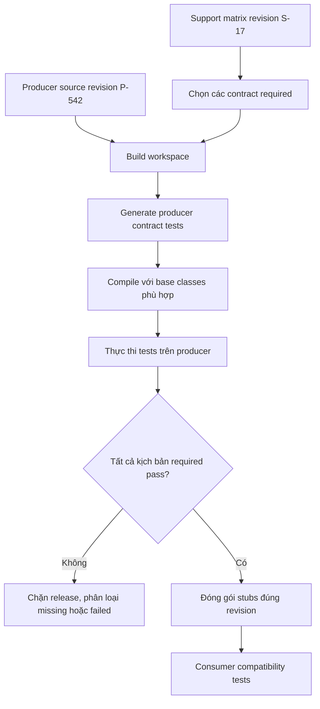
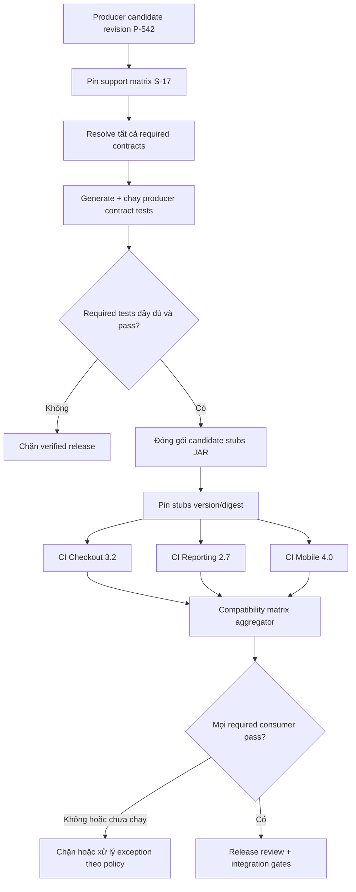
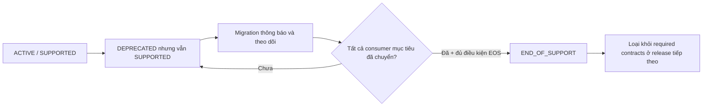

# Xác minh hợp đồng của các consumer còn được hỗ trợ

## 1. Vì sao “consumer mới nhất chạy tốt” vẫn chưa đủ?

Trong **Spring Cloud Contract**, **producer** là dịch vụ cung cấp HTTP API hoặc phát thông điệp; **consumer** là dịch vụ gọi API hoặc nhận thông điệp. Nhóm có thể mô tả giao diện bằng **Groovy/YAML DSL**, sinh kiểm thử phía producer, phát hành **stub**, chạy consumer tests với **Stub Runner** và tích hợp CI để phát hiện thay đổi không tương thích.

Giả sử `order-service` phục vụ ba consumer:

- `checkout-service` bản 3.2 đang đọc trường `status` từ HTTP response.
- `reporting-service` bản 2.7 vẫn đọc `status` nhưng chỉ được cập nhật theo chu kỳ hàng tháng.
- `mobile-gateway` bản 4.0 mới đã chuyển sang trường `state`.

Producer muốn đổi JSON từ:

```json
{"orderId":"ord-42","status":"CONFIRMED"}
```

thành:

```json
{"orderId":"ord-42","state":"CONFIRMED"}
```

Kiểm thử của `mobile-gateway` bản mới có thể xanh. Tuy nhiên, **checkout** và **reporting** đang được hỗ trợ vẫn có thể hỏng khi triển khai producer mới. Nếu CI chỉ chạy bộ hợp đồng của consumer mới nhất, kết quả xanh chưa phải bằng chứng producer tương thích với **tập consumer mục tiêu**.

**Nguyên tắc cốt lõi:** Mỗi bản producer chuẩn bị phát hành phải được xác minh với **tất cả các hợp đồng còn hiệu lực của những consumer còn được tổ chức cam kết hỗ trợ**, đồng thời consumer tests phải chạy với stub/artifact tương ứng. Những consumer đã hết hỗ trợ cần được loại khỏi phạm vi bằng **quyết định có thể truy vết**, không phải vô tình biến mất khỏi source root hoặc bộ lọc test.

Mục tiêu của bài:

1. Xác định thế nào là một consumer **còn được hỗ trợ**, phân biệt khỏi “consumer mới nhất”.
2. Thiết kế **ma trận tương thích** giữa bản producer và các consumer/version đang hoạt động.
3. Giữ hợp đồng của consumer cũ khi producer thêm khả năng mới; phân biệt thay đổi tương thích và phá vỡ.
4. Tổ chức contract sources, generated producer verification, stub publication và consumer CI theo version.
5. Áp dụng chính sách ngừng hỗ trợ/deprecation có kiểm soát.
6. Thực hành điều tra một thay đổi HTTP hoặc messaging làm consumer cũ bị ảnh hưởng.

## 2. Consumer “còn được hỗ trợ” nghĩa là gì?

Một consumer được hỗ trợ không nhất thiết là phiên bản mới nhất hay consumer vẫn có repository hoạt động. Nó là **một phiên bản hoặc nhóm phiên bản mà producer/đơn vị sở hữu API còn cam kết giữ khả năng giao tiếp trong một thời hạn hoặc theo một chính sách đã công bố**.

Ví dụ chính sách:

| Consumer | Phiên bản đang vận hành | Trạng thái hỗ trợ | Điều producer phải giữ |
| --- | --- | --- | --- |
| `checkout-service` | `3.2.x` | **Supported** | HTTP `GET /api/orders/{id}` có `status` |
| `reporting-service` | `2.7.x` | **Supported**, đến cuối đợt migration | `status` và mã lỗi `ORDER_NOT_FOUND` |
| `mobile-gateway` | `4.0.x` | **Supported** | Có thể đọc `state` và `status` trong chuyển tiếp |
| `legacy-exporter` | `1.1.x` | **End-of-support**, đã được chấp thuận | Không bắt buộc bảo vệ sau thời điểm hỗ trợ kết thúc |
| `fraud-service` | `5.0-rc` | **Candidate** | Kiểm tra sớm, chưa coi là consumer production đang được hỗ trợ |

Các phiên bản và trạng thái chỉ là ví dụ. Nhóm cần nguồn dữ liệu đáng tin: service catalog, manifest triển khai, product owner, consumer registration hoặc hợp đồng hỗ trợ. Không suy rằng “không có request trong log tuần này” nghĩa là consumer đã ngừng sử dụng API: có thể nó chỉ chạy batch theo tháng, trong quy trình dự phòng hoặc ở một vùng chưa có telemetry.

### Ba danh sách cần phân biệt

1. **Consumer đang chạy**: đã quan sát được trong deployment/telemetry.
2. **Consumer còn được hỗ trợ**: được bao phủ bởi cam kết tương thích của producer hoặc tổ chức.
3. **Consumer đang thử nghiệm**: có contract candidate nhưng chưa deploy hoặc chưa được chấp thuận.

Ba tập này có thể giao nhau nhưng **không đồng nhất**. Tập cần bảo vệ trước release thường là **consumer còn được hỗ trợ** cộng với những candidate mà nhóm quyết định đưa vào release gate; cách xử lý khác biệt phải được ghi trong policy.

### Ghi rõ phạm vi hỗ trợ theo khả năng

Một dịch vụ có thể còn hỗ trợ `checkout-service` bản 3.2 cho **GET /api/orders/{id}` nhưng không bảo đảm một endpoint thử nghiệm riêng. Vì vậy policy nên liên kết **consumer version → những contract/scenario đang được hỗ trợ**, chứ không chỉ ghi tên service. Đây là điều kiện để việc kiểm chứng có phạm vi thực tế.

## 3. Định nghĩa tính tương thích theo cặp phiên bản

Ký hiệu:

- `P(v)`: producer phiên bản `v`.
- `C_i(w)`: consumer thứ `i`, phiên bản `w`.
- `K_i(w)`: tập những kịch bản contract mà consumer ấy đang phụ thuộc.
- `S`: tập consumer/version **còn được hỗ trợ** tại thời điểm phát hành.

Một yêu cầu tối thiểu cho producer release:

\[
\forall C_i(w) \in S,\quad
P(v) \models K_i(w)
\]

Đọc: *Với từng consumer/version còn được hỗ trợ, producer chuẩn bị phát hành phải đáp ứng các hợp đồng tương ứng*. Ký hiệu `\models` ở đây là cách diễn đạt **mục tiêu kiểm chứng**, không phải tính toán tự động mà Spring Cloud Contract cung cấp sẵn.

Quan hệ cần kiểm tra là **producer version × consumer version**, không chỉ “contract version mới nhất”. Một producer có thể hỗ trợ consumer 2.x lẫn 3.x cùng lúc; một consumer có thể tương thích với producer 1.5 và 1.6 nhưng không với 2.0.

| Producer / consumer | Checkout 3.2 | Reporting 2.7 | Mobile 4.0 | Có thể release theo policy ở mục 2? |
| --- | --- | --- | --- | --- |
| `order-service 1.5` | Pass | Pass | Không hỗ trợ field `state` | Không, nếu Mobile 4.0 bắt buộc |
| `order-service 1.6-rc1` | Fail do mất `status` | Fail do mất `status` | Pass | **Không** |
| `order-service 1.6-rc2` | Pass | Pass | Pass | **Có thể**, sau các gate còn lại |

“Pass” trong bảng nghĩa là **những assertions và tình huống đã định nghĩa** được thực thi thành công, không phải mọi hành vi production đều đã được chứng minh.

### Vì sao dùng ma trận thay vì một boolean toàn hệ thống?

Một dòng `compatibility = PASS` dễ che việc producer chỉ mới chạy test với Checkout 3.3 nhưng Reporting 2.7 chưa được kiểm tra. Ma trận giúp thấy **ô chưa chạy**, **ô thất bại**, **ô không còn yêu cầu** và nguyên nhân. Nó cũng cho phép team quyết định rollout theo nhóm/vùng khi nhiều bản consumer đang hoạt động.

## 4. Quy trình lập danh sách hợp đồng bắt buộc

Trước khi bật release gate, nên lập **compatibility inventory**:

| Contract ID | Producer | Consumer/version | HTTP hoặc messaging | Trạng thái | Owner |
| --- | --- | --- | --- | --- | --- |
| `ORD-GET-200` | Order | Checkout 3.2, Reporting 2.7 | HTTP 200, field `status` | Required | Order + Checkout |
| `ORD-GET-404` | Order | Reporting 2.7 | HTTP 404, `code` | Required | Order + Reporting |
| `ORD-GET-V2` | Order | Mobile 4.0 | HTTP 200, field `state` | Required | Order + Mobile |
| `ORD-EVENT-1` | Order | Notification 2.1 | Message `OrderConfirmed` | Required | Order + Notification |
| `ORD-BETA-1` | Order | Fraud 5.0-rc | Event experimental | Candidate | Order + Fraud |

Hợp đồng có thể được **chia sẻ giữa nhiều consumers** nếu họ sử dụng cùng giao diện. Không nhất thiết nhân bản `ORD-GET-200` thành nhiều tệp giống nhau; quan trọng là inventory biết **những consumer nào sẽ bị ảnh hưởng khi đổi contract ấy**.

### Nguồn inventory có thể đến từ đâu?

- Registry/service catalog ghi các consumer và version còn được hỗ trợ.
- Pull request contracts của consumer và producer đã được chấp thuận.
- Deployment manifests, release notes, runtime telemetry có thời gian theo dõi đủ đại diện.
- Quyết định deprecation và end-of-support được ghi nhận.

Không tự động xóa contract vì một consumer chưa cập nhật SDK, hoặc vì tháng này không có commit trong repo consumer. Trước khi loại một ô ma trận, cần có **quyết định hỗ trợ đã kết thúc** và bằng chứng rollout/notification thích hợp.

### Chốt thời điểm kiểm chứng

Tập `S` cần được chụp lại (*snapshot*) ở một thời điểm xác định của release. Nếu đang chạy CI mà danh sách consumer đổi vì một team vừa merge PR, kết quả có thể khó tái lập. Hãy ghi `supportMatrixRevision` hoặc build metadata tương đương; mọi thay đổi danh sách sau đó cần làm mới verification/candidate gate theo policy.

## 5. Ví dụ breaking change: từ `status` sang `state`

Giả sử API cũ:

```http
GET /api/orders/42 HTTP/1.1
Accept: application/json
```

```json
{
  "orderId": "ord-42",
  "status": "CONFIRMED"
}
```

Mobile 4.0 muốn tên trường `state` thay cho `status`. Một thay đổi trực tiếp:

```json
{
  "orderId": "ord-42",
  "state": "CONFIRMED"
}
```

có nguy cơ phá vỡ Checkout 3.2 và Reporting 2.7. Thay đổi **an toàn hơn trong giai đoạn chuyển tiếp** có thể là:

```json
{
  "orderId": "ord-42",
  "status": "CONFIRMED",
  "state": "CONFIRMED"
}
```

Nhưng đây vẫn chỉ là **ứng viên tương thích**, cần test thực tế: một consumer deserialize JSON ở chế độ nghiêm ngặt có thể từ chối trường `state` mới. Nếu có API version tách riêng như `/v2/api/orders`, consumer mới có thể gọi v2 còn consumer cũ tiếp tục gọi v1; đổi lại producer phải hỗ trợ nhiều giao diện trong giai đoạn đã cam kết.

### Các quyết định migration cần ghi

1. Consumer/version nào đọc `status`?
2. Có consumer nào từ chối JSON extra fields không?
3. `state` có cùng enum và semantic với `status` không, hay chỉ đổi tên?
4. Có plan deprecation rõ: thông báo, ngày kết thúc hỗ trợ, kiểm tra rollout?
5. Producer sẽ phát cả hai field hay tạo API version mới?
6. Những generated producer tests và Stub Runner consumer tests nào phải chạy trước release?

**Không nên xóa trường cũ khỏi contract chỉ vì code producer mới không còn xuất nó.** Contract là thỏa thuận với consumer còn được hỗ trợ; sửa một phía để test pass không phải minh chứng các consumer đã chuyển đổi.

## 6. Groovy DSL: bảo vệ giao diện đang được consumer cũ sử dụng

Một contract producer-owned cho Checkout 3.2:

```groovy
import org.springframework.cloud.contract.spec.Contract

Contract.make {
    description 'Checkout 3.x đọc đơn hàng qua API hiện tại'

    request {
        method GET()
        url '/api/orders/42'
        headers {
            accept(applicationJson())
        }
    }

    response {
        status OK()
        headers {
            contentType(applicationJson())
        }
        body([
            orderId: 'ord-42',
            status: 'CONFIRMED'
        ])
    }
}
```

Contract này bảo vệ việc producer trả field `status` cho một kịch bản xác định. Generated producer test sẽ gửi request và xác minh những assertion được sinh; WireMock stub sẽ cung cấp response mẫu tương ứng. **Phải kiểm tra generated test thực tế** để biết matcher có cho phép extra response fields hay không trong phiên bản Spring Cloud Contract đang dùng — đừng tự cho rằng mọi kiểm tra JSON luôn strict hoặc luôn lenient.

### Thêm yêu cầu mới mà không xóa giao diện cũ

Nếu producer chọn versioned endpoint, có thể thêm contract khác cho Mobile 4.0:

```groovy
import org.springframework.cloud.contract.spec.Contract

Contract.make {
    description 'Mobile 4.x dùng giao diện v2'

    request {
        method GET()
        url '/v2/api/orders/42'
        headers {
            accept(applicationJson())
        }
    }

    response {
        status OK()
        headers {
            contentType(applicationJson())
        }
        body([
            orderId: 'ord-42',
            state: 'CONFIRMED'
        ])
    }
}
```

Hai contract có **request path khác nhau**, nên stub có thể chọn mapping rõ ràng: `/api/orders/42` cho consumer cũ, `/v2/api/orders/42` cho consumer mới. Không nhất thiết đây là phương án tốt nhất về thiết kế API; mục tiêu ví dụ là làm rõ **cách cùng một producer xác minh hai giao diện còn được hỗ trợ**.

### Nếu muốn cùng path và trả cả hai field?

Khi producer có một response chứa cả `status` và `state`, cần cân nhắc **một contract hợp nhất** mô tả response thật:

```groovy
response {
    status OK()
    headers {
        contentType(applicationJson())
    }
    body([
        orderId: 'ord-42',
        status: 'CONFIRMED',
        state: 'CONFIRMED'
    ])
}
```

**Không tạo hai WireMock mappings cùng `GET /api/orders/42`, cùng headers/query, nhưng một mapping trả chỉ `status` và mapping kia trả chỉ `state`** rồi chờ Stub Runner đoán consumer nào đang gọi. Hai mappings không có điều kiện phân biệt sẽ xung đột hoặc khiến test chọn response ngoài dự kiến. Có thể dùng versioned path, version header rõ ràng, hoặc **một mapping hợp nhất** theo hợp đồng đã đồng thuận.

Nếu consumer cũ **không nhận extra fields**, trả cả hai có thể vẫn gây lỗi; cần test consumer cụ thể. Trường hợp đó nên phân tách endpoint/media type/versioning hoặc có migration plan tương ứng.

## 7. YAML DSL: kiểm chứng cả success và lỗi mà consumer cũ cần

Một consumer cũ có thể vẫn dựa vào error code `ORDER_NOT_FOUND` để hiển thị thông báo phù hợp. Khi sửa DTO thành `state`, đừng vô tình làm mất các hợp đồng lỗi.

Ví dụ YAML contract cho response 404:

```yaml
description: Reporting 2.x xử lý đơn hàng không tồn tại
request:
  method: GET
  url: /api/orders/999
  headers:
    Accept: application/json
response:
  status: 404
  headers:
    Content-Type: application/json
  body:
    code: ORDER_NOT_FOUND
    message: Đơn hàng không tồn tại
```

Consumer test nên assert **cả HTTP status và `code`**, bởi WireMock có thể trả 404 mặc định khi request không match stub. Một test chỉ assert status 404 có thể pass dù hợp đồng lỗi nghiệp vụ chưa được nạp.

### Phải tránh khóa dữ liệu ngẫu nhiên

Nếu producer trả `eventId`, `correlationId` hoặc timestamp được sinh động, hãy dùng matcher phù hợp định dạng/kiểu thay vì bắt đúng một UUID mẫu. Nhưng không nới matcher cho `status`, `state` hoặc error code tới `.*` chỉ để test pass: đó có thể là trường consumer dựa vào chính xác.

Trong Spring Cloud Contract DSL, với **request**, matcher phía consumer thường ảnh hưởng việc stub match input; với **response**, matcher phía producer giúp generated test xác minh output động. Khi chuyển Groovy sang YAML, kiểm tra đúng ý nghĩa của `consumer(...)`, `producer(...)` và `request.matchers`/`response.matchers` ở phiên bản plugin đang dùng.

### Hợp đồng không tự chứng minh toàn bộ enum

Nếu `status` có `CONFIRMED`, `PENDING`, `CANCELLED` và `FAILED`, một contract chỉ mô tả `CONFIRMED` **không chứng minh** producer phát đúng tất cả giá trị. Cần thống kê các trạng thái consumer còn dùng, thêm các kịch bản quan trọng và xác minh versioning của enum. Với trường hợp “consumer bỏ qua unknown status”, cần test hành vi fallback thực tế, không chỉ dựa trên contract matcher.

## 8. Tổ chức hợp đồng theo consumer và phiên bản

Spring Cloud Contract cho phép tổ chức DSL theo thư mục. Việc phân nhóm giúp reviewer biết **kịch bản nào phục vụ consumer nào**, nhưng cách plugin đọc thư mục, tạo package hay lọc stub có thể phụ thuộc build tool/version.

Ví dụ một source tree **theo quy ước tổ chức**:

```text
src/contractTest/resources/contracts/
  order-service/
    checkout-3x/
      get-order-success.groovy
    reporting-2x/
      get-order-not-found.yml
    mobile-4x/
      get-order-v2.groovy
    notification-2x/
      order-confirmed.groovy
    candidates/
      fraud-5x/
        enriched-order-event.groovy
```

Đây không phải schema thư mục bắt buộc của Spring Cloud Contract. Trong một repo có nhiều producers, cần định nghĩa rõ root producer nào được verifier lấy. **Không coi tên thư mục `checkout-3x` tự động ràng buộc phiên bản runtime**: phải liên kết với compatibility inventory và support policy.

### Ba cách tổ chức hợp đồng mà vẫn giữ được tính đúng

| Cách | Điểm mạnh | Rủi ro phải quản lý |
| --- | --- | --- |
| **Hợp đồng chung theo endpoint/event** | Tránh nhân bản schema giống nhau; dễ thay đổi đồng thời | Cần inventory để biết consumer nào phụ thuộc |
| **Hợp đồng riêng theo consumer** | Consumer tự đưa yêu cầu và review theo nhu cầu | Nhiều tệp có thể trùng request gây stub conflict |
| **Hợp đồng theo API/event version** | Phân tách giao diện v1/v2 rõ ràng | Phải giữ version cũ trong thời gian hỗ trợ |

Một mô hình kết hợp thường hữu ích: các contract chung bảo vệ giao diện chia sẻ, còn contract consumer-specific mô tả những kịch bản **thực sự khác biệt**. Không nhất thiết copy cùng một contract sang ba thư mục chỉ để “đếm ba consumer”.

### Khi consumer-specific contracts có cùng method và URL

Hai consumer có thể gửi **cùng một HTTP request** nhưng muốn response khác. Đây là dấu hiệu cần **thỏa thuận lại giao diện**, ví dụ phân biệt bằng version header, route hoặc quyền truy cập, chứ không phải chỉ đặt hai contract ở hai thư mục rồi giao việc chọn mapping cho WireMock. Consumer-specific filtering của Stub Runner (nếu được phiên bản hỗ trợ) giúp chọn mapping cho bộ test nhưng **không bảo đảm producer có thể đáp ứng hai response mâu thuẫn trong production**.

## 9. Producer verification cho tất cả hợp đồng còn hiệu lực

**Producer verification** là lớp kiểm tra bắt buộc của lời hứa API. Trong Spring Cloud Contract, luồng thường là:



Lưu ý `required` là **trạng thái do support policy quyết định**, không phải một keyword chuẩn trong mọi Groovy/YAML contract. Trước khi dùng filter, CI phải biết các kịch bản nào bắt buộc và vì sao.

### Checklist để producer test thực sự có giá trị

1. Tập contract đầu vào bao gồm những kịch bản required của **toàn bộ supported consumers**.
2. Source root, include/exclude/ignored patterns và đường dẫn contract được kiểm tra.
3. Generated tests thực sự biên dịch và chạy, không chỉ tạo ra source files.
4. Test framework và base class phù hợp: JUnit 5/4, Spock; MockMvc/HTTP thực/messaging adapter.
5. Test gọi producer implementation ở đúng phạm vi; không mock chính response cần bảo vệ.
6. Test report ghi `executed`, `failed`, `skipped` và các scenario ID bắt buộc.
7. Mọi thay đổi output contract phải qua review và chạy lại trên **producer code mục tiêu**.

Đừng chỉ đặt điều kiện “generated test count `> 0`”. Nếu `reporting-service` còn hỗ trợ nhưng folder contract lỗi bị bộ lọc bỏ qua, 20 tests khác có thể vẫn xanh. **Coverage gate cần đối chiếu danh sách required scenarios**, không chỉ tổng số.

## 10. Gradle/Maven: đưa tập contract được hỗ trợ vào producer build

Một producer Gradle thường sử dụng plugin Spring Cloud Contract và task `contractTest`; một producer Maven thường dùng `spring-cloud-contract-maven-plugin` trong lifecycle tương ứng. Quan trọng nhất là **đầu vào contract** và **bằng chứng test đã chạy**.

### Ví dụ Gradle producer-owned

```groovy
plugins {
    id 'java'
    id 'org.springframework.cloud.contract' version 'REPLACE_WITH_COMPATIBLE_SCC_VERSION'
}

contracts {
    testFramework = 'JUNIT5'
    testMode = 'MockMvc'
    baseClassForTests = 'com.example.orders.contract.OrderContractBase'
    contractsDslDir = file('src/contractTest/resources/contracts')
    failOnNoContracts = true
}

tasks.named('contractTest', Test) {
    useJUnitPlatform()
}
```

Đoạn này là **khung minh họa**, chưa phải build file chạy ngay: cần plugin/dependency/JDK/Spring Boot versions tương thích, repositories và base class trên test classpath. Với producer không dùng Spring MVC, `MockMvc` có thể không phù hợp; cần test mode khác. Trong bài này, yếu tố đáng chú ý là `contractsDslDir` phải chứa **cả hợp đồng dành cho consumer cũ còn hỗ trợ**, không chỉ các contract mới.

Các lệnh thực hành:

```bash
./gradlew generateContractTests
./gradlew contractTest
```

`generateContractTests` **không** thay thế `contractTest`. Kiểm tra generated Java/Groovy test files và báo cáo thực thi. Nếu dùng multi-module Gradle, có thể chạy theo prefix module, ví dụ `:order-service:contractTest`.

### Ví dụ Maven ở producer

Một cấu hình plugin Maven thường cần `baseClassForTests`, hợp đồng trong source root và test framework tương ứng:

```xml
<plugin>
    <groupId>org.springframework.cloud</groupId>
    <artifactId>spring-cloud-contract-maven-plugin</artifactId>
    <extensions>true</extensions>
    <configuration>
        <baseClassForTests>
            com.example.orders.contract.OrderContractBase
        </baseClassForTests>
    </configuration>
</plugin>
```

`version` của plugin, dependency management/BOM, test mode, generator và JUnit runner cần đặt trong POM thực tế. Với lifecycle đã nối đúng:

```bash
./mvnw -B clean verify
```

Maven và Gradle có **mặc định source root/filter khác nhau** giữa các phiên bản; đừng sao chép `ignoredFiles` Gradle thành property Maven nếu chưa kiểm tra plugin. Với repository contract riêng, producer còn phải pin `contractDependency`/`contractsMode`/`contractsPath` hoặc checkout Git revision nguồn để đảm bảo tập hợp đồng chính xác.

### Tách candidate khỏi required bằng cách nào?

Một số dự án dùng thư mục `candidates` hoặc tag trong metadata để biết hợp đồng đang thử nghiệm. **Không đồng nghĩa plugin tự hiểu nhãn đó**. Cấu hình filter phải đảm bảo:

- **Required contracts:** luôn được đưa vào release verification và stubs artifact chính thức.
- **Candidate contracts:** có thể chạy trong job riêng để feedback sớm; nếu producer chưa hỗ trợ thì không làm sai lệch thông báo “release required contracts pass”.
- **Retired contracts:** chỉ được loại khỏi required sau quyết định end-of-support có thể truy vết.

Nếu cần kiểm chứng candidate, hãy có task/job rõ và metadata báo cáo riêng. Đừng làm mất kết quả `required` khi chạy chọn lọc hoặc bật cờ bỏ qua failure để candidate không chặn release.

## 11. Consumer tests với Stub Runner: kiểm tra từng phiên bản đang được hỗ trợ

Consumer test không chạy producer thật, nhưng kiểm tra **HTTP client hoặc message listener thực sự của consumer** trước một stub mẫu đã được producer xác minh. Vì vậy nó phải chạy trên **đúng phiên bản source/artifact của consumer** mà policy còn hỗ trợ, không chỉ cùng một nhánh `main`.

Ví dụ Checkout 3.2 dùng `@AutoConfigureStubRunner`:

```java
import org.junit.jupiter.api.Test;
import org.springframework.beans.factory.annotation.Autowired;
import org.springframework.boot.test.context.SpringBootTest;
import org.springframework.cloud.contract.stubrunner.StubRunnerProperties;
import org.springframework.cloud.contract.stubrunner.spring.AutoConfigureStubRunner;

import static org.assertj.core.api.Assertions.assertThat;

@SpringBootTest(properties =
    "clients.order.base-url=http://localhost:9090")
@AutoConfigureStubRunner(
    ids = "com.example:order-service:1.6.0-rc2:stubs:9090",
    stubsMode = StubRunnerProperties.StubsMode.LOCAL
)
class Checkout32ContractTest {

    @Autowired
    OrderClient orderClient;

    @Test
    void keepsReadingOldStatusField() {
        OrderDto order = orderClient.getOrder("42");
        assertThat(order.status()).isEqualTo("CONFIRMED");
    }
}
```

`OrderClient` và `OrderDto` là các kiểu ứng dụng giả định, phải được triển khai theo Checkout 3.2 thật. Property `clients.order.base-url` cũng là property minh họa của consumer, không phải thiết lập Stub Runner bắt buộc. Chỉ khi HTTP client gọi **đúng WireMock trên 9090** và mapping tương ứng mới có bằng chứng consumer test.

Đây là khung cho `LOCAL`: artifact stubs cần được install vào Maven local repository trên máy chạy test; CI ở repository độc lập có thể dùng `REMOTE` với repository URL và credentials an toàn.

### Không dùng một consumer build đại diện cho tất cả

Nếu Checkout 3.2 và 3.3 có DTO/HTTP client khác nhau, chạy một test trên Checkout 3.3 chưa chứng minh Checkout 3.2 vẫn chấp nhận response. Cần chạy **test code của version thực**, dùng versioned branch, tag, container artifact hoặc một môi trường có khả năng kiểm thử binary/SDK cũ. Nếu không thể thực thi consumer cũ, phải ghi rõ khoảng trống bằng chứng và cân nhắc API smoke tests/compatibility tests bổ sung.

### Consumer có thể tiếp tục dùng stub của producer cũ

Một consumer vẫn deploy Checkout 3.2 nhưng test với `order-service:1.5.0:stubs` có thể xanh. Điều đó **không chứng minh** Checkout 3.2 chạy được với producer `1.6.0` đang chuẩn bị release. Khi kiểm chứng release candidate, nên chạy consumer version đang hỗ trợ với **stub tạo từ chính producer candidate đã qua verification**, không tự động dùng stub cũ đã lưu trong cache.

### Per-consumer stubs: công cụ lựa chọn, không phải giấy phép đổi API

Một số phiên bản Spring Cloud Contract/Stub Runner hỗ trợ **lọc stub theo consumer** (thường được mô tả bằng tùy chọn `stubsPerConsumer` hoặc cấu hình consumer name tương ứng). Tính năng này giúp một consumer chỉ nạp những stub liên quan. Tuy nhiên:

- Cú pháp và đường dẫn được hỗ trợ thay đổi theo phiên bản/build tool, cần đối chiếu tài liệu đúng version.
- Một producer release vẫn phải verify **toàn bộ required contracts**, không chỉ tập stub được từng consumer nạp.
- Không được dùng lọc theo consumer để che hai hợp đồng có **request giống hệt nhưng response mâu thuẫn trong production**.
- Nếu một contract được chia sẻ, cần đảm bảo việc lọc không làm consumer khác mất mapping bắt buộc.

**Tách việc “chọn stub để test consumer” khỏi việc “chứng minh producer có đáp ứng mọi consumer cần hỗ trợ”.** Đây là hai quyết định có phạm vi khác nhau.

## 12. Messaging: còn hỗ trợ consumer cũ nghĩa là giữ cả destination và header

Trong messaging, thay đổi phá vỡ không chỉ là JSON field. Consumer có thể phụ thuộc:

- Destination hoặc binding logic như `orders.confirmed`.
- Header `eventType: OrderConfirmed`.
- Schema/version của payload.
- `orderId`, `eventId`, `occurredAt` hoặc các field tương quan.
- Kiểu serialize thực tế (JSON, Avro, Protobuf...), enum values và nullability.

Một contract Groovy minh họa:

```groovy
import org.springframework.cloud.contract.spec.Contract

Contract.make {
    description 'Notification 2.x nhận OrderConfirmed'
    label 'order_confirmed_v1'

    input {
        triggeredBy('confirmOrder()')
    }

    outputMessage {
        sentTo('orders.confirmed')
        headers {
            header('eventType', 'OrderConfirmed')
            messagingContentType(applicationJson())
        }
        body([
            eventId: $(consumer('evt-701'),
                       producer(regex('evt-[0-9]+'))),
            orderId: 'ord-42',
            status: 'CONFIRMED'
        ])
    }
}
```

Nếu producer mới chuyển sang `orders.events.v2` và `eventType = OrderApproved` mà không phát thông điệp cũ, Notification 2.x có thể **không nhận được message nào** dù JSON mới vẫn có đủ ID. Producer verification với contract cũ phải phát hiện sai khác ở destination/header nếu adapter test được cấu hình đúng. Consumer test với `StubTrigger` chỉ cho biết listener xử lý được **stub cũ**; nó không chứng minh code producer mới vẫn publish vào destination cũ.

### Kế hoạch chuyển tiếp messaging

Trong một giai đoạn hỗ trợ đồng thời có thể:

1. Producer giữ phát `OrderConfirmed` trên destination v1 cho consumer cũ.
2. Producer phát thêm event v2 trên destination/event type mới cho consumer mới, nếu kiến trúc cho phép.
3. Xác minh **hai** message contracts bằng producer tests tương ứng.
4. Kiểm thử consumer v1/v2 với stub phù hợp và broker integration riêng cho routing, serializer, acknowledgment.
5. Theo dõi rollout, duplicate và idempotency nếu cùng một nghiệp vụ sinh nhiều event để tránh xử lý trùng.

**Không giả định contract verification tự kiểm tra giao hàng đúng một lần, ordering hoặc transaction/outbox.** Khi hai event version cùng tồn tại, double processing là rủi ro nghiệp vụ cần kiểm thử riêng.

## 13. Thiết kế CI: producer candidate phải vượt qua toàn bộ required contracts

Một quality gate có ý nghĩa thường có **hai cấp**:

1. **Producer-level gate:** producer candidate đáp ứng **tất cả các required contracts** của tập supported consumers.
2. **Consumer-level gate:** từng consumer version được hỗ trợ xử lý được những stubs/scenarios tương ứng với producer candidate.



### Vì sao producer gate phải chạy trước publication?

Nếu stubs JAR được phát hành dưới nhãn verified trong khi producer chưa pass tests, consumer có thể chạy thành công với **response mô phỏng không do producer thực tế tạo ra**. Cần gắn cổng producer verification vào quy trình package/publish. Candidate stubs chưa verified có thể được dùng nội bộ để phát triển song song, nhưng phải có version/nhãn phân biệt và không coi chúng là bằng chứng producer tương thích.

### Vẫn cần consumer gate sau producer verification?

**Có**, vì producer test và consumer test trả lời hai câu hỏi khác:

| Bằng chứng | Điều kiểm tra | Điều không tự kiểm tra |
| --- | --- | --- |
| Producer generated contract test | Producer trả/phát dữ liệu phù hợp assertions | Consumer DTO, error handling, listener có xử lý đúng không |
| Consumer Stub Runner test | Consumer xây request/deserialize/xử lý một mẫu đã cam kết | Code producer hiện tại có đang đáp ứng contract không |
| Compatibility matrix | Các phiên bản consumer mục tiêu đã được chạy với stub candidate chưa | Những luồng không được biểu diễn trong contracts |
| Broker/HTTP integration/E2E | Tương tác runtime và vận hành được cấu hình | Không tự thay thế toàn bộ contract scenarios |

Khi CI cần tiết kiệm thời gian, có thể song song hóa consumer suites, cache **artifacts bất biến**, chia kịch bản theo mức rủi ro và dùng gating theo merge/release. Nhưng không nên im lặng bỏ một consumer được hỗ trợ chỉ vì test của nó chạy lâu; quyết định ngoại lệ cần có người chịu trách nhiệm và được ghi nhận.

## 14. Báo cáo ma trận: phân biệt PASS, FAIL, NOT_RUN và NOT_REQUIRED

Một bảng release candidate thực tế nên có ít nhất:

| Consumer/version | Contract revision | Producer verifier | Consumer test với candidate stub | Trạng thái tổng |
| --- | --- | --- | --- | --- |
| Checkout 3.2 | `ORD-GET-200@C-128` | PASS | PASS | **PASS** |
| Reporting 2.7 | `ORD-GET-404@C-128` | PASS | NOT_RUN | **INCOMPLETE** |
| Mobile 4.0 | `ORD-GET-V2@C-128` | PASS | PASS | **PASS** |
| Notification 2.1 | `ORD-EVENT-1@C-128` | FAIL | PASS với stub cũ | **FAIL** |
| Legacy Exporter 1.1 | Không còn hỗ trợ | NOT_REQUIRED | NOT_REQUIRED | **EXEMPT**, có quyết định EOS |

**Không dùng “chưa chạy” như một trạng thái xanh**. Một ô `NOT_RUN` có thể do CI chưa kết nối repository consumer, thiếu credentials hoặc test environment unavailable; nó khác với `NOT_REQUIRED` đã được product/engineering owner xác nhận.

### Quy ước trạng thái minh bạch

| Trạng thái | Ý nghĩa |
| --- | --- |
| **PASS** | Tests bắt buộc đã chạy và pass với version/provenance xác định |
| **FAIL** | Ít nhất một assertion đã thực thi và phát hiện sai khác |
| **NOT_RUN** | Chưa thực thi hoặc thiếu báo cáo; **không có bằng chứng** |
| **SKIPPED** | Có test nhưng bị skip theo cấu hình; cần policy riêng, không mặc nhiên pass |
| **NOT_REQUIRED** | Không nằm trong support matrix được phê duyệt cho release này |
| **INCOMPLETE** | Thiếu một hay nhiều bằng chứng bắt buộc |
| **CANDIDATE_ONLY** | Kịch bản thử sớm, chưa là cam kết release |

Đây là **quy ước báo cáo CI do nhóm tự thiết kế**, không phải giá trị trạng thái mặc định của Spring Cloud Contract DSL. Tên trạng thái có thể khác trong Jenkins/GitHub Actions/GitLab nhưng ý nghĩa nên rõ ràng.

### Cần lưu provenance cho mỗi ô

Một record minh họa:

```yaml
producer:
  service: order-service
  artifactVersion: 1.6.0-rc2
  sourceRevision: P-542
contracts:
  sourceRevision: C-128
  supportMatrixRevision: S-17
verification:
  expectedRequiredScenarios: 14
  executed: 14
  failed: 0
  skipped: 0
stubs:
  coordinates: "com.example:order-service:1.6.0-rc2:stubs"
  sha256: "<digest-from-CI>"
consumer:
  service: reporting-service
  version: 2.7.4
  sourceRevision: R-307
  scenariosPassed: 3
  scenariosFailed: 0
  result: PASS
```

Các mã revision, số test và digest là **dữ liệu giả định để hướng dẫn thiết kế**. Trong pipeline thật chỉ điền những giá trị được thu từ build; một `sha256` không được tính ra thì phải ghi thiếu, không tự đoán. Tương tự, `expectedRequiredScenarios` nên được xác định từ inventory/versioned policy, không hard-code một con số khiến team quên cập nhật khi có contract mới.

### Khi số scenario không bằng số file contract

Một file DSL có thể biểu diễn nhiều hợp đồng hoặc một framework có thể sinh nhiều test methods cho một source file. Vì thế quality gate cần theo **contract/scenario ID hoặc generated test identity**, không chỉ đếm `.groovy` và `.yml`. Nếu input là 20 files nhưng 1 file quan trọng bị filter mất, việc executed count bằng 19 vẫn cần báo lỗi theo inventory.

## 15. Thời hạn hỗ trợ và quy trình loại hợp đồng cũ

Giữ mọi hợp đồng mãi mãi có thể tạo chi phí đáng kể; nhưng xóa quá sớm sẽ phá vỡ consumer. Cần một **deprecation lifecycle** rõ:



Ví dụ lộ trình:

1. Ngày thông báo: `status` sẽ được thay bởi `state`, cung cấp tài liệu và ví dụ version mới.
2. Trong thời gian hỗ trợ: producer tiếp tục giữ `status` hoặc API v1; CI vẫn chạy **required contracts cũ**.
3. Consumer teams cập nhật, kiểm thử với candidate stub v2, xác minh rollout thực tế.
4. Hết thời hạn có thỏa thuận: owner chốt `END_OF_SUPPORT`, ghi danh sách consumer còn sót và phương án xử lý ngoại lệ nếu có.
5. Chỉ sau đó mới loại contract cũ khỏi **required set** và cho producer bỏ behavior cũ ở version phù hợp.

Không nên quyết định EOS chỉ dựa vào việc repository consumer cũ đã bị archive: một binary cũ có thể còn đang deploy. Ngược lại, việc giữ mã source cũ trong Git không đồng nghĩa nó phải được hỗ trợ vô thời hạn nếu policy đã kết thúc.

### Cần thu bằng chứng gì trước khi retire?

- Danh sách tất cả consumer/version đã thông báo và thời hạn.
- Xác nhận rollout lên những môi trường/vùng quan trọng hoặc kế hoạch ngoại lệ.
- Telemetry có khoảng quan sát phù hợp với tần suất thực tế (kể cả batch).
- Sự đồng ý từ API owner/product owner hoặc chính sách enterprise.
- Release notes, migration instructions và rollback plan.
- Source revision của support matrix thay đổi trạng thái.

**Retirement phải là một thay đổi có review trong support matrix**, không phải một bộ lọc `ignoredFiles` bất ngờ xuất hiện để CI chạy nhanh.

## 16. Kiểm chứng thay đổi phá vỡ bằng negative smoke tests

Một bộ kiểm thử mạnh cần chứng minh **nó sẽ fail khi producer vô tình phá một lời hứa**. Đó là cách phát hiện lỗ hổng do matcher quá rộng, contract thiếu hoặc test bị skip.

### Những thay đổi cố ý để thử hệ thống bảo vệ

| Mutation thử nghiệm | Contract cần phát hiện | Kỳ vọng |
| --- | --- | --- |
| Bỏ field `status` khỏi response v1 | Checkout 3.x, Reporting 2.x | Producer test v1 fail |
| Đổi `orderId` từ chuỗi sang số | Những consumer deserialize chuỗi | Test schema/matcher cần fail |
| Đổi HTTP `404` thành `200` cho đơn không có | Reporting error contract | Producer test lỗi fail |
| Bỏ `code = ORDER_NOT_FOUND` | Reporting error handler | Producer test và consumer assertion fail |
| Chuyển `OrderConfirmed` sang destination mới không giữ v1 | Notification 2.1 | Producer messaging contract fail |
| Đổi header `eventType` | Notification 2.1 | Contract header assertion fail |
| Thêm field `state` khi consumer strict | Checkout 3.2 test actual deserializer | Consumer test phải phát hiện nếu không chịu extra fields |
| Không đưa một contract required vào generator | Support matrix coverage gate | CI fail dù các test còn lại pass |

**Phải phân biệt producer test với consumer test**: mutation đổi field trên producer sẽ làm **producer verification fail** khi test chạy trên code đã đổi, nhưng consumer test vẫn có thể pass với stub cũ; đó là lý do cần hai cổng. Với response JSON thêm field, việc test có fail hay không phụ thuộc matcher/serializer và đặc tả; không tự coi một strictness nào là mặc định cho mọi version.

### Phép thử “0 tests” không thể được xem là đạt

Giả sử CI chạy `./gradlew contractTest` nhưng vì đổi đường dẫn `contractsDslDir` nên test report có **0 tests**; build vẫn exit 0 do task cấu hình sai. Nếu release gate không kiểm tra inventory, producer có thể được publish mà không có bằng chứng contract nào.

Một kiểm tra tốt cần **tồn tại kịch bản bắt buộc + generated source + executed test + assertion pass**. `failOnNoContracts` (nếu được plugin version hỗ trợ) giúp bắt nguồn contract rỗng, nhưng không tự phát hiện việc một nhóm consumer bị mất khỏi tập có 20 contract khác.

### Đừng làm negative tests thành nghĩa vụ phát hành sai

Mutation tests nên chạy ở job thử nghiệm có kiểm soát hoặc dùng fixture riêng để chứng minh gate hoạt động. Không commit cố ý làm hỏng producer vào nhánh release. Mục tiêu là xác nhận hệ thống kiểm chứng có khả năng phát hiện sai khác, không phải làm những consumer thật nhận response lỗi.

## 17. Tương thích request: consumer cũ còn được phép gửi gì?

Không phải mọi breaking change đều nằm trong **response**. Một producer có thể sửa validation, authentication, query, URL path hoặc header mà consumer cũ không biết.

Ví dụ API hiện tại của Checkout 3.2:

```http
POST /api/orders HTTP/1.1
Content-Type: application/json

{"customerId":"cust-123","quantity":2}
```

Producer mới muốn bắt buộc query `source` và header `X-Client-Version`:

```http
POST /api/orders?source=checkout HTTP/1.1
Content-Type: application/json
X-Client-Version: 4

{"customerId":"cust-123","quantity":2}
```

Nếu producer từ chối request thiếu hai trường mới, consumer cũ có thể nhận `400`/`401`/`422` thay vì response đã cam kết. Vì vậy, kiểm tra tương thích phải bảo vệ **những request consumer cũ còn gửi**, không chỉ những response mà consumer cũ muốn đọc.

### Ma trận các dạng thay đổi request

| Producer đổi gì? | Rủi ro với consumer cũ | Hướng kiểm chứng |
| --- | --- | --- |
| Bắt buộc query mới `source` | Client cũ không gửi | Giữ contract request cũ, chạy producer verification |
| Bắt buộc header `X-Client-Version` | Client cũ thiếu header | Test path cũ vẫn được chấp nhận hoặc version hóa |
| Đổi `POST` sang `PUT` | Client vẫn gửi POST | Contract method cũ phải còn pass nếu được hỗ trợ |
| Đổi `/api/orders` sang `/orders` | Client gọi path cũ | Có alias/version endpoint hoặc migration |
| Yêu cầu thêm JSON field | Client cũ thiếu field | Test producer với body cũ vẫn được chấp nhận |
| Đổi `quantity` từ number sang string | Serializer/validation khác | Contract kiểm tra kiểu request và response |
| Siết regex `customerId` | Dữ liệu từng hợp lệ có thể bị từ chối | Test các giá trị cũ đại diện, đặc biệt edge cases |
| Đổi auth scheme | Consumer cũ không có credential mới | Security integration/compatibility tests |

### Đặc biệt: kiểm thử mẫu không tự bao phủ toàn miền dữ liệu

Một contract gửi `customerId = cust-123` không chứng minh mọi mã `cust-001` đến `cust-999` đều được chấp nhận. Matcher consumer-side có thể làm stub chấp nhận nhiều giá trị nhưng generated producer test thường gửi **một giá trị mẫu**. Với policy tương thích có yêu cầu về miền dữ liệu, bổ sung **boundary/validation tests** cho producer hoặc nhiều contract scenarios tiêu biểu.

### “Nới contract” chưa chắc nới implementation

Nếu developer sửa DSL để request matcher cho phép thiếu `source` nhưng controller thật vẫn dùng `@RequestParam(required = true)`, producer verification phải thất bại khi generated test gửi request thiếu query. Ngược lại, nếu generated test chỉ gửi request có `source`, nó không tự xác minh backward compatibility với request không có `source`. Phải thiết kế **test input cũ rõ ràng**.

## 18. Chẩn đoán khi producer mới “pass” nhưng consumer cũ hỏng

| Triệu chứng | Khả năng nguyên nhân | Bước đầu tiên |
| --- | --- | --- |
| Producer tests pass, Checkout 3.2 fail deserialize | Response có extra fields/kiểu dữ liệu thay đổi | So response thực/stub candidate với DTO của Checkout 3.2 |
| Producer tests pass, Reporting 2.7 nhận 404 bất ngờ | Path/query hoặc authorization thay đổi | Kiểm tra request thực của Reporting và contract request cũ |
| Consumer tests pass với stubs 1.5.0, production dùng 1.6.0 | **Stale stub** không đại diện cho producer mới | Đối chiếu artifact version/digest và generated tests |
| Producer tests pass nhưng Notification không nhận event | Destination/header, broker binding hoặc listener sai | Kiểm tra messaging contract, adapter và broker integration |
| Một consumer được hỗ trợ không có job trong matrix | Inventory thiếu hoặc CI không kết nối | Xem supportMatrixRevision/owner và trạng thái NOT_RUN |
| Tests sinh nhưng không chạy | JUnit engine, source set, task/filter sai | Xem test report executed/skipped và task graph |
| Không có contract lỗi 404 | Đã bị filter hoặc source root thiếu | Kiểm tra contract inventory, generated mapping |
| Cả hai phía pass nhưng auth ở production hỏng | Contract test không đi qua security/gateway | Bổ sung security/integration tests |
| “Cùng version” nhưng artifact hashes khác | Release artifact bị ghi đè hoặc cache | Xác minh registry provenance và checksum |
| Consumer cũ đã EOS nhưng vẫn trong required gate | Support matrix chưa cập nhật | Review quyết định EOS và versioned inventory |
| Candidate contract làm required gate fail | Chưa tách phạm vi candidate | Phân loại test scope; không sửa required contracts để che |
| Hai contracts cùng GET/path trả body khác nhau | Stub mappings cạnh tranh, giao diện mâu thuẫn | Thiết kế versioned route/header hoặc response hợp nhất |

### Một thứ tự điều tra đáng tin cậy

```text
1. Support: consumer/version này còn nằm trong supported set?
2. Source: contract nào mô tả request/response/message nó cần?
3. Input: producer verification đã đọc đúng source revision không?
4. Execute: generated tests có thực sự chạy trên producer revision mới?
5. Stub: consumer CI tải đúng candidate stubs artifact/digest?
6. Consumer: HTTP client/listener nào được chạy và assert gì?
7. Runtime: lỗi chỉ xuất hiện do broker/DB/gateway/security?
8. Release: binary/image deploy có cùng revision/digest đã verify?
```

Không thay đổi ngay contract để khớp behavior mới khi một consumer còn được hỗ trợ vừa báo lỗi. Trước hết phải xác định **lời hứa cũ có còn hiệu lực không**, kịch bản nào thiếu test và producer có thực sự vi phạm.

## 19. Bài thực hành: phát hành Order Service 1.6 mà không phá consumer 2.x/3.x

### Bối cảnh

Producer `order-service` chuẩn bị phát hành `1.6.0`. Nhóm có:

| Consumer | Version | Được hỗ trợ? | Cần gì? |
| --- | --- | --- | --- |
| `checkout-service` | 3.2 | Có | `GET /api/orders/42` có `status` |
| `reporting-service` | 2.7 | Có | `GET /api/orders/999` trả `404 ORDER_NOT_FOUND` |
| `mobile-gateway` | 4.0 | Có | `GET /v2/api/orders/42` có `state` |
| `notification-service` | 2.1 | Có | Event `OrderConfirmed` destination `orders.confirmed` |
| `legacy-exporter` | 1.1 | Không, đã EOS | Không còn required |

Developer thay `OrderController` để chỉ trả `state` và đổi `OrderConfirmed` thành `OrderApproved`. Tests của Mobile 4.0 pass, nhưng CI producer hiện chỉ đọc các contracts mới.

### Nhiệm vụ A — Xác định sai lệch

Hãy phân loại:

1. Vì sao chỉ chạy contract `GET /v2/api/orders/42` chưa đủ?
2. Vì sao việc đổi event type có thể phá Notification dù JSON body tương tự?
3. Vì sao Legacy Exporter 1.1 không nhất thiết phải có test ở release gate này?
4. Những kịch bản `404` còn được yêu cầu dù mobile không dùng?

**Đáp án định hướng:** Checkout 3.2 và Reporting 2.7 vẫn còn hỗ trợ; Notification cần header/destination cũ; Legacy Exporter có quyết định EOS, còn Reporting vẫn cần lỗi `ORDER_NOT_FOUND`.

### Nhiệm vụ B — Lập inventory phiên bản

Tạo một bảng với các cột: `consumerId`, `versionRange`, `requiredContractIds`, `supportState`, `supportUntil`, `owner`. Phân biệt `REQUIRED`, `CANDIDATE` và `RETIRED` theo chính sách của nhóm. Đặt revision cho inventory (ví dụ `S-17`) để CI có thể truy vết.

Không xem version range là điều kiện tự hiểu của SCC: đây là dữ liệu tổ chức, cần được pipeline diễn giải thành **tập scenario cụ thể**.

### Nhiệm vụ C — Thiết kế nguồn DSL

Hãy dùng bốn contract:

1. Groovy: `GET /api/orders/42` → body có `status = CONFIRMED`.
2. YAML: `GET /api/orders/999` → `404`, `code = ORDER_NOT_FOUND`.
3. Groovy: `GET /v2/api/orders/42` → body có `state = CONFIRMED`.
4. Groovy messaging: `OrderConfirmed` phát đến `orders.confirmed`, header `eventType` giữ nguyên.

Có thể lấy các ví dụ ở mục 6, 7 và 12 làm khung. Đảm bảo không tạo hai mappings cùng request nhưng response mâu thuẫn, không bỏ contracts cũ khỏi source root chỉ vì đang phát triển v2.

### Nhiệm vụ D — Chạy producer verification

1. Cấu hình Gradle/Maven theo Spring Cloud Contract version thực của producer.
2. Kiểm tra contract discovery: đủ bốn scenario bắt buộc, không có cái nào bị filter.
3. Generate và **chạy** producer tests (không dừng ở bước generate).
4. Cho controller chỉ trả `state` trên route cũ để quan sát test `status` fail.
5. Cho producer không phát `OrderConfirmed` để quan sát messaging contract test fail hoặc timeout khi adapter đúng.
6. Sửa implementation để đáp ứng các lời hứa được hỗ trợ; ghi lại test report với số executed/failed/skipped.

Lệnh minh họa cho Gradle:

```bash
./gradlew generateContractTests
./gradlew contractTest
```

Đây là **lệnh thực hành**, không phải câu lệnh đã thực thi trên workspace khi soạn bài. Plugin versions/task graph phải được kiểm tra trong project người học.

### Nhiệm vụ E — Chạy từng consumer với candidate stubs

Sau khi producer verification pass:

1. Đóng gói `order-service:1.6.0-rc2:stubs` từ đúng revision đã test.
2. Chạy Checkout 3.2 qua Stub Runner; assert `status`.
3. Chạy Reporting 2.7; assert HTTP 404 cùng `ORDER_NOT_FOUND`, tránh 404 unmatched.
4. Chạy Mobile 4.0; assert `state` trên v2 endpoint.
5. Chạy Notification 2.1 với Stub Trigger/adapter tương ứng; assert listener xử lý event.
6. Tổng hợp kết quả vào compatibility matrix, không bỏ qua một job vì timeout hoặc thiếu credentials.

### Nhiệm vụ F — Đánh giá kết quả

Giả sử nhận báo cáo:

```text
Support matrix: S-17
Producer revision: P-542
Required contract scenarios: 4
Producer generated tests executed: 4
Producer verification: PASS
Stub artifact: order-service:1.6.0-rc2:stubs
Checkout 3.2: PASS
Reporting 2.7: NOT_RUN
Mobile 4.0: PASS
Notification 2.1: PASS
Legacy Exporter 1.1: NOT_REQUIRED (EOS)
```

**Câu hỏi:** Có thể tuyên bố “mọi consumer còn hỗ trợ đã được xác minh” chưa? **Chưa.** Reporting 2.7 vẫn nằm trong supported set nhưng job chưa chạy. Cần chạy test hoặc có ngoại lệ release chính thức theo policy, ghi rõ phạm vi rủi ro còn lại. `NOT_REQUIRED` của Legacy Exporter không giống `NOT_RUN` của Reporting.

### Mở rộng

Thêm yêu cầu producer bắt buộc `X-Client-Version` cho API v2. Làm thế nào bảo đảm Checkout 3.2 **vẫn được phép gọi API cũ không có header ấy**? Hãy thêm producer-side contract/test input cũ. Nếu hệ thống đổi auth gateway, cần bổ sung security/integration test chứ không kỳ vọng WireMock tự chứng minh deployment auth đúng.

## 20. Rollout, rollback và hỗ trợ nhiều producer versions

Ngay cả khi release candidate pass, deployment thực có thể diễn ra theo từng vùng hoặc từng nhóm người dùng. Trong một khoảng thời gian, **hai phiên bản producer có thể cùng hoạt động**, ví dụ `order-service 1.5.0` và `1.6.0`. Producer mới cần tương thích với consumer còn hỗ trợ; đồng thời consumer mới có thể phải hoạt động với producer cũ nếu routing/rollback cho phép điều đó.

| Tình huống | Quan hệ phải kiểm tra |
| --- | --- |
| Canary deploy 1.6, phần còn lại vẫn 1.5 | Các consumer được route tới **cả 1.5 và 1.6** có xử lý đúng không |
| Mobile 4.0 deploy trước khi producer v2 có mặt toàn bộ | Mobile phải chịu được producer v1 hoặc được route/chặn theo feature flag |
| Rollback producer từ 1.6 về 1.5 | Consumer mới có yêu cầu field/endpoint chỉ 1.6 có fallback không |
| Một consumer batch chạy cuối tháng | Producer có giữ contract mà batch ấy phụ thuộc không |
| Hai event v1/v2 cùng phát trong migration | Consumer có phân biệt version và tránh double processing không |

### Ma trận hỗ trợ có thể cần chiều “producer đang lưu hành”

Nếu hệ thống không bao giờ chạy hai producer versions cùng lúc và consumer chỉ triển khai sau producer, ma trận ở mục 3 có thể đủ. Nếu có canary, rollback hoặc client mobile cập nhật chậm, cần mở rộng kiểm thử **producer versions hiện còn được phục vụ** × **consumer versions được hỗ trợ**.

Ví dụ, Mobile 4.0 yêu cầu `/v2/api/orders/42` nhưng producer 1.5 không có route v2. Nếu Mobile 4.0 có thể gặp producer 1.5 khi rollback, phải có **client fallback**, **routing guarantee**, **feature rollout order** hoặc **không cho rollback** mà không có plan. Chỉ producer 1.6 pass với Mobile 4.0 stub chưa chứng minh tổ hợp Mobile 4.0 + Producer 1.5 hoạt động.

### Compatibility gate gắn với artifact triển khai

Tạo ra stubs từ revision P-542 và kiểm chứng P-542, nhưng sau đó deploy image được build từ P-550 mà không verify lại thì bằng chứng **không còn gắn chắc với artifact mục tiêu**. Cần lưu producer image/JAR digest trong release provenance, đảm bảo deployed binary được tạo từ revision/tested artifact hoặc qua quy trình reproducible build đã được phê duyệt.

Đây là lớp bảo đảm bổ sung cho Spring Cloud Contract: framework tạo ra **test evidence**, còn **release engineering** chịu trách nhiệm bảo đảm đúng artifact được triển khai.

## 21. Những sai lầm phổ biến khi xác minh supported consumers

### Sai lầm 1 — Chỉ chạy test của consumer ở nhánh main

Main có thể dùng DTO/URL mới, không phản ánh consumer 2.x đang chạy. Hãy chọn **consumer version thực tế trong supported set** và chạy test tương ứng hoặc xác định rõ một compatibility harness đại diện được chấp thuận.

### Sai lầm 2 — Thấy producer `contractTest` xanh thì mặc định không có breaking change

Producer test chỉ kiểm tra tập contract **được chọn vào build**. Nếu một consumer cũ không có contract, bị filter hoặc không có assertion đúng field, kết quả xanh không nói gì về consumer ấy. Kiểm tra **required inventory** trước khi xem pass/fail.

### Sai lầm 3 — Coi tất cả `400` hoặc `404` là một kịch bản

Consumer cũ có thể phụ thuộc mã lỗi `ORDER_NOT_FOUND` trong JSON, không chỉ HTTP status. Nếu stub trả 404 vì mapping không match, consumer test chỉ assert 404 sẽ pass giả. Cần test status, content type, error code và những field bắt buộc.

### Sai lầm 4 — Đổi contract để phù hợp code mới rồi xóa kỳ vọng cũ

Khi producer đã lỡ bỏ `status`, sửa DSL của Checkout 3.x thành `state` để producer tests xanh **không biến Checkout 3.x đang deploy thành code hiểu `state`**. Phải kiểm tra support policy, migration và behavior thực tế trước khi thay lời hứa.

### Sai lầm 5 — Coi “không thấy consumer gọi API” là hết hỗ trợ

Batch job ít hoạt động, các vùng ít traffic hoặc ứng dụng offline có thể không tạo log trong khoảng quan sát. End-of-support phải là quyết định rõ có owner, thông báo và ngày hiệu lực, không tự động dựa trên telemetry ngắn hạn.

### Sai lầm 6 — Gộp contract mới/cũ cùng request nhưng response khác

Hai stub mappings cho cùng GET/path/header/query mà trả JSON khác nhau có thể làm test chọn mapping không ổn định. Thiết kế **request versioning** hoặc response hợp nhất khi tương thích, chứ không phụ thuộc thứ tự load file.

### Sai lầm 7 — Consumer dùng `latest` hoặc SNAPSHOT trôi nổi

Consumer CI có thể tải stubs khác nhau vào hai thời điểm, khiến kết quả không tái lập; thậm chí stub không đến từ producer revision cần deploy. Pin version/digest và ghi lại artifact thực tế được tải.

### Sai lầm 8 — Bỏ qua failure messaging vì HTTP tests đã pass

Notification 2.1 có thể cần `OrderConfirmed` trên destination v1. Khi producer đổi destination hoặc eventType, HTTP contracts vẫn xanh. Messaging producer verification và consumer listener tests phải là **các ô riêng trong ma trận**, không được gom rồi bỏ sót.

### Sai lầm 9 — Coi consumer test với stub là producer verification

WireMock/StubTrigger mô phỏng dữ liệu đã khai báo, không gọi controller hoặc publisher của producer hiện tại. Cần producer contract tests chạy trên code release candidate và stubs được sinh từ cùng nguồn đã verify.

### Sai lầm 10 — Đếm số test thay vì định danh contract

`10 tests executed` có thể không bao gồm đúng contract `ORD-GET-404` của Reporting 2.7. Gate tốt theo **scenario IDs, owner và support matrix revision**, không chỉ tổng số. Mỗi test bị skip hoặc source bị lọc cần được phân loại trước release.

## 22. Checklist trước khi tuyên bố “tương thích với mọi consumer còn hỗ trợ”

- [ ] Có **support matrix** đã version hóa, xác định consumer/version, owner, phạm vi hợp đồng và thời hạn hỗ trợ.
- [ ] Đã phân biệt consumer đang chạy, consumer còn hỗ trợ và candidate consumer.
- [ ] Đã biết những producer versions nào còn được phục vụ trong rollout/rollback.
- [ ] Các contract cũ còn hiệu lực không bị xóa khi thêm endpoint/event version mới.
- [ ] Những request cũ (method, URL, query, header, body) vẫn được kiểm chứng nếu thuộc cam kết hỗ trợ.
- [ ] Những response cũ (status, header, body, field, error code) vẫn được kiểm chứng.
- [ ] Các message contracts giữ destination, event type, payload/schema và serialization cần thiết cho consumer cũ.
- [ ] Contract được tổ chức để không có mappings trùng request nhưng trả response mâu thuẫn.
- [ ] Producer build lấy **đúng toàn bộ required contracts** theo support matrix revision.
- [ ] Generated producer tests đã được sinh, biên dịch, thực thi; không có trường hợp 0 test hoặc kịch bản required bị skip không được phê duyệt.
- [ ] Test base class, test mode và messaging adapter thực sự kiểm tra producer implementation phù hợp.
- [ ] Producer verification pass với **đúng producer code/artifact revision** dự kiến release.
- [ ] Candidate stubs artifact được sinh từ **cùng contract revision** đã verify.
- [ ] Stubs version/digest và producer revision/test report có provenance có thể truy vết.
- [ ] Mỗi consumer version còn được hỗ trợ đã chạy **client/listener tests của version ấy** với candidate stub tương ứng hoặc có ngoại lệ được phê duyệt.
- [ ] Consumer tests assert cả những tình huống success/error, không nhầm unmatched WireMock 404 với lỗi nghiệp vụ.
- [ ] Ma trận phân biệt rõ PASS, FAIL, NOT_RUN, SKIPPED, NOT_REQUIRED, CANDIDATE_ONLY.
- [ ] End-of-support/deprecation đã được thông báo, review và ghi trong support matrix trước khi retire hợp đồng.
- [ ] Rollout/canary/rollback không khiến consumer mới gặp producer cũ không tương thích mà thiếu fallback/routing plan.
- [ ] Những bất biến ngoài contract như DB, auth, broker delivery, idempotency và concurrency có integration/E2E tests phù hợp.
- [ ] Chỉ cho phép release khi **bằng chứng bắt buộc** đạt, không dựa trên một dấu `BUILD SUCCESS` duy nhất.

### Câu hỏi tự kiểm tra cuối bài

| Câu hỏi | Câu trả lời cần đạt |
| --- | --- |
| Consumer cũ có còn được hỗ trợ không? | Có policy và owner, không chỉ đoán từ Git/telemetry |
| Hợp đồng nào thuộc consumer ấy? | Có inventory/contract ID theo revision |
| Producer phiên bản mới đã chạy chúng chưa? | Có test report, số executed và kết quả chi tiết |
| Consumer test xanh với stub cũ đủ chưa? | **Không**; cần đúng candidate stubs + producer verification |
| Khi nào được bỏ hợp đồng cũ? | Sau end-of-support có review và migration evidence |
| Nếu canary/rollback cho phép nhiều producer versions? | Phải kiểm chứng các tổ hợp có thể xảy ra |
| Nếu producer và consumer đều xanh nhưng production lỗi? | Xem coverage, config, broker/DB/security và integration tests |

**Ghi nhớ:** Xác minh hợp đồng của **các consumer còn được hỗ trợ** là bảo vệ một **tập quan hệ phiên bản**, không phải chỉ chạy test của consumer mới nhất. Spring Cloud Contract cung cấp nguồn Groovy/YAML DSL, generated producer verification và stub cho consumer, nhưng nhóm phải quản lý **support matrix, contract inventory, artifact provenance và CI gates**. Chỉ khi producer candidate còn đáp ứng những hợp đồng bắt buộc, các consumer mục tiêu xử lý được stub tương ứng, và artifact triển khai đúng revision đã kiểm tra, nhóm mới có cơ sở tuyên bố tương thích **trong phạm vi các kịch bản đã xác minh**.
