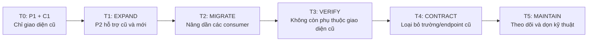
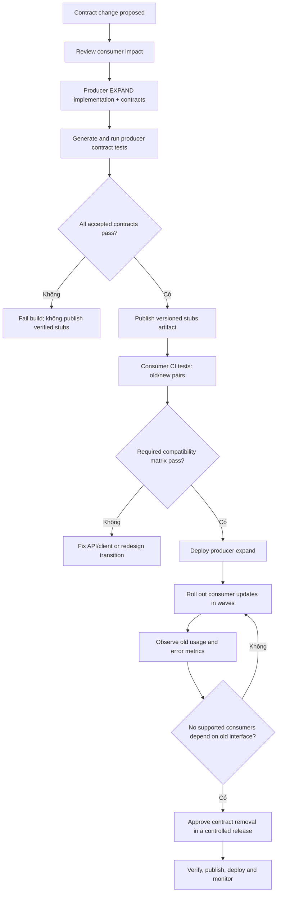

# Giai đoạn chuyển tiếp khi thay đổi API hoặc schema

## 1. Bài toán: producer và consumer không triển khai cùng một thời điểm

Trong hệ thống nhiều dịch vụ, việc triển khai `Order Service` và `Checkout Service` thường không xảy ra đồng thời. `Order Service` (producer) có thể thay đổi API trong phiên bản mới, nhưng `Checkout Service`, `Reporting Service` và một ứng dụng di động đời cũ vẫn đang gọi API đã phát hành.

Giả sử response của `GET /api/orders/42` hiện có:

```json
{
  "orderId": 42,
  "customerName": "Mai",
  "status": "CREATED"
}
```

Nhóm producer muốn đổi `customerName` thành `buyerName` để dùng một thuật ngữ nghiệp vụ nhất quán hơn. Nếu chỉ thay tên trường rồi triển khai ngay, consumer cũ có thể nhận `null`, lỗi deserialize hoặc hiển thị thiếu tên khách hàng.

Vấn đề tương tự xảy ra với **message schema**: `Order Service` phát `OrderCreated` tới nhiều subscriber, nhưng không thể buộc mọi subscriber nâng cấp cùng thời điểm. Một sự kiện được phát theo schema mới có thể trở nên không đọc được đối với consumer đang chạy schema cũ.

Với **Spring Cloud Contract**, Groovy/YAML DSL giúp mô tả những tương tác được cam kết; **Contract Verifier** sinh test để xác minh producer thật; stub artifact và **Stub Runner** giúp consumer kiểm thử trước khi nâng cấp. Nhưng các công cụ này chỉ kiểm tra những hợp đồng và tình huống đã khai báo: việc **phối hợp giai đoạn chuyển tiếp** vẫn phải được thiết kế có chủ đích.

Trong bài thuộc chương **Phiên bản và tương thích**, chúng ta sẽ:

1. Hiểu tại sao một thay đổi “đúng về thiết kế” vẫn có thể phá consumer cũ.
2. Áp dụng chiến lược **expand → migrate → contract** (mở rộng, chuyển đổi, thu hẹp).
3. Viết hợp đồng HTTP Groovy/YAML cho giai đoạn cùng hỗ trợ trường cũ và trường mới.
4. Phân biệt thay đổi tương thích và phá vỡ tương thích theo **chiều producer/consumer**.
5. Lập kế hoạch chuyển đổi endpoint, request body, status code và message schema.
6. Sử dụng stub version, producer verification, kiểm thử consumer và ma trận CI.
7. Định nghĩa tiêu chí loại bỏ hành vi cũ, giám sát, rollback và xử lý sự cố.

## 2. Tương thích có nghĩa là tương thích với ai?

“API mới có backward compatibility” là phát biểu chưa đủ rõ nếu không nêu **phiên bản của bên nào với bên nào**. Có hai câu hỏi thực tế:

- **Producer mới có phục vụ được consumer cũ không?** Đây thường là yêu cầu tối thiểu khi deploy producer trước.
- **Consumer mới có làm việc được với producer cũ không?** Đây là yêu cầu nếu consumer có thể được deploy trước, rollback một bên hoặc hệ thống chạy nhiều phiên bản cùng lúc.

Ma trận ví dụ:

| | Producer P1 (cũ) | Producer P2 (mới) |
| --- | --- | --- |
| **Consumer C1 (cũ)** | Phải hoạt động | **Phải hoạt động trong giai đoạn chuyển tiếp** |
| **Consumer C2 (mới)** | Có thể phải hoạt động nếu triển khai/rollback ngược chiều | Phải hoạt động |

Không nên mặc định cả bốn ô đều thành công. Hãy chọn **thứ tự triển khai** và tuyên bố chính xác những cặp phiên bản cần hỗ trợ.

### 2.1. Tương thích cú pháp và tương thích ngữ nghĩa

Một thay đổi có thể qua được JSON parser nhưng vẫn phá nghiệp vụ:

| Thay đổi | Vấn đề cú pháp | Vấn đề ngữ nghĩa |
| --- | --- | --- |
| Đổi `customerName` thành `buyerName` | Consumer cũ mất key | Mất tên cần hiển thị |
| Đổi `amount` từ number sang string | DTO có thể lỗi | Tiền tệ/tính toán sai |
| Giữ `status: PAID` nhưng đổi ý nghĩa | JSON vẫn hợp lệ | Consumer hiểu sai lúc nào được giao hàng |
| Đổi `201 Created` thành `202 Accepted` | Response có thể parse | Trạng thái hoàn tất trở thành bất đồng bộ |
| Thêm enum `PARTIALLY_REFUNDED` | Vẫn là string | Consumer cũ có thể không xử lý nhánh mới |

**Schema compatibility không tự bảo đảm behavioral compatibility.** Spring Cloud Contract có thể kiểm tra status, header, body, matcher và một số hành vi cụ thể, nhưng những thay đổi về nghĩa nghiệp vụ cần được đưa thành hợp đồng/kiểm thử phù hợp hoặc có quy trình review riêng.

## 3. Mô hình ba giai đoạn: expand → migrate → contract

Chiến lược an toàn cho nhiều thay đổi phá vỡ tương thích là **mở rộng trước khi thu hẹp**:



Các giai đoạn:

| Giai đoạn | Producer làm gì? | Consumer làm gì? | Điều kiện chuyển tiếp |
| --- | --- | --- | --- |
| **T0 — Hiện tại** | Phục vụ `customerName` | Đọc `customerName` | Hợp đồng cũ đã biết |
| **T1 — Expand** | Trả **cả `customerName` và `buyerName`** | Bản cũ tiếp tục dùng được | Producer tests cho giao diện cũ và mới đạt |
| **T2 — Migrate** | Duy trì cả hai trường | Triển khai dần code dùng `buyerName` | Consumer tests đạt trên producer/stub đã mở rộng |
| **T3 — Verify** | Chưa xóa trường cũ | Đã chuyển hết consumer liên quan | Có bằng chứng về dependency và traffic thực |
| **T4 — Contract** | Xóa `customerName` trong **một breaking release hoặc giao diện mới có kiểm soát** | Chỉ còn consumer dùng schema mới | Thỏa thuận deprecation, compatibility gate và rollback plan |
| **T5 — Maintain** | Dọn legacy code/metrics | Theo dõi lỗi sau phát hành | SLO và chỉ số vận hành ổn định |

**Không nhất thiết luôn phải tách thành năm lần triển khai.** Số release phụ thuộc độ rủi ro, số consumer, thời hạn nâng cấp và hệ thống vận hành. Điểm không được bỏ qua là **khoảng thời gian mà giao diện cũ và mới cùng tồn tại** đủ dài để các consumer nâng cấp an toàn.

### 3.1. Khi nào không thể triển khai theo kiểu mở rộng trong một response?

Có các thay đổi không thể biểu diễn cùng lúc mà không làm thay đổi ngữ nghĩa:

- Một endpoint chuyển từ kết quả đồng bộ sang tác vụ bất đồng bộ với contract khác hẳn.
- Cùng một tên field nhưng **đổi đơn vị** từ đồng sang xu, khiến hai consumer hiểu khác nhau.
- Cùng request nhưng producer bị yêu cầu trả hai status/body **mâu thuẫn**.
- Một định dạng message mới không được consumer cũ giải mã.

Khi đó cần **version API, media type, endpoint hoặc event type/destination tách biệt**, thay vì cố “để cả hai behavior” trong cùng một request không thể phân biệt.

## 4. Ví dụ xuyên suốt: đổi tên trường HTTP `customerName` → `buyerName`

Hãy giữ nguyên endpoint:

```http
GET /api/orders/42
Accept: application/json
```

### 4.1. Trước thay đổi

Producer P1:

```json
{
  "orderId": 42,
  "customerName": "Mai",
  "status": "CREATED"
}
```

Consumer C1 đọc `customerName` và không biết đến `buyerName`.

### 4.2. Giai đoạn mở rộng

Producer P2 tạm thời trả:

```json
{
  "orderId": 42,
  "customerName": "Mai",
  "buyerName": "Mai",
  "status": "CREATED"
}
```

Ưu điểm:

- Consumer cũ vẫn tìm thấy `customerName`.
- Consumer mới có thể bắt đầu đọc `buyerName`.
- Trong thời gian chuyển tiếp, producer có thể kiểm tra tính nhất quán của hai giá trị.

**Lưu ý về JSON clients:** Thêm một trường vào response **thường** là thay đổi tương thích khi consumer bỏ qua trường lạ, nhưng không phải luôn luôn. Một consumer có cấu hình deserializer từ chối unknown properties hoặc so sánh body nguyên văn có thể lỗi. Phải dùng kiểm thử của từng consumer để xác nhận, không chỉ dựa vào suy đoán “JSON thêm field luôn an toàn”.

### 4.3. Giai đoạn chuyển consumer

Consumer C2 nên ưu tiên `buyerName`, nhưng có thể fallback về `customerName` trong thời gian cần chạy với P1:

```java
import com.fasterxml.jackson.annotation.JsonIgnoreProperties;

@JsonIgnoreProperties(ignoreUnknown = true)
public record OrderView(
    long orderId,
    String customerName,
    String buyerName,
    String status
) {
    public String displayName() {
        return buyerName != null ? buyerName : customerName;
    }
}
```

Đây là ví dụ Java/Jackson tối giản: `displayName()` hỗ trợ hai kiểu response, còn `@JsonIgnoreProperties(ignoreUnknown = true)` giúp tránh lỗi do field bổ sung không cần thiết. Trong ứng dụng thực, cân nhắc validation, field rỗng, `null`, semantic consistency và cách mapper xử lý primitive/nullable.

Consumer test phải thử cả **producer P1** (chỉ `customerName`) và **P2** (cả hai trường) nếu thứ tự deploy/rollback có thể đưa C2 về kết nối với P1.

### 4.4. Giai đoạn thu hẹp

Chỉ khi tất cả consumer cần hỗ trợ đã chuyển sang `buyerName`, producer mới cân nhắc bỏ `customerName`:

```json
{
  "orderId": 42,
  "buyerName": "Mai",
  "status": "CREATED"
}
```

**Đây là breaking change đối với bất kỳ consumer còn đọc `customerName`.** Nếu vẫn phải hỗ trợ consumer không thể nâng cấp (mobile app cũ, partner API), cần tiếp tục phục vụ giao diện cũ hoặc phát hành API version mới.

## 5. Spring Cloud Contract bảo vệ giai đoạn mở rộng thế nào?

Một hợp đồng Groovy cho **response đã mở rộng**:

```groovy
import org.springframework.cloud.contract.spec.Contract

Contract.make {
    description 'API don hang trong giai doan chuyen ten truong'

    request {
        method GET()
        url '/api/orders/42'
        headers {
            header('Accept', 'application/json')
        }
    }

    response {
        status OK()
        headers {
            contentType(applicationJson())
        }
        body(
            orderId: 42,
            customerName: 'Mai',
            buyerName: 'Mai',
            status: 'CREATED'
        )
    }
}
```

Hợp đồng này xác định một **response mẫu duy nhất**: chứa đồng thời hai trường và cùng giá trị `Mai`. Producer verification kiểm tra implementation trả về dữ liệu theo các assertion được generator sinh; Stub Runner có thể dùng stub response cho consumer.

**Cần lưu ý độ chặt của matcher:** Generated test có thể có các kiểm tra body/JSON phù hợp theo mode và matcher đang khai báo. Nếu muốn cho phép thêm field không ảnh hưởng consumer, phải kiểm tra cách so khớp JSON ở đúng phiên bản Spring Cloud Contract và đặt matcher phù hợp. Không mặc nhiên cho rằng body cũ luôn chấp nhận field bổ sung.

### 5.1. YAML DSL tương đương

```yaml
description: API don hang trong giai doan chuyen ten truong
request:
  method: GET
  url: /api/orders/42
  headers:
    Accept: application/json
response:
  status: 200
  headers:
    Content-Type: application/json
  body:
    orderId: 42
    customerName: Mai
    buyerName: Mai
    status: CREATED
```

Groovy và YAML thể hiện cùng một cam kết. File này thuộc về producer `Order Service`; **không tự biết consumer nào đã nâng cấp** nếu nhóm không duy trì thông tin phụ thuộc giữa các bên.

### 5.2. Không “hợp thức hóa” bằng cách xóa hợp đồng cũ trước

Một cách làm sai:

1. Producer sửa JSON chỉ còn `buyerName`.
2. Xóa contract có `customerName` để generated tests pass.
3. Publish stub mới và kết luận tương thích.

Việc xóa một assertion không chứng minh consumer cũ không còn phụ thuộc. Contract test chỉ kiểm tra **những nghĩa vụ vẫn được định nghĩa**. Nếu xóa nghĩa vụ trước khi có bằng chứng các consumer đã chuyển, pipeline sẽ xanh giả đối với compatibility.

Quy trình đúng:

- Dùng contract repository, inventory consumer và các PR để nhận diện ai đang dùng trường cũ.
- Giữ cam kết cũ trong giai đoạn mở rộng.
- Bổ sung/điều chỉnh contract cho giao diện được mở rộng.
- Consumer chạy stub test với version mới và xác nhận xử lý được.
- Chỉ bỏ yêu cầu cũ khi đã đạt tiêu chí deprecation/migration được thống nhất.

## 6. Consumer-driven contracts: ai sở hữu hợp đồng trong từng giai đoạn?

Khi nhiều consumer dùng chung `Order Service`, một cách tổ chức là nhóm contract theo consumer:

```text
order-service/
  src/test/resources/contracts/
    checkout-service/
      get_order.yml
    reporting-service/
      get_order_report.groovy
    notification-service/
      order_created.groovy
```

Nhóm `checkout-service` ghi những field và tình huống Checkout phụ thuộc, nhóm `reporting-service` ghi điều Reporting cần, v.v. Trong giai đoạn chuyển tiếp, người phụ trách có thể xem **consumer nào còn yêu cầu `customerName`**.

Tuy nhiên, **chia nhóm theo consumer không khiến cùng một request HTTP có thể trả hai response mâu thuẫn ngoài production**. Nếu Checkout và Reporting đều gửi `GET /api/orders/42` với request giống hệt nhưng hợp đồng yêu cầu hai body khác nhau, producer cần có **một response chung** thỏa cả hai, hoặc phân biệt contract bằng URL/header/media type/version thực sự được API hỗ trợ.

Stub Runner có tùy chọn `stubsPerConsumer` để nạp mappings dành cho một consumer; nó tránh xung đột **trên stub server** nhưng không giải quyết mâu thuẫn ở producer thật.

### 6.1. Ma trận trách nhiệm

| Vai trò | Trong bước expand | Trong bước migrate | Trước bước contract |
| --- | --- | --- | --- |
| Producer owner | Thực thi hỗ trợ cả hai trường/giao diện | Duy trì cả hai và giám sát | Xác nhận có thể loại bỏ giao diện cũ |
| Consumer owner | Kiểm tra có nhận extra fields được không | Cập nhật client, hợp đồng và test | Xác nhận không còn phụ thuộc cũ |
| Contract reviewer | Không bỏ assertion cũ vô căn cứ | Review contract mới và dữ liệu stub | Đồng thuận thay đổi phá vỡ |
| CI/release engineer | Bật producer verification, publish stub đúng version | Chạy ma trận compatibility | Thiết lập release gate/rollback |
| Operations/SRE | Theo dõi traffic cũ, lỗi decode và status | Đo mức độ chuyển đổi | Xác định thời gian an toàn và giám sát sau release |

## 7. Thay đổi request: bắt buộc, tùy chọn và giá trị mặc định

Không chỉ response field gây rủi ro. Trong request, một field **mới trở thành bắt buộc** thường phá consumer cũ ngay lập tức.

Ví dụ P1 chấp nhận:

```json
{
  "orderId": 42,
  "amount": 125000
}
```

P2 muốn thêm `currency`. Nếu request cũ không có `currency` bị trả `400`, consumer C1 sẽ lỗi.

Chiến lược chuyển tiếp:

1. **Expand:** producer chấp nhận request cũ; khi thiếu `currency`, áp dụng một default rõ ràng và an toàn **nếu nghiệp vụ cho phép**.
2. **Migrate:** consumer gửi `currency` tường minh.
3. **Verify:** producer xác minh không còn consumer cần default.
4. **Contract:** trong API/version mới, `currency` có thể trở thành bắt buộc theo thỏa thuận.

**Cẩn trọng:** Tiền tệ không phải trường có thể tùy tiện đoán mặc định nếu hệ thống xử lý đa tiền tệ. Nếu không có default an toàn, nên tạo phiên bản endpoint/request mới thay vì âm thầm chọn `VND`.

### 7.1. Ma trận thay đổi request

| Thay đổi ở producer | Có thể tác động consumer cũ? | Đề xuất |
| --- | --- | --- |
| Bổ sung field request **tùy chọn** | Thường không nếu thiếu field vẫn được xử lý như cũ | Giữ đường cũ, định nghĩa fallback hợp lý |
| Biến field tùy chọn thành bắt buộc | Có | Chuyển dần hoặc version API |
| Đổi kiểu `amount`: number → string | Có | Hỗ trợ cả hai kiểu tạm thời hoặc version schema |
| Thay tên query parameter | Có | Nhận alias cũ/mới trong giai đoạn chuyển tiếp |
| Siết validation mạnh hơn | Có thể | Dùng contract với các input cũ còn hợp lệ |
| Thêm authentication bắt buộc | Có nếu client cũ chưa gửi credential | Kế hoạch cung cấp credential/deprecation rõ ràng |

Với Spring Cloud Contract, hãy tạo/giữ các contract **request cũ hợp lệ** và **request mới hợp lệ**, bảo đảm producer verification thực thi cả hai. Chỉ thêm stub response mới mà không chạy generated tests cho request cũ không đủ để bảo vệ compatibility.

## 8. Thay đổi HTTP status, header và endpoint cần xét hành vi

### 8.1. `200` khác `202`

Nếu API trước đây trả `200 OK` sau khi thanh toán đã lưu thành công nhưng bản mới trả `202 Accepted` để báo “đang xử lý”, đây không chỉ là đổi số:

- Consumer có thể đang coi mọi `2xx` là thành công cuối cùng.
- Màn hình có thể thông báo đã thanh toán dù tiến trình chưa hoàn tất.
- Một hệ thống khác có thể bắt đầu giao hàng quá sớm.

Nếu đổi mô hình đồng bộ sang bất đồng bộ, cần **hợp đồng endpoint/status mới và quy trình consumer migration**, không chỉ nới matcher status thành mọi `2xx`.

### 8.2. Header cũng là giao diện

Các header như `Content-Type`, `Location`, `ETag`, `Retry-After` hoặc version media type có thể quan trọng với consumer. Thay `application/json` thành media type không hỗ trợ, xóa `Location` hoặc đổi caching semantics đều có thể phá client.

Trong giai đoạn deprecation, nhóm có thể công bố thông báo qua tài liệu, response headers (ví dụ các header deprecation theo chuẩn áp dụng) và kênh trao đổi với consumer. **Spring Cloud Contract không tự triển khai chính sách deprecation**; nếu header là một phần cam kết, cần mô tả và test nó.

### 8.3. Version endpoint khi không thể mở rộng cùng một giao diện

Một lựa chọn rõ ràng:

```text
GET /api/v1/orders/42   -> response có customerName
GET /api/v2/orders/42   -> response có buyerName
```

Trong giai đoạn chuyển tiếp, producer hỗ trợ cả `/v1` và `/v2`; contract tests kiểm tra hai endpoint. Consumer chuyển từng bước sang `/v2`.

Đừng coi `/v2` là giải pháp tự động cho mọi thay đổi. Nó thêm chi phí vận hành: routing, bảo mật, tài liệu, monitoring, bug fixes và thời điểm ngừng `/v1`. Chỉ chọn version mới khi có thay đổi không thể tương thích hoặc cần ranh giới phiên bản rõ ràng.

### 8.4. Ví dụ contract YAML cho endpoint v2

```yaml
description: Lay don hang API v2
request:
  method: GET
  url: /api/v2/orders/42
response:
  status: 200
  headers:
    Content-Type: application/json
  body:
    orderId: 42
    buyerName: Mai
    status: CREATED
```

Với `/v1`, duy trì một contract **riêng**, không xóa ngay sau khi tạo contract `/v2`. Producer verification phải kiểm tra cả hai trong thời gian còn hỗ trợ.

## 9. Quy tắc khi chuyển schema thông điệp

Trong hệ thống event-driven, `Order Service` có thể phát:

```json
{
  "eventType": "OrderCreated",
  "schemaVersion": 1,
  "eventId": "evt-42",
  "orderId": 42,
  "customerName": "Mai"
}
```

`Notification Service`, `Analytics Service` và `Inventory Service` có thể nhận event qua Kafka/RabbitMQ hoặc một message binder khác. Vì việc phát/nhận bất đồng bộ, producer và consumer có thể chạy nhiều phiên bản cùng lúc; thậm chí **message cũ có thể được đọc lại sau khi schema mới đã triển khai**.

### 9.1. Expand schema message

Thay vì đổi ngay `customerName` thành `buyerName`, producer có thể phát:

```json
{
  "eventType": "OrderCreated",
  "schemaVersion": 1,
  "eventId": "evt-42",
  "orderId": 42,
  "customerName": "Mai",
  "buyerName": "Mai"
}
```

Nếu consumer cũ **bỏ qua trường lạ**, nó vẫn đọc được `customerName`. Consumer mới có thể đọc `buyerName`. Nhưng với Avro, Protobuf hoặc schema registry, điều kiện “thêm field là an toàn” phụ thuộc vào **writer/reader schema, default, optional/required, mode compatibility và serialization format**. Không áp dụng mù quy tắc từ JSON động sang mọi định dạng.

### 9.2. Hợp đồng messaging với trường mới và cũ

```groovy
import org.springframework.cloud.contract.spec.Contract

Contract.make {
    description 'OrderCreated trong giai doan chuyen ten truong'
    label 'order_created_transition'

    input {
        triggeredBy('createOrderAndPublish()')
    }

    outputMessage {
        sentTo('orders.created')
        body(
            eventType: 'OrderCreated',
            schemaVersion: 1,
            eventId: 'evt-42',
            orderId: 42,
            customerName: 'Mai',
            buyerName: 'Mai'
        )
        headers {
            header('eventType', 'OrderCreated')
        }
    }
}
```

Base test class cần có phương thức `createOrderAndPublish()` kích hoạt **publisher thực**, cùng cấu hình message verifier/binder phù hợp. `outputMessage.sentTo` mô tả destination logic; hợp đồng không tự tạo broker hay đảm bảo Kafka topic tồn tại.

Đoạn Groovy trên là **một contract sinh kiểm thử message producer**; nó không thay thế những test consumer đọc event v1/v2 từ broker hoặc Stub Runner.

### 9.3. Khi không thể cùng một schema

Nếu có thay đổi phá schema lớn, cần chiến lược **side-by-side**:

```text
orders.created.v1  -> event type/schema cũ
orders.created.v2  -> event type/schema mới
```

Hoặc giữ cùng topic nhưng phân biệt rõ `eventType`, schema ID/version và cơ chế router/serializer nếu hệ sinh thái chấp nhận. **Không tự giả định một consumer đọc topic cũ sẽ hiểu payload mới chỉ vì tên topic không đổi.**

Khi phát song song hai schema, producer có thể phải **dual-publish** trong một giai đoạn. Điều này mang lại rủi ro **xử lý trùng** ở consumer nào subscribe cả hai luồng. Cần thiết kế `eventId`, lineage và deduplication/idempotency, cùng kế hoạch tránh phát hai hiệu ứng nghiệp vụ.

### 9.4. Không dùng `schemaVersion` thay cho chiến lược compatibility

Thêm `"schemaVersion": 2` không tự làm serializer hỗ trợ schema v2. Producer/consumer phải biết:

1. Cách nhận diện đúng schema khi deserialize.
2. Cách chuyển dữ liệu cũ khi replay message.
3. Quy định field bắt buộc/tùy chọn/default.
4. Cách loại bỏ/không tái sử dụng tên hoặc field number theo định dạng.
5. Các phiên bản consumer vẫn đang chạy.

Với Protobuf, không tái sử dụng field number đã dùng cho ý nghĩa khác; với Avro, phải kiểm tra compatibility mode và quy tắc default trong schema registry. Với JSON, cần xem contract và parser thực sự chấp nhận field mới/sự thay đổi kiểu ra sao.

## 10. Phân biệt ba loại version thường bị trộn lẫn

| Phiên bản | Ví dụ | Trả lời câu hỏi |
| --- | --- | --- |
| **Phiên bản triển khai producer** | `order-service:2.8.0` | Binary/code nào đang chạy? |
| **Phiên bản stub artifact** | `com.example:order-service:2.8.0:stubs` | Consumer test đang dùng mẫu hợp đồng được đóng gói từ bản nào? |
| **Phiên bản giao diện/schema** | `/api/v2`, `schemaVersion=2` | Hình dạng/ý nghĩa giao diện nào được công bố? |

Các version này **có liên hệ nhưng không phải một**. Producer có thể ra nhiều bản patch trong khi API v1 không đổi; ngược lại một release producer có thể đồng thời phục vụ API v1 và v2.

### 10.1. Stub artifact phải phản ánh đúng source đã verify

Giả sử producer `Order Service` phát hành:

```text
com.example:order-service:2.8.0:stubs
```

Trước publish cần biết:

- Contract revision nào được dùng?
- Generated tests đã chạy trên commit producer nào?
- Stub JAR có cả các mappings v1/v2 cần giữ không?
- Có consumer nào cần stub per consumer không?
- Artifact version có được ghim và giữ bất biến không?

Một stub artifact tải được từ Nexus/Artifactory không tự chứng minh code producer đang chạy ngoài production còn tương thích. Phải có bằng chứng producer verification trong pipeline tương ứng.

### 10.2. Không dùng `+` hoặc snapshot động làm baseline release

```text
com.example:order-service:+:stubs
```

có thể resolve sang một stub version mới giữa hai lần test. Tương tự, một snapshot có thể được publish lại với nội dung khác. Trong pipeline tái lập, nên sử dụng **version artifact xác định** và lưu resolved coordinates/producer commit trong build metadata.

Đừng coi semantic versioning như cơ chế bảo đảm tự động. `2.8.0` nghe có vẻ “minor” hay “patch” không quyết định compatibility; chỉ các hợp đồng, test và review version cụ thể mới hỗ trợ kết luận.

## 11. Consumer test với Stub Runner trong giai đoạn chuyển tiếp

Checkout có thể kiểm tra HTTP client mới với stub artifact từ producer đã expand:

```java
import org.junit.jupiter.api.Test;
import org.springframework.boot.test.context.SpringBootTest;
import org.springframework.cloud.contract.stubrunner.spring.AutoConfigureStubRunner;
import org.springframework.cloud.contract.stubrunner.spring.StubRunnerProperties;

@SpringBootTest(properties = {
    "order.client.base-url=http://localhost:8091"
})
@AutoConfigureStubRunner(
    ids = "com.example:order-service:2.8.0:stubs:8091",
    stubsMode = StubRunnerProperties.StubsMode.LOCAL
)
class CheckoutOrderContractTest {

    @Test
    void checkoutReadsTransitionResponse() {
        // Gọi OrderClient thật tới Stub Runner trên localhost:8091.
        // Kiểm tra cả trường buyerName và fallback nếu client hỗ trợ P1.
    }
}
```

Đây là **bộ khung cần hoàn thiện**, không phải test tự kiểm tra được vì phần thân đang là comment. Để chạy:

- Stub JAR `order-service-2.8.0-stubs.jar` phải nằm trong Maven local repository nếu dùng `LOCAL`, hoặc đổi sang `REMOTE` cùng repository credentials tương ứng.
- `OrderClient` thật của Checkout cần đọc đúng property `order.client.base-url`.
- Test phải gọi client và assert giá trị thực, không chỉ xác nhận stub server khởi động.
- Test nên tránh port cố định nếu nhiều job chạy song song; cân nhắc `StubFinder` hoặc cấu hình port riêng.

### 11.1. Tại sao cần test với hơn một stub version?

Trong rollout có thể tồn tại:

```text
Producer P1 -> response chỉ customerName
Producer P2 -> response customerName + buyerName
Producer P3 -> response chỉ buyerName (sau contract)
```

Nếu consumer C2 có thể kết nối P1 khi rollback hoặc khi load balancer còn node cũ, thì test **C2 với stub P1 và P2** là cần thiết. Sau giai đoạn contract, cần bảo đảm consumer hiện tại xử lý P3.

Không có quy tắc máy móc “luôn test mọi version đã từng phát hành”. Hãy xác định **tập cặp phiên bản có thể thực sự gặp nhau** khi rollout, scale-out, rollback hoặc hỗ trợ đối tác, rồi tạo compatibility matrix cho tập đó.

### 11.2. Ví dụ hai profile test

Một cách tổ chức (mang tính cấu hình, không buộc dùng đúng file này):

```yaml
# Profile kiểm tra consumer mới với producer đã expand
spring:
  cloud:
    contract:
      stubrunner:
        stubs-mode: REMOTE
        repository-root: "https://repo.example.test/repository/maven-releases/"
        ids:
          - "com.example:order-service:2.8.0:stubs:8091"
```

Nếu cần profile riêng cho P1, thay `2.8.0` bằng version P1 đã ghi nhận và chạy cùng các assertion consumer phù hợp. Đừng cố đăng ký **hai mapping mâu thuẫn cho cùng một HTTP request** trên cùng WireMock port rồi mong server tự nhận diện “phiên bản producer”.

## 12. Kiểm thử theo từng giai đoạn, không chỉ theo một contract

Một kế hoạch kiểm thử có thể được chia như sau:

| Giai đoạn | Producer verification | Consumer test | Integration/E2E |
| --- | --- | --- | --- |
| T0 | Contract cũ pass với P1 | C1 + P1 stubs | Baseline |
| T1 — Expand | Contract bảo vệ `customerName` và `buyerName` trên P2 | C1 + P2, C2 + P2 (nếu sẵn sàng) | API response mới không phá client cũ |
| T2 — Migrate | P2 vẫn phải hỗ trợ cả hai | C2 + P1 (nếu rollback cần), C2 + P2 | Canary/traffic theo consumer |
| T3 — Verify | Test cả nghĩa vụ chưa loại bỏ | Xác nhận những consumer còn được hỗ trợ | Kiểm tra traffic cũ và phiên bản đang hoạt động |
| T4 — Contract | Contract mới không còn field cũ; contract v1 giữ riêng nếu còn hỗ trợ | C2 + P3; C1 phải được ngừng/di chuyển trước | Rollout, lỗi decode, rollback |

**Mỗi “PASS” cần gắn với version cụ thể.** C1 chạy pass với P1 không có nghĩa C1 sẽ pass với P3; C2 pass với stub P2 không có nghĩa P2 code thật đã vượt producer verification nếu pipeline đã bỏ qua test.

### 12.1. Vì sao cần giữ nhiều contract trong một số giai đoạn?

Ở giai đoạn expand, có thể giữ những nghĩa vụ của consumer cũ và thêm nghĩa vụ của consumer mới. Ví dụ:

- Checkout cũ còn cần `customerName`.
- Reporting mới cần `buyerName`.
- Producer P2 trả **cả hai trường** và generated tests phải bảo đảm nghĩa vụ liên quan vẫn đáp ứng.

Nếu hệ thống đã version endpoint `/v1`/`/v2`, nên có contract riêng cho hai endpoint. Nếu cùng endpoint, tránh tạo **hai WireMock response khác nhau cho cùng request hoàn toàn giống nhau**; có thể dùng một response mở rộng chung hoặc phân biệt request bằng version media type thực sự hỗ trợ.

### 12.2. Không để generated tests bị skip

Một build có thể sinh stub artifact thành công nhưng không chạy generated contract tests do cấu hình Gradle/Maven, test filter hoặc flag `skipTests`.

Trong CI cần kiểm tra:

1. Generated source có chứa tests mong đợi không?
2. Test count có bao gồm contract tests không?
3. Test thực hiện request/trigger lên producer implementation không?
4. Report thể hiện assertion pass hoặc fail cho mỗi hợp đồng quan trọng?
5. Bước publish có bị chặn nếu verification fail không?

**Số lượng file JAR hay mappings không thay thế test execution count.**

## 13. CI và rollout: mô hình mở rộng trước, thu hẹp sau



Một pipeline có thể chia thành các cổng:

- **Contract review gate:** xác nhận thay đổi additive hay breaking, có consumer nào phụ thuộc.
- **Producer verification gate:** tests Groovy/YAML được sinh và chạy trên mã producer.
- **Stub publication gate:** chỉ phát hành artifact gắn với producer/contract revision đã đạt.
- **Consumer compatibility gate:** chạy HTTP/message client hoặc subscriber với những stub version mà runtime có thể gặp.
- **Deployment gate:** canary, quan sát lỗi thực và khả năng rollback.
- **Removal gate:** chỉ bỏ giao diện cũ khi có bằng chứng không còn consumer được hỗ trợ cần nó.

### 13.1. Không thể chỉ dùng pipeline test để biết traffic đã bằng 0

Một consumer có thể:

- Chạy theo lịch hằng tuần, nên không tạo traffic trong vài giờ quan sát.
- Là ứng dụng di động với vòng đời nâng cấp dài.
- Được bên thứ ba quản lý, không thấy trong CI nội bộ.
- Chỉ dùng endpoint khi có sự cố hiếm gặp.

Do đó, **một khoảng thời gian không thấy request không đủ bằng chứng tuyệt đối**. Cần inventory consumer, owner acknowledgement, retention/deprecation policy, metrics đủ dài và đánh giá rủi ro theo đặc điểm API.

## 14. Giám sát và chính sách deprecation

Một kế hoạch deprecation tốt nên có:

| Thành phần | Ví dụ |
| --- | --- |
| Thay đổi cần chuyển | `customerName` → `buyerName` |
| Ngày bắt đầu hỗ trợ song song | Theo lịch release đã công bố |
| Consumer bị ảnh hưởng | Checkout, Reporting, partner integrations |
| Phiên bản producer hỗ trợ cả hai | P2 (expand) |
| API/schema cũ cần ngừng | `customerName` trên response hoặc `/v1` |
| Cách liên lạc | PR, changelog, thông báo API/deprecation |
| Điều kiện hoàn tất | Owner xác nhận, contract tests và telemetry đủ tin cậy |
| Rủi ro rollback | Producer cũ không hiểu schema mới; DB/queue đã thay đổi |
| Phương án khôi phục | Giữ P2, tái bật endpoint cũ, revert feature flag phù hợp |

Để đo mức sử dụng, có thể dùng access logs, HTTP metrics theo endpoint/version, correlation/consumer ID đáng tin cậy và telemetry trên message subscribers. Không thu thập token, PII hoặc payload nhạy cảm chỉ để xác định consumer đang gọi endpoint nào.

### 14.1. Feature flag có thể giúp, nhưng không thay contract

Feature flag giúp bật/tắt phần output mới, dual-publish hay chọn đường đọc dữ liệu trong rollout. Nhưng nếu flag khiến cùng contract có hai response khác nhau, phải kiểm tra cả hai trạng thái mà hệ thống hỗ trợ.

**Không dùng flag để xóa trường cũ khi vẫn còn consumer cũ phụ thuộc.** Flag là công cụ điều hành rollout, không phải bằng chứng compatibility.

## 15. Rollback và thay đổi database schema

Một migration API đôi khi đòi thay đổi database:

```text
DB cũ: orders.customer_name
DB mới: orders.buyer_name
```

Nếu cập nhật API rồi xóa ngay cột `customer_name`, rollback về producer P1 có thể thất bại vì code cũ vẫn đọc cột đã bị xóa.

Một chiến lược schema database tương tự:

1. **Expand DB:** thêm cột `buyer_name` nhưng giữ `customer_name`.
2. **Dual-write/backfill:** bảo đảm dữ liệu mới/cũ nhất quán, có quy tắc nguồn chân lý.
3. **Migrate reads:** producer API và các consumers nội bộ chuyển sang cột mới.
4. **Observe:** so sánh dữ liệu, kiểm tra truy vấn cũ còn hoạt động không.
5. **Contract DB:** chỉ xóa cột cũ sau khi không còn binary cần nó và đã hết cửa sổ rollback tương ứng.

Đây là **database integration/migration testing**, không phải chức năng tự động của Spring Cloud Contract. Contract Verifier bảo vệ giao diện được mô tả; dữ liệu persisted, rollback migration và transaction cần kiểm thử riêng.

### 15.1. Rollback không luôn tương đương deploy lại JAR cũ

Sau khi P3 đã ngừng phát message cũ, consumer cũ có thể không đọc được message v2. Nếu DB đã drop cột, P1 không chạy được. Nếu hệ thống đã ghi event v2 vào topic có retention, rollout ngược về consumer v1 có thể gặp payload không giải mã được.

Do đó, **kế hoạch rollback phải xét trạng thái dữ liệu và message đã phát**, không chỉ artifact producer/consumer. Đôi khi cách khôi phục an toàn là **roll forward** một bản sửa nhỏ thay vì quay hẳn về binary cũ.

## 16. Thay đổi message schema: ngoài content còn có delivery

Hợp đồng messaging có thể kiểm tra `input`, `outputMessage`, `sentTo`, headers, payload và các matcher. Nhưng trong chuyển tiếp message cần lưu ý thêm:

| Rủi ro | Nguyên nhân | Kiểm thử bổ sung |
| --- | --- | --- |
| Consumer không giải mã event mới | Thay kiểu hoặc field bắt buộc | Consumer tests với schema v1/v2 |
| Consumer nhận hai bản sao | Dual-publish hoặc at-least-once delivery | Idempotency/deduplication |
| Event đến khác thứ tự | Partition/retry/parallel consumers | Ordering/replay tests |
| Consumer cũ đọc lại message đã ghi | Retention/replay | Backward reader compatibility |
| Schema registry từ chối version mới | Compatibility policy không đạt | Registry/schema validation |
| Producer phát sai topic | Destination đổi không được thông báo | Producer verifier + broker integration test |
| Thông tin `eventType` sai | Routing header/payload thay đổi | Header contract/consumer handler test |

**Stub Runner messaging** có thể phát message stub để consumer thử handler, nhưng không tự chứng minh Kafka/RabbitMQ thực thi retry, ordering, ACL hoặc transactional delivery. Cần test binder hoặc integration với broker thật cho các thuộc tính này.

### 16.1. Nguyên tắc xử lý dual-publish

Nếu phải phát đồng thời `OrderCreatedV1` và `OrderCreatedV2`:

- Xác định rõ **một** sự kiện nghiệp vụ gốc và quan hệ giữa hai biểu diễn.
- Dùng `eventId`/business ID giúp consumer nhận diện duplicate khi cần.
- Tránh để một consumer subscribe cả hai luồng rồi thực hiện tác động hai lần.
- Theo dõi lag/offset, số message xử lý và tỷ lệ lỗi deserialization.
- Quy định thời điểm ngừng v1 dựa trên subscriber inventory, không chỉ producer readiness.

Không phải broker nào cũng có các bảo đảm giao hàng giống nhau; tiêu chí hoàn thành phải dựa trên triển khai cụ thể.

## 17. Các sai lầm phổ biến trong giai đoạn chuyển tiếp

| Triệu chứng | Sai lầm thường gặp | Hướng khắc phục |
| --- | --- | --- |
| C1 lỗi sau khi producer đổi field | Xóa `customerName` trước khi C1 nâng cấp | Expand response, giữ field cũ |
| Test producer pass nhưng partner lỗi | Hợp đồng của partner không được lưu/kiểm tra | Bổ sung inventory và hợp đồng phản ánh phụ thuộc |
| C2 không chạy với P1 khi rollback | Consumer mới chỉ hiểu `buyerName` | Fallback/test C2+P1 hoặc cấm rollback ngược chiều |
| Cùng request có hai stub response mâu thuẫn | Mỗi consumer định nghĩa response khác nhau | Response chung hoặc endpoint/media type versioned |
| Contract bị xóa để build xanh | Loại nghĩa vụ trước khi migration xong | Review deprecation và giữ producer verification |
| Consumer test xanh với stub cũ | Artifact version chưa được cập nhật | Ghim version theo release, record resolved artifact |
| Message mới không deserialize | Schema rules/defaults không tương thích | Dual schema và schema-registry compatibility |
| Dual-publish gây tác động hai lần | Thiếu deduplication/subscribe cả v1,v2 | Idempotency và migration plan |
| Rollback thất bại dù JAR cũ chạy được | DB schema hoặc retained events đã thay đổi | Expand/contract DB, replay/rollback rehearsal |
| Không biết consumer nào còn dùng v1 | Không có owner/telemetry/API inventory | Tạo dependency inventory và lịch deprecation |
| `200` đổi thành `202` gây lỗi nghiệp vụ | Xem mọi `2xx` giống nhau | Contract lại semantics, nâng client theo giai đoạn |

### 17.1. Vì sao “thêm field là an toàn” có thể sai?

Vì consumer có thể:

- Đặt `FAIL_ON_UNKNOWN_PROPERTIES=true`.
- Hash toàn bộ raw JSON body để so sánh hoặc xác nhận chữ ký.
- Dùng schema validation nghiêm ngặt chỉ chấp nhận một tập trường cố định.
- Có code mapping so sánh response body toàn bộ.

Ngay cả thay đổi additive cũng phải được xác minh bằng contract/consumer tests có hành vi đại diện cho client thật.

### 17.2. Vì sao “hợp đồng mới pass” chưa đủ?

Một bộ hợp đồng chỉ mô tả giao diện mới có thể không còn assertion bảo vệ hành vi cũ. **Compatibility là quan hệ giữa các phiên bản**, nên cần kiểm tra các cặp phiên bản được yêu cầu và giữ hợp đồng cũ cho tới thời điểm ngừng hỗ trợ được chấp nhận.

## 18. Bài thực hành: nâng cấp API tra cứu hóa đơn

**Bối cảnh:** `Invoice Service` là producer. `Billing UI` và `Accounting Service` là hai consumer. Hiện tại:

```http
GET /api/invoices/900
```

Response P1:

```json
{
  "invoiceId": 900,
  "total": 220000,
  "status": "ISSUED"
}
```

Nhóm producer muốn đổi `total` thành `totalAmount` và bổ sung `currency`. `Billing UI` có thể nâng cấp trong tuần này, nhưng `Accounting Service` chỉ có release window vào cuối tháng.

### 18.1. Yêu cầu

1. Phân loại thay đổi `total` → `totalAmount`: additive hay breaking nếu áp dụng trực tiếp?
2. Thiết kế response **expand** để cả Billing UI cũ và mới vẫn dùng được.
3. Viết YAML contract cho response mở rộng của `GET /api/invoices/900`.
4. Nêu ma trận P1/P2 với C1/C2 cần kiểm tra nếu Billing UI có thể rollback.
5. Đề xuất tiêu chí để bỏ `total` sau khi Accounting nâng cấp.
6. Nếu Billing UI mới gọi P1 mà không có `totalAmount`, client cần xử lý ra sao?
7. Nếu cùng sự kiện `InvoiceIssued` cũng được phát qua Kafka, bạn có thể đổi schema ngay bằng cách chỉ sửa API HTTP contract không?
8. Lập kế hoạch publish stub artifacts và các gate CI.

### 18.2. Gợi ý response expand

```json
{
  "invoiceId": 900,
  "total": 220000,
  "totalAmount": 220000,
  "currency": "VND",
  "status": "ISSUED"
}
```

`total` và `totalAmount` phải dùng cùng đơn vị trong thời gian chuyển tiếp; nếu đổi đơn vị tiền thì phải thể hiện trong contract và code xử lý, không chỉ copy giá trị.

### 18.3. Gợi ý YAML contract

```yaml
description: Hoa don trong giai doan doi ten truong tong tien
request:
  method: GET
  url: /api/invoices/900
response:
  status: 200
  headers:
    Content-Type: application/json
  body:
    invoiceId: 900
    total: 220000
    totalAmount: 220000
    currency: VND
    status: ISSUED
```

### 18.4. Gợi ý compatibility matrix

| Consumer | P1 (chỉ `total`) | P2 (cả `total` và `totalAmount`) |
| --- | --- | --- |
| Billing UI cũ | Phải hoạt động | Phải hoạt động |
| Billing UI mới | Nếu rollback/sóng triển khai cần P1, phải hỗ trợ fallback | Phải hoạt động |
| Accounting cũ | Phải hoạt động | Phải hoạt động cho tới khi Accounting nâng cấp |
| Accounting mới | Theo chính sách deploy | Phải hoạt động |

Một consumer mới có thể fallback từ `totalAmount` sang `total` khi P1 còn tồn tại; khi bước contract hoàn tất và các consumer không còn cần P1, nhóm có thể loại bỏ fallback sau khi review.

### 18.5. Tiêu chí kết thúc và lời giải tóm tắt

Không bỏ `total` cho tới khi:

1. Billing UI và Accounting Service đã thực sự deploy bản không phụ thuộc `total`.
2. Các owner xác nhận thời gian hỗ trợ giao diện cũ kết thúc.
3. CI producer/consumer tests cho cặp phiên bản cần hỗ trợ đều đạt.
4. Telemetry không còn chỉ ra phụ thuộc đang được hỗ trợ trong khoảng quan sát phù hợp.
5. Có kế hoạch rollback/roll-forward, bao gồm dữ liệu hóa đơn và schema message nếu liên quan.

Nếu thay đổi luôn cả Kafka `InvoiceIssued`, phải có **messaging contract và schema compatibility tests riêng**. Việc thay một HTTP YAML contract không tự cập nhật subscriber hoặc bảo đảm broker xử lý sự kiện đúng.

## 19. Checklist trước khi xóa API/schema cũ

- Đã lập ma trận **producer cũ/mới × consumer cũ/mới** theo những cặp có thể gặp thực tế?
- Thay đổi có ảnh hưởng **kiểu dữ liệu, ý nghĩa nghiệp vụ, HTTP status, header, URL hay schema message**?
- Đã triển khai giai đoạn **expand** để bảo vệ những consumer còn sử dụng giao diện cũ?
- Consumer có bỏ qua field thừa và xử lý null/default đúng không; đã được test thực tế?
- Groovy/YAML contracts còn giữ những nghĩa vụ cũ trong suốt migration?
- Generated producer tests được sinh và **thực sự chạy** trên implementation mới?
- Stub artifact có version rõ ràng, được publish sau producer verification và được consumer CI dùng đúng version?
- Khi chạy song song v1/v2, request có được phân biệt thật hoặc response mở rộng có đáp ứng cả hai?
- Messaging có xem xét subscriber lag, replay, schema registry, dual-publish, duplicate và idempotency?
- Database migration có bảo toàn khả năng rollback trong khoảng yêu cầu?
- Đã có inventory consumer, owner sign-off, telemetry và lịch deprecation đáng tin cậy?
- Không xóa contract cũ chỉ để làm build pass?
- Đã chuẩn bị canary, alerting và quyết định rollback/roll-forward rõ ràng?

**Tài liệu để đối chiếu theo phiên bản dự án:**

- [Spring Cloud Contract — Reference](https://docs.spring.io/spring-cloud-contract/reference/).
- [Spring Cloud Contract — HTTP Contracts](https://docs.spring.io/spring-cloud-contract/reference/project-features-contract/http.html).
- [Spring Cloud Contract — Dynamic Properties](https://docs.spring.io/spring-cloud-contract/reference/project-features-contract/dsl-dynamic-properties.html).
- [Spring Cloud Contract — Messaging](https://docs.spring.io/spring-cloud-contract/reference/project-features-messaging.html).
- [Spring Cloud Contract — Stub Runner](https://docs.spring.io/spring-cloud-contract/reference/project-features-stubrunner.html).
- [Spring Cloud Contract — Stubs Per Consumer](https://docs.spring.io/spring-cloud-contract/reference/project-features-stubrunner/stub-runner-stubs-per-consumer.html).

**Ghi nhớ:** **Thay đổi API hoặc schema an toàn không phải chỉ viết thêm contract mới rồi xóa contract cũ.** Trong hệ thống nhiều dịch vụ, producer và consumer triển khai lệch thời điểm; cần giai đoạn **expand** hỗ trợ cùng lúc giao diện cũ/mới, **migrate** từng consumer kèm kiểm thử, **verify** mức sử dụng thực tế rồi mới **contract** để loại bỏ nghĩa vụ cũ. Spring Cloud Contract, producer verification, stub artifact và Stub Runner hỗ trợ phát hiện sai khác, nhưng quyết định thời điểm thu hẹp phải dựa trên **compatibility matrix, owner acknowledgement, telemetry, migration plan và khả năng rollback**.
