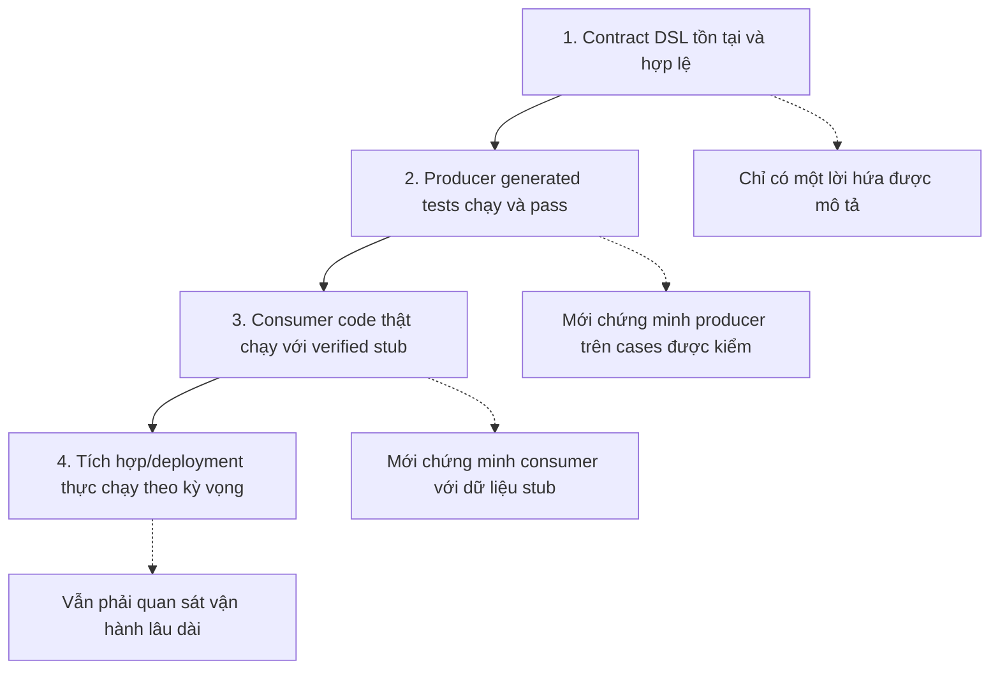
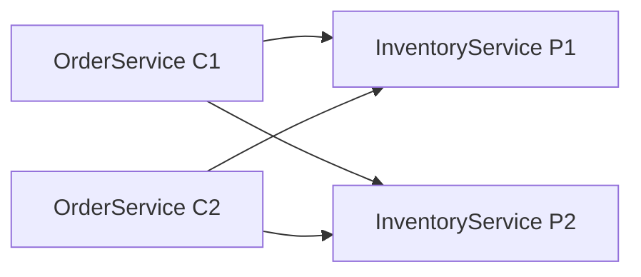
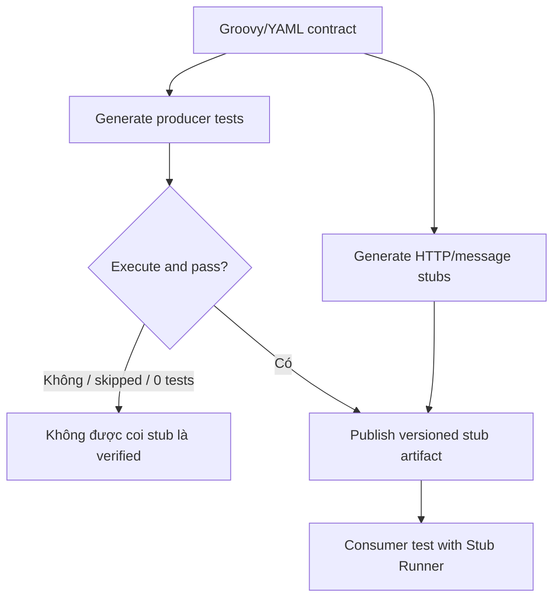
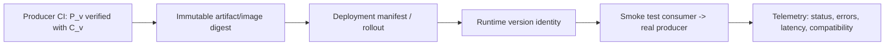
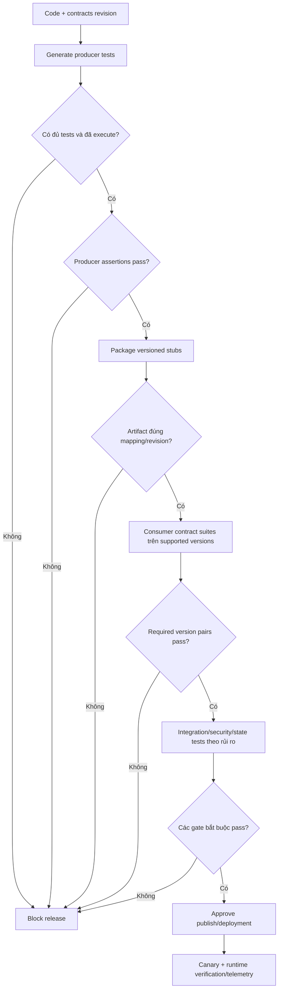

# Giới hạn suy luận tương thích chỉ từ việc kiểm thử đạt

Khi một pipeline hiển thị **BUILD SUCCESSFUL** hoặc **Tests passed**, rất dễ kết luận: “Producer và consumer đã tương thích”. Nhưng một bài kiểm thử hợp đồng chỉ có thể kiểm những tương tác **đã được mô tả, được tạo thành test, được thực thi và được quan sát đúng**. Nó không thể tự chứng minh mọi phiên bản consumer, mọi đầu vào, mọi cấu hình triển khai hay mọi tình huống của hệ thống phân tán đều an toàn.

Giả sử `InventoryService` (producer) thay đổi API giữ hàng, trong khi `OrderService` (consumer) và `CheckoutService` đang dùng các phiên bản khác nhau. Producer CI chạy generated tests của **Spring Cloud Contract** và đều pass; consumer CI với **Stub Runner** cũng xanh. Dù vậy, một consumer cũ vẫn có thể không đọc được field mới, một mapping WireMock quá rộng có thể làm consumer test xanh giả, hoặc môi trường production vẫn đang chạy producer khác với phiên bản đã kiểm. **PASS là bằng chứng có phạm vi, không phải chứng nhận tương thích vô điều kiện.**

Bài thuộc chương **Phiên bản và tương thích** của module **SPRING_CLOUD_CONTRACT**. Theo phạm vi module, chúng ta dùng **Groovy/YAML DSL** để định nghĩa hành vi HTTP hoặc messaging, sinh test phía producer, phát hành stubs cho consumer và tích hợp CI nhằm phát hiện thay đổi API không tương thích. Trọng tâm bài này là **đọc đúng ý nghĩa của bằng chứng kiểm thử**, nhận biết giới hạn suy luận và thiết kế quyết định release có trách nhiệm.

Sau bài học, bạn có thể:

- Phân biệt **test pass**, **contract được đáp ứng**, **tương thích phiên bản** và **an toàn triển khai**.
- Viết một kết luận có điều kiện cho producer–consumer pair thay vì tuyên bố tương thích tuyệt đối.
- Phát hiện các khoảng trống về **coverage**, fixture, matcher, generated tests, stub và môi trường.
- Phân tích tương thích ngược/thuận trong rolling upgrade và ma trận consumer–producer versions.
- Nhận diện các thay đổi tưởng là additive nhưng vẫn phá consumer strict schema/deserializer.
- Biết giới hạn Spring Cloud Contract đối với HTTP state, messaging, authorization, timeout, retry và performance.
- Kết hợp producer verification, consumer tests, schema tests, integration/E2E và runtime telemetry thành nhiều lớp bằng chứng.
- Thiết kế CI release gate kiểm **có test thực thi**, dùng **đúng artifacts** và lưu được phạm vi xác minh.

## 1. Khẳng định “test đạt” phải gắn với bối cảnh cụ thể

Một câu kết luận có ý nghĩa cần nói rõ ít nhất:

| Trục | Câu hỏi phải trả lời | Ví dụ |
| --- | --- | --- |
| **Producer revision** | Phiên bản mã producer nào được chạy? | `inventory-service:1.4.2`, commit `P42` |
| **Contract revision** | Tập DSL nào được dùng? | `inventory-contracts:2.3.0` |
| **Test implementation** | Generated tests và base class chạy thật chưa? | 24 tests pass, 0 skipped |
| **Consumer revision** | Phiên bản code consumer nào đã chạy stub tests? | `order-service:2.8.0` |
| **Stub artifact** | Stub được sinh từ bộ contract đã verify nào? | `inventory-service:1.4.2:stubs` |
| **Fixture/environment** | Dữ liệu, timezone, profile và client stack gì? | Test DB, JUnit 5, HTTP mock mode |
| **Coverage** | Tương tác nào được kiểm? | Tạo reservation thành công và thiếu hàng |
| **Giới hạn** | Chưa kiểm điều gì? | Concurrent requests, retry, auth ở gateway |

Nếu chỉ biết “CI xanh”, bạn không thể suy ra các trục còn thiếu. Ngay cả khi ghi `100% tests passed`, tỷ lệ ấy chỉ nói về **tập tests đã được runner thực thi**, không nói số hành vi quan trọng chưa có test.

### Công thức suy luận đúng phạm vi

Ký hiệu:

- `P`: một revision của producer.
- `C`: một tập contract đã xác định.
- `T(P,C)`: generated tests sinh từ `C`, chạy trên `P`.
- `E`: môi trường/fixtures/test-mode sử dụng.

Khi `T(P,C,E) = PASS`, phát biểu hợp lý là:

> Trong môi trường E, producer revision P đã đáp ứng những assertions được thực thi từ tập contract C tại thời điểm kiểm.

Không được suy diễn thành:

> Producer P tương thích với mọi consumer đang và sẽ tồn tại, với mọi input và mọi môi trường.

Biểu diễn logic:

\[
\operatorname{Pass}(T(P,C,E))
\not\Rightarrow
\forall u\in Consumers,\;\forall x\in Inputs,\;\forall e\in Environments,\;
\operatorname{Compatible}(P,u,x,e).
\]

Kết luận thứ hai đòi hỏi thông tin về **những consumer và điều kiện không hề xuất hiện trong test**.

## 2. Bốn mức bằng chứng không nên đánh đồng



| Bằng chứng | Chứng minh được | Chưa chứng minh được |
| --- | --- | --- |
| **Contract DSL parse được** | Công cụ đọc cú pháp contract | Producer thật đáp ứng |
| **Producer Contract Verifier pass** | Implementation được test đáp ứng assertions đã sinh | Consumer thực parse, xử lý hay gọi đúng request |
| **Consumer Stub Runner test pass** | Consumer code được kiểm xử lý dữ liệu stub trong những cases đã chạy | Producer production đúng version và behavior |
| **Integration/E2E test pass** | Những tương tác thực đã kiểm ở môi trường tương ứng đạt | Mọi tình huống tải, dữ liệu, cấu hình và thời gian |
| **Production monitoring ổn** | Không thấy sự cố trong phạm vi quan sát và ngưỡng đo | Không tồn tại bug hoặc tương lai sẽ luôn đúng |

Những lớp trên **bổ sung cho nhau**, không thay thế nhau. Một consumer test xanh chỉ có ý nghĩa khi thực sự gọi **mã consumer cần kiểm** và **đúng stub**; một producer test xanh chỉ có ý nghĩa khi chạy trên **implementation cần xác minh**, không phải một controller mock trả sẵn kết quả.

## 3. Ví dụ HTTP tối thiểu: một kịch bản đúng chưa bao phủ API

`OrderService` cần gọi:

```http
POST /api/v1/reservations HTTP/1.1
Content-Type: application/json

{"sku":"SKU-001","quantity":2}
```

Producer `InventoryService` cam kết:

```http
HTTP/1.1 201 Created
Content-Type: application/json

{"reservationId":"RES-701","status":"HELD"}
```

Một contract Groovy DSL:

```groovy
import org.springframework.cloud.contract.spec.Contract

Contract.make {
    name 'create_reservation_success'
    description '''
        Consumer OrderService cần reservationId và trạng thái HELD.
        Producer InventoryService phải tạo lượt giữ hàng cho SKU hợp lệ.
    '''
    request {
        method 'POST'
        url '/api/v1/reservations'
        headers {
            contentType(applicationJson())
        }
        body([
            sku: 'SKU-001',
            quantity: 2
        ])
    }
    response {
        status 201
        headers {
            contentType(applicationJson())
        }
        body([
            reservationId: $(consumer('RES-701'),
                             producer(regex('RES-[0-9]+'))),
            status: 'HELD'
        ])
    }
}
```

Nếu generated producer test chạy và pass, kết luận được hỗ trợ là **producer trả đúng response cho request/fixture được mô tả**, trong bối cảnh test. Nó không chứng minh:

- Quantity `0`, số âm, quá lớn hoặc sku không tồn tại đều được xử lý đúng.
- API có idempotency khi consumer retry cùng request.
- Reservation thực sự được commit vào database nếu test chỉ kiểm HTTP response.
- Các trường `Location` hoặc `X-Correlation-Id` thỏa yêu cầu nếu contract không assert.
- Những nhánh `401`, `403`, `404`, `409`, `429`, `503` hoạt động đúng.
- Consumer cũ chịu được field mới hay sự thay đổi về thứ tự xử lý.
- Deployment dùng đúng code, schema DB và cấu hình mà bài test đã chạy.

**Tăng số lượng test không phải giải pháp duy nhất**: cần viết đúng những bất biến mà consumer phụ thuộc, chọn fixture và môi trường có ý nghĩa, rồi xác định phần nào thuộc integration hoặc security tests.

## 4. Một contract YAML cũng có cùng giới hạn

Ví dụ tình huống thiếu tồn kho bằng YAML DSL:

```yaml
name: create_reservation_insufficient_stock
description: OrderService phải xử lý lỗi khi không đủ hàng
request:
  method: POST
  url: /api/v1/reservations
  headers:
    Content-Type: application/json
  body:
    sku: SKU-EMPTY
    quantity: 2
response:
  status: 409
  headers:
    Content-Type: application/json
  body:
    code: INSUFFICIENT_STOCK
```

Nếu generated test cho `SKU-EMPTY` pass, điều đó mở rộng bằng chứng thêm một **kịch bản lỗi**, nhưng không suy ra:

- Mọi SKU hết hàng đều được nhận diện đúng.
- Lỗi chỉ đến từ nguồn tồn kho chính xác, không phải fake trả sẵn `409`.
- Consumer hiểu mã lỗi và không tiếp tục thanh toán.
- Khi hai request cạnh tranh số lượng cuối cùng, không thể giữ hàng quá mức.
- Mọi dữ liệu `quantity=2` của các warehouse đều đúng.

YAML này dùng **literal**; nếu muốn ID/timestamp động, cần cấu hình matcher YAML đúng phiên bản Spring Cloud Contract. Không chép nguyên cú pháp `$(consumer(...), producer(...))` của Groovy vào YAML rồi coi chúng tương đương.

### Đừng đo coverage bằng “số file contract”

Năm file cùng mô tả một happy path với SKU khác nhau không nhất thiết có giá trị hơn hai file kiểm **happy path và một nhánh lỗi phá doanh thu**. Coverage nên được xem theo:

- Những **khả năng nghiệp vụ** consumer đang dùng.
- Những **trạng thái** API và transition quan trọng.
- Những **HTTP/media schemas** và business errors có ý nghĩa.
- Những **tổ hợp phiên bản** producer/consumer đang được hỗ trợ.
- Những **rủi ro deployment** mà contract tests không quan sát.

File count hoặc dòng code không thể thay thế ma trận hành vi này.

## 5. Hạn chế vì tập contract không đầy đủ

Một repository có thể chứa các contract hợp lệ, nhưng chưa thể hiện tất cả consumer thực tế.

Ví dụ:

| Consumer | Hành vi đang dùng | Có trong tập contract? |
| --- | --- | --- |
| `OrderService 2.8` | `POST /reservations`, `201` | Có |
| `CheckoutService 1.7` | `GET /reservations/{id}`, field `expiresAt` | Chưa |
| `FulfillmentService 3.2` | Message `reservation.confirmed` | Có nhưng thiếu header |
| Một tác vụ batch cũ | `GET /reservations` kèm query `state=HELD` | Không được ghi nhận |

Nếu producer test toàn bộ contracts hiện có và pass, điều đó không chứng minh `CheckoutService 1.7` hoặc tác vụ batch cũ tương thích. Những consumer này **chưa được đại diện đầy đủ** trong tập contract.

Điều cần làm:

1. Lập danh sách các consumers được producer tuyên bố hỗ trợ.
2. Ánh xạ consumer → endpoint/event → field/header/status mà consumer đang sử dụng.
3. Tìm khoảng trống trong contracts và consumer tests.
4. Bổ sung điều kiện có giá trị, tránh tạo file trùng lặp hình thức.
5. Ghi rõ **những consumer chưa được kiểm** trong quyết định release.

Không tìm thấy contract của một consumer **không chứng minh consumer ấy không tồn tại hoặc không sử dụng API**. Có thể cần code search và telemetry giao tiếp thực tế để tìm các consumer chưa được quản lý tốt.

## 6. Matcher quá rộng có thể cho kết quả xanh giả

Contract có thể chứa matcher cho dữ liệu động, nhưng matcher không đủ chính xác sẽ làm suy luận sai.

Ví dụ trong response Groovy:

```groovy
body([
    reservationId: $(consumer('RES-701'), producer(regex('.*'))),
    status: $(consumer('HELD'), producer(regex('.*')))
])
```

Một producer trả:

```json
{"reservationId":"","status":"EXPIRED"}
```

có thể thỏa regex `.*` của từng field mặc dù **vi phạm yêu cầu nghiệp vụ** của consumer. Khi test pass, điều chứng minh chỉ là “hai chuỗi có thể match biểu thức quá rộng”, không phải “response hợp lệ”.

### Matcher tốt hơn

```groovy
body([
    reservationId: $(consumer('RES-701'),
                     producer(regex('RES-[0-9]+'))),
    status: 'HELD'
])
```

Mẫu `RES-[0-9]+` loại bỏ chuỗi rỗng hoặc ID khác định dạng; literal `HELD` bảo vệ trạng thái cụ thể. Tuy nhiên ngay cả matcher này cũng **không chứng minh** ID là duy nhất, được lưu bền vững hoặc thuộc đúng `orderId`.

| Matcher | Có thể chứng minh | Không thể chứng minh |
| --- | --- | --- |
| `regex('RES-[0-9]+')` | Chuỗi phù hợp định dạng ID | ID tồn tại, duy nhất hay đúng chủ |
| `status == 'HELD'` | Trạng thái của case đang kiểm bằng literal | Các transition hợp lệ trong tương lai |
| Timestamp ISO regex | Chuỗi có dạng timestamp | Giá trị sau thời điểm tạo hoặc không hết hạn |
| `numberType()`/matcher kiểu số | Kiểu JSON phù hợp | Miền giá trị, phép tính hoặc giới hạn tiền tệ |
| `equalToJson` của WireMock | Body request phù hợp quy tắc so sánh JSON đang cấu hình | Mọi schema constraints của nghiệp vụ |

Hãy mô tả **đúng mức** những gì được kiểm: kiểm định dạng là một bằng chứng, còn bảo đảm quan hệ giữa các field, tính duy nhất và stateful invariant cần test bổ sung.

## 7. Matcher quá chặt cũng làm kết luận tương thích sai lệch

Trường hợp ngược lại: consumer chấp nhận một dải response hợp lệ, nhưng contract lại cố định cả ID/timestamp dù producer tạo động.

Ví dụ response yêu cầu nguyên chuỗi:

```json
{
  "reservationId": "RES-701",
  "createdAt": "2026-11-24T08:00:00Z"
}
```

Trong production, producer sinh ID và thời gian mới cho mỗi request. Một contract so equality đúng cả hai giá trị có thể **fail dù producer thực tế vẫn tương thích** với consumer. Đây là **false negative** do hợp đồng ràng buộc ngoài nhu cầu.

Điều chỉnh:

- Dùng consumer sample và producer matcher ở nơi giá trị có thể thay đổi.
- Giữ literal cho những field có ý nghĩa cố định đối với case.
- Nếu cần kiểm thời gian nằm trong khoảng hợp lệ, viết custom assertion/business test thay vì dùng regex timestamp đơn thuần.
- Không dùng `regex('.*')` làm lối tắt xóa mọi ràng buộc.

Một contract tốt tránh cả hai cực: **bảo vệ thiếu** (quá rộng) và **bảo vệ thừa** (quá chặt).

## 8. Tương thích phải được hỏi theo cặp phiên bản

Các nhận định “InventoryService tương thích” hoặc “API giữ hàng backward-compatible” là chưa đủ khi không xác định **đối tượng đang sử dụng**.

Đặt:

- `P1`: InventoryService `1.4.1`.
- `P2`: InventoryService `1.5.0`.
- `C1`: OrderService `2.8.0`.
- `C2`: OrderService `2.9.0`.

Ma trận cần điền bằng **kết quả kiểm thử và mục tiêu hỗ trợ thực tế**, không được tự đánh dấu PASS chỉ vì version mới hơn:

| Consumer \\ Producer | `P1 = 1.4.1` | `P2 = 1.5.0` |
| --- | --- | --- |
| `C1 = 2.8.0` | Cặp hiện đang chạy; cần có bằng chứng | Cần test backward compatibility |
| `C2 = 2.9.0` | Cần test nếu deploy consumer trước | Cặp đích; cần producer + consumer verification |

### Tương thích ngược và tương thích thuận

- **Backward compatibility của producer mới:** `P2` vẫn phục vụ đúng những nhu cầu của consumer cũ `C1` trong phạm vi được hỗ trợ.
- **Forward compatibility của consumer mới:** `C2` vẫn có thể làm việc với producer cũ `P1` trong giai đoạn triển khai lệch version, **nếu đó là yêu cầu**.

Chúng **không suy ra từ nhau**. Producer mới có thể giữ API cũ trong khi consumer mới đã bắt đầu gọi endpoint chỉ tồn tại ở producer mới.

### Rolling upgrade là ma trận, không phải một đường thẳng



Khi có nhiều instance producer/consumer và traffic phân phối không đồng đều, **cả bốn cặp có thể cùng tồn tại** trong một khoảng thời gian. Một test chỉ chạy `(C2,P2)` chưa đủ để an toàn nếu rollout cho phép `(C2,P1)`.

Giải pháp release thường dùng:

1. Triển khai producer phiên bản mới **còn hỗ trợ request cũ**.
2. Chứng minh `(C1,P2)` đạt với các hợp đồng mà C1 phụ thuộc.
3. Triển khai consumer mới và kiểm `(C2,P2)`.
4. Nếu consumer có thể chạm producer cũ trong rollout, kiểm thêm `(C2,P1)` hoặc dùng feature flag/routing để tránh cặp đó.
5. Chỉ loại bỏ API cũ sau khi consumer cuối cùng không còn dùng.

Không phải dự án nào cũng cần chạy full cross-product của mọi phiên bản đã tồn tại; phải chọn ma trận theo **những cặp có khả năng thực sự gặp nhau và được tuyên bố hỗ trợ**.

## 9. Tên version và semantic versioning không tự xác minh tính tương thích

Một quy tắc như “tăng minor thì không breaking” có thể là **chính sách đặt version**, nhưng không tự chứng minh một thay đổi là an toàn.

| Thay đổi | Có thể ảnh hưởng gì? | Cần kiểm gì? |
| --- | --- | --- |
| Thêm field JSON response | Consumer strict deserializer có thể fail | Test consumer cũ với response mới |
| Đổi `201` thành `200` | Consumer kiểm chính xác status | HTTP contract và consumer behavior |
| Đổi `reservationId` thành `holdId` | Consumer mất field đang dùng | Migration/compatibility tests |
| Đổi kiểu `quantity` number → string | Parser/schema validation fail | Serialization contract |
| Thêm required request header | Consumer cũ không gửi → `400/401` | Contract cho request cũ |
| Xóa field “không thấy ai dùng” | Consumer chưa được inventory có thể phụ thuộc | Impact matrix + telemetry/code search |
| Đổi routing key message | Consumer queue không nhận event | Messaging contract + broker integration |
| Đổi semantics `409` thành `422` | Error handler consumer rẽ nhánh khác | Contract lỗi + consumer tests |

**Thêm field không phải lúc nào cũng tương thích.** Với Java/Jackson, nhiều cấu hình thường bỏ qua unknown fields nhưng có cấu hình strict sẽ ném lỗi. Khả năng tương thích phụ thuộc **client implementation và settings cụ thể**, không chỉ dựa trên JSON spec.

Semantic Versioning hữu ích để truyền thông ý định release; Spring Cloud Contract không tự suy ra major/minor/patch an toàn từ số bài test pass.

## 10. Thêm field: producer tests xanh nhưng consumer strict parser đỏ

Giả sử contract chỉ kiểm hai field:

```json
{"reservationId":"RES-701","status":"HELD"}
```

Phiên bản producer mới trả:

```json
{
  "reservationId": "RES-701",
  "status": "HELD",
  "riskScore": 0.12
}
```

Tùy cách matcher body được sinh và cách kiểm, producer contract tests **có thể vẫn pass** vì hai field đã cam kết không đổi. Nhưng một consumer có thể cấu hình Jackson ở chế độ **không cho phép field lạ**:

```java
import com.fasterxml.jackson.databind.DeserializationFeature;
import com.fasterxml.jackson.databind.ObjectMapper;

record ReservationDto(String reservationId, String status) {}

ObjectMapper mapper = new ObjectMapper()
    .configure(
        DeserializationFeature.FAIL_ON_UNKNOWN_PROPERTIES,
        true
    );

String response = """
    {"reservationId":"RES-701","status":"HELD","riskScore":0.12}
    """;

// Có thể ném UnrecognizedPropertyException cho riskScore.
ReservationDto dto =
    mapper.readValue(response, ReservationDto.class);
```

Đoạn Java dùng **text block** (Java 15+), Jackson và record (Java 16+); nó là ví dụ minh họa deserialization. Spring Boot thường có các customization riêng cho `ObjectMapper`, do đó **phải thử đúng cấu hình của consumer thực**, không suy rằng mọi consumer đều strict hoặc đều lenient.

### Hai điều kiện cùng cần được xác nhận

1. **Producer-side constraint:** những field cũ, status và kiểu dữ liệu mà contract bảo vệ vẫn đúng.
2. **Consumer-side tolerance:** client đang dùng có thể đọc **toàn bộ response mới** hoặc ít nhất không crash khi gặp field thêm.

Đây là lý do một thay đổi additive nên được kiểm bằng **stub version mới với consumer code cũ**, nhất là với client được sinh từ OpenAPI, DTO sealed types, protobuf schema hoặc strict validation.

### Không chỉ là field mới

Các thay đổi sau cũng có thể là breaking theo client cụ thể:

- `null` thay cho field vắng mặt hoặc ngược lại.
- JSON number `2` thay bằng JSON string `"2"`.
- Enum có giá trị mới, ví dụ `HELD_PENDING_REVIEW`.
- Danh sách thay đổi thứ tự mà consumer đang giả định.
- Offset/timezone trong timestamp thay đổi.
- Thay status `201` bằng `200` dù body giống nhau.
- Bỏ header `Location` mà consumer đang parse.
- Đổi media type từ `application/json` sang vendor-specific media type.

Các thay đổi này có thể vượt qua một contract **nếu contract không có assertion tương ứng**.

## 11. “Producer pass” không có nghĩa “test đi qua đường production”

Spring Cloud Contract Verifier sinh tests, nhưng **base class** và **test mode** quyết định test tác động tới implementation như thế nào.

Một trường hợp sai:

```java
// Ví dụ phản chứng: KHÔNG nên dùng như producer contract base.
@BeforeEach
void setup() {
    RestAssuredMockMvc.standaloneSetup(
        (Object) new ControllerThatAlwaysReturnsContractFixture()
    );
}
```

Nếu test chỉ gọi một controller giả trả fixture, nó có thể pass mà chưa kiểm controller/serializer/business service mà producer thực sự deploy. Cú pháp trên chỉ minh họa ý tưởng bypass, **không phải một setup class hoàn chỉnh**.

Một cấu hình có ý nghĩa hơn cho Spring MVC:

```java
import io.restassured.module.mockmvc.RestAssuredMockMvc;
import org.junit.jupiter.api.BeforeEach;
import org.springframework.beans.factory.annotation.Autowired;
import org.springframework.boot.test.context.SpringBootTest;
import org.springframework.web.context.WebApplicationContext;

@SpringBootTest
public abstract class ContractVerifierBase {

    @Autowired
    WebApplicationContext context;

    @BeforeEach
    void setup() {
        RestAssuredMockMvc.webAppContextSetup(context);
    }
}
```

Đây là mẫu nền cho producer Spring MVC, giả định có dependencies Contract Verifier/RestAssured MockMvc. Base class còn cần fixture phù hợp. Với WebFlux, messaging hoặc server HTTP thật, chọn **test mode/adapter khác**; không áp dụng MockMvc một cách máy móc.

**Nhưng ngay cả test trên application context thật vẫn có giới hạn:** nếu repository, broker hoặc remote dependency được mock, test xác minh các tầng có tham gia, không tự xác minh các tầng bị thay thế. Cần công bố rõ boundary được kiểm.

### Câu hỏi “mã nào được chạy?”

Trước khi diễn giải PASS:

- Generated test gọi controller/handler thật hay fake?
- Serialization dùng Jackson configuration giống runtime không?
- Spring Security filters được bật trong test mode không?
- Feature flags và `@Profile` nào đang hoạt động?
- Database/broker thật, Testcontainers, in-memory hoặc Mockito mock?
- Validation, exception handler, interceptor có nằm trong request path không?
- Có listener/background job bất đồng bộ chưa được chạy trong test không?

Nếu không biết những thông tin này, “producer test pass” chỉ nên được xem là bằng chứng ở **mức framework setup mà test thực sự chạy**.

## 12. “Consumer pass” không có nghĩa consumer đã gọi đúng stub

Một consumer test chỉ làm:

```java
// Chỉ là kiểm stub HTTP hoạt động; CHƯA kiểm code consumer.
RestAssured.given()
    .port(8090)
    .contentType("application/json")
    .body("{\"sku\":\"SKU-001\",\"quantity\":2}")
    .post("/api/v1/reservations")
    .then()
    .statusCode(201);
```

Kết quả xanh chỉ chứng minh WireMock ở cổng 8090 có phản hồi phù hợp. `OrderService` có thể:

- Vẫn trỏ base URL về production.
- Dùng client bean đã bị mock.
- Lấy kết quả từ cache.
- Trả hardcoded `RES-701`.
- Gửi JSON `quantity` dưới dạng string mà fallback mapping vẫn trả `201`.
- Không xử lý `409` do một catch-all lỗi.

Một phép kiểm consumer có giá trị nên **gọi service/client thực** và kiểm cả request journal lẫn business outcome:

```java
// Pseudocode đặt trong test đã khởi động Stub Runner và consumer context.
WireMock.configureFor("localhost", 8090);
WireMock.resetAllRequests();

ReservationResult result =
    orderCheckoutService.prepare("SKU-001", 2);

assertThat(result.status()).isEqualTo("HELD");

WireMock.verify(1, postRequestedFor(
        urlPathEqualTo("/api/v1/reservations"))
    .withHeader("Content-Type", containing("application/json"))
    .withRequestBody(matchingJsonPath(
        "$.sku", equalTo("SKU-001"))));
```

`OrderCheckoutService`, `ReservationResult` và các imports là thành phần ứng dụng giả định. Ví dụ chỉ cho thấy **nguyên tắc assertion**. `WireMock.configureFor` dùng global/static client state; khi có nhiều WireMock instances hoặc tests song song, nên dùng client được cấu hình riêng theo port.

Chỉ có journal assertion vẫn chưa đủ nếu chính test cũng gửi HTTP vào stub. Trong test trên, **hành động gửi request phải đến từ mã consumer**, không phải một lời gọi RestAssured khác dùng để làm đẹp journal.

## 13. Stub artifact được sinh nhưng producer chưa được xác minh

Một nguy cơ đặc trưng của contract testing là công cụ có thể **sinh stub từ DSL** trước hoặc độc lập với việc generated producer tests đạt.



Giả sử contract hứa `201 HELD`, nhưng producer đã đổi implementation trả `200 PENDING`. Stub được sinh vẫn có thể trả `201 HELD`. Nếu CI cho phép publish stub dù producer verification không chạy, consumer test xanh nhưng **mã producer và stub khác nhau**.

### Cần bốn bằng chứng, không chỉ một file JAR

| Bằng chứng | Giá trị |
| --- | --- |
| Contract source revision | Xác định lời hứa nào được dùng |
| Producer commit/version | Xác định implementation nào được kiểm |
| Generated test report | Xác nhận đúng tests **đã chạy** và đạt |
| Stub coordinates/checksum | Xác định artifact consumer tải chính là output từ lần verify đó |

Một tên version giống nhau chưa đủ nếu kho artifact cho phép ghi đè cùng coordinates. Release nên bất biến; với SNAPSHOT cần ghi rõ timestamp/resolved artifact khi điều tra.

## 14. Kết quả xanh giả do không có generated tests

Một pipeline có thể hiển thị thành công khi:

- Contract nằm sai thư mục.
- Maven/Gradle plugin không được áp dụng ở producer module.
- Chỉ sinh stub mappings, không sinh test sources.
- JUnit test engine không discover generated tests.
- Các tests bị `skipTests`, excluded patterns hoặc task `contractTest` không chạy.
- Một module trong monorepo không được gọi `verify`/`check`.

**0 passed, 0 failed** không tương đương với **n tests passed**.

### Với Maven

```bash
# Dự án phải có Contract Verifier plugin và test runner phù hợp.
mvn -B -ntp clean verify
```

Sau lệnh, cần kiểm báo cáo Surefire/Failsafe theo cấu hình. Không chỉ tìm `BUILD SUCCESS`: phải xác nhận **số generated tests được tạo và thực thi**, failed/skipped và fixture.

### Với Gradle

```bash
# Ví dụ producer có source set contractTest được plugin cấu hình.
./gradlew clean contractTest check
```

Nếu `contractTest` không tồn tại, source set chưa được cấu hình hoặc test execution đã gắn task khác, phải xác định task thật. Không giả định `test` luôn chạy generated contracts; nhiều dòng Gradle plugin dùng `contractTest` riêng.

### Điều kiện chặn tối thiểu

1. Tìm được **contract files mong đợi**.
2. Sinh được producer tests từ contract files đó.
3. Test runner thực sự chạy chúng; số lượng khác 0 và phù hợp với thay đổi.
4. Không skipped ngoài ý muốn.
5. Assertions chạm đúng producer code.
6. Nếu fail, pipeline không publish stub release.

Việc có 20 tests thực thi thay vì 0 giúp loại một lớp false green, nhưng **không chứng minh 20 tests đã bao phủ mọi tình huống**.

## 15. WireMock matching và “đúng response từ sai mapping”

WireMock có thể có nhiều mappings cùng phục vụ một URL. Ví dụ:

| Mapping | Request condition | Response |
| --- | --- | --- |
| Generated success | `POST /reservations` với `SKU-001`, quantity `2` | `201 HELD` |
| Manual fallback rộng | Mọi `POST /reservations` | `201 HELD` |
| Generated insufficient stock | `POST /reservations` với `SKU-EMPTY` | `409 INSUFFICIENT_STOCK` |

Nếu manual fallback được ưu tiên hoặc matching không chặt, consumer test với JSON body sai vẫn nhận `201` và pass. Test đó **không chứng minh request hợp đồng đã được gửi đúng**.

### Hai kiểm tra cần song hành

- Đọc mapping active tại `/__admin/mappings` hoặc runtime API có tương đương.
- Kiểm request journal và matched mapping/serve-event nếu WireMock version cung cấp thông tin đó.

Ví dụ (chỉ dùng trong môi trường test-local):

```bash
curl http://127.0.0.1:8090/__admin/mappings
curl http://127.0.0.1:8090/__admin/requests
```

WireMock có thể trả `404` mặc định khi request không match. Nếu contract lỗi yêu cầu `404`, chỉ assert status sẽ tạo **false positive**; phải kiểm **business error body/code** và mapping tương ứng.

Đừng sửa bằng matcher `.*` cho mọi trường để “giảm flaky”. Điều đó đổi một bài test nhạy với regression thành bài test chấp nhận gần như mọi đầu vào.

## 16. Thay đổi về trạng thái và thứ tự không được chứng minh bằng HTTP contract đơn lẻ

Giả sử `OrderService` dùng một chuỗi:

```text
1. POST /reservations         -> 201, RES-701, HELD
2. POST /reservations/RES-701/confirm -> 200, CONFIRMED
3. GET  /reservations/RES-701 -> 200, CONFIRMED
```

Ba contract độc lập có thể đều pass với fixtures khác nhau mà producer vẫn có bug:

- POST confirm không cập nhật DB, nhưng test GET dùng fixture có sẵn `CONFIRMED`.
- Reservation ID của request đầu không phải ID được lưu.
- Hai request đồng thời tranh số lượng cuối cùng cùng thành công.
- Một lỗi transaction làm message phát ra trước khi commit và sau đó rollback.
- Retry tạo thêm nhiều reservation ngoài ý muốn.

### Bài test bổ sung đúng loại

```text
Given warehouse SKU-001 có đúng 2 đơn vị khả dụng
When  POST tạo reservation quantity=2 và nhận ID thực tế
And   POST confirm chính ID đó
And   GET lại trạng thái theo ID đó
Then  response trạng thái CONFIRMED
And   DB có đúng một reservation được xác nhận
And   tồn kho được trừ đúng một lần
```

Đây là **producer integration test nhiều bước**, không phải điều đương nhiên được kiểm khi ba HTTP contract tests chạy tách rời. Có thể dùng WireMock Scenario để kiểm **consumer workflow**, nhưng state của stub không thay thế transaction/state thật của producer.

Một contract pass giúp phát hiện lỗi **shape of interaction** đã được mô tả; nó không bảo đảm **state machine invariant** xuyên nhiều request trừ khi test được thiết kế để kiểm điều đó.

## 17. Messaging contract pass và giới hạn về delivery

Spring Cloud Contract còn hỗ trợ các messaging contracts qua Groovy/YAML DSL. Một ví dụ Groovy:

```groovy
import org.springframework.cloud.contract.spec.Contract

Contract.make {
    name 'reservation_confirmed_event'
    label 'reservation_confirmed'
    input {
        triggeredBy('publishReservationConfirmed()')
    }
    outputMessage {
        sentTo('reservationEvents')
        body([
            reservationId: 'RES-701',
            status: 'CONFIRMED'
        ])
        headers {
            messagingContentType(applicationJson())
            header('eventType', 'reservation.confirmed')
        }
    }
}
```

Đây là **mẫu cho môi trường có message verifier adapter tương thích**; `publishReservationConfirmed()` là phương thức trigger cần có trong producer test base class, `reservationEvents` là một destination được adapter giải nghĩa (ví dụ Spring Integration channel), không tự đồng nghĩa với RabbitMQ exchange hay Kafka topic.

Nếu generated messaging test pass, nó có thể xác minh message được quan sát theo destination, payload và headers của **test adapter**. Nó không tự chứng minh:

- Kafka/RabbitMQ broker production đã cấu hình topic/queue binding đúng.
- Delivery semantics là exactly-once.
- Consumer không nhận duplicate hoặc out-of-order messages.
- Event được phát sau DB commit thành công.
- Retry, DLQ, dead-letter routing và acknowledgment phù hợp.
- Consumer đang deploy dùng schema/message version tương thích.

### Phân lớp bài test messaging

| Lớp | Điều cần kiểm |
| --- | --- |
| Contract verification | Producer phát message với shape, destination/header đang thỏa thuận |
| Consumer test với stub/`StubTrigger` | Handler thật nhận và xử lý payload |
| Broker integration test | Exchange/topic, routing, converter, ack/nack, retry/DLQ |
| Domain/state test | Idempotency, ordering trong phạm vi cam kết, nhất quán DB/event |
| Deployment/soak test | Tải, broker outages, reconnect và vận hành nhiều instance |

**Một stub trigger trả `true` không chứng minh consumer đã xử lý event.** Cần quan sát side effect hoặc state của consumer và chờ completion có timeout phù hợp với adapter asynchronous.

## 18. Security, authorization và cấu hình gateway thường nằm ngoài test

Producer contract cho request hợp lệ có thể pass khi `@SpringBootTest` dùng profile tắt security hoặc khi MockMvc setup không qua đầy đủ filter chain.

Ở production, cùng request có thể gặp:

- `401` vì token hết hạn hoặc không có audience đúng.
- `403` vì role/scope khác với test fixture.
- `404` được cố ý trả để ẩn sự tồn tại tài nguyên.
- `429` do rate limiting ở API gateway.
- `406` do content negotiation khác nhau.
- `413` do giới hạn kích thước body.
- Timeout do ingress, proxy buffering hoặc connection pool.

Không thể kết luận “API tương thích trong production” chỉ từ generated test bypass gateway và không thực hiện authorization.

### Cách bổ sung bằng chứng

1. Viết contracts cho những status/error payload consumer phải xử lý nếu phù hợp.
2. Kiểm Spring Security filters và quyền truy cập ở producer test integration.
3. Thử JWT/scopes/headers tại gateway thật hoặc test environment tương đương khi cần.
4. Kiểm request size, media type và serialization khi chúng là một phần giao diện.
5. Không đưa secret thật hoặc token production vào stub fixtures/logs.

Contract test không bị “sai” khi nó không kiểm gateway; chỉ **sai ở cách diễn giải kết quả** nếu người đọc bỏ qua giới hạn môi trường.

## 19. Hiệu năng, độ tin cậy và tải không được suy ra từ response đúng

Một producer có thể trả đúng `201` và JSON body trong 20 ms ở test-local, nhưng mất hơn 10 giây khi có 1.000 requests đồng thời. Response đúng **không đồng nghĩa dịch vụ đáp ứng yêu cầu hiệu năng**.

| Thuộc tính vận hành | Tại sao contract test thường không đủ? | Loại bằng chứng bổ sung |
| --- | --- | --- |
| p95/p99 latency | Một request fixture không đại diện tải | Load test và telemetry theo percentile |
| Throughput | Test không mô phỏng cạnh tranh tài nguyên | Capacity/load test |
| Timeout/retry | Stub trả response ngay, mạng không bất định | Fault-injection/integration test |
| Circuit breaker | Test path có thể bỏ qua breaker hoặc chưa đạt ngưỡng | Resilience scenario tests |
| Resource leak | Một request không phơi bày leak theo thời gian | Soak test, resource metrics |
| Backpressure | JSON contract không mô phỏng consumer chậm | Reactive/network tests |
| Deployment availability | Unit/mock mode không có network/gateway | Canary, health/readiness, E2E |

**Đừng dùng con số response time đo trong generated tests như một cam kết SLA/SLO**, trừ khi bài test được thiết kế, hiệu chuẩn và chạy trong môi trường đại diện cho mục tiêu ấy.

### Ví dụ timeout làm “tương thích về shape” vẫn không dùng được

Giả sử OrderService có client timeout 2 giây. InventoryService trả đúng status/schema nhưng ở môi trường tích hợp cần 5 giây để xử lý một số SKU.

Producer contract tests có thể pass vì controller được gọi trong bộ nhớ, không đi qua proxy hoặc database chậm. Consumer stub tests cũng pass vì WireMock phản hồi ngay. Tuy nhiên yêu cầu thật timeout. Cần **kiểm consumer timeouts/retry policy** và **đo producer latency** ở môi trường phù hợp.

## 20. Fixture và dữ liệu thử nghiệm có thể tạo bằng chứng không đại diện

Contract tests thường chạy trên một tập input cố định, như `SKU-001` còn hàng. Độ tin cậy suy luận phụ thuộc vào **tính đại diện của fixtures**.

Ví dụ lỗi không được lộ qua happy path:

| Fixture đang có | Trường hợp thực tế chưa kiểm | Hậu quả có thể |
| --- | --- | --- |
| SKU chữ số ASCII | SKU Unicode hoặc ký tự đặc biệt | URL/JSON encoding sai |
| Quantity nhỏ | Quantity tối đa hoặc số âm | Overflow/validation |
| ID `RES-701` | ID rất dài hoặc format mới | Parser/database column lỗi |
| Không có null | Field nullable | NullPointerException |
| Một request tại một thời điểm | Concurrent reservations | Overselling |
| Dữ liệu đã tạo sẵn | Transaction mới commit/rollback | State inconsistency |
| Timezone UTC | Offset khác, DST hoặc local timezone | Lỗi deadline/expiry |
| Một user với đầy đủ quyền | User quyền thấp/khác tenant | Lộ dữ liệu hoặc 403 sai |

Không cần sinh vô hạn test inputs. Nên dùng **equivalence classes**, boundary values, property-based tests và integration scenarios cho những rủi ro quan trọng. Khi phát hiện một case lỗi production, thêm **regression case** tương ứng vào đúng lớp test.

### Test pass không tự tạo ra giá trị thống kê

Một bộ 20 contract tests đều pass không có nghĩa “xác suất tương thích 100%”. Số tests không phải các quan sát ngẫu nhiên độc lập đại diện toàn bộ không gian đầu vào; chúng là các **kịch bản được chọn có chủ đích**. Đừng biến test count thành xác suất thành công nếu không có mô hình thống kê và dữ liệu phù hợp.

## 21. Đúng producer build nhưng sai phiên bản đang deploy

Giả sử CI xác minh:

```text
Producer artifact: com.example:inventory-service:1.5.0
Producer commit:   P-150
Contract revision: C-42
Stubs artifact:    com.example:inventory-service:1.5.0:stubs
Result:            PASS
```

Nhưng môi trường staging vẫn chạy `inventory-service:1.4.1` hoặc một replica chưa được rolling update.

**Điều CI đã chứng minh**: source/build `P-150` phù hợp với những assertions trong `C-42`. **Điều CI chưa chứng minh**: request consumer ở staging chắc chắn sẽ tới instance `P-150`.

Những nguồn lệch version phổ biến:

1. Release artifact đã build nhưng image/tag triển khai trỏ bản cũ.
2. Mutable container image tag làm image khác với artifact đã kiểm.
3. Một vài replicas chưa được cập nhật.
4. Gateway routing đến cluster cũ/region khác.
5. Runtime config, database migration hoặc feature flag khác test.
6. Consumer config trỏ nhầm endpoint, domain hoặc API version.
7. Canary traffic phân chia giữa P1 và P2 trong rollout.

### Bằng chứng deployment cần tách riêng



Một release gate nên đối chiếu **artifact digest được triển khai**, cấu hình quan trọng và trạng thái rollout. Đừng suy rằng “đã publish stubs version 1.5.0” nghĩa production đang chạy producer 1.5.0.

## 22. Version matrix nên được chọn theo topology triển khai

Thay vì thử tùy tiện mọi kết hợp, hãy xuất phát từ thứ tự rollout và cửa sổ tương thích được tuyên bố.

### Ví dụ kế hoạch chuyển từ P1/C1 sang P2/C2

| Giai đoạn | Các cặp có thể cùng xuất hiện | Điều cần chứng minh |
| --- | --- | --- |
| Trước rollout | `(C1,P1)` | Baseline hiện tại |
| Deploy producer theo canary | `(C1,P1)`, `(C1,P2)` | **P2 phục vụ C1** |
| Deploy consumer trong khi P1 còn tồn tại | `(C1,P1)`, `(C1,P2)`, `(C2,P1)`, `(C2,P2)` | C2 có chịu được P1 hay routing tránh được cặp này |
| Sau rollout hoàn tất | `(C2,P2)` | Cặp đích |
| Rollback producer | `(C2,P1)` có thể quay lại | Test rollback compatibility hoặc chặn rollback nguy hiểm |

### Quy tắc ra quyết định

- Nếu không thể bảo đảm `(C2,P1)`, **đừng deploy C2 trước khi P1 biến mất hoàn toàn**, hoặc dùng feature flag/routing phân đoạn có bằng chứng.
- Nếu P2 không thể phục vụ C1, rollout producer-first có thể phá consumer cũ; phải dùng migration 2 bước hoặc phiên bản API riêng.
- Nếu schema dữ liệu mới không thể rollback, contract tests HTTP xanh **không giải quyết** được database migration risk.
- Khi tổ chức chỉ hỗ trợ một cửa sổ phiên bản, ghi rõ chính sách ấy và áp dụng các điều kiện triển khai để tránh cặp ngoài hỗ trợ.

Không tô màu “PASS” trong ma trận nếu chỉ có nhận định lý thuyết. Một ô nên ghi **test ID, môi trường, artifact versions và kết quả**, hoặc `NOT_TESTED` khi chưa có bằng chứng.

## 23. Một biểu mẫu đánh giá phạm vi tương thích

Để tránh kết luận mơ hồ, đội phát triển có thể lập “compatibility evidence card” cho mỗi release:

| Trường | Cách ghi |
| --- | --- |
| Producer build | Coordinates + full Git SHA + image digest nếu có |
| Contract revision | Repo/artifact SHA hoặc version cố định |
| Consumers trong phạm vi | Tên + phiên bản được hỗ trợ |
| Test boundary | MockMvc/WebTestClient/server, DB/broker mock hay thật |
| Những kịch bản đã kiểm | IDs của contracts, status/error/event |
| Test counts | Generated, executed, failed, skipped |
| Stub artifact | Version, classifier, checksum, repository |
| Consumer tests | Test suites đã chạy với stub tương ứng |
| Version matrix | Những cặp producer/consumer đã pass |
| Rủi ro chưa kiểm | Security, load, state, retries, data migration... |
| Release decision | Approved / blocked / conditional + lý do |

### Ví dụ một bản ghi **minh họa**, không phải chứng nhận thật

```yaml
release:
  producer: com.example:inventory-service:1.5.0
  producerCommit: REPLACE_WITH_PRODUCER_SHA
  contractArtifact: com.example.contracts:inventory-contracts:2.3.0
  contractRevision: REPLACE_WITH_CONTRACT_SHA
  stubArtifact: com.example:inventory-service:1.5.0:stubs
  stubSha256: REPLACE_WITH_ACTUAL_DIGEST
verification:
  generatedTests: 24
  executedTests: 24
  failedTests: 0
  skippedTests: 0
  result: PASS
supportedPairs:
  - consumer: order-service:2.8.0
    producer: inventory-service:1.5.0
    result: PASS
  - consumer: order-service:2.9.0
    producer: inventory-service:1.4.1
    result: NOT_TESTED
knownGaps:
  - concurrent reservation oversell scenario
  - broker redelivery with duplicate events
  - canary gateway routing
decision: CONDITIONAL
```

Đây là **schema ví dụ**, không phải format chuẩn tự động của Spring Cloud Contract. Số `24`, các phiên bản và trường `PASS` chỉ minh họa cách ghi nhận; CI cần thu thập **số liệu thật**, không dùng các giá trị mẫu để phát hành.

**Ý nghĩa của `CONDITIONAL`:** có thể quyết định chỉ rollout producer trước và chưa bật consumer mới cho đến khi chứng minh hoặc loại bỏ cặp `(C2,P1)`. Không nên dùng một nhãn chung `COMPATIBLE` để che khoảng trống ấy.

## 24. Thiết kế kiểm thử theo nguy cơ thay đổi (change-impact)

Thay vì chạy lại mọi thứ một cách không phân biệt hoặc tin rằng một test pass là đủ, hãy đánh giá **thay đổi đã xảy ra**.

| Loại thay đổi | Contract verification | Consumer stub test | Bổ sung khuyến nghị |
| --- | --- | --- | --- |
| Thêm field tùy chọn | Kiểm field cũ và schema mới | Consumer cũ phải parse được | Strict deserializer test |
| Xóa/đổi tên field | Contract cũ cần fail nếu consumer phụ thuộc | Test consumer cũ với candidate stub | Migration/rollout gate |
| Đổi HTTP status | Assert status mới/cũ theo policy | Error handler và routing logic | Gateway/integration nếu liên quan |
| Thêm enum status | Matchers không quá rộng | Kiểm consumer gặp enum lạ | Enum exhaustive handling |
| Đổi timezone/format | Assert type/format cụ thể | Deserializer/UTC assumptions | Boundary/timezone tests |
| Thêm required header | Producer kiểm request mới | Client cũ gửi được không | Backward-compatibility check |
| Chuyển từ sync sang async | Contract về HTTP acknowledgement | Consumer polling/event handling | State workflow test |
| Đổi message topic/routing | Contract destination/headers | Consumer listener xử lý được | Broker integration/queue binding |
| Tối ưu DB/caching | Contract response vẫn đúng | Consumer giữ cách gọi | Concurrency, cache invalidation |
| Nâng Spring Boot/Cloud/WireMock | Verify generated tests và stub parsing | Stub Runner/client compatibility | Dependency/mode smoke test |

Điều quan trọng là **phân lớp theo loại rủi ro**, không phải chỉ thêm một bài `POST success` nữa rồi báo coverage tăng.

### Rủi ro có xác suất thấp nhưng tác động cao

Ví dụ mất idempotency ở endpoint thanh toán có thể hiếm khi xảy ra nhưng gây giao dịch trùng. Không thể dựa vào “happy path contract pass 100 lần” để loại trừ. Cần một **concurrency/idempotency integration test** được thiết kế rõ. Điều này phản ánh tư duy **risk-based testing**, không hạ thấp giá trị Contract Verifier.

## 25. Kiểm tra bằng phép thử phản chứng (negative control)

Một phép kiểm có giá trị nên fail khi **điều khoản mà nó bảo vệ** bị phá.

Ví dụ:

1. Producer contract quy định `201`. Tạm thời cho implementation trả `200` trong một nhánh thử nghiệm: generated test tương ứng **phải fail**.
2. Producer contract quy định `status=HELD`. Tạm đổi response thành `EXPIRED`: assertion **phải fail**.
3. Consumer test phải gọi HTTP client. Tạm mock/hardcode response trong một nhánh thử nghiệm: request verification ở WireMock **phải fail**.
4. Stub artifact thay version hoặc bỏ mapping success: consumer test **phải fail**, không được rơi vào manual fallback trả thành công.
5. Một contract của consumer legacy bị loại bỏ: kiểm expected contract/test count hoặc contract inventory **phải phát hiện** thiếu coverage.

**Không commit các thay đổi cố ý phá behavior vào main.** Phép thử phản chứng có thể được thực hiện trên branch/fixture tạm hoặc bằng mutation testing có kiểm soát. Mục tiêu là kiểm độ nhạy của test suite, không tạo một producer hỏng.

### Một kết quả fail cũng cần diễn giải chính xác

Khi contract test fail, chưa chắc API thật đã breaking:

- Fixture dữ liệu bị lệch.
- Test base bị cấu hình sai.
- Matcher quá chặt so với thỏa thuận.
- Plugin đổi generated test semantics.
- Network/flaky timing làm assertion fail.

Vì vậy cần **điều tra nguyên nhân fail**. Không nên tùy tiện nới matcher hoặc disable test chỉ để pipeline xanh, nhưng cũng không kết luận mọi failure là một breaking change thật.

## 26. Cổng release nhiều lớp cho Spring Cloud Contract

Một pipeline producer có thể kết hợp các kiểm tra:



### Điều gì là “gate bắt buộc”?

Tùy SLA và tính chất hệ thống, các bước có thể khác nhau. Nhưng tối thiểu nên có:

- Producer test được **sinh và thực thi** trên revision đúng.
- Stub artifact có version/checksum truy vết được, không publish khi producer verification fail.
- Consumer test dùng đúng artifact version và **mã consumer thật**.
- Các cặp phiên bản có thể cùng gặp nhau trong rollout được đánh giá.
- Bài test về business/security/data risk quan trọng không bị bỏ qua.
- Artifact triển khai đúng digest đã được xác minh.

Không thể nâng một kết luận “test pass trong unit/mock mode” thành “an toàn production” chỉ bằng cách đổi tên job thành `compatibility-gate`.

## 27. CI ví dụ: công bố bằng chứng thay vì chỉ công bố trạng thái xanh

Ví dụ producer Maven đã cấu hình Contract Verifier:

```bash
mvn -B -ntp clean verify

# Đây là bước kiểm thủ công/CI bổ sung theo project:
# 1. Kiểm generated test report thực sự có test.
# 2. Kiểm failed/skipped theo policy.
# 3. Kiểm stubs jar có mappings/contracts dự kiến.
# 4. Ghi producer SHA, contract revision, stub digest.
```

Ví dụ producer Gradle:

```bash
./gradlew clean contractTest check verifierStubsJar
```

Đối với Gradle multi-module cần dùng task path của module producer, và phải xem `contractTest` có tồn tại/được nối vào task graph đúng version không. Trong một số dự án, các phase của `check` đã kéo theo contract tests, nhưng **cần xác minh bằng báo cáo**, không giả định.

Một **GitHub Actions workflow minh họa** chỉ thu thập producer test reports:

```yaml
name: Producer compatibility evidence

on:
  pull_request:
  push:
    branches: [main]

jobs:
  producer-verify:
    runs-on: ubuntu-latest
    steps:
      - uses: actions/checkout@v4
      - uses: actions/setup-java@v4
        with:
          distribution: temurin
          java-version: '21'
          cache: maven
      - name: Run producer verification
        run: mvn -B -ntp clean verify
      - name: Retain reports
        if: always()
        uses: actions/upload-artifact@v4
        with:
          name: producer-test-reports
          path: |
            target/surefire-reports/
            target/failsafe-reports/
```

Workflow này **chưa phải release gate hoàn chỉnh**. Nó chưa kiểm report count, chưa đọc đầy đủ version matrix, chưa kiểm provenance và chưa publish. Đó là nhiệm vụ của các bước có logic phù hợp dự án. Nếu chạy trong monorepo, phải chỉnh working directory/path để báo cáo của từng producer không bị bỏ sót.

### Không cho publish khi chỉ có `BUILD SUCCESS`

Trong release job nên xác minh, tối thiểu:

1. Test runner báo số tests thực thi đáng tin cậy; không phải 0.
2. Không có skip trái policy.
3. Version contracts được resolve xác định, không phải branch/latest không khóa.
4. Stub JAR cuối có mappings/contracts đúng, checksum được ghi nhận.
5. Artifacts publish là **chính output từ build đã verify**, hoặc được tái build từ inputs cố định với verification lại.
6. Repository không cho overwrite release artifact.
7. Canary/deployment dùng đúng image digest và config phù hợp.

**Không kiểm được một bước thì ghi `NOT_VERIFIED`, không điền `PASS` theo suy đoán.**

## 28. Cách viết kết luận tương thích có phạm vi, đủ rõ để ra quyết định

Một câu **không nên dùng** trong release report:

> Spring Cloud Contract đã pass nên InventoryService 1.5.0 tương thích hoàn toàn với mọi consumer.

Một câu **chặt chẽ hơn**:

> Producer `InventoryService 1.5.0` (commit `P-150`) đã vượt qua 24 generated contract tests từ contracts revision `C-42` ở profile kiểm thử HTTP, không có skipped tests. `OrderService 2.8.0` đã chạy 8 consumer tests bằng `inventory-service:1.5.0:stubs` và xác nhận request/response cần thiết. Chưa có bằng chứng cho `OrderService 2.9.0` tương tác với `InventoryService 1.4.1` trong lúc rollback; cần chặn cặp triển khai đó hoặc bổ sung kiểm chứng trước khi rollout consumer.

Đây vẫn là **ví dụ dữ liệu giả định**, không phải báo cáo kết quả thật. Nhưng cách diễn đạt làm rõ:

- **Đối tượng** đã được kiểm.
- **Đầu vào** và contract revision.
- **Cách kiểm** và số test.
- **Phạm vi** những cặp phiên bản đã kiểm.
- **Khoảng trống** và hành động giảm rủi ro.

Từ đó, người quyết định release có thể chấp thuận rollout với điều kiện cụ thể, không phải tin vào một chữ `PASS` thiếu bối cảnh.

### Bốn nhãn hữu ích trong bảng quyết định

| Nhãn | Ý nghĩa nên quy ước |
| --- | --- |
| `VERIFIED_IN_SCOPE` | Những test trong phạm vi ghi rõ đã chạy và đạt |
| `NOT_TESTED` | Chưa có bằng chứng cho cặp/kịch bản đó |
| `KNOWN_INCOMPATIBLE` | Có hành vi phá vỡ hợp đồng hoặc lỗi đã xác nhận |
| `CONDITIONAL` | Có thể triển khai nếu điều kiện routing/feature flag/rollout được bảo đảm |

Đây là quy ước báo cáo **đề xuất**, không phải enum do Spring Cloud Contract định nghĩa. Ưu điểm là nó ngăn việc dùng `PASS` cho một vùng chưa hề thử.

## 29. Bảng tổng hợp các giới hạn suy luận phổ biến

| Một kết quả PASS có thể là... | Nhưng điều còn chưa được chứng minh... | Cần làm gì? |
| --- | --- | --- |
| Một happy-path producer contract | Mọi error path và boundary values | Thêm contract quan trọng và test boundary |
| Một matcher schema/regex đạt | Business invariant, tính duy nhất, quan hệ field | Domain/integration assertion |
| Producer tests qua MockMvc | Gateway/security/network deployment | Security và deployment tests |
| HTTP response từng request đúng | State transition và concurrency | Multi-step/stateful integration |
| Stub Runner trả response đúng | Consumer code thật đã gọi stub | Gọi client/service thật; kiểm journal |
| Consumer stub tests xanh | Producer implementation thật đã đáp ứng | Producer verification bắt buộc |
| Stub JAR đã được tạo | Producer generated tests đã thực thi | Kiểm test reports và fail-on-zero |
| Producer P2 pass contracts hiện có | Consumer cũ chưa có contracts vẫn an toàn | Inventory consumers, impact analysis |
| Test C2 với P2 pass | C2 dùng được P1 trong rolling rollout | Compatibility matrix |
| Message payload đúng | Broker routing/ack/retry/idempotency | Broker integration và consumer processing tests |
| JSON thêm field được producer chấp nhận | Consumer strict deserializer chấp nhận | Consumer compatibility test với payload mới |
| Build/test đúng source commit | Production đang deploy đúng build | Image digest, deployment identity, canary |
| Một request latency thấp | Tải lớn, network failures, p99 latency | Load, soak, resilience và observability |
| Một lần CI pass | Lần chạy sau vẫn có cùng dependencies/artifacts | Pin versions, immutability và provenance |

Mỗi dòng là **một giới hạn về điều được suy ra**, không phải lý do bỏ contract testing. Sử dụng đúng lớp kiểm giúp phát hiện lỗi sớm mà vẫn tránh tuyên bố quá mức.

## 30. Checklist trước khi gọi một bản nâng cấp “tương thích”

- [ ] Xác định rõ producer revision, contract revision và consumer versions trong phạm vi hỗ trợ.
- [ ] Biết rollout/deployment topology để chọn các cặp phiên bản cần kiểm.
- [ ] Contract files được generator phát hiện, không bỏ sót do path hoặc filter.
- [ ] Generated tests được biên dịch **và thực thi**; test count khác 0 và hợp lý.
- [ ] Test reports không có skipped ngoài chủ đích; mọi failure quan trọng được xử lý.
- [ ] Base class/test mode thực thi đúng lớp producer cần xác minh.
- [ ] Fixture đại diện cho happy, error, boundary và state quan trọng.
- [ ] Matchers đủ chặt để bắt regression nhưng không cố định dữ liệu động vô nghĩa.
- [ ] Producer tests bảo vệ status, headers, body schema và error code consumer đang dùng.
- [ ] Có thông tin về consumer chưa được contracts đại diện và cách giảm rủi ro.
- [ ] Stub artifact sinh từ **đúng contract revision** mà producer đã verify.
- [ ] Stub release không bị overwrite; coordinates/checksum có thể truy vết.
- [ ] Consumer CI pin stub version, gọi **mã consumer thật** và kiểm request journal/side effects.
- [ ] Kiểm schema/deserialize trên client strict hoặc generated client nếu có.
- [ ] Khi thay đổi enum/nullable/date/number, đã kiểm parser và quy tắc nghiệp vụ của consumer.
- [ ] Với messaging, có test destination/adapter, consumer handler và broker behavior quan trọng.
- [ ] Với stateful workflow, có integration tests xuyên nhiều request.
- [ ] Với retry/idempotency, có test phù hợp ngoài single-message contract.
- [ ] Với security/gateway, đã xác minh các config/runtime path có tác động.
- [ ] Với rolling upgrade, `(C_old,P_new)` được kiểm hoặc có routing/feature-flag policy tránh cặp đó.
- [ ] Với rollback, `(C_new,P_old)` được kiểm hoặc rollout bảo đảm không xảy ra.
- [ ] Đã kiểm artifact/image digest đang deploy khớp build được verify.
- [ ] Những khoảng trống còn lại được đánh dấu `NOT_TESTED` hoặc `CONDITIONAL`, không tự chuyển thành `PASS`.
- [ ] Có canary/telemetry về compatibility errors và khả năng rollback phù hợp.

### Bài tập thực hành

Bạn đang chuẩn bị phát hành `InventoryService P2 = 1.5.0`. Hai consumers là:

```text
OrderService C1 = 2.8.0:
  POST /api/v1/reservations -> cần 201 và reservationId

OrderService C2 = 2.9.0:
  POST /api/v1/reservations -> cần 201 và reservationId
  GET  /api/v1/reservations/{id} -> cần expiresAt

InventoryService P1 = 1.4.1:
  Chưa có expiresAt

InventoryService P2 = 1.5.0:
  Có expiresAt, có thể bổ sung enum HELD_PENDING_REVIEW
```

Producer CI hiện có 20 HTTP generated tests, 0 failed, 0 skipped. Consumer C2 dùng Stub Runner với P2 stubs và pass. Nhóm dự kiến rolling upgrade trong đó C2 có thể đến P1.

Hãy thực hiện:

1. **Viết kết luận đúng phạm vi:** từ producer tests pass và C2 stub tests pass, bạn được khẳng định điều gì, và chưa được khẳng định điều gì?
2. **Tạo ma trận 2×2** cho C1/C2 với P1/P2. Ghi `TESTED`, `NOT_TESTED` hoặc `KNOWN_INCOMPATIBLE` theo bằng chứng đã cho; không tự suy thêm kết quả.
3. **Phân tích rollout:** vì P1 chưa có `expiresAt`, điều gì xảy ra nếu C2 yêu cầu field này và gọi P1?
4. **Đề xuất thứ tự triển khai** hoặc feature flag/routing để tránh cặp không tương thích; nêu điều kiện rollback.
5. **Viết một Groovy contract** kiểm `POST` thành công với matcher cho reservation ID động.
6. **Viết YAML contract** cho `409 INSUFFICIENT_STOCK`; phân biệt literal dữ liệu fixture và matcher.
7. **Tìm false green do matcher rộng:** sửa contract để `status` regex `.*` rồi cho producer trả `EXPIRED`; giải thích vì sao test có thể pass sai.
8. **Tìm false negative do matcher quá chặt:** cố định `reservationId=RES-701` và timestamp trong producer assertions; cho producer sinh ID mới đúng logic rồi quan sát khả năng test fail sai.
9. **Kiểm consumer strict parsing:** cho P2 thêm một field `riskScore` và C1 dùng strict deserializer; viết test chứng minh compatibility phải được đánh giá ở consumer.
10. **Tạo fault/sentinel test cho consumer:** chứng minh test fail nếu client bị hardcode response thay vì gọi Stub Runner.
11. **Cố ý làm generated tests bằng 0** trên một branch thử (sai contracts directory hoặc filter), xác minh CI chặn build xanh giả.
12. **Kiểm artifact provenance:** ghi P2 Git SHA, contract revision, số tests executed, stub coordinates/checksum và môi trường.
13. **Bổ sung workflow integration:** tạo → confirm → get reservation theo ID thực, không dùng ba fixtures độc lập.
14. **Đánh giá messaging** nếu InventoryService phát `reservation.confirmed`: payload contract pass có chứng minh broker ack, duplicate delivery hoặc DB outbox không? Chọn test bổ sung.
15. **Viết release note có phạm vi:** nêu các cặp phiên bản đã kiểm, khoảng trống và quyết định có điều kiện.

**Tiêu chí hoàn thành:** khi nhìn thấy `PASS`, bạn có thể trả lời ngay **“pass trên mã nào, contracts nào, consumer nào, input nào, môi trường nào và còn thiếu bằng chứng gì?”**. Nếu không trả lời được, kết quả kiểm thử chưa đủ để phát biểu rằng toàn bộ hệ thống tương thích.

## Tài liệu tham khảo

- [Spring Cloud Contract — Reference](https://docs.spring.io/spring-cloud-contract/reference/): Contract Verifier, Groovy/YAML DSL, generated tests, Stub Runner và các chế độ test.
- [Spring Cloud Contract — HTTP Contracts](https://docs.spring.io/spring-cloud-contract/reference/project-features-contract/http.html): request/response DSL và matchers.
- [Spring Cloud Contract — Stub Runner](https://docs.spring.io/spring-cloud-contract/reference/project-features-stubrunner.html): stub artifacts, HTTP/messaging stubs và test consumer.
- [Spring Cloud Contract — Messaging](https://docs.spring.io/spring-cloud-contract/reference/project-features-messaging.html): giới hạn và cách kiểm contracts messaging với adapters.
- [WireMock — Request Matching](https://wiremock.org/docs/request-matching/): matcher method, URL, header và JSON body.
- [WireMock — Verifying Requests](https://wiremock.org/docs/verifying/): request journal và assertion số lượt gọi.
- [Spring Framework — Testing](https://docs.spring.io/spring-framework/reference/testing.html): integration test boundaries, MockMvc và WebTestClient.
- [Semantic Versioning](https://semver.org/): quy ước version và ý nghĩa của breaking changes, không thay thế compatibility tests.
- [Gradle — Testing in Java/JVM Projects](https://docs.gradle.org/current/userguide/java_testing.html): test execution, discovery và report.
- [Apache Maven — Build Lifecycle](https://maven.apache.org/guides/introduction/introduction-to-the-lifecycle.html): các pha build/test/verify/deploy.
