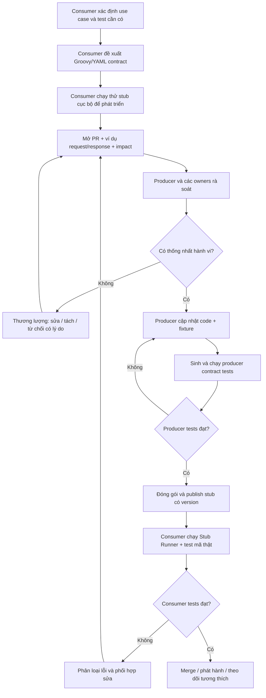
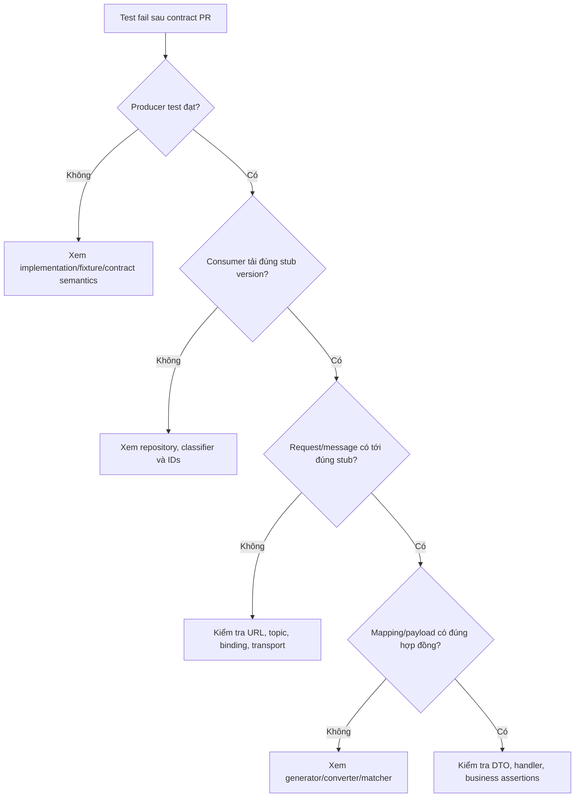

# Quy trình consumer đề xuất và producer rà soát hợp đồng

## 1. Vì sao một hợp đồng cần được hai nhóm cùng thống nhất?

Trong **Spring Cloud Contract** (module `SPRING_CLOUD_CONTRACT`), hợp đồng mô tả hành vi mà một **producer** cung cấp và một hoặc nhiều **consumer** kỳ vọng. Hợp đồng có thể là HTTP request/response hoặc một tương tác thông điệp, được viết bằng **Groovy DSL** hay **YAML DSL**. Công cụ sinh kiểm thử để producer xác nhận hành vi thật, đóng gói stub theo phiên bản để consumer chạy với **Stub Runner**, và giúp CI phát hiện những thay đổi API không tương thích.

Về mặt kỹ thuật, một hợp đồng là một tập quy tắc có thể kiểm thử. Về mặt phối hợp, đó là **thỏa thuận giữa các nhóm**. Nếu consumer tự ghi kỳ vọng mà producer không chấp thuận, stub có thể mô phỏng một API chưa từng tồn tại. Ngược lại, nếu producer tự đổi response mà không hiểu các consumer đang sử dụng trường nào, một thay đổi tưởng như nhỏ có thể làm hỏng hệ thống tích hợp.

**Consumer-driven contract testing (CDC)** giải quyết vấn đề này bằng cách đưa **nhu cầu thực tế của consumer** vào quá trình tạo hợp đồng. Consumer có thể chủ động mô tả hành vi cần dùng và gửi pull request; producer phải xem xét, thương lượng khi cần và thực hiện producer verification trước khi phát hành stub đáng tin cậy.

Ví dụ: Checkout Service cần biết SKU còn hàng để quyết định cho phép tạo đơn. Inventory Service là producer cung cấp API kiểm tra tồn kho. Checkout đề xuất:

```text
GET /api/inventory/SKU-001
Accept: application/json

200 OK
Content-Type: application/json
{
  "sku": "SKU-001",
  "available": true,
  "quantityAvailable": 12
}
```

Consumer có thể viết ngay test cho luồng đặt hàng theo response này. Nhưng trước khi xem đây là API đã cam kết, producer cần xác nhận:

- Endpoint, trạng thái và các trường có phù hợp thiết kế Inventory không?
- `quantityAvailable` là số lượng còn trong kho hay số lượng **có thể bán** sau khi trừ reservation?
- Một SKU không tồn tại khác SKU có tồn tại nhưng hết hàng thế nào?
- Có trường nào biến động hoặc nhạy cảm mà không nên công bố?
- Implementation hiện có đáp ứng hợp đồng hay cần thêm một thay đổi mới?
- Những consumer khác có thể bị ảnh hưởng không?

**Mục tiêu bài học** là thiết kế một quy trình hoàn chỉnh từ **đề xuất → rà soát → producer verification → stub publication → consumer verification**, thay vì chỉ dừng ở việc tạo file `.groovy`.

## 2. Vai trò, trách nhiệm và quyền quyết định

CDC không có nghĩa “consumer muốn gì producer phải làm đúng như vậy”. Nó có nghĩa **consumer đóng góp kỳ vọng theo use case**, còn **producer chịu trách nhiệm công bố hành vi mà mình thực sự hỗ trợ**.

| Vai trò | Trách nhiệm chính | Không nên làm |
| --- | --- | --- |
| **Consumer developer** | Mô tả use case, đề xuất request/response tối thiểu, viết consumer test, giải thích tác động | Tự công bố stub như hợp đồng đã được producer chấp thuận |
| **Producer developer** | Rà soát semantics, khả năng triển khai, tác động tương thích, tạo fixture và chạy generated producer tests | Chấp nhận PR chỉ vì cú pháp DSL hợp lệ |
| **API/domain owner** | Quyết định từ vựng, policy, quy tắc nghiệp vụ và lộ trình version | Để hai đội hiểu khác nhau về cùng một field |
| **Reviewer từ consumer khác** | Chỉ ra phụ thuộc hiện hữu và nguy cơ regression | Xem hợp đồng mới như việc riêng của một consumer |
| **CI/release owner** | Kiểm soát version artifact, gate producer tests, publish và provenance | Phát hành stub chưa có bằng chứng producer đáp ứng |
| **Security/data owner** khi liên quan | Rà soát quyền truy cập, PII và dữ liệu fixture | Cho đưa token hoặc dữ liệu production thật vào stub |

Với một tổ chức nhỏ, một người có thể kiêm nhiều vai trò. Điều quan trọng không phải số lượng chức danh, mà là **kỳ vọng được người dùng API đề xuất và được bên cung cấp API thừa nhận bằng bằng chứng**.

### 2.1. Phân biệt quyền viết PR và quyền phê duyệt API

Consumer có thể được cấp quyền tạo branch hoặc pull request trong repository chứa contracts. Điều đó **không đồng nghĩa** consumer có quyền tự quyết định rằng API mới đã được phát hành.

- **Đề xuất:** consumer thể hiện nhu cầu bằng hợp đồng cụ thể.
- **Rà soát:** producer và domain owner xác định có chấp nhận hay không.
- **Thực thi:** producer viết code/fixture cho hành vi đã chấp thuận.
- **Xác minh:** generated producer tests chạy trên producer thật.
- **Phát hành:** stub/artifact version mới được publish sau các quality gates.
- **Tiêu thụ:** consumer cập nhật test và chạy với artifact đã được xác minh.

Nếu producer từ chối một kỳ vọng, đó có thể là quyết định đúng: API hiện hữu có thể dùng được, contract bị quá ràng buộc hoặc yêu cầu vi phạm security policy. Cần **nêu lý do và đưa ra phương án thay thế**, không chỉ đóng PR.

## 3. Sơ đồ toàn bộ quy trình phối hợp



Sơ đồ mô tả **một chính sách làm việc đề xuất**. Thứ tự merge source contract, merge implementation và publish artifact có thể khác nhau theo tổ chức. Điều **không được bỏ** là sự khác biệt giữa:

1. Consumer **chạy thử với stub được tạo từ bản đề xuất**.
2. Producer **xác minh rằng ứng dụng thật đáp ứng bản hợp đồng đã chấp thuận**.
3. Consumer **chạy lại với artifact được producer xác minh và phát hành**.

Nếu chỉ có bước 1, consumer có thể xanh với một **stub mong muốn** mà producer chưa bao giờ tạo ra được.

## 4. Chuẩn bị trước khi consumer viết đề xuất

Một yêu cầu “thêm field để frontend dùng” thường quá mơ hồ. Consumer nên mô tả **hành vi quan sát được ở ranh giới tích hợp**.

### 4.1. Phiếu nhu cầu tối thiểu

| Câu hỏi | Ví dụ của Checkout Consumer |
| --- | --- |
| Người sử dụng contract là ai? | Checkout Service, nhóm Checkout |
| Hành vi nghiệp vụ cần gì? | Chỉ cho đặt hàng khi SKU còn khả năng bán |
| Producer dự kiến? | Inventory Service |
| Tương tác? | `GET /api/inventory/{sku}` |
| Input nào cần gửi? | SKU và `Accept: application/json` |
| Output tối thiểu? | `sku`, `available`, `quantityAvailable` |
| Nhánh lỗi quan trọng? | SKU không tồn tại trả `404 SKU_NOT_FOUND` |
| Những consumer khác? | Catalog UI, Order Service |
| Phiên bản đang dùng? | Inventory `1.8.0` (minh họa) |
| Thời gian cần? | Trước khi phát hành checkout flow mới |
| Người chịu trách nhiệm? | Checkout owner và Inventory API owner |

**Giá trị của bảng** là tạo ngữ cảnh để producer phản biện phần nghiệp vụ. Một DSL file đúng cú pháp vẫn không nói được vì sao `available = true` khi quantity bằng 0, hoặc một trường có thể vắng mặt khi nào.

### 4.2. Phân loại thay đổi

Trước khi tạo hợp đồng, nhóm nên xác định đề xuất thuộc loại:

- **Hành vi đang có nhưng chưa được mô tả**: thêm contract để bảo vệ điều đang chạy.
- **Hành vi mới tương thích**: thêm endpoint hoặc trường tùy chọn theo chính sách schema.
- **Hành vi mới có thể phá tương thích**: đổi kiểu, đổi ý nghĩa, đổi error code hoặc endpoint.
- **Sửa lỗi implementation**: producer đã có hợp đồng nhưng ứng xử sai.
- **Thay đổi giao thức thông điệp**: topic/destination, header, schema, nhãn stub hoặc serializer.

Không nên gom các thay đổi có rủi ro rất khác nhau vào một PR lớn. Một PR tập trung vào **một yêu cầu consumer có thể kiểm thử** giúp review và rollback dễ hơn.

## 5. Hai mô hình lưu trữ hợp đồng chính

Spring Cloud Contract mô tả hai cách tổ chức thường gặp cho Consumer-Driven Contracts:

### 5.1. Hợp đồng nằm trong repository của producer

```text
inventory-producer/
  pom.xml
  src/
    main/
      java/...               # Implementation producer
    test/
      java/...               # Base class + fixtures
      resources/
        contracts/
          checkout/
            get_inventory_available.groovy
            get_inventory_sku_not_found.yml
          catalog/
            get_inventory_summary.groovy
```

**Luồng:** Checkout developer clone/fork repository của Inventory theo quyền được cấp, tạo contract dưới thư mục thích hợp, tự thử local stub nếu cần, rồi mở PR. Producer reviewer tiếp nhận PR, sửa hoặc bổ sung implementation, chạy generated verification tests và merge.

**Ưu điểm:** contract nằm gần source producer; producer có thể thiết lập review/code ownership và CI gate cùng repository.

**Giới hạn:** nếu consumer không được quyền xem source producer (khác công ty, security boundary), mô hình này có thể không phù hợp. Consumer cũng có thể phải tải nhiều code không liên quan chỉ để gửi một bản DSL.

### 5.2. Hợp đồng nằm trong repository chung

Một tổ chức có thể tạo repository **chuyên chứa hợp đồng**, phân nhóm theo producer và consumer:

```text
contracts-repository/
  com/
    example/
      inventory-producer/
        checkout-consumer/
          get_inventory_available.groovy
          get_inventory_sku_not_found.yml
        catalog-consumer/
          get_inventory_summary.groovy
        pom.xml
      payments-producer/
        checkout-consumer/
          payment_succeeded.groovy
  pom.xml
```

Cây thư mục này là **quy ước minh họa** dựa trên mô hình repository chung; cần cấu hình plugin/assembly đúng cấu trúc thực tế. Không có nghĩa Spring Cloud Contract tự suy ra quyền của consumer từ tên folder.

Trong mô hình này:

- Consumer có thể tạo PR trong repository contracts mà không truy cập source producer.
- Nhóm vận hành package contracts thành artifact riêng.
- Producer dùng `contractDependency`, `contractsMode` và repository configuration tương ứng để lấy **đúng phiên bản hợp đồng** khi sinh test.
- Consumer dùng các stubs được tạo từ hợp đồng đã thống nhất.

**Ưu điểm:** minh bạch các expectations theo consumer, hỗ trợ nhóm nhiều repository hoặc ranh giới bảo mật. **Đổi lại:** phải version hóa riêng contract artifact, kiểm soát PR/CI ở repository chung và giữ đồng bộ với producer implementation.

### 5.3. Bảng chọn mô hình

| Tiêu chí | Contracts trong producer repo | Contracts trong common repo |
| --- | --- | --- |
| Consumer cần đọc source producer? | Thường có trong quá trình tạo PR | Không nhất thiết |
| Review bởi producer | PR trong producer repo | PR trong common repo với producer owner |
| Bằng chứng implementation | Producer CI cùng repo | Producer CI tải đúng contract artifact |
| Quản lý version | Gắn với producer code/release policy | Cần thêm version contract repository/artifact |
| Thích hợp khi | Các nhóm cùng tổ chức, truy cập tương đối dễ | Nhiều consumer, quyền truy cập tách biệt |
| Rủi ro chính | Consumer phụ thuộc cấu trúc nội bộ repo | Producer và consumer dùng lệch contract version |

**Dù đặt contract ở đâu, producer vẫn phải xác minh hợp đồng bằng ứng dụng thật.** Không nên kết luận rằng PR đã merge vào common repo thì producer đã được kiểm chứng.

## 6. Viết hợp đồng HTTP từ nhu cầu của consumer

Giả sử hai nhóm đã thống nhất endpoint Inventory `GET /api/inventory/SKU-001`.

### 6.1. Đề xuất bằng Groovy DSL

File `get_inventory_available.groovy`:

```groovy
import org.springframework.cloud.contract.spec.Contract

Contract.make {
    name 'get_inventory_available'
    description 'Checkout cần biết một SKU có thể đặt được'

    request {
        method GET()
        url '/api/inventory/SKU-001'
        headers {
            header 'Accept': 'application/json'
        }
    }

    response {
        status 200
        headers {
            contentType(applicationJson())
        }
        body([
            sku              : 'SKU-001',
            available        : true,
            quantityAvailable: 12
        ])
    }
}
```

Hợp đồng làm rõ **method, URL, request header, HTTP status, response content type, kiểu và giá trị body**. Consumer nên đưa vào proposal một mô tả ý nghĩa:

- `sku` là định danh của SKU đã hỏi; producer trả đúng SKU, không lấy từ cache sai key.
- `available` biểu thị khả năng đặt hàng **tại thời điểm kiểm tra**, không tự bảo đảm reservation đã thành công.
- `quantityAvailable` là số lượng có thể bán theo quy tắc đã thống nhất, không phải tổng tồn kho vật lý.
- Response `200` chỉ áp dụng cho SKU tồn tại trong fixture.

Đây là **một ví dụ cụ thể**, không phải mô tả mọi dữ liệu tồn kho có thể hợp lệ. Cần hợp đồng riêng cho những nhánh khác mà consumer thực sự sử dụng.

### 6.2. Biểu diễn YAML tương đương

```yaml
name: get_inventory_available
description: Checkout cần biết một SKU có thể đặt được
request:
  method: GET
  url: /api/inventory/SKU-001
  headers:
    Accept: application/json
response:
  status: 200
  headers:
    Content-Type: application/json
  body:
    sku: SKU-001
    available: true
    quantityAvailable: 12
```

Đây là **biểu diễn thay thế** của cùng hợp đồng Groovy. Không đưa cả hai file mô tả cùng điều kiện request và response vào một build nếu điều đó gây mapping/test trùng lặp.

### 6.3. Bổ sung nhánh lỗi thực sự cần bảo vệ

File `get_inventory_sku_not_found.groovy`:

```groovy
import org.springframework.cloud.contract.spec.Contract

Contract.make {
    name 'get_inventory_sku_not_found'
    description 'SKU không tồn tại khác SKU hết hàng'

    request {
        method GET()
        url '/api/inventory/SKU-MISSING'
        headers {
            header 'Accept': 'application/json'
        }
    }

    response {
        status 404
        headers {
            contentType(applicationJson())
        }
        body([
            code: 'SKU_NOT_FOUND'
        ])
    }
}
```

**Đừng nhầm `404 SKU_NOT_FOUND` với `404` do WireMock không tìm được mapping.** Consumer test cần kiểm tra cả error code/body mà producer cam kết, không chỉ status.

### 6.4. Điều kiện phản ví dụ: hết hàng không đồng nghĩa không tồn tại

Nếu SKU `SKU-002` tồn tại nhưng `quantityAvailable = 0`:

```json
{
  "sku": "SKU-002",
  "available": false,
  "quantityAvailable": 0
}
```

Consumer có thể cần **một contract `200` riêng** cho tình huống này. Nếu không, bug `available` luôn true hoặc Checkout bỏ qua quantity có thể không bị phát hiện. Tập hợp kịch bản phải bao phủ **những quyết định mà consumer thực sự đưa ra**, không phải mọi trạng thái nội bộ của Inventory.

## 7. Consumer làm gì trước khi gửi PR?

Consumer có thể phát triển theo hướng **test-first**:

1. Viết test ứng dụng Checkout cần làm gì khi nhận response có `available = true`.
2. Viết hoặc cập nhật HTTP client/DTO ở consumer theo hợp đồng đề xuất.
3. Tạo contract nguồn Groovy/YAML ở vị trí đã thỏa thuận.
4. Tạo stub cục bộ từ contract đề xuất để chạy test khi producer chưa kịp implement.
5. Đính kèm request/response mẫu, kết quả test và những câu hỏi nghiệp vụ còn mở vào PR.

### 7.1. Test của consumer phải đi qua mã consumer thật

Giả sử Checkout có `InventoryClient` và `CheckoutAvailabilityService`. Consumer test dùng Stub Runner:

```java
import org.junit.jupiter.api.Test;
import org.springframework.beans.factory.annotation.Autowired;
import org.springframework.boot.test.context.SpringBootTest;
import org.springframework.cloud.contract.stubrunner.StubRunnerProperties;
import org.springframework.cloud.contract.stubrunner.spring.AutoConfigureStubRunner;

import static org.assertj.core.api.Assertions.assertThat;

@SpringBootTest(properties = {
    "clients.inventory.base-url=http://localhost:8090"
})
@AutoConfigureStubRunner(
    ids = "com.example:inventory-producer:1.9.0-SNAPSHOT:stubs:8090",
    stubsMode = StubRunnerProperties.StubsMode.LOCAL
)
class CheckoutAvailabilityConsumerTest {

    @Autowired
    CheckoutAvailabilityService checkoutAvailabilityService;

    @Test
    void availableSkuCanBeOrdered() {
        AvailabilityView actual =
            checkoutAvailabilityService.check("SKU-001");

        assertThat(actual.sku()).isEqualTo("SKU-001");
        assertThat(actual.canOrder()).isTrue();
    }

    @Test
    void missingSkuIsNotTreatedAsAvailable() {
        assertThat(
            checkoutAvailabilityService.check("SKU-MISSING").canOrder()
        ).isFalse();
    }
}
```

`CheckoutAvailabilityService` và `AvailabilityView` là **thành phần minh họa do consumer tự hiện thực**. Hành vi `check("SKU-MISSING").canOrder() == false` là **chính sách giả định của ví dụ**, không phải tính năng Spring Cloud Contract. Nếu ứng dụng chọn ném domain exception, test phải assert exception thay vì ép service trả view.

**Điều kiện chạy:** artifact `1.9.0-SNAPSHOT:stubs` được cài trong local Maven repository từ proposal; consumer thực sự gọi HTTP client trỏ tới stub; test context và dependencies tương thích. Với CI phát hành, dùng version **đã được producer xác minh** thay vì coi stub thử nghiệm của consumer là nguồn chân lý.

### 7.2. Stub thử nghiệm và stub được producer xác minh khác nhau

| Bằng chứng | Chứng minh | Chưa chứng minh |
| --- | --- | --- |
| Consumer cài stub local từ đề xuất | Consumer có thể phát triển theo giao diện mong muốn | Producer hiện tại đã hỗ trợ giao diện |
| Consumer test pass với stub local | Client và logic consumer xử lý được mẫu | Producer thật trả đúng mẫu |
| Producer generated tests pass | Producer đáp ứng hợp đồng trong fixture đã chọn | Mọi consumer đã tương thích |
| Consumer test pass với stub phát hành | Consumer xử lý artifact được producer xác minh | Mọi lỗi mạng, bảo mật, dữ liệu production đều đã được bao phủ |

Tài liệu CDC của Spring Cloud Contract có ví dụ người viết contract cài local stubs để thử nghiệm sớm. Việc **tạm bỏ chạy tests** trong bước tạo stub cục bộ không đồng nghĩa được phép **bỏ producer verification khi phát hành**.

### 7.3. Cẩn thận source contract chứa nhiều nhánh

Nếu Checkout chỉ đề xuất một ví dụ `SKU-001` rồi producer dùng regex quá rộng để mọi SKU đều trả `200 available = true`, stub có thể làm consumer test xanh giả. Khi API phân biệt SKU tồn tại/hết hàng/không tồn tại, cần tách mapping request theo dữ liệu hoặc điều kiện nhận request thực tế.

Không thay thế phạm vi hợp đồng bằng một mẫu `GET /api/inventory/.*` trả cùng response khi đó không phải hành vi producer cam kết.

## 8. Pull request đề xuất contract cần có những gì?

Một PR tốt không chỉ chứa file mới. Nó giúp producer **ra quyết định**, giúp reviewer của consumer khác thấy tác động và cho CI biết cần kiểm tra điều gì.

### 8.1. Mẫu mô tả PR

```markdown
## Nhu cầu từ consumer
Checkout Service cần chặn thao tác đặt hàng khi SKU hết hàng.

## API được đề xuất
GET /api/inventory/{sku}
200: {sku, available, quantityAvailable}
404: {code: "SKU_NOT_FOUND"}

## Hợp đồng thay đổi
- get_inventory_available.groovy
- get_inventory_out_of_stock.groovy
- get_inventory_sku_not_found.groovy

## Ý nghĩa trường
- available: có thể tiếp nhận đơn tại thời điểm đọc
- quantityAvailable: số lượng có thể bán, không phải total stock

## Tính tương thích
- Không thay đổi endpoint hiện hữu
- Cần producer xác nhận loại dữ liệu và điều kiện 404

## Kiểm thử
- Consumer test với stub local: PASS
- Producer verification: PENDING PRODUCER REVIEW

## Owners
Consumer: Checkout Team
Producer: Inventory Team
Other consumers to notify: Catalog Team
```

Trong code review thực tế, PR có thể dùng template/issue tracker của tổ chức. Những trạng thái `PASS`/`PENDING` trong ví dụ là **minh họa**, không phải kết quả một build đã chạy.

### 8.2. Thông tin đủ để review không có nghĩa PR phải dài

Tối thiểu nên có **use case, contract diff, định nghĩa trường, nhánh lỗi, tác động tương thích, người liên hệ và kết quả test**. Nếu một thay đổi ảnh hưởng schema version, security headers, PII hoặc SLAs, phải có thêm phần rủi ro tương ứng.

**Không đính kèm token thật hoặc request production chứa dữ liệu cá nhân** chỉ để chứng minh API đang được gọi. Dùng fixture tổng hợp và tài liệu hóa những gì quan trọng.

## 9. Producer review: những câu hỏi phải được trả lời

Producer không nên chỉ bình luận “looks good”. Review cần bao phủ **đúng hành vi**, **đúng ranh giới** và **đúng khả năng bảo trì**.

| Nhóm câu hỏi | Điều producer cần rà soát |
| --- | --- |
| Nghiệp vụ | `available` nghĩa là gì, tính tại thời điểm nào, có bị race condition không? |
| Contract scope | Consumer có đòi cả dữ liệu không dùng, như tồn kho ở từng kho hàng, không? |
| HTTP semantics | Method, URL, status, headers, content type, auth có đúng quy ước API? |
| Kiểu dữ liệu | Boolean/số/chuỗi, nullability, số nguyên âm, enum mới, thứ tự danh sách |
| Nhánh lỗi | `404`, `400`, `409`; error code body; phân biệt SKU thiếu và hết hàng |
| Tương thích | Có ảnh hưởng consumer cũ hoặc API/documentation đã công bố? |
| Kiểm thử producer | Có fixture ổn định, base test class, generated assertions hợp lệ? |
| Stub semantics | Request matcher có quá rộng hoặc mappings chồng lấp không? |
| Vận hành | Có cần version mới, migration period hoặc feature flag? |
| Bảo mật | API lộ dữ liệu nhạy cảm không, có xác thực/quyền thích hợp không? |

### 9.1. “Có thể đáp ứng” chưa đủ: cần phản hồi về ý nghĩa

Ví dụ Checkout đề xuất `available = true` khi `quantityAvailable > 0`. Inventory có thể đã giữ hàng cho các đơn khác. Định nghĩa đúng có thể là:

```text
quantityAvailable = onHand - reserved - safetyBuffer
available = quantityAvailable > 0
```

Công thức trên là **ví dụ quy tắc nghiệp vụ được thương lượng**, không phải cách tính tồn kho bắt buộc. Producer phải xác nhận quy tắc thực tế; nếu chưa có sự nhất trí, không merge contract mô tả một nghĩa mà consumer và producer hiểu khác.

### 9.2. Chọn kỳ vọng đủ mạnh nhưng không quá khóa cứng

Nếu consumer chỉ cần biết `available`, hợp đồng không nhất thiết phải ràng buộc thêm `warehouseInternalId`, `lastRecountJobId` hay thứ tự fields trong JSON. Khóa chặt các chi tiết không dùng làm tăng false failures và cản trở tiến hóa API.

Mặt khác, một matcher `.*` cho mọi response body sẽ không phát hiện đổi kiểu `available` từ boolean thành chuỗi. Chọn ràng buộc theo **phụ thuộc thật của consumer**:

- Method/URL/headers quan trọng.
- Các trường cần và kiểu dữ liệu.
- Những giá trị/nhánh nghiệp vụ phân biệt.
- Quy tắc dữ liệu động chỉ khi cần.
- Không ràng buộc những chi tiết nội bộ không được công bố.

**Nguyên tắc cân bằng:** *Đủ chặt để bắt lỗi phá consumer; đủ hẹp về phạm vi để producer không bị khóa bởi điều consumer không dùng.*

## 10. Producer verification sau khi chấp thuận hợp đồng

Khi producer đồng ý với đề xuất, bước tiếp theo **không phải lập tức publish stub**. Producer cần:

1. Cập nhật implementation của endpoint nếu hành vi mới chưa tồn tại.
2. Tạo fixture cho SKU còn hàng, hết hàng và không tồn tại.
3. Cấu hình Spring Cloud Contract Maven/Gradle plugin với contracts root đúng.
4. Sinh producer tests từ các hợp đồng đã được review.
5. Chạy generated tests trên controller/service thật hoặc ranh giới producer được lựa chọn.
6. Kiểm tra HTTP mappings và stub artifact được đóng gói đúng.
7. Chỉ publish phiên bản mới khi toàn bộ verification gates đạt.

### 10.1. Base class minh họa cho HTTP producer

Với Spring MVC, JUnit 5 và chế độ MockMvc:

```java
package com.example.inventory.contract;

import io.restassured.module.mockmvc.RestAssuredMockMvc;
import org.junit.jupiter.api.BeforeEach;
import org.springframework.beans.factory.annotation.Autowired;
import org.springframework.boot.test.autoconfigure.web.servlet.AutoConfigureMockMvc;
import org.springframework.boot.test.context.SpringBootTest;
import org.springframework.test.web.servlet.MockMvc;

@SpringBootTest
@AutoConfigureMockMvc
public abstract class InventoryContractBase {

    @Autowired
    private MockMvc mockMvc;

    @Autowired
    private InventoryContractFixtures fixtures;

    @BeforeEach
    protected void prepareContractState() {
        fixtures.reset();
        fixtures.stock("SKU-001", 12);
        fixtures.stock("SKU-002", 0);
        fixtures.ensureMissing("SKU-MISSING");
        RestAssuredMockMvc.mockMvc(mockMvc);
    }
}
```

`InventoryContractFixtures` và các phương thức `reset`, `stock`, `ensureMissing` là **test helper giả định do producer hiện thực**. Chúng phải chuẩn bị trạng thái để endpoint thực xử lý yêu cầu; không được thay controller bằng một response hard-code chỉ để generated test đạt.

### 10.2. Maven cấu hình tối thiểu

Trong producer có BOM/dependency management phù hợp:

```xml
<dependencies>
  <dependency>
    <groupId>org.springframework.boot</groupId>
    <artifactId>spring-boot-starter-test</artifactId>
    <scope>test</scope>
  </dependency>
  <dependency>
    <groupId>org.springframework.cloud</groupId>
    <artifactId>spring-cloud-starter-contract-verifier</artifactId>
    <scope>test</scope>
  </dependency>
</dependencies>

<build>
  <plugins>
    <plugin>
      <groupId>org.springframework.cloud</groupId>
      <artifactId>spring-cloud-contract-maven-plugin</artifactId>
      <version>REPLACE_WITH_COMPATIBLE_VERSION</version>
      <extensions>true</extensions>
      <configuration>
        <testFramework>JUNIT5</testFramework>
        <testMode>MOCKMVC</testMode>
        <baseClassForTests>com.example.inventory.contract.InventoryContractBase</baseClassForTests>
      </configuration>
    </plugin>
  </plugins>
</build>
```

`REPLACE_WITH_COMPATIBLE_VERSION` là placeholder; cần thay bằng version Spring Cloud Contract phù hợp Spring Boot/Cloud của dự án. Đây là phần POM rút gọn, không phải build có thể chạy độc lập. Maven plugin, test runner và dependency versions phải được cấu hình đúng để **generated tests thực sự chạy**, không chỉ sinh Java source.

### 10.3. Test xanh giả cần phòng tránh

| Tình huống | Vì sao chưa có bằng chứng producer đáp ứng? |
| --- | --- |
| `generateTests` chạy thành công | Chỉ chứng minh generator tạo source |
| Stub JAR tồn tại nhưng tests bị skip | Không có generated assertions đã được thực thi |
| Fixture tự trả đúng response mà bỏ qua service | Không kiểm chứng implementation thật |
| CI báo `BUILD SUCCESS` với 0 contract tests | Có thể plugin không đọc contracts hoặc test runner bỏ qua |
| Consumer test pass với stub local đề xuất | Stub mẫu có thể không được producer hỗ trợ |

Người review nên nhìn **generated test counts**, logs của producer assertions và stub artifact/version, không chỉ dấu tick xanh trên PR.

## 11. Contract review khi có nhiều consumer khác nhau

Giả sử Inventory Service phục vụ:

- **Checkout** cần `available` và `quantityAvailable`.
- **Catalog** chỉ cần trạng thái “còn/hết hàng” để hiển thị.
- **Warehouse Operations** cần số lượng vật lý, reserved quantity và thời điểm kiểm kê.

Không nên ép một endpoint trả **tất cả trường nội bộ** chỉ vì có ba consumer. Các lựa chọn cần xem xét:

| Phương án | Ưu điểm | Rủi ro / điều kiện |
| --- | --- | --- |
| Một API chung với các trường được công bố rõ | Dễ reuse | Dễ phình to, rò rỉ dữ liệu hoặc coupling |
| Tách endpoint theo use case | Rõ quyền/trách nhiệm, giảm dữ liệu không cần | Cần quản lý nhiều hợp đồng |
| Thêm trường tùy chọn | Có thể backward-compatible nếu consumer dung thứ | Consumer nghiêm ngặt có thể fail |
| Media type/API version mới | Tách breaking change | Chi phí hỗ trợ song song |
| Dedicated message/event | Phù hợp xử lý bất đồng bộ | Schema evolution, ordering và routing phức tạp hơn |

### 11.1. Tránh hai hợp đồng xung đột

Ví dụ:

```text
Checkout contract:
  GET /api/inventory/SKU-001 -> 200 {"available":true}

Catalog contract:
  GET /api/inventory/SKU-001 -> 200 {"available":false}
```

Nếu **cùng request và cùng fixture** nhưng hai response kỳ vọng trái ngược, hai hợp đồng không thể đồng thời đại diện cho cùng một hành vi producer. Cần:

1. Xác định tiền điều kiện khác nhau (kho hàng, thời điểm, quyền truy cập...).
2. Tách điều kiện request có ý nghĩa hoặc fixture tương ứng.
3. Nếu không có cách phân biệt, chọn một semantics đã thống nhất và cập nhật consumer.
4. Bảo đảm WireMock mappings không chồng lấp rồi trả response tùy thứ tự matching.

**Đặt hợp đồng ở hai thư mục consumer khác nhau không khiến WireMock tự phân biệt hai request giống hệt.**

### 11.2. Thay đổi có vẻ “chỉ thêm field” vẫn cần hỏi consumer

Thêm `warehouseZone` vào JSON response có thể không phá consumer dùng deserializer dung thứ unknown properties. Nhưng consumer sử dụng DTO/schema nghiêm ngặt có thể từ chối field mới. Producer nên chủ động chạy consumer contract tests cho những nhóm còn hỗ trợ, thay vì kết luận “thêm field chắc chắn tương thích”.

## 12. Phản hồi review: chấp thuận, chỉnh sửa hay từ chối

Một quy trình tốt có nhiều trạng thái hợp lệ hơn “merge ngay” hoặc “đóng PR”.

| Kết quả review | Ví dụ | Hành động tiếp |
| --- | --- | --- |
| **Accept** | Hành vi rõ, phù hợp kiến trúc và có thể kiểm chứng | Producer implement nếu cần, chạy generated tests |
| **Request changes** | `quantityAvailable` chưa rõ đơn vị hoặc âm được không | Bổ sung semantics, sửa DSL, test lại |
| **Split proposal** | PR gộp endpoint mới và đổi schema message cũ | Tách thành các đề xuất dễ review/rollback |
| **Alternative offered** | API đã có `/availability` cung cấp thông tin tương đương | Consumer thử dùng endpoint hiện hữu |
| **Defer** | Cần thay đổi database lớn hoặc chưa có capacity | Ghi dependency và mốc đánh giá lại |
| **Reject with reason** | Yêu cầu trả dữ liệu kho nội bộ vi phạm chính sách | Nêu nguyên nhân, tìm giải pháp khác |

### 12.1. Ví dụ hội thoại review có tính xây dựng

> **Consumer:** “Chúng tôi cần `quantityAvailable` để chặn Checkout khi hết hàng.”
>
> **Producer:** “Hệ thống có reservation đồng thời; số lượng chỉ là snapshot và không bảo đảm giữ hàng thành công. Chúng tôi đề xuất thêm `available` cho UI và một endpoint `POST /reservations` để quyết định cuối cùng.”
>
> **Consumer:** “Vậy hợp đồng `GET` sẽ dùng để hiển thị, còn submit đơn phải xử lý `409 OUT_OF_STOCK` từ reservation.”
>
> **Kết luận:** Sửa đề xuất thành hai hành vi rõ: kiểm tra sơ bộ và reservation có tính quyết định.

Đây là **ví dụ thương lượng nghiệp vụ**, không phải mẫu bắt buộc cho mọi hệ thống. Điểm quan trọng: một field boolean được chuyển từ nghĩa “cam kết giữ hàng” sang “trạng thái tham khảo” sau khi producer làm rõ giới hạn.

### 12.2. Ghi quyết định, không chỉ ghi “LGTM”

Với yêu cầu đáng kể, PR nên để lại bản tóm tắt:

```text
Decision: ACCEPT_WITH_CHANGES
Consumer: checkout-consumer
Producer: inventory-producer
Contract: get_inventory_available
Semantics: available is a point-in-time indicator
Reservation: POST /api/reservations remains authoritative
Error cases: SKU_NOT_FOUND, OUT_OF_STOCK handled separately
Compatibility: additive endpoint, no removal of existing fields
Producer verification: required before publish
Owners: Checkout API Owner + Inventory API Owner
```

Bản ghi này là **tài liệu review minh họa**, không phải metadata DSL phải nhúng vào contract.

## 13. Phối hợp cho hợp đồng thông điệp (messaging)

Với messaging, consumer không chủ động gọi một URL; contract có thể mô tả một message phát ra bởi producer. Việc thương lượng cần làm rõ **destination, body, headers, content type, event semantics và delivery assumptions**.

Giả sử Orders Producer phát sự kiện khi đơn được tạo, còn Inventory Consumer cần biết để lên yêu cầu giữ hàng.

### 13.1. Consumer đề xuất Groovy contract

```groovy
import org.springframework.cloud.contract.spec.Contract

Contract.make {
    name 'order_created_event'
    label 'order_created'
    description 'Inventory nhận sự kiện khi Orders tạo đơn'

    input {
        triggeredBy('publishOrderCreated()')
    }

    outputMessage {
        sentTo('orders.events')
        body([
            eventType: 'ORDER_CREATED',
            orderId  : 'ord-1001',
            productId: 'SKU-001',
            quantity : 2
        ])
        headers {
            header('eventType', 'ORDER_CREATED')
            messagingContentType(applicationJson())
        }
    }
}
```

**Chú ý các vai trò:**

- `label 'order_created'` là nhãn **kích hoạt message stub** trong consumer tests khi messaging integration hỗ trợ.
- `triggeredBy('publishOrderCreated()')` là **phương thức do producer test base hiện thực** để kích hoạt producer thật trong verification.
- `sentTo('orders.events')` là **destination** cần được kiểm tra.
- `body` và `headers` là dữ liệu/metadata của message mà consumer cần.

Đổi `label` không tự đổi topic; đổi `eventType` trong body không tự thay header `eventType`. Consumer và producer phải thống nhất nơi dữ liệu nằm và kiểu của nó.

### 13.2. YAML DSL tương đương

```yaml
name: order_created_event
label: order_created
description: Inventory nhận sự kiện khi Orders tạo đơn
input:
  triggeredBy: publishOrderCreated()
outputMessage:
  sentTo: orders.events
  body:
    eventType: ORDER_CREATED
    orderId: ord-1001
    productId: SKU-001
    quantity: 2
  headers:
    eventType: ORDER_CREATED
    contentType: application/json
```

Hai bản Groovy/YAML biểu diễn **một hợp đồng**, không đưa vào cùng build như hai kịch bản khác nhau nếu điều đó làm generated tests trùng lặp.

### 13.3. Producer phải review thêm những gì?

| Câu hỏi | Lý do |
| --- | --- |
| Event có phát sau **commit nghiệp vụ** không? | Tránh consumer thấy trạng thái chưa được lưu |
| `orderId` và `eventId` có ổn định/duy nhất không? | Hỗ trợ truy vết và idempotency |
| `quantity` là số nguyên và có thể bằng 0 không? | Consumer có thể xử lý sai lượng hàng |
| `sentTo` là logical destination hay broker topic thật? | Binder/messaging integration có thể ánh xạ khác nhau |
| `contentType`/serializer thống nhất không? | Consumer phải giải mã được payload |
| Event có thể bị giao lặp hoặc đến trễ không? | Test stub không tự bảo đảm delivery semantics |
| Có cần schema version không? | Tiến hóa payload với consumer cũ |
| Có quy tắc security/tenant partition không? | Không gửi event sai phạm vi dữ liệu |

**Không đòi Stub Runner tự chứng minh** exactly-once, ordering, retry hay broker security. Những nội dung đó cần integration/resilience tests bổ sung.

### 13.4. Producer test và consumer test là hai bằng chứng khác nhau

Producer test dùng `publishOrderCreated()` để chạy hành vi Orders thật và quan sát message. Consumer test có thể gọi:

```java
assertThat(stubTrigger.trigger("order_created")).isTrue();

await().atMost(Duration.ofSeconds(5))
       .untilAsserted(() ->
           assertThat(inventoryReadModel.hasOrder("ord-1001")).isTrue()
       );
```

Đây là đoạn **minh họa** trong một JUnit consumer test có Stub Runner, message binder và Awaitility; `inventoryReadModel` là API của ứng dụng. Trước trigger phải đảm bảo read model **chưa có** `ord-1001`, nếu không assertion có thể đạt dù consumer handler bị hỏng.

## 14. Tương thích API và versioning khi hai nhóm cùng thay đổi

Sau khi producer xác minh hợp đồng, cần phát hành stub artifact như:

```text
com.example:inventory-producer:1.9.0:stubs
```

Consumer nên **ghim version đã kiểm chứng** khi chạy CI phục vụ release. Một cấu hình dùng `+` hoặc “latest” có thể khiến cùng một commit lấy stub khác nhau giữa các lần chạy.

### 14.1. Những thay đổi có nguy cơ breaking

| Thay đổi producer đề xuất | Rủi ro đối với consumer | Chiến lược phối hợp |
| --- | --- | --- |
| Đổi `quantityAvailable` số thành chuỗi | DTO/logic so sánh sai | Giữ kiểu cũ hoặc version hóa contract |
| Đổi `available` thành `availabilityStatus` | Consumer không đọc được field cũ | Giai đoạn chuyển tiếp hỗ trợ cả hai nếu phù hợp |
| Bỏ response `404 SKU_NOT_FOUND` | Consumer không phân loại lỗi được | Thống nhất schema lỗi mới và migration |
| Đổi `200` thành `204` khi hết hàng | Consumer không còn JSON để phân tích | Contract mới + consumer rollout plan |
| Thêm field tùy chọn | Có thể phá deserializer nghiêm ngặt | Consumer compatibility tests với stub ứng viên |
| Đổi `orders.events` sang topic khác | Consumer không nhận message | Dual publish/routing migration nếu cần |
| Đổi label `order_created` | Stub trigger của consumer test fail | Phối hợp cập nhật test hoặc giữ label tương thích |
| Đổi content type/serializer | Consumer parse payload lỗi | Schema/converter integration tests |

**Không phải mọi thay đổi đều cần major version**, nhưng đánh giá breaking phải dựa trên **những consumer còn được hỗ trợ**, không chỉ quan điểm producer rằng thay đổi là “nhỏ”.

### 14.2. Chiến lược rollout

Một thay đổi có nguy cơ phá tương thích thường cần:

1. Producer công bố contract mới song song với hành vi cũ nếu có thể.
2. Consumer thử trên stub version ứng viên.
3. Consumer phát hành bản chấp nhận được response mới.
4. Producer triển khai behavior mới theo feature flag/version/dual format nếu cần.
5. Giám sát tương thích trong giai đoạn chuyển tiếp.
6. Chỉ loại bỏ hành vi/stub cũ khi hết support, rollback và dependency.

Không dùng việc **xóa stub cũ** để buộc consumer nâng cấp: điều đó chỉ gây `artifact not found` và làm mất khả năng kiểm thử/rollback của các bản còn được hỗ trợ.

## 15. CI gates dành cho hai nhóm

Một PR chỉ nên được xem là an toàn khi **đúng hợp đồng và đúng quy trình kiểm chứng**.

### 15.1. Các cổng kiểm tra

| Giai đoạn | Chủ trách nhiệm | Điều phải đạt | Bằng chứng |
| --- | --- | --- | --- |
| Contract lint/parse | Consumer + contract repo CI | Groovy/YAML đúng và được quét | Build logs, discovered contract list |
| Consumer test với stub đề xuất | Consumer | Client và logic xử lý được mẫu mong muốn | Consumer test report, ghi rõ *unverified stub* |
| Producer review | Producer/domain owner | Semantics, contract scope, security, compatibility được chấp thuận | Review approvals/decision |
| Generated producer tests | Producer | Test source có cho các nhánh cần bảo vệ | Generated classes/test count |
| Producer verification | Producer CI | Tests chạy trên code/fixture thật và đạt | Surefire/Gradle report |
| Stub packaging | Producer CI | Artifact có đúng contracts/mappings/version | JAR inspection, checksum |
| Consumer compatibility | Consumer CI | Chạy với **stub đã producer xác minh** | Stub coordinates + test report |
| Publish/rollout | Release owner | Chỉ phát hành sau quality gates | Immutable artifact, release record |

Nếu tổ chức giữ contracts ở **common repository**, cần thêm bước producer lấy **đúng contract artifact version**. Không được chạy producer tests trên bộ contract khác với bộ consumer vừa review.

### 15.2. Câu hỏi trong pull request review

- Có ít nhất một **consumer owner** mô tả use case/actual usage không?
- Producer owner có chấp thuận semantics/response/error codes không?
- Hợp đồng được đặt đúng folder và plugin phát hiện chưa?
- File test có bảo vệ behavior, hay chỉ so sánh fixture với fixture?
- Generated producer tests **thực thi** chưa, hay chỉ có source?
- HTTP mappings có match chồng lấp không?
- Với messaging, label/destination/header/content type đã được thống nhất chưa?
- Consumer có thử trên **artifact candidate version** không?
- Có nhánh âm/không tìm thấy/hết hàng phù hợp không?
- Những consumer/branches khác có cần chạy lại không?
- Có dữ liệu nhạy cảm, token thật hoặc nội dung nội bộ quá mức trong fixture không?

### 15.3. Ví dụ luồng CI

```text
Consumer feature PR
  -> write consumer test
  -> propose contract branch / PR
  -> optional local stub test (unverified)

Producer contract review
  -> accept / negotiate / reject
  -> implement missing behavior
  -> generate producer tests
  -> run producer verification
  -> convert HTTP mappings / package message definitions
  -> publish candidate stub artifact

Consumer compatibility CI
  -> resolve exact stub version
  -> run actual consumer client/handler tests
  -> report PASS/FAIL to both owners
  -> coordinated release decision
```

**Không bỏ qua bước “actual consumer behavior”**: nếu consumer chỉ xác nhận WireMock trả JSON như fixture, test chưa bảo vệ HTTP client, DTO mapping hoặc quyết định nghiệp vụ của consumer.

## 16. Trách nhiệm khi CI phát hiện lỗi

Một lần fail không tự chứng minh producer hay consumer “có lỗi”. Phân loại theo ranh giới giúp hai nhóm phối hợp thay vì sửa expected values vô điều kiện.

| Dấu hiệu | Nghi vấn | Nhóm nên kiểm tra trước |
| --- | --- | --- |
| DSL parse fail | Syntax/contract format không hợp lệ | Người đề xuất + contract repo CI |
| Producer test fail `200` vs thực tế `404` | Fixture thiếu hoặc implementation chưa hỗ trợ | Producer |
| Generated test không được tạo | Contracts root/plugin filter sai | Producer build owner |
| Stub artifact `1.9.0` không tìm thấy | Chưa publish hoặc classifier/version sai | Producer release + consumer CI |
| Consumer nhận `404` WireMock no-match | Client method/path/header/body sai hoặc mapping thiếu | Consumer + producer mapping reviewer |
| Stub `200` đúng nhưng DTO parse fail | Type/schema/content type khác kỳ vọng | Consumer; phối hợp producer nếu contract sai |
| Messaging label không trigger được | Label/artifact khác hoặc integration chưa cấu hình | Cả hai nhóm |
| Consumer test fail trên bản producer mới | Breaking change hoặc giả định consumer cũ | Hai nhóm + API owner |
| Consumer test pass stub local, fail producer verification | Đề xuất chưa được implementation thật đáp ứng | Producer implement, consumer kiểm tra semantics |

### 16.1. Tránh “sửa test để xanh” khi lỗi có thật

Nếu producer trả `quantityAvailable` dưới dạng `"12"` (chuỗi) nhưng hợp đồng yêu cầu số `12`, không nên sửa contract thành `.*` mà chưa hỏi consumer. Consumer có thể dùng field để so sánh số lượng. Hãy:

1. Xác nhận kiểu được hai bên chấp thuận.
2. Kiểm tra serializer/DTO phía producer.
3. Sửa implementation hoặc thương lượng version mới.
4. Chạy lại producer tests và consumer tests.

**Hợp đồng là công cụ phát hiện sai lệch**, không phải một phép kiểm tra được làm lỏng mỗi lần có failure.

### 16.2. Khi chưa biết bên nào sai

Một kịch bản debug hiệu quả:



## 17. Quản lý hợp đồng theo vòng đời, không chỉ theo một PR

Sau khi hợp đồng được merge và stub được publish, công việc phối hợp vẫn tiếp tục:

1. **Version hóa** artifact với release của producer; ghi lại contract commit/provenance.
2. **Theo dõi consumer owners** và supported branches sử dụng phiên bản nào.
3. **Thông báo deprecation** trước khi bỏ field/endpoint/message label.
4. **Chạy regression** cho các consumer quan trọng khi producer thay đổi.
5. **Giữ lịch sử hợp đồng** phục vụ rebuild LTS/rollback theo policy.
6. **Định kỳ loại hợp đồng không còn được dùng**, nhưng phải xác nhận không còn consumer đang hỗ trợ phụ thuộc vào đó.

### 17.1. Một bảng theo dõi đơn giản

| Contract | Producer owner | Consumer owners | Tình trạng | Stub version | Hành động |
| --- | --- | --- | --- | --- | --- |
| `get_inventory_available` | Inventory | Checkout, Catalog | Active | `1.9.0` | Monitor |
| `get_inventory_sku_not_found` | Inventory | Checkout | Active | `1.9.0` | Giữ nhánh lỗi |
| `legacy_stock_count` | Inventory | Warehouse LTS | Deprecated | `1.7.5` | Chưa xóa khi LTS còn dùng |
| `order_created_event` | Orders | Inventory | Active | `2.3.0` | Theo dõi schema/label |

Đây là **bảng minh họa**, không phải dữ liệu thực tế của một nhóm. Giá trị quan trọng là ai chịu trách nhiệm phản hồi khi đề nghị thay đổi/xóa hợp đồng.

### 17.2. Hợp đồng không thay thế tài liệu API

Một hợp đồng kiểm thử các **ví dụ đại diện và điều kiện được mô tả**. Để hiểu toàn bộ API, nhóm vẫn có thể cần:

- OpenAPI/AsyncAPI/schema documentation.
- Quy định auth, rate limit, pagination và idempotency.
- Quy tắc nullability, backward compatibility và deprecation.
- SLOs, retry/timeouts, error budget và operational guidance.
- Kiểm thử tích hợp với transport/broker thật cho những điều không được stub mô phỏng.

Hợp đồng nên **nhất quán** với tài liệu, không nhất thiết thay thế toàn bộ tài liệu.

## 18. Những anti-pattern khi nhiều nhóm phối hợp

| Anti-pattern | Hệ quả | Cách khắc phục |
| --- | --- | --- |
| Consumer tự thêm expectation rồi coi như API đã phát hành | Stub vượt khả năng producer | Producer review + generated test gate |
| Producer tự đổi field mà không thông báo | Consumer vỡ DTO/logic | Chạy compatibility matrix, review changes |
| Chỉ có một happy-path fixture | Không phát hiện phân nhánh sai | Thêm lỗi/hết hàng/đối chứng có ý nghĩa |
| PR chỉ có code, không có ngữ nghĩa field | Hai bên hiểu khác nhau | Ghi use case, semantics, error handling |
| Contract đòi chi tiết DB nội bộ | Coupling và security risk | Chỉ mô tả behavior ở public boundary |
| Matcher quá rộng để test xanh | Không bắt breaking changes | Chọn matcher theo dependency consumer |
| Mỗi consumer tự viết mapping giả riêng | Stubs phân kỳ và không được producer xác minh | Dùng nguồn contract được review |
| Nhánh lỗi `404` chỉ assert status | Có thể pass do WireMock no-match | Assert business error body |
| Không ghim stub version | CI không tái lập được | Ghim artifact version |
| Dùng test mock client để báo contract test PASS | Không test HTTP boundary | Chạy client thật với Stub Runner |
| Merge contract từ common repo nhưng producer dùng bản cũ | Không kiểm chứng cùng một contract | Pin contract artifact/version trong producer CI |
| Đổi message label mà không thông báo | StubTrigger consumer fail | Ghi label là interface phục vụ test |
| Xóa stub ngay sau producer release mới | LTS/hotfix consumer không rebuild được | Inventory supported consumers trước dọn |
| Merge đồng thời hai PR conflict cùng matcher | WireMock trả response không ổn định | Review mapping overlap và fixture |
| Bỏ qua producer verification để publish nhanh | Stub chưa được producer chứng minh | Chặn publish khi generated tests fail |

## 19. Case study: Checkout đề xuất thêm khả năng giữ hàng

### 19.1. Bài toán

Checkout cần luồng mới:

1. Hiển thị khả năng đặt SKU.
2. Khi người dùng nhấn đặt hàng, yêu cầu giữ số lượng mong muốn.
3. Nếu hết hàng, hiển thị lỗi rõ ràng mà không báo thành công giả.

Inventory đã có endpoint `GET /api/inventory/{sku}` trả số lượng tham khảo. Checkout ban đầu đề xuất thêm `reserved: true` vào response `GET`.

### 19.2. Review phát hiện vấn đề

Producer giải thích: HTTP `GET` chỉ đọc trạng thái, không nên tạo reservation. Hai yêu cầu đặt hàng đồng thời có thể cùng nhìn thấy hàng và cùng cố đặt. Việc thêm `reserved: true` vào `GET` dễ khiến consumer tin rằng stock đã bị khóa.

Hai bên đổi đề xuất:

| Hành vi | Request | Response thành công | Nhánh lỗi |
| --- | --- | --- | --- |
| Kiểm tra tham khảo | `GET /api/inventory/SKU-001` | `200`, `available`, `quantityAvailable` | `404 SKU_NOT_FOUND` |
| Giữ hàng có hiệu lực | `POST /api/reservations` với SKU và quantity | `201`, `reservationId`, `status=RESERVED` | `409 OUT_OF_STOCK` |

### 19.3. Hợp đồng Groovy cho reservation thành công

```groovy
import org.springframework.cloud.contract.spec.Contract

Contract.make {
    name 'reserve_inventory_success'

    request {
        method POST()
        url '/api/reservations'
        headers {
            contentType(applicationJson())
        }
        body([
            sku     : 'SKU-001',
            quantity: 2
        ])
    }

    response {
        status 201
        headers {
            contentType(applicationJson())
        }
        body([
            reservationId: 'res-1001',
            status       : 'RESERVED'
        ])
    }
}
```

### 19.4. Hợp đồng YAML cho nhánh hết hàng

```yaml
name: reserve_inventory_out_of_stock
request:
  method: POST
  url: /api/reservations
  headers:
    Content-Type: application/json
  body:
    sku: SKU-002
    quantity: 2
response:
  status: 409
  headers:
    Content-Type: application/json
  body:
    code: OUT_OF_STOCK
```

**Tại sao không dùng cùng request cho cả `201` và `409`?** Nếu method, URL, headers, body matcher và fixture không có khác biệt quan sát được, WireMock không biết chọn nhánh nào; producer test cũng khó ổn định nếu database state thay đổi mà request giống hệt.

Trong ví dụ, `SKU-001` được seed còn hàng và `SKU-002` được seed hết hàng. Với API thật, có thể sử dụng một điều kiện request khác hoặc test fixture riêng; cần đảm bảo generated producer tests có setup tương ứng.

### 19.5. Quyết định cuối cùng

```text
Consumer request:
  "GET trả luôn trạng thái reserved để Checkout biết đặt hàng đã thành công"

Producer review:
  "Không thể bảo đảm reservation bằng GET; có race condition."

Agreed contracts:
  GET availability (advisory)
  POST reservation (authoritative)
  201 RESERVED
  409 OUT_OF_STOCK

Verification:
  Producer runs generated tests with deterministic stock fixtures.
  Consumer runs actual Checkout client against versioned stubs.
Release:
  Coordinated, with rollback/compatibility plan.
```

Case study này cho thấy **CDC là một quá trình thiết kế API hai chiều**, không phải consumer viết YAML rồi producer buộc phải khớp.

## 20. Bài thực hành: tổ chức một contract proposal từ đầu đến cuối

### 20.1. Bối cảnh và dữ liệu

Payment Service là producer. Orders Service là consumer cần xác nhận kết quả thanh toán. Hiện tại Orders nhận `PAYMENT_SUCCEEDED` với body `paymentId` và `orderId`, nhưng cần bổ sung `amount`, `currency` và cách xử lý `PAYMENT_FAILED`.

Các nhóm:

| Nhóm | Vai trò |
| --- | --- |
| Orders Team | Consumer đề xuất và viết message handler test |
| Payments Team | Producer review, implement và chạy generated tests |
| Platform Team | Quản lý repository/stub artifact CI |

### 20.2. Yêu cầu

1. Viết **use case** vì sao Orders cần số tiền và đơn vị tiền.
2. Xác định **trường tối thiểu** ở body và headers để consumer xử lý.
3. Viết Groovy messaging contract cho `PAYMENT_SUCCEEDED` với `label` rõ.
4. Viết một YAML contract riêng cho `PAYMENT_FAILED` với `reason = DECLINED`.
5. Nêu ba câu hỏi Payments Team cần trả lời về amount type, currency và idempotency.
6. Tạo nội dung PR có owners, semantics, compatibility và test evidence.
7. Thiết kế producer base test trigger sự kiện bằng **logic Payment thực**.
8. Thiết kế consumer test dùng Stub Runner và assert handler cập nhật trạng thái thật.
9. Đề xuất version của stub artifact và cách hai nhóm xác nhận đang dùng cùng version.
10. Viết review outcome có thể là accept, request changes hoặc defer, kèm lý do.
11. Mô tả kế hoạch khi một consumer cũ chưa đọc được `currency`.
12. Đưa ra ba điều kiện CI sẽ **chặn publish**.

### 20.3. Gợi ý Groovy contract cho thành công

```groovy
import org.springframework.cloud.contract.spec.Contract

Contract.make {
    name 'payment_succeeded_event'
    label 'payment_succeeded'

    input {
        triggeredBy('publishPaymentSucceeded()')
    }

    outputMessage {
        sentTo('payments.events')
        body([
            eventType: 'PAYMENT_SUCCEEDED',
            paymentId: 'pay-1001',
            orderId  : 'ord-1001',
            amount   : 125000,
            currency : 'VND'
        ])
        headers {
            header('eventType', 'PAYMENT_SUCCEEDED')
            messagingContentType(applicationJson())
        }
    }
}
```

`publishPaymentSucceeded()` là helper **do producer test base tự hiện thực**, không phải phương thức tích hợp sẵn. Test phải chạy hành vi Payment thực với fixture đã chuẩn bị.

### 20.4. Gợi ý YAML contract cho thất bại

```yaml
name: payment_failed_event
label: payment_failed
input:
  triggeredBy: publishPaymentFailed()
outputMessage:
  sentTo: payments.events
  body:
    eventType: PAYMENT_FAILED
    paymentId: pay-2002
    orderId: ord-2002
    reason: DECLINED
  headers:
    eventType: PAYMENT_FAILED
    contentType: application/json
```

Nhánh thất bại có thể có các trường khác nhau theo chính sách Payment; cần review rõ thông tin nào được công bố, đặc biệt tránh đưa dữ liệu thẻ, token thanh toán hoặc thông tin nhạy cảm thật vào contract.

### 20.5. Định nghĩa kết quả đúng của bài thực hành

Một bài làm đạt yêu cầu khi:

- Có **hai use cases** và hai contracts phân biệt được.
- Bên producer có thể giải thích cách tạo hai tình huống bằng fixture.
- Generated producer tests có thể được chạy trên message producer thật.
- Consumer test dùng stub **và kiểm tra trạng thái sau khi handler xử lý**, không chỉ `trigger(...) == true`.
- Có người quyết định về schema evolution và consumer cũ.
- Artifact version được ghi rõ và producer verification hoàn tất trước khi publish.

### 20.6. Câu hỏi tự kiểm tra

**Câu 1.** Consumer có thể mở PR vào producer repo không?

**Đáp án:** Có, nếu quy trình/quyền cho phép. Consumer đề xuất hợp đồng, còn producer owner review và xác minh hành vi trước khi công bố.

**Câu 2.** Consumer test pass trên stub tự sinh từ PR đã đủ để merge API mới chưa?

**Đáp án:** Chưa. Stub đó phản ánh kỳ vọng; cần producer chấp thuận và chạy generated producer tests với implementation thật.

**Câu 3.** Khi dùng common contract repo, điều gì phải đồng bộ?

**Đáp án:** Producer phải tải **đúng version contract artifact** vừa được review; consumer phải thử với **đúng stub version** đã được producer kiểm chứng.

**Câu 4.** Nếu hai consumer đề xuất response khác nhau cho cùng request, chỉ tách thư mục contract là đủ chưa?

**Đáp án:** Chưa. Phải thống nhất semantics hoặc phân biệt tiền điều kiện/request; nếu không, mappings có thể xung đột.

**Câu 5.** Đổi label của messaging contract có luôn là breaking change trên message wire không?

**Đáp án:** Không nhất thiết đổi wire payload, nhưng có thể phá consumer tests dùng `StubTrigger.trigger(label)`. Cần phối hợp cập nhật.

**Câu 6.** Producer test pass có chứng minh consumer nào cũng xử lý được API không?

**Đáp án:** Không. Consumer tests phải chạy trên stub artifact theo version, với code consumer thật và các nhánh liên quan.

## 21. Checklist phối hợp consumer và producer

### Trước khi gửi đề xuất

- [ ] Xác định producer/consumer owners và hệ thống đang được tích hợp.
- [ ] Có use case và expected behavior quan sát được.
- [ ] Biết hợp đồng là HTTP hay messaging, đúng method/destination.
- [ ] Chọn những field, headers, content type và nhánh lỗi mà consumer thật sự cần.
- [ ] Có ví dụ request/response hoặc message với fixture **không chứa dữ liệu nhạy cảm**.
- [ ] Có consumer test hoặc kế hoạch test đi qua mã client/handler thật.
- [ ] Nếu consumer thử stub local, ghi rõ đó là **unverified proposal**.
- [ ] Tìm những consumers khác có thể bị ảnh hưởng.

### Khi producer review

- [ ] Producer xác nhận semantics, kiểu dữ liệu, nullability và error handling.
- [ ] Phân tích backward compatibility và sự hỗ trợ các consumer cũ.
- [ ] Kiểm tra matcher quá rộng, mapping chồng lấp và fixture không ổn định.
- [ ] Chốt owner của implementation và các quality gates.
- [ ] Có quyết định accept/change/defer/reject kèm lý do.
- [ ] Với messaging, kiểm tra label/destination/body/header/content type và transport assumptions.
- [ ] Không merge một hợp đồng mà cả hai phía đang hiểu khác nhau về hành vi.

### Sau khi thống nhất

- [ ] Generated producer tests được sinh và **chạy** trên implementation producer thật.
- [ ] Producer CI có test report và chặn publish khi verification fail.
- [ ] Stub JAR chứa contracts/mappings hoặc message definitions đúng phiên bản.
- [ ] Consumer CI tải đúng artifact candidate version.
- [ ] Consumer tests kiểm tra **kết quả xử lý nghiệp vụ**, không chỉ fixture.
- [ ] Nếu breaking change, có migration/rollout/rollback plan.
- [ ] Owner và tài liệu API/schema được cập nhật.
- [ ] Artifact release cũ còn được giữ khi consumer LTS/rollback cần dùng.
- [ ] PR/release ghi lại contract version, producer commit, stub version và approvals.

### Tài liệu tham khảo

- [Spring Cloud Contract — Step-by-step Guide to Consumer Driven Contracts](https://docs.spring.io/spring-cloud-contract/reference/getting-started/cdc.html): hướng dẫn consumer đề xuất contract và producer tiếp nhận PR.
- [Spring Cloud Contract — Consumer Driven Contracts with Contracts on the Producer Side](https://docs.spring.io/spring-cloud-contract/reference/using/cdc-producer-side.html): luồng hợp đồng lưu ở producer repository.
- [Spring Cloud Contract — Consumer Driven Contracts with Contracts in an External Repository](https://docs.spring.io/spring-cloud-contract/reference/using/cdc-external-repo.html): mô hình hợp đồng bên ngoài producer source.
- [Spring Cloud Contract — Common Repository for Contracts](https://docs.spring.io/spring-cloud-contract/reference/howto/how-to-common-repo-with-contracts.html): tổ chức hợp đồng theo consumer trong repository chung.
- [Spring Cloud Contract — Stub Runner](https://docs.spring.io/spring-cloud-contract/reference/project-features-stubrunner/stub-runner-core.html): tiêu thụ stub theo tọa độ artifact/version.
- [Spring Cloud Contract — Messaging](https://docs.spring.io/spring-cloud-contract/reference/project-features-messaging.html): hợp đồng thông điệp, generated producer tests và message stubs.

**Ghi nhớ:** quy trình **consumer đề xuất → producer rà soát → producer verification → phát hành stub → consumer verification** là một chuỗi thỏa thuận và bằng chứng, không chỉ là chuỗi thao tác với file DSL. Consumer có tiếng nói về hành vi cần dùng; producer chịu trách nhiệm bảo đảm hành vi đó có thật và tương thích; cả hai cùng chịu trách nhiệm xử lý thay đổi, versioning, CI và vòng đời hỗ trợ. Spring Cloud Contract giúp biến sự thống nhất ấy thành kiểm thử có thể lặp lại, nhưng **không thay thế đối thoại và quyết định kỹ thuật giữa các nhóm**.
