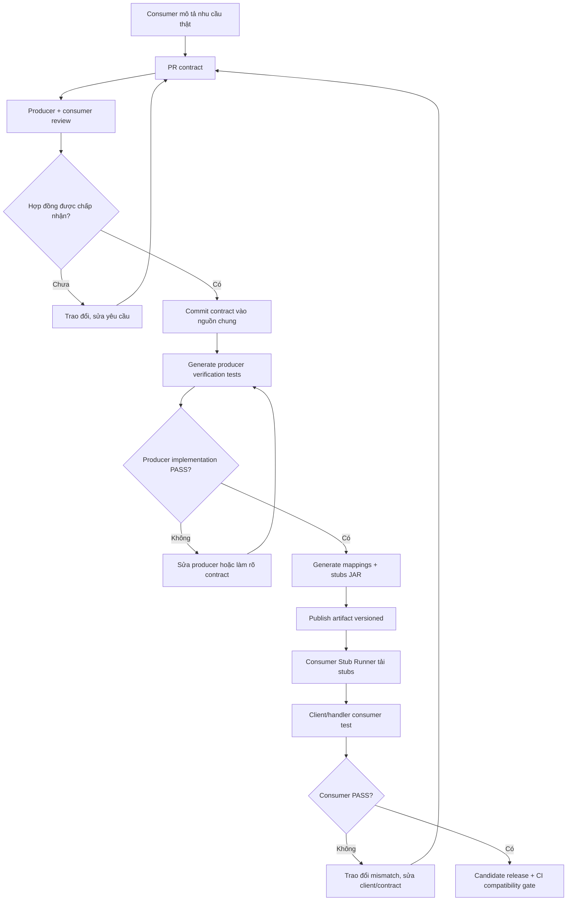
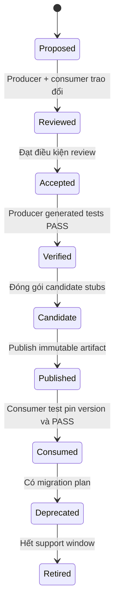
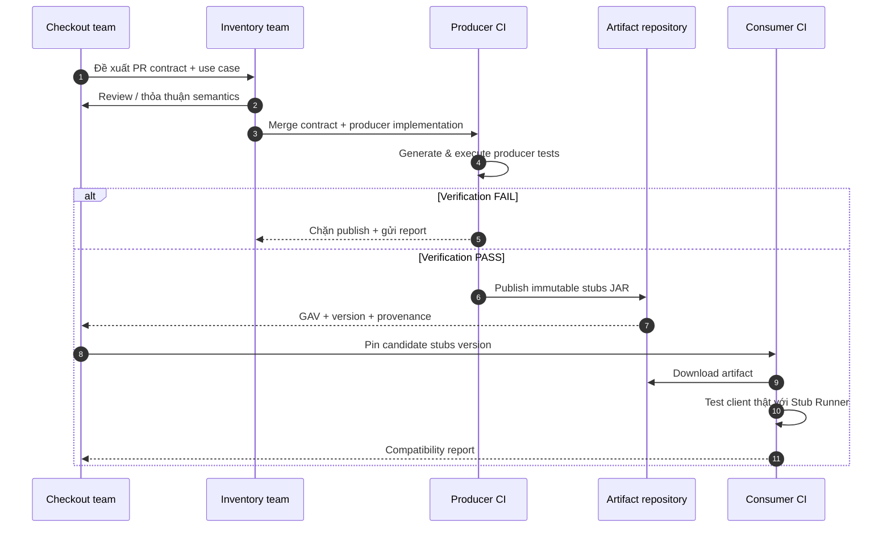
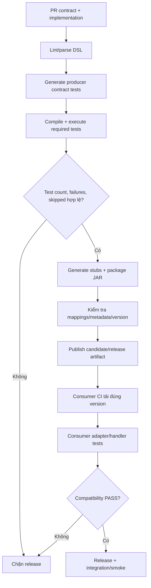

# Quy trình producer công bố hợp đồng cho consumer sử dụng

> **Chương:** Phối hợp nhiều nhóm  
> **Module:** `SPRING_CLOUD_CONTRACT` — học kiểm thử hợp đồng giữa producer và consumer bằng Groovy/YAML DSL cho HTTP hoặc thông điệp, sinh kiểm thử phía producer, phát hành stub, sử dụng Stub Runner và tích hợp CI để phát hiện thay đổi API không tương thích.

## Mục tiêu học tập

Sau bài này, bạn có thể:

1. Mô tả **toàn bộ quy trình** từ một yêu cầu của consumer đến contract được review, producer verification PASS, artifact stub được phát hành và consumer test sử dụng được.
2. Phân biệt **contract nguồn**, **generated producer test**, **WireMock mapping**, **stubs JAR** và **producer application artifact**; giải thích mỗi tài sản dùng ở bước nào.
3. Phân công trách nhiệm giữa nhóm producer, nhóm consumer, người quản lý artifact repository và CI/release owner, tránh tình trạng "bên kia tưởng mình đã làm".
4. Viết một contract Spring Cloud Contract YAML/Groovy cho HTTP có cả thành công và lỗi, đồng thời xác định bằng chứng producer thực sự giữ đúng lời hứa.
5. Thiết lập mô hình **publish versioned stubs** trong Maven hoặc Gradle và biết tại sao sinh stub chưa đồng nghĩa đã verify producer.
6. Dùng **Stub Runner** lấy artifact `LOCAL`/`REMOTE`, đưa HTTP client thật vào bài kiểm thử consumer và pin đúng version/candidate.
7. Phối hợp PR review, release candidate, CI compatibility gates, thông báo thay đổi và rollout/rollback không đồng bộ giữa nhiều nhóm.
8. Biết cách xử lý khi hợp đồng chưa được chấp nhận, producer chưa triển khai, artifact thiếu hoặc consumer và producer hiểu khác nhau về ngữ nghĩa.
9. Mở rộng nguyên tắc công bố sang **messaging contracts** với event, destination, schema version và StubTrigger, đồng thời nhận diện giới hạn của mock/broker.
10. Tự dựng checklist và chứng cứ bàn giao để consumer có thể sử dụng stub **mà không cần chờ producer chạy cục bộ**.

## 1. Tại sao "công bố hợp đồng" không phải chỉ gửi một file YAML?

Giả sử có hai nhóm làm việc độc lập:

- **Inventory team** sở hữu `inventory-service` — producer của API tồn kho.
- **Checkout team** sở hữu `checkout-service` — consumer gọi inventory trước khi cho người dùng đặt hàng.

Checkout cần gọi:

```http
GET /api/stock/SKU-001 HTTP/1.1
Accept: application/json
```

Và cần một response có ý nghĩa:

```http
HTTP/1.1 200 OK
Content-Type: application/json

{
  "sku": "SKU-001",
  "available": true,
  "quantity": 4
}
```

Nếu Inventory team gửi qua chat một đoạn JSON mẫu, Checkout team có thể bắt đầu viết client. Nhưng đoạn JSON ấy **chưa trả lời được**:

- Request phải dùng method/path/header nào?
- `available` có luôn là JSON boolean không, hay có thể `null`?
- Nếu SKU không tồn tại, status/body lỗi nào được cam kết?
- Producer đã triển khai đúng hành vi ấy chưa?
- Làm sao Checkout test tự động mà không khởi động Inventory?
- Một tuần sau, Checkout biết mình đang dùng **bản lời hứa nào**?
- Nếu Inventory muốn xóa `quantity`, ai được quyền chấp nhận việc đó?

Quy trình phối hợp tốt biến lời hứa thành **một chuỗi có thể truy vết**:

**Contract được hai nhóm chấp nhận → Producer verification PASS → Stubs được đóng gói có version → Artifact được công bố → Consumer lấy đúng artifact và test client thật → CI bảo vệ thay đổi tiếp theo.**

### 1.1. Hai thứ phải được công bố đúng cách

1. **Nguồn contract** (Groovy/YAML DSL): diễn đạt những điều producer cam kết và được review khi thay đổi.
2. **Stub artifact** (thường là JAR có classifier `stubs`): chứa các mappings/contract cần cho Stub Runner mô phỏng collaborator trong consumer tests.

Hai thứ liên quan nhưng không đồng nhất. Một bản contract hợp lệ về cú pháp **chưa chứng minh implementation producer đã pass**. Một stub JAR tồn tại trong repository **không tự chứng minh nó được sinh từ producer build đã verify**.

### 1.2. Mô hình tổng thể



Quy trình có thể được chia thành nhiều PR/CI jobs và không phải lúc nào cũng tuần tự tuyệt đối. Điều bất biến là **không gọi một artifact là "đã được producer kiểm chứng" nếu chưa có producer verification PASS liên quan**.

## 2. Phân công vai trò: ai sở hữu điều gì?

| Vai trò | Quyền quyết định chính | Trách nhiệm kiểm chứng | Vật bàn giao |
| --- | --- | --- | --- |
| **Consumer owner** | Trường, status, lỗi, hành vi mà consumer cần | Client/handler thật xử lý contract | Scenario đề xuất, consumer contract tests, phản hồi |
| **Producer owner** | Khả năng đáp ứng, cách triển khai, support/deprecation | Generated producer tests phải PASS; đánh giá ảnh hưởng mọi consumer | Contract được chấp nhận, verified build, stubs artifact |
| **API/contract reviewer** | Chuẩn đặt tên, tương thích, bất biến schema | Review breaking changes, semantics, auth/error behavior | PR approval/rationale |
| **CI/release owner** | Quality gates và artifact promotion | Kiểm soát version, test reports, không publish khi fail/skip | Artifact có provenance, release record |
| **Consumer integration owner** | Binding/config, timeout/retry, phương án cập nhật client | Integration/smoke tests ngoài phạm vi stub | Triển khai và quan sát sau release |

Trong nhóm nhỏ, một người có thể giữ nhiều vai trò. Nhưng **quyền sở hữu contract và quyền công bố artifact vẫn cần rõ** để không có một bên âm thầm sửa lời hứa rồi tuyên bố tương thích.

### 2.1. Gợi ý RACI cho các mốc

Trong bảng dưới, `R` là người thực hiện, `A` là người chịu trách nhiệm cuối cùng, `C` là người cần tham vấn, `I` là người được thông báo.

| Hoạt động | Consumer | Producer | Contract reviewer | CI/release |
| --- | --- | --- | --- | --- |
| Xác định use case consumer | **R/A** | C | C | I |
| Đề xuất contract | **R** | A/C | C | I |
| Chấp nhận contract | C | **R/A** | C | I |
| Sửa implementation cho phù hợp | C | **R/A** | I | I |
| Chạy producer verification | I | **R/A** | I | C |
| Tạo và publish verified stub | I | **R** | I | **A** |
| Test consumer với candidate | **R/A** | C | I | C |
| Quyết định breaking change/retirement | C | **R** | **A** theo policy | C |
| Ghi nhận release/rollback | I | C | I | **R/A** |

Đây là **ma trận gợi ý**, không phải yêu cầu cứng của Spring Cloud Contract. Team có thể đổi người `A` theo quy trình nội bộ, nhưng cần đảm bảo không có một việc mà mọi người đều chỉ là `I`.

## 3. Hợp đồng là tài sản có vòng đời, không phải tệp dùng một lần

Một lifecycle khả thi:



Các trạng thái trên là **quy ước quản trị của nhóm**, không phải giá trị `status` có sẵn trong Spring Cloud Contract DSL.

### 3.1. Phân biệt "in progress" và "verified"

Spring Cloud Contract có cơ chế **contracts in progress** hỗ trợ một số luồng phát stub khi producer chưa sẵn sàng; tài liệu cũng mô tả khả năng tạo stubs khi runtime. Cơ chế đó hữu ích để **mở khóa phát triển consumer sớm**, nhưng cần gắn nhãn rõ:

- **Proposed / provisional stub:** contract chưa được chấp nhận hoặc producer implementation chưa pass.
- **Verified stub:** build producer đã chạy và pass test được sinh từ contract ấy.

**Không đưa provisional stub vào quality gate phát hành dưới nhãn verified**, vì consumer PASS với một lời hứa chưa triển khai không chứng minh producer sẽ đáp ứng nó.

### 3.2. Nguồn sự thật phải được thống nhất

Nhóm thường chọn một trong các mô hình:

1. Contract được lưu trong **repository producer**; consumer gửi PR bổ sung/thay đổi.
2. Contract được lưu trong **repository hợp đồng riêng**; producer lấy contract dependency hoặc SCM source rồi verify.
3. Contract được quản lý bằng hệ thống nội bộ khác, nhưng có quy trình biến thành DSL và artifact có version.

Bài này dùng **producer repository** làm ví dụ chính vì nó đơn giản để học và dễ gắn verification với producer build. Nếu dùng contract repository riêng, phải thêm một bước bảo đảm producer test và stub publish dùng **đúng revision đã duyệt**.

## 4. Nhóm consumer viết yêu cầu dựa trên nhu cầu thực

Trước khi mở PR, Checkout team nên mô tả use case bằng ngôn ngữ nghiệp vụ:

> "Checkout cần biết SKU còn bán được hay không và còn bao nhiêu đơn vị để quyết định cho phép đặt `requestedQuantity`. Nếu SKU không tồn tại, phải nhận một lỗi có mã nhận diện ổn định."

Chuyển yêu cầu thành các trường hợp quan sát được:

| Tình huống | Request | Kỳ vọng |
| --- | --- | --- |
| Có hàng | `GET /api/stock/SKU-001` | 200, `available: true`, `quantity: 4` |
| Hết hàng | `GET /api/stock/SKU-002` | 200, `available: false`, `quantity: 0` |
| Không có SKU | `GET /api/stock/SKU-404` | 404 và mã lỗi `SKU_NOT_FOUND` |
| Lỗi upstream tạm thời | Theo policy | Consumer retry/fallback phù hợp; không nhất thiết là contract response bắt buộc |

Trong bước này, đừng bắt producer cam kết **mọi chi tiết nội bộ** như tên database column, scheduler hoặc class name. Contract nên diễn đạt **điều consumer thực sự dùng được qua interface**.

### 4.1. Thỏa thuận ngữ nghĩa, không chỉ JSON shape

Cần ghi rõ:

- `quantity` là số lượng **còn bán được**, không phải tổng hàng vật lý.
- `available` là boolean, không phải chuỗi `"true"`.
- `quantity = 0` tương ứng hết hàng trong fixture này.
- `404` nghĩa là SKU không tồn tại, khác `200` với `available: false`.
- `Content-Type` là JSON và `Accept` của consumer được hỗ trợ.
- Thời điểm dữ liệu được tính, độ trễ chấp nhận được và chính sách caching nếu nghiệp vụ phụ thuộc.

Một test chỉ so `quantity` là number sẽ không tự phát hiện producer đổi **ngữ nghĩa** của nó.

## 5. Ví dụ YAML contract do hai nhóm thống nhất

Với Maven producer, các file contract thường nằm tại:

```text
inventory-service/
└── src/test/resources/contracts/
    └── checkout-service/
        ├── stock_available.yml
        ├── stock_empty.yml
        └── stock_not_found.yml
```

Với Gradle plugin hiện đại, thư mục mặc định là `src/contractTest/resources/contracts` và base test classes ở `src/contractTest/java` hoặc Groovy tương ứng. Không bê nguyên đường dẫn Maven sang Gradle rồi giả định plugin quét được.

### 5.1. Tình huống có hàng

File `stock_available.yml`:

```yaml
name: stock_available
description: "Checkout doc ton kho ban duoc"

request:
  method: GET
  url: /api/stock/SKU-001
  headers:
    Accept: application/json

response:
  status: 200
  headers:
    Content-Type: application/json
  body:
    sku: SKU-001
    available: true
    quantity: 4
```

Đây là **lời hứa phía producer** cho một request cụ thể. Khi build được cấu hình đúng, plugin dùng nó để sinh producer verification test và WireMock mapping cho consumer.

### 5.2. Tình huống hết hàng

File `stock_empty.yml`:

```yaml
name: stock_empty

request:
  method: GET
  url: /api/stock/SKU-002
  headers:
    Accept: application/json

response:
  status: 200
  headers:
    Content-Type: application/json
  body:
    sku: SKU-002
    available: false
    quantity: 0
```

### 5.3. Tình huống không tồn tại

File `stock_not_found.yml`:

```yaml
name: stock_not_found

request:
  method: GET
  url: /api/stock/SKU-404
  headers:
    Accept: application/json

response:
  status: 404
  headers:
    Content-Type: application/json
  body:
    code: SKU_NOT_FOUND
    message: Stock item not found
```

**Lưu ý triển khai:** producer thật cần có exception handler hoặc controller behavior trả đúng status, header và body này. Nếu code chỉ ném một exception mà Spring trả error payload khác, generated producer verification phải FAIL cho đến khi hai bên thống nhất đúng behavior.

### 5.4. Có thể viết bằng Groovy DSL

Ví dụ tương đương **chỉ cho case có hàng**:

```groovy
org.springframework.cloud.contract.spec.Contract.make {
    name 'stock_available'

    request {
        method 'GET'
        url '/api/stock/SKU-001'
        headers {
            header 'Accept': 'application/json'
        }
    }

    response {
        status 200
        headers {
            contentType(applicationJson())
        }
        body(
            sku: 'SKU-001',
            available: true,
            quantity: 4
        )
    }
}
```

**Chỉ giữ một DSL cho cùng interaction trong một build.** Nếu cả YAML và Groovy có cùng method/path/headers và cùng kết quả, bạn có thể sinh test hoặc stub mappings trùng; nếu chúng đòi response khác nhau thì còn tệ hơn vì producer không thể đồng thời đáp ứng hai lời hứa mâu thuẫn cho cùng request.

## 6. Những gì cần được review trước khi producer chấp nhận contract

Một PR tốt không chỉ có file mới. Nó phải có **ngữ cảnh, tác động và điều kiện chấp nhận**.

### 6.1. Checklist review theo góc nhìn consumer

- Client thật sẽ gọi method/path/header nào?
- Field nào là required, optional hoặc có thể null?
- Kiểu JSON có quan trọng không: boolean, number, string, array?
- Có giá trị enum/format/timestamp mà client parse theo quy tắc cố định?
- Những status/error response nào client dùng để quyết định retry hoặc hiển thị?
- Nếu producer thêm unknown field, client có chấp nhận không?
- Có khác biệt giữa "hết hàng" và "SKU không tồn tại" không?
- Có yêu cầu tương thích với phiên bản client cũ đang chạy không?

### 6.2. Checklist review theo góc nhìn producer

- Endpoint/event đã tồn tại hay là đề xuất mới?
- Có thể tạo fixture ổn định để generated producer test kiểm chứng không?
- Contract mô tả **public behavior** hay vô tình khóa chặt implementation detail?
- Có ảnh hưởng các consumer khác đang dùng cùng endpoint không?
- Có hợp đồng nào mâu thuẫn về method/path/header nhưng yêu cầu hai responses khác nhau?
- Nếu thay đổi có rủi ro, cần giữ v1 song song hoặc phát hành v2?
- Test hiện có có thể phát hiện producer vi phạm required fields?
- Ai là owner bảo trì contract và quyết định deprecation?

### 6.3. Bảng review quyết định

| Phát hiện | Quyết định |
| --- | --- |
| Contract cần field mới mà producer chưa có | Có thể chấp nhận **có điều kiện triển khai**, nhưng không gọi stub là verified trước khi test pass |
| Contract thiếu error path consumer thực sự cần | Yêu cầu bổ sung case |
| Consumer đòi một field nội bộ không phải API | Trao đổi, thay bằng behavior quan sát được |
| Hai consumer yêu cầu outputs mâu thuẫn cho cùng request | Thiết kế request/version khác biệt hoặc schema chung |
| Producer muốn xóa field consumer cũ còn dùng | Chưa chấp nhận breaking change nếu chưa có migration plan |
| Contract có UUID/timestamp động | Dùng matcher đúng chiều, không so literal ngẫu nhiên |
| Stub đã tồn tại nhưng không rõ commit/version | Chưa đủ điều kiện công bố verified artifact |

### 6.4. Ví dụ thông tin trên PR

```text
Contract PR: inventory / stock lookup
Consumer owner: Checkout team
Producer owner: Inventory team

Use cases:
  - SKU-001 has stock
  - SKU-002 out of stock
  - SKU-404 missing

Consumer depends on:
  - GET /api/stock/{sku}
  - Accept application/json
  - quantity is JSON number; available is boolean
  - SKU_NOT_FOUND on HTTP 404

Compatibility:
  - New endpoint behavior; no existing field removed
  - Existing client versions to re-check: checkout 2.7.x, catalog 1.9.x

Acceptance:
  - Producer generated contract tests PASS
  - Candidate stubs artifact is published with immutable version
  - Checkout consumer tests PASS with candidate
```

Đây là **mẫu PR do nhóm tự đặt ra**, không phải schema cấu hình Spring Cloud Contract. Các version cần thay bằng dữ liệu thật khi áp dụng.

## 7. Producer: biến lời hứa thành kiểm thử có thể thất bại

Sau khi chấp nhận contract, producer team có nhiệm vụ làm cho **generated tests gọi implementation thật và PASS**.

### 7.1. Controller ví dụ

```java
@RestController
@RequestMapping("/api/stock")
public class StockController {

    @GetMapping(
        value = "/{sku}",
        produces = MediaType.APPLICATION_JSON_VALUE
    )
    public StockResponse get(@PathVariable String sku) {
        return switch (sku) {
            case "SKU-001" ->
                new StockResponse("SKU-001", true, 4);
            case "SKU-002" ->
                new StockResponse("SKU-002", false, 0);
            default ->
                throw new SkuNotFoundException(sku);
        };
    }

    public record StockResponse(
        String sku, boolean available, int quantity
    ) {}
}
```

Đây là **minh họa** bằng Java 17+; cần imports Spring MVC, exception handler cho `SkuNotFoundException` và project Boot phù hợp. Hành vi `404 + SKU_NOT_FOUND` phải được handler thật triển khai; nếu chưa có, contract `stock_not_found` sẽ chưa PASS.

### 7.2. Base test với MockMvc

```java
package com.example.inventory;

import io.restassured.module.mockmvc.RestAssuredMockMvc;
import org.junit.jupiter.api.BeforeEach;
import org.springframework.beans.factory.annotation.Autowired;
import org.springframework.boot.test.autoconfigure.web.servlet.AutoConfigureMockMvc;
import org.springframework.boot.test.context.SpringBootTest;
import org.springframework.web.context.WebApplicationContext;

@SpringBootTest
@AutoConfigureMockMvc
public abstract class ContractTestBase {

    @Autowired
    WebApplicationContext context;

    @BeforeEach
    public void setup() {
        RestAssuredMockMvc.webAppContextSetup(context);
    }
}
```

Test base này dùng **Spring web application context thật** trong test, thích hợp khi Spring MVC advice/converter/validation liên quan đến contract. Cần có ứng dụng Boot, dependencies Verifier/MockMvc và cấu hình fixture ổn định. Nếu controller gọi database/broker, test setup phải cô lập tài nguyên ngoài mà không mock luôn phần HTTP behavior đang được kiểm chứng.

### 7.3. Chú ý giới hạn bằng chứng

Generated producer test PASS giúp khẳng định implementation **trong phạm vi test** đáp ứng request/response được contract mô tả. Nó **không tự kiểm tra** toàn bộ hệ thống triển khai thật, cấu hình gateway/TLS, database transaction ở môi trường khác hoặc độ tin cậy của broker production.

Vì vậy cần integration/E2E tests bổ sung với đúng rủi ro còn lại, nhưng **không thay** contract verification bằng E2E đơn lẻ.

## 8. Producer build: phát hiện, sinh, chạy, đọc report

### 8.1. Dự án Maven

Với Spring Cloud Contract Maven plugin, contract nguồn mặc định thường ở `src/test/resources/contracts`. Cấu hình plugin fragment:

```xml
<plugin>
  <groupId>org.springframework.cloud</groupId>
  <artifactId>spring-cloud-contract-maven-plugin</artifactId>
  <extensions>true</extensions>
  <configuration>
    <testFramework>JUNIT5</testFramework>
    <testMode>MOCKMVC</testMode>
    <baseClassForTests>
      com.example.inventory.ContractTestBase
    </baseClassForTests>
  </configuration>
</plugin>
```

Đây là **fragment**, không phải `pom.xml` hoàn chỉnh: cần quản lý phiên bản Maven plugin qua parent/pluginManagement hoặc khai báo version thích hợp với Spring Boot/Cloud/Contract, dependency Verifier, JUnit 5, Surefire và application code.

Chạy:

```bash
mvn clean verify
```

Ba điều phải kiểm tra trong báo cáo:

1. Contract files đã được plugin phát hiện và **generated test sources** được tạo.
2. Generated tests được biên dịch, JUnit engine nhận diện và **thực sự chạy**.
3. Các assertions PASS, không có tests bắt buộc bị skip.

**Không chấp nhận build xanh với 0 generated tests** chỉ vì unit tests ở một module khác chạy thành công.

### 8.2. Dự án Gradle

Gradle plugin hiện đại dùng source set `contractTest`, nơi contract mặc định ở `src/contractTest/resources/contracts`. Cấu hình `build.gradle` minh họa:

```groovy
plugins {
    id 'java'
    id 'org.springframework.cloud.contract' version '5.0.3'
}

contracts {
    testFramework = 'JUNIT5'
    testMode = 'MockMvc'
    baseClassForTests = 'com.example.inventory.ContractTestBase'
    contractsDslDir = file('src/contractTest/resources/contracts')
    failOnNoContracts = true
}

tasks.named('contractTest', Test) {
    useJUnitPlatform()
}
```

Mẫu trên **chưa phải project hoàn chỉnh**; cần Spring Boot plugin/dependencies, dependency management/BOM và Java/JUnit toolchain tương thích. Nếu base class dùng JUnit Jupiter, đặt vào `src/contractTest/java` theo Gradle source set và bảo đảm có dependency thích hợp.

Chạy:

```bash
./gradlew clean build
```

Cần xem `generateContractTests`, `compileContractTestJava` (nếu Java), `contractTest` và JUnit XML/HTML reports của **`contractTest`**. `generateClientStubs` và `verifierStubsJar` không thay thế việc **chạy** producer tests.

### 8.3. Cổng xác minh thực thi

| Bằng chứng | Tiêu chí PASS |
| --- | --- |
| Contract discovery | Có đủ scenario được chấp nhận |
| Generated code | Không rỗng, đúng test framework/base |
| Compilation | Test source biên dịch |
| Execution | Test runner chạy các case cần thiết |
| Assertion | Không FAIL/ERROR |
| Skipped count | Không skip required contract |
| Provenance | Report gắn commit/build |
| Stubs packaging | Mapping/contract tương ứng với nguồn đã verify |

**Một JAR có mapping nhưng thiếu producer test report không đủ** để gọi là verified artifact.

## 9. Đóng gói và công bố stub artifact

Sau khi producer verification đạt, nhóm producer phát hành **stubs JAR** để consumer chạy mà không cần tải source code hoặc khởi động producer server.

### 9.1. Artifact coordinate tiêu chuẩn

Ví dụ producer Maven artifact:

```text
groupId:    com.example
artifactId: inventory-service
version:    1.4.0
classifier: stubs
type:       jar
```

File thực tế có thể được đặt là:

```text
inventory-service-1.4.0-stubs.jar
```

Stub Runner sử dụng ký pháp tương tự:

```text
com.example:inventory-service:1.4.0:stubs
```

Nếu cần cổng cố định trong một số workflow:

```text
com.example:inventory-service:1.4.0:stubs:8090
```

Trường cuối `8090` là **cổng WireMock**, không phải artifact version. Khi có thể, hãy để Stub Runner chọn cổng động, rồi lấy URL/port từ API để tránh xung đột CI.

### 9.2. Artifact chứa gì?

Một stub JAR do plugin đóng gói có thể chứa:

```text
META-INF/
└── com.example/
    └── inventory-service/
        └── 1.4.0/
            ├── contracts/
            │   └── checkout-service/
            │       ├── stock_available.yml
            │       ├── stock_empty.yml
            │       └── stock_not_found.yml
            └── mappings/
                └── ... generated WireMock JSON ...
```

Đây là **cấu trúc minh họa**, đường dẫn/names trong artifact thật phụ thuộc plugin/build. Khi debug, mở JAR và kiểm tra `META-INF/<group>/<artifact>/<version>/contracts` hoặc `mappings` đúng theo layout của phiên bản đang sử dụng.

Với messaging, artifact cũng có contract/metadata để Stub Runner dựng các routes/labels, nhưng **một HTTP WireMock mapping không tự mô phỏng Kafka/RabbitMQ**.

### 9.3. Phát hành Maven

Ở producer Maven đã cấu hình Spring Cloud Contract plugin và artifact repository:

```bash
# Giai đoạn kiểm chứng bắt buộc:
mvn clean verify

# Với cấu hình distributionManagement + credentials phù hợp,
# giai đoạn phát hành phải giữ tất cả test/verification gates:
mvn deploy
```

`mvn deploy` chạy lifecycle tới deploy theo cấu hình, có thể chạy lại các test. CI nên dùng **một release job có quality gates rõ ràng**, không chạy `-DskipTests` hoặc tắt plugin rồi gọi stubs là verified. `mvn install` thích hợp để consumer **trên cùng máy** thử stubs trước khi đưa lên repository, không thay bước publish cho những runner tách biệt.

### 9.4. Phát hành Gradle

Từ Spring Cloud Contract 3.x, **Gradle plugin không tự động publish stubs như một artifact mặc định**; cần cấu hình Gradle `maven-publish` đưa `verifierStubsJar` vào publication. Fragment:

```groovy
plugins {
    id 'maven-publish'
}

publishing {
    publications {
        mavenJava(MavenPublication) {
            from components.java
            artifact tasks.named('verifierStubsJar')
        }
    }
}
```

Đây là **fragment**; phải có Java component, repository, credentials và version đúng. Chỉ chạy publish sau khi `contractTest` và quality gate hoàn tất PASS.

```bash
./gradlew clean build
./gradlew publish
```

Hai lệnh trên là **quy trình tham khảo**, không phải chứng minh publish task tự phụ thuộc quality gate. Trong CI thực, cần thiết kế dependency/gates để **không thể publish trước verification**, kể cả khi ai đó gọi thẳng `publish`.

## 10. Artifact repository là giao diện giữa hai nhóm

Nhóm producer không nên chia sẻ stub qua một thư mục cục bộ không version, email đính kèm hoặc file được ghi đè trên shared drive. Một Maven-compatible repository như Nexus/Artifactory cho phép:

- Lưu artifact theo **groupId/artifactId/version/classifier**.
- Phân biệt release với release candidate/snapshot.
- Lưu metadata và quy tắc retention.
- Cho consumer tải bằng dependency resolution trong CI.
- Truy vết artifact tới producer build đã verify.
- Cấp quyền đọc riêng cho consumer và quyền publish giới hạn cho pipeline.

### 10.1. Quy tắc bất biến

**Không ghi đè cùng một release version bằng nội dung stub khác.** Nếu đã publish `1.4.0:stubs`, bản đó phải giữ nguyên. Nếu contract đổi, phát hành `1.4.1` hoặc candidate version mới tùy policy.

Nếu dùng `SNAPSHOT`, cần hiểu artifacts có thể thay đổi theo lần publish và repository metadata/caching có thể chọn bản khác. Với release gate yêu cầu tái lập, dùng version **cụ thể, bất biến hoặc build ID**.

### 10.2. Không lộ secrets

Địa chỉ repository có thể được ghi trong build config; **password/token** không được commit vào YAML contract, POM, Gradle script hoặc log CI. Dùng secrets manager/CI credentials/Maven settings/Gradle properties phù hợp. Kiểm soát ACL vì contract/mapping có thể tiết lộ URL nội bộ, headers và ví dụ dữ liệu.

Chỉ dùng **dữ liệu giả** trong stubs; không đưa API keys, email khách hàng thật hoặc thông tin nhạy cảm vào fixture để tất cả consumer đều có thể tải.

### 10.3. Artifact release record

```yaml
artifact:
  coordinates: "com.example:inventory-service:1.4.0:stubs"
  repository: "https://repo.example.org/repository/stubs-releases"
  producerCommit: "<commit-sha>"
  producerBuild: "<ci-run-id>"
  contractRevision: "<contract-revision>"
  verified: true
  verifierTestsExecuted: 3
  verifierTestsFailed: 0
  verifierTestsSkipped: 0
consumers:
  - checkout-service
  - catalog-service
```

Đây là **release manifest do nhóm tự định nghĩa**, không phải định dạng Spring Cloud Contract sinh sẵn. Trong pipeline thật, những giá trị như `verified: true` và `verifierTestsExecuted` phải được trích từ **test reports/provenance thực**, không hard-code `PASS` chỉ để thông báo đẹp.

## 11. Consumer: lấy stubs từ repository và chạy client thật

Sau khi producer publish `com.example:inventory-service:1.4.0:stubs`, Checkout team có thể dùng Stub Runner trong tests.

Các chế độ lấy stubs:

| `StubsMode` | Nguồn | Khi dùng |
| --- | --- | --- |
| `LOCAL` | Maven local repository trên máy chạy test | Producer/consumer dev trên cùng máy, thử offline sau `mvn install` |
| `REMOTE` | Artifact repository hoặc repository protocol được hỗ trợ | CI tách runner, Nexus/Artifactory, release candidates |
| `CLASSPATH` | Stub mappings đã có trên classpath | Dự án chủ động đóng gói stubs vào test runtime |

**`LOCAL` trong container consumer không thấy `~/.m2` của container producer.** Nếu CI tách máy, dùng repository `REMOTE` hoặc chuyển artifact bằng cơ chế CI rồi cài vào local repo.

### 11.1. Spring Boot consumer test

Ví dụ sử dụng Spring Cloud Contract Stub Runner:

```java
@SpringBootTest
@AutoConfigureStubRunner(
    ids = "com.example:inventory-service:1.4.0:stubs",
    stubsMode = StubRunnerProperties.StubsMode.REMOTE,
    repositoryRoot = "https://repo.example.org/repository/stubs-releases/"
)
class CheckoutInventoryContractTest {

    @StubRunnerPort("com.example:inventory-service")
    int inventoryStubPort;

    @Test
    void canReadPublishedInventoryContract() throws Exception {
        URI base = URI.create("http://localhost:" + inventoryStubPort);

        InventoryClient client = new InventoryClient(base);
        InventoryClient.Stock stock = client.fetch("SKU-001");

        assertEquals("SKU-001", stock.sku());
        assertTrue(stock.available());
        assertEquals(4, stock.quantity());
    }
}
```

Đây là **ví dụ cấu trúc**, cần imports và dependencies Spring Boot Test, Stub Runner, `InventoryClient` thật, JUnit 5, cấu hình repository auth phù hợp. `@StubRunnerPort` do Stub Runner Spring cung cấp; nếu Stub Runner không tải được đúng artifact, test phải FAIL.

### 11.2. Một HTTP client thực, không mock adapter

Mẫu Java 17+ (sử dụng Java HttpClient và Jackson 2) cho `InventoryClient` ở trên:

```java
public final class InventoryClient {

    private final URI base;
    private final HttpClient http = HttpClient.newHttpClient();
    private final ObjectMapper json = new ObjectMapper();

    public InventoryClient(URI base) {
        this.base = base;
    }

    public Stock fetch(String sku) throws Exception {
        // Fixture bài học chỉ dùng SKU chữ/số; với input thực
        // cần mã hóa URI path segment đúng cách.
        URI url = base.resolve("/api/stock/" + sku);

        HttpRequest request = HttpRequest.newBuilder(url)
            .header("Accept", "application/json")
            .GET()
            .build();

        HttpResponse<String> response = http.send(
            request,
            HttpResponse.BodyHandlers.ofString()
        );

        if (response.statusCode() != 200) {
            throw new IllegalStateException(
                "Inventory returned " + response.statusCode()
            );
        }

        JsonNode body = json.readTree(response.body());
        if (!body.path("available").isBoolean()
                || !body.path("quantity").isIntegralNumber()) {
            throw new IllegalArgumentException("Invalid stock schema");
        }

        return new Stock(
            body.path("sku").asText(),
            body.path("available").booleanValue(),
            body.path("quantity").intValue()
        );
    }

    public record Stock(
        String sku, boolean available, int quantity
    ) {}
}
```

Đây là **đoạn minh họa** chưa gồm imports, timeout/retry, error handling đầy đủ. Với project thật cần chuyển Jackson dependency vào scope phù hợp nếu client ở `src/main/java`, dùng URI encoding, handle 404/503 và cấu hình timeout.

**Điểm cần học:** consumer test gọi **adapter HTTP thật của consumer**, nhận response từ Stub Runner, kiểm tra cả dữ liệu và hành vi. Nếu mock `InventoryClient` và chỉ assert một giá trị trả về tự dựng, thì không kiểm tra request path, headers hoặc JSON mapping từ contract.

### 11.3. Tránh hard-code port

Stub Runner có thể chọn cổng động. Khi dùng Spring test, `@StubRunnerPort` cung cấp cổng; khi dùng JUnit 5 `StubRunnerExtension`, có thể gọi `findStubUrl("com.example", "inventory-service")`.

Tránh chọn cổng 8090 cho mọi suite nếu có nhiều CI jobs chạy đồng thời. **Port của stub không phải version của producer.**

## 12. JUnit 5 ngoài Spring context cũng có thể dùng artifact đã công bố

Một Java SDK/consumer dùng JUnit Jupiter mà không cần khởi động Spring Boot có thể sử dụng `StubRunnerExtension`:

```java
@RegisterExtension
static StubRunnerExtension stubs = new StubRunnerExtension()
    .downloadStub("com.example:inventory-service:1.4.0:stubs")
    .repoRoot("https://repo.example.org/repository/stubs-releases/")
    .stubsMode(StubRunnerProperties.StubsMode.REMOTE);

@Test
void inventoryClientWorksWithPublishedStubs() throws Exception {
    URI base = stubs
        .findStubUrl("com.example", "inventory-service")
        .toURI();

    InventoryClient client = new InventoryClient(base);
    InventoryClient.Stock stock = client.fetch("SKU-001");

    assertEquals(4, stock.quantity());
}
```

Đoạn này là **snippet test**, cần imports JUnit 5, Stub Runner và client ở mục trước. Nó không chạy code producer; extension tải verified stub artifact và quản lý WireMock server trong vòng đời JUnit.

"**Không cần Spring TestContext**" không có nghĩa "không dùng thư viện Spring Cloud Contract": extension vẫn là một Java library và có dependencies của nó.

Nếu consumer nằm ở Node.js/Python, cần một **Stub Runner server hoặc WireMock process/container** do test harness khởi động để cung cấp HTTP endpoint; không thể gắn annotation `@RegisterExtension` Java trực tiếp vào test Node.js.

## 13. Quy trình trao đổi giữa hai nhóm từ PR đến release

Một quy trình tham khảo có sáu cuộc bàn giao rõ ràng.

### Bàn giao 1 — Yêu cầu từ consumer

Checkout tạo issue/PR với use case, request/response cần thiết, error cases và hành vi đang phụ thuộc. Producer phản hồi về khả năng thực thi, giới hạn dữ liệu và thời điểm đưa behavior vào candidate.

**Đầu ra cần thấy:** contract source được review, không chỉ là lời hứa qua chat.

### Bàn giao 2 — Producer chấp nhận hợp đồng

Inventory review syntax, semantics, compatibility và fixture, xác định owner chịu trách nhiệm. Nếu không thể thực thi theo đúng đề xuất, hai bên sửa contract **trước khi gọi nó là accepted**.

**Đầu ra cần thấy:** PR approval hoặc trạng thái accepted theo governance.

### Bàn giao 3 — Producer verification

Inventory chạy generated tests trên code thật và đọc report. Nếu contract chưa được triển khai, sửa code hoặc giữ trạng thái provisional; không mượn mã mock controller tự trả fixture để tạo PASS giả.

**Đầu ra cần thấy:** test reports gắn producer commit, không có required test bị skip.

### Bàn giao 4 — Publish versioned artifact

Pipeline tạo stubs JAR từ revision đã verify, đẩy lên repository theo tọa độ duy nhất và kiểm tra tải lại artifact thành công.

**Đầu ra cần thấy:** repository URL, coordinates, version, checksum/provenance theo quy trình nhóm và thời điểm phát hành.

### Bàn giao 5 — Consumer compatibility

Checkout pin đúng stub candidate, chạy HTTP client thật và assert hành vi. Khi lỗi, phân loại: client gửi request sai, producer contract chưa được chấp nhận, stub mapping bị thiếu hoặc version không khớp.

**Đầu ra cần thấy:** consumer test report gắn candidate stub coordinates.

### Bàn giao 6 — Release và theo dõi

Producer và consumer có thể deploy độc lập nếu compatibility được giữ. Ghi rõ deprecation window, những consumer còn dùng v1 và quy trình rollback khi cần.

**Đầu ra cần thấy:** release note và owner/on-call liên quan, không phải yêu cầu hai nhóm deploy cùng lúc chỉ vì cùng dùng contract.



## 14. Công bố cho nhiều consumer mà không đánh mất trách nhiệm

Giả sử Inventory phục vụ cả Checkout và Catalog. Các yêu cầu có thể khác:

```text
contracts/
├── checkout-service/
│   ├── stock_available.yml
│   ├── stock_empty.yml
│   └── stock_not_found.yml
└── catalog-service/
    ├── stock_display.yml
    └── stock_missing.yml
```

Spring Cloud Contract hỗ trợ **`stubsPerConsumer`** để một consumer chỉ đăng ký các stub mappings liên quan đến tên của mình:

```java
@AutoConfigureStubRunner(
    ids = "com.example:inventory-service:1.4.0:stubs",
    stubsMode = StubRunnerProperties.StubsMode.REMOTE,
    repositoryRoot = "https://repo.example.org/repository/stubs-releases/",
    stubsPerConsumer = true,
    consumerName = "checkout-service"
)
```

### 14.1. Điều stubsPerConsumer làm

- Giúp consumer test nạp **những scenarios theo thư mục consumer**.
- Giảm nguy cơ những mappings không liên quan lấn át nhau khi có nhiều consumer.
- Cho producer thấy nhóm nào đang phụ thuộc phần interface nào.

### 14.2. Điều stubsPerConsumer **không** làm

- Không cho producer bỏ verification của những consumer còn hỗ trợ khác.
- Không cho API thật trả **hai kết quả mâu thuẫn** cho cùng method, URL, header và body.
- Không tự nâng cấp version của những consumer không tham gia pipeline.
- Không thay một chiến lược versioning/migration khi cần phá schema.

Nếu Checkout đòi `quantity` còn Catalog đòi `availableUnits`, có thể tạo một response chung chứa cả hai field hoặc tách endpoint/media type rõ ràng. Không thể coi hai responses mâu thuẫn cho **cùng một request** là contract hợp lệ chỉ vì chúng nằm trong hai thư mục khác nhau.

## 15. Khi contract thay đổi: phải giữ tương thích với consumer nào?

Mọi producer change cần được phân loại:

| Loại thay đổi | Khả năng tương thích | Cách phối hợp |
| --- | --- | --- |
| Thêm endpoint mới, giữ endpoint cũ | Thường tương thích | Publish contract mới và cho consumer opt-in |
| Thêm field response tùy chọn | **Có điều kiện** | Kiểm tra consumer strict/tolerant readers |
| Xóa field consumer đang dùng | **Breaking** | Duy trì v1, migrate consumer hoặc version API |
| Đổi number thành string | **Breaking** về schema | Chặn hoặc thương lượng contract v2 |
| Thêm request header bắt buộc | **Breaking** với client cũ | Giữ optional/default trong giai đoạn chuyển tiếp |
| Đổi status/error code | Có thể breaking | Consumer review error/fallback logic |
| Đổi semantics nhưng giữ JSON shape | Có thể breaking | Business contract examples + integration tests |
| Thêm event type trên topic chung | Có điều kiện | Consumer phải biết bỏ qua/route event lạ |
| Đổi destination hoặc event field required | Thường breaking | Version event/broker migration |

### 15.1. Expand → migrate → contract

Thay vì xóa ngay `quantity`, Inventory có thể:

1. **Expand:** hỗ trợ trường cũ và trường mới hoặc endpoint `/api/v2/stock`, verify cả v1/v2 contracts.
2. **Migrate:** Checkout và Catalog dùng candidate stubs, cập nhật client, deploy theo lịch riêng.
3. **Contract:** chỉ ngừng behavior cũ khi không còn consumer được hỗ trợ cần nó, đã hết rollback/deprecation window.

Producer mới không bắt buộc phải deploy đồng thời với consumer mới nếu vẫn giữ tương thích ngược. Đó là lợi ích quan trọng của contract testing trong microservices.

### 15.2. Không sửa contract cũ theo code sai chỉ để CI xanh

Nếu producer vô tình đổi `quantity: 4` thành `quantity: "4"`, generated test cần FAIL. Việc sửa contract yêu cầu string sẽ khiến producer test xanh theo lời hứa **mới**, nhưng client cũ vẫn có thể chết.

**Quy trình review phải bảo vệ nhu cầu consumer hiện tại**, không chỉ bảo vệ sự nhất quán giữa contract mới và implementation mới.

## 16. Công bố hợp đồng messaging: những khác biệt cần chú ý

Không phải tất cả contracts đều là HTTP request/response. Spring Cloud Contract còn mô tả việc producer phát **message/event** khi điều kiện kích hoạt xảy ra.

Ví dụ `OrderAccepted`:

```yaml
name: order_accepted
label: order_accepted

input:
  triggeredBy: publishAcceptedOrder()

outputMessage:
  sentTo: orders.events
  headers:
    contentType: application/json
    eventType: OrderAccepted
  body:
    eventType: OrderAccepted
    orderId: ORD-1001
    amount: 240000
    currency: VND
```

Producer cần `@AutoConfigureMessageVerifier` và test infrastructure gửi/nhận đúng destination. Generated test xác minh **message thực sự được phát** đúng header/payload trong phạm vi adapter test; không tự chứng minh Kafka partition, retry, ACK hoặc broker production.

### 16.1. Bàn giao cho consumer messaging

Producer công bố:

- Event type, label và destination.
- Payload fields, header type, schema version.
- Quy tắc nullability/enum và format amount/timestamp.
- Versioned stubs/contract artifact.
- Behavior của event cũ và mới khi cần replay/backlog.

Consumer có thể dùng Stub Runner/`StubTrigger` để kích hoạt event được đóng gói, **nếu có messaging integration/binder hoặc adapter thích hợp**.

```java
boolean triggered = stubTrigger.trigger("order_accepted");
assertTrue(triggered);

// Sau đó phải kiểm tra handler thật đã xử lý event:
await().atMost(Duration.ofSeconds(5))
    .untilAsserted(() ->
        assertEquals(
            "READY_TO_BILL",
            billingState.status("ORD-1001")
        )
    );
```

Đây là **fragment test** phụ thuộc `StubTrigger`, listener/binder, Awaitility và `billingState` của ứng dụng. Chỉ `triggered == true` không chứng minh handler đã cập nhật dữ liệu.

### 16.2. Version event và broker integration

Nếu producer đổi `amount` thành `total`, consumer cũ có thể không parse được ngay cả khi JSON vẫn hợp lệ. Cần giữ event v1 trong cửa sổ migration hoặc định nghĩa event/schema version mới; test cả **messages v1 còn tồn backlog** và messages v2.

Mô phỏng message bằng Stub Runner không tự kiểm tra Kafka/RabbitMQ/JMS kết nối thực, durability, ordering hay idempotency. Cần thêm broker integration tests khi những thuộc tính đó là rủi ro quan trọng.

## 17. CI pipeline: không thể publish khi thiếu bằng chứng

Một pipeline producer có logic:



### 17.1. Các gates không được bỏ qua

- Contract files có tồn tại và được parser đọc.
- Generated producer tests **có số lượng mong đợi**, không phải 0.
- JUnit/Spock test runner thực thi, không bị `SKIPPED` hoặc `NO-SOURCE`.
- Assertions PASS trên behavior producer, không chỉ trên fixture giả do test tự tạo.
- Stub JAR có mappings liên quan, đúng version, đúng tên artifact.
- Release process không cho ghi đè immutable version.
- Consumer test tải **candidate stubs đúng version** và chạy client/handler thật.
- Khi breaking change, có review/migration plan với consumer đang hỗ trợ.

### 17.2. Một pipeline YAML mô tả logic (không phụ thuộc CI vendor)

```yaml
stages:
  - contract_review
  - producer_verify
  - package
  - consumer_compatibility
  - promote

producer_verify:
  commands:
    - "mvn clean verify"
  required:
    generated_contract_tests: ">= 3"
    failed_tests: 0
    skipped_required_tests: 0

package:
  depends_on: producer_verify
  artifact:
    coordinates: "com.example:inventory-service:1.4.0-RC1:stubs"

consumer_compatibility:
  depends_on: package
  consumes: "com.example:inventory-service:1.4.0-RC1:stubs"

promote:
  depends_on: consumer_compatibility
```

Đây là **pseudocode YAML của pipeline**, không phải GitHub Actions/GitLab/Jenkins syntax để chạy ngay. Các điều kiện số tests, version và report path phải được cài bằng tính năng CI thật; không dùng pseudocode để chứng nhận build đã pass.

### 17.3. Khi producer và consumer CI ở hai repository

Các jobs có thể được điều phối bằng:

- Publish **candidate stubs** trước release chính thức.
- Trigger consumer CI với tọa độ candidate.
- Chờ kết quả compatibility và ghi vào release record.
- Chỉ promote/release sau khi các consumers bắt buộc PASS.
- Giữ artifact candidate/version để tái tạo kết quả khi xảy ra lỗi.

Consumer không cần pull source code producer vào build của mình. Artifact repository là **ranh giới phân phối được kiểm soát**.

## 18. Cơ chế thông báo và bàn giao sau publish

Thông báo cho consumer phải trả lời được **cái gì, ở đâu, từ bản nào, đã kiểm chứng ra sao và cần làm gì**.

Một mẫu thông báo ngắn:

```text
Inventory contract publication

Producer: inventory-service
Owner: Inventory team
Contract version / build: 1.4.0-RC1
Stub artifact: com.example:inventory-service:1.4.0-RC1:stubs
Repository: https://repo.example.org/repository/stubs-candidates/
Source revision: <commit-sha>
Verification: PASS (3 required contract tests, 0 skipped)
Changes:
  - GET /api/stock/SKU-001 => 200
  - GET /api/stock/SKU-002 => 200
  - GET /api/stock/SKU-404 => 404 / SKU_NOT_FOUND
Compatibility: No previously required fields removed
Action:
  - Checkout runs consumer tests with 1.4.0-RC1:stubs
  - Report incompatibility before release gate deadline
Rollback: Stable 1.3.x behavior remains supported
```

Đây là **mẫu do nhóm tự tạo**; không mặc định mọi version là candidate. Không thông báo "PASS" nếu CI chưa có test reports.

### 18.1. Quy định thời gian và phản hồi

Trong dự án thật, nhóm nên tự quy ước:

- Thời điểm cần consumer review trước khi xóa/đổi behavior.
- Thời điểm candidate artifact được publish cho các nhóm.
- Ai phản hồi khi consumer compatibility FAIL.
- SLA xử lý sự cố và escalation owner.
- Thời gian hỗ trợ API cũ/rollback window.
- Nguồn log, report, dashboards, artifact coordinates để triage.

Không có khoảng thời gian SLA mặc định nào do Spring Cloud Contract bắt buộc; nó là thỏa thuận giữa các nhóm.

## 19. Xử lý lỗi: ai cần làm gì khi consumer không chạy được stub?

| Triệu chứng | Nguyên nhân có thể | Bên ưu tiên điều tra | Bằng chứng cần |
| --- | --- | --- | --- |
| Stub Runner không tìm thấy JAR | Chưa publish, sai coordinates, repository inaccessible | Release/repository owner | GAV, repository logs |
| Local dev PASS, CI consumer FAIL | Artifact chỉ ở `~/.m2` máy dev | Consumer + release | Runner repository config |
| Stub Runner chạy nhưng HTTP trả 404 | Method/path/header/body không khớp mapping | Consumer trước, phối hợp producer | Actual request và WireMock mappings |
| Consumer parse lỗi dù stub trả 200 | DTO/type/error schema không phù hợp | Consumer + producer | JSON payload và contract |
| Producer verification FAIL | Code producer phá contract hoặc base fixture sai | Producer | Generated test failure |
| Producer CI xanh với 0 tests | Plugin/task wiring/test discovery sai | Producer + CI owner | Test task report/count |
| Consumer PASS với stub cũ, production FAIL | Drift version; API producer mới breaking | Hai nhóm + release | Artifact và deployment versions |
| Stub có nhưng contract chưa được chấp nhận | Provisional artifact không được gắn nhãn | Producer/contract owner | PR review state |
| Hai consumer cùng request đòi output mâu thuẫn | Không thể cùng đáp ứng ở một interface | API/contract reviewer | So request predicates |
| Messaging event không tới handler | Thiếu binder/adapter/wrong destination | Consumer integration owner | Stub label, binding, logs |
| CI fail vì credential repository | Secret/network/ACL sai | Release/repository owner | HTTP 401/403, config |
| Stub JAR chứa version cũ dù file mới | Packaging/cache sai | Producer/CI | JAR mappings, build sha |

### 19.1. Debug theo thứ tự tiết kiệm thời gian

1. **Xác định tọa độ** mà consumer test thực sự dùng, không đoán từ file build hiện tại.
2. **Xác nhận artifact tồn tại** và có đúng mappings/contracts.
3. Kiểm tra **Stub Runner startup logs**, cổng WireMock, artifact version.
4. So request thật của consumer với mapping: method, path/query, headers, body matcher.
5. Khi mismatch, so lại **contract source đã review**.
6. Nếu contract đúng mà producer code sai, sửa code và chạy verifier; nếu contract thiếu nhu cầu consumer, mở PR bổ sung.
7. Nếu chỉ integration/staging lỗi, kiểm tra auth, network, DB/broker và deployed versions — không đổ mọi lỗi cho WireMock.

Không tự nới matcher từ field bắt buộc thành `.*` chỉ để consumer nhận 200; hành động đó có thể làm mất khả năng phát hiện breaking change.

## 20. Những anti-pattern trong phối hợp nhiều nhóm

| Anti-pattern | Hệ quả | Thay thế |
| --- | --- | --- |
| Gửi JSON mẫu qua chat rồi coi là contract | Không có review/version/test | Commit DSL, có owner và CI |
| Producer sửa contract cho khớp code bị lỗi | Consumer cũ có thể hỏng | Review compatibility, giữ active contracts |
| Publish stubs khi producer test bị skip | Stub chưa được verified | Chặn publish bằng test report gate |
| Consumer dùng `+` trong release gate | Kết quả không tái lập | Pin candidate/release version |
| Cùng version stub bị ghi đè | CI ở hai thời điểm tải nội dung khác nhau | Immutable artifacts/build IDs |
| Chỉ kiểm tra WireMock trả 200 | Client thật có thể sai request/parse | Test HTTP adapter/handler thật |
| Không viết error contracts | Client vỡ khi gặp 404/409/503 | Cases cho lỗi consumer phụ thuộc |
| Chỉ verify contract của một consumer | Consumer khác bị phá | Producer kiểm tra mọi active contracts |
| Đợi hai nhóm deploy cùng lúc | Coupling, rollout/rollback khó | Expand–migrate–contract |
| Không báo version artifact đã publish | Consumer test dùng stub cũ | Publication manifest/release note |
| Đưa dữ liệu thật vào fixture | Rò rỉ thông tin khi artifact được chia sẻ | Dùng dữ liệu giả, secret management |
| Đánh đồng Stub Runner với E2E | Không kiểm tra real upstream/network | Integration/E2E bổ sung |

## 21. Thực hành quy trình từ đầu tới cuối

Bài thực hành giả định hai repository giả lập: `inventory-service` (producer) và `checkout-service` (consumer). Chọn **Maven hoặc Gradle** phù hợp và dùng toolchain đã cài; nội dung dưới là hướng dẫn cho người học, không phải lệnh được thực thi khi viết bài.

### Bài 1 — Phân định trách nhiệm

Viết bảng trách nhiệm cho ba case `stock_available`, `stock_empty`, `stock_not_found`. Ai có quyền review payload/status? Ai chịu trách nhiệm làm generated producer tests PASS? Ai cần chứng minh client parse và xử lý lỗi đúng?

### Bài 2 — Đề xuất contract

Tạo ba file YAML ở `src/test/resources/contracts/checkout-service` (Maven) hoặc `src/contractTest/resources/contracts/checkout-service` (Gradle). Viết phần mô tả nghiệp vụ và phân biệt `available: false` với HTTP 404.

### Bài 3 — Review breaking changes

Producer đề xuất đổi `quantity` thành `stockCount` và xóa trường cũ. Checkout cũ vẫn dùng `quantity`. Hãy phân loại thay đổi và đề xuất rollout tương thích cho consumer chưa nâng cấp.

### Bài 4 — Producer verification

Tạo controller/service tương ứng, cấu hình base class cho generated tests. Chạy build producer rồi xác minh report có đủ ba case, không skipped. Nếu `stock_not_found` fail, kiểm tra error handler trước khi thay hợp đồng.

### Bài 5 — Mutation test

Cố ý đổi `quantity: 4` thành `quantity: 0` trong producer implementation, giữ contract cũ. Generated test có FAIL không? Nếu không, điều tra plugin/task/fixture và các assertions của generated tests.

### Bài 6 — Tạo verified stub

Sau khi khôi phục producer code và verification PASS, tạo `com.example:inventory-service:1.4.0-RC1:stubs` rồi kiểm tra artifact thực sự chứa `mappings` và `contracts`.

### Bài 7 — Local so với Remote

Chạy `LOCAL` trên máy có artifact vừa cài. Sau đó mô phỏng hai CI runners không chia sẻ Maven local repository. Vì sao consumer ở runner khác không thấy JAR? Thiết kế publish/tải qua `REMOTE`.

### Bài 8 — Consumer test đúng phạm vi

Viết `InventoryClient` gọi HTTP thật, dùng Stub Runner và assert `sku`, `available`, `quantity`. Với `SKU-404`, assert client chuyển response thành domain error đúng policy; không chỉ assert WireMock trả 404.

### Bài 9 — Nhiều consumer

Thêm `catalog-service` với contract riêng. Khi bật `stubsPerConsumer` ở consumer test, những mappings nào được nạp? Producer phải verify những contract nào trước khi publish chung artifact?

### Bài 10 — CI release gate

Thiết kế flow producer CI → artifact repository → checkout CI → promotion. Chặn publish khi (a) generated tests bằng 0, (b) một required test skipped, (c) producer verifier FAIL, (d) artifact thiếu mapping.

### Bài 11 — Messaging

Định nghĩa `OrderAccepted` gồm `orderId`, `amount`, `currency`, destination `orders.events`. Nêu các thành phần producer message verifier và consumer binder/StubTrigger cần có, cùng một integration test kiểm tra broker thật.

### Bài 12 — Sự cố release

Checkout CI PASS với `inventory-service:1.3.0:stubs`, nhưng producer vừa triển khai `1.4.0` đã xóa `quantity`. Xác định vì sao suite xanh, tìm bằng chứng đang thiếu và đề xuất quy trình phản ứng/sửa lỗi.

### Gợi ý đáp án

1. Consumer owner cung cấp yêu cầu và test client; producer owner chấp nhận contract và verify implementation; CI/release owner quản lý publication gate.
2. Ba contract riêng, phân biệt hết hàng (200, quantity=0) với SKU không tồn tại (404, code lỗi).
3. Breaking change; giữ `quantity` trong v1 hoặc tạo v2, migrate checkout rồi mới ngừng v1.
4. Đọc generated test reports, không chỉ build success; xử lý controller advice/fixture để đáp ứng contract.
5. Generated test `stock_available` phải FAIL; nếu không, plugin/test runner/contract source có vấn đề.
6. Stub artifact cần gắn đúng version, mappings/contract và producer verification provenance.
7. `LOCAL` không chia sẻ giữa runner; dùng repository hoặc CI artifact transfer và pin version.
8. HTTP client thật phải gửi request đúng, parse JSON và xử lý 404 thành hành vi phù hợp.
9. `stubsPerConsumer` chỉ lọc mappings cho một consumer test; producer vẫn kiểm chứng tất cả active contracts.
10. Chỉ publish sau đủ test cases PASS và reports; không cho `skipped` hoặc `NO-SOURCE` đạt gate.
11. Message verifier ở producer, sender/receiver/binder ở consumer test, broker integration bổ sung cho routing/ACK/retry.
12. Stub cũ không chứng minh candidate mới; producer phải verify active contract, consumer chạy đúng candidate và có rollback/expand plan.

## 22. Checklist công bố contract cho consumer

**Trước khi chấp nhận PR**

- [ ] Consumer owner, producer owner và use case đã rõ?
- [ ] Method/path/headers/body/status/error được mô tả bằng DSL?
- [ ] Required/optional/nullability/type và semantics được thỏa thuận?
- [ ] Các consumer đang được hỗ trợ có bị breaking change không?
- [ ] Bộ contract không có mappings mâu thuẫn cho cùng request?
- [ ] Reviewer có thể tái hiện failure case từ mô tả?

**Trước khi tạo stub artifact**

- [ ] Generated producer tests đã được sinh?
- [ ] Test base gọi implementation thật?
- [ ] Các required scenarios thực sự chạy và PASS?
- [ ] Không có test bị skip bất ngờ hoặc report bằng 0?
- [ ] Mapping trong JAR đúng contract revision?
- [ ] Không đưa thông tin nhạy cảm vào fixtures?

**Trước khi publish**

- [ ] Artifact có group/artifact/version/classifier rõ ràng?
- [ ] Version release bất biến, candidate có provenance?
- [ ] Publication job thực sự phụ thuộc verification gate?
- [ ] Credentials repository lấy từ secrets chứ không commit?
- [ ] Manifest ghi producer commit, contract revision, tests executed?
- [ ] Consumer được thông báo version, repository URL và các changes?

**Trước khi consumer/release PASS**

- [ ] Stub Runner tải **đúng** artifact và phát hiện mapping?
- [ ] Consumer test gọi client/handler thật thay vì mock chúng?
- [ ] Success và error cases mà consumer phụ thuộc đều được kiểm tra?
- [ ] Test với candidate version, không vô tình dùng bản cũ?
- [ ] Mọi consumer bắt buộc đã phản hồi PASS/approve?
- [ ] Có migration/deprecation/rollback khi thay đổi rủi ro?
- [ ] Integration/E2E tests bổ sung cho những ranh giới ngoài contract?

## 23. Tổng kết

**Producer công bố hợp đồng cho consumer** là một quy trình phối hợp có **bằng chứng và phiên bản**, không phải thao tác gửi một file YAML hay JAR. Consumer đề xuất nhu cầu thực, producer review/chấp nhận, Contract Verifier sinh và chạy tests trên implementation, CI chặn lỗi, producer phát hành stubs artifact versioned, còn consumer dùng Stub Runner để chạy client/handler thật với đúng artifact được chọn.

Bốn điều cần nhớ:

1. **Contract được chấp nhận** khác với **stub đã được producer kiểm chứng**.
2. **Sinh stubs** khác với **chạy generated producer tests**; chỉ publish verified artifact sau khi tests PASS.
3. **Consumer Stub Runner tests** xác minh cách consumer dùng **stub version được chọn**, không tự kiểm tra producer production đang chạy.
4. **Phối hợp phiên bản và backward compatibility** quyết định producer/consumer có thể deploy độc lập, tránh breaking changes và rollback nguy hiểm.

Với HTTP, artifact thường chứa WireMock mappings; với messaging, còn cần label/destination và messaging integration tương ứng. Một quy trình có owner, review, test reports, immutable versions, repository access, candidate compatibility và release notes giúp nhiều nhóm làm việc song song mà vẫn kiểm soát được lời hứa API.

## Tài liệu tham khảo

- [Spring Cloud Contract — Step-by-step Consumer Driven Contracts](https://docs.spring.io/spring-cloud-contract/reference/getting-started/cdc.html) — consumer đề xuất contract, gửi PR cho producer và các vòng trao đổi.
- [Spring Cloud Contract — Maven Project](https://docs.spring.io/spring-cloud-contract/reference/maven-project.html) — contract source, generated producer verification tests, stubs packaging.
- [Spring Cloud Contract — Gradle Project](https://docs.spring.io/spring-cloud-contract/reference/gradle-project.html) — source set `contractTest`, task `contractTest`, `verifierStubsJar` và cấu hình publication.
- [Spring Cloud Contract — Publishing Stubs as JARs](https://docs.spring.io/spring-cloud-contract/reference/project-features-stubrunner/stub-runner-publishing-stubs-as-jars.html) — lưu/phân phối stub artifacts qua Maven-compatible repository.
- [Spring Cloud Contract — Stub Runner Core](https://docs.spring.io/spring-cloud-contract/reference/project-features-stubrunner/stub-runner-core.html) — `LOCAL`, `REMOTE`, `CLASSPATH` và WireMock mappings.
- [Spring Cloud Contract — Stub Runner JUnit](https://docs.spring.io/spring-cloud-contract/reference/project-features-stubrunner/stub-runner-junit.html) — `@AutoConfigureStubRunner`, JUnit extension và tìm cổng stub.
- [Spring Cloud Contract — Stubs Per Consumer](https://docs.spring.io/spring-cloud-contract/reference/project-features-stubrunner/stub-runner-stubs-per-consumer.html) — tổ chức và lọc contract/mapping theo consumer.
- [Spring Cloud Contract — Common Top-Level Elements: Contracts in Progress](https://docs.spring.io/spring-cloud-contract/reference/project-features-contract/common-top-elements.html) — `inProgress` cho phép sinh stub khi chưa sinh producer test; cần kiểm soát `failOnInProgress` trước release.
- [Spring Cloud Contract — Generating Stubs at Runtime](https://docs.spring.io/spring-cloud-contract/reference/project-features-stubrunner/stub-runner-generate-stubs-at-runtime.html) — trường hợp consumer cần stubs trước khi producer implementation hoàn thành.
- [Spring Cloud Contract — Messaging](https://docs.spring.io/spring-cloud-contract/reference/project-features-messaging.html) — message contract verification và messaging Stub Runner.
