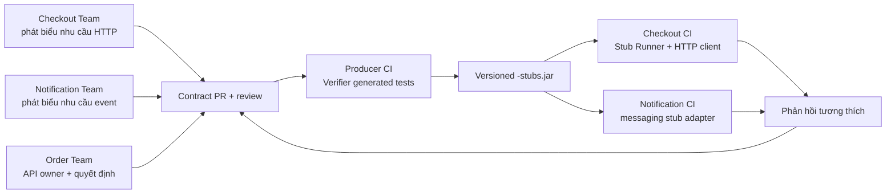
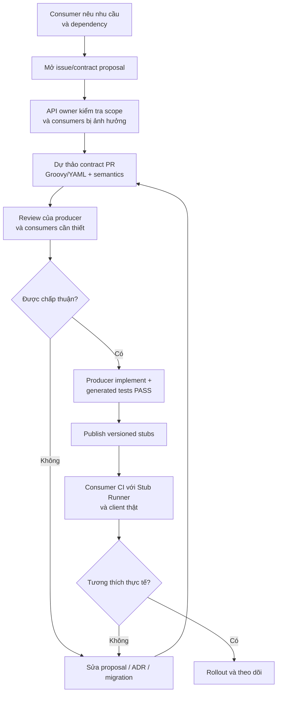
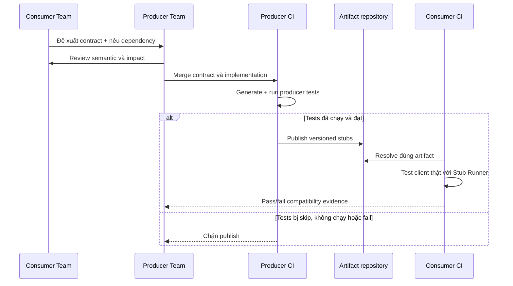

# Thỏa thuận trách nhiệm sở hữu từng hợp đồng

## 1. Vì sao kiểm thử hợp đồng là bài toán phối hợp nhiều nhóm?

Trong **Spring Cloud Contract**, nhóm producer và consumer định nghĩa hành vi HTTP hoặc thông điệp bằng **Groovy/YAML DSL**. Công cụ Verifier sinh kiểm thử để xác minh **producer thật**; các stub được đóng gói và phát hành cho **Stub Runner** để consumer kiểm tra client của mình. CI có thể phát hiện thay đổi API không tương thích trước khi triển khai.

Nhưng công cụ không tự trả lời những câu hỏi thuộc về tổ chức:

- Ai được quyền thay đổi một contract đã có consumer phụ thuộc?
- Ai đảm bảo yêu cầu mới phản ánh đúng nhu cầu của consumer?
- Khi generated test fail vì producer đổi API, nhóm nào phải sửa?
- Ai review và chấp thuận việc xóa một field, đổi HTTP status hoặc đổi destination của message?
- Nếu ba consumer có kỳ vọng mâu thuẫn, ai ra quyết định cuối cùng?
- Ai publish `-stubs.jar` và ai nâng version stub trong consumer CI?
- Khi một nhóm chuyển giao service, ai chịu trách nhiệm tiếp tục duy trì các contracts cũ?

Không có thỏa thuận rõ ràng, một hợp đồng có thể trở thành **file không ai sở hữu**: producer nghĩ consumer tự viết thì consumer phải sửa; consumer nghĩ producer phát hành nên producer quyết định mọi thứ. Trường hợp nguy hiểm hơn là một nhóm “sửa contract cho xanh” sau khi API đã đổi, khiến kiểm thử không còn bảo vệ người dùng của giao diện.

**Mục tiêu bài học:** thiết kế một thỏa thuận **trách nhiệm sở hữu theo từng hợp đồng hoặc nhóm kịch bản có thể xác định**, phân biệt người đề xuất, người quyết định, người triển khai và người kiểm chứng, rồi biến thỏa thuận đó thành quy trình PR, review, CI và phát hành có thể truy vết.

Đây là một **quy ước làm việc cho nhóm**, không phải cú pháp bắt buộc của Spring Cloud Contract. DSL mô tả hành vi kỹ thuật; quyền sở hữu, trách nhiệm review và lịch sử quyết định cần được quản lý bằng quy trình/repository của tổ chức.

## 2. Một contract không có nghĩa chỉ một người “sở hữu tất cả”

Hãy phân biệt năm trách nhiệm:

| Trách nhiệm | Câu hỏi cần trả lời | Người thường đảm nhận |
|---|---|---|
| **API owner** | Ai chịu trách nhiệm cho sự ổn định, semantics và khả năng cung cấp của giao diện? | Nhóm producer |
| **Contract decision owner** | Ai đưa ra quyết định cuối về thay đổi contract sau khi thu thập ý kiến? | Người/nhóm được giao rõ ràng, thường là API owner |
| **Requirement owner** | Ai phát biểu một consumer phụ thuộc vào field/status/message nào? | Nhóm consumer liên quan |
| **Implementation & verification owner** | Ai sửa producer và giữ generated producer tests chạy đạt? | Nhóm producer |
| **Consumer test owner** | Ai tích hợp đúng stub version và giữ consumer tests chạy đạt? | Mỗi nhóm consumer |

Một contract có thể được **consumer đề xuất**, **producer đồng ý và triển khai**, **cả hai cùng review**. Do đó, không nên đồng nhất:

> “Nhóm tạo file `.groovy` đầu tiên” = “nhóm có quyền tự ý sửa mọi hành vi API về sau”.

**Nguyên tắc thiết kế:** với mỗi contract phải có **một đầu mối chịu trách nhiệm quyết định cuối cùng** (accountable), nhưng có thể có nhiều người tham gia viết, review, kiểm thử và được thông báo. Quyền quyết định không loại bỏ nghĩa vụ tham vấn consumer đang phụ thuộc.

### 2.1. Contract là giao diện được thỏa thuận, không phải bản sao implementation

Một API contract mô tả **quan sát được từ bên ngoài**:

- HTTP: method, path, query/header/body quan trọng, status, error schema, response body và semantic của field.
- Messaging: input trigger hoặc inbound message, destination, headers, body, định dạng sự kiện và hành vi được cam kết.

Contract không nên khóa những chi tiết thuần nội bộ như tên class repository, câu SQL, thread pool hay cách service chia module khi consumer không phụ thuộc. **Thay đổi implementation** có thể chỉ do producer quyết định nếu không tác động hành vi đã cam kết; **thay đổi giao diện đã cam kết** đòi hỏi review của người sở hữu và consumer liên quan.

### 2.2. Sở hữu contract khác với sở hữu stub

Người quản lý contract source và người quản lý pipeline artifact có thể là hai vai trò riêng:

| Đối tượng | Trách nhiệm |
|---|---|
| Contract source | Duy trì ví dụ và assertions đại diện cho cam kết API |
| Producer generated tests | Chạy trên code producer thật, chuẩn bị fixture/base test |
| Stub mappings và artifact | Đóng gói đúng contract đã xác minh, phát hành version/classifier |
| Consumer stub tests | Dùng đúng artifact và kiểm tra client/logic thật |
| Compatibility policy | Xác định việc thay đổi có cần review, deprecation hay version hóa |

Không được suy luận rằng “người publish `-stubs.jar`” có quyền thay đổi bất kỳ contract nào mà không cần trao đổi với người phụ thuộc.

## 3. Bối cảnh thực tế: ba nhóm cùng phụ thuộc `order-service`

Giả sử một nền tảng thương mại có ba nhóm:

| Nhóm | Vai trò | Giao diện liên quan |
|---|---|---|
| **Order Team** | Producer API và sự kiện của `order-service` | `GET /api/orders/{id}`, `OrderPaid` |
| **Checkout Team** | Consumer HTTP | Đọc `id`, `state`, `currency` để cho phép xuất biên lai |
| **Notification Team** | Consumer messaging | Nhận `OrderPaid` để gửi thông báo |
| **Platform/CI Team** | Hỗ trợ hạ tầng build/repository, nếu tổ chức có | Maven/Gradle runner, artifact repository, CI template |

Một `order-service` có thể phát hành nhiều hợp đồng, nhưng **quyền sở hữu và tập consumer liên quan cần được xác định theo từng nhóm kịch bản**, không chỉ theo tên service:

```text
order-service contracts
├── HTTP /api/orders/{id}
│   ├── order-success           → Checkout Team phụ thuộc
│   ├── order-not-found         → Checkout Team phụ thuộc
│   └── order-payment-details   → Billing Team (nếu có)
└── Messaging OrderPaid
    ├── event destination/body → Notification Team phụ thuộc
    └── idempotency semantics  → các consumer có xử lý trùng lặp
```

Nếu Checkout Team muốn thêm `estimatedDeliveryDate` vào response, Notification Team **không nhất thiết phải review mọi chi tiết** của HTTP contract. Nhưng nếu Order Team đổi ý nghĩa `state=PAID` và điều đó ảnh hưởng cả sự kiện, nhóm notification phải được tham vấn.

### 3.1. Sơ đồ tương tác của trách nhiệm



Các mũi tên biểu diễn **quy trình phối hợp đề xuất**, không phải quyền mặc định do Spring Cloud Contract áp đặt. Tổ chức có thể chọn contract trong producer repo hay một contract repo riêng, miễn rõ ai chịu trách nhiệm và CI kiểm chứng ở đúng producer/consumer.

## 4. Đơn vị sở hữu: service, endpoint hay từng kịch bản?

Câu nói “Order Team sở hữu tất cả contracts” là đầu mối ban đầu, nhưng đôi khi chưa đủ. Một endpoint có nhiều hành vi:

```text
GET /api/orders/{id}
  200 - order PAID
  200 - order PENDING
  404 - ORDER_NOT_FOUND
  400 - invalid ID format
  401/403 - authorization nếu giao diện có cam kết
```

Một consumer có thể phụ thuộc riêng vào **404 error schema**, trong khi consumer khác chỉ dùng nhánh thành công. Khi sửa 404 body, nhóm chịu tác động có thể khác khi thêm một field cho 200.

Có hai cấp nên duy trì:

1. **Owner cấp API/domain**: chịu trách nhiệm ổn định và governance của tất cả hành vi thuộc API, bảo đảm không có contract mồ côi.
2. **Owner/collaborators cấp contract scenario**: người đề xuất, nhóm cần ký nhận, danh sách consumer đang phụ thuộc và người giữ test.

**Không nên phân mảnh tới mức mỗi file đều phải có một cá nhân duy nhất** nếu tổ chức không đủ nhân lực; team ownership bền vững hơn một tên người. Nhưng khi một kịch bản có nhiều consumer nhạy cảm, cần ghi rõ những nhóm phải review trước khi thay đổi.

### 4.1. Tên file không tự định nghĩa owner

Ví dụ `get-order-not-found.groovy` nằm trong producer repo không có nghĩa tác giả commit mới nhất là người duyệt duy nhất. Quyền sở hữu nên được công bố qua **repo policy, CODEOWNERS, danh mục dịch vụ hoặc contract registry**, và được rà soát khi đội ngũ thay đổi.

Không thêm trường `owner` vào file metadata bài học `team-coordination-003.yml`: file YAML đang giao chỉ có `menuLevel1`, `menuLevel2` và `status` theo quy trình nội dung. Metadata owner trong ví dụ này là **quy trình quản trị hợp đồng của dự án minh họa**, không phải một field mới của bài học.

## 5. Ma trận RACI cho một thay đổi hợp đồng

RACI là khung phân công:

- **R — Responsible:** trực tiếp thực hiện.
- **A — Accountable:** chịu trách nhiệm ra quyết định cuối cùng/đảm bảo kết quả.
- **C — Consulted:** phải được tham vấn trước quyết định.
- **I — Informed:** cần được thông báo.

Ví dụ chính sách giữa Order Team (producer), Checkout Team (HTTP consumer), Notification Team (messaging consumer) và Platform Team:

| Công việc | Order Team | Checkout Team | Notification Team | Platform Team |
|---|---|---|---|---|
| Định nghĩa semantic của `GET /orders` | **A/R** | C | I | I |
| Đề xuất field HTTP cần cho checkout | A/C | **R** | I | I |
| Review thay đổi HTTP gây breaking với checkout | **A/R** | **C bắt buộc** | I | I |
| Đề xuất schema `OrderPaid` cho notification | A/C | I | **R** | I |
| Review thay đổi message destination/body | **A/R** | C nếu bị ảnh hưởng | **C bắt buộc** | I |
| Sửa controller/publisher và chạy producer tests | **A/R** | C | C | I |
| Viết/chạy checkout client tests với stub mới | C | **A/R** | I | I |
| Viết/chạy notification consumer tests | C | I | **A/R** | I |
| Duy trì template CI/artifact repository | C | I | I | **A/R** nếu được giao |
| Phê duyệt rollout API mới sau compatibility review | **A** | C | C | C |

Đây là **ma trận ví dụ cần được nhóm điều chỉnh**. Mỗi hoạt động nên có **một đầu mối A**, nhưng nhiều R/C được phép. `C bắt buộc` không có nghĩa consumer sẽ sở hữu toàn bộ implementation; đó là quy tắc **không được bỏ qua review của nhóm có dependency thật**.

### 5.1. “Người duyệt” và “người có quyền phủ quyết”

Một thỏa thuận nên trả lời rõ:

- Consumer bị breaking change có quyền **chặn PR** hay chỉ đưa ý kiến?
- Nếu owner và consumer bất đồng, có tiêu chí tương thích hoặc cơ chế escalation nào?
- Một lỗi bảo mật khẩn cấp có thể dùng quy trình ngoại lệ không, ai phê duyệt và làm thế nào thông báo/khắc phục?
- Nếu consumer không phản hồi trong SLA review đã thống nhất, PR xử lý ra sao?

Không nên mặc định “mọi consumer phải approve mọi PR”: với nhiều nhóm sẽ gây tắc nghẽn. Nên định nghĩa **chính sách review theo mức ảnh hưởng**. Một thay đổi internal implementation không ảnh hưởng contract có thể không cần consumer review; đổi HTTP status, kiểu JSON hoặc destination phải có review của nhóm liên quan.

## 6. Bản thỏa thuận tối thiểu cho từng contract

Một bản ghi ownership nên bao gồm:

| Thuộc tính | Ví dụ cho `get-paid-order` | Vì sao cần |
|---|---|---|
| Contract ID/path | `http/orders/get-paid-order.groovy` | Truy được file và generated test |
| Producer/API | `order-service`, Order Team | Có đầu mối cho behavior và implementation |
| Decision owner | Order Team API maintainer | Có nơi ra quyết định cuối |
| Consumer dependency | Checkout Team đọc `id/state/currency` | Biết ai bị tác động |
| Reviewers | Order + Checkout khi đổi response semantics | Không bỏ qua người dùng giao diện |
| Compatibility policy | Giữ field hiện hữu, kiểu dữ liệu, error semantics | Có tiêu chí đánh giá breaking |
| Verification owner | Order Team chạy generated producer tests | Không chỉ sinh stub mà bỏ test |
| Consumer test owner | Checkout Team chạy client test với Stub Runner | Thấy lỗi deserialize/business |
| Artifact coordinates | `com.example:order-service:1.4.0:stubs` | Truy vết đúng phiên bản |
| Deprecation contact | Order Team + consumer contact | Có quy trình dừng hỗ trợ |

Một cách lưu là **tài liệu ownership trong repository hoặc catalog của tổ chức**, liên kết tới từng contract path. Cũng có thể dùng metadata PR, issue tracker và CODEOWNERS theo path. Spring Cloud Contract không bắt buộc format bảng này; điều quan trọng là **có thể tìm, duyệt và cập nhật** khi chuyển giao trách nhiệm.

### 6.1. Mẫu thỏa thuận ngắn để đưa vào PR/ADR

```text
Contract: http/orders/get-paid-order.groovy
Producer: order-service (Order Team)
Decision owner: Order Team API maintainer
Consumer(s): checkout-service (Checkout Team)
Consumer needs: id:number; state:string; currency:string;
                HTTP 200 + Content-Type application/json
Required reviewers for breaking change: Order + Checkout
Producer verification: Maven/Gradle generated contract tests
Consumer verification: Stub Runner + real checkout HTTP client
Artifact: com.example:order-service:<release-version>:stubs
Change/deprecation policy: discuss before removing/renaming
Links: PR, CI report, release decision (điền trong dự án thật)
```

Đây là **mẫu minh họa**, các giá trị `<release-version>` và links phải được thay bằng dữ liệu thực tế trong dự án. Không chứa token, dữ liệu cá nhân hoặc URL bí mật trong ownership manifest.

## 7. Nguồn sự thật: contract nằm ở producer repo hay repo riêng?

Không có một sơ đồ lưu trữ duy nhất cho mọi nhóm. Hai cách thường gặp:

### 7.1. Contract nằm cùng code producer

```text
order-service/
├── pom.xml
├── src/main/java/...
└── src/test/resources/contracts/
    ├── http/orders/get-paid-order.groovy
    ├── http/orders/get-order-not-found.yml
    └── messaging/order-paid.groovy
```

**Ưu điểm:** dễ chạy producer generated tests cùng code và publish stub artifact theo release producer; Order Team có trách nhiệm vận hành rõ.

**Rủi ro:** consumer có thể khó sửa trực tiếp hoặc bị thiếu quyền PR; nếu producer tự merge contract changes không có consumer review, kiểm thử biến thành “producer tự xác nhận mình đúng”.

**Cách giảm rủi ro:** cho consumer đề xuất PR và dùng code review policy/CODEOWNERS để yêu cầu người chịu tác động review.

### 7.2. Contract nằm ở repository riêng

```text
api-contracts/
├── order-service/
│   ├── http/
│   │   └── orders/get-paid-order.groovy
│   └── messaging/
│       └── order-paid.groovy
└── payment-service/
    └── http/...
```

**Ưu điểm:** consumer có thể đóng góp trực tiếp, tập trung review và catalog giao diện, dễ quản trị nhiều producer.

**Rủi ro:** cần cơ chế **đưa hợp đồng đúng commit/version vào producer build**; nếu repository hợp đồng thay đổi độc lập mà producer verification không dùng đúng bản, có thể phát hành stub với dữ liệu khác API thật.

**Điều bắt buộc về vận hành:** nếu hợp đồng được tải từ repo riêng hoặc artifact source, pin revision/version cụ thể cho producer CI, chạy generated tests trên code producer, rồi publish stub gắn provenance. Không để pipeline tự lấy “branch main mới nhất” ở mỗi lần chạy mà không ghi revision.

### 7.3. Tránh hai nguồn sự thật độc lập

Một anti-pattern:

```text
Producer repo: contract A (response id/state/currency)
Consumer repo: contract A' (response id/state)
Contract repo: contract A'' (response id/state/currency/paymentStatus)
```

Nếu không có cơ chế đồng bộ và version rõ ràng, ba file có thể trôi lệch. Test “xanh” ở từng repo không có nghĩa chúng mô tả cùng giao diện.

**Khuyến nghị:** chỉ định **một nguồn chuẩn cho mỗi contract/version**, các nơi khác **tham chiếu, tiêu thụ hoặc generate** từ nguồn chuẩn. Nếu có consumer-specific contracts, ghi rõ chúng là **tuyên bố dependency của consumer** và cách producer xác nhận/ghép chúng thành một tập có thể verify.

## 8. Làm cho ownership có thể thi hành bằng repository policy

Một thỏa thuận miệng dễ mất khi thay người. Repo có thể dùng **CODEOWNERS**, branch protection, review checklist và automated checks để duy trì việc tham vấn.

### 8.1. CODEOWNERS theo đường dẫn

Ví dụ trong repository hỗ trợ cú pháp CODEOWNERS kiểu GitHub:

```text
# File minh họa: .github/CODEOWNERS
/src/test/resources/contracts/http/orders/ @org/order-team @org/checkout-team
/src/test/resources/contracts/messaging/ @org/order-team @org/notification-team
/pom.xml @org/order-team @org/platform-team
```

Các tên nhóm `@org/...` là **placeholder**, không phải tài khoản có thật. Cú pháp, cách chọn pattern và quy tắc review thực tế phụ thuộc nền tảng Git hosting. **CODEOWNERS chỉ giúp đề xuất/yêu cầu reviewers theo policy**, không tự đảm bảo mọi người phải đồng ý với semantic mới; cần branch protection và quy trình review có hiệu lực.

Đặc biệt, một số nền tảng có quy tắc **pattern cuối cùng khớp được ưu tiên** hoặc yêu cầu **một approval từ tập owners**, không phải mọi owner đều approval. Vì vậy, nếu thay đổi breaking cần **cả producer và consumer ký nhận**, phải cấu hình rule và quy trình kiểm soát phù hợp; không chỉ đặt hai nhóm trên một dòng rồi kết luận đã đủ approval.

### 8.2. Pull request template

```markdown
### Contract change
- Contract path / scenario:
- Producer/API owner:
- Consumer(s) affected:
- Nature: additive / behavioral / breaking / deprecation:
- Contract diff (method/path/status/headers/body/message destination):
- Consumer dependency and compatibility evidence:
- Producer generated tests (report link):
- Consumer Stub Runner tests (artifact version + report link):
- Rollout/rollback plan:
- Reviewer acknowledgements:
```

Mẫu PR buộc người đề xuất nói rõ **ai chịu ảnh hưởng** và **test nào đã chạy**, thay vì chỉ mô tả “thêm một field”. PR có thể bổ sung ADR/issue link khi thay đổi semantics phức tạp.

### 8.3. Không dùng `status: WRITTEN` làm quy trình phê duyệt contract

Trong hệ thống tài liệu bài học này, `status: WRITTEN` chỉ đánh dấu **nội dung bài viết đã được ghi** theo STEP_4. Nó **không phải** trạng thái review của một API contract. Khi thiết kế governance thật, dùng các trạng thái như Draft/Review/Approved/Verified/Released/Deprecated trong công cụ phù hợp, tránh đánh đồng việc tạo file với việc API được các nhóm chấp thuận.

## 9. Quy ước review giúp xác định ai phải đồng ý

Thay đổi contract có thể được phân theo tác động:

| Kiểu thay đổi | Ví dụ | Người phải tham vấn | Chính sách khuyến nghị |
|---|---|---|---|
| **Sửa mô tả không đổi behavior** | Chỉnh description, tài liệu | API owner | Review nhẹ, không cần consumer test mới nếu thật sự không đổi behavior |
| **Thêm field response** | `estimatedDeliveryDate` | API owner + consumers liên quan | Kiểm tra strict parser/schema, chạy client cũ với stub mới |
| **Thêm endpoint mới** | `GET /api/orders/{id}/tracking` | API owner + consumer đề xuất | Thêm contract/test, không làm lệch endpoint cũ |
| **Đổi kiểu field** | `id: number` → `id: string` | Mọi consumer dùng field | Đánh giá breaking, cần kế hoạch migration/version |
| **Đổi error schema/status** | `404 ORDER_NOT_FOUND` → `200 null` | Consumers xử lý lỗi | Review bắt buộc, kiểm tra negative path |
| **Xóa/đổi tên field** | Bỏ `currency` | Consumers phụ thuộc | Deprecation/versioning hoặc phối hợp nâng cấp |
| **Đổi messaging destination/header** | `orders.paid` → `orders.completed` | Consumers message liên quan | Breaking theo routing, kiểm tra subscription |
| **Đổi behavior không đổi JSON** | `PAID` mang nghĩa mới | Consumers dựa vào semantic | Review business contract, không chỉ schema |
| **Thay implementation nội bộ** | Đổi repository/database schema | API owner | Không cần consumer review nếu behavior cam kết không đổi |

“Thêm field response” thường *có khả năng* tương thích, nhưng consumer strict có thể fail. **Không gắn nhãn non-breaking chỉ từ hình dạng diff**; phải xem dependency và test với **consumer thực**.

### 9.1. Thỏa thuận SLA review

Một đội có thể đặt nguyên tắc ví dụ:

- PR chỉnh tài liệu thuần túy: API owner review trong nhịp làm việc bình thường.
- PR additive API: API owner review, thông báo consumers, chạy compatibility tests; review của consumer bị ảnh hưởng theo chính sách.
- PR breaking: mở proposal/ADR, liệt kê consumers, yêu cầu chấp thuận hoặc migration plan trước khi merge.
- Security hotfix: có quy trình ngoại lệ với người phê duyệt và kế hoạch thông báo/rà soát sau.

Các mốc thời gian cụ thể tùy tổ chức; **đừng coi một SLA tùy ý là tính năng mặc định của Spring Cloud Contract**. Thỏa thuận phải mô tả cách xử lý khi reviewer không phản hồi hoặc khi hai nhóm không thống nhất.

## 10. Một hợp đồng HTTP và các nhóm cần xác nhận

Ví dụ Order Team cung cấp `GET /api/orders/42`. Checkout Team phụ thuộc vào status, content type, `id`, `state` và `currency`.

### 10.1. Groovy DSL

```groovy
import org.springframework.cloud.contract.spec.Contract

Contract.make {
    description 'Đơn hàng đã thanh toán phục vụ checkout'

    request {
        method GET()
        url '/api/orders/42'
        headers {
            header 'Accept', 'application/json'
        }
    }

    response {
        status OK()
        headers {
            contentType(applicationJson())
        }
        body(
            id: 42,
            state: 'PAID',
            currency: 'VND'
        )
    }
}
```

**Ai chịu trách nhiệm trong ví dụ?**

1. **Checkout Team** mô tả tại sao `state=PAID` và `currency` quan trọng cho flow xuất biên lai; có thể tạo PR ban đầu.
2. **Order Team** xác nhận response đã hứa, chuẩn bị fixture, implement và chạy generated producer tests.
3. **Order Team** publish stub artifact sau khi producer verification đạt.
4. **Checkout Team** dùng đúng version stub với client thật để kiểm tra deserialize và quyết định checkout.
5. Nếu `currency` bị đổi tên, **Order Team không tự sửa contract cho khớp producer** mà chưa có kế hoạch cho Checkout Team đang phụ thuộc.

### 10.2. YAML DSL tương đương

```yaml
description: Đơn hàng đã thanh toán phục vụ checkout
request:
  method: GET
  url: /api/orders/42
  headers:
    Accept: application/json
response:
  status: 200
  headers:
    Content-Type: application/json
  body:
    id: 42
    state: PAID
    currency: VND
```

Đây là **hai biểu diễn của cùng một kịch bản**, không nên đặt cả hai trong cùng tập contract nếu điều đó tạo mappings trùng. Nhóm có thể thống nhất một DSL để giảm chi phí bảo trì; **quyền sở hữu hợp đồng không phụ thuộc Groovy hay YAML**.

### 10.3. Hợp đồng nhánh lỗi cũng cần owner

Một consumer thường phụ thuộc `404` và error code:

```json
{
  "code": "ORDER_NOT_FOUND",
  "message": "Order does not exist"
}
```

Nếu producer đổi body lỗi thành plain text trong khi Checkout Team đọc `code`, đó là **breaking change** dù HTTP status vẫn là `404`. Vì thế ownership review phải bao gồm **error contracts**, không chỉ happy path.

## 11. Hợp đồng messaging: trách nhiệm sở hữu cả routing và semantics

Với messaging, consumer có thể không gọi một endpoint theo yêu cầu tức thời; nó **subscribe** topic/queue, nhận event và quyết định xử lý theo body/headers. Vì vậy, hợp đồng cần làm rõ:

- **Ai sở hữu sự kiện**: Order Team sở hữu sự kiện `OrderPaid`.
- **Ai sở hữu producer implementation**: Order Team duy trì transaction/outbox/publisher và generated verification.
- **Ai phụ thuộc vào sự kiện**: Notification Team cần `orderId` và `state` để gửi thông báo; các consumer khác có thể cần `eventId` để deduplicate.
- **Ai quyết định destination/schema**: API/event owner phối hợp với consumers và platform rules.
- **Ai kiểm tra transport và listener**: producer xác minh message được phát; mỗi consumer kiểm tra listener thật với stub/adapter hoặc integration environment phù hợp.

### 11.1. Groovy contract cho outbound message

```groovy
import org.springframework.cloud.contract.spec.Contract

Contract.make {
    description 'Thanh toán thành công phát OrderPaid'
    label 'order_paid'

    input {
        triggeredBy('publishPaidOrderForContract()')
    }

    outputMessage {
        sentTo('orders.paid')
        headers {
            header('eventType', 'OrderPaid')
            header('correlationId', 'CORR-42')
        }
        body(
            eventId: 'EVT-42',
            orderId: 42,
            state: 'PAID',
            currency: 'VND'
        )
    }
}
```

**Lưu ý kỹ thuật:** `triggeredBy('publishPaidOrderForContract()')` đòi producer base test có phương thức có thể gọi đúng chữ ký, kích hoạt luồng phát message thực. `sentTo('orders.paid')` mô tả đích output mong đợi. Nó không tự cấu hình Kafka/RabbitMQ broker; test cần message verifier/adapter phù hợp. Các giá trị cố định `EVT-42`/`CORR-42` dùng để minh họa fixture có tính xác định; nếu ID động, contract nên dùng matcher phù hợp và stub cần sample nhất quán.

**Trách nhiệm review:**

| Thay đổi đề xuất | Order Team | Notification Team | Platform Team nếu có |
|---|---|---|---|
| Thêm field tùy chọn trong event | Xác minh publisher, compatibility | Kiểm tra listener/parser thực tế | Được thông báo khi ảnh hưởng serialization |
| Đổi `orders.paid` thành `orders.completed` | Quyết định sau review, migration plan | Bắt buộc review routing/subscribe | Có thể cần điều chỉnh topic/broker ACL |
| Đổi `orderId` number thành string | Producer verification và versioning | Bắt buộc kiểm tra DTO/handler | I/C tùy chính sách schema |
| Bỏ `eventId` | Không tự đổi nếu consumers dùng dedup | Kiểm tra idempotency | C khi có tracing/routing policy |
| Đổi delivery policy/retry | Đánh giá behavior producer | Đánh giá consumer xử lý duplicate | C nếu broker/infra quản lý chung |

Không chỉ nhìn body. Đổi topic, content type, message key, header hay delivery semantics có thể **phá consumer** ngay cả khi JSON body giữ nguyên.

### 11.2. Inbound message khác với trigger method

Nếu producer xử lý một inbound message rồi phát message khác, hợp đồng có thể dùng:

```groovy
input {
    messageFrom('orders.created')
    messageBody(orderId: 42)
}
outputMessage {
    sentTo('inventory.reservation.requested')
    body(orderId: 42)
}
```

Ở đây các nhóm phải thống nhất **ai sở hữu input schema và ai sở hữu output schema**. Producer của `orders.created` có thể là Order Team, còn handler/output producer của `inventory.reservation.requested` thuộc Inventory Team. Một pipeline test bên Inventory không chuyển toàn bộ quyền quyết định về `orders.created` cho Inventory Team.

Nguyên tắc: **quyền sở hữu event đi theo giao diện mà producer phát hành**, và **consumer sở hữu dependency/test của mình**. Khi một service là producer ở luồng này nhưng consumer ở luồng khác, phân công từng interface thay vì gắn nhãn cố định “team A là producer của tất cả”.

## 12. Quy trình thay đổi: từ nhu cầu consumer tới contract được phát hành

Một thay đổi nên có những mốc rõ ràng:



Tên trạng thái dùng trong quy trình có thể là `DRAFT`, `UNDER_REVIEW`, `APPROVED`, `PRODUCER_VERIFIED`, `PUBLISHED`, `CONSUMER_VERIFIED`, `DEPRECATED`. Đây là **trạng thái workflow của hợp đồng**, không phải key bắt buộc phải thêm vào DSL hay tệp metadata bài học.

### 12.1. Trước khi mở PR

Người đề xuất (producer hoặc consumer) nên viết:

1. **Business scenario**: điều gì xảy ra và consumer cần ra quyết định gì?
2. **Contract hiện tại**: method/path/status/body hoặc destination/message tương ứng.
3. **Behavior mới mong muốn**: khác biệt quan sát được, ví dụ thêm `estimatedDeliveryDate` hoặc duy trì error `code`.
4. **Danh sách consumer**: phiên bản đang chạy, quy tắc parse/validation và contact.
5. **Phân loại tác động**: additive, breaking, error schema, semantic change, removal, deprecation.
6. **Kế hoạch tương thích**: chạy consumer cũ với stub mới, hoặc version negotiation/deprecation khi cần.
7. **Tiêu chí hoàn thành**: generated producer tests, consumer tests, tài liệu và artifact.

Không viết contract trước rồi ép client consumer thích nghi mà không thông báo. Cũng không để consumer tự tạo hợp đồng dựa vào một response ngẫu nhiên từ staging mà producer chưa cam kết duy trì.

### 12.2. Trong vòng review

Reviewer phải xác nhận **ý nghĩa**, không chỉ cú pháp:

- Giá trị `state=PAID` mang nghĩa gì và khi nào xuất hiện?
- `404` có body `ORDER_NOT_FOUND` nhất quán không?
- `id` là number hay string; khả năng `null`/missing ra sao?
- Message có được phát đúng destination và đủ correlation/idempotency headers không?
- Có consumer nào dùng schema exact hoặc đang deploy version cũ không?
- Contract có mô tả cả lỗi quan trọng và không tạo mapping quá rộng không?
- Điều gì cần được pin version, migration hoặc rollout theo thứ tự?

Reviewers nên có **quyền yêu cầu test hoặc bổ sung kịch bản** khi một dependency thực tế chưa được bảo vệ.

### 12.3. Sau approval

Approval chưa chứng minh producer đáp ứng contract. Nhóm producer phải:

1. Implement hoặc xác nhận code hiện hành đã đáp ứng hành vi.
2. Cấu hình base class/fixture cho generated tests.
3. Chạy test thật; kiểm tra có **executed > 0**, không skipped/fail.
4. Đóng gói stub artifact phù hợp, kiểm tra mappings và body files.
5. Publish version có thể truy vết tới commit/CI report.

Sau đó mỗi nhóm consumer phải chạy **client/listener thật** với stub version đó, xác nhận behavior của chính mình, và đưa kết quả vào quyết định rollout.

## 13. Khi nào một thay đổi được coi là breaking?

Đừng dùng tiêu chí “file contract có ít dòng thay đổi” làm căn cứ. Một thay đổi thường có nguy cơ breaking khi:

| Ví dụ | Consumer dependency bị tác động | Kết quả cần đánh giá |
|---|---|---|
| Bỏ field `currency` | Checkout hiển thị đơn vị tiền | Có thể null/deserialize lỗi |
| Đổi kiểu `id` | DTO/validation số nguyên | Có thể parse sai hoặc mất precision |
| Thêm field response | Strict parser/schema | Có thể phá consumer dù chỉ additive |
| Đổi `404` thành `200` có `null` | Client xử lý lỗi bằng status | Thay đổi nhánh nghiệp vụ |
| Đổi `orders.paid` destination | Notification listener/subscription | Không còn nhận sự kiện |
| Đổi `eventType` header | Consumer dispatch | Không chọn được handler |
| Không phát `eventId` nữa | Consumer deduplicate | Xử lý duplicate nguy hiểm |
| Đổi nghĩa `PAID` | Business decision của nhiều nhóm | Kết quả sai dù JSON schema hợp lệ |

**Phân loại cuối cùng dựa trên các consumer cần hỗ trợ và hợp đồng đã được thỏa thuận**, không chỉ trên diff kỹ thuật. Nếu consumer hiện hữu strict, một field bổ sung cũng có thể breaking; cần test chính consumer đó.

### 13.1. Chia trách nhiệm khi phát hiện breaking change

Ví dụ Checkout Team báo “sau deploy mới, client không parse response”:

- **Checkout Team** cung cấp bằng chứng: HTTP request, response thực, stack trace hoặc contract test fail và version đang chạy.
- **Order Team** xác định behavior producer mới, contract version và nguyên nhân; không “sửa expected” để che lỗi.
- **Hai nhóm** quyết định rollback, giữ v1 hoặc sửa client theo kế hoạch có xác minh.
- **Platform Team**, nếu quản lý CI/repository, hỗ trợ pin artifact, log và phục hồi pipeline; không được tự ý thay schema API mà không có owner.

Quyền sở hữu không nhằm đổ lỗi. Nó giúp **biết ai quyết định và ai hành động tiếp** khi cần xử lý nhanh.

## 14. Producer verification: việc không thể chuyển hết cho consumer

Ngay cả khi consumer viết file contract, nhóm producer vẫn phải chứng minh **code production tạo được response/message tương ứng**.

Với HTTP:

```text
Contract GET /api/orders/42 → 200 JSON
            |
            v
Spring Cloud Contract Verifier
            |
            v
Generated producer test
            |
            v
Controller + serialization + service thật
            |
            v
Assert status, headers, body
```

Với messaging, generated producer test có thể gọi `triggeredBy(...)` hoặc đưa message inbound rồi xác minh message output qua message verifier/binder. Test infrastructure phải kích hoạt logic producer thật, **không chỉ gửi một message giả từ mã test**.

### 14.1. Base class do ai sở hữu?

Thông thường **Producer Team** sở hữu base class vì nó biết:

- Cách khởi động Spring application context.
- Trạng thái database/fixture trước hợp đồng.
- Cách mock dependency ngoại vi mà không bỏ qua logic API quan trọng.
- Cách cấu hình MockMvc, real HTTP port hoặc message verifier.
- Cách dọn state sau test và tránh test order dependency.

Consumer có quyền yêu cầu hành vi cần kiểm tra, nhưng không nên bị yêu cầu tự debug một Spring context riêng của producer nếu họ không sở hữu codebase đó.

### 14.2. Generated test không được im lặng biến mất

Producer CI cần kiểm tra:

| Mốc | Bằng chứng |
|---|---|
| Contract được phát hiện | Plugin đọc đúng source ở module |
| Generated test được sinh | Source có class/method tương ứng |
| Test biên dịch | Không thiếu base class/method/import |
| JUnit/Surefire/Failsafe chạy test | Report có generated test, executed > 0 |
| Assertions đạt | Failures/errors bằng 0, không skipped |
| Stub có thể phát hành | Artifact chứa đúng mappings/body và version |

Nếu Maven ghi `BUILD SUCCESS` nhưng generated tests bị loại bởi `-DskipTests` hoặc runner filters, **chưa có producer contract verification**. Đây là trách nhiệm build/verification của producer (với hỗ trợ từ Platform Team nếu được giao), không nên đẩy sang consumer bằng cách “hãy tin stub của chúng tôi”.

## 15. Consumer verification: trách nhiệm ở mỗi nhóm dùng giao diện

Stub Runner giúp consumer test với stub artifact do producer phát hành. Ví dụ Checkout Team có thể cấu hình:

```java
import org.junit.jupiter.api.Test;
import org.springframework.boot.test.context.SpringBootTest;
import org.springframework.cloud.contract.stubrunner.StubRunnerProperties;
import org.springframework.cloud.contract.stubrunner.spring.AutoConfigureStubRunner;
import org.springframework.cloud.contract.stubrunner.spring.StubRunnerPort;

@SpringBootTest
@AutoConfigureStubRunner(
    ids = "com.example:order-service:1.4.0:stubs",
    stubsMode = StubRunnerProperties.StubsMode.LOCAL
)
class CheckoutConsumerContractTest {

    @StubRunnerPort("com.example:order-service")
    int orderStubPort;

    @Test
    void paidOrderEnablesReceipt() {
        // Cấu hình client thật của consumer bằng:
        // http://localhost:<orderStubPort>
        // Gọi GET /api/orders/42 qua client ấy.
        // Assert DTO state=PAID và quyết định được xuất biên lai.
    }
}
```

Đây là **khung minh họa**, không phải test đầy đủ: cần dependency Stub Runner, một `OrderClient` của consumer, assertion cụ thể và stub archive `1.4.0:stubs` đã được install cho mode `LOCAL`. Với CI lấy artifact từ kho chung, dùng `REMOTE` và repository configuration phù hợp.

**Consumer Team sở hữu phần sau:**

1. Chọn stub version đại diện cho producer mà họ cần tương thích.
2. Đưa **base URL/cổng runtime của đúng stub** vào HTTP client, không hardcode cổng producer thật.
3. Chạy client/listener mà ứng dụng thật dùng, không chỉ gọi WireMock bằng một client giả khác.
4. Kiểm tra deserialize, status/error mapping và quyết định nghiệp vụ.
5. Báo kết quả rõ ràng cho API owner khi stub mới làm hỏng client hiện hữu.

Producer có thể cung cấp hỗ trợ nhưng **không thể tự khẳng định consumer không bị ảnh hưởng** chỉ vì generated producer tests đạt.

### 15.1. Messaging consumer cần test khác HTTP

Với `OrderPaid`, Notification Team cần listener/message handling test có messaging adapter hoặc test binder phù hợp. Stub Runner cho HTTP không tự biến thành Kafka/RabbitMQ producer. Phải kiểm tra event mẫu được gửi tới listener, body/header parse đúng và notification behavior hoạt động.

Nếu phía producer dùng `label 'order_paid'` để hỗ trợ cơ chế kích hoạt stub message, nhóm consumer cần cấu hình đúng integration và kiểm tra **message thật sự đi qua listener**. Chỉ có Stub Runner startup thành công chưa chứng minh notification consumer xử lý event.

## 16. Artifact version và giao kèo giữa hai pipeline CI

Một hợp đồng muốn được nhiều nhóm dùng phải có **dấu vết phiên bản**:

```text
Producer:
  groupId    = com.example
  artifactId = order-service
  version    = 1.4.0
  classifier = stubs

Stub artifact:
  order-service-1.4.0-stubs.jar

Consumer:
  resolve com.example:order-service:1.4.0:stubs
  run client tests, lưu resolved artifact + report
```

**Version** xác định tập hợp hợp đồng, **classifier `stubs`** chỉ artifact stub. Cổng WireMock được chọn lúc consumer chạy test, **không phải** một phần của JAR được phát hành.

### 16.1. Ma trận trách nhiệm CI

| CI stage | Nhóm chịu trách nhiệm A/R | Điều cần fail khi không đạt |
|---|---|---|
| Parse/generate contract | Producer | Contract syntax lỗi hoặc kịch bản không được phát hiện |
| Generated producer tests | Producer | Compile fail, skipped, 0 generated tests, assertion fail |
| Stub package/attach | Producer | Thiếu mapping/body file, classifier sai |
| Artifact publish | Producer hoặc release owner theo thỏa thuận | Không có report verification hoặc version/provenance sai |
| Consumer HTTP test | Checkout | Parser/logic hỏng với stub version cần thử |
| Consumer message test | Notification | Event không parse/routing đúng |
| Shared CI infrastructure | Platform nếu có | Không resolve được repo do cấu hình hạ tầng |
| Compatibility decision | API owner sau tham vấn consumer | Breaking change chưa có phương án xử lý |

Nếu Platform Team chịu trách nhiệm repository hoặc runner template, họ có thể sửa lỗi hạ tầng nhưng **không được tự thay contract semantic** chỉ để pipeline xanh.

### 16.2. Workflow CI minh họa



Không nên yêu cầu consumer dùng một stub version chưa được producer xác minh mà không đánh dấu rõ đó là **candidate contract đang trong review**. Với candidate, có thể dùng artifact CI tạm có commit/version rõ; sau khi đủ điều kiện, phát hành version chính thức.

### 16.3. Phiên bản cố định và canary

- **Release gate:** pin một version cụ thể như `1.4.0`, lưu artifact provenance, kiểm tra đúng contract muốn triển khai.
- **Canary compatibility:** có thể thử bản mới/`SNAPSHOT` hay `+` nếu resolver hỗ trợ, nhưng ghi rõ version thực sự được resolve; không dùng kết quả “latest” không xác định để chứng nhận release cũ.
- **Incident/rollback:** biết consumer đã test với artifact nào, producer deploy build nào và ai phê duyệt sự thay đổi.

Một pipeline chỉ ghi “stub test pass” mà không có version rất khó dùng để điều tra một sự cố sau vài tuần.

## 17. Xử lý bất đồng, chuyển giao và hợp đồng mồ côi

### 17.1. Hai consumer yêu cầu schema mâu thuẫn

Giả sử Checkout Team muốn `amount` là JSON number, trong khi một consumer legacy mong `amount` là string. Không nên tạo hai mappings cùng match `GET /api/orders/42` nhưng trả response khác nhau mà không có request discriminator; WireMock có thể chọn mapping không như kỳ vọng.

Quy trình giải quyết:

1. Liệt kê **phụ thuộc hiện tại** và bằng chứng client tests của cả hai.
2. Xác định semantic chuẩn và phạm vi hỗ trợ phiên bản cũ.
3. Đánh giá versioned endpoint/media type hoặc chuyển đổi ở client.
4. Chọn một giao diện chính thức cho mỗi version/condition đã công bố.
5. Thêm contracts cho từng nhánh, có request matcher phân biệt.
6. Chạy producer verification và consumer tests cho cả nhánh được hỗ trợ.
7. Ghi quyết định trong ADR/issue, chỉ rõ owner và kế hoạch deprecation.

API owner là **đầu mối quyết định**, nhưng không nên bỏ qua phụ thuộc đã được thỏa thuận của consumer chỉ để giảm số test.

### 17.2. Team consumer không còn tồn tại

Nếu một client legacy vẫn đang chạy nhưng nhóm phát triển đã giải thể:

- API owner và service catalog cần xác định **đơn vị vận hành hiện tại** của client.
- Nếu không có người nhận bàn giao, đây là **rủi ro ownership**, không phải bằng chứng client đã không còn tồn tại.
- Giữ contract bảo vệ giao diện cho tới khi có bằng chứng client đã ngừng sử dụng hoặc có kế hoạch deprecation được phê duyệt.
- Gắn owner mới, cập nhật review routing và consumer tests nếu có thể.

Không xóa contract vì “CODEOWNERS tag không còn người” mà chưa kiểm tra traffic/dependencies thực tế.

### 17.3. Producer chuyển nhóm

Khi `order-service` chuyển từ Order Team sang Commerce Platform Team:

1. Bàn giao danh sách contract paths và consumer contacts.
2. Bàn giao generated test infrastructure, base tests và fixtures.
3. Bàn giao stub artifact coordinates, pipeline và repository permissions.
4. Bàn giao chính sách deprecation/compatibility, những vấn đề đang mở.
5. Cập nhật CODEOWNERS/ownership registry, không đổi semantics hay artifact coordinates tùy tiện.
6. Chạy một vòng producer + consumer compatibility tests dưới chủ sở hữu mới.

**Owner phải thay đổi có kiểm soát; hợp đồng không được mất người chịu trách nhiệm chỉ vì tổ chức đổi tên nhóm.**

## 18. Thước đo và dấu hiệu quy trình ownership hoạt động

Không cần xây hệ thống phức tạp ngay từ đầu. Một số chỉ số giúp phát hiện lỗ hổng:

| Quan sát | Cách hiểu | Hành động khi bất thường |
|---|---|---|
| Tỷ lệ contracts có API owner rõ ràng | Có đầu mối trách nhiệm | Gắn owner cho những contract chưa có |
| Tỷ lệ breaking PR có consumer impact review | Có kiểm soát tương thích | Chặn merge/review workflow |
| Tỷ lệ generated producer tests thực thi và đạt | Producer verification thực chất | Điều tra 0 tests, skipped, failures |
| Tỷ lệ consumer CI dùng đúng stub release | Tính tái lập | Pin artifact và lưu resolved version |
| Số contract thay đổi không có migration plan | Rủi ro thay đổi đột ngột | Yêu cầu ADR/deprecation |
| Thời gian phản hồi review | Có tắc nghẽn phối hợp không | Điều chỉnh reviewers hoặc escalation |
| Contract trùng/mâu thuẫn | Có nhiều nguồn sự thật | Hợp nhất hoặc version hóa có chủ đích |
| Sự cố “stub pass nhưng API production sai” | Lỗ hổng verification/provenance | Kiểm tra CI gate và generated reports |

Chỉ số cần phục vụ **phát hiện rủi ro và cải thiện quy trình**, không nên dùng để đánh giá cá nhân qua số dòng DSL hoặc số PR review. Một nhóm có nhiều contract là do phạm vi API, không nhất thiết làm việc tốt/hơn nhóm khác.

### 18.1. Định kỳ rà soát ownership

Một lần rà soát theo chu kỳ do nhóm tự chọn nên hỏi:

- Contract nào không còn consumer nhưng vẫn được duy trì?
- Contract nào vẫn có consumer nhưng thiếu automated tests?
- Owner nào đã đổi nhóm hoặc không còn quyền repository?
- Consumer nào đang dùng stub version quá cũ so với producer deploy?
- Có deprecation nào gần đến hạn mà chưa có kế hoạch migration?
- Có nhánh lỗi hoặc message destination chưa được ghi rõ người chịu trách nhiệm?

Chỉ xóa một contract sau khi có **quyết định vòng đời giao diện**; “không thấy test fail gần đây” không đủ chứng minh contract không còn được sử dụng.

## 19. Bài thực hành: ký nhận trách nhiệm cho ba hợp đồng

**Bối cảnh:** Order Team quản lý `order-service`. Checkout Team gọi HTTP; Notification Team nhận `OrderPaid`. Sắp có ba thay đổi:

1. Thêm `estimatedDeliveryDate` vào HTTP `200` response.
2. Đổi body `404` từ `{"code":"ORDER_NOT_FOUND"}` thành plain text.
3. Chuyển message destination từ `orders.paid` sang `orders.completed`.

Người quản lý dự án đề nghị “gộp một PR, để Order Team duyệt vì mọi file đều ở order-service”. Bạn cần thiết kế quy trình review và test hợp đồng đúng trách nhiệm.

### 19.1. Bước 1 — Lập inventory

| Contract | API owner | Consumer đang phụ thuộc | Rủi ro |
|---|---|---|---|
| `http/orders/get-paid-order` | Order Team | Checkout Team | Field mới có thể phá strict parser |
| `http/orders/get-order-not-found` | Order Team | Checkout Team | Body error code bị xóa |
| `messaging/order-paid` | Order Team | Notification Team | Listener không còn nhận đúng topic |

**Không được gán tất cả consumer khác là “được thông báo” nếu họ đang chịu breaking change trực tiếp**. Cần xác định người review bắt buộc theo từng contract.

### 19.2. Bước 2 — Điền RACI

Với mỗi thay đổi, nhóm học viên cần chỉ rõ:

- Ai **R** đề xuất/viết contract?
- Ai **A** về quyết định API cuối cùng?
- Ai **C** vì code đang phụ thuộc vào behavior?
- Ai **R** implement và chạy producer verification?
- Ai **A/R** chạy consumer tests?
- Ai **I** khi release/deprecation?

Một đáp án hợp lý: Order Team là **API decision owner** và producer verification owner; Checkout review bắt buộc thay đổi 1–2, Notification review bắt buộc thay đổi 3; Platform hỗ trợ CI/artifact nếu có trách nhiệm hạ tầng.

### 19.3. Bước 3 — Thiết kế verification

Cho HTTP:

1. Giữ nguyên method/path và các field `id/state/currency` của hợp đồng cũ.
2. Với field mới, chạy **Checkout client cũ với stub version mới**, không chỉ xem code producer.
3. Với lỗi `404`, kiểm tra consumer có parse `code` không; nếu có, đổi sang plain text là breaking.

Cho messaging:

1. Order Team cập nhật contract và message producer code/test.
2. Notification Team thử listener thật với stub/event candidate.
3. Nếu muốn đổi topic, cân nhắc **dual-publish** trong giai đoạn chuyển tiếp hoặc migration có phối hợp. Dual-publish có thể tạo duplicate; consumer phải kiểm tra idempotency.
4. Chỉ bỏ topic cũ sau khi có bằng chứng consumer đã chuyển.

### 19.4. Bước 4 — PR và CI

Mỗi PR hoặc nhóm PR liên quan nên ghi:

```text
Contract path:
Decision owner:
Affected consumer(s):
Dependency changed:
Approval / decision link:
Producer generated test report:
Candidate/new stub artifact coordinates:
Consumer compatibility report:
Rollout and rollback:
```

Các fields trên **không phải các key bắt buộc của DSL**. Chúng là hồ sơ thay đổi cho người review và CI gate. Hãy chọn cách lưu phù hợp hệ thống quản lý công việc của nhóm.

### 19.5. Kịch bản phản biện

Giả sử Checkout Team báo strict deserializer fail khi thêm `estimatedDeliveryDate`. Order Team nói “thêm field thì không thể breaking”. Học viên cần lập luận:

- Tương thích là quan hệ giữa producer mới và **consumer thực tế**.
- Jackson/schema validation/exact JSON assertion có thể reject unknown fields.
- Producer generated tests P2 đạt chưa bảo đảm C1 chịu được P2.
- Phải nâng C1 cho phép field mới, hoặc giữ format/version cũ, trước khi rollout chung.
- Mọi quyết định phải ghi lại owner, review và test evidence.

Với thay đổi destination `orders.paid`, học viên phải giải thích vì sao **message body không đổi vẫn có thể breaking**: subscriber đang nghe topic cũ không nhận event mới.

### 19.6. Câu hỏi tự đánh giá

| Câu hỏi | Trả lời |
|---|---|
| Ai viết contract đầu tiên có tự động quyết định mọi thay đổi về sau không? | **Không**, cần ownership policy |
| Một contract có thể do consumer đề xuất nhưng producer chịu trách nhiệm verification không? | **Có** |
| CODEOWNERS có tự bảo đảm cả hai nhóm approval không? | **Không**, cần kiểm tra hosting/branch policy |
| Producer tests pass có chứng minh Checkout client parse được stub mới không? | **Không**, phải chạy consumer tests |
| Thêm response field có luôn non-breaking không? | **Không**, strict consumer có thể fail |
| Đổi message destination nhưng giữ body có thể breaking không? | **Có**, consumer nghe topic cũ |
| Ai quyết định cuối khi hai consumers có nhu cầu mâu thuẫn? | **Decision owner đã thống nhất**, sau tham vấn/escalation |
| Contract ở repository riêng có tự khớp code producer không? | **Không**, cần pin revision và producer verification |
| Release artifact classifier `stubs` có đủ chứng minh contract đạt chưa? | **Không**, kiểm tra generated test reports |
| Có thể xóa hợp đồng chỉ vì owner cũ nghỉ việc không? | **Không**, phải bàn giao và đánh giá dependency |

## 20. Checklist thỏa thuận ownership trước khi merge

- [ ] Mỗi contract hoặc nhóm kịch bản có **API owner** và đầu mối quyết định cuối cùng rõ ràng.
- [ ] Đã liệt kê consumer đang phụ thuộc và những field/status/error/message semantics họ dùng.
- [ ] Đã phân biệt người đề xuất, người review, người triển khai và người chịu trách nhiệm producer/consumer tests.
- [ ] RACI hoặc trách nhiệm tương đương có **một A** cho những quyết định chính.
- [ ] Repo/registry có **một nguồn sự thật có version** cho mỗi giao diện được công bố.
- [ ] Nếu hợp đồng ở repo riêng, producer build pin đúng revision và chạy generated verification.
- [ ] CODEOWNERS/branch policy/PR checklist phản ánh những nhóm phải review; không suy đoán số approval từ tên nhóm.
- [ ] Thay đổi được phân loại theo behavior, không chỉ số dòng/field; có đánh giá strict parser và migration nếu cần.
- [ ] HTTP contracts bao gồm success và error schema consumer đang sử dụng.
- [ ] Messaging contracts có owner của destination, headers, body, trigger và kỳ vọng delivery/idempotency.
- [ ] Base class, fixture, message verifier hoặc HTTP adapter do producer duy trì và hoạt động với code thật.
- [ ] Generated producer tests đã được sinh, biên dịch, **thực thi và đạt**, không bị skip hoặc biến mất.
- [ ] Stub artifact được đóng gói sau producer verification, có group/artifact/version/classifier truy vết được.
- [ ] Mỗi consumer cần hỗ trợ chạy **client/listener thật** với đúng stub version.
- [ ] Khi một consumer không tương thích, có owner quyết định rollback, versioning, dual-run hoặc migration.
- [ ] Có cơ chế escalation cho xung đột/chậm review, và quy trình ngoại lệ cho sự cố khẩn cấp.
- [ ] Có kế hoạch deprecation, thời điểm ngừng hỗ trợ và consumer acknowledgements trước khi xóa contract.
- [ ] Khi nhóm chuyển giao, contacts, CI, artifacts và test ownership được bàn giao.
- [ ] CI lưu report cùng commit/version và chặn phát hành khi contract verification thiếu hoặc fail.
- [ ] Các nhóm định kỳ rà soát contract mồ côi, consumer bị bỏ sót và nhiều nguồn sự thật.

**Ghi nhớ:** Một hợp đồng được duy trì tốt cần **có người chịu trách nhiệm quyết định, người nêu dependency và các nhóm thật sự kiểm chứng hành vi**. Trong Spring Cloud Contract, Groovy/YAML DSL giúp mô tả giao diện, generated tests giúp producer chứng minh code tuân thủ, còn Stub Runner giúp consumer xác minh khả năng tương thích. **Thỏa thuận ownership theo từng contract, review dựa trên tác động và CI có bằng chứng** là lớp phối hợp biến các công cụ đó thành cam kết đáng tin cậy giữa nhiều nhóm.
