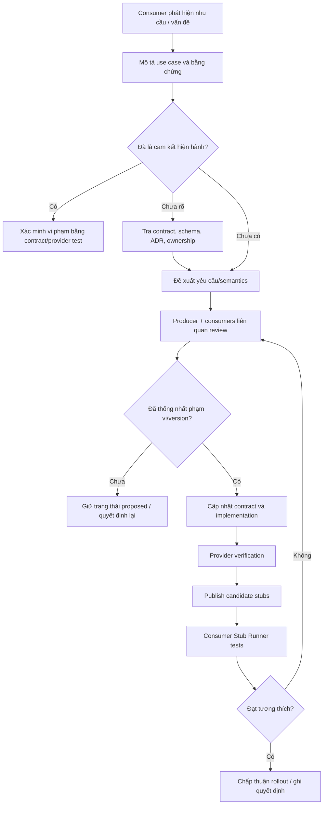
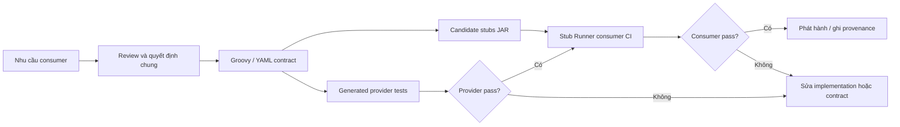

# Phân biệt kỳ vọng hợp lệ với yêu cầu chưa được thống nhất khi phối hợp nhiều nhóm

Trong hệ thống microservices, một API có thể phục vụ đồng thời nhiều nhóm. `order-producer` cung cấp thông tin đơn hàng; `checkout-consumer` cần trạng thái thanh toán; `billing-consumer` cần số tiền và đơn vị tiền tệ; `analytics-consumer` muốn biết nguồn chiến dịch marketing. Cả ba có thể dùng cùng HTTP endpoint hoặc sự kiện `OrderCreated`, nhưng không phải mọi điều họ **mong muốn** đều đã trở thành điều producer **cam kết**.

Đây là nguyên nhân phổ biến của tranh chấp hợp đồng: consumer nói “API phải luôn trả trường này”, producer trả lời “chúng tôi chưa bao giờ thỏa thuận trường đó”; hoặc producer xóa một field vì cho rằng không ai dùng, trong khi consumer đã phụ thuộc nó từ lâu. **Spring Cloud Contract (SCC)** giúp biểu diễn các giao tiếp đã thống nhất bằng **Groovy/YAML DSL**, sinh **provider verification tests**, phát hành **stubs JAR** và cho consumer kiểm tra bằng **Stub Runner**. Tuy nhiên, công cụ không tự quyết định một yêu cầu nghiệp vụ đã được các nhóm chấp thuận hay chưa.

Bài thuộc chương **Phối hợp nhiều nhóm**, tập trung vào **phân biệt kỳ vọng hợp lệ với yêu cầu chưa được thống nhất**: tiêu chí nhận diện, bằng chứng cần có, ví dụ HTTP/messaging, cách xử lý các giả định chưa được ghi nhận, quy trình thương lượng và cách đưa quyết định chung vào contract, stub, CI.

## 1. Vì sao cần phân biệt trước khi viết thêm matcher?

Giả sử producer hiện trả:

```http
GET /api/orders/1001 HTTP/1.1
Accept: application/json
```

```http
HTTP/1.1 200 OK
Content-Type: application/json

{"id":1001,"status":"CREATED","currency":"VND"}
```

Một nhóm consumer vừa viết bài test đòi thêm `customerName`, dù producer chưa từng chấp thuận công bố tên khách hàng. Khi test thất bại, có hai kết luận rất khác nhau:

- **Vi phạm hợp đồng:** producer không còn đáp ứng một hành vi đã được thống nhất và xác minh.
- **Yêu cầu chưa thống nhất:** consumer đang đòi hỏi một hành vi mới hoặc suy đoán từ dữ liệu mẫu mà không có cam kết tương ứng.

Hai tình huống cần hai cách xử lý khác nhau. Với vi phạm hợp đồng, ưu tiên sửa implementation hoặc thực hiện quy trình thay đổi có tương thích. Với yêu cầu mới, cần **thảo luận nhu cầu, xác định owner, đánh giá rủi ro và cập nhật contract sau khi các bên thống nhất**.

**Không sửa contract chỉ để làm bài test xanh; cũng không gạt bỏ một kỳ vọng hợp lệ chỉ vì nó chưa có test tự động.**

### 1.1. Cái giá của việc nhầm lẫn

| Hiểu nhầm | Hậu quả |
| --- | --- |
| Coi mọi giả định consumer là cam kết | Producer bị ràng buộc bởi các yêu cầu chưa được review |
| Coi mọi thay đổi producer là quyền nội bộ | Consumer có thể vỡ giao tiếp dù producer tests xanh |
| Coi stub example là đặc tả đầy đủ mọi giá trị | Test trở nên quá cứng, chặn thay đổi tương thích |
| Coi những gì chưa có contract là không ai dùng | Dễ xóa nhầm hành vi thực tế quan trọng |
| Chỉ nhìn một build xanh | Bỏ qua artifact cũ, consumer chưa tham gia test hoặc kịch bản thiếu |
| Đổi API qua tin nhắn không có quyết định lưu lại | Các nhóm diễn giải khác nhau ở những sprint sau |

## 2. Định nghĩa: kỳ vọng hợp lệ và yêu cầu chưa thống nhất

**Kỳ vọng hợp lệ** trong phạm vi kiểm thử hợp đồng là hành vi mà consumer có cơ sở hợp lý để phụ thuộc, với bằng chứng về **cam kết hiện hành của giao diện** và **ngữ nghĩa được thống nhất**. Bằng chứng thường nằm trong contract đã review, tài liệu API/schema được phê duyệt, chính sách versioning/compatibility hoặc quyết định thiết kế có thể truy vết.

**Yêu cầu chưa được thống nhất** là điều một bên muốn, suy diễn hoặc đang sử dụng nhưng **chưa có đủ bằng chứng** rằng producer chịu trách nhiệm bảo đảm nó. Đó có thể là đề xuất chính đáng về mặt nghiệp vụ, nhưng **chưa nên biến thành assertion bắt buộc đối với producer**.

Một ví dụ:

| Phát biểu | Trạng thái cần xác minh |
| --- | --- |
| “Response 200 luôn có `id` kiểu số” | Hợp lệ nếu contract/schema hiện hành quy định |
| “Trong stub `id=1001`, vậy production phải luôn trả 1001” | Thường là nhầm ví dụ cụ thể với quy tắc |
| “Consumer cần `customerName` để hiển thị” | Nhu cầu thật, nhưng cần thỏa thuận quyền dữ liệu và interface |
| “Producer đã công bố `404 ORDER_NOT_FOUND` trong contract” | Kỳ vọng hợp lệ với trường hợp được khai báo |
| “Tất cả 404 phải có chính xác cùng message tiếng Anh” | Chưa hợp lệ nếu chỉ cam kết `code`, không cam kết `message` |
| “Sự kiện `OrderCreated` cần giữ `eventId` ổn định qua redelivery” | Cần kiểm tra hợp đồng và delivery/idempotency policy được thống nhất |
| “Producer phải trả dưới 150 ms ở mọi tình huống” | Cần SLO/SLA riêng, không thể suy từ một stub HTTP |

### 2.1. Ba mức độ nên ghi rõ

Để tránh tranh cãi nhị phân “đúng/sai”, phân loại thành:

1. **AGREED / cam kết đã thống nhất:** có owner, phạm vi/version và bằng chứng chấp thuận; nên có test tương ứng.
2. **PROPOSED / đang đề xuất:** có nhu cầu consumer, nhưng chưa chốt schema, ngữ nghĩa hoặc lộ trình.
3. **UNSUPPORTED / nằm ngoài cam kết hiện tại:** producer không cung cấp hoặc đã quyết định không hỗ trợ; consumer phải đổi thiết kế hoặc mở đề xuất mới.

Các nhãn trên là **quy ước phối hợp nội bộ minh họa**, không phải enum trạng thái do Spring Cloud Contract tự cung cấp.

### 2.2. Chưa có test không đồng nghĩa chưa có cam kết

Một API đã được công bố và đang được consumer tin dùng có thể có cam kết bằng tài liệu hoặc hành vi được bảo đảm bởi chính sách tổ chức, dù chưa có contract DSL. Trong trường hợp đó, việc cần làm là **chuyển cam kết đã có thành kiểm thử**, không tự tuyên bố consumer đang yêu cầu mới.

Ngược lại, chỉ có một màn hình từng thấy field xuất hiện trong log production **không tự chứng minh field đó luôn được bảo đảm**.

## 3. Bốn câu hỏi để đánh giá một kỳ vọng

Trước khi đưa một assertion vào provider verification hoặc consumer CI, hỏi:

1. **Nguồn cam kết:** hành vi này nằm ở contract/API schema/tài liệu/chính sách nào? Được phê duyệt ở revision nào?
2. **Phạm vi:** áp dụng cho method, endpoint, status, header, field, event version và điều kiện request nào?
3. **Chủ sở hữu:** ai có quyền chấp thuận thay đổi và những consumer nào phụ thuộc?
4. **Bằng chứng thực thi:** có provider test chứng minh producer và consumer test chứng minh client/listener dùng đúng điều đã cam kết không?

Nếu một câu trả lời còn thiếu, không nhất thiết bác bỏ ngay. Hãy **đánh dấu là chưa đủ bằng chứng**, ghi rõ điều còn phải thương lượng và tìm người chịu trách nhiệm.

### 3.1. Thang bằng chứng để review

| Loại bằng chứng | Giá trị | Giới hạn |
| --- | --- | --- |
| Contract Groovy/YAML đã review và phát hành | Mạnh cho hành vi cụ thể trong contract | Không bao phủ mọi hành vi chưa khai báo |
| Tài liệu OpenAPI/AsyncAPI đã được phê duyệt | Mạnh cho schema/interface được công bố | Có thể bị lệch implementation nếu không kiểm chứng |
| Chính sách tương thích/versioning được chấp thuận | Mạnh cho cách thay đổi công khai | Không thay mô tả field cụ thể |
| Provider verification pass trên đúng commit | Chứng minh implementation đáp ứng những test đã chạy | Không tự chứng minh consumer đã đồng ý contract |
| Consumer Stub Runner test pass với candidate stubs | Chứng minh consumer xử lý những stub đã thử | Không tự chứng minh producer thật hay mọi kịch bản |
| Ticket/ADR có quyết định và approvers | Ghi nhận thỏa thuận, lý do, hiệu lực | Cần chuyển thành artifact/test thực thi |
| Log production chứa field | Cho thấy field từng được trả | Không chứng minh luôn có và giữ ổn định |
| Mock tự viết trong repo consumer | Cho thấy giả định của consumer | Không chứng minh producer đã cam kết |
| Trao đổi miệng hoặc chat rời rạc | Khởi đầu cuộc thảo luận | Dễ thiếu phiên bản, phạm vi và người chốt |

**Bằng chứng tốt là bằng chứng có thể truy lại và gắn với phạm vi rõ**, không chỉ là một ví dụ được nhiều người nhớ khác nhau.

## 4. Các lớp cam kết: interface, ý nghĩa, vận hành

Một vấn đề có thể thuộc những lớp khác nhau:

| Lớp | Ví dụ | Công cụ/bằng chứng chính |
| --- | --- | --- |
| Cú pháp/giao thức HTTP | `GET`, URL, status, `Content-Type` | SCC contract, provider test, Stub Runner |
| Schema dữ liệu | `id` là number, `currency` là string | Contract, matcher, schema registry nếu có |
| Ngữ nghĩa nghiệp vụ | `CREATED` có nghĩa gì; khi nào trả 404 | Quyết định product/domain và contract cases |
| Khả năng tương thích | Có thể thêm field? Enum mới? Khi nào deprecate? | Chính sách versioning và consumer compatibility tests |
| Vận hành | p95 latency, availability, retry budget | SLO/SLA, metrics, load/resilience tests |
| Bảo mật/quyền dữ liệu | Ai được xem tên khách, token/tenant scope | Security/privacy review, integration tests |
| Messaging delivery | Ack, retry, DLQ, ordering, transaction | Broker/listener/DB integration tests |

**Không cố nhét mọi kỳ vọng vào một HTTP response matcher.** Một matcher regex có thể bảo vệ định dạng `eventId` nhưng không thể tự chứng minh broker at-least-once hay DB transaction atomicity.

### 4.1. Một giá trị mẫu không phải quy tắc toàn cục

Contract `body(status: 'CREATED')` thường xác minh **trường hợp đã mô tả**. Nó không tự nói rằng mọi đơn hàng đều có trạng thái `CREATED` hoặc producer không bao giờ có `PAID`, `CANCELLED`. Để cam kết tập giá trị hợp lệ, cần schema/semantics và các bài test phù hợp.

Đừng suy diễn từ một request/response fixture thành toàn bộ trạng thái nghiệp vụ.

## 5. Tình huống ba consumer cùng một producer

Giả sử `order-producer` có API:

```http
GET /api/orders/1001 HTTP/1.1
Accept: application/json
```

Trả:

```json
{
  "id": 1001,
  "status": "CREATED",
  "currency": "VND",
  "totalMinor": 125000
}
```

Những nhu cầu khác nhau:

| Consumer | Thực sự dùng | Phát biểu yêu cầu | Phân tích |
| --- | --- | --- | --- |
| Checkout UI | `id`, `status` | “Status phải tồn tại và có nghĩa nhất quán” | Có thể là kỳ vọng hợp lệ nếu đã công bố |
| Billing | `totalMinor`, `currency` | “Tiền phải ở minor units, không làm tròn ngẫu nhiên” | Cần cam kết rõ về đơn vị và kiểu dữ liệu |
| Analytics | `campaignId` | “Thêm mã chiến dịch để phân nhóm” | Đề xuất mới nếu schema hiện tại chưa có |
| Fraud | `customerEmail` | “Trả email khách trong mọi response” | Cần security/privacy review; không thể mặc nhiên yêu cầu |
| Legacy batch | Thứ tự field JSON | “`status` luôn đứng ngay sau `id`” | Thường là giả định sai về JSON object nếu không được cam kết |
| Support dashboard | `message` lỗi | “Message phải giống chính xác tiếng Anh cũ” | Cần phân biệt error code ổn định và display text có thể thay |

Một đề xuất chưa thống nhất **không có nghĩa là vô ích**. Analytics có thể chứng minh nhu cầu rất chính đáng; nhưng trước khi bắt producer phát `campaignId`, nhóm phải thảo luận nguồn dữ liệu, tính optional, ảnh hưởng quyền truy cập, version và rollout.

### 5.1. Hai chiều phải được bảo vệ

- **Consumer không đòi thêm điều chưa cam kết** bằng các assertion không có nguồn.
- **Producer không phá cam kết đang tồn tại** bằng cách xóa hoặc đổi ngữ nghĩa field mà consumer hợp lệ còn sử dụng.

Phối hợp nhiều nhóm không phải việc producer luôn có quyền quyết định đơn phương hay consumer luôn có quyền ép thêm trường; nó là **quản trị một giao diện chung**.

## 6. Dùng Groovy DSL ghi một hành vi đã thống nhất

Ví dụ producer và checkout cùng chấp thuận rằng `GET /api/orders/1001` trả `id`, `status`, `currency` và `totalMinor` trong kịch bản mẫu:

```groovy
import org.springframework.cloud.contract.spec.Contract

Contract.make {
    description 'Đọc đơn hàng thành công: các field public đã thống nhất'

    request {
        method GET()
        url '/api/orders/1001'
        headers {
            header('Accept', 'application/json')
        }
    }

    response {
        status OK()
        headers {
            contentType(applicationJson())
        }
        body(
            id: 1001,
            status: 'CREATED',
            currency: 'VND',
            totalMinor: 125000
        )
    }
}
```

Hợp đồng này có ích vì:

- `GET` và URL nêu phạm vi tình huống.
- `Accept` và `Content-Type` bảo vệ nội dung giao tiếp của client.
- `status=200` và body mẫu kiểm tra producer trên một kịch bản.
- `totalMinor` được biểu diễn bằng JSON number, không phải string có dấu phẩy thập phân.

**Nhưng đoạn code không tự quy định** tập tất cả status, quyền xem thông tin khách, sorting của danh sách, SLA latency hay việc tất cả response đều chứa `totalMinor`. Các cam kết ấy phải được nêu rõ và test đúng nơi.

### 6.1. YAML DSL tương đương

```yaml
description: "Đọc đơn hàng thành công: các field public đã thống nhất"
request:
  method: GET
  url: /api/orders/1001
  headers:
    Accept: application/json
response:
  status: 200
  headers:
    Content-Type: application/json
  body:
    id: 1001
    status: CREATED
    currency: VND
    totalMinor: 125000
```

Trong build thực tế nên chọn **một trong hai bản Groovy/YAML cho cùng kịch bản**, tránh generated tests/stub mappings trùng nhau. Cấu hình plugin, version và test base quyết định cách contract được xử lý.

### 6.2. Đừng thêm `campaignId` chỉ vì consumer yêu cầu

Nếu analytics consumer mở một pull request thêm:

```yaml
response:
  body:
    campaignId: BLACK_FRIDAY
```

đoạn đó **mới là thay đổi đề xuất** nếu chưa có thỏa thuận. Nó không tự trở thành cam kết chỉ vì YAML parse thành công. Review phải xác định API nào, đối tượng nào, trường optional hay required, quyền dữ liệu, giá trị khi không có chiến dịch và khả năng tương thích.

Sau khi chấp thuận, contract có thể được cập nhật và producer verification kiểm tra implementation mới.

## 7. Hợp đồng request: consumer đòi thêm hay gửi sai?

Sự khác biệt giữa kỳ vọng và yêu cầu mới cũng xảy ra ở **request do consumer gửi**.

Ví dụ producer đã cam kết:

```http
POST /api/orders HTTP/1.1
Content-Type: application/json

{"externalRef":"EXT-100001","quantity":2}
```

Consumer đang muốn gửi thêm `priority=EXPRESS` và tin producer sẽ ưu tiên xử lý nhanh hơn. Nếu field chưa thuộc API, request có thể được server bỏ qua hoặc từ chối theo chính sách. Consumer không được coi việc producer đã nhận một request mẫu là cam kết hỗ trợ hành vi `EXPRESS`.

### 7.1. Bốn câu hỏi cho request mới

1. Producer có công bố field/query/header này không?
2. Field có kiểu, miền giá trị và default semantics rõ không?
3. Producer có cam kết reject unknown values hay ignore extra fields không?
4. Consumer cần xử lý response/status nào cho tình huống request ấy?

Nếu chưa có câu trả lời, mở **đề xuất thay đổi giao diện**, không tự đưa kỳ vọng vào test bắt buộc của producer.

### 7.2. Một contract chỉ match đúng những gì được khai báo

Trong WireMock, một mapping không có điều kiện query `priority` vẫn có thể match request chứa query đó. Vì vậy **stub trả 200 cho một request có extra query** chưa chứng minh producer thật hiểu hoặc đã cam kết thực thi query mới.

Đừng lấy việc request match một stub rộng làm bằng chứng producer chấp thuận tính năng.

## 8. Field bắt buộc, tùy chọn, null và vắng mặt

Đây là nguồn mâu thuẫn thường gặp nhất giữa nhiều consumer.

Giả sử analytics muốn `campaignId`, nhưng không phải đơn hàng nào cũng thuộc chiến dịch. Ba định nghĩa khác nhau:

| Quy tắc | Ví dụ JSON | Hành vi consumer cần biết |
| --- | --- | --- |
| Field luôn bắt buộc | `"campaignId":"CMP-42"` | Consumer có thể dựa vào việc field tồn tại |
| Field tùy chọn, có thể vắng | JSON không chứa `campaignId` | Consumer phải xử lý trường hợp absent |
| Field có mặt nhưng nullable | `"campaignId":null` | Consumer phải phân biệt null với string hợp lệ |

**“Optional” và “nullable” không phải lúc nào cũng đồng nghĩa.** Một số deserializer phân biệt absent/null; một số áp dụng default khác. Contract và schema phải mô tả điều được cam kết, không chỉ để một fixture chứa field và nghĩ mọi nhóm sẽ hiểu giống nhau.

### 8.1. Một đề xuất phải có bảng quyết định

Khi thêm `campaignId`, cần thống nhất:

- Tên JSON và kiểu dữ liệu.
- Khi nào field có mặt, khi nào vắng hoặc null.
- Dải giá trị, định dạng và tính ổn định.
- Có cần quyền truy cập riêng không.
- Nếu consumer cũ không biết field, họ có ignore unknown properties không.
- Nếu consumer mới bắt buộc field, thời điểm nào producer bảo đảm đã phát đủ.
- API version hoặc event schema version nào áp dụng.
- Có giai đoạn chuyển tiếp và fallback hợp lệ không.

Nếu chưa thống nhất những điểm ấy, viết `assertNotNull(campaignId)` cho mọi response là **đẩy một giả định riêng thành ràng buộc công khai**.

### 8.2. Không ép JSON object thành chuỗi có thứ tự

JSON object không được consumer coi thứ tự field là ngữ nghĩa, trừ khi giao thức riêng đã bổ sung quy tắc có chủ đích. Bài test so sánh raw JSON string theo byte-to-byte có thể fail vì serialization sắp xếp field khác dù đối tượng dữ liệu tương đương.

Ưu tiên assert **các field/giá trị/ngữ nghĩa đã cam kết**, không assert whitespace hoặc thứ tự field không được giao diện quy định.

## 9. Enum, trạng thái nghiệp vụ và thay đổi có vẻ “chỉ thêm giá trị”

Producer bổ sung trạng thái `ON_HOLD`. Đây là thay đổi nhỏ trong database, nhưng có thể phá consumer:

```java
enum OrderStatus {
    CREATED,
    PAID,
    CANCELLED
}
```

Nếu consumer deserialize enum strict và gặp `ON_HOLD`, nó có thể ném exception hoặc đi vào nhánh chưa xử lý.

### 9.1. Phân biệt ba mức cam kết

1. **Một ví dụ:** `status: CREATED` ở contract GET đơn 1001.
2. **Tập giá trị:** trạng thái public hiện cho phép `CREATED|PAID|CANCELLED`.
3. **Quy tắc tiến hóa:** consumer có bắt buộc chịu được giá trị tương lai hay producer phải version API trước khi bổ sung enum?

Một ví dụ số 1 **không tự giải quyết** số 2 và 3. Hai bên phải có quyết định về forward compatibility. Nếu consumer đang dùng exhaustive switch mà không có nhánh unknown, thêm enum có thể là breaking change trên thực tế.

### 9.2. Cách thương lượng

- Consumer liệt kê các nhánh nghiệp vụ dựa trên status.
- Producer nêu lý do và thời điểm cần trạng thái mới.
- Hai bên thống nhất cách xử lý `UNKNOWN`, fallback, hoặc endpoint/version mới.
- Cập nhật schema/contract và consumer tests có kịch bản cụ thể.
- Chạy candidate stubs trên các consumer liên quan trước rollout.

**Không ghi “thêm enum luôn backward-compatible” như một quy tắc tuyệt đối.** Tính tương thích phụ thuộc hành vi đã cam kết và khả năng consumer đang triển khai.

## 10. Status code và lỗi: đừng chỉ thỏa thuận happy path

Một consumer có thể mong mọi đơn hàng không tồn tại trả `404` với JSON error code `ORDER_NOT_FOUND`, trong khi producer chỉ từng công bố status 404 mà chưa cam kết error body. Hai mức cam kết khác nhau:

| Tuyên bố | Điều producer cần xác minh |
| --- | --- |
| “Không tìm thấy trả 404” | HTTP status |
| “404 có `code=ORDER_NOT_FOUND`” | Status và field `code` |
| “404 luôn có đúng `message=Order does not exist`” | Thêm text chính xác, nếu thật sự là cam kết |
| “404 response có `requestId`” | Trường header/body và định dạng nếu được thỏa thuận |
| “404 có cùng cấu trúc ở mọi endpoint” | Nhiều kịch bản và chính sách lỗi chung |

Ví dụ Groovy contract cho 404 đã thỏa thuận:

```groovy
import org.springframework.cloud.contract.spec.Contract

Contract.make {
    description 'Đơn hàng không tồn tại trả mã lỗi ổn định'

    request {
        method GET()
        url '/api/orders/9999'
    }

    response {
        status NOT_FOUND()
        headers {
            contentType(applicationJson())
        }
        body(
            code: 'ORDER_NOT_FOUND'
        )
    }
}
```

Nếu `message` chỉ để hiển thị và có thể được bản địa hóa, không nên bắt consumer kiểm tra chuỗi tiếng Anh chính xác trừ khi đã thống nhất đó là contract.

### 10.1. Lỗi 404 của WireMock không phải lúc nào cũng là contract

Stub Runner/WireMock có thể trả 404 mặc định nếu request **không match bất cứ mapping nào**. Nó khác với mapping hợp lệ chủ động trả 404 cùng `ORDER_NOT_FOUND`. Khi consumer báo lỗi, cần xem request journal và mapping được chọn trước khi xác nhận producer đã vi phạm cam kết.

## 11. Pagination, sorting và những thứ dễ bị ngầm định

Endpoint:

```text
GET /api/orders?customerId=CUS-42
```

Consumer hiển thị danh sách và mặc nhiên nghĩ record được sắp xếp theo `createdAt` giảm dần. Nếu producer chưa cam kết thứ tự, việc thay query plan/database index có thể đổi order mà không thay HTTP schema.

Những kỳ vọng cần thỏa thuận rõ:

- Default sort nếu client không truyền `sort`.
- Những trường cho phép sort và tie-breaker để có thứ tự ổn định.
- Ý nghĩa `page`, `size` hoặc cursor.
- Cách biểu diễn next cursor và tính ổn định trong lúc có bản ghi mới.
- Có bảo đảm snapshot consistency giữa hai trang không.
- Khi query không hợp lệ, trả 400 hay bỏ qua.
- Có giới hạn kích thước trang và thứ tự fallback không.

**Một stub trả danh sách theo thứ tự cụ thể không tự biến thứ tự đó thành hợp đồng API.** Muốn consumer phụ thuộc vào thứ tự, phải có quyết định và contract/test đúng kịch bản.

### 11.1. Khi consumer chỉ cần hiển thị

Nếu UI chỉ cần liệt kê mà không phụ thuộc thứ tự, nên test tập giá trị hoặc ràng buộc cần thiết thay vì assert cứng phần tử đầu tiên. Cách này giảm false alarms khi producer thay đổi hành vi chưa bị ràng buộc.

### 11.2. Khi nghiệp vụ cần thứ tự

Nếu hệ thống phải ưu tiên giao hàng mới nhất, sort là **yêu cầu thực** cần đưa vào giao diện: ví dụ `sort=createdAt,desc` cùng quy tắc tie-breaker; sau đó provider và consumer cùng xác minh.

## 12. HTTP headers và bảo mật: nơi dễ vượt phạm vi contract

Một nhóm consumer có thể muốn:

- `Content-Type` luôn là `application/json`.
- `ETag` có mặt để caching.
- `Retry-After` để điều khiển retry.
- `X-Correlation-Id` được echo.
- `Authorization` dùng token với scope cụ thể.
- `X-Tenant-Id` xác định tenant.

**Không phải mọi header đã từng xuất hiện đều được bảo đảm.** Đặc biệt các header do gateway, tracing agent hoặc proxy thêm có thể khác giữa môi trường.

| Header hoặc hành vi | Loại thỏa thuận cần có |
| --- | --- |
| `Content-Type` | HTTP contract/media type |
| `ETag` và `If-None-Match` | Cache semantics/versioned resource policy |
| `Retry-After` | Error contract và consumer retry policy |
| Correlation ID | Observability/cross-service tracing convention |
| `Authorization` | Authentication/security interface |
| Tenant context | Authorization/isolation policy, không chỉ chuỗi header |

### 12.1. WireMock không xác minh security implementation

Stub có thể match header `Authorization` hoặc trả 401/403, nhưng **không chạy JWT verification, permission checks hay tenant isolation** của producer thật. Nhóm an ninh có quyền yêu cầu integration/security tests riêng; không thể coi một contract header matcher là bằng chứng bảo mật đầy đủ.

### 12.2. Dữ liệu nhạy cảm là một yếu tố quyết định

Yêu cầu thêm `customerEmail`, `fullAddress` hay token vào payload không chỉ là tiện ích cho consumer. Nó ảnh hưởng quyền truy cập, data minimization, retention và quy tắc chia sẻ. Ngay cả khi consumer có use case chính đáng, việc công bố dữ liệu vẫn cần quyết định theo chính sách security/privacy của tổ chức.

## 13. Giá trị động: phân biệt định dạng cần bảo đảm với literal mẫu

Một lỗi thường gặp là consumer xem literal stub như cam kết producer phải trả chính xác literal đó.

Ví dụ:

```json
{
  "eventId": "EVT-100001",
  "occurredAt": "2026-11-24T03:15:30.123Z",
  "correlationId": "corr-111"
}
```

Consumer hợp lệ có thể cần:

- `eventId` là một string định danh không rỗng/đúng mẫu.
- `occurredAt` là timestamp ISO 8601 có offset/UTC.
- `correlationId` được truyền/ánh xạ theo quy tắc tracing nếu có cam kết.

Nhưng không nên bắt mọi sự kiện đều có `eventId=EVT-100001` hoặc xảy ra đúng tại một thời điểm mẫu.

### 13.1. Dùng matcher khi hợp đồng bảo vệ quy tắc

Ví dụ ý định một Groovy contract cho request có externalRef động:

```groovy
import org.springframework.cloud.contract.spec.Contract

Contract.make {
    request {
        method POST()
        url '/api/orders'
        headers {
            contentType(applicationJson())
        }
        body(
            externalRef: 'EXT-100001',
            quantity: 2
        )
        bodyMatchers {
            jsonPath('$.externalRef',
                byRegex('^EXT-[0-9]{6}$'))
        }
    }

    response {
        status CREATED()
        headers {
            contentType(applicationJson())
        }
        body(
            id: 1001,
            status: 'CREATED'
        )
    }
}
```

YAML tương đương cho request matcher:

```yaml
request:
  method: POST
  url: /api/orders
  headers:
    Content-Type: application/json
  body:
    externalRef: EXT-100001
    quantity: 2
  matchers:
    body:
      - path: $.externalRef
        type: by_regex
        value: '^EXT-[0-9]{6}$'
response:
  status: 201
  headers:
    Content-Type: application/json
  body:
    id: 1001
    status: CREATED
```

Các ví dụ mô tả quy tắc **externalRef có mẫu EXT và sáu chữ số**, không đòi mọi request dùng cùng `EXT-100001`. Cách DSL/matcher được sinh cần kiểm tra với plugin version thực tế.

### 13.2. Matcher cũng cần review

Một regex quá rộng như `.*` có thể cho phép payload sai. Một regex quá chặt có thể khiến producer fail dù một thay đổi hợp lệ. **Matcher cũng là một quyết định hợp đồng**, không chỉ lựa chọn kỹ thuật của người viết test.

## 14. Messaging: thống nhất schema, destination và ngữ nghĩa giao nhận

Với sự kiện `OrderCreated`, producer có thể có contract:

```groovy
import org.springframework.cloud.contract.spec.Contract

Contract.make {
    description 'Sự kiện OrderCreated v1 có eventId và orderId'
    label 'order_created_v1'

    input {
        triggeredBy('publishOrderCreated()')
    }

    outputMessage {
        sentTo('orders.created')
        headers {
            messagingContentType(applicationJson())
        }
        body(
            eventId: 'EVT-1001',
            eventType: 'OrderCreated',
            schemaVersion: 1,
            orderId: 'ORD-1001'
        )
    }
}
```

Những phần có thể đưa vào thỏa thuận message:

- `eventType` và `schemaVersion`.
- `eventId`: định dạng/ý nghĩa/dedupe key.
- `orderId`: domain identifier, kiểu dữ liệu.
- `sentTo`: destination logic theo adapter.
- Headers và content type mà consumer dùng.
- Quy tắc field optional/required và event evolution.

Những điều **không tự được chứng minh** bởi một message contract:

- Kafka offset commit hoặc RabbitMQ ack/nack.
- Số lần redelivery và retry backoff.
- DLQ routing, retention, ordering hoặc partition.
- Transaction giữa database và broker.
- Exactly-once business side effects.

### 14.1. “Message luôn đến đúng một lần” là một yêu cầu khác

Nếu `notification-consumer` nói “chúng tôi cần producer bảo đảm phát đúng một lần”, hãy tách vấn đề:

1. Producer có cam kết tạo một **logical event** cho mỗi nghiệp vụ không?
2. Transport có hỗ trợ at-least-once, at-most-once hay transaction trong phạm vi nào?
3. Consumer có chịu được duplicate theo `eventId` không?
4. Những side effects như gửi email/thu tiền có cơ chế idempotency không?
5. Cần fault-injection/integration tests nào?

**Đừng đưa tuyên bố exactly-once vào contract chỉ vì một StubTrigger chạy thành công.** Cần thống nhất scope và kiểm chứng với broker/database runtime.

### 14.2. Khi nhiều consumer muốn dữ liệu khác nhau

Ví dụ billing cần `totalMinor` và `currency` trong event, analytics cần `campaignId`. Các nhóm cần thảo luận nên:

- Mở rộng `OrderCreated` v1 với optional field có semantics rõ.
- Tạo event riêng cho analytics nếu ownership khác.
- Phát phiên bản event mới và migration cho consumer.
- Dùng API truy vấn bổ sung thay vì nhồi mọi dữ liệu vào một event.

Một event không nhất thiết phải thỏa mãn mọi yêu cầu của mọi consumer; thiết kế cần cân bằng coupling, privacy, compatibility và nhu cầu nghiệp vụ.

## 15. Đâu là kỳ vọng vận hành cần một thỏa thuận khác?

Những câu như sau thường bị lẫn vào contract request/response:

- “Endpoint phải phản hồi dưới 150 ms trong mọi trường hợp.”
- “Consumer có thể retry POST vô hạn mà không tạo duplicate.”
- “Thứ tự message phải giữ nguyên qua mọi partition.”
- “Producer sẽ luôn online 99,99%.”
- “Bất kỳ lỗi 503 nào đều hồi phục trong ba attempts.”

Chúng đòi hỏi **SLO/SLA, resilience policy, idempotency design hoặc integration/load tests**, chứ không chỉ một Groovy/YAML contract tĩnh.

### 15.1. Phân loại trước khi gán trách nhiệm

| Kỳ vọng | Owner cần tham gia | Bằng chứng phù hợp |
| --- | --- | --- |
| p95 latency dưới ngân sách | Producer/SRE/platform | SLO và measurement under load |
| Retry 503 tối đa ba attempts | Consumer và producer nếu có Retry-After policy | Consumer resilience tests |
| POST idempotent theo key | Producer + consumer | Contract header và producer duplicate-request integration tests |
| Event ordering trên một key | Producer, broker team, consumer | Partition/routing policy và broker integration tests |
| DLQ sau khi retry hết | Consumer/platform | Broker/listener integration tests |
| JWT scope cho đọc PII | Security/privacy + producer | Authorization tests và threat review |

**Một yêu cầu hợp lệ về vận hành vẫn có thể chưa thống nhất về phạm vi hoặc chủ sở hữu.** Ghi nó thành đề xuất cụ thể thay vì âm thầm kỳ vọng stub thực thi.

## 16. Quy trình đề xuất → thống nhất → xác minh → phát hành

Một chuỗi phối hợp phù hợp:



**Đây là workflow đề xuất cho nhóm**, không phải các state mà Spring Cloud Contract tự quản lý.

### 16.1. Không gộp “đề xuất” với “đã chấp thuận”

Một request PR có thể chứa Groovy contract hợp lệ về cú pháp nhưng vẫn đang **chờ review nghiệp vụ**, security hoặc compatibility. Không tự merge một contract chỉ vì parser chạy được.

Ngược lại, một contract cũ đã có cam kết nhưng provider test fail phải được ưu tiên xử lý như regression, không bị đẩy sang backlog đề xuất mới để trì hoãn.

### 16.2. Những người nên tham gia

- **Consumer owner:** nêu hành vi thực sự cần và nhánh code dùng nó.
- **Producer owner:** xác nhận khả năng cung cấp và semantics nguồn dữ liệu.
- **Các consumer khác:** đánh giá thay đổi ảnh hưởng giao diện chung.
- **API/platform architect khi cần:** versioning, schema governance, repository.
- **Security/privacy khi có dữ liệu nhạy cảm hoặc quyền truy cập.**
- **SRE/operations khi liên quan SLA, retry, broker, DLQ hoặc rollout.**

Không cần bắt mọi thay đổi nhỏ qua một hội đồng lớn; dùng tiêu chí rủi ro để chọn reviewers phù hợp.

## 17. Mẫu yêu cầu thay đổi để tránh suy đoán

Một ticket hoặc PR mô tả **yêu cầu còn chờ thống nhất** nên có ít nhất:

```yaml
changeProposal:
  id: API-142
  state: PROPOSED
  producer: order-producer
  affectedConsumers:
    - analytics-consumer
    - checkout-consumer
  interface:
    type: HTTP
    method: GET
    path: /api/orders/{id}
  requestedBehavior:
    field: campaignId
    jsonType: string
    required: false
    absentWhenNoCampaign: true
  justification: "Hiển thị nhóm chiến dịch trong báo cáo"
  compatibility:
    needsUnknownFieldToleranceReview: true
    rollout: "Producer adds optional field before consumer relies on it"
  ownerDecision: PENDING
  verification:
    producerContractTest: PENDING
    consumerCandidateStubTest: PENDING
```

Tệp YAML ở trên là **mẫu tài liệu nghiệp vụ**, không phải Spring Cloud Contract DSL và không có ý nghĩa chạy tự động nếu dự án không tự xây tooling.

Điều quan trọng là quyết định được lưu cùng:

- **Ai phê duyệt** và ngày/phiên bản hiệu lực.
- **Consumer nào phụ thuộc** và rủi ro khi không có field.
- **Acceptance criteria** có thể kiểm thử.
- **Cách triển khai tương thích** cho consumer cũ.
- **Thời hạn hỗ trợ và kế hoạch deprecation** nếu thay thế field cũ.

### 17.1. Acceptance criteria phải có điều kiện rõ

“API hỗ trợ campaign” quá mơ hồ. Tốt hơn:

> Với đơn hàng có chiến dịch hợp lệ, response GET đơn hàng có `campaignId` là string đã chuẩn hóa; với đơn hàng không có chiến dịch, field này vắng mặt; consumer cũ không bắt buộc biết field mới. Áp dụng từ producer release được ghi trong quyết định.

Nếu nhóm chọn `null` thay vì absent, phải cập nhật câu trên trước khi viết contract/test. Đây là **lý do cần thỏa thuận ngữ nghĩa trước khi sinh mã**.

## 18. Quy trình xử lý bất đồng: kiểm tra bằng chứng trước, tranh luận sau

Ví dụ consumer báo: “Producer đã phá API vì response có thêm field `discountMinor`”.

Thay vì lập tức rollback hoặc sửa matcher, thực hiện:

1. **Ghi yêu cầu và response thực tế:** method, URL, status, headers, body đã được ẩn dữ liệu nhạy cảm.
2. **Xác định candidate/release:** producer commit, stubs JAR version/classifier và build.
3. **So contract hiện hành:** field thêm có bị cấm? Schema có cho phép unknown properties không?
4. **Xem consumer logic:** JSON parser có strict, DTO có reject unknown fields không?
5. **Áp dụng chính sách tương thích đã thống nhất:** thêm optional field có được coi là tương thích trong hệ sinh thái này không?
6. **Đánh giá ảnh hưởng các consumer khác:** một nhóm strict có thể làm thay đổi “additive” thành breaking trong thực tế.
7. **Ra quyết định có owner:** sửa producer, sửa consumer, đưa ra migration/version mới hoặc tạo giai đoạn hỗ trợ kép.
8. **Cập nhật nguồn cam kết và tests:** không chỉ sửa expected body trong một repo.
9. **Ghi lại bài học:** field/schema/version nào gây lệch hiểu để tránh lặp lại.

### 18.1. Không mặc định “thêm field là luôn an toàn”

Nhiều JSON clients bỏ qua unknown fields, nhưng không phải tất cả. Code consumer có thể dùng strict deserializer hoặc xác thực schema cấm field lạ. Tính tương thích cần dựa trên **chính sách được thống nhất và kiểm thử các consumer đang dùng**, không chỉ dựa trên lý thuyết “additive”.

### 18.2. Không mặc định “consumer đang dùng nghĩa là producer phải giữ mãi”

Consumer có thể phụ thuộc hành vi chưa công bố do phát hiện một field nội bộ. Điều đó tạo **rủi ro thực tế cần phối hợp migration**, nhưng không biến mọi chi tiết implementation thành cam kết vô hạn. Cần đánh giá quyền lợi người dùng, tác động kinh doanh và chi phí chuyển đổi.

## 19. Tương thích ngược và quy tắc thay đổi giao diện

Một bảng review hữu ích:

| Thay đổi đề xuất | Nguy cơ | Điều phải thống nhất |
| --- | --- | --- |
| Thêm optional JSON field | Thường thấp nhưng strict parser có thể lỗi | Unknown-field policy, nullable/absent |
| Xóa field consumer đang dùng | Cao | Deprecation, migration, version |
| Đổi `id` number → string | Cao | DTO compatibility và versioning |
| Đổi tên `status` → `state` | Cao | Dual-write/alias hay API v2 |
| Thêm enum `ON_HOLD` | Phụ thuộc consumer | Unknown value handling |
| Đổi 404 → 200 kèm error body | Cao | Error semantics và branch xử lý |
| Thêm query bắt buộc | Cao | Default, compatibility với client cũ |
| Thay `currency` default | Cao nếu ảnh hưởng tiền | Đơn vị, locale, business semantics |
| Đổi event destination | Cao | Subscriber routing và migration |
| Thêm field vào message v1 | Phụ thuộc deserializer | Schema compatibility và rollout |
| Bỏ header correlation ID | Phụ thuộc tracing và contract | Header ownership/observability |
| Thay p95 latency target | Không phải schema change | SLO/operations agreement |

Không phải mọi thay đổi “nguy cơ cao” luôn bị cấm. Chúng cần **versioning/rollout plan và bằng chứng tiêu thụ**. Cũng không phải mọi thay đổi “nguy cơ thấp” đều tự động được merge.

### 19.1. Cách giảm breaking change

- Thêm field theo hướng optional và làm rõ absent/null.
- Giữ field cũ song song trong giai đoạn chuyển đổi nếu khả thi.
- Đánh dấu deprecation kèm ngày/phiên bản và consumer ownership.
- Thêm API version hoặc event schema version khi thay đổi không thể tương thích.
- Gửi candidate stubs cho các consumer trước rollout.
- Đo usage thực tế của endpoint/field và xác minh consumer còn sử dụng.
- Chỉ xóa behavior sau khi có điều kiện kết thúc hỗ trợ được chấp thuận.

## 20. Spring Cloud Contract và Stub Runner giúp xác nhận thỏa thuận thế nào?

Một quy trình đúng:

1. Producer và consumer **thống nhất hành vi giao tiếp**.
2. Hành vi được đưa vào **Groovy/YAML contract** với request/response hoặc input/output message cụ thể.
3. **Contract Verifier** sinh provider tests; producer chạy chúng với implementation thật.
4. Producer đóng gói **stubs JAR** và phát hành candidate artifact có version xác định.
5. Consumer dùng **Stub Runner** chạy stubs từ đúng candidate, gọi client hoặc listener thật và kiểm tra kết quả.
6. CI dùng kết quả hai phía làm bằng chứng compatibility trước release.



### 20.1. Mỗi loại test chứng minh điều gì?

| Bằng chứng | Có thể kết luận | Không nên kết luận |
| --- | --- | --- |
| Contract DSL được chấp thuận | Có thỏa thuận về trường hợp mô tả | Producer đã làm đúng |
| Generated provider test pass | Producer đáp ứng các case được chạy | Mọi consumer đều xử lý được |
| Stubs JAR tồn tại | Có dữ liệu stub phục vụ consumer | Provider tests đã thực thi |
| Stub Runner consumer test pass | Consumer xử lý được candidate stub cases | Hạ tầng/gateway/broker production đúng |
| Full integration tests pass | Một tập hành vi runtime đã được kiểm tra | Mọi SLA hay failure mode đều đã được bảo vệ |
| Monitoring production | Quan sát vận hành thực | Thay thế hoàn toàn contract/schema review |

### 20.2. Pin candidate stubs để tranh luận trên cùng dữ kiện

Nếu một nhóm dùng `order-producer:1.4.0:stubs` còn nhóm khác dùng `1.5.0-SNAPSHOT`, hai bên có thể đang nói về **hai giao diện khác nhau**. Khi triage, ghi lại full GAV/classifier, repository, hash nếu có và producer commit. **Không cố giải quyết “hợp đồng bị phá” trước khi xác định hai nhóm đang chạy với cùng candidate**.

## 21. CI không thể quyết định thay con người điều chưa được thống nhất

Tự động hóa rất hữu ích, nhưng có giới hạn:

- CI phát hiện producer vi phạm contract **đã được viết**.
- CI phát hiện consumer không xử lý được stub **đã được phát hành**.
- CI có thể kiểm tra số contract/test, schema validation và artifact version.
- CI có thể thử mutation để biết cổng test có fail khi thay đổi nguy hiểm.

Nhưng CI không tự quyết định liệu `campaignId` có nên được công bố, có chứa PII hay không, hoặc producer có quyền ngừng hỗ trợ consumer cũ từ thời điểm nào.

### 21.1. Cổng review và cổng thực thi khác nhau

**Cổng review:** producer owner, consumer owner và các bên liên quan chấp thuận semantics, compatibility, security và rollout.

**Cổng thực thi:** Contract Verifier/provider tests, Stub Runner/consumer tests, integration/security tests đúng phạm vi.

Hai cổng đều cần thiết. Một contract sai nghiệp vụ có thể được generated tests xác minh rất tốt nếu implementation cũng làm theo điều sai đó.

### 21.2. CI cần chống “test xanh giả”

Các trường hợp cần chặn:

- Không có generated provider test dù contract thay đổi.
- Provider test bị skip hoặc không discover vì test engine.
- Consumer vẫn dùng stubs JAR cũ trong Maven cache.
- Consumer test chỉ kiểm tra WireMock khởi động chứ không gọi client thật.
- Mappings quá rộng, khiến request sai vẫn nhận response 200.
- Bài test chỉ có happy path, không có error path consumer phụ thuộc.
- Candidate được publish trước khi provider verification pass.
- Yêu cầu đang ở trạng thái `PROPOSED` nhưng bị coi là contract đã chốt.

## 22. Bài tập: phân loại 12 phát biểu và xử lý một tranh chấp

Chuẩn bị ba vai: `order-producer`, `checkout-consumer` và `analytics-consumer`. Giả định contract hiện hành chỉ công bố:

```text
GET /api/orders/1001
  200 application/json
  body: id(number), status(string), currency(string), totalMinor(number)

GET /api/orders/9999
  404 application/json
  body.code = ORDER_NOT_FOUND

OrderCreated v1:
  eventId, orderId, eventType, schemaVersion
```

Phân loại các phát biểu:

| # | Phát biểu của một nhóm | Định hướng phân loại ban đầu |
| --- | --- | --- |
| 1 | GET đơn 1001 phải có `id` kiểu number | Có bằng chứng contract hiện hành |
| 2 | Mọi đơn đều có `id=1001` | Suy diễn sai từ fixture |
| 3 | Response 404 có `code=ORDER_NOT_FOUND` ở case 9999 | Có bằng chứng contract hiện hành |
| 4 | Mọi error `message` phải giống chuỗi tiếng Anh cũ | Chưa có bằng chứng |
| 5 | Analytics cần `campaignId` optional | Đề xuất mới cần review |
| 6 | Fraud muốn có `customerEmail` | Đề xuất cần security/privacy review |
| 7 | JSON fields phải xuất hiện theo thứ tự của stub | Thường là giả định sai |
| 8 | `status` có thể thêm `ON_HOLD` bất cứ lúc nào | Phải xem enum evolution policy |
| 9 | Producer trả dưới 150 ms ở mọi lần | Cần SLO, không suy từ contract |
| 10 | Consumer có thể retry POST mà không tạo duplicate | Cần idempotency agreement và integration test |
| 11 | `OrderCreated` có `eventId` trong case đã công bố | Có bằng chứng message contract |
| 12 | Kafka phát event đúng một lần, không redelivery | Không được chứng minh bằng message stub |

Các bước thực hành:

1. Với mỗi phát biểu, ghi **nguồn bằng chứng và phạm vi** thay vì chỉ đánh dấu đúng/sai.
2. Chọn `campaignId`, viết một **change proposal** theo mẫu phần 17.
3. Xác định field **optional hay required**, absent hay null, và quyền đọc dữ liệu.
4. Cho producer và hai consumer mô phỏng buổi review; ghi một **decision record** gồm owner, semantics và thời điểm hỗ trợ.
5. Cập nhật một contract Groovy hoặc YAML **sau khi đã chốt**.
6. Chạy generated provider tests trong dự án thực nếu có môi trường tương thích.
7. Build candidate stubs JAR và cho consumer chạy Stub Runner với đúng version.
8. Thử một consumer strict JSON parser, xác định việc thêm field có phá tương thích không.
9. Thử đổi `id` từ number sang string; trình bày vì sao cần migration/versioning.
10. Thử cho consumer đòi field chưa thống nhất trong assertion; giải thích vì sao đây chưa phải regression của producer.
11. Viết test 404 `ORDER_NOT_FOUND` và phân biệt mapping 404 hợp lệ với unmatched 404 của WireMock.
12. Thảo luận yêu cầu “latency dưới 150 ms”; chọn SLO/load test thay vì cố nhét vào response body contract.
13. Với messaging, mở rộng đề xuất `OrderCreated` thêm `campaignId` và xem xét schema evolution cho các subscriber.
14. Viết checklist CI có cả review gate, provider test count, candidate stub version và consumer assertions.
15. Tổng kết các bằng chứng phải lưu khi hai nhóm báo “breaking change”.

### 22.1. Bảng tự đánh giá

| Năng lực | Minh chứng đạt |
| --- | --- |
| Phân loại yêu cầu | Nêu được cam kết hiện hành, proposed và unsupported |
| Truy vết bằng chứng | Tìm được nguồn, owner, version, điều kiện áp dụng |
| Phân biệt fixture/semantics | Không suy mọi literal mẫu thành quy tắc |
| Dữ liệu tùy chọn | Phân biệt absent, null và required |
| Review compatibility | Biết khi nào thêm field/enum có thể phá consumer |
| Xử lý tranh chấp | Có quy trình evidence → review → decision |
| Dùng SCC đúng phạm vi | Groovy/YAML provider verification và Stub Runner |
| Messaging | Không nhầm schema event với broker delivery semantics |
| CI | Chặn false green, pin candidate stubs, bảo đảm test thực thi |
| Rollout | Có owner, migration và deprecation plan khi cần |

## 23. Tổng kết: thỏa thuận trước, biến thành kiểm thử sau

Khi phối hợp nhiều nhóm, **kỳ vọng hợp lệ** là hành vi có **căn cứ cam kết, phạm vi áp dụng và trách nhiệm rõ**; còn **yêu cầu chưa thống nhất** là một nhu cầu hoặc giả định chưa được các bên chấp thuận. Consumer được quyền nêu nhu cầu mới, producer có trách nhiệm giữ lời hứa hiện hành và các bên cùng chịu trách nhiệm quản trị thay đổi của giao diện chung.

Nhớ năm nguyên tắc:

1. **Đừng xem stub literal là đặc tả toàn diện.** Một mẫu `CREATED` không chứng minh mọi đơn đều `CREATED`.
2. **Đừng bắt consumer đoán ý producer.** Required/optional, null/absent, enum, status/error, headers và versioning phải có semantics rõ.
3. **Đừng xem nhu cầu đề xuất là lỗi producer.** Ghi proposal, đánh giá tác động, có owner và decision trước khi biến thành acceptance test.
4. **Đừng dùng test xanh thay cho sự đồng thuận.** Provider verification và Stub Runner thực thi những điều đã mô tả, không quyết định nghiệp vụ, privacy hay SLO.
5. **Đừng thay đổi cam kết công khai đơn phương.** Dùng candidate stubs, consumer CI, migration/deprecation và quyết định có thể truy vết.

Khi **Groovy/YAML DSL, generated producer tests, stubs JAR, Stub Runner và CI** được đặt sau một quy trình thương lượng rõ ràng, các nhóm có thể phân biệt **API regression thật** với **một kỳ vọng chưa hề được chấp thuận**. Nhờ đó, thay đổi được kiểm chứng đúng chỗ, ít tranh cãi hơn và phát hiện sớm những bất tương thích gây ảnh hưởng thực tế.
