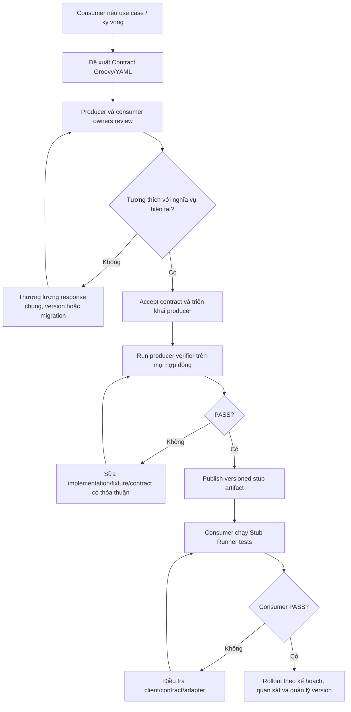
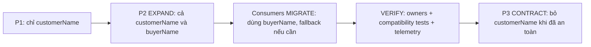
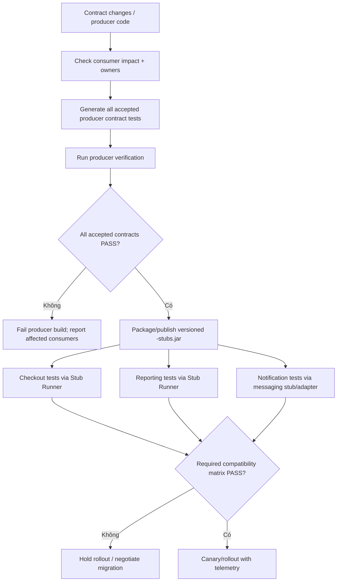

# Quản lý nhiều consumer có kỳ vọng khác nhau

## 1. Bài toán: một producer, nhiều lời hứa phải giữ

Trong hệ thống microservices, một dịch vụ hiếm khi chỉ có một người sử dụng. Ví dụ, `Order Service` (producer) phục vụ đồng thời:

- **Checkout Service**: cần biết đơn hàng đã xác nhận để chuyển khách tới bước thanh toán.
- **Reporting Service**: cần số tiền và tiền tệ để tính báo cáo.
- **Notification Service**: cần sự kiện `OrderConfirmed` để gửi thông báo.
- **Ứng dụng đối tác**: có thể dùng API phiên bản cũ và không thể nâng cấp đúng lịch với nhóm nội bộ.

Khi Order Service đổi field, URL, status code hoặc message schema, mỗi consumer có thể bị ảnh hưởng theo cách khác nhau. Một yêu cầu “thêm trường cho Reporting” có vẻ nhỏ nhưng có thể làm Checkout lỗi deserialize nếu Checkout từ chối trường JSON lạ. Ngược lại, Checkout muốn rút gọn response còn `orderId` và `status`, trong khi Reporting cần thêm `totalAmount`.

Trong **Spring Cloud Contract**, Groovy/YAML DSL mô tả các tương tác HTTP hoặc thông điệp. **Contract Verifier** sinh test để kiểm tra producer thật; producer phát hành stub artifact; **Stub Runner** giúp từng consumer kiểm tra khả năng gửi request, nhận response hoặc xử lý message. Tuy nhiên, công cụ không tự quyết định **kỳ vọng nào có hiệu lực, khi nào hai hợp đồng mâu thuẫn, ai được quyền thay đổi giao diện hoặc khi nào có thể bỏ hỗ trợ consumer cũ**. Đó là phần phối hợp kỹ thuật giữa các nhóm.

Bài học thuộc chương **Phối hợp nhiều nhóm** và tập trung vào cách biến những yêu cầu riêng thành một bộ cam kết tương thích, có thể kiểm tra và vận hành.

Sau bài này, bạn có thể:

1. Lập **bản đồ consumer và kỳ vọng** theo endpoint/event/phiên bản.
2. Phân biệt **kỳ vọng khác nhau nhưng đồng thời thỏa được** với **hợp đồng thực sự mâu thuẫn**.
3. Tổ chức hợp đồng theo consumer mà vẫn bảo vệ một behavior nhất quán ở producer.
4. Dùng Groovy/YAML, producer verification, `stubsPerConsumer` và Stub Runner đúng vai trò.
5. Thiết kế quy trình đề xuất, review, chấp nhận, phát hành và ngừng hỗ trợ hợp đồng.
6. Xây dựng ma trận CI cho nhiều consumer, giám sát và kế hoạch chuyển đổi an toàn.

## 2. Ba khái niệm phải phân biệt ngay từ đầu

| Khái niệm | Nghĩa | Ví dụ |
| --- | --- | --- |
| **Kỳ vọng consumer** | Điều consumer cần hoặc giả định về giao diện | Checkout đọc `status` |
| **Hợp đồng được chấp nhận** | Tương tác producer và consumer đã thống nhất, được diễn đạt bằng DSL/test | `GET /api/orders/42` trả `200`, body có `orderId`, `status` |
| **Hành vi producer** | Điều application thực sự thực hiện khi chạy | Controller trả một JSON response cụ thể |

Một consumer có thể **mong muốn** producer trả một cấu trúc mới, nhưng việc viết file DSL không tự làm producer thực thi được cấu trúc đó. Ngược lại, producer có thể thay đổi implementation nhưng chưa trao đổi với consumer, khiến những hành vi consumer đang dựa vào bị phá vỡ.

**Nguồn chân lý cần có tính hai chiều:** một contract được chấp nhận phải phản ánh nhu cầu thực của consumer **và** được kiểm chứng trên producer implementation. Không thể dùng hợp đồng đã được sửa chỉ để test xanh làm bằng chứng rằng mọi consumer đều đã đồng ý.

### 2.1. Phân biệt yêu cầu về dữ liệu và yêu cầu về chính sách

Kỳ vọng không chỉ là danh sách JSON fields:

| Loại kỳ vọng | Ví dụ | Điều cần bảo vệ |
| --- | --- | --- |
| Cấu trúc | `orderId` là số, `status` là chuỗi | Kiểu dữ liệu, field bắt buộc/tùy chọn |
| HTTP behavior | `GET` trả `200`, không tồn tại trả `404` | Status, method, URL, headers |
| Ngữ nghĩa | `CONFIRMED` nghĩa là đơn đã được xác nhận | Trạng thái nghiệp vụ |
| Message | `OrderConfirmed` phát tới `orders.confirmed` | Event type, destination, schema |
| Khả năng tương thích | Consumer cũ vẫn đọc `customerName` | Rollout/migration |
| Vận hành | Timeout, retry, thứ tự message, latency | Thường cần thêm integration/resilience tests |
| Bảo mật | Token cần scope cụ thể | Security tests, không chỉ stub header matcher |

**Spring Cloud Contract chỉ xác minh những khía cạnh được biểu diễn và thực thi trong test.** SLA độ trễ, xác thực token thật, tính bền vững của Kafka và transaction xuyên dịch vụ cần những kiểm thử/quan sát bổ sung phù hợp.

## 3. Tạo bản đồ consumer trước khi thay đổi API

Với mỗi endpoint hoặc message được chia sẻ, duy trì một **consumer dependency matrix** ngắn gọn:

| Consumer | Giao diện | Các trường/hành vi cần | Owner | Khả năng nâng cấp |
| --- | --- | --- | --- | --- |
| Checkout | `GET /api/orders/{id}` | `orderId`, `status`, HTTP `404` | Nhóm Checkout | Hàng tuần |
| Reporting | `GET /api/orders/{id}/report` | `totalAmount`, `currency` | Nhóm Data | Theo đợt |
| Notification | `OrderConfirmed` event | `orderId`, `eventId`, `customerId` | Nhóm Notification | Hàng tuần |
| Partner Portal | `/api/v1/orders/{id}` | `customerName`, `status` | Nhóm Integrations | Có lịch riêng |

Đây là **ma trận minh họa**, không phải metadata Spring Cloud Contract tự tạo ra. Có thể lưu nó trong tài liệu quản trị API hoặc hệ thống quản lý công việc; khi đề xuất thay đổi, nhóm xác minh lại với owner.

Mỗi mục nên có:

1. **Danh tính consumer** ổn định: application/service name, không chỉ tên team.
2. **Giao diện và phiên bản** đang dùng: URL/method, media type, event topic/schema.
3. **Trường/nhánh lỗi quan trọng**: tránh hiểu “consumer cần JSON” quá chung.
4. **Trạng thái contract**: đề xuất, đã chấp nhận, deprecated, đã ngừng.
5. **Owner và kênh trao đổi**: ai xác nhận thay đổi.
6. **Bằng chứng tích hợp**: contract test, consumer test, telemetry hoặc xác nhận của partner.
7. **Thời điểm/ngưỡng chuyển đổi**: tránh phải đoán khi nào có thể xóa field cũ.

### 3.1. Không biết consumer nào thì sao?

Consumer chưa được ghi trong registry không có nghĩa là không tồn tại. Với public API, SDK, mobile app hoặc đối tác, cần kết hợp tài liệu phát hành, gateway/access logs, versioned endpoints và thời hạn hỗ trợ được công bố. Tránh kết luận “không ai dùng nữa” chỉ vì không có test hoặc không thấy request trong một khoảng rất ngắn.

## 4. Khác kỳ vọng chưa chắc là mâu thuẫn

Giả sử hai consumer cùng gọi:

```http
GET /api/orders/42
Accept: application/json
```

Checkout cần:

```json
{
  "orderId": 42,
  "status": "CONFIRMED"
}
```

Reporting cần thêm:

```json
{
  "orderId": 42,
  "totalAmount": 125000,
  "currency": "VND"
}
```

Hai bên **khác tập field quan tâm**, nhưng producer có thể trả một response chung:

```json
{
  "orderId": 42,
  "status": "CONFIRMED",
  "totalAmount": 125000,
  "currency": "VND"
}
```

Nếu hai consumer chấp nhận extra fields và hiểu cùng ngữ nghĩa, response này đáp ứng đồng thời cả hai. Không cần một producer “nhận diện” Checkout để trả body A và Reporting để trả body B.

**Nhưng thêm field không luôn tương thích.** Một client cấu hình Jackson `FAIL_ON_UNKNOWN_PROPERTIES`, validator schema đóng hoặc so sánh raw JSON chính xác có thể từ chối response mở rộng. Consumer tests cần xác minh hành vi parser thực.

### 4.1. Phân loại thay đổi trước khi quyết định

| Tình huống | Có thể đồng thời thỏa? | Cách tiếp cận |
| --- | --- | --- |
| Checkout chỉ cần `status`, Reporting cần `amount` | Thường có | Response chung, field bổ sung có kiểm chứng |
| Checkout muốn `status=CONFIRMED`, Reporting muốn `status=APPROVED` cho cùng đơn hàng | Không nếu cùng ý nghĩa/request | Thống nhất vocabulary hoặc API version |
| Hai consumer cần cùng dữ liệu nhưng kiểu khác, number và string | Có thể qua field/endpoint mới | Expand–migrate–contract hoặc version |
| Hai consumer cần response khác cho `Accept` khác nhau | Có nếu producer thực hỗ trợ | Content negotiation/media type versioning |
| Một consumer yêu cầu `200`, một consumer yêu cầu `202` cho cùng thao tác | Thường xung đột semantics | Làm rõ đồng bộ/bất đồng bộ và luồng mới |
| Consumer cũ đọc message schema v1, consumer mới dùng v2 | Có nếu hỗ trợ chuyển tiếp | Dual-format, schema rules hoặc topic/event version |

Điểm cần xét là **tập request hợp lệ và hành vi quan sát được**. Hai file contract ở hai thư mục không tự tạo ra hai execution path ở producer.

## 5. Mâu thuẫn thực sự: cùng request nhưng hai response không tương thích

Ví dụ một contract của Checkout yêu cầu:

```http
GET /api/orders/42
Accept: application/json

HTTP/1.1 200 OK
Content-Type: application/json

{"orderId":42,"status":"CONFIRMED"}
```

Trong khi contract của Reporting yêu cầu cho **cùng method, URL, headers, query và state**:

```http
GET /api/orders/42
Accept: application/json

HTTP/1.1 200 OK
Content-Type: application/json

{"orderId":42,"status":"PENDING"}
```

Nếu `status` mang cùng ý nghĩa, producer không thể đồng thời trả `CONFIRMED` và `PENDING` cho một request/điều kiện hoàn toàn giống nhau.

**Hai rủi ro xuất hiện:**

1. **Producer contract verification** có thể có các assertion mâu thuẫn, không thể cùng pass trên implementation thật.
2. Nếu sinh hai WireMock mappings cùng match request, stub server có thể chọn một mapping theo priority/thứ tự và làm một consumer test nhận response của consumer khác.

### 5.1. Những hướng giải quyết có cơ sở

**Hướng A — Thống nhất một ngữ nghĩa chung.** Nếu `CONFIRMED` mới là trạng thái đúng, Reporting phải cập nhật diễn giải nghiệp vụ hoặc dùng trường khác có tên chính xác, ví dụ `settlementStatus`.

**Hướng B — Phân biệt request bằng API có thật.** Có thể dùng:

```http
GET /api/orders/42
Accept: application/vnd.example.order.v1+json
```

và:

```http
GET /api/orders/42
Accept: application/vnd.example.order.v2+json
```

nếu producer **thật sự triển khai** content negotiation. Hoặc tạo endpoint khác, ví dụ `/api/orders/42/report`.

**Hướng C — Giai đoạn hỗ trợ song song.** Producer cung cấp field hoặc endpoint cũ và mới trong thời gian các consumer chuyển đổi, rồi bỏ giao diện cũ khi đã đủ bằng chứng.

**Không nên:** chỉ bật `stubsPerConsumer` để mỗi consumer thấy một response giả khác nhau rồi tuyên bố API tương thích. Cơ chế đó **cô lập mapping**, không thay đổi hành vi của producer thật.

## 6. Quy tắc đặt hợp đồng theo consumer

Spring Cloud Contract cho phép tổ chức hợp đồng theo tên consumer, ví dụ:

```text
order-service/
  src/test/resources/contracts/
    checkout-service/
      get_order_status.groovy
      order_not_found.yml
    reporting-service/
      get_order_report.yml
    notification-service/
      order_confirmed.groovy
```

Ưu điểm:

- Dễ nhận diện **consumer sở hữu yêu cầu**.
- PR thay đổi file trong nhánh `checkout-service` có thể được review bởi Checkout owner.
- Dễ đánh giá consumer nào có nguy cơ bị ảnh hưởng khi đổi field/destination.
- Stub Runner có thể chọn stub mappings thuộc nhóm consumer khi cấu hình `stubsPerConsumer` thích hợp.

**Tên consumer là định danh logic trong cấu trúc hợp đồng, không phải cơ chế authentication.** Một request đến WireMock hoặc producer thật không được xác thực chỉ vì nó match thư mục `checkout-service`.

### 6.1. Nên đặt hợp đồng chung ở đâu?

Có hai nhu cầu khác nhau:

- **Một behavior dùng chung cho nhiều consumer:** duy trì một contract canonical đại diện hoặc các contract nhất quán về ngữ nghĩa, với quy ước đặt file/nhóm rõ ràng và các consumer tests riêng.
- **Một tương tác dành cho consumer cụ thể:** đặt trong nhánh consumer đó, nhưng vẫn giữ đúng hành vi producer thật.

Không tự cho rằng file dưới một thư mục `common/` luôn tự được Stub Runner nạp cho tất cả consumer khi `stubsPerConsumer=true`. Quy tắc lọc dựa trên đường dẫn và phiên bản/cấu hình Stub Runner; nếu dùng nhóm chung, cần kiểm chứng mapping nào được đăng ký cho từng consumer. Một cách thực tế là tạo các contract không trùng lấn/giá trị tương thích theo từng consumer và kiểm tra artifact cuối.

### 6.2. Không đặt theo tên team thay tên application

Ví dụ nhóm Data sở hữu `reporting-service`. Nếu đặt thư mục `data-team` nhưng application dùng `spring.application.name=reporting-service`, tính năng stubs-per-consumer có thể không chọn được đúng mapping. Giữ quy tắc đặt tên ổn định; nếu cần tên khác, dùng `consumerName` tường minh trong cấu hình test.

## 7. Groovy DSL: hợp đồng dành cho Checkout

Đối với Checkout, giao diện cần kiểm tra trạng thái đơn hàng:

```text
src/test/resources/contracts/checkout-service/get_order_status.groovy
```

```groovy
import org.springframework.cloud.contract.spec.Contract

Contract.make {
    description 'Checkout xem trang thai don hang da xac nhan'

    request {
        method GET()
        url '/api/orders/42'
        headers {
            header('Accept', 'application/json')
        }
    }

    response {
        status OK()
        headers {
            contentType(applicationJson())
        }
        body(
            orderId: 42,
            status: 'CONFIRMED',
            totalAmount: 125000,
            currency: 'VND'
        )
    }
}
```

Vì response **canonical** trả cả các field được dùng chung, producer có một hành vi quan sát được rõ ràng. Checkout test có thể chỉ assert `orderId`, `status`, nhưng cần bảo đảm JSON client của nó **không lỗi vì các field khác**.

Contract Verifier ở producer cần chạy trên API thật để xác minh các điều kiện được sinh ra từ DSL. Stub artifact sẽ chứa HTTP mapping mẫu cho consumer. **Contract chỉ là yêu cầu, không phải implementation.**

### 7.1. Hợp đồng khi đơn hàng không tồn tại

Một contract YAML khác trong cùng thư mục:

```yaml
description: Checkout nhan 404 khi don hang khong ton tai
request:
  method: GET
  url: /api/orders/999
  headers:
    Accept: application/json
response:
  status: 404
  headers:
    Content-Type: application/json
  body:
    code: ORDER_NOT_FOUND
```

Với consumer, `404` cũng là một kỳ vọng quan trọng: UI có thể cần hiển thị “Đơn hàng không tồn tại” thay vì timeout hoặc lỗi giải mã JSON.

**Phân biệt:** WireMock `404` vì **không có mapping** khác với một `404` **được contract chủ đích mô tả**. Kiểm tra body và request journal khi debug.

## 8. YAML DSL: hợp đồng dành cho Reporting

Reporting muốn đọc dữ liệu báo cáo tại **endpoint khác được producer thực sự cung cấp**:

```text
src/test/resources/contracts/reporting-service/get_order_report.yml
```

```yaml
description: Reporting doc thong tin don hang de lap bao cao
request:
  method: GET
  url: /api/orders/42/report
  headers:
    Accept: application/json
response:
  status: 200
  headers:
    Content-Type: application/json
  body:
    orderId: 42
    totalAmount: 125000
    currency: VND
    settlementStatus: NOT_SETTLED
```

Endpoint `/api/orders/42/report` có trường `settlementStatus` thay vì tái sử dụng `status` với một nghĩa khác. Điều đó giúp phân biệt rõ **trạng thái đơn hàng** (`CONFIRMED`) với **trạng thái quyết toán** (`NOT_SETTLED`).

Đừng tự tạo endpoint mới chỉ để stub tests xanh; producer cần **triển khai và công bố endpoint** này, rồi các generated producer tests phải xác minh nó.

### 8.1. Khi không muốn tạo thêm endpoint

Nếu Reporting có thể dùng response chung từ `GET /api/orders/42`, không cần tạo `/report` chỉ vì Reporting quan tâm trường khác. Lựa chọn giao diện nên dựa trên ranh giới domain, hiệu năng, phân quyền và giao diện hiện có. Có thể giữ một endpoint chung, một contract thống nhất và consumer tests khác nhau, miễn tất cả kỳ vọng tương thích.

## 9. Messaging: một producer phát sự kiện cho nhiều subscriber

Với `Notification Service`, nhu cầu không nhất thiết là HTTP. `Order Service` có thể phát sự kiện `OrderConfirmed`:

```text
src/test/resources/contracts/notification-service/order_confirmed.groovy
```

```groovy
import org.springframework.cloud.contract.spec.Contract

Contract.make {
    description 'Notification nhan su kien don hang da xac nhan'
    label 'order_confirmed'

    input {
        triggeredBy('confirmOrderAndPublish()')
    }

    outputMessage {
        sentTo('orders.confirmed')
        body(
            eventType: 'OrderConfirmed',
            schemaVersion: 1,
            eventId: 'evt-order-42',
            orderId: 42,
            customerId: 7
        )
        headers {
            header('eventType', 'OrderConfirmed')
        }
    }
}
```

Base test class của producer phải cung cấp phương thức `confirmOrderAndPublish()` kích hoạt **logic publisher thật**, cùng message verifier/adapter hoặc binder phù hợp. DSL không tự khởi động Kafka/RabbitMQ và không tự thực hiện nghiệp vụ xác nhận đơn.

### 9.1. Khi Notification và Analytics cần payload khác nhau

Giả sử Notification chỉ dùng `orderId`, `customerId`; Analytics cần `totalAmount`, `currency`. Có ba lựa chọn:

1. **Một event chung đủ thông tin:** nếu dữ liệu không nhạy cảm và schema cho phép các consumer bỏ qua field không dùng.
2. **Hai event type có ngữ nghĩa khác nhau:** `OrderConfirmed` và `OrderSalesRecorded` nếu thực sự là hai sự kiện domain khác nhau.
3. **Nhiều phiên bản/định dạng trong giai đoạn chuyển tiếp:** nếu thay đổi schema phá reader cũ và cần hỗ trợ cùng lúc.

Không tạo payload “riêng theo consumer” trên cùng một topic/event type nhưng không có cơ chế schema/version rõ ràng, vì subscriber có thể đọc một message không theo định dạng mình mong đợi.

### 9.2. Cùng tên trường nhưng khác nghĩa là tín hiệu nguy hiểm

Nếu `amount` trong event có lúc là đơn vị đồng, lúc là xu, hai consumer có thể parse thành công mà tính sai doanh thu. Cần tách `amountInMinorUnits` hoặc ghi rõ `currency` và đơn vị, rồi chuyển đổi có kiểm soát. Contract matching chỉ bảo vệ ngữ nghĩa nếu kỳ vọng đã diễn đạt đúng.

### 9.3. Ngoài schema còn có delivery

Stub Runner messaging có thể kích hoạt message stub theo `label`, nhưng không tự chứng minh Kafka partition ordering, RabbitMQ retry/DLQ, broker ACL, idempotency hoặc exactly-once effect. Nếu thay đổi topic hay chiến lược dual-publish, các nhóm cần thêm broker integration tests và consumer handling tests.

## 10. Stub Runner và `stubsPerConsumer`: công dụng thật

Khi producer đóng gói nhiều contract trong cùng `-stubs.jar`, consumer có thể muốn chỉ nạp mapping thuộc nhóm của mình. Spring Cloud Contract Stub Runner có chế độ **stubs-per-consumer**.

Ví dụ test Spring Boot trong Checkout:

```java
import org.junit.jupiter.api.Test;
import org.springframework.boot.test.context.SpringBootTest;
import org.springframework.cloud.contract.stubrunner.spring.AutoConfigureStubRunner;
import org.springframework.cloud.contract.stubrunner.spring.StubRunnerProperties;

@SpringBootTest(properties = {
    "order.client.base-url=http://localhost:8091"
})
@AutoConfigureStubRunner(
    ids = "com.example:order-service:1.4.0:stubs:8091",
    stubsMode = StubRunnerProperties.StubsMode.LOCAL,
    stubsPerConsumer = true,
    consumerName = "checkout-service"
)
class CheckoutOrderClientContractTest {

    @Test
    void readsOrderStatus() {
        // Gọi OrderClient THẬT đến localhost:8091.
        // Assert orderId, status và hành vi consumer với JSON mẫu.
    }
}
```

Đây là **khung code**, không phải test đã hoàn thành: cần dependency Stub Runner, stub artifact đã cài vào Maven local và assertion thực. Tên property `order.client.base-url` là ví dụ; HTTP client trong dự án phải thực sự đọc nó.

Tương đương bằng cấu hình Spring Boot ở môi trường test:

```yaml
spring:
  application:
    name: checkout-service
  cloud:
    contract:
      stubrunner:
        stubs-mode: LOCAL
        stubs-per-consumer: true
        consumer-name: checkout-service
        ids:
          - "com.example:order-service:1.4.0:stubs:8091"
```

**Các điểm cần hiểu chính xác:**

- `ids` trỏ đến **artifact của producer** (`order-service`), không phải artifact của Checkout.
- `consumerName` xác định nhóm mapping **được nạp**. Nếu không override, Stub Runner có thể dùng `spring.application.name` theo cấu hình/phiên bản.
- `stubsPerConsumer` không phải cơ chế xác thực hoặc authorization.
- Producer vẫn phải chạy **mọi generated tests của những hợp đồng đã được chấp nhận**, dù mỗi consumer chỉ nạp một nhóm stub.
- Tính năng lọc chỉ có hiệu quả nếu layout của stub artifact giữ được **đường dẫn nhận diện consumer**.
- Nếu nhóm consumer không có mapping tương ứng, test phải báo lỗi hoặc bị fail bởi assertion có chủ đích; không được kết luận rằng không có breaking change chỉ vì ứng dụng test vẫn khởi động.

### 10.1. Khi nào không nên dùng stubs-per-consumer?

Không nhất thiết cần nếu chỉ có một tập hợp đồng chung, các mappings không xung đột và các consumer dùng cùng response mẫu. Việc bật lọc khi chưa thống nhất đường dẫn nhóm có thể làm consumer **không nhận được stub** cần thiết.

### 10.2. Giới hạn quan trọng nhất

`stubsPerConsumer` giúp **cô lập bài kiểm thử consumer**. Nó **không** khiến Order Service production tự nhận diện Checkout hoặc Reporting rồi trả hai body khác nhau cho cùng một request hoàn toàn giống nhau. Nếu kỳ vọng thật sự mâu thuẫn, phải sửa **thiết kế giao diện** hoặc **quy ước phiên bản**, không chỉ sửa cấu hình Stub Runner.

## 11. Producer verification là điểm hợp nhất mọi kỳ vọng

Một producer nhận hợp đồng từ nhiều consumer phải **bảo vệ toàn bộ tập nghĩa vụ đã được chấp nhận**. Ví dụ:

| Nhóm hợp đồng | Producer verification phải bảo vệ |
| --- | --- |
| Checkout | `GET /api/orders/42` và `404 ORDER_NOT_FOUND` |
| Reporting | `GET /api/orders/42/report` với số tiền/tiền tệ |
| Notification | Event `OrderConfirmed` được phát với payload/header đúng |

Ở phía producer:

1. Plugin đọc tất cả source contracts của những nhóm được cấu hình.
2. Generated tests được sinh tương ứng với HTTP hoặc messaging interactions.
3. Test base classes chuẩn bị context, transport, fixture/trigger **thực**.
4. Producer implementation được gọi hoặc kích hoạt.
5. Các assertions phải đạt trước khi stub artifact được publish như bản đã xác minh.

**Không phải một consumer yêu cầu thay đổi nghĩa là producer được bỏ hợp đồng của consumer khác.** Nếu một thay đổi phục vụ Reporting làm hỏng Checkout, việc producer verification fail là tín hiệu có giá trị: cần thương lượng thiết kế trước khi phát hành.

### 11.1. Cảnh giác test “đạt” vì đã bỏ nghĩa vụ

Các sai lầm nguy hiểm:

- Xóa contract Checkout khi Checkout vẫn phụ thuộc field cũ.
- Disable nhóm test Messaging vì khó khởi động broker/adapter.
- Cập nhật stub mẫu theo implementation sai mà không có consumer review.
- Publish `-stubs.jar` từ CI có `skipTests` hoặc generated tests không được chạy.
- Chỉ kiểm tra số lượng file stub được sinh mà không kiểm tra test count.

Producer test chỉ có ý nghĩa trong phạm vi **hợp đồng còn tồn tại và thực sự được chạy**.

## 12. Quy trình đề xuất thay đổi hợp đồng giữa các nhóm

Nên dùng một workflow có thể truy vết:



Các bước cụ thể:

1. **Consumer tạo đề xuất**, mô tả use case, request, response, business rule và tình huống lỗi.
2. **Producer đánh giá khả thi** và tác động tới những consumer đang có.
3. **Hai phía review DSL**, tránh đặt matcher quá rộng hoặc response mẫu không có ý nghĩa.
4. **Chấp nhận hợp đồng** trong nguồn được quản lý version; ghi owner và quyết định thiết kế.
5. **Producer triển khai và verify** trên mọi contract đã chấp nhận.
6. **Phát hành stub artifact** chỉ sau verification đạt, với tọa độ/version rõ ràng.
7. **Consumer chạy test trên client thật** với stub đúng version; không chỉ khởi động WireMock.
8. **Triển khai và giám sát**, cập nhật dependency inventory sau release.

Việc hợp đồng nằm trong repository producer, repository chung hoặc artifact riêng chỉ thay đổi **cách quản trị nguồn**. Bất kể mô hình nào, phải biết ai duyệt và pipeline nào chạy generated tests trên producer thật.

## 13. Quyền sở hữu và phê duyệt: không để ai cũng sửa lời hứa của người khác

Một mô hình trách nhiệm thực tế:

| Hoạt động | Consumer owner | Producer owner | Người vận hành/CI |
| --- | --- | --- | --- |
| Xác định use case và dữ liệu cần | Chủ trì | Tư vấn | — |
| Thảo luận định dạng, semantic và security | Đồng duyệt | Đồng duyệt | Tư vấn |
| Viết contract mới | Đề xuất/chủ trì tùy mô hình | Review | — |
| Chấp nhận contract vào producer build | Xác nhận expectation | **Chịu trách nhiệm cuối về khả năng triển khai** | Thiết lập gate |
| Chạy producer verification | Theo dõi kết quả | Chịu trách nhiệm sửa producer | Bảo đảm test thực thi |
| Consumer Stub Runner test | Chịu trách nhiệm | Cung cấp stub đã verify | Thiết lập CI |
| Xóa field/endpoint cũ | Xác nhận không còn phụ thuộc | Đề xuất và thực thi | Giám sát traffic/rollback |

Quy tắc quan trọng: **người sửa hợp đồng không được tự xóa một consumer expectation đã chấp nhận chỉ để làm build xanh**. Cần owner của consumer hoặc chính sách deprecation đã thông báo trước.

### 13.1. Một checklist PR gợi ý

Mỗi PR thay đổi contract có thể mô tả:

```text
Producer: Order Service
Contract(s): checkout-service/get_order_status.groovy
Consumer(s): Checkout, Reporting, Notification, Partner Portal
Loại thay đổi: additive / breaking / deprecation / fix
HTTP request hoặc message destination bị ảnh hưởng:
Current behavior:
Proposed behavior:
Khả năng chạy cùng phiên bản cũ:
Migration/rollback plan:
Producer verification result:
Consumer stub test result:
Owner approvals:
```

Đây là **mẫu quản trị**, không phải các key của Spring Cloud Contract DSL. Nó giúp người review tìm hiểu tác động mà chỉ nhìn file `*.groovy` chưa chắc thấy hết.

## 14. Thương lượng khi consumer có kỳ vọng mâu thuẫn

Không nên giải quyết bằng tranh luận “ai có quyền chọn JSON đúng”. Dùng tiêu chí:

1. **Ngữ nghĩa domain:** các trạng thái/field có thực sự mô tả cùng một khái niệm?
2. **Khả năng cùng thỏa:** một response superset có đáp ứng được mọi consumer không?
3. **Chính sách dữ liệu:** có được phép gửi thêm dữ liệu nhạy cảm tới consumer không?
4. **Chi phí thay đổi:** sửa một producer hay hàng chục consumer, có client không thể cập nhật ngay không?
5. **Khả năng version:** có thể dùng `Accept`, API path, event type hoặc schema version?
6. **Hiệu năng:** response lớn hoặc endpoint báo cáo phức tạp có nên tách riêng?
7. **Thời gian hỗ trợ song song:** có thể duy trì hai giao diện trong giai đoạn migrate không?
8. **Bằng chứng:** contract tests, consumer tests và telemetry đang nói gì?

### 14.1. Ví dụ conflict: `amount` ở hai đơn vị

Checkout muốn:

```json
{"amount":125000,"currency":"VND"}
```

Reporting muốn:

```json
{"amount":1250,"currency":"VND"}
```

Nếu một bên coi `amount` là đồng, một bên coi là đơn vị nhỏ hơn theo quy tắc khác, **cùng field name nhưng semantics không giống nhau**. Không thể giải bằng cách tạo hai stub response khác nhau và hy vọng production tự hiểu consumer.

Một hướng thống nhất là công bố `amountMinorUnits` có đơn vị và quy tắc tính rõ ràng, hoặc API version/endpoint riêng trong quá trình chuyển đổi. **Không chọn một giá trị ví dụ tùy ý để che sự khác biệt nghiệp vụ.**

### 14.2. Không lấy consumer name làm điều kiện authorization

Nếu API có hai hình dạng response tùy quyền người dùng, producer cần kiểm tra danh tính và quyền thông qua security layer thật. Header kiểu `X-Consumer-Name: checkout` có thể dùng cho routing trong test **chỉ khi đó thật sự là giao diện đã công bố và producer xử lý đúng**, nhưng không được coi nó là bằng chứng consumer đã được xác thực.

## 15. Giai đoạn chuyển tiếp khi không thể đồng bộ release

Một thay đổi phá vỡ, ví dụ đổi `customerName` thành `buyerName`, cần có chiến lược **expand → migrate → contract**:



| Giai đoạn | Producer | Consumer | Gate |
| --- | --- | --- | --- |
| **P1 — Legacy** | Trả `customerName` | Đọc field cũ | Baseline contracts |
| **P2 — Expand** | Tạm thời trả `customerName` và `buyerName` | Bản cũ vẫn chạy, bản mới dùng field mới | Producer verification + C1/P2 test |
| **Migrate** | Giữ hai field | Nâng dần mọi consumer bị ảnh hưởng | C2/P2, C2/P1 nếu rollback cần |
| **Verify** | Chưa xóa field cũ | Owners xác nhận không còn phụ thuộc | Test matrix + usage monitoring |
| **P3 — Contract** | Bỏ field cũ trong breaking release/version mới nếu cần | Chỉ còn client tương thích | Rollout/rollback plan |

**Không tự xóa contract cũ sau khi consumer mới đã pass.** Vẫn có thể còn phiên bản di động/partner, cron job hiếm chạy hoặc consumer chưa được ghi trong inventory.

### 15.1. Tương thích không chỉ là parse JSON

Ngay cả khi client bỏ qua unknown field, thay `200` thành `202`, đổi định nghĩa `PAID` hoặc bỏ `Location` header có thể phá workflow. Cần duy trì cả **shape** và **semantic behavior** được consumer kỳ vọng.

### 15.2. Với messaging còn có replay và dual-publish

Khi schema event đổi, các consumer có thể đọc lại message cũ từ broker. Thêm field không luôn tương thích với Avro/Protobuf nếu schema reader/writer/defaults không đáp ứng policy. Nếu dual-publish event v1/v2, cần event identity và idempotency để subscriber không thực thi tác động hai lần.

## 16. Quản lý phiên bản stub và ma trận tương thích

Một stub artifact có version của producer, ví dụ:

```text
com.example:order-service:1.4.0:stubs
```

Khi Order Service cập nhật, các consumer không nhất thiết nâng cấp cùng một thời điểm. Nên ghi rõ:

| Consumer | Phiên bản đang dùng | Stub producer đang test | Trạng thái cần xác minh |
| --- | --- | --- | --- |
| Checkout C1 | 2.6.0 | Order 1.4.0 | Pass |
| Checkout C2 | 2.7.0 | Order 1.4.0 và 1.5.0 | Pass nếu runtime có thể gặp cả hai |
| Reporting R1 | 3.1.0 | Order 1.5.0 | Chưa đạt, cần điều tra |
| Notification N1 | 1.8.0 | Order 1.5.0 messaging | Cần xác minh subscriber handling |

Các version và trạng thái trên **chỉ minh họa một báo cáo nội bộ**, không phải dữ liệu thực. Mục tiêu là xác nhận **những cặp producer/consumer có thể cùng chạy**.

### 16.1. Khi nào cần test consumer mới với stub producer cũ?

Nếu hạ tầng có rolling deployment hoặc cho phép rollback producer, **consumer mới có thể gặp producer cũ**. Khi đó test C2/P1 là một phần của compatibility plan. Nếu hệ thống bảo đảm thứ tự rollout khiến cặp này không thể tồn tại, không nhất thiết test mọi phiên bản trong lịch sử; nhưng giả định phải được ghi rõ.

### 16.2. Version động và snapshot

Không dựa vào `+` hoặc snapshot mutable làm baseline cho release CI: cùng một cấu hình có thể resolve artifact khác nhau theo thời điểm. Ghim version đã được producer verification, lưu resolved coordinates và thông tin commit/contract revision để tái lập sự cố.

### 16.3. Artifact tải được không đồng nghĩa producer đúng

Stub Runner tải JAR từ Maven local/Nexus/Artifactory không chứng minh implementation Order Service đang chạy ngoài production còn đáp ứng. Cần liên kết **producer build verification results → stub artifact version → consumer test results**.

## 17. Chiến lược CI khi một producer có nhiều consumer



**Producer CI** cần:

1. Xác minh file hợp đồng Groovy/YAML thuộc **mọi nhóm consumer đã chấp nhận** được tìm thấy.
2. Sinh và chạy generated producer tests thực sự, không chỉ sinh mappings.
3. Kiểm tra số lượng test/destination phù hợp, tránh `NO-SOURCE` hoặc `SKIPPED` làm pipeline xanh.
4. Bảo đảm test base và fixtures đi qua code producer thật.
5. Chặn publish stub nếu contract verification fail.
6. Gắn stub artifact với version cụ thể và commit đã xác minh.

**Consumer CI** cần:

1. Ghim artifact producer và config `consumerName`/mappings cần thiết.
2. Gọi HTTP client thật, hoặc xử lý message trong subscriber thật.
3. Kiểm tra thành công **và** các nhánh lỗi quan trọng (`404`, schema không hợp lệ, v.v.).
4. Chạy các cặp producer/consumer version quan trọng đối với rollout/rollback.
5. Báo chính xác consumer nào fail, không chỉ một trạng thái tổng `contract tests failed`.

**CI là bộ lọc rủi ro, không phải bộ máy tự ra quyết định business.** Nếu một contract đề xuất chưa được producer chấp nhận, test fail có thể là tín hiệu cần đàm phán; nếu contract đã được chấp nhận và implementation fail, producer phải khắc phục hoặc thống nhất thay đổi có kiểm soát.

## 18. Quan sát production: tránh tuyên bố đã hết consumer quá sớm

Trước khi xóa field hoặc endpoint cũ, phải xem những bằng chứng:

- **API gateway/access metrics** theo version, route, client ID đáng tin cậy.
- **Thông tin release** của consumer nội bộ và xác nhận owner.
- **Partner/mobile support window** hoặc chính sách deprecation công bố.
- **Broker consumer groups/offsets**, lag và các subscriber còn đọc schema cũ.
- **Tỷ lệ lỗi deserialize, 4xx/5xx**, latency và cảnh báo của consumer sau rollout.
- **Bài kiểm thử rollback/compatibility** với cặp version có thể gặp nhau.

Không thu thập raw bearer token, PII hay message payload nhạy cảm vào log chỉ để xác định consumer nào đang sử dụng API. Chọn metric labels có giới hạn cardinality và quyền truy cập phù hợp.

### 18.1. Khi nào có thể ngừng hỗ trợ?

Một ngưỡng quyết định hợp lý thường cần **đồng thời**:

1. Tất cả consumer còn được hỗ trợ đã triển khai phiên bản mới.
2. Owners/partner đã nhận và xác nhận lịch loại bỏ.
3. CI compatibility tests cho các cặp version yêu cầu đều đạt.
4. Telemetry đủ dài, phù hợp tần suất sử dụng, không còn dấu hiệu phụ thuộc cũ.
5. Có phương án rollback hoặc roll-forward không phụ thuộc giao diện sắp bị xóa.

Không coi “không có request v1 trong 24 giờ” là bằng chứng tuyệt đối nếu có monthly job hoặc partner lâu mới truy cập.

## 19. Chẩn đoán lỗi khi nhiều consumer cùng phát triển

| Triệu chứng | Nguyên nhân thường gặp | Cách xử lý |
| --- | --- | --- |
| Checkout test xanh, Reporting test đỏ | Hai consumer dùng stub version khác hoặc yêu cầu khác | Đối chiếu resolved artifact và hợp đồng |
| Producer verification fail sau PR Reporting | Contract mới mâu thuẫn với behavior đang có | Review semantic, phân biệt endpoint/media type hoặc migration |
| Stub Runner nạp mapping của consumer khác | `stubsPerConsumer` tắt hoặc nhóm tên sai | Kiểm tra `consumerName`, artifact layout |
| Consumer bật lọc nhưng không có stub | Tên thư mục consumer khác application name | Đồng bộ naming hoặc override tường minh |
| Cùng request trả response không ổn định trong WireMock | Nhiều mappings match cùng request | Kiểm tra priority, thiết kế contract, tránh mâu thuẫn |
| Consumer mới không hiểu producer cũ | Chưa test cặp version cần rollback | Fallback hoặc đổi thứ tự rollout |
| Consumer cũ lỗi sau khi thêm field | JSON parser quá nghiêm ngặt | Xác minh client và có kế hoạch tương thích |
| Message schema thay đổi làm Notification fail | Reader cũ không decode hoặc destination sai | Schema compatibility/messaging contract test |
| Producer pass nhưng partner production lỗi | Partner expectation không có trong bộ contract | Bổ sung inventory, contract và release policy |
| Không biết ai duyệt thay đổi | Thiếu ownership/review workflow | Bổ sung owner và PR approval |
| CI xanh vì xóa contract cũ | Test suite mất nghĩa vụ đã chấp nhận | Review diff contract, buộc owner sign-off |
| Hai consumer hiểu `amount` khác đơn vị | Schema đúng nhưng domain semantics mâu thuẫn | Đổi tên field/định nghĩa đơn vị rõ ràng |

### 19.1. Tách lỗi hợp đồng khỏi lỗi môi trường

Nếu một consumer không nhận response đúng, điều tra theo thứ tự:

1. **Stub artifact nào** đang được tải: GAV, version, classifier?
2. **Mapping nào** đã được nạp: thuộc consumer group nào?
3. **Actual request** của client: method, URL, query, headers, body?
4. **Response stub** có phù hợp với contract được producer chấp nhận không?
5. **Producer verification** tương ứng có chạy và đạt không?
6. **Client parsing/behavior** có lỗi do extra fields, type hoặc status không?
7. Nếu đây là messaging, binder/adapter/topic/label/consumer handler đã được cấu hình đúng chưa?

Điều tra theo thứ tự giúp phân biệt lỗi **artifact resolution**, **mapping mismatch**, **client bug**, **producer violation** và **hợp đồng chưa được thống nhất**.

## 20. Bài thực hành: điều phối ba consumer của Payment Service

Giả sử `Payment Service` phục vụ:

- **Checkout** gọi `GET /api/payments/42`, cần `paymentId` và `status`.
- **Reporting** gọi `GET /api/payments/42`, cần `amount`, `currency`.
- **Notification** nhận message `PaymentCompleted`, cần `paymentId`, `eventId` và `customerId`.

Producer hiện đang trả:

```json
{
  "paymentId": 42,
  "status": "PAID",
  "amount": 125000,
  "currency": "VND"
}
```

Reporting đề xuất đổi `amount` sang chuỗi (ví dụ `"125000"`) để tương thích hệ thống báo cáo, còn Checkout vẫn dùng `amount` kiểu số ở một nhánh tính tiền. Notification muốn thêm `schemaVersion` vào event.

### 20.1. Yêu cầu

1. Lập ma trận consumer, giao diện, fields và owner.
2. Giải thích tại sao hai consumer **không nên** tạo hai stub response trái kiểu cho cùng request.
3. Đề xuất một thiết kế compatible cho Reporting mà không phá Checkout.
4. Viết một hợp đồng YAML cho HTTP response được thống nhất.
5. Viết một hợp đồng Groovy cho `PaymentCompleted` event đã bổ sung `schemaVersion`.
6. Nêu cách tổ chức hợp đồng theo consumer và cấu hình Stub Runner cho Checkout.
7. Thiết kế pipeline producer verification và ít nhất hai consumer test jobs.
8. Đề xuất khi nào có thể bỏ field hoặc schema cũ, và cách giám sát.

### 20.2. Gợi ý giải pháp HTTP

Nếu tất cả consumer đồng ý, giữ `amount` dạng số và thêm một field mới **mang nghĩa rõ ràng** chỉ khi thực sự cần, ví dụ:

```json
{
  "paymentId": 42,
  "status": "PAID",
  "amount": 125000,
  "currency": "VND",
  "formattedAmount": "125000"
}
```

Trường `formattedAmount` chỉ có ý nghĩa nếu hợp đồng định nghĩa rõ cách format, locale, decimal separator và mục đích. Không dùng cùng tên `amount` với hai kiểu khác nhau. Nếu Reporting chỉ cần chuyển số thành string trong báo cáo, **mapping trong consumer** có thể là lựa chọn đơn giản hơn việc thay API.

Gợi ý YAML contract:

```yaml
description: Payment response tuong thich Checkout va Reporting
request:
  method: GET
  url: /api/payments/42
response:
  status: 200
  headers:
    Content-Type: application/json
  body:
    paymentId: 42
    status: PAID
    amount: 125000
    currency: VND
    formattedAmount: '125000'
```

Lưu ý rằng **contract phải phản ánh API mà Payment Service thực sự triển khai**; không tự thêm `formattedAmount` vào file chỉ để làm stub pass.

### 20.3. Gợi ý messaging contract

```groovy
import org.springframework.cloud.contract.spec.Contract

Contract.make {
    label 'payment_completed'
    input {
        triggeredBy('completePaymentAndPublish()')
    }
    outputMessage {
        sentTo('payments.completed')
        body(
            eventType: 'PaymentCompleted',
            schemaVersion: 1,
            eventId: 'evt-payment-42',
            paymentId: 42,
            customerId: 7
        )
        headers {
            header('eventType', 'PaymentCompleted')
        }
    }
}
```

Khi thêm `schemaVersion`, cần xác minh Notification cũ có bỏ qua field mới và framework serializer/schema registry có cho phép hay không. Không tự đổi version lên `2` nếu chưa có thỏa thuận về schema v2.

### 20.4. Ma trận test gợi ý

| Test | Mục tiêu |
| --- | --- |
| Payment producer HTTP contract tests | Response có kiểu `amount` và các field đã chấp nhận |
| Payment producer messaging contract tests | Event thật có `schemaVersion`, destination và headers đúng |
| Checkout + Payment stub tests | HTTP client xử lý cả response cũ và mở rộng khi cần |
| Reporting + Payment stub tests | Mapping dữ liệu báo cáo đúng, không ép producer đổi `amount` sai |
| Notification + messaging stub tests | Subscriber parse và xử lý event với schema cần hỗ trợ |
| Broker/schema integration tests | Kiểm tra transport/schema registry khi dùng định dạng nghiêm ngặt |

Chỉ publish stub version mới sau producer verification pass; các consumer jobs dùng version đó để đánh giá khả năng nâng cấp. Nếu có phiên bản consumer cũ còn chạy, giữ test tương thích theo ma trận cần hỗ trợ.

## 21. Checklist trước khi merge contract thay đổi nhiều consumer

- Đã liệt kê **mọi consumer quan trọng**, owner và giao diện/version họ dùng?
- Đã phân biệt field nào là **bắt buộc**, **tùy chọn**, **chỉ tiêu thụ nội bộ**?
- Có hai contract nào mâu thuẫn trên cùng request/message schema không?
- Một response canonical hoặc điều kiện phân biệt request thật có giải quyết được khác biệt không?
- Có kiểm tra consumer strict deserialization trước khi thêm field JSON?
- Hợp đồng theo consumer có giữ tên thư mục ổn định và mapping không xung đột?
- `stubsPerConsumer` được dùng đúng vai trò **lọc stub**, không làm bằng chứng producer có hành vi khác nhau?
- Producer verification chạy **toàn bộ hợp đồng đã chấp nhận** và không bị skip?
- Stub artifact được publish sau khi producer tests pass, có version/commit rõ ràng?
- Consumer Stub Runner tests kiểm tra HTTP client/subscriber thật và các nhánh lỗi thiết yếu?
- Có ma trận cặp version cho rolling upgrade/rollback?
- Thay đổi schema event đã xét replay, default fields, idempotency và broker integration?
- PR có producer/consumer owner approvals, migration plan và tiêu chí loại bỏ giao diện cũ?
- CI cho biết **consumer nào** fail, không che mờ bằng một trạng thái chung?
- Telemetry và chính sách deprecation đủ để tránh bỏ hỗ trợ consumer còn hoạt động?

**Tài liệu tham khảo để đối chiếu theo phiên bản:**

- [Spring Cloud Contract — Reference](https://docs.spring.io/spring-cloud-contract/reference/).
- [Spring Cloud Contract — Contract DSL](https://docs.spring.io/spring-cloud-contract/reference/project-features-contract.html).
- [Spring Cloud Contract — Stub Runner](https://docs.spring.io/spring-cloud-contract/reference/project-features-stubrunner.html).
- [Spring Cloud Contract — Stubs Per Consumer](https://docs.spring.io/spring-cloud-contract/reference/project-features-stubrunner/stub-runner-stubs-per-consumer.html).
- [Spring Cloud Contract — Messaging](https://docs.spring.io/spring-cloud-contract/reference/project-features-messaging.html).

**Ghi nhớ:** Khi một producer phục vụ nhiều consumer, **khác yêu cầu không nhất thiết là xung đột**: có thể thiết kế một response chung, endpoint/media type có phân biệt hoặc giai đoạn hỗ trợ song song. Nhưng **hai hợp đồng mâu thuẫn cho cùng request không thể được “giải quyết” chỉ bằng cách tách thư mục hoặc bật `stubsPerConsumer`**. Hãy quản lý kỳ vọng bằng consumer inventory, review đa bên, producer verification trên mọi hợp đồng đã chấp nhận, stub artifact có version, CI theo ma trận tương thích và deprecation/rollout có quan sát thực tế.
