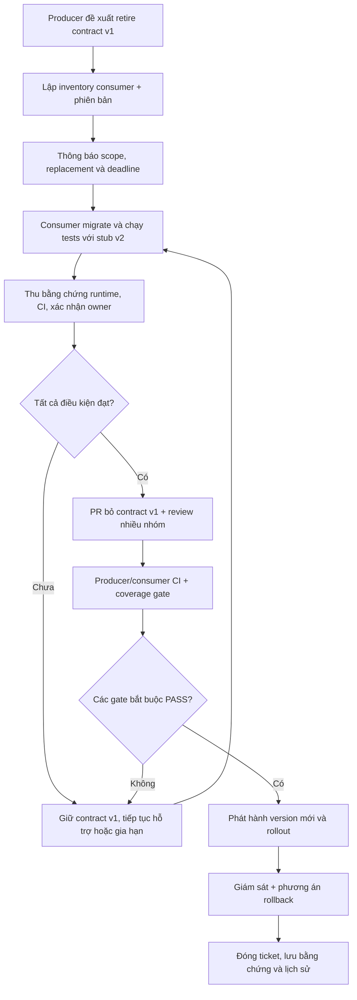
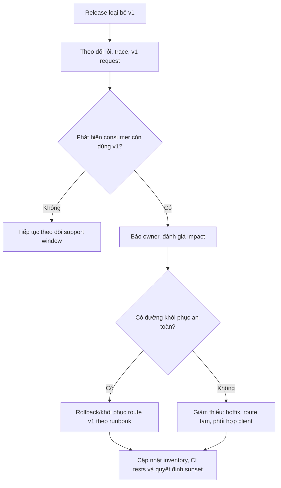
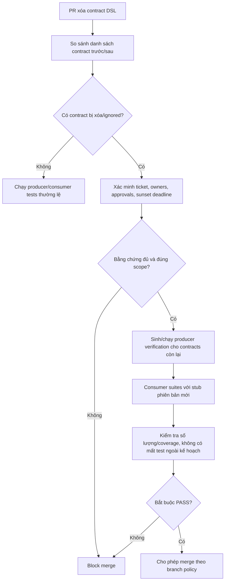

# Loại bỏ hợp đồng cũ có xác nhận của bên sử dụng

## 1. Vì sao không thể xóa contract chỉ vì producer muốn dọn mã?

Trong **Spring Cloud Contract (SCC)**, **producer** cung cấp API HTTP hoặc phát thông điệp; **consumer** gọi API hoặc tiếp nhận sự kiện. Hai phía có thể ghi lại các kỳ vọng bằng **Groovy/YAML DSL**, sinh **producer verification tests**, đóng gói **stub artifact**, rồi sử dụng **Stub Runner** ở consumer và kết nối các bước này vào **CI** để phát hiện sớm thay đổi API không tương thích.

Trong một hệ thống có nhiều nhóm, một hợp đồng đã tồn tại lâu ngày có thể trông như “không còn cần thiết”. Ví dụ `payment-service` vẫn có contract cho:

```text
GET /api/v1/payments/{paymentId}
```

trong khi nhóm producer đã triển khai:

```text
GET /api/v2/payments/{paymentId}
```

Có thể `checkout-service` mới đã chuyển sang v2, nhưng một batch job đối soát chỉ chạy cuối tháng, một consumer triển khai ở vùng khác hoặc một đối tác vẫn gọi v1. **Xóa file hợp đồng cũ mà không biết ai đang sử dụng có thể khiến producer tests xanh hơn chính vì đã mất ràng buộc cần bảo vệ.**

Đây là vấn đề **phối hợp nhiều nhóm**, không đơn thuần là thao tác xóa file.

> **Quy tắc bài học:** Chỉ loại bỏ hợp đồng cũ khi đã xác định phạm vi ảnh hưởng, có xác nhận rõ từ các bên sử dụng còn liên quan, đã kiểm tra phiên bản thực sự triển khai, có thời gian chuyển đổi phù hợp và CI bảo vệ cả bước di chuyển lẫn bước xóa.

### Mục tiêu học tập

Sau bài này bạn có thể:

1. Phân biệt **xóa contract**, **ngừng hỗ trợ hành vi API/message**, **ngừng phát hành stub** và **xóa tài liệu lịch sử**.
2. Lập danh sách consumer và version còn sử dụng một contract.
3. Thu thập xác nhận có thể kiểm chứng từ chủ sở hữu consumer, không coi sự im lặng là đồng ý.
4. Dùng SCC producer verification và Stub Runner để chứng minh **consumer đã chuyển sang hợp đồng thay thế**.
5. Xác định điều kiện chấp nhận, mốc deprecation/sunset và rollback.
6. Thiết kế PR, release notes và cổng CI để việc xóa không vô tình loại bỏ bài test quan trọng.
7. Xử lý trường hợp consumer không phản hồi, consumer ngoài danh sách, batch job hiếm chạy, mobile client hoặc message còn trong backlog.
8. Thực hành quy trình xóa một contract v1 khi có nhiều nhóm phụ thuộc.

## 2. Bốn hành động thường bị gọi chung là “bỏ contract”

| Hành động | Thay đổi thực tế | Có thể gây ảnh hưởng gì? |
|---|---|---|
| **Gỡ contract file khỏi source** | Xóa YAML/Groovy khỏi nguồn mà SCC generator đọc | Producer không còn generated tests/mappings bảo vệ tình huống đó trong bản build tiếp theo |
| **Ngừng hỗ trợ API/event cũ** | Xóa endpoint, field, error response, event type hoặc route | Consumer phiên bản cũ có thể gặp lỗi thật |
| **Ngừng phát hành stub cho tình huống cũ** | Stub artifact mới không còn mapping/contract tương ứng | Consumer tests pin bản mới không thể mô phỏng tương tác cũ |
| **Gỡ artifact/tài liệu lịch sử** | Xóa bản `-stubs.jar` cũ, tài liệu version cũ hoặc record đã phát hành | Khó tái lập test, kiểm toán và hỗ trợ rollback/consumer cũ |

**Bốn hành động không nhất thiết diễn ra cùng lúc.** Một producer có thể tiếp tục hỗ trợ API v1 cho nhóm đang chuyển đổi, nhưng đã thông báo ngừng nhận consumer mới sử dụng v1. Một API đã sunset vẫn có thể giữ tài liệu lịch sử và các stub JAR đã phát hành bất biến để debug hoặc tái lập test.

Trong bài này, **“loại bỏ hợp đồng cũ”** là một **quyết định thay đổi phạm vi hỗ trợ** có kiểm soát, trong đó thao tác cuối có thể là xóa contract DSL khỏi tập đang sinh test/stub. Nó **không** đồng nghĩa phải phá hủy lịch sử Git hoặc xóa mọi artifact đã được công bố.

### 2.1. Một thay đổi nhìn nhỏ có thể làm mất khả năng phát hiện lỗi

Giả sử file `legacy-payment-status.yml` kiểm tra producer trả `200` và `state: CAPTURED`. Nếu developer xóa file và chạy:

```bash
./mvnw verify
```

build vẫn có thể **PASS**, vì không còn generated test nào đòi endpoint v1. Kết quả này **không chứng minh v1 an toàn để xóa**; nó chỉ cho biết các bài test còn lại đã đạt.

SCC chỉ bảo vệ những hành vi **vẫn được mô tả và thực sự được kiểm thử**. Một test biến mất có thể làm suite nhanh hơn và xanh hơn mà chất lượng bảo vệ lại giảm.

### 2.2. “Đã deprecated” cũng chưa có nghĩa “được phép xóa”

**Deprecated:** thông báo hành vi sẽ bị loại bỏ; consumer có thời gian chuẩn bị, thường còn được hỗ trợ trong một khoảng thời gian.

**Sunset:** đến thời điểm đã công bố sẽ ngừng hỗ trợ theo chính sách.

**Removed:** hành vi cũ thực sự không còn được đảm bảo; contract tương ứng có thể được rút khỏi tập đang xác minh.

Nếu chỉ mới gắn nhãn deprecated mà chưa hết support window, hoặc còn consumer chưa được chuyển đổi, **đừng xóa contract trước khi hành vi cũ không còn thuộc cam kết hỗ trợ**.

## 3. Câu chuyện xuyên suốt: ai còn dùng Payment API v1?

Giả sử `payment-service` đang cung cấp hai endpoint:

```text
Legacy:
  GET /api/v1/payments/PAY-42
  → {"paymentId":"PAY-42","state":"CAPTURED","legacyCode":"S01"}

Replacement:
  GET /api/v2/payments/PAY-42
  → {"id":"PAY-42","status":"CAPTURED","reasonCode":"SUCCESS"}
```

Các consumer được biết đến:

| Consumer | Version đang hoạt động (giả định) | Hành vi đang sử dụng | Tần suất |
|---|---|---|---|
| `checkout-service` | `2.8.0` ở một số instance, `3.1.0` ở instance mới | Cũ gọi v1, mới gọi v2 | Liên tục |
| `reconciliation-batch` | `1.6.0` | V1 để đối soát giao dịch | Cuối tháng |
| `partner-gateway` | Nhiều client versions | Có thể gọi v1 qua gateway | Không đồng đều |
| `reporting-service` | `2.0.0` | Đã dùng v2 | Hằng ngày |

Dù nhóm checkout xác nhận `3.1.0` đã dùng v2, vẫn **chưa thể kết luận** v1 không còn được sử dụng. Checkout `2.8.0` có thể tiếp tục được định tuyến, batch job chưa chạy trong thời gian quan sát và partner gateway có thể có clients không thuộc quản lý source code của công ty.

**Đừng dùng “consumer chính đã nâng cấp” thay cho “tất cả consumer còn được hỗ trợ đã xác nhận và được xác minh”.**

### 3.1. Ba nhóm bằng chứng phải được đối chiếu

- **Bằng chứng về chủ sở hữu:** nhóm nào chịu trách nhiệm consumer, ai có thẩm quyền xác nhận ngừng dùng, version nào liên quan.
- **Bằng chứng kỹ thuật:** source/client tests đã chuyển, deployment inventory đã lên phiên bản mới, log/trace thể hiện request/event cũ hết được dùng theo kỳ quan sát phù hợp.
- **Bằng chứng quy trình:** có thông báo, thời hạn, PR/review/ticket và quyết định release/rollback được ghi lại.

Không có nhóm bằng chứng nào hoàn hảo một mình. Một PR đã merge chưa chứng minh code đã deploy; telemetry thiếu traffic trong một ngày chưa chứng minh batch tháng đã ngừng; một lời “OK” không nêu version/endpoint có thể chỉ là đồng ý hướng đi.

## 4. Vòng đời đề xuất → xác nhận → loại bỏ



Luồng này chỉ là **mẫu quy trình điều phối**, không phải workflow mặc định được Spring Cloud Contract tự động áp dụng. SCM/issue tracker/CI của mỗi tổ chức có thể khác; điều quan trọng là các **điều kiện chuyển giai đoạn có bằng chứng**.

### 4.1. Vai trò và trách nhiệm

| Vai trò | Trách nhiệm chính | Điều không nên làm |
|---|---|---|
| **Producer owner** | Đề xuất, liệt kê API thay thế, đánh giá rủi ro, giữ API cũ trong support window | Xóa contract khi chỉ biết code producer |
| **Consumer owner** | Xác nhận nhu cầu/version thực, migrate client, cung cấp test/deployment evidence | Trả lời “đã xong” khi chưa deploy |
| **API/platform governance** | Quản lý support policy, consumer inventory, thông báo chung, xử lý ngoại lệ | Cho rằng không có telemetry nghĩa là không có người dùng |
| **CI/release owner** | Chạy producer verification, consumer matrix, điều phối release, giữ log/checksum | Bỏ qua failed gate chỉ để đúng deadline |
| **Operations/on-call** | Kiểm tra traffic, route, lỗi, rollout và rollback | Dựa riêng vào PR approval để kết luận hệ thống thực an toàn |
| **External partner contact** | Xác nhận kế hoạch chuyển đổi và hỗ trợ test liên tổ chức | Được coi đã đồng ý chỉ vì không phản hồi email |

Một người có thể kiêm nhiều vai trò trong nhóm nhỏ, nhưng trách nhiệm và bằng chứng vẫn cần tách rõ.

## 5. Điều kiện tối thiểu trước khi xin xác nhận xóa

Trước khi gửi yêu cầu cho consumer, producer cần cung cấp **đề xuất có thể đánh giá**:

1. **Contract ID và vị trí logic:** tên contract, endpoint/event, version API và những trường/status/header đang bảo vệ.
2. **Hành vi thay thế:** contract mới dùng path/event/field nào, khác về semantics ra sao.
3. **Phạm vi hỗ trợ hiện tại:** danh sách consumer, versions, môi trường, lịch chạy batch, đối tác.
4. **Thời hạn dự kiến:** thông báo deprecation, thời điểm cuối hỗ trợ, ngày xóa dự kiến.
5. **Kế hoạch kiểm thử:** producer tests nào sẽ giữ; consumer tests nào phải chuyển sang stub mới.
6. **Ảnh hưởng rollback:** nếu quay lại consumer cũ hoặc rollback producer, có còn API v1 cần duy trì không?
7. **Mốc xác nhận:** ai cần trả lời, cần kèm bằng chứng gì, xử lý ngoại lệ thế nào.
8. **Quy trình dừng:** khi thiếu xác nhận hoặc CI fail, không xóa; báo owner để quyết định gia hạn.

Không chỉ gửi “đội mình sắp xóa endpoint v1, ai còn dùng thì lên tiếng”. Câu hỏi không xác định deadline/scope/version thường dẫn tới những câu trả lời khó kiểm chứng.

### 5.1. Dùng contract inventory theo consumer

Với Spring Cloud Contract, có thể tổ chức contracts theo consumer:

```text
src/test/resources/contracts/
  checkout-service/
    legacy-payment-status.yml
    new-payment-status.yml
  reconciliation-batch/
    legacy-payment-reconcile.yml
  reporting-service/
    new-payment-summary.yml
```

Thư mục theo tên consumer giúp nhìn thấy nhóm nào đang yêu cầu những tương tác nào. Tính năng **`stubsPerConsumer`** của SCC còn có thể giúp Stub Runner lọc mappings theo consumer name khi tổ chức đúng layout.

Nhưng **tên thư mục không tự chứng minh ownership và usage thực tế**. Consumer ngoài hệ thống, version cũ đã phát hành hoặc API gọi qua gateway có thể chưa có contract trong repository. Thư mục contract nên là **đầu mối inventory**, không phải nguồn duy nhất để chấp thuận xóa.

### 5.2. Ma trận xác nhận — công cụ ra quyết định

| Consumer | Owner đã xác định? | Đang dùng v1? | Code chuyển v2? | Đã deploy? | Test v2? | Xác nhận retire? |
|---|---|---|---|---|---|---|
| Checkout 2.8/3.1 | Có | Có trên phiên bản cũ | Có ở bản mới | Một phần | Có | **Chưa** |
| Reconciliation 1.6 | Có | Có | Đang làm | Chưa | Chưa | **Chưa** |
| Reporting 2.0 | Có | Không theo inventory | Có | Có | Có | Có, cần đối chiếu telemetry |
| Partner gateway | Chưa đủ | Chưa rõ | Chưa rõ | Chưa rõ | Chưa rõ | **Chưa** |

Đây là **bảng dữ liệu giả định minh họa**. Việc một hàng có chữ “Có” ở cột “xác nhận” chưa đủ khi các cột về deploy/test/usage vẫn thiếu. Chính sách cuối cùng nên dựa trên **điều kiện chấp thuận tổng hợp**, không phải một ô checkbox.

## 6. Xác nhận của consumer cần cụ thể đến mức nào?

Một phản hồi hữu ích phải trả lời rõ:

- **Ai xác nhận?** Tên nhóm/chủ sở hữu, người chịu trách nhiệm và kênh/ticket.
- **Xác nhận cái gì?** Contract ID, API/event cụ thể, cả nhánh lỗi/headers/fields nếu liên quan.
- **Consumer versions nào?** Bản đang chạy, bản còn hỗ trợ, các batch/partner versions.
- **Đã thay thế bằng gì?** Đường API v2, event type mới hoặc flow bỏ nhu cầu cũ.
- **Khi nào code đã deploy?** Commit/release/deployment references.
- **Tests nào đã pass?** Consumer test với stub đúng version và integration tests nếu cần.
- **Có rollback không?** Có thể quay lại phiên bản gọi v1 sau mốc xóa hay không?
- **Chấp thuận mốc nào?** Đến ngày/phiên bản nào producer được ngừng bảo vệ và gỡ API cũ.

**Không coi im lặng, reaction emoji, PR chỉ được xem, hoặc “bên mình không nghĩ còn dùng” là sự chấp thuận rõ ràng.**

### 6.1. Ví dụ mẫu xác nhận bằng văn bản

```text
XÁC NHẬN NGỪNG SỬ DỤNG CONTRACT

Producer: payment-service
Contract cũ: GET /api/v1/payments/{id}
Contract thay thế: GET /api/v2/payments/{id}
Consumer: checkout-service
Owner: đội Checkout

Các phiên bản còn hoạt động:
- checkout 3.1.0+ dùng v2.
- checkout 2.8.0 đã được gỡ khỏi tất cả môi trường
  thuộc phạm vi hỗ trợ; không có lịch rollback về 2.8.0.

Bằng chứng:
- Consumer test với payment-service:1.5.0:stubs: PASS
- Deployment reference: <internal-change-id>
- Quan sát v1 traffic trong kỳ thích hợp: không có request
  đến từ checkout-service (đã đối chiếu route/metrics).

Chấp thuận:
- Đội Checkout không còn yêu cầu hợp đồng v1 sau mốc
  sunset đã thống nhất.
- Người chấp thuận và thời điểm: <name/date>
```

Các giá trị trong mẫu là **placeholder**, không phải bằng chứng thật. Một đội khác như Reconciliation phải **có xác nhận riêng**; không được lấy email của Checkout làm đại diện cho mọi consumer.

### 6.2. Mức bằng chứng tùy tác động

| Thay đổi | Mức bằng chứng nên có |
|---|---|
| Dọn contract trùng hoàn toàn, giữ nguyên hành vi | Review contract equivalence + generated test/mapping diff |
| Bỏ field chỉ một consumer dùng | Xác nhận owner + client code tests + producer tests cho phần còn lại |
| Xóa endpoint v1 còn public | Consumer inventory, deprecation window, đối tác, deployment telemetry, release review |
| Ngừng phát sự kiện cũ | Owner confirmations, broker backlog/replay, consumer migration, integration tests |
| Xóa behavior giao dịch thanh toán | Owner signoff, semantics/idempotency, rollout/rollback và observability chặt hơn |

Không cần biến mọi thay đổi nhỏ thành thủ tục nặng nề, nhưng không hạ thấp yêu cầu đối với API có ảnh hưởng tới thanh toán, dữ liệu và tính nhất quán.

## 7. Xác nhận bằng PR review không giống bằng chứng deployment

Một consumer owner có thể approve PR đổi client sang v2. Điều đó chứng minh **mã nguồn đã được xem xét**, nhưng chưa chứng minh:

- Version mới đã deploy ở mọi region/environment đang được hỗ trợ.
- Job định kỳ dùng binary mới.
- Một phiên bản cũ không còn được khởi chạy bởi autoscaling/rollback.
- Mobile/external clients đã nhận được bản cập nhật.
- Request không bị route theo path cũ từ gateway/cache.

Vì vậy, nên tách:

1. **Code approval:** chuẩn bị migration đúng kỹ thuật.
2. **Test approval:** consumer tests/integration tests pass với artifact phù hợp.
3. **Operational confirmation:** tất cả phiên bản đang phục vụ đã chuyển và ngừng yêu cầu contract cũ.
4. **Sunset approval:** các owner liên quan xác nhận producer có thể ngừng hỗ trợ sau mốc đã công bố.

Một hệ thống có release train hoặc external partner SLA cần chờ **thời hạn hỗ trợ** dù code mới đã sẵn sàng.

### 7.1. Nếu một nhóm chưa phản hồi thì sao?

Không tự chuyển trạng thái `UNKNOWN` thành `APPROVED` khi quá hạn. Thay vào đó:

- Gửi lại yêu cầu với scope/version/deadline cụ thể.
- Xác định escalation owner/đầu mối quản lý nếu consumer không còn maintain.
- Kiểm tra ownership bằng repository, service catalog, deployment records và telemetry được phép.
- Đánh giá rủi ro nếu không thể xác nhận; tiếp tục duy trì contract hoặc xin **ngoại lệ có thẩm quyền** theo chính sách.
- Ghi rõ quyết định và chấp nhận rủi ro nếu tổ chức chọn ngừng hỗ trợ một consumer không được quản lý.

**Không biến im lặng thành sự chấp thuận mặc định.** Nếu có quyền ra quyết định sunset theo một hợp đồng hỗ trợ đã công bố, đó là **quyết định governance riêng**, cần được ghi rõ, không phải “đã có xác nhận consumer”.


## 8. Contract v1 và v2 trong Spring Cloud Contract

Để người học thấy rõ ảnh hưởng, xét hai hợp đồng HTTP cùng được producer `payment-service` hỗ trợ trong giai đoạn migration.

### 8.1. Contract cũ cần tiếp tục được bảo vệ

File minh họa `contracts/checkout-service/legacy-payment-status.yml`:

```yaml
name: legacy_payment_status_for_checkout
description: "Checkout cũ tra cứu trạng thái thanh toán qua API v1"
request:
  method: GET
  url: /api/v1/payments/PAY-42
  headers:
    Accept: application/json
response:
  status: 200
  headers:
    Content-Type: application/json
  body:
    paymentId: "PAY-42"
    state: "CAPTURED"
    legacyCode: "S01"
```

Nó bảo vệ cụ thể HTTP path, status, content type và ba trường response. Khi còn `checkout-service 2.8.0` sử dụng `/api/v1`, **không xóa contract** chỉ vì ứng dụng producer đã có endpoint v2.

### 8.2. Contract thay thế

File `contracts/checkout-service/payment-status-v2.yml`:

```yaml
name: payment_status_v2_for_checkout
description: "Checkout mới tra cứu trạng thái thanh toán qua API v2"
request:
  method: GET
  url: /api/v2/payments/PAY-42
  headers:
    Accept: application/json
response:
  status: 200
  headers:
    Content-Type: application/json
  body:
    id: "PAY-42"
    status: "CAPTURED"
    reasonCode: "SUCCESS"
```

Hai YAML này minh họa **hai files khác nhau**, không phải những đường dẫn bắt buộc của mọi Maven/Gradle project. SCC sẽ dùng vị trí contract tương ứng với cấu hình plugin/version của producer; ví dụ Maven thường dùng `src/test/resources/contracts`, còn Gradle có convention riêng. Không được dùng danh sách path mẫu để đoán plugin đang quét đúng thư mục.

### 8.3. Cùng tồn tại trong migration

Trong giai đoạn chuyển đổi:

- Producer P2 cần trả đúng cho **cả v1 và v2**, nếu cả hai còn được hỗ trợ.
- Generated producer tests phải có các trường hợp tương ứng và **thực sự được chạy**.
- Stub artifact P2 có thể chứa mappings cho cả hai nếu packaging đúng.
- Consumer C1 dùng Stub Runner để kiểm tra client cũ; C2 kiểm tra client mới.
- API v1 chỉ được bỏ sau khi những bên còn phụ thuộc đã xác nhận và đạt điều kiện sunset.

**Điểm cần tránh:** Nếu khi chuyển sang v2 nhóm đổi luôn kiểu `legacyCode` ở v1, có thể phá consumer cũ dù file v2 hoàn toàn đúng. Bởi vậy, trong giai đoạn hỗ trợ song song, contract v1 tiếp tục có giá trị bảo vệ.

### 8.4. Groovy DSL không thay đổi quy tắc phối hợp

Ví dụ khung Groovy biểu đạt cùng API cũ:

```groovy
import org.springframework.cloud.contract.spec.Contract

Contract.make {
    name('legacy_payment_status_for_checkout')
    description('Checkout cũ tra cứu thanh toán qua API v1')
    request {
        method GET()
        url '/api/v1/payments/PAY-42'
        headers { accept(applicationJson()) }
    }
    response {
        status OK()
        headers { contentType(applicationJson()) }
        body(
            paymentId: 'PAY-42',
            state: 'CAPTURED',
            legacyCode: 'S01'
        )
    }
}
```

Bỏ file YAML hay Groovy cuối cùng vẫn là **bỏ một nguồn generated verification**. Đừng chỉ chuyển từ Groovy sang YAML rồi nhầm là “đã xóa contract”; nếu behavior còn trong phạm vi hỗ trợ, phải bảo đảm test mới tương đương trước khi dọn file cũ.

## 9. Dùng `stubsPerConsumer` để truy tìm nhu cầu, nhưng không coi là toàn bộ sự thật

SCC hỗ trợ **stubs per consumer**, cho phép contracts được tổ chức theo consumer name và Stub Runner chỉ nạp mappings phù hợp. Ví dụ:

```text
contracts/
  checkout-service/
    legacy-payment-status.yml
    payment-status-v2.yml
  reconciliation-batch/
    legacy-payment-reconcile.yml
  reporting-service/
    payment-summary-v2.yml
```

Bên consumer:

```java
@SpringBootTest
@AutoConfigureStubRunner(
    ids = "com.acme.billing:payment-service:1.5.0:stubs",
    stubsMode = StubRunnerProperties.StubsMode.REMOTE,
    repositoryRoot = "https://repo.example.org/repository/maven-releases/",
    stubsPerConsumer = true,
    consumerName = "checkout-service"
)
class CheckoutPaymentContractTest {
    // Gọi CheckoutService và HTTP client thực của consumer.
}
```

Ví dụ phụ thuộc dependencies/JUnit/Spring test configuration phù hợp và **stub artifact đúng layout**. Phần `consumerName` không phải version của consumer; nó chỉ xác định tập stubs cho consumer name theo cơ chế lọc của SCC.

**Lợi ích khi cân nhắc xóa:**

1. Producer nhìn thấy contract nào gắn với Checkout, Reconciliation và Reporting.
2. Nhóm có thể chạy lại consumer-specific tests với artifact mới.
3. Pull request có thể chỉ rõ những folder bị thay đổi và reviewer phụ trách.
4. Các mapping không cùng consumer được lọc bớt khi test một nhóm, giảm xung đột.

**Giới hạn:** Đó là một **quy ước tổ chức test**, không phải hệ thống tự thu thập đầy đủ người dùng API. Một contract không có owner trong folder, hoặc một consumer cũ không nằm trong CI, vẫn có thể có traffic thật. Vì vậy, quyết định xóa còn phải đối chiếu inventory/deploy/telemetry.

### 9.1. Không đánh đồng “không có test thất bại” với “không ai dùng”

Tài liệu SCC có diễn giải rằng việc tổ chức contract theo consumer giúp nhìn ra nơi còn sử dụng field; khi xóa field mà không có generated test nào thất bại, có thể cân nhắc loại bỏ. Nhưng kết luận này chỉ đáng tin nếu:

- Danh sách consumers **đầy đủ trong support window**.
- Các contract hiện hữu phản ánh **đúng field/flow đang dùng**.
- Generated tests thực sự chạy trên producer build mới.
- Các consumer phiên bản cũ vẫn còn hỗ trợ cũng được đưa vào đánh giá.
- Không còn đối tác hoặc kênh runtime nằm ngoài hệ thống quản lý contracts.

Nếu chưa đạt điều kiện này, **không có test đỏ chỉ là thiếu bằng chứng**, không phải xác nhận được phép xóa. Với chủ đề bài này, **xác nhận từ consumer owner** vẫn là một tiêu chí cần có.

## 10. Bằng chứng kiểm thử trước và sau migration

Một kế hoạch xóa contract cũ cần phân biệt **trước migration**, **sau migration** và **sau removal**.

| Giai đoạn | Producer verification | Consumer Stub Runner | Bằng chứng runtime |
|---|---|---|---|
| Chưa migrate | **V1 + V2** nếu v2 đã có | C1/v1 vẫn chạy; C2/v2 thử nghiệm | Có v1 traffic |
| Đang migrate | Giữ **v1 + v2** | Test C1/v1 và C2/v2 theo version | V1 traffic giảm; vẫn có instances cũ |
| Sau consumer xác nhận | Giữ v1 đến mốc sunset đã duyệt; v2 bắt buộc PASS | Consumer còn support pass trên v2 | Không còn v1 traffic trong kỳ đủ dài |
| PR gỡ v1 | Kiểm tra **contract v2 vẫn được sinh và chạy** | Consumer suites với stub version mới PASS | Kế hoạch rollback và monitor rõ |
| Sau release bỏ v1 | Không còn cam kết v1 trong bản mới | Không chạy test yêu cầu bản mới phục vụ v1 | Không có lỗi từ consumer còn support |

**Lưu ý:** PASS trong bảng biểu thị **cổng kiểm tra cần đạt**, không phải kết quả đã được thực thi trong bài. Việc xóa v1 có thể đồng thời tác động các instance producer cũ vẫn phục vụ v1 trong rolling deploy; support window, routing và release policy phải quy định hành vi trong giai đoạn chồng lấn.

### 10.1. Producer verification trước khi xóa

Trước PR xóa, chạy bộ contracts hiện tại:

```bash
# Ví dụ Maven producer dùng Spring Cloud Contract plugin
./mvnw clean verify
```

Hoặc Gradle producer:

```bash
./gradlew clean contractTest
```

Các lệnh này là **hướng dẫn**, chưa được chạy trong quá trình biên soạn. Tên task/phase và nguồn contract phải được xác minh theo plugin version.

Cần ghi:

- Số source contracts và số generated tests trước xóa.
- Những tests bảo vệ v1 và v2.
- Producer build/commit/version đã test.
- Bằng chứng fixtures và assertions thực sự chạy, không phải `0 tests`.

### 10.2. Consumer dùng Stub Runner với artifact version rõ ràng

Ví dụ sau khi producer chuẩn bị bản `1.6.0` hỗ trợ v2:

```java
@SpringBootTest
@AutoConfigureStubRunner(
    ids = "com.acme.billing:payment-service:1.6.0:stubs",
    stubsMode = StubRunnerProperties.StubsMode.REMOTE,
    repositoryRoot = "https://repo.example.org/repository/maven-releases/"
)
class CheckoutConsumerContractTest {
    @Autowired CheckoutService checkout;

    @Test
    void checkoutUsesPaymentV2() {
        CheckoutDecision result = checkout.evaluate("PAY-42");
        assertEquals("READY", result.reason());
    }
}
```

Ví dụ chỉ có ý nghĩa khi **CheckoutService và HTTP client thực sự gọi endpoint v2 trên stub URL**. Cần cấu hình URL/cổng `@StubRunnerPort` hoặc `StubFinder` (hay discovery integration phù hợp). Nếu test chỉ mock `PaymentHttpClient` hoặc dùng URL producer production, nó **không chứng minh client đã migrate sang stub v2**.

Stub Runner ID cần **pin version** cho release gate. `+:stubs` có thể chọn bản mới nhất tại thời điểm chạy và gây kết quả không tái lập; dùng nó cho job theo dõi riêng nếu cần, đồng thời lưu version thực tế đã resolve.

### 10.3. Thử cố tình phá vỡ để phát hiện test xanh giả

Trong môi trường branch/test cô lập, thử một **kiểm tra âm** có kiểm soát:

1. Thay base URL consumer test thành một địa chỉ stub không tồn tại.
2. Hoặc đổi path v2 thành path sai.
3. Hoặc thay đổi field body bắt buộc trong một stub thử nghiệm tách biệt.
4. Chạy consumer integration tests.

Nếu test **vẫn xanh**, có thể HTTP client bị mock, cache đã trả kết quả cũ, assertion quá lỏng hoặc test không đi qua contract path. Không thực hiện các phép thử phá hoại này trên hạ tầng production.

## 11. Đếm contract và generated tests trước/sau để không bị mất kiểm soát

Một PR xóa 3 contracts nên làm rõ **3 nguồn ràng buộc nào sẽ biến mất** và có ảnh hưởng tới generated tests/stub mappings ra sao.

**Mẫu báo cáo khác biệt**:

```text
Trước PR:
  active HTTP contracts: 18
  active v1 contracts: 3
  generated producer tests: 18 (ví dụ)
  v2 consumer test scenarios: 5

Sau PR:
  active HTTP contracts: 15
  active v1 contracts: 0
  generated producer tests: 15 (ví dụ)
  v2 consumer test scenarios: 5

Giải trình:
  3 contracts v1 bị xóa theo retirement ticket RET-42.
  Đã có consumer confirmations được liệt kê trong PR.
  V2 contracts và test cases không bị thay đổi ngoài chủ đích.
```

Các số là **giả định minh họa**, không phải quy luật một contract luôn bằng một test; plugin có thể tạo nhiều hay ít tests theo DSL/configuration. Hãy dùng số đếm thực tế theo build của dự án.

### 11.1. Đặt cổng không cho mất coverage ngoài kế hoạch

Một quy tắc CI/PR có thể là:

- Mọi diff **xóa/đánh dấu ignored** contract cần liên kết tới ticket retire đã được duyệt.
- Có xác nhận consumer owners theo scope.
- So sánh danh sách contract names/paths trước và sau, không chỉ tổng số file.
- Generated producer tests vẫn **chạy thực**, không có test discovery bằng 0.
- Các consumer v2 suites bắt buộc PASS trên đúng artifact mới.
- Nếu contract giảm ngoài danh sách retirement được duyệt, block PR.

**SCC không tự thi hành quy tắc review đa nhóm này.** Nó cần SCM branch protection, CI script hoặc governance process của tổ chức. Không giả định có plugin setting duy nhất chứng minh mọi consumer đã đồng ý xóa.

### 11.2. “No contracts found” không phải thành công ngầm

Nếu xóa contract cuối cùng hoặc cấu hình nhầm source directory, một build có thể không còn generated verification tests. Với Spring Cloud Contract, có các cấu hình kiểm soát trường hợp không tìm thấy contracts/stubs; hãy giữ chính sách **fail when expected contracts are absent** phù hợp với plugin/version.

Đừng chuyển `failOnNoContracts` hay `failOnNoStubs` thành `false` để CI xanh sau khi xóa, trừ khi module đó **thực sự không còn sử dụng SCC** và việc thay đổi đã được phê duyệt. Nếu bỏ hẳn SCC khỏi module, đó là **thay đổi build policy riêng**, phải có review và phạm vi rõ.

## 12. Tránh lạm dụng `ignored` và `inProgress` để “xóa mềm”

SCC có hỗ trợ top-level flags như `ignored: true` và `inProgress: true` trong YAML DSL (Groovy có các biểu đạt tương ứng). Nhưng đây **không phải trạng thái xác nhận consumer đã ngừng sử dụng**.

### 12.1. `ignored` không phải lệnh deprecate theo chính sách

Ví dụ:

```yaml
name: legacy_payment_status
ignored: true
request:
  method: GET
  url: /api/v1/payments/PAY-42
response:
  status: 200
```

Đánh dấu ignored là yêu cầu **bỏ qua contract trong quy trình generator theo semantics SCC/version**, không phải lời thông báo consumer rằng API sẽ kết thúc, càng không phải bằng chứng contract đã được thay thế.

Nếu contract đang bảo vệ consumer cũ, thêm `ignored: true` có thể làm mất test coverage **trước khi consumer được chuyển đổi**. Vì vậy, chỉ áp dụng khi có lý do kỹ thuật tạm thời đã được duyệt và có deadline xử lý; không dùng làm cách “dọn test đỏ” cho thay đổi breaking.

### 12.2. `inProgress` là dành cho hợp đồng chưa được producer xác minh

```yaml
name: payment_status_v3_in_development
inProgress: true
request:
  method: GET
  url: /api/v3/payments/PAY-42
response:
  status: 200
```

Tài liệu SCC mô tả contract in progress **có thể sinh stub nhưng không sinh producer verification tests tương ứng**; `failOnInProgress` dùng để chặn release theo cấu hình, thường mặc định `true`.

Do đó, **không được đánh dấu contract v1 đã production là `inProgress`** chỉ để nó không còn làm producer tests fail. Đó là đổi ý nghĩa kỹ thuật và có thể tạo kết quả tương thích giả, không phải cách thông báo deprecation.

### 12.3. Thêm comment/ticket không thay việc migrate

Có thể lưu trạng thái deprecation trong tài liệu hoặc issue tracker, nhưng miễn v1 còn được hỗ trợ, contract cần tiếp tục bảo vệ behavior. Việc thêm comment “TODO remove” không thay đổi trách nhiệm producer.

## 13. Xóa contract và ngừng hỗ trợ endpoint là hai PR hay một PR?

Có ba chiến lược phổ biến:

### A. Tách PR — dễ review và theo dõi

1. **PR migration:** bổ sung v2, giữ v1, producer + consumer tests pass.
2. **PR deprecation/docs:** thông báo sunset, cập nhật inventory, giữ behavior v1.
3. **PR retirement:** sau xác nhận và deadline, xóa v1 contract và v1 code/route theo thứ tự được duyệt, xác minh không còn dependency.

Đây thường là cách dễ kiểm soát khi có nhiều nhóm.

### B. Một PR retirement sau khi các nhóm đã migrate

Nếu v1 đã không còn trong support window và toàn bộ chứng cứ đã tập hợp, có thể gộp xóa contract và endpoint vào một PR rõ scope. Điều kiện là **chấp thuận có trước thay đổi phá vỡ**, test coverage còn lại vẫn đạt, và rollback được đánh giá.

### C. Xóa contract nhưng vẫn giữ endpoint (chuyển tiếp)

Trong một số tổ chức, contract đã hết cam kết nhưng endpoint vẫn được giữ tạm để quan sát hoặc chuẩn bị rollout. Khi đó:

- Tài liệu cần nói rõ API v1 **không còn được bảo đảm** trong build mới.
- Không dùng kết quả producer contract tests xanh để khẳng định v1 đúng.
- Nếu vẫn có consumer thực tế sử dụng, nên cân nhắc giữ contract thêm thay vì tạo rủi ro âm thầm.
- Đừng mặc định endpoint còn tồn tại là lý do consumer được phép dựa vào v1 mãi mãi.

Việc chọn A/B/C cần phản ánh **support contract và rủi ro thực tế**. Không có quy tắc SCC buộc phải dùng một số lượng PR cụ thể.

## 14. Thông báo và chính sách sunset phù hợp nhiều consumer

Một thông báo retirement nên có ít nhất:

| Trường | Nội dung ví dụ |
|---|---|
| **Producer/API** | `payment-service /api/v1/payments/{id}` |
| **Contract IDs** | `legacy_payment_status_for_checkout`, `legacy_payment_reconcile` |
| **Mục đích** | Hợp nhất hỗ trợ vào API v2 |
| **Phạm vi breaking** | Bỏ path v1; v2 đổi `paymentId` → `id` và `state` → `status` |
| **Thay thế** | `GET /api/v2/payments/{id}` và error contract tương ứng |
| **Consumer owners** | Checkout, Reconciliation, partner contact |
| **Migration guide** | Cách cấu hình client, mapping DTO/status và test bằng stub |
| **Giai đoạn hỗ trợ song song** | Thời gian phù hợp SLA và lịch batch |
| **Ngày sunset đề xuất** | Mốc tuyệt đối, có múi giờ và cơ chế điều chỉnh |
| **Yêu cầu xác nhận** | Owner ký xác nhận, kèm version/CI/deploy evidence |
| **Rủi ro/rollback** | Có thể cần phục hồi route v1; lưu artifact/feature flag |
| **Liên hệ** | Nhóm producer/đầu mối chịu trách nhiệm |

**Không dùng ví dụ deadline như một cam kết chung của SCC.** Support window phụ thuộc SLA, external clients, tần suất batch và quy định của tổ chức. Với batch chỉ chạy hằng tháng, thời gian quan sát dưới một chu kỳ batch có thể không đủ để khẳng định đã ngừng dùng.

### 14.1. Dùng deprecation headers khi phù hợp, nhưng đừng chỉ dựa vào chúng

Với HTTP APIs, nhóm có thể dùng các header tiêu chuẩn như `Deprecation` hoặc `Sunset` **theo phiên bản giao thức và chính sách cụ thể**, cùng tài liệu migration. Tuy vậy, có client không ghi log, không đọc headers hoặc đang dùng thư viện cũ. Một deprecation header là **kênh thông báo bổ sung**, không phải chữ ký xác nhận consumer.

### 14.2. Consumer không thuộc nội bộ

Với mobile apps và external partners:

- Không chắc có thể thu hồi mọi bản client cũ.
- Không luôn có repository/CI của consumer để chạy Stub Runner.
- Telemetry có thể chỉ thấy gateway ID, không thấy binary version.
- Hợp đồng thương mại/SLA có thể quy định thời hạn hỗ trợ cụ thể.

Trong trường hợp này, quyết định retirement cần sự tham gia của **API owner, partner manager và governance**. Không dùng mỗi quy tắc “tất cả internal teams đã approve” để bỏ API public.

## 15. Kế hoạch rollback phải được quyết định trước PR xóa

Một khi v1 contract và endpoint bị loại bỏ, việc rollback producer về bản cũ có thể dễ, nhưng **rollback consumer mới về bản cũ** lại cần v1. Ngược lại, nếu v2 đã viết dữ liệu theo schema mới, producer cũ có thể không đọc được.

Trước khi xóa hãy trả lời:

1. **Producer rollback:** Có thể triển khai lại binary hỗ trợ v1 không? Artifact, DB/schema, config còn tương thích không?
2. **Consumer rollback:** Có còn quyền quay về C1 gọi v1 hay đã khóa bỏ hoàn toàn?
3. **Routing:** Có gateway/feature flag nào tạm phục hồi `/v1` mà không phá v2?
4. **Database:** Migrations có hỗ trợ mixed-version code và rollback không?
5. **Messaging:** Có consumer/event cũ cần replay sau khi rollout không?
6. **Thời gian phản ứng:** Metrics nào giúp phát hiện nhanh lỗi mới và owner nào quyết định rollback?



**Đừng xóa lịch sử stub JAR và contracts chỉ để repo “sạch”**: dữ liệu lịch sử giúp tái lập regression và hỗ trợ rollback. Với Maven repositories, ưu tiên artifact release bất biến; nếu buộc phải gỡ artifact vì yêu cầu khác, đó là một quyết định riêng cần phạm vi/backup rõ.


## 16. Với messaging, “không có consumer” còn khó chứng minh hơn HTTP

Đối với thông điệp, một contract có thể quy định producer gửi `PaymentCaptured` với `outputMessage.sentTo`, headers và body. Consumer có thể không nhận sự kiện ngay lập tức vì **queue backlog, retention, replay hoặc lịch batch**.

Ví dụ contract messaging cũ:

```yaml
description: "Sự kiện thanh toán v1 cho hệ thống đối soát"
label: payment_captured_legacy
input:
  triggeredBy: emitLegacyPaymentCaptured()
outputMessage:
  sentTo: payments.events.v1
  headers:
    eventType: PAYMENT_CAPTURED_V1
    contentType: application/json
  body:
    paymentId: "PAY-42"
    amount: 150000
    currency: "VND"
    legacyCode: "S01"
```

Producer muốn thay bằng event v2:

```yaml
description: "Sự kiện thanh toán v2"
label: payment_captured_v2
input:
  triggeredBy: emitPaymentCapturedV2()
outputMessage:
  sentTo: payments.events.v2
  headers:
    eventType: PAYMENT_CAPTURED_V2
    contentType: application/json
  body:
    paymentId: "PAY-42"
    amount: 150000
    currency: "VND"
    reasonCode: "SUCCESS"
```

Đây là **hai contract minh họa cho hai logical destinations**, không có nghĩa SCC tự tạo topic, queue, exchange hoặc bảo đảm broker routing.

### 16.1. Consumer phải xác nhận cả code và dữ liệu còn tồn

Trước khi ngừng phát v1:

- Những consumer handlers còn subscription tới `payments.events.v1` đã được nâng cấp/chấm dứt chưa?
- Có event v1 còn lưu trong Kafka topics hoặc RabbitMQ queues để replay không?
- Có consumer mới vẫn cần đọc dữ liệu **được producer P1 phát trước đây** không?
- Có quy trình reprocessing/backfill hoặc dead-letter replay sử dụng v1 payload không?
- Message schema registry còn versions/compatibility policy nào cần giữ?
- Dual publishing v1/v2 có gây side effect trùng ở consumer không?
- Broker ACL, retry, DLQ và retention có thể khiến một listener ngừng xuất hiện trong metric dù vẫn còn subscription không?

**Không suy từ traffic sản xuất v1 bằng 0 rằng sự kiện v1 không còn tồn tại hoặc không bao giờ được đọc lại.**

### 16.2. Gói kiểm thử dành cho message retirement

| Mức kiểm thử | Điều cần kiểm tra |
|---|---|
| SCC producer message contracts | Producer còn phát đúng v1 trong support window; v2 đúng schema/headers/destination |
| Consumer Stub Runner/message adapter | Consumer mới xử lý được event v2 mô phỏng |
| Consumer replay test | Consumer mới có đọc được event v1 còn tồn không? |
| Broker integration test | Topic/queue/binding, key/partition, ack/retry/DLQ đúng trong migration |
| Idempotency test | Nếu dual publish hoặc replay, không tạo side effect trùng |
| Operational readiness | Backlog, consumer group lag, dead-letter và retention được kiểm tra |

Nếu dừng phát v1 nhưng vẫn cần xử lý event lịch sử, **có thể xóa producer emission contract v1 sau đủ điều kiện** trong khi **giữ consumer deserialization/replay tests cho v1**. Đừng gộp hai quyết định ấy vào một hành động xóa tất cả định nghĩa liên quan.

## 17. Batch jobs, offline clients và external consumers

Một API có thể không được gọi trong **nhiều ngày** rồi được gọi vào cuối kỳ báo cáo. Đó là lý do đếm request theo khung thời gian quá ngắn có thể gây kết luận sai.

### 17.1. Consumer có lịch chạy không thường xuyên

Ví dụ `reconciliation-batch 1.6.0` chạy vào ngày cuối tháng:

- Nếu quan sát traffic 7 ngày mà không có v1 request, chưa thể xác nhận batch đã ngừng dùng v1.
- Nếu source code đã migrate nhưng scheduler còn trỏ container image cũ, cần xem deployment/scheduler state.
- Nếu batch có tình huống retry hoặc backfill theo năm, phải xét đường chạy đó.
- Test v2 cần dữ liệu mẫu và nhánh lỗi phù hợp với **đối soát**, không chỉ contract happy path của Checkout.

Kỳ quan sát nên bao phủ **ít nhất các chu kỳ sử dụng liên quan và thời gian hỗ trợ đã cam kết**; không có một con số ngày chung áp dụng cho mọi hệ thống.

### 17.2. Mobile và đối tác không thể ép cập nhật đồng loạt

Với client ngoài vòng kiểm soát triển khai:

- Công bố **lịch deprecation và sunset** theo hợp đồng hỗ trợ.
- Cho họ môi trường test, ví dụ WireMock stub hoặc sandbox v2, và tài liệu migration.
- Có đầu mối support để nhận xác nhận phiên bản/kế hoạch.
- Theo dõi usage theo client ID/token/tenant khi **được phép và phù hợp chính sách dữ liệu**.
- Cân nhắc giữ compatibility layer ở gateway hoặc API version cũ nếu consumer không thể cập nhật ngay.
- Nếu vẫn phải sunset theo hợp đồng, ghi rõ **quyết định governance và rủi ro được chấp thuận**, không gọi đó là “mọi consumer đã xác nhận”.

Một mobile client version cũ vẫn có thể hoạt động ngoại tuyến và gửi request sau khi kết nối lại. Đây là rủi ro rollout thực, không giải quyết bằng việc xóa nhanh YAML.

## 18. Mẫu PR retirement mà nhiều nhóm có thể review

Một pull request xóa contract cần có mô tả **tự đủ nghĩa**. Mẫu:

```markdown
# Retire payment API v1 contracts — RET-42

## Thay đổi đề xuất
- Gỡ contract: legacy_payment_status_for_checkout
- Gỡ contract: legacy_payment_reconcile
- Producer: payment-service
- Replacement: GET /api/v2/payments/{id}

## Vì sao có thể ngừng hỗ trợ?
- Checkout owner: <link xác nhận + version deploy>
- Reconciliation owner: <link xác nhận + chu kỳ batch>
- Partner owner/governance: <link xác nhận hoặc quyết định sunset>
- Runtime evidence: <dashboard + khoảng quan sát>
- Support window kết thúc: <ngày giờ và múi giờ>

## Bằng chứng kiểm thử
- Producer v2 verification report: <CI link>
- Checkout code test với P2 stub version: <CI link>
- Reconciliation code test với P2 stub version: <CI link>
- Coverage diff: <trước/sau, contract names>
- Artifact/version/checksum: <release reference>

## Kế hoạch release
- Canary/rollout: <mô tả>
- Monitoring: <dashboard + cảnh báo>
- Rollback: <runbook + owner>
- Mốc loại bỏ v1: <ngày đã được duyệt>

## Người phải review
- Producer owner
- Từng consumer owner còn liên quan
- API/platform governance nếu thay đổi external/public API

## Điều kiện chặn
- Thiếu xác nhận, còn client cũ trong support window,
  telemetry chưa đủ, hoặc CI fail → KHÔNG MERGE/RELEASE.
```

Tất cả `<...>` là placeholder của tài liệu mẫu, **không phải minh chứng đã tồn tại**. Với repository hỗ trợ CODEOWNERS/required reviewers, có thể dùng rules để yêu cầu review đúng nhóm; nhưng **CODEOWNERS không tự biết toàn bộ consumers runtime** và không thay điều tra usage.

### 18.1. Tách reviewer bắt buộc và người được thông báo

- **Approver bắt buộc:** những bên chịu ảnh hưởng và có thẩm quyền xác nhận ngừng sử dụng, chủ sở hữu producer/API.
- **Reviewer kỹ thuật:** người đánh giá generated tests, migration compatibility và release strategy.
- **Stakeholder được thông báo:** nhóm hỗ trợ, vận hành, product/partner nếu cần.
- **Người ra quyết định ngoại lệ:** governance owner có thẩm quyền nếu consumer không xác nhận nhưng support agreement cho phép sunset.

Đừng mô tả mọi người được CC vào thông báo như những người đã chấp thuận.

## 19. Thiết kế CI gate cho pull request xóa contract

**Spring Cloud Contract xác minh contract còn được đưa vào build; nó không tự xử lý quy trình xin chữ ký của người sử dụng.** Vì thế, bên cạnh generated tests, CI/branch protection cần một gate xem xét **các contract bị loại bỏ**.

### 19.1. Luồng kiểm tra đề xuất



Đây là **logic chính sách do tổ chức triển khai**, không phải một task có sẵn mang tên `retireContract` của SCC.

### 19.2. Ví dụ cấu hình test consumer có strict stub resolution

```yaml
spring:
  cloud:
    contract:
      stubrunner:
        stubs-mode: REMOTE
        repository-root: "https://repo.example.org/repository/maven-releases/"
        ids:
          - "com.acme.billing:payment-service:1.6.0:stubs"
        fail-on-no-stubs: true
```

Khi một suite **phải có stub**, không đặt `fail-on-no-stubs: false` để hợp thức hóa việc đã xóa mapping. Theo tài liệu SCC, Stub Runner thông thường fail nếu không tìm thấy stubs; giữ kiểm tra đó là một lớp bảo vệ.

**Nhưng:** `fail-on-no-stubs` chỉ báo gói stub có được nạp hay không, **không chứng minh một mapping v1 hoặc v2 cụ thể tồn tại** nếu artifact vẫn có nhiều mappings khác. Vì vậy cần consumer tests/assertions theo scenario và kiểm tra danh sách mappings/contract names phù hợp.

### 19.3. Ví dụ pseudocode cổng xác nhận

```text
deletedContracts = diffContracts(baseRevision, currentRevision)

if deletedContracts is not empty:
    requireApprovedRetirementTicket(deletedContracts)
    requireConsumerOwnerConfirmations(deletedContracts)
    requireSupportWindowElapsed(deletedContracts)
    requireDeploymentAndUsageEvidence(deletedContracts)
    requireRollbackPlan(deletedContracts)

runProducerContractTests()
assertExpectedContractCoverage()
runRequiredConsumerMatrixWithPinnedStubs()

if any required gate failed or not executed:
    blockMergeOrRelease()
```

Pseudocode này **không phải API của SCC/SCM**, không tự chạy nếu chỉ dán vào build file. Nó mô tả cách một script hoặc workflow nội bộ có thể phối hợp **Git diff + issue tracker + code reviews + CI test reports**.

Không coi một comment trong PR như `APPROVED=true` là bằng chứng thật nếu không xác thực người phê duyệt, phạm vi và version. Các hệ thống doanh nghiệp cần quyền/branch rules phù hợp để không thể tự ý đánh dấu đã chấp thuận.

### 19.4. Không phát hành stub chưa được producer xác minh

Nếu contract v2 mới được tạo với `inProgress: true`, SCC có thể tạo stub trước khi producer implementation đáp ứng; đây là thuận tiện cho consumer development nhưng **không đủ cho release gate**. Trước khi cho phép xóa v1, producer v2 phải có generated tests thực sự chạy và PASS, hoặc phải có **quyết định ngoại lệ được ghi nhận với rủi ro cụ thể**.

Một quy trình đúng cần liên kết **producer source commit, contract revision, version stub artifact và consumer test reports**. Consumer test dùng gói `1.5.0` không bảo vệ release `1.6.0` nếu API thay đổi trong bản mới.

## 20. Ví dụ timeline phối hợp ba nhóm

Dưới đây là **timeline giả định** để học cách đặt cổng, không phải lịch cụ thể của công ty nào.

| Mốc | Producer | Checkout | Reconciliation/Partner | Quyết định |
|---|---|---|---|---|
| **T0 – đề xuất** | Công bố ý định retire v1 | Xác nhận còn C1 | Báo lịch batch/partner | V1 tiếp tục hỗ trợ |
| **T1 – mở rộng** | Có v1 + v2, contract tests cho cả hai | C2 tích hợp v2 | Bắt đầu migration | Chưa xóa v1 |
| **T2 – chuyển đổi** | Cung cấp stubs v2 pin version | Deploy C2, gỡ C1 | Chạy batch v2 và kiểm tra kết quả | Thu bằng chứng |
| **T3 – xác nhận** | Kiểm tra inventory/telemetry | Owner ký xác nhận | Owner ký xác nhận; đối tác xử lý SLA | Đánh giá đủ điều kiện |
| **T4 – PR retirement** | Xóa v1 contract/route theo kế hoạch | Test C2 với artifact mới | Test batch v2, xác minh không còn v1 | Merge khi tất cả gate PASS |
| **T5 – rollout** | Canary/monitor/rollback ready | Theo dõi HTTP errors | Theo dõi batch/event | Đóng ticket hoặc kích hoạt rollback |

**Không tự quy định T2 → T3 là 24 giờ.** Với job chạy cuối tháng, partner mobile hay Kafka replay, khoảng thời gian có thể dài hơn đáng kể. Mốc thật phụ thuộc inventory, SLA và rủi ro.

### 20.1. Một trường hợp bị chặn dù code hoàn tất

Checkout C2 đã deploy, producer P2 test xanh, nhưng Reconciliation 1.6 còn được scheduler chạy mỗi tháng và chưa có bản v2. Đến T3, nhóm checkout xác nhận xong, nhóm reconciliation chưa.

**Quyết định đúng:** chưa xóa contract v1 thuộc reconciliation, chưa loại bỏ endpoint v1 nếu batch vẫn được hỗ trợ. Có thể release chức năng v2 và tiếp tục dual support; tách phần đã hoàn tất khỏi việc ngừng hỗ trợ API cũ.

### 20.2. Một trường hợp cần quyết định ngoại lệ

Partner A không phản hồi sau nhiều lần liên hệ. Hợp đồng dịch vụ có quy định rõ ngày chấm dứt hỗ trợ v1, đã hết thời hạn, và quản lý API có thẩm quyền chấp thuận sunset theo chính sách. Khi đó có thể ghi nhận **ngoại lệ/decision record và rủi ro còn lại**, nhưng **không ghi “Partner A đã xác nhận”** nếu họ chưa từng xác nhận.

Phân biệt **có quyền ngừng hỗ trợ** với **đã thu được xác nhận từ người sử dụng** là một yêu cầu trung thực trong phối hợp nhiều nhóm.

## 21. Bảng lỗi phối hợp thường gặp

| Lỗi | Hệ quả | Cách khắc phục |
|---|---|---|
| Xóa contract vì không có commit đụng tới file nhiều tháng | Consumer vẫn dùng hành vi cũ | Inventory consumer và usage thực |
| Producer owner tự approve việc xóa contract do consumer khác sở hữu | Thiếu xác nhận có thẩm quyền | Required consumer owner approval |
| Chỉ xem deployment mới nhất | Instance cũ/rollback vẫn dùng v1 | Inventory toàn bộ active versions |
| Chỉ quan sát traffic trong ngày | Bỏ qua batch định kỳ và mobile offline | Kỳ quan sát phù hợp chu kỳ sử dụng |
| Coi không phản hồi là đồng ý | Bỏ sót consumer quan trọng | Escalation/exception governance, không giả xác nhận |
| Đánh dấu `ignored: true` cho test đỏ | Mất producer verification | Giữ test đến khi retire được duyệt |
| Đánh dấu `inProgress: true` cho API cũ | Sinh stub nhưng không verify producer | Không dùng in-progress làm cờ deprecation |
| Xóa contract trước khi có contract thay thế | Consumer mới không có chuẩn kiểm thử | Expand v2, chạy tests rồi migrate |
| Chỉ kiểm tra producer tests xanh sau xóa | Số test giảm có thể tạo xanh giả | Coverage diff và required scenario lists |
| Consumer test dùng `+` không lưu resolved version | Không biết đang test gói nào | Pin versions cho release |
| Dùng `failOnNoStubs=false` khi bắt buộc phải có stub | CI xanh dù không nạp được artifact | Fail nếu thiếu stubs và assert mapping cần thiết |
| Xóa stub JAR versions cũ khỏi repository | Không tái lập test/rollback | Giữ artifacts lịch sử theo retention policy |
| Dừng phát event cũ ngay khi code mới lên | Consumer replay/backlog có thể lỗi | Kiểm tra broker lag, retention và schema |
| Chỉ xác nhận happy path `200` | Error contracts cũ vẫn bị dùng | Test `404/409`, headers và error body |
| Consumer code merge nhưng chưa deploy | Runtime vẫn gọi v1 | Thu deployment evidence |
| Một vùng đã chuyển nhưng vùng khác còn C1 | Rolling traffic gây lỗi | Kiểm tra mọi region/shard còn hỗ trợ |
| Xóa API v1 cùng database column cũ ngay | Rollback producer/consumer hỏng | Expand–migrate–contract cho DB và API |
| PR yêu cầu một CODEOWNERS approval duy nhất | Không bao phủ mọi consumer | Phối hợp owner inventory và branch policy |
| Chỉ nhìn `BUILD SUCCESS`, không xem test count | Generated tests có thể không chạy | Kiểm tra test report, zero-test guard |
| Thông báo “v1 deprecated” không có deadline | Consumer không có thời hạn rõ | Sunset date, migration guide, escalation |


## 22. Bài tập thực hành: retire Payment API v1 khi có consumer chưa xác nhận

### 22.1. Bối cảnh

Một nhóm muốn gỡ các contract YAML cho:

```text
GET /api/v1/payments/{id}
```

và chỉ giữ:

```text
GET /api/v2/payments/{id}
```

Producer là `payment-service 1.6.0`. Những consumer hiện tại:

| Consumer | Phiên bản/lịch chạy | Tình trạng migration |
|---|---|---|
| `checkout-service` | 3.1.0 đã deploy; 2.8.0 có khả năng rollback | Đã đổi sang v2, owner xác nhận code merge |
| `reconciliation-batch` | 1.6.0 chạy cuối tháng | Bản 2.0.0 đã code xong nhưng chưa chạy chu kỳ batch |
| `reporting-service` | 2.0.0 | Đã dùng v2, có CI pass |
| `partner-gateway` | Client versions không đồng nhất | Chưa xác định đủ consumers; chưa phản hồi |

Nhóm producer đã tạo file `payment-status-v2.yml`, chạy generated tests cho v2 và muốn xóa `legacy-payment-status.yml` ngay. **Bạn là người điều phối thay đổi contract giữa các nhóm.**

### 22.2. Nhiệm vụ

1. Xác định vì sao **chưa đủ điều kiện xóa v1**, ngay cả khi producer v2 tests xanh.
2. Lập danh sách các bên cần xác nhận và bằng chứng tối thiểu mỗi bên phải cung cấp.
3. Soạn một yêu cầu xác nhận có contract IDs, replacement, deadline và migration instructions.
4. Thiết kế **ma trận consumer versions với stub artifact** cần chạy trước PR xóa.
5. Chỉ ra những phép kiểm tra có thể dùng SCC và những phép kiểm tra phải dùng telemetry/deployment/broker ngoài SCC.
6. Mô tả cách kiểm soát **generated test count/contract diff** để tránh mất coverage ngoài kế hoạch.
7. Quyết định hành động khi `reconciliation-batch 2.0.0` chưa chạy một chu kỳ thật.
8. Quyết định hành động khi `partner-gateway` không phản hồi nhưng support agreement chưa hết hạn.
9. Đề xuất các giai đoạn rollout, rollback và điều kiện đóng retirement ticket.
10. Giải thích vì sao **không** dùng `ignored: true` hoặc `inProgress: true` trên v1 để làm CI xanh.

### 22.3. Mẫu yêu cầu xác nhận ngắn

```text
Chủ đề: Xác nhận ngừng dùng Payment API v1 — RET-42

Nhóm Payment dự kiến retire các contract cho
GET /api/v1/payments/{id}; API thay thế là
GET /api/v2/payments/{id}.

Vui lòng xác nhận rõ:
1. Consumer/service và tất cả phiên bản còn được hỗ trợ.
2. Những request/error cases v1 còn được sử dụng hay không.
3. Version và môi trường đã chuyển sang v2.
4. Link CI tests sử dụng payment-service:<version>:stubs.
5. Lịch batch/partner/backfill/rollback có thể cần v1.
6. Có chấp thuận ngày sunset đề xuất và lý do nếu chưa thể.

Không phản hồi không được xem là chấp thuận.
Nếu chưa chuyển xong, đề xuất ngày hoàn tất hoặc rủi ro cần xử lý.

Đầu mối: nhóm Payment/API Owner.
```

`<version>` là placeholder. Trong quy trình thật, cần link ticket và mốc ngày giờ cụ thể, không chỉ copy nguyên mẫu.

### 22.4. Ma trận xác nhận gợi ý

| Bên sử dụng | Điều kiện để xác nhận | Hiện trạng theo đề bài | Quyết định |
|---|---|---|---|
| Checkout | Không còn C1 trong support window hoặc đã kiểm soát rollback; C2 pass với P2 stub | Chỉ mới merge/deploy C2, khả năng rollback C1 còn | **Chưa đạt** |
| Reconciliation | Batch v2 chạy/test đủ scenarios; không còn scheduler v1 và nhu cầu backfill v1 | Chưa chạy chu kỳ batch mới | **Chưa đạt** |
| Reporting | Owner xác nhận không dùng v1, test v2 và deployment evidence | Có test v2 pass; cần xác nhận scope/telemetry | **Cần đối chiếu** |
| Partner | Client inventory + confirmation hoặc support policy sunset được áp dụng minh bạch | Chưa phản hồi, chưa hết support | **Chưa đạt** |

Kết luận ở thời điểm này: **chưa xóa v1 contract và hành vi v1**. Có thể tiếp tục release v2 và hỗ trợ song song, đồng thời hoàn thiện migration và xác nhận.

### 22.5. Ma trận consumer tests nên chuẩn bị

Giả sử producer release candidate `1.6.0` đang phục vụ v1 và v2, cần có ít nhất:

```text
checkout 2.8.0   × payment 1.5.x stub  → baseline v1
checkout 2.8.0   × payment 1.6.0 stub  → backward compatibility trong rollout
checkout 3.1.0   × payment 1.6.0 stub  → behavior v2
reconciliation 1.6.0 × payment 1.6.0 stub → nhánh v1 nếu còn support
reconciliation 2.0.0 × payment 1.6.0 stub → behavior v2
reporting 2.0.0 × payment 1.6.0 stub → behavior v2
```

**Đây là ma trận cần kiểm thử, không phải kết quả PASS.** Những tổ hợp nào không thể xuất hiện do routing/deprecation policy được chứng minh có thể đánh dấu `UNSUPPORTED`, kèm lý do và owner chấp thuận.

### 22.6. Đáp án định hướng: điều kiện mở PR xóa cuối cùng

Một PR retirement có thể được đề xuất **sau khi**:

- Consumer owners còn liên quan đã chấp thuận bằng văn bản với contract IDs/version/mốc.
- Các phiên bản đã deploy và lịch batch/rollback không còn đường phụ thuộc v1 trong support window.
- Telemetry/consumer inventory đủ tin cậy, không còn v1 traffic thuộc phạm vi hỗ trợ; xử lý ngoại lệ đối tác theo đúng SLA.
- Producer đã có v2 verification và consumer v2 tests với đúng version stub, không bị skip.
- Có coverage diff liệt kê chính xác những contracts v1 bị gỡ.
- PR có review của producer, từng owner consumer và API governance nếu cần.
- Có runbook xử lý sự cố khi còn traffic v1, dữ liệu lịch sử và rollback.
- Release/monitoring hoàn tất theo chính sách.

**Không nhất thiết phải giữ endpoint v1 mãi mãi.** Nhưng việc gỡ nó phải là kết quả của **quyết định hỗ trợ đã được phối hợp và kiểm chứng**, không phải hệ quả phụ của một PR cleanup.

## 23. Checklist “Definition of Done” cho việc loại bỏ hợp đồng

- [ ] Đã xác định **tên contract, endpoint/event, phiên bản, status/headers/fields** cần retire.
- [ ] Phân biệt rõ xóa YAML/Groovy, ngừng hành vi producer, ngừng mappings mới và lưu artifacts lịch sử.
- [ ] Có inventory **tất cả consumers còn được hỗ trợ**, kể cả batch, partner, mobile và các phiên bản cũ.
- [ ] Mỗi consumer có owner chịu trách nhiệm xác nhận.
- [ ] Có migration path và contract thay thế được hai phía thống nhất.
- [ ] Contract cũ tiếp tục được producer verification bảo vệ trong support window.
- [ ] Consumer code mới thực sự dùng giao diện thay thế, không chỉ mock client.
- [ ] Consumer tests chạy với **đúng stub artifact/version**, không chỉ dùng `+` không kiểm soát.
- [ ] CI test reports xác minh producer generated tests thật sự được thực thi.
- [ ] Không có contract `inProgress` được dùng như bằng chứng producer đã verified.
- [ ] Không dùng `ignored` để vô hiệu hóa ràng buộc chưa được phép retire.
- [ ] Có test các nhánh error/header/body quan trọng, không chỉ happy path.
- [ ] Nếu sử dụng `stubsPerConsumer`, consumer name/layout và mappings được kiểm tra.
- [ ] Đã kiểm tra không có **người dùng ngoài registry** còn yêu cầu hành vi cũ trong phạm vi hỗ trợ.
- [ ] Xác nhận owner có contract IDs, versions, deployment evidence, mốc sunset và kế hoạch rollback.
- [ ] Không có nhóm nào bị coi là đồng ý do im lặng hoặc không có commit mới.
- [ ] Runtime telemetry bao phủ thời gian phù hợp với batch/partner, không chỉ một cửa sổ ngắn.
- [ ] Message backlog/replay/schema registry được đánh giá nếu thay đổi có messaging.
- [ ] Mốc sunset/deprecation đã được thông báo theo SLA và governance policy.
- [ ] Có PR/ticket đính kèm bằng chứng, reviewer bắt buộc và người chấp thuận ngoại lệ nếu cần.
- [ ] Coverage diff chỉ ra **chính xác contracts bị xóa** và generated tests bị ảnh hưởng.
- [ ] Remaining producer contracts và consumer test suites đều PASS trước release.
- [ ] CI fail rõ khi thiếu stubs bắt buộc, mapping hoặc verification; không tắt fail flags vô cớ.
- [ ] Có kế hoạch canary/monitoring và runbook rollback đã được owner duyệt.
- [ ] Stub artifacts phiên bản đã phát hành được giữ bất biến theo chính sách lưu trữ.
- [ ] Retirement ticket chỉ đóng khi rollout hoàn tất, các owner đã được thông báo và bằng chứng được lưu.

**Nguyên tắc chốt:** Không nên hỏi “xóa contract này có làm build đỏ không?” rồi dừng ở đó. Cần hỏi: **“Chúng ta đã có đủ bằng chứng và xác nhận để không còn cam kết hành vi này đối với bất kỳ consumer nào thuộc phạm vi hỗ trợ hay chưa?”**

## 24. Ghi nhớ và tài liệu tham khảo

Loại bỏ một hợp đồng cũ trong Spring Cloud Contract **không chỉ là xóa một tệp YAML/Groovy**. Đó là thay đổi cam kết giữa producer và các consumer với những phiên bản, lịch triển khai và mức rủi ro khác nhau.

**Cách làm có trách nhiệm:**

1. Xác định contract còn bảo vệ consumer nào và phiên bản nào.
2. Đưa contract thay thế vào producer verification và consumer Stub Runner tests.
3. Theo dõi migration thực tế và thu **xác nhận rõ ràng từ từng bên sử dụng liên quan**.
4. Đối chiếu telemetry, lịch batch, messaging backlog, support window và khả năng rollback.
5. Chỉ sau đó mới mở PR retirement, kiểm tra diff/coverage và release theo CI gates.
6. Lưu lại lịch sử artifact, các quyết định, CI reports và ngày sunset để có thể truy vết.

**Đặc biệt:** `stubsPerConsumer` hỗ trợ phân nhóm hợp đồng; `ignored` và `inProgress` phục vụ trạng thái kỹ thuật của generator; `failOnNoStubs` giúp phát hiện thiếu gói. **Không tính năng nào trong số này tự xác nhận rằng người sử dụng đã đồng ý từ bỏ một giao diện.**

### Tài liệu chính thức

- [Spring Cloud Contract — Consumer-Driven Contracts: Stubs Per Consumer](https://docs.spring.io/spring-cloud-contract/reference/project-features-stubrunner/stub-runner-stubs-per-consumer.html).
- [Spring Cloud Contract — Common Top-Level Elements: ignored, inProgress](https://docs.spring.io/spring-cloud-contract/reference/project-features-contract/common-top-elements.html).
- [Spring Cloud Contract — How Can I Mark That a Contract Is in Progress](https://docs.spring.io/spring-cloud-contract/reference/howto/how-to-mark-contract-in-progress.html).
- [Spring Cloud Contract — Stub Runner: Fail On No Stubs](https://docs.spring.io/spring-cloud-contract/reference/project-features-stubrunner/stub-runner-fail-on-no-stubs.html).
- [Spring Cloud Contract — Stub Runner Core: artifact và mappings](https://docs.spring.io/spring-cloud-contract/reference/project-features-stubrunner/stub-runner-core.html).
- [Spring Cloud Contract — Stub Runner Common Properties: IDs và versions](https://docs.spring.io/spring-cloud-contract/reference/project-features-stubrunner/stub-runner-common.html).
- [Spring Cloud Contract — Maven Project: producer verifier, failOnNoContracts và failOnInProgress](https://docs.spring.io/spring-cloud-contract/reference/maven-project.html).
- [Spring Cloud Contract — Reference Documentation](https://docs.spring.io/spring-cloud-contract/reference/index.html).

Những tài liệu trên mô tả khả năng **kỹ thuật** của SCC; các bước owner approval, deprecation, retirement và SLA là **quy trình phối hợp do tổ chức định nghĩa**, cần được kiểm soát minh bạch cùng các bằng chứng kiểm thử.


