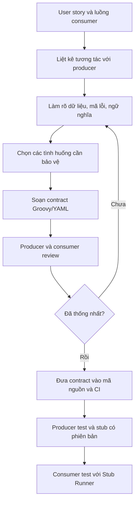
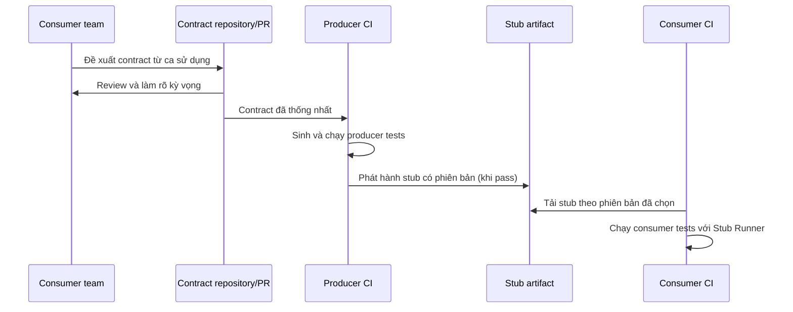

# Từ yêu cầu của consumer đến đề xuất hợp đồng

## 1. Vì sao vòng đời hợp đồng phải bắt đầu từ consumer?

Trong hệ thống nhiều dịch vụ, **consumer** là ứng dụng hoặc dịch vụ sử dụng API/thông điệp; **producer** là bên cung cấp API hoặc phát thông điệp. Consumer biết chính xác mình cần dữ liệu nào để hoàn thành một ca sử dụng, còn producer biết dữ liệu và hành vi nào mình có thể cung cấp. Khoảng cách giữa hai góc nhìn này thường gây ra lỗi tích hợp: tên trường không khớp, mã trạng thái bị hiểu khác nhau, định dạng ngày thay đổi hoặc một trường tưởng là tùy chọn lại bắt buộc với giao diện người dùng.

**Spring Cloud Contract (SCC)** hỗ trợ biến những kỳ vọng giao tiếp đã thống nhất thành hợp đồng có thể thực thi. Với HTTP, hợp đồng mô tả request mà consumer sẽ gửi và response mà producer phải đáp ứng; với messaging, hợp đồng mô tả đầu vào/đầu ra thông điệp cùng các ràng buộc tương ứng. Hợp đồng có thể được viết bằng **Groovy DSL hoặc YAML DSL**, dùng để sinh kiểm thử phía producer và tạo stub cho consumer. **Stub Runner** giúp consumer kiểm thử với các stub; CI giúp phát hiện sớm sai lệch giữa triển khai và giao diện đã thống nhất.

Ở giai đoạn đầu của **vòng đời hợp đồng**, nhiệm vụ chính không phải vội viết YAML. Trước hết, nhóm cần chuyển **nhu cầu nghiệp vụ của consumer** thành **kỳ vọng giao tiếp rõ ràng, tối thiểu và có thể kiểm chứng**, sau đó gửi producer xem xét. Một yêu cầu chưa được producer chấp thuận mới là **đề xuất hợp đồng**, chưa phải cam kết rằng API hiện tại hỗ trợ hành vi ấy.

Sau bài này, người học có thể:

- Rút ra những tương tác HTTP hoặc thông điệp mà consumer thực sự phụ thuộc từ một user story.
- Phân biệt kỳ vọng cần bảo vệ bằng contract với chi tiết triển khai nội bộ hoặc dữ liệu tình cờ.
- Viết một đề xuất hợp đồng Spring Cloud Contract bằng YAML DSL cho luồng thành công và luồng lỗi.
- Mô tả trạng thái, giả định, ví dụ dữ liệu và tiêu chí chấp nhận để producer có thể phản hồi.
- Đưa đề xuất đi qua review, kiểm thử producer, phát hành stub và kiểm thử consumer mà không nhầm một bản nháp với hợp đồng đã được xác nhận.

## 2. Ví dụ xuyên suốt: trang chi tiết đơn hàng

Giả sử nhóm **Web Order** (consumer) làm trang chi tiết đơn hàng, còn nhóm **Order Service** (producer) quản lý đơn hàng. User story ban đầu chỉ nói:

> Khi mở một đơn hàng đã thanh toán, người dùng cần thấy mã đơn, trạng thái thanh toán và tổng tiền. Nếu đơn hàng không tồn tại, ứng dụng cần hiển thị thông báo phù hợp.

Đây là yêu cầu chức năng, **chưa đủ để viết hợp đồng có thể kiểm thử**. Consumer cần làm rõ những câu hỏi như: gọi endpoint nào, dùng phương thức HTTP nào, biểu diễn số tiền bằng đơn vị nào, `status` có thể nhận những giá trị nào, thiếu đơn hàng trả `404` hay `200` với body rỗng, và trạng thái đã thanh toán lấy từ nguồn dữ liệu nào?

Để minh họa, giả sử **hai nhóm đang đề xuất**, chưa xác nhận, các quyết định sau:

| Nhu cầu của consumer | Kỳ vọng giao tiếp đề xuất | Điểm cần producer xác nhận |
|---|---|---|
| Mở chi tiết đơn hàng theo mã | `GET /api/orders/{id}` | Endpoint và cách biểu diễn `id` |
| Hiển thị mã đơn | JSON có trường `id` kiểu số | Phạm vi giá trị và độ ổn định của kiểu dữ liệu |
| Hiển thị trạng thái | JSON có trường `status`, ví dụ `PAID` | Danh sách trạng thái, ý nghĩa từng giá trị |
| Hiển thị tổng tiền | JSON có `totalAmount` và `currency` | Đơn vị của số tiền, cách làm tròn, mã tiền tệ |
| Xử lý đơn không tồn tại | HTTP `404`, body có `code: ORDER_NOT_FOUND` | Định dạng lỗi thống nhất của hệ thống |
| Giải mã phản hồi | Header `Content-Type: application/json` | Content negotiation và các header cần thiết |

**Điểm phân biệt:** `GET /api/orders/{id}`, `totalAmount` và `ORDER_NOT_FOUND` ở đây là **thiết kế ứng viên** do các bên cần thỏa thuận, không phải hành vi mặc định do Spring Cloud Contract tạo ra. Công cụ chỉ kiểm tra điều được thể hiện trong contract và test; nó không tự quyết định thiết kế API hợp lý thay cho nhóm.

## 3. Quy trình chuyển nhu cầu thành đề xuất hợp đồng



### Bước 1 — Xác định consumer và tình huống nghiệp vụ

Đặt tên consumer cụ thể, chẳng hạn `web-order-ui`, cùng tác vụ của nó: hiển thị một đơn đã thanh toán và thông báo khi đơn không tồn tại. Tránh mô tả chung chung như “API trả JSON chuẩn”. Một producer có thể phục vụ nhiều consumer với nhu cầu khác nhau; không phải mọi trường mà producer cung cấp đều cần xuất hiện trong hợp đồng của consumer này.

Nên ghi **ai chịu trách nhiệm** cho ca sử dụng, phiên bản consumer đang được bảo vệ và nơi nhóm liên hệ để phản hồi. Nếu có nhiều consumer cùng dùng endpoint, cần biết những kỳ vọng nào là dùng chung và những kỳ vọng nào chỉ thuộc một client.

### Bước 2 — Liệt kê các tương tác nằm trên đường đi thực tế

Quan sát luồng gọi của consumer và viết thành các tình huống có thể lặp lại:

1. Consumer gửi yêu cầu lấy đơn hàng tồn tại.
2. Consumer nhận dữ liệu và hiển thị mã đơn, trạng thái, tổng tiền.
3. Consumer yêu cầu đơn không tồn tại.
4. Consumer nhận mã lỗi có thể phân biệt và hiển thị trạng thái “không tìm thấy”.

Nếu giao diện có phân quyền, phân trang hoặc xử lý lỗi xác thực, ghi nhận các đường đi này để chọn độ ưu tiên. Không tự suy ra rằng một hợp đồng thành công bảo vệ luôn mọi trường hợp lỗi. Với hệ thống messaging, một “tương tác” có thể là consumer nhận sự kiện `OrderPaid`, cần header loại sự kiện và các trường payload nhất định; vẫn phải làm rõ nguồn phát, điều kiện phát và dữ liệu mong đợi.

### Bước 3 — Đổi từng nhu cầu thành điều có thể quan sát

Contract cần mô tả những phần giao tiếp **nhìn thấy từ bên ngoài**, ví dụ phương thức, đường dẫn, tham số, header, mã HTTP, trường JSON hoặc payload thông điệp. Những chi tiết như tên bảng database, hàm Java nội bộ, thuật toán cache hay tên lớp DTO chưa chắc là ràng buộc của consumer và thường không thuộc contract.

Nên xác định cả **ngữ nghĩa**, không chỉ kiểu dữ liệu. `totalAmount: 125000` là số nguyên nhưng chưa đủ rõ nếu hai bên không biết đây là **125.000 VND**, không phải 125.000 xu hay một đơn vị nội bộ. Tương tự, `status: PAID` cần biểu thị trạng thái nào: giao dịch được xác nhận, tiền đã ghi nhận hay đơn chỉ vừa tạo yêu cầu thanh toán?

### Bước 4 — Chọn tập ví dụ đại diện và điều kiện kiểm thử

Từ user story, chọn tối thiểu một ví dụ thành công và một ví dụ lỗi. Mỗi ví dụ cần có **đầu vào xác định**, **phản hồi có thể kiểm tra** và **điều kiện dữ liệu** để producer dựng test ổn định.

Trong minh họa này, quy ước dữ liệu kiểm thử là:

- Đơn `42` **tồn tại** và đã thanh toán, có tổng tiền `125000` VND.
- Đơn `9999` **không tồn tại** trong trạng thái test tương ứng.

Các ID này là **fixture minh họa**. Producer cần tạo/mô phỏng trạng thái dữ liệu phù hợp cho bài test được sinh từ contract. Nếu test chỉ vượt qua vì hard-code phản hồi bất kể trạng thái dữ liệu, nó có thể cho tín hiệu xanh nhưng bảo vệ rất ít hành vi thực tế.

## 4. Viết đề xuất đầu tiên bằng Spring Cloud Contract YAML DSL

Một contract HTTP đơn giản có phần `request` và `response`. Mỗi tài liệu dưới đây biểu diễn **một tình huống giao tiếp**. Hãy đặt chúng trong thư mục contract được cấu hình cho dự án producer hoặc kho hợp đồng chung theo quy ước đã thống nhất.

### 4.1. Tình huống thành công: lấy đơn hàng đã thanh toán

File ví dụ `order-details-found.yml`:

```yaml
name: order-details-found
description: "Consumer lấy chi tiết đơn hàng đã thanh toán"
request:
  method: GET
  url: /api/orders/42
  headers:
    Accept: application/json
response:
  status: 200
  headers:
    Content-Type: application/json
  body:
    id: 42
    status: PAID
    totalAmount: 125000
    currency: VND
```

Ý nghĩa của từng phần:

| Thành phần | Điều được đề xuất bảo vệ |
|---|---|
| `request.method` và `request.url` | Consumer gửi `GET /api/orders/42` |
| `request.headers.Accept` | Consumer chấp nhận JSON |
| `response.status` | Producer trả HTTP `200` trong tình huống này |
| `response.headers.Content-Type` | Response dùng `application/json` |
| `response.body` | Consumer nhận các trường cần để hiển thị |

YAML ở trên chọn **giá trị cụ thể** để người học thấy rõ tương tác. Trong dự án thật, cần cân nhắc matcher khi giá trị sinh động như ID, thời gian, mã giao dịch hoặc dữ liệu ngẫu nhiên. Không khóa cứng một giá trị chỉ vì fixture hiện tại tình cờ tạo ra nó; cũng không dùng matcher quá rộng nếu consumer thực sự cần một định dạng hoặc tập enum cụ thể.

### 4.2. Tình huống lỗi: không tìm thấy đơn hàng

File ví dụ `order-details-not-found.yml`:

```yaml
name: order-details-not-found
description: "Consumer nhận thông báo khi đơn hàng không tồn tại"
request:
  method: GET
  url: /api/orders/9999
  headers:
    Accept: application/json
response:
  status: 404
  headers:
    Content-Type: application/json
  body:
    code: ORDER_NOT_FOUND
    message: Order not found
```

Ở đây, `404` và `code: ORDER_NOT_FOUND` là kỳ vọng **cần producer xác nhận**. Nếu producer thực tế dùng mô hình lỗi khác, hai bên phải thương lượng trước khi công nhận đây là hợp đồng. Consumer có thể chỉ cần `code` để quyết định cách hiển thị; khi đó cần cân nhắc xem `message` có thực sự là một cam kết ổn định hay chỉ là thông điệp mô tả có thể dịch/đổi văn bản.

Không nên gom quá nhiều tình huống vào một ví dụ rồi ngầm coi chúng đã được bao phủ. Hai contract riêng giúp người review nhìn rõ **đường thành công** và **đường lỗi**, đồng thời giúp đọc kết quả kiểm thử dễ hơn.

### 4.3. Cách hiểu đúng phạm vi khẳng định của hai contract

Hai ví dụ chỉ yêu cầu producer đáp ứng request được mô tả khi test chạy trong trạng thái đã chuẩn bị. Chúng **chưa xác nhận**:

- Mọi ID hợp lệ đều trả đúng dữ liệu, hoặc mọi ID không tồn tại đều cho cùng một kết quả.
- Consumer có đủ quyền đọc đơn hàng, hay endpoint đã xử lý an toàn trường hợp truy cập trái phép.
- Tính đúng đắn của dữ liệu thanh toán trong database và các quy tắc nghiệp vụ phía sau response.
- Hiệu năng, timeout, khả năng chịu tải, tính sẵn sàng hoặc cấu hình mạng khi triển khai.
- Các phiên bản producer/consumer khác với cặp đã được kiểm thử vẫn tương thích.

Nếu các yêu cầu đó quan trọng, nhóm cần thêm contract phù hợp và/hoặc những lớp kiểm thử chuyên trách như unit, integration, security, end-to-end và performance test.

## 5. Thế nào là một đề xuất đủ rõ để producer review?

Hai file YAML là phần kỹ thuật, nhưng bản đề xuất nên có thêm ngữ cảnh ra quyết định. Một mô tả pull request hoặc issue đi kèm có thể viết như sau:

> **Consumer:** `web-order-ui`.
>
> **Ca sử dụng:** Hiển thị chi tiết đơn hàng đã thanh toán; nhận diện đơn không tồn tại.
>
> **Đề nghị:** `GET /api/orders/{id}` trả `id`, `status`, `totalAmount`, `currency`; đối với đơn không tồn tại, trả `404` và mã lỗi `ORDER_NOT_FOUND`.
>
> **Cần xác nhận:** Ý nghĩa của `PAID`, đơn vị `totalAmount`, kiểu `id`, quy tắc phân quyền, nội dung lỗi ổn định và các phiên bản client được hỗ trợ.
>
> **Ví dụ kiểm chứng:** Đơn `42` đã thanh toán; đơn `9999` không tồn tại trong fixture kiểm thử.
>
> **Tiêu chí chấp nhận:** Producer chấp thuận ngữ nghĩa, triển khai đáp ứng hợp đồng, generated producer tests chạy thành công; consumer kiểm thử xử lý response qua stub có đúng phiên bản.

Nội dung này giúp các bên phân biệt **điều đã biết**, **điều đang đề nghị** và **điều còn bỏ ngỏ**. Một đề xuất có tình huống cụ thể giúp producer đưa ra phương án khả thi hơn lời yêu cầu chung chung “hãy đảm bảo backward compatibility”.

### Những thông tin bắt buộc nên được thống nhất

| Câu hỏi review | Vì sao cần trả lời? |
|---|---|
| Ai là consumer, họ dùng trường nào? | Ngăn hợp đồng mô tả thừa hoặc bỏ sót nhu cầu thực |
| Tương tác nào quan trọng nhất? | Chọn ưu tiên kiểm thử và định nghĩa phạm vi bảo vệ |
| Producer đã có endpoint hay cần tạo mới? | Xác định đây là thay đổi hiện hữu hay chức năng mới |
| Giá trị, kiểu và ý nghĩa từng trường là gì? | Tránh tương thích hình dạng nhưng sai ngữ nghĩa |
| Điều kiện tạo dữ liệu test là gì? | Generated producer tests có thể chạy lặp lại |
| Cách xử lý lỗi, xác thực và phiên bản? | Bảo vệ các luồng thực tế thay vì chỉ trường hợp thuận lợi |
| Contract và stub sẽ được phát hành từ đâu? | Consumer dùng đúng artifact và kiểm tra đúng phiên bản |
| Ai phê duyệt thay đổi và khi nào release? | Tránh contract thay đổi trước khi các consumer liên quan sẵn sàng |

## 6. Thương lượng khi consumer và producer có kỳ vọng khác nhau

Một đề xuất có thể xung đột với API đang tồn tại. Ví dụ, consumer muốn `status: PAID`, nhưng producer đang sử dụng `paymentState: COMPLETED`. Không nên “sửa cho test xanh” ngay bằng cách ép producer đổi tên trường hoặc ép consumer hiểu thêm một định dạng không được thỏa thuận.

Có thể cân nhắc các hướng sau, tùy tình huống:

1. **Consumer thích nghi với API hiện tại:** phù hợp khi cách biểu diễn cũ đã ổn định và đáp ứng yêu cầu nghiệp vụ; sửa lại bản đề xuất cho chính xác.
2. **Producer bổ sung khả năng tương thích:** ví dụ tạm thời duy trì `paymentState` đồng thời hỗ trợ `status`; cần chính sách rõ ràng để loại bỏ trường cũ sau này.
3. **Thiết kế endpoint hoặc phiên bản mới:** cân nhắc khi ngữ nghĩa thay đổi thực sự và không thể duy trì tương thích mà không gây hiểu nhầm.
4. **Thống nhất lớp chuyển đổi ở ranh giới consumer:** khi dữ liệu producer có ý nghĩa đúng nhưng giao diện consumer cần dạng khác, client hoặc adapter có thể chuyển đổi một cách có kiểm thử.

Tiêu chí chọn phương án là **hành vi có thể duy trì và kiểm chứng**, tác động lên các consumer khác và chi phí vận hành/versioning. Không phải thay đổi nào cũng là breaking change: thêm trường tùy chọn có thể an toàn với client bỏ qua trường lạ, nhưng gây lỗi với client giải mã nghiêm ngặt. Cần xét thực tế của từng consumer.

Nếu chưa thống nhất, ghi lại điểm chưa quyết định trong đề xuất và giữ trạng thái **draft/đang review**. Không coi hợp đồng đang tranh luận là nguồn chân lý đã được producer chấp thuận.

## 7. Đề xuất hợp đồng được xác nhận như thế nào?

Sau review, một quy trình tích hợp Spring Cloud Contract thông dụng có thể diễn ra như sau:

1. **Thống nhất contract và nơi lưu trữ.** Contract có thể được quản lý cùng mã producer hoặc theo quy trình hợp đồng chung. Nhóm xác định branch, quyền review và cách version hóa phù hợp.
2. **Chuẩn bị trạng thái kiểm thử của producer.** Dựng dữ liệu hoặc mock dependency để request của contract sinh ra response có thể kiểm chứng. Ví dụ: `42` đã thanh toán, `9999` không tồn tại.
3. **Sinh và chạy producer tests.** Spring Cloud Contract tạo test từ Groovy/YAML DSL; test phải chạy với cấu hình thích hợp của ứng dụng. Khi producer lệch kỳ vọng, build/CI cần báo thất bại.
4. **Đóng gói và phát hành stub đã xác nhận.** Stub phản ánh các tương tác của contract; cần giữ dấu vết commit/build/phiên bản để biết stub thuộc phiên bản producer nào.
5. **Consumer sử dụng stub qua Stub Runner.** Consumer kiểm thử lời gọi HTTP hoặc xử lý thông điệp, giải mã response và luồng lỗi thực sự. Một test chỉ khởi động Stub Runner nhưng không kiểm tra cách client dùng dữ liệu không chứng minh nhiều điều.
6. **Đặt cổng kiểm soát CI và chính sách nâng phiên bản.** Producer tests và các kiểm thử consumer cần thiết phải được chạy, không bị bỏ qua lỗi; release phải liên kết với artifact đã xác minh.



**Lưu ý:** khả năng sinh test và stub của Spring Cloud Contract không đồng nghĩa những bước trên tự diễn ra trong mọi dự án. Nhóm phải cấu hình plugin/build, test base, kho artifact, Stub Runner và CI tương ứng. Stub đúng contract có thể chạy xanh trên consumer ngay cả khi producer thật đã triển khai sai; vì vậy kiểm thử của **hai phía bổ sung cho nhau**.

Nếu hệ thống dùng message contract thay vì HTTP, cũng bắt đầu từ nhu cầu tiêu thụ: sự kiện nào được phát khi nào, payload/header nào consumer cần, kiểu và ý nghĩa trường nào ổn định. Hợp đồng kiểm tra giao diện thông điệp đã mô tả; việc broker giao hàng đúng thứ tự, retry, duplicate delivery hay quyền truy cập cần được kiểm thử bổ sung khi nằm ngoài phạm vi contract.

## 8. Lỗi thường gặp khi đi từ yêu cầu đến YAML

| Cách làm dễ gây lỗi | Hậu quả | Cách cải thiện |
|---|---|---|
| Sao chép toàn bộ JSON response của producer thành contract | Khóa chặt consumer vào những trường không sử dụng | Chọn trường consumer thật sự phụ thuộc; ràng buộc đủ mạnh |
| Chỉ tạo một contract `200 OK` | Bỏ sót lỗi `404`, `401`, `403` hoặc các luồng bất thường quan trọng | Chọn các tình huống âm theo nhu cầu client |
| Dùng matcher quá rộng cho mọi giá trị | Thay đổi enum, đơn vị, định dạng có thể lọt qua | Định rõ kiểu, giá trị hoặc ngữ nghĩa mà consumer thực sự cần |
| Cố định timestamp/ID ngẫu nhiên | Test dễ vỡ vì dữ liệu biến động | Dùng fixture ổn định hoặc matcher phù hợp |
| Producer tự viết hợp đồng mà không hỏi consumer | Contract phản ánh điều producer muốn trả, thiếu điều client cần | Lấy user story và hành vi client làm đầu vào review |
| Coi contract được merge là đã kiểm chứng | Mã producer vẫn có thể không đáp ứng | Bắt buộc generated tests chạy và pass trên đúng build |
| Consumer chạy stub bất kỳ phiên bản | Kết quả xanh có thể không liên quan release đang chuẩn bị | Quản lý version stub và ma trận phiên bản hỗ trợ |
| Mô tả `totalAmount` chỉ là `number` | Producer đổi đơn vị mà vẫn đúng kiểu | Chốt đơn vị, cách làm tròn, tiền tệ và ca kiểm thử ngữ nghĩa |

## 9. Thực hành: tự soạn đề xuất từ một user story

**Bối cảnh:** ứng dụng giao hàng (consumer) cần hiển thị trạng thái giao của một kiện hàng do Shipping Service (producer) quản lý. Khi mã vận đơn tồn tại, trang cần `trackingId`, `deliveryStatus`, `updatedAt`. Khi không tìm thấy mã, trang hiện trạng thái “không tìm thấy”.

Hãy thực hiện theo thứ tự:

1. Viết một câu nêu **ca sử dụng và consumer cụ thể**.
2. Đề xuất phương thức, đường dẫn, header và cấu trúc JSON cần thiết; ghi rõ đây là thiết kế cần producer xác nhận.
3. Chọn một mã vận đơn có dữ liệu ổn định để làm **tình huống thành công** và một mã không tồn tại để làm **tình huống lỗi**.
4. Soạn hai YAML contract với `request` và `response`; quy định `200` cho thành công và đề xuất cách báo lỗi thích hợp.
5. Ghi lại ít nhất ba câu hỏi producer phải trả lời trước khi chấp thuận: chẳng hạn múi giờ/định dạng `updatedAt`, tập giá trị `deliveryStatus`, phân quyền tra cứu.
6. Mô tả điều kiện để ghi nhận hoàn thành: producer tests pass, stub được phát hành có phiên bản và consumer có assertion khi chạy với Stub Runner.

**Tiêu chí tự kiểm tra:** người khác đọc đề xuất phải biết *consumer cần gì*, *request nào được gửi*, *response nào được kỳ vọng*, *điều kiện test nào cần dựng* và *những quyết định nào chưa được hai bên thống nhất*. Nếu chỉ có một đoạn JSON mẫu mà thiếu ngữ nghĩa, tình huống lỗi hoặc trạng thái review, đề xuất vẫn chưa đủ để trở thành hợp đồng đáng tin cậy.

## 10. Ghi nhớ

Một đề xuất hợp đồng tốt xuất phát từ **nhu cầu thực tế của consumer**, được diễn đạt thành những tương tác nhỏ, có thể kiểm thử và chứa đủ ngữ cảnh để producer đánh giá. Spring Cloud Contract cho phép viết các tương tác ấy bằng **Groovy/YAML DSL**, sinh test kiểm tra producer, phát hành stub và sử dụng **Stub Runner** cho kiểm thử consumer; CI nối các bước thành cơ chế cảnh báo thay đổi không tương thích.

Giá trị của giai đoạn đề xuất nằm ở việc **thỏa thuận rõ điều hai bên cam kết**: hình dạng request/response hoặc message, ngữ nghĩa dữ liệu, ca thành công và ca lỗi, điều kiện dữ liệu test, phiên bản và trách nhiệm review. Chỉ sau khi được thống nhất, thực thi và kiểm chứng trên các phiên bản liên quan, một bản đề xuất mới trở thành bằng chứng hữu ích về tương thích giao tiếp.
