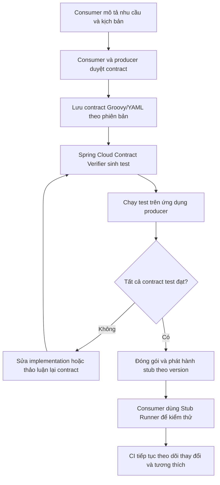

# Producer xác minh khả năng đáp ứng hợp đồng

Trong **vòng đời hợp đồng** của **Spring Cloud Contract**, producer không chỉ nói rằng API của mình đáp ứng yêu cầu của consumer; producer phải **chứng minh điều đó bằng kiểm thử chạy trên mã thực tế**. Một contract được thống nhất từ nhu cầu của consumer sẽ trở thành nguồn đầu vào để Spring Cloud Contract Verifier sinh các bài test phía producer. Khi một thay đổi làm hành vi của producer lệch khỏi cam kết, quá trình build có thể thất bại trước khi bản thay đổi được phát hành.

Spring Cloud Contract hỗ trợ hợp đồng cho HTTP và giao tiếp bằng thông điệp, định nghĩa bằng Groovy/YAML DSL, sinh test phía cung cấp, đóng gói stub cho consumer dùng với Stub Runner và tích hợp vào CI. Bài này tập trung vào **bước xác minh ở phía producer**, bao gồm cách chuẩn bị môi trường, đọc kết quả test và dùng kết quả ấy để quyết định có thể phát hành stub hoặc thay đổi API hay chưa.

Sau bài học, bạn có thể:

- Phân biệt contract, test sinh tự động, mã thực thi của producer và stub cung cấp cho consumer.
- Thiết lập quy trình cơ bản để chạy contract test HTTP trên một ứng dụng Spring Boot.
- Giải thích vì sao test pass hoặc fail, cách xử lý dữ liệu động và trường hợp lỗi nghiệp vụ.
- Đưa kiểm thử hợp đồng vào CI, gắn bản stub với phiên bản producer đã được xác minh.
- Nhận biết những điều mà contract test chưa thể bảo đảm và cần kiểm thử bổ sung.

## 1. Producer thực sự cần chứng minh điều gì?

Giả sử `OrderService` là consumer và `InventoryService` là producer. Hai nhóm thống nhất rằng yêu cầu giữ hàng thành công phải:

1. Nhận `POST /api/v1/reservations` với JSON chứa `sku` và `quantity`.
2. Trả `201 Created` và nội dung JSON.
3. Cung cấp `reservationId` để consumer tham chiếu lượt giữ hàng và `status = HELD` để consumer biết có thể tiếp tục thanh toán.

Những yêu cầu đó là **hành vi quan sát được tại ranh giới tích hợp**. Producer cần kiểm chứng ứng dụng mình đáp ứng đúng phương thức, đường dẫn, đầu vào, mã trạng thái, header, cấu trúc và giá trị phản hồi mà consumer phụ thuộc vào. Producer không phải chứng minh toàn bộ hệ thống đều đúng chỉ bằng một contract test.

| Thành phần | Vai trò | Ai chịu trách nhiệm chính? |
| --- | --- | --- |
| Nhu cầu consumer | Xác định dữ liệu và hành vi mà luồng nghiệp vụ cần | Consumer nêu; hai nhóm thống nhất |
| Contract Groovy/YAML | Mô tả tương tác được cam kết, theo cú pháp Spring Cloud Contract | Hai nhóm cùng duyệt và quản lý phiên bản |
| Mã producer | Thực thi controller, validation, nghiệp vụ và định dạng phản hồi | Producer |
| Test do Verifier sinh | Gửi yêu cầu và đối chiếu phản hồi của producer với contract | Công cụ sinh; producer phải chạy và xử lý lỗi |
| Stub artifact | Mô phỏng các hành vi đã mô tả để consumer phát triển/kiểm thử | Được tạo, phát hành từ quy trình hợp đồng |
| CI | Tự động kiểm tra trước khi hợp nhất hoặc phát hành | Nhóm sở hữu pipeline |

Một test pass chỉ chứng minh **các điều kiện đã được mã hóa trong contract và được thực thi bởi test** phù hợp với phiên bản producer đang chạy trong môi trường kiểm thử. Nếu consumer cần thêm một trường nhưng hợp đồng chưa đề cập, test xanh không phát hiện được thiếu sót đó.

## 2. Vị trí của bước xác minh trong vòng đời



Thứ tự này bảo đảm bản stub được phát hành tương ứng với hành vi mà producer đã xác minh trong cùng một bản build. Nếu nhóm consumer yêu cầu thay đổi contract, producer cần đánh giá khả năng thực hiện rồi chạy lại các test. Nếu producer muốn đổi API, phải đánh giá những contract của các consumer đang phụ thuộc trước khi bỏ hành vi cũ.

Quy trình có thể triển khai theo mô hình contract nằm trong repository của producer, một repository riêng hoặc mô hình contract do consumer đề xuất qua pull request. Vị trí lưu trữ có thể khác nhau, nhưng **producer phải lấy đúng bản contract đã thống nhất** để sinh test.

## 3. Ví dụ: contract HTTP làm đầu vào cho producer

Giả định hai bên đã thống nhất một contract giữ hàng thành công. Trong dự án producer dùng cấu trúc mặc định, có thể đặt file tại:

```text
src/test/resources/contracts/reserve_stock_success.groovy
```

Nội dung minh họa:

```groovy
import org.springframework.cloud.contract.spec.Contract

Contract.make {
    name 'reserve_stock_success'
    description 'OrderService yêu cầu giữ 2 đơn vị hàng'

    request {
        method 'POST'
        url '/api/v1/reservations'
        headers {
            contentType(applicationJson())
        }
        body([
            sku     : 'SKU-001',
            quantity: 2
        ])
    }

    response {
        status 201
        headers {
            contentType(applicationJson())
        }
        body([
            reservationId: 'RES-001',
            status       : 'HELD'
        ])
    }
}
```

Đây là **hợp đồng ví dụ của ứng dụng giả định**, không phải endpoint hoặc mã trạng thái do Spring Cloud Contract tự quy định. Khi chạy kiểm thử, Verifier cần gửi yêu cầu tới producer rồi kiểm tra các kỳ vọng trong `response`.

Các điểm cần chú ý:

- `request` mô tả yêu cầu mà test producer phải gửi. Test có thể sử dụng giá trị mẫu `SKU-001` và `quantity = 2` để tạo trạng thái có thể kiểm chứng.
- `response` mô tả kết quả mà producer phải trả về. Nếu implementation trả `200` thay vì `201`, hoặc `status` khác `HELD`, test tương ứng sẽ thất bại.
- Giá trị `RES-001` là dữ liệu cố định để ví dụ dễ theo dõi. Nếu ứng dụng tạo ID ngẫu nhiên, cần dùng **matcher** hoặc một fixture kiểm thử ổn định thay vì buộc ID thật phải luôn bằng một chuỗi cố định.
- Nếu consumer phải xử lý trường hợp hết hàng, hãy thêm **contract riêng cho nhánh lỗi**, chẳng hạn phản hồi `409` với mã lỗi đã được hai bên thống nhất. Một contract thành công không bao phủ hành vi lỗi.

### Một contract cho nhánh không đủ hàng

Ví dụ file `reserve_stock_insufficient.groovy`:

```groovy
import org.springframework.cloud.contract.spec.Contract

Contract.make {
    name 'reserve_stock_insufficient'

    request {
        method 'POST'
        url '/api/v1/reservations'
        headers {
            contentType(applicationJson())
        }
        body([
            sku     : 'SKU-OUT-OF-STOCK',
            quantity: 2
        ])
    }

    response {
        status 409
        headers {
            contentType(applicationJson())
        }
        body([
            code: 'INSUFFICIENT_STOCK'
        ])
    }
}
```

Việc chọn `409` và `INSUFFICIENT_STOCK` là **quyết định của thiết kế API trong ví dụ**. Hệ thống khác có thể dùng quy ước khác; điều quyết định là consumer và producer thống nhất cùng một ngữ nghĩa.

## 4. Thiết lập Verifier trong producer

Với ứng dụng Spring Boot xây dựng bằng Maven, cần tích hợp plugin sinh contract test và các thư viện dùng trong lúc kiểm thử. Phiên bản Spring Cloud Contract phải tương thích với dòng Spring Boot/Spring Cloud của dự án; ví dụ dưới dùng thuộc tính phiên bản mà dự án đã quản lý.

Trong `pom.xml`, cấu hình dạng tối giản:

```xml
<dependencies>
    <!-- Các dependency ứng dụng khác -->
    <dependency>
        <groupId>org.springframework.boot</groupId>
        <artifactId>spring-boot-starter-test</artifactId>
        <scope>test</scope>
    </dependency>
    <dependency>
        <groupId>org.springframework.cloud</groupId>
        <artifactId>spring-cloud-starter-contract-verifier</artifactId>
        <scope>test</scope>
    </dependency>
</dependencies>

<build>
    <plugins>
        <plugin>
            <groupId>org.springframework.cloud</groupId>
            <artifactId>spring-cloud-contract-maven-plugin</artifactId>
            <version>${spring-cloud-contract.version}</version>
            <extensions>true</extensions>
            <configuration>
                <testFramework>JUNIT5</testFramework>
                <testMode>MOCKMVC</testMode>
                <baseClassForTests>
                    com.example.inventory.ContractVerifierBase
                </baseClassForTests>
            </configuration>
        </plugin>
    </plugins>
</build>
```

Đoạn trên là phần tích hợp cần ghép vào POM hiện có, **không phải một `pom.xml` độc lập**. Cần khai báo giá trị `spring-cloud-contract.version` bằng cách quản lý phiên bản phù hợp với dự án; đồng thời cấu hình repository nếu môi trường của bạn yêu cầu. Dự án Gradle cũng có plugin Spring Cloud Contract tương ứng và cùng nguyên lý sinh test/chạy test.

Các cấu hình chính:

| Cấu hình | Ý nghĩa |
| --- | --- |
| `spring-cloud-starter-contract-verifier` | Cung cấp các công cụ phục vụ contract test |
| `spring-cloud-contract-maven-plugin` | Đọc contract, sinh test và hỗ trợ tạo artifact stub |
| `testFramework = JUNIT5` | Sinh test dùng JUnit 5 |
| `testMode = MOCKMVC` | Thực thi kiểm thử HTTP qua Spring MVC test support, không yêu cầu mở cổng HTTP thật |
| `baseClassForTests` | Gắn các test được sinh với lớp chuẩn bị môi trường kiểm thử của producer |

Nếu code dùng WebFlux, giao thức khác hoặc message contract, cách bootstrap và chế độ kiểm thử phải phù hợp với stack thực tế. Không nên sao chép nguyên cấu hình MockMvc cho một producer không dùng Spring MVC.

## 5. Chuẩn bị lớp cơ sở cho các test sinh tự động

Các test được sinh cần biết cách khởi chạy ứng dụng và đưa yêu cầu HTTP vào controller. Với Spring MVC và `MOCKMVC`, có thể tạo lớp sau trong mã nguồn kiểm thử của producer:

```text
src/test/java/com/example/inventory/ContractVerifierBase.java
```

```java
package com.example.inventory;

import io.restassured.module.mockmvc.RestAssuredMockMvc;
import org.junit.jupiter.api.BeforeEach;
import org.springframework.beans.factory.annotation.Autowired;
import org.springframework.boot.test.context.SpringBootTest;
import org.springframework.test.context.ActiveProfiles;
import org.springframework.web.context.WebApplicationContext;

@SpringBootTest(
    webEnvironment = SpringBootTest.WebEnvironment.MOCK
)
@ActiveProfiles("contract")
public abstract class ContractVerifierBase {

    @Autowired
    private WebApplicationContext context;

    @BeforeEach
    void setUpContractTest() {
        RestAssuredMockMvc.webAppContextSetup(context);
    }
}
```

Ví dụ này dùng **Rest Assured MockMvc** để đưa yêu cầu của test vào Spring `WebApplicationContext`. Tùy cách tổ chức ứng dụng và phiên bản thư viện, bạn có thể dùng phương án bootstrap khác tương thích với `testMode`; mục tiêu là test phải gọi được **controller thật** và kiểm tra phản hồi của nó.

Lớp cơ sở không nên tự trả về một JSON giả giống hệt contract, vì như vậy test có thể xanh mà không kiểm chứng controller của producer. Trong ví dụ giữ hàng, có thể chuẩn bị dữ liệu test theo một trong các cách:

- Dùng profile `contract` với kho dữ liệu thử nghiệm chứa `SKU-001` còn đủ hàng và `SKU-OUT-OF-STOCK` không còn đủ hàng.
- Cô lập tích hợp ngoài phạm vi kiểm thử (ví dụ một hệ thống kho bên ngoài) bằng test double có trạng thái xác định, nhưng vẫn thực thi controller, validation và ánh xạ kết quả của producer.
- Reset dữ liệu trước mỗi kịch bản để kết quả độc lập với thứ tự chạy; không dựa vào database dùng chung hoặc dữ liệu của môi trường production.

**Chọn phạm vi kiểm thử có ý thức:** với contract test ở lớp HTTP, việc mô phỏng dependency bên ngoài có thể phù hợp. Nếu cần chứng minh tính đúng của giao dịch giữ hàng, khóa đồng thời, idempotency hoặc khả năng kết nối broker thật, phải có kiểm thử tích hợp chuyên biệt ngoài lớp contract test.

### Xử lý giá trị động

ID, thời gian và dữ liệu do server sinh là nguồn gây test giòn nếu contract dùng giá trị cố định. Trong DSL, Spring Cloud Contract hỗ trợ các **matcher** và cách mô tả giá trị theo góc nhìn consumer/producer. Với phản hồi, có thể yêu cầu producer trả ID theo một mẫu thay vì bằng một giá trị cứng; phía stub vẫn cần giá trị cụ thể để trả cho consumer.

Ví dụ ý tưởng về điều kiện xác minh: `reservationId` phải là chuỗi không rỗng, `status` phải bằng `HELD`, `expiresAt` phải có định dạng thời gian thống nhất. Cần chọn matcher phù hợp với phiên bản DSL và bảo đảm thực tế. Một regex đúng định dạng thời gian **không chứng minh** rằng lượt giữ hàng chưa hết hạn.

Khi fixture có chủ đích cố định `RES-001`, giữ giá trị chính xác như ví dụ là hợp lý. Khi chạy trên dữ liệu động, đổi kỳ vọng sang matcher cho thuộc tính thực sự cần cam kết thay vì loại bỏ việc kiểm tra trường đó.

## 6. Sinh, chạy và đọc kết quả kiểm thử

Với cấu hình Maven và contract ở vị trí mặc định, chạy tại gốc dự án producer:

```bash
mvn -B -ntp clean verify
```

Trong quá trình build, plugin Spring Cloud Contract đọc các file hợp đồng và sinh mã kiểm thử. Test được biên dịch, chạy trong vòng đời kiểm thử Maven và đóng góp vào kết quả thành công/thất bại của build. Ở cách bố trí Maven thường gặp, bạn có thể xem mã test được sinh trong `target/generated-test-sources/contracts`; vị trí chính xác tùy plugin, cấu hình và phiên bản đang dùng.

Để hiểu một test sinh tự động làm gì, hãy tưởng tượng nó thực hiện các bước sau:

```text
1. Khởi tạo môi trường kiểm thử qua ContractVerifierBase.
2. Gửi POST /api/v1/reservations với JSON đã mô tả trong request.
3. Nhận phản hồi từ controller của ứng dụng producer.
4. So sánh HTTP status, headers và body với response trong contract.
5. Báo thất bại nếu một điều kiện không khớp.
```

Đây là mô tả hành vi, không phải bản sao mã Java mà plugin sẽ sinh. Tên lớp, helper, thư viện assertion và cấu trúc của mã sinh phụ thuộc cấu hình.

### Đọc một test thất bại

Giả sử implementation bị sửa thành:

```java
return ResponseEntity.ok(reservationResponse);
```

Controller vẫn trả dữ liệu JSON chứa `reservationId` và `status`, nhưng mã trạng thái chuyển từ `201` sang `200`. Theo contract đã thống nhất, đây là **vi phạm có thể quan sát được**: test cần phát hiện khác biệt, và CI không được coi producer là tương thích chỉ vì API vẫn trả `2xx`.

Để xử lý một lỗi contract test:

1. Mở báo cáo test và xác định **contract nào, điều kiện nào, giá trị thực tế nào** gây lỗi.
2. Đối chiếu kịch bản trong DSL với nhu cầu consumer đã thống nhất.
3. Nếu producer sai, sửa implementation hoặc fixture rồi chạy lại test.
4. Nếu yêu cầu đã thực sự thay đổi, trao đổi lại với consumer, đánh giá tương thích các phiên bản đang dùng và cập nhật contract theo quy trình duyệt.
5. Chỉ chấp nhận kết quả pass sau khi kiểm tra rằng test thực sự gọi tới phần mã cần kiểm chứng.

Không nên sửa contract từ `201` thành `200` chỉ để làm pipeline xanh khi consumer vẫn đang dựa vào `201`. Việc thay hợp đồng cần dựa trên thỏa thuận tương thích, không dựa trên kết quả implementation hiện tại.

## 7. Những thay đổi nào contract test phát hiện được?

| Thay đổi trong producer | Kỳ vọng với contract ở ví dụ | Giải thích |
| --- | --- | --- |
| `201` thành `200` | Fail | Mã trạng thái không khớp |
| Bỏ `reservationId` khỏi body | Fail | Thiếu trường đã cam kết |
| Đổi `status` từ `HELD` thành `PENDING` | Fail | Giá trị không khớp kỳ vọng |
| Đổi đường dẫn hoặc bỏ route cũ | Fail | Không còn xử lý đúng yêu cầu trong contract |
| Thêm trường `traceId` vào response | Có thể pass | Thường không phá kỳ vọng đã nêu, tùy matcher/assertion và cấu hình |
| Làm API chậm hơn nhưng vẫn trả đúng body | Có thể pass | Chưa có kiểm thử hiệu năng hoặc timeout riêng |
| Logic giữ hàng gây trừ tồn kho hai lần khi retry | Có thể pass | Một request-response trong contract không kiểm chứng toàn bộ chuỗi trạng thái |
| Đổi ngữ nghĩa `HELD` nhưng vẫn trả đúng chuỗi | Có thể pass | Test không tự hiểu ý nghĩa nghiệp vụ nằm ngoài điều kiện được kiểm |

Hai nhóm cần phân biệt **tính tương thích ở giao diện** với **tính đúng của toàn bộ nghiệp vụ**. Contract test bảo vệ giao diện và các hành vi đã được mô tả; unit test, integration test, kiểm thử bảo mật, hiệu năng, trạng thái và đồng thời vẫn có vai trò riêng.

## 8. Kiểm thử contract cho giao tiếp bằng thông điệp

Ngoài HTTP, Spring Cloud Contract hỗ trợ đặc tả tương tác bằng message. Ví dụ `PaymentService` phát sự kiện thanh toán thành công và `OrderService` tiêu thụ sự kiện ấy. Producer có thể cam kết về:

- Điểm phát/đích đến của message, theo cơ chế tích hợp đã chọn.
- Header cần thiết, như loại sự kiện và phiên bản schema.
- Cấu trúc payload, kiểu dữ liệu, trường bắt buộc và giá trị có ý nghĩa với consumer.
- Kịch bản gây phát sự kiện khi nghiệp vụ hoàn tất.

Với message contract, bước xác minh không còn là gửi HTTP rồi so status. Test được sinh cần **kích hoạt hành vi phát message**, lấy message đi qua cơ chế tích hợp đã cấu hình và so sánh header/payload với contract. Tùy stack sử dụng, producer phải cấu hình Spring Cloud Contract message verification, tích hợp với binder hoặc phương thức phát message được hỗ trợ, và chuẩn bị fixture tương ứng.

Điều quan trọng là kiểm thử được **message mà mã producer thật sự phát ra**. Một test chỉ tạo sẵn payload tĩnh rồi so với chính contract sẽ không phát hiện producer đã ngừng phát event hoặc đổi schema khi phát. Đồng thời, khẳng định một event đúng cấu trúc chưa đủ chứng minh thứ tự xử lý, khả năng giao lại, chống xử lý trùng hoặc độ bền lưu trữ của broker.

## 9. Sau khi xác minh: xuất bản stub cho consumer

Khi producer vượt qua các contract test, quy trình build có thể đóng gói stub từ các contract đã được duyệt. Với thiết lập Maven thông dụng, kết quả có thể là artifact mang classifier `stubs`, thường có tên tương tự:

```text
inventory-service-1.4.0-stubs.jar
```

Consumer dùng Spring Cloud Contract Stub Runner để tải và chạy stub theo tọa độ artifact đã công bố, chẳng hạn kết hợp `groupId`, `artifactId`, `version` và classifier `stubs`. Cách quản lý version, repository và phạm vi tải artifact phụ thuộc cấu hình dự án.

Ví dụ cách gắn các phần của quy trình:

| Bước | Đầu vào | Kết quả |
| --- | --- | --- |
| Sinh test | Contract đã thống nhất | Test ở phía producer |
| Chạy test | Test sinh tự động + ứng dụng producer | Kết quả xác minh phiên bản mã |
| Đóng gói | Contract/stub được tạo trong build | Artifact `-stubs.jar` |
| Phát hành | Build đạt yêu cầu và version đã chốt | Stub có thể truy xuất từ kho artifact |
| Consumer kiểm thử | Stub tương ứng version producer dự kiến | Phát hiện lệch kỳ vọng phía consumer |

Nên gắn stub với **phiên bản xác định** đã được producer xác minh. Nếu consumer liên tục lấy bản mới nhất bằng ký hiệu version động, kết quả CI có thể khó tái lập; dùng phiên bản được kiểm soát hoặc chính sách cập nhật đã thống nhất sẽ giúp truy vết thay đổi dễ hơn.

Đừng xuất bản stub của một bản build mà contract test đã fail: khi đó stub có thể mô phỏng lời hứa mà producer thật không thực hiện được.

## 10. Đặt bước xác minh vào CI

Với repository producer dùng Maven, một pipeline tối thiểu nên chạy toàn bộ contract test cùng các test cần thiết trên mỗi pull request thay đổi mã ứng dụng hoặc contract.

Ví dụ phần job của GitHub Actions (cần điều chỉnh phiên bản JDK và cách cài Maven cho dự án):

```yaml
name: Producer contract verification

on:
  pull_request:
  push:
    branches: [main]

jobs:
  verify:
    runs-on: ubuntu-latest
    steps:
      - uses: actions/checkout@v4
      - uses: actions/setup-java@v4
        with:
          distribution: temurin
          java-version: '21'
          cache: maven
      - name: Verify producer contracts and tests
        run: mvn -B -ntp clean verify
```

Đây là ví dụ về **cổng kiểm tra**. Quy trình phát hành thực tế còn cần quản lý thông tin xác thực repository, version, quyền xuất bản và cơ chế chặn release khi job fail; không nên nhét thông tin đăng nhập hoặc token vào file contract.

Một pipeline đầy đủ thường áp dụng nguyên tắc:

1. **PR:** checkout đúng mã và đúng contract, sinh test, chạy test, đính kèm báo cáo lỗi dễ tra cứu.
2. **Merge:** yêu cầu job xác minh pass trước khi chấp nhận thay đổi đối với API đang có consumer.
3. **Release:** build và xác minh lại trên commit/version được phát hành; chỉ xuất bản artifact và stub khi các cổng kiểm tra đều đạt.
4. **Consumer CI:** tải version stub phù hợp bằng Stub Runner, chạy test phía consumer và phản hồi sớm khi phụ thuộc vào hành vi chưa được producer cam kết.

Nếu contract được lưu ở repository riêng, pipeline phải xác định **revision nào** của contract được dùng để sinh test. Việc producer và consumer chạy hai bản contract khác nhau có thể khiến cả hai pipeline đều xanh nhưng tích hợp thật vẫn lệch.

## 11. Chẩn đoán các lỗi thường gặp

| Hiện tượng | Nguyên nhân có thể | Hướng kiểm tra |
| --- | --- | --- |
| Build xanh nhưng không có test nào được sinh | Sai đường dẫn `contracts`, plugin chưa kích hoạt hoặc cấu hình sinh test chưa chạy | Kiểm tra log plugin, số test được sinh và thư mục đầu ra |
| Test sinh được nhưng không khởi chạy | Thiếu base class, cấu hình JUnit không phù hợp, test runner không thu nhận test | Kiểm tra `baseClassForTests`, framework và báo cáo test |
| Test lỗi `404` | Sai URL/method hoặc controller chưa được nạp vào context | So request trong DSL với mapping thật |
| Test lỗi `500` | Fixture thiếu, bean không khởi động hoặc nghiệp vụ ném exception | Đọc stack trace, cấu hình profile `contract` và dữ liệu test |
| Test pass trên máy cá nhân nhưng fail trong CI | Dữ liệu, timezone, thứ tự test, biến môi trường hoặc dịch vụ ngoài không ổn định | Cố định fixture, cô lập dependency, thống nhất cấu hình |
| Test fail ở ID hoặc thời gian | Giá trị động bị so bằng dữ liệu cứng | Dùng matcher phù hợp hoặc dữ liệu kiểm thử xác định |
| Producer thay đổi API mà test vẫn xanh | Contract không chứa kỳ vọng consumer đang cần, hoặc test chỉ kiểm tra mock trả sẵn | Rà soát phạm vi contract, đường chạy thật và test báo cáo |
| Stub được publish nhưng consumer vẫn lỗi | Sai version stub, thiếu kịch bản hoặc khác biệt giữa stub và producer ngoài phạm vi contract | Ghép phiên bản cụ thể, bổ sung kịch bản và kiểm thử tích hợp |

Khi sửa lỗi, nên giữ nguyên một nguyên tắc: **contract là cam kết được hai phía đồng thuận**, vì vậy thay đổi contract phải có lý do từ nhu cầu tích hợp. Thay đổi riêng mã test sinh tự động thường không bền: lần sinh kế tiếp có thể ghi đè thay đổi đó. Hãy sửa DSL, cấu hình tạo test, base class hoặc implementation tùy nguồn lỗi.

## 12. Checklist xác minh trước khi phát hành

- [ ] Contract đến từ nhu cầu consumer và được producer chấp nhận.
- [ ] Có kịch bản thành công và các nhánh lỗi mà consumer cần xử lý.
- [ ] Plugin đã thực sự sinh test; số lượng test không bất ngờ bằng 0.
- [ ] Test gọi controller/message path của producer, không chỉ so payload với một mock cố định.
- [ ] Dữ liệu kiểm thử độc lập và đủ ổn định để chạy lại trong CI.
- [ ] Mã trạng thái, header, body, trường bắt buộc và giá trị động được kiểm đúng mức.
- [ ] Lỗi contract được xử lý ở implementation hoặc qua thỏa thuận thay đổi contract.
- [ ] Test tích hợp/đồng thời/bảo mật/hiệu năng bổ sung đã bao phủ các bảo đảm ngoài phạm vi contract khi cần.
- [ ] CI chặn merge/release khi contract test fail.
- [ ] Stub được phát hành từ bản build đã xác minh, có version rõ ràng để consumer sử dụng.

### Bài tập thực hành

Bạn là người duy trì `InventoryService`. Contract thành công yêu cầu `201`, `reservationId` và `status = HELD`, trong khi nhánh hết hàng yêu cầu `409` và `code = INSUFFICIENT_STOCK`.

1. Tạo hai contract tương ứng trong `src/test/resources/contracts`, tích hợp Verifier và chuẩn bị test profile có hai SKU như ví dụ.
2. Chạy `mvn -B -ntp clean verify`. Kiểm tra có bao nhiêu test được sinh, xem chúng gửi request nào và xác minh response nào.
3. Cố ý sửa controller để trả `200` trong trường hợp thành công. Quan sát lỗi, chỉ ra điều khoản contract bị vi phạm, sau đó sửa implementation về `201`.
4. Cố ý bỏ trường `reservationId` khỏi response. Quan sát test fail và giải thích tại sao consumer có thể bị ảnh hưởng.
5. Bổ sung một trường không bắt buộc vào response, chạy lại test và thảo luận xem điều đó có phá vỡ contract hay không.
6. Giả sử `reservationId` được sinh động ở production: chọn cách tạo fixture ổn định hoặc matcher để xác minh thuộc tính cần thiết mà không phụ thuộc vào một ID cụ thể.
7. Thiết kế bước CI chỉ phát hành stub sau khi contract test cùng các phép kiểm tra bắt buộc khác đều pass.

Kết quả mong đợi: bạn có thể chỉ ra **chính xác hành vi producer đã chứng minh được**, tình huống nào khiến build bị chặn và những kiểm thử nào vẫn cần bổ sung. Khi đó contract đã trở thành một cơ chế phát hiện thay đổi không tương thích giữa producer và consumer, thay vì chỉ là tài liệu mô tả API.
