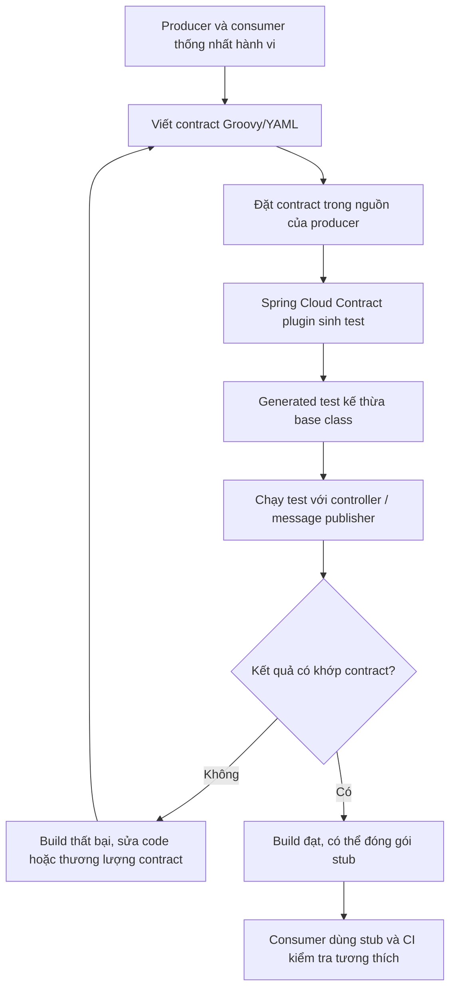
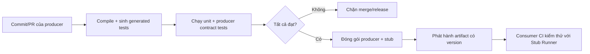

# Sinh và chạy kiểm thử phía producer

## 1. Vai trò của producer verification trong vòng đời hợp đồng

Trong hệ thống microservice, **consumer** là bên gọi API hoặc sử dụng thông điệp, còn **producer** là bên cung cấp HTTP API hoặc phát thông điệp đó. Consumer có thể xây dựng phần mềm dựa trên một cấu trúc JSON hoặc mã trạng thái đã thống nhất, trong khi producer vẫn đang phát triển và triển khai độc lập. Vấn đề nảy sinh khi producer đổi tên trường, thay kiểu dữ liệu, sửa HTTP status hoặc thay payload sự kiện mà không biết consumer đang phụ thuộc vào hành vi cũ.

**Spring Cloud Contract** đưa thỏa thuận giữa hai phía thành tệp hợp đồng có thể thực thi bằng Groovy hoặc YAML DSL. Ở phía producer, plugin của Spring Cloud Contract **sinh test tự động từ hợp đồng**, sau đó chạy các test đó với mã ứng dụng producer. Nếu producer không còn đáp ứng kỳ vọng đã mô tả, build thất bại trước khi thay đổi được phát hành. Sau khi vượt qua xác minh, producer có thể đóng gói và phát hành stub để consumer kiểm thử bằng Stub Runner trong một bước khác của vòng đời.

Bài này thuộc chương **Vòng đời hợp đồng**, tập trung vào thao tác **sinh và chạy kiểm thử phía producer**. Mục tiêu là hiểu đúng trách nhiệm từng thành phần và tự thiết lập một quy trình xác minh cho HTTP; đồng thời biết cách mở rộng sang messaging và CI.

Sau khi học, bạn có thể:

- Xác định contract nào phải được producer kiểm chứng và đặt đúng vị trí trong dự án.
- Cấu hình bộ sinh test của Spring Cloud Contract cho Maven hoặc Gradle.
- Viết lớp cơ sở (base class) chuẩn bị MockMvc và dữ liệu đầu vào cho generated tests.
- Chạy và đọc kết quả producer verification, nhận biết khi nào test thất bại vì API phá vỡ hợp đồng.
- Phân biệt kiểm chứng HTTP với kiểm chứng một sự kiện messaging và kết nối producer verification vào CI.

> **Nguyên tắc:** Contract là cam kết về hành vi quan sát được ở ranh giới dịch vụ. Generated test kiểm chứng producer thực hiện cam kết đó; nó không tự thay thế unit test, integration test, security test hoặc end-to-end test.

## 2. Luồng xử lý: từ hợp đồng đến kiểm thử được sinh



Ba thành phần thường dễ bị nhầm:

| Thành phần | Ai viết hoặc tạo? | Vai trò |
| --- | --- | --- |
| Contract DSL | Người phát triển hoặc hai nhóm cùng thống nhất | Mô tả request, response, message và những gì consumer có quyền mong đợi |
| Generated test | Plugin Spring Cloud Contract | Biến DSL thành các phép kiểm tra producer có thể chạy |
| Base test class | Người phát triển producer | Khởi tạo Spring test context, MockMvc hoặc cơ chế messaging, chuẩn bị dữ liệu/trạng thái để generated test thực thi |

**Plugin không tự tạo dữ liệu nghiệp vụ đúng cho bạn.** Nếu contract yêu cầu truy vấn đơn hàng `ORD-123`, ứng dụng đang kiểm thử phải có cách trả về đơn hàng đó: fixture, mock dependency, dữ liệu trong test database hoặc một cơ chế setup khác. Nếu thiếu trạng thái phù hợp, test có thể thất bại dù HTTP endpoint tồn tại.

## 3. Ví dụ xuyên suốt: producer cung cấp API tra cứu đơn hàng

Giả sử `Order Service` có endpoint:

```http
GET /api/orders/ORD-123
Accept: application/json
```

Kết quả mà một consumer đã thống nhất sử dụng:

```http
HTTP/1.1 200 OK
Content-Type: application/json

{
  "orderId": "ORD-123",
  "status": "CONFIRMED",
  "totalAmount": 199000
}
```

Ở đây consumer dựa vào `orderId`, `status`, `totalAmount` và HTTP status `200`. Nếu producer xóa trường `totalAmount` hoặc trả `status: "DONE"` thay cho `"CONFIRMED"`, consumer có thể hỏng dù code Java của producer vẫn biên dịch bình thường.

Để minh họa ngắn gọn, cấu trúc dự án Maven theo phong cách Spring Boot như sau:

```text
order-service/
├── pom.xml
└── src/
    ├── main/java/com/example/orders/
    │   ├── OrderController.java
    │   ├── OrderQuery.java
    │   └── OrderView.java
    └── test/
        ├── java/com/example/orders/
        │   └── ContractVerifierBase.java
        └── resources/contracts/
            └── order/
                └── get_order_by_id.groovy
```

Đường dẫn mặc định thường dùng cho contract nguồn là `src/test/resources/contracts`. Các thư mục con là cách nhóm contract theo tính năng hoặc consumer, tùy quy ước dự án. Không đặt tệp DSL vào thư mục Java thông thường rồi chờ plugin tự phát hiện.

### 3.1. Viết contract HTTP bằng Groovy DSL

Tệp `src/test/resources/contracts/order/get_order_by_id.groovy`:

```groovy
import org.springframework.cloud.contract.spec.Contract

Contract.make {
    description 'Trả về thông tin đơn hàng mà consumer sử dụng'

    request {
        method 'GET'
        url '/api/orders/ORD-123'
        headers {
            accept(applicationJson())
        }
    }

    response {
        status OK()
        headers {
            contentType(applicationJson())
        }
        body(
            orderId: 'ORD-123',
            status: 'CONFIRMED',
            totalAmount: 199000
        )
    }
}
```

Contract mô tả một trường hợp thành công: request `GET` với path xác định và phản hồi JSON có các trường mà consumer cần. Đây là **dữ liệu hợp đồng minh họa**, không phải quy định mọi API đơn hàng đều phải dùng mã `ORD-123` hay `199000`.

Một contract tương tự có thể viết bằng YAML DSL:

```yaml
description: Trả về thông tin đơn hàng mà consumer sử dụng
request:
  method: GET
  url: /api/orders/ORD-123
  headers:
    Accept: application/json
response:
  status: 200
  headers:
    Content-Type: application/json
  body:
    orderId: ORD-123
    status: CONFIRMED
    totalAmount: 199000
```

Một dự án có thể chọn Groovy hoặc YAML theo quy ước nhóm. Dù dùng DSL nào, **điều producer phải đáp ứng là như nhau**. Tránh tạo hai contract trùng nhau chỉ để lưu cả hai định dạng; ở ví dụ này hãy chọn một trong hai tệp.

### 3.2. Bảo đảm ứng dụng có hành vi cần kiểm tra

Controller minh họa (Spring MVC) truy vấn dữ liệu qua một cổng ứng dụng thay vì hard-code JSON trong controller:

```java
package com.example.orders;

import org.springframework.web.bind.annotation.GetMapping;
import org.springframework.web.bind.annotation.PathVariable;
import org.springframework.web.bind.annotation.RequestMapping;
import org.springframework.web.bind.annotation.RestController;

@RestController
@RequestMapping("/api/orders")
class OrderController {
    private final OrderQuery orderQuery;

    OrderController(OrderQuery orderQuery) {
        this.orderQuery = orderQuery;
    }

    @GetMapping("/{id}")
    OrderView findById(@PathVariable String id) {
        return orderQuery.findById(id);
    }
}
```

Hai kiểu dữ liệu tối giản dùng trong ví dụ có thể đặt vào hai tệp Java riêng cùng package:

```java
// OrderQuery.java
package com.example.orders;

interface OrderQuery {
    OrderView findById(String id);
}
```

```java
// OrderView.java
package com.example.orders;

record OrderView(
    String orderId,
    String status,
    long totalAmount
) {}
```

Trong ứng dụng thật, `OrderQuery` cần một implementation được Spring quản lý; trong kiểm thử slice bên dưới, dependency này được thay bằng mock để tập trung xác minh hành vi HTTP của controller. Nếu ứng dụng thực có xử lý quan trọng ở tầng service hoặc serialization tùy chỉnh, hãy điều chỉnh mức tải context và fixture để không bỏ qua phần hành vi cần kiểm chứng.

## 4. Viết base class cho generated tests

Spring Cloud Contract sinh code test, nhưng không biết trước phải tải Spring context nào hoặc đặt dữ liệu nào vào bộ nhớ. **Base class** là điểm kết nối giữa test được sinh và cấu hình thử nghiệm của producer.

Ví dụ `src/test/java/com/example/orders/ContractVerifierBase.java` dành cho Spring MVC với JUnit 5:

```java
package com.example.orders;

import io.restassured.module.mockmvc.RestAssuredMockMvc;
import org.junit.jupiter.api.BeforeEach;
import org.springframework.beans.factory.annotation.Autowired;
import org.springframework.boot.test.autoconfigure.web.servlet.WebMvcTest;
import org.springframework.test.context.bean.override.mockito.MockitoBean;
import org.springframework.test.web.servlet.MockMvc;

import static org.mockito.BDDMockito.given;

@WebMvcTest(OrderController.class)
public abstract class ContractVerifierBase {

    @Autowired
    MockMvc mockMvc;

    @MockitoBean
    OrderQuery orderQuery;

    @BeforeEach
    void setUp() {
        given(orderQuery.findById("ORD-123"))
            .willReturn(
                new OrderView("ORD-123", "CONFIRMED", 199000L)
            );

        RestAssuredMockMvc.mockMvc(mockMvc);
    }
}
```

**Ý nghĩa của cấu hình:**

1. `@WebMvcTest(OrderController.class)` tải lớp web cần kiểm tra và các thành phần MVC liên quan, giúp feedback nhanh hơn so với khởi động toàn bộ ứng dụng.
2. `@MockitoBean` tạo mock cho `OrderQuery`, cho phép dựng một trường hợp có kết quả xác định.
3. `given(...).willReturn(...)` chuẩn bị trạng thái đầu vào để endpoint trả về giá trị mà contract yêu cầu.
4. `RestAssuredMockMvc.mockMvc(mockMvc)` kết nối các thao tác HTTP trong generated test với MockMvc đã khởi tạo.

`@MockitoBean` thuộc Spring Test trên Spring Framework 6.2+/các bản Spring Boot tương ứng. Nếu dự án dùng Spring Boot đời cũ, annotation tạo mock có thể là `@MockBean`; cần dùng API phù hợp với phiên bản dự án. **Không trộn tùy tiện các phiên bản Spring Boot, Spring Cloud và Spring Cloud Contract.**

Trong dự án có security filter, authentication hoặc authorization là một phần của contract, đừng tắt filter để làm test xanh; hãy thiết lập request, principal hoặc token thử nghiệm thích hợp. Nếu chỉ kiểm tra controller với mock, phải hiểu rõ bạn đã cô lập những thành phần nào.

### 4.1. Vì sao không nên đưa mọi thứ vào base class?

Base class nên cung cấp môi trường chạy và dữ liệu cần thiết. Không nên chép lại thủ công toàn bộ assertion mà contract DSL đã mô tả. Nếu vừa có generated test vừa có một test tự viết kiểm tra cùng JSON/status hoàn toàn giống nhau, bộ test dễ trở nên trùng lặp và khó bảo trì.

Khi có nhiều nhóm contract yêu cầu cách khởi tạo khác nhau (ví dụ HTTP và messaging), hãy dùng **base class phù hợp theo nhóm contract** và cấu hình mapping tương ứng thay vì nhét mọi loại setup vào một lớp chung.

## 5. Cấu hình plugin cho Maven

Với Maven, phía producer thường cần `spring-cloud-starter-contract-verifier` trong test scope và `spring-cloud-contract-maven-plugin` để sinh test. Dưới đây là những phần cấu hình chính của `pom.xml`; ứng dụng cần có cấu hình Spring Boot, repository và các dependency nghiệp vụ phù hợp.

```xml
<dependencies>
    <dependency>
        <groupId>org.springframework.boot</groupId>
        <artifactId>spring-boot-starter-web</artifactId>
    </dependency>

    <dependency>
        <groupId>org.springframework.boot</groupId>
        <artifactId>spring-boot-starter-test</artifactId>
        <scope>test</scope>
    </dependency>

    <dependency>
        <groupId>org.springframework.cloud</groupId>
        <artifactId>spring-cloud-starter-contract-verifier</artifactId>
        <scope>test</scope>
    </dependency>
</dependencies>

<build>
    <plugins>
        <plugin>
            <groupId>org.springframework.cloud</groupId>
            <artifactId>spring-cloud-contract-maven-plugin</artifactId>
            <version>${spring-cloud-contract.version}</version>
            <extensions>true</extensions>
            <configuration>
                <baseClassForTests>
                    com.example.orders.ContractVerifierBase
                </baseClassForTests>
                <testFramework>JUNIT5</testFramework>
                <testMode>MOCKMVC</testMode>
            </configuration>
        </plugin>
    </plugins>
</build>
```

Trong `pom.xml` thực tế, thuộc tính `spring-cloud-contract.version` phải được khai báo hoặc kế thừa từ cấu hình có chủ đích. Quản lý phiên bản dependency bằng một Spring Cloud release train tương thích với Spring Boot đang dùng; không nên sao chép số phiên bản từ ví dụ không cùng nền tảng. Plugin Maven có version riêng và phải khớp nhánh Spring Cloud Contract đã lựa chọn.

Các cấu hình quan trọng:

| Thuộc tính | Ý nghĩa |
| --- | --- |
| `spring-cloud-contract-maven-plugin` | Plugin tạo test từ DSL trong build Maven |
| `<extensions>true</extensions>` | Bật phần mở rộng Maven để tích hợp các goal liên quan vào vòng đời build theo cấu hình plugin |
| `<baseClassForTests>` | Tên lớp cơ sở mà generated test kế thừa |
| `<testFramework>JUNIT5</testFramework>` | Sinh kiểm thử theo JUnit 5 |
| `<testMode>MOCKMVC</testMode>` | Dùng MockMvc cho trường hợp HTTP Spring MVC |
| `spring-cloud-starter-contract-verifier` | Các thành phần test-side dành cho producer verification |

Đây là cấu hình **MockMvc cho Spring MVC**. Ứng dụng chạy reactive stack, JAX-RS hoặc cần khởi động server qua cổng HTTP thật phải chọn chế độ/cấu hình thích hợp theo phiên bản plugin. Chỉ đặt `MOCKMVC` khi đường request của producer được kiểm thử bằng Spring MVC MockMvc.

## 6. Sinh và chạy kiểm thử phía producer

Từ thư mục gốc của producer, chạy Maven wrapper:

```bash
# macOS / Linux
./mvnw clean verify
```

Trên Windows:

```powershell
.\mvnw.cmd clean verify
```

Các bước chính của quá trình build:

1. Plugin tìm các tệp contract trong vị trí đã cấu hình, mặc định thường là `src/test/resources/contracts`.
2. Plugin sinh mã Java test, chẳng hạn vào `target/generated-test-sources/contracts` đối với cấu hình Maven thông dụng.
3. Maven biên dịch cả mã kiểm thử do nhóm viết và mã kiểm thử được sinh.
4. JUnit chạy generated tests. Mỗi test sử dụng base class để có ứng dụng/MockMvc hoặc môi trường message cần thiết.
5. Nếu response, status, header hoặc message không khớp hợp đồng, test thất bại, kéo theo kết quả build không đạt.

Trong Maven, có thể chạy riêng bước sinh test bằng goal thích hợp của plugin để kiểm tra đầu ra khi cần chẩn đoán. Khi xác minh chuẩn để đưa vào CI, `clean verify` giúp bao phủ cả sinh test, biên dịch và thực thi trong vòng đời build.

### 6.1. Generated test trông như thế nào?

Tùy phiên bản và chế độ kiểm thử, code Java được sinh sẽ khác nhau. Về mặt ý tưởng, một test HTTP có phép kiểm tra tương đương đoạn sau:

```java
RestAssuredMockMvc
    .given()
    .header("Accept", "application/json")
    .get("/api/orders/ORD-123")
    .then()
    .statusCode(200)
    .header("Content-Type", org.hamcrest.Matchers.containsString("application/json"))
    .body("orderId", org.hamcrest.Matchers.equalTo("ORD-123"))
    .body("status", org.hamcrest.Matchers.equalTo("CONFIRMED"))
    .body("totalAmount", org.hamcrest.Matchers.equalTo(199000));
```

Đoạn này chỉ để **đọc hiểu ý nghĩa của generated test**, không phải mã bắt buộc plugin sẽ sinh ra nguyên văn. Mã thật có thể thêm import tĩnh, matcher khác hoặc tên phương thức khác. Người phát triển không nên sửa file trong thư mục `target/generated-test-sources`: lần sinh test tiếp theo sẽ ghi đè đầu ra đó. Cách sửa bền vững là thay đổi **contract, base class hoặc code producer**.

### 6.2. Điều gì khiến producer verification thất bại?

Giả sử nhóm đổi controller thành:

```java
record OrderView(
    String orderId,
    String state,       // đổi tên từ status
    long totalAmount
) {}
```

Jackson có thể serialize trường `state` thay vì `status`. Generated test vẫn mong `status: "CONFIRMED"` như contract và sẽ thất bại. Đây là tín hiệu rằng producer đang thay đổi giao diện mà consumer sử dụng; cần phối hợp sửa thiết kế hoặc duy trì tương thích.

Ví dụ khác: producer trả `404` vì base class không tạo dữ liệu `ORD-123`. Lỗi này có thể do **fixture/setup** sai chứ không nhất thiết có breaking change ở mã sản phẩm. Để đọc kết quả đúng, phải đối chiếu response thực nhận, fixture, setup và hành vi thật của controller.

## 7. Cấu hình tương ứng với Gradle

Nếu dự án sử dụng Gradle, không cần áp dụng plugin Maven. Ví dụ dưới đây dùng Gradle Groovy DSL; các placeholder version cần thay bằng những phiên bản tương thích trong dự án:

```groovy
plugins {
    id 'org.springframework.boot' version '<boot-version>'
    id 'io.spring.dependency-management' version '<dependency-management-version>'
    id 'org.springframework.cloud.contract' version '<contract-plugin-version>'
}

dependencyManagement {
    imports {
        mavenBom "org.springframework.cloud:spring-cloud-dependencies:<cloud-release-train>"
    }
}

dependencies {
    implementation 'org.springframework.boot:spring-boot-starter-web'
    testImplementation 'org.springframework.boot:spring-boot-starter-test'
    testImplementation 'org.springframework.cloud:spring-cloud-starter-contract-verifier'
}

contracts {
    baseClassForTests = 'com.example.orders.ContractVerifierBase'
    testFramework =
        org.springframework.cloud.contract.verifier.config.TestFramework.JUNIT5
    testMode =
        org.springframework.cloud.contract.verifier.config.TestMode.MOCKMVC
}

tasks.named('test') {
    useJUnitPlatform()
}
```

Lệnh minh họa:

```bash
./gradlew clean build
```

Muốn chỉ kiểm tra giai đoạn sinh test có thể dùng task sinh contract tests mà plugin cung cấp, thường là `generateContractTests`. Đường dẫn đặt generated sources và tên task/phụ thuộc có thể thay đổi theo plugin version; hãy xem build output của dự án để xác nhận.

Điểm giống nhau giữa Maven và Gradle là:

- **Nguồn chân lý** là các contract DSL.
- **Plugin** chuyển contract thành mã test.
- **Base class** chuẩn bị môi trường producer.
- **Test task** thực thi generated tests và biến sai lệch thành build failure.

Chỉ cần cấu hình **một build tool** mà dự án đang dùng.

## 8. Dữ liệu động và matcher: tránh test sai mục tiêu

Trong hệ thống thật, `orderId`, timestamp hoặc correlation ID thường thay đổi giữa các lần chạy. Nếu cố định mọi giá trị động trong contract, generated test sẽ thất bại vì những thay đổi hợp lệ. Ngược lại, nếu matcher quá rộng, test có thể cho qua một thay đổi phá vỡ consumer.

Spring Cloud Contract hỗ trợ khai báo giá trị và matcher theo góc nhìn consumer/producer. Ví dụ về **response body trong Groovy DSL**:

```groovy
body(
    orderId: $(consumer('ORD-123'), producer(regex('ORD-[0-9]+'))),
    status: 'CONFIRMED'
)
```

Ở ví dụ này, giá trị `ORD-123` có thể được sử dụng ở phía stub dành cho consumer, trong khi phép kiểm chứng producer chấp nhận ID phù hợp với mẫu `ORD-[0-9]+`. Cách áp dụng matcher phụ thuộc việc trường nằm trong **request** hay **response**; hãy xác định rõ bên nào phải cung cấp giá trị, bên nào cần so khớp mẫu.

| Dữ liệu | Chiến lược hợp lý |
| --- | --- |
| HTTP status `200` hoặc `404` được consumer xử lý | So khớp chính xác |
| `status: CONFIRMED` dùng để quyết định nghiệp vụ | So khớp tập giá trị/trạng thái đã cam kết |
| UUID/correlation ID sinh tự động | Kiểm tra định dạng nếu consumer cần định dạng đó |
| Timestamp động | Kiểm tra kiểu/định dạng, chỉ cố định giá trị khi có lý do |
| Trường mới mà consumer bỏ qua | Tránh khóa chặt toàn bộ JSON như snapshot nếu không cần |

Với các ràng buộc nghiệp vụ như `amount > 0`, một regex số không đảm bảo giá trị dương trong mọi trường hợp. Contract test nên phối hợp với unit test/domain test để xác minh quy tắc sâu hơn.

## 9. Sinh kiểm thử cho nhánh lỗi cũng quan trọng

Hợp đồng thành công thường chưa đủ. Nếu consumer phụ thuộc vào `404` để hiển thị “không tìm thấy đơn hàng”, producer cần cam kết nhánh đó.

Ví dụ thêm tệp Groovy riêng cho `GET /api/orders/ORD-404`:

```groovy
import org.springframework.cloud.contract.spec.Contract

Contract.make {
    description 'Trả về 404 cho đơn hàng không tồn tại'

    request {
        method 'GET'
        url '/api/orders/ORD-404'
    }

    response {
        status NOT_FOUND()
        headers {
            contentType(applicationJson())
        }
        body(
            code: 'ORDER_NOT_FOUND'
        )
    }
}
```

Generated test cho trường hợp này cần được base class hỗ trợ tương ứng: `OrderQuery` trả lỗi hoặc ném exception dẫn đến response `404` và body mã lỗi `ORDER_NOT_FOUND`. **Tạo contract lỗi mà không cấu hình hành vi lỗi ở producer sẽ khiến test thất bại**, dù contract mô tả một API mong muốn hợp lý.

Lựa chọn nhánh lỗi dựa trên nhu cầu của consumer, không nhất thiết tạo test cho mọi mã HTTP có thể tồn tại.

## 10. Producer verification đối với messaging

Spring Cloud Contract cũng có thể sinh kiểm thử cho **thông điệp**. Điểm khác biệt với HTTP là không có request/response đồng bộ: producer có thể phát event lên channel/topic và consumer nhận sau đó.

Ví dụ `Payment Service` cần phát `PaymentAuthorized` sau khi xác nhận thanh toán. Contract Groovy:

```groovy
import org.springframework.cloud.contract.spec.Contract

Contract.make {
    description 'Phát sự kiện khi thanh toán được xác nhận'
    label 'paymentAuthorized'

    input {
        triggeredBy('publishAuthorizedPayment()')
    }

    outputMessage {
        sentTo('payments.authorized')
        headers {
            header('contentType', 'application/json')
        }
        body(
            eventType: 'PaymentAuthorized',
            orderId: 'ORD-123',
            paymentId: 'PAY-456',
            amount: 199000
        )
    }
}
```

Những gì hợp đồng yêu cầu producer:

- Khi hành vi `publishAuthorizedPayment()` được kích hoạt trong test, producer phải **phát message**.
- Message phải đi tới đích `payments.authorized` theo cách tích hợp messaging của ứng dụng.
- Headers và body phải phù hợp với kỳ vọng consumer đã thống nhất.

Một base class dành cho messaging thường phải cung cấp phương thức được DSL nhắc tới:

```java
// Phần phương thức minh họa trong base class messaging
@Autowired
PaymentPublisher paymentPublisher;

public void publishAuthorizedPayment() {
    paymentPublisher.publishAuthorized("ORD-123", "PAY-456", 199000L);
}
```

Tên `PaymentPublisher` và `publishAuthorized` là các API **minh họa của ứng dụng**, không phải class/method có sẵn của Spring Cloud Contract. Base class còn phải cấu hình môi trường gửi/nhận và khả năng quan sát message (ví dụ các thành phần message verifier/binder tương ứng) cho phiên bản Spring Cloud Contract cùng hệ thống messaging đang dùng.

Một generated messaging test về cơ bản sẽ:

1. Gọi trigger được định nghĩa trong contract.
2. Chờ hoặc truy xuất output message ở destination đã khai báo.
3. So khớp headers và payload.
4. Báo lỗi nếu producer không phát đúng sự kiện hoặc dữ liệu.

Tùy cấu hình, có thể kiểm tra message bằng cơ chế kiểm thử in-memory hoặc tích hợp với môi trường messaging thật. **Test khớp payload không chứng minh broker bảo đảm giao hàng, thứ tự, retry hay xử lý message trùng lặp**; các đặc tính này cần integration/resilience test phù hợp.

Nếu một producer có cả hợp đồng HTTP và messaging, base class cho từng nhóm có thể khác nhau. Trong dự án thực tế, cần cấu hình mapping các hợp đồng sang base class thích hợp thay vì mặc định mọi test kế thừa `ContractVerifierBase` của MockMvc.

## 11. Phân biệt producer test, consumer stub test và integration test

| Loại kiểm thử | Được chạy ở đâu? | Phát hiện lỗi gì? |
| --- | --- | --- |
| Generated producer contract test | Build của producer | Producer không còn đáp ứng giao diện đã cam kết |
| Consumer test với stub/Stub Runner | Build của consumer | Consumer gửi request hoặc xử lý phản hồi không đúng với stub đã thống nhất |
| Integration test giữa các dịch vụ/broker | Môi trường tích hợp phù hợp | Sai cấu hình mạng, serialization thực tế, routing, transaction, retry, lỗi broker, v.v. |
| Unit/domain test | Trong module chức năng | Logic tính tiền, chuyển trạng thái, kiểm tra điều kiện nghiệp vụ |

Một producer test xanh chứng minh producer đáp ứng **những contract đã được chọn và chạy**. Nó không tự chứng minh consumer đã xử lý hết mọi response, mọi event hoặc rằng tất cả nhóm đã dùng đúng phiên bản stub.

Trong vòng đời phát hành thông dụng, sau khi producer verification đạt, build có thể tạo **stub artifact có version** để consumer chạy Stub Runner. Chỉ nên công bố stub từ các hợp đồng phù hợp với hành vi producer đã được xác minh; việc tạo và phát hành stub có thể được thiết lập bằng các plugin/task riêng trong cùng pipeline.

## 12. Tích hợp kiểm thử producer vào CI

Một pipeline tối thiểu có thể chạy theo sơ đồ:



Ví dụ lệnh build trong job CI của Maven:

```bash
./mvnw -B clean verify
```

Để CI có ý nghĩa, cần bảo đảm:

1. **Contract DSL được version-control cùng với thay đổi producer hoặc theo quy trình trao đổi contract đã thống nhất.**
2. Bước sinh test chạy trước khi test compilation; không vô tình tắt plugin hoặc bỏ qua module chứa contract.
3. Generated tests thực sự được test runner tìm thấy và chạy. Build xanh khi **0 contract tests** cần được điều tra, không tự coi là thành công.
4. Cấu hình test context có dữ liệu ổn định, không phụ thuộc cơ sở dữ liệu bên ngoài dễ thay đổi nếu không cần thiết.
5. Artifact/stub được đánh số phiên bản và chỉ phát hành sau khi producer verification thành công.
6. Nhóm chịu trách nhiệm đánh giá breaking change thay vì chỉ sửa contract để test xanh khi consumer chưa đồng ý.

Ví dụ tình huống: Pull request đổi `status` trong JSON thành `state`. Nếu generated test từ contract cũ thất bại, CI cần chặn merge để nhóm kiểm tra khả năng tương thích. Giải pháp có thể là giữ trường cũ trong giai đoạn chuyển đổi, cập nhật consumer theo lộ trình hoặc thương lượng một phiên bản contract/API mới.

## 13. Đọc lỗi và khắc phục thường gặp

| Hiện tượng | Nguyên nhân có thể | Kiểm tra / cách khắc phục |
| --- | --- | --- |
| Không thấy generated test | Sai vị trí tệp DSL, thiếu plugin, goal/task chưa chạy | Kiểm tra thư mục `contracts`, plugin và phần log sinh test |
| Compiler không tìm thấy base class | Sai tên đầy đủ, package hoặc vị trí `src/test/java` | Đối chiếu `baseClassForTests` với khai báo `package` và tên class |
| Lỗi JUnit hoặc dependency khi compile | Phiên bản JUnit, Boot, Cloud Contract không tương thích | Đồng bộ dependency management, test framework và plugin version |
| Test HTTP trả `404` thay vì `200` | Sai mapping hoặc fixture không tồn tại | Kiểm tra controller mapping, request path, mock/stub dữ liệu |
| Body thiếu trường hoặc sai kiểu | DTO/serializer đã thay đổi; mock trả dữ liệu sai | So sánh JSON thực nhận với contract và kỳ vọng consumer |
| Test lỗi vì timestamp/ID động | Giá trị cố định quá chặt | Dùng matcher phù hợp với định dạng thực sự được cam kết |
| Test `401/403` ngoài dự kiến | Security filter hoạt động, request thiếu principal/token | Thiết lập dữ liệu xác thực và kiểm tra contract có ràng buộc auth hay không |
| Messaging test không thấy message | Trigger không phát, destination lệch hoặc message verifier chưa cấu hình | Kiểm tra trigger, binder/channel, routing và thời gian quan sát |
| Build xanh nhưng không phát hiện thay đổi API | Contract thiếu nhánh, matcher quá rộng hoặc test bị skip | Kiểm tra số lượng test và thiết kế ràng buộc theo consumer |

Khi gặp lỗi, đọc **lỗi đầu tiên có ý nghĩa** trong build log và kiểm tra lần lượt: contract nguồn → mã generated test → base class/setup → response/message thực tế. Không sửa file Java được sinh trực tiếp để “chữa” lỗi.

## 14. Thực hành có hướng dẫn

Cho một producer `Catalog Service` cung cấp:

```http
GET /api/products/P-100
Accept: application/json
```

Phản hồi dự kiến:

```json
{
  "productId": "P-100",
  "name": "Wireless Mouse",
  "price": 350000,
  "available": true
}
```

Consumer dùng `productId`, `price` và `available` để quyết định có cho phép đặt hàng hay không.

**Yêu cầu thực hành:**

1. Tạo `get_product.groovy` trong `src/test/resources/contracts/catalog`, mô tả `GET /api/products/P-100`, status `200`, media type JSON và bốn trường phản hồi.
2. Tạo base class của generated tests, nạp controller và mock dịch vụ truy vấn sản phẩm với sản phẩm `P-100`.
3. Cấu hình plugin tương ứng với Maven hoặc Gradle và chạy build có thực thi generated tests.
4. Đổi trường `available` thành `inStock` trong phản hồi producer nhưng giữ nguyên contract. Quan sát generated test thất bại.
5. Khôi phục khả năng tương thích (ví dụ tiếp tục trả `available`), chạy lại test và xác nhận build đạt.
6. Bổ sung contract cho mã `404` khi không tìm thấy sản phẩm nếu consumer có nhánh xử lý trường hợp này.

### Gợi ý tự kiểm tra

```groovy
import org.springframework.cloud.contract.spec.Contract

Contract.make {
    description 'Lấy sản phẩm để consumer quyết định có thể đặt hàng'

    request {
        method 'GET'
        url '/api/products/P-100'
    }

    response {
        status OK()
        headers {
            contentType(applicationJson())
        }
        body(
            productId: 'P-100',
            name: 'Wireless Mouse',
            price: 350000,
            available: true
        )
    }
}
```

Đáp án không nằm ở việc “sinh ra được file test”, mà là **chạy được test kiểm tra hành vi producer** và chứng minh một breaking change sẽ làm test thất bại. Với dữ liệu `name`, chỉ ràng buộc giá trị cố định nếu consumer thực sự cần một tên chính xác ở kịch bản này; nếu không, có thể dùng matcher về kiểu dữ liệu.

## 15. Checklist trước khi coi producer verification hoàn tất

- [ ] Contract thể hiện đúng kỳ vọng consumer, có chủ sở hữu và trạng thái được quản lý cùng source.
- [ ] Contract nằm ở đường dẫn mà plugin được cấu hình đọc.
- [ ] Build tool sử dụng plugin và dependency Spring Cloud Contract tương thích với Spring Boot/Spring Cloud.
- [ ] `baseClassForTests` trỏ đúng lớp có thể load controller hoặc cơ chế messaging cần kiểm chứng.
- [ ] Fixture và các mock tạo trạng thái nghiệp vụ khớp contract, không phụ thuộc dữ liệu ngẫu nhiên.
- [ ] Generated tests được sinh **và thực thi** trong `verify`/`build`, không chỉ compile.
- [ ] Có minh chứng một thay đổi phá vỡ contract khiến build thất bại.
- [ ] Các nhánh lỗi mà consumer phụ thuộc đã có contract phù hợp.
- [ ] Matcher đủ linh hoạt cho dữ liệu động nhưng vẫn phát hiện được thay đổi giao diện quan trọng.
- [ ] CI chặn merge hoặc phát hành khi producer verification thất bại.
- [ ] Stub chỉ được phát hành từ producer đã vượt qua những kiểm chứng cần thiết.
- [ ] Những rủi ro ngoài phạm vi contract test được đưa vào integration, security hoặc resilience test.

**Kết luận:** Trong Spring Cloud Contract, việc **sinh** test chỉ là bước chuyển từ DSL sang mã kiểm thử. Giá trị thật đến từ việc **chạy** test đó với producer, chuẩn bị đúng trạng thái qua base class và để CI phát hiện các thay đổi không tương thích trước khi producer được triển khai. Khi kết quả đã đạt, stub có thể tiếp tục phục vụ consumer trong phần còn lại của vòng đời hợp đồng.

