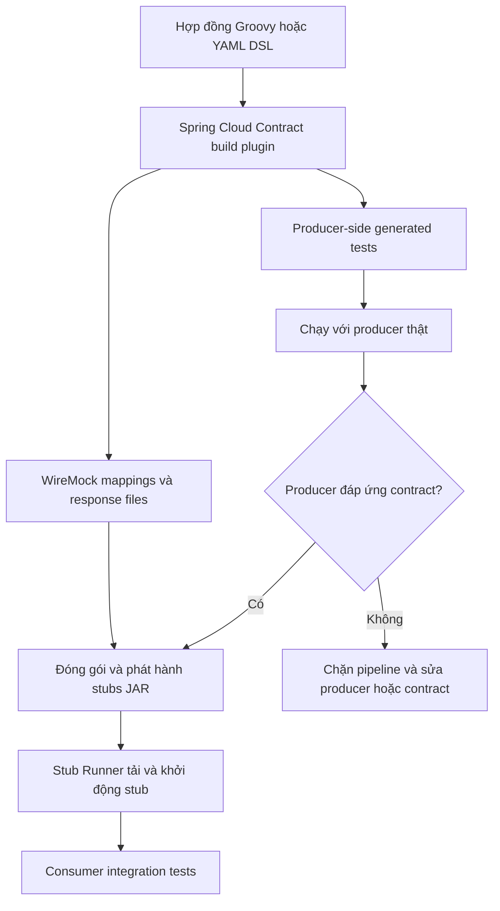

# Sinh stub từ cùng nguồn hợp đồng

## 1. Vì sao producer test và consumer stub phải có cùng nguồn?

Trong **Spring Cloud Contract**, hợp đồng (*contract*) mô tả hành vi mà **producer** cam kết cung cấp và **consumer** dự kiến sử dụng. Với HTTP, một hợp đồng có thể mô tả phương thức, đường dẫn, header, body của request và response, mã trạng thái cùng các quy tắc khớp dữ liệu. Với thông điệp bất đồng bộ, hợp đồng có thể mô tả thông điệp đầu vào hoặc đầu ra. Spring Cloud Contract hỗ trợ định nghĩa các hành vi này bằng Groovy hoặc YAML DSL.

Khi hai nhóm phát triển độc lập, cách làm thủ công thường tạo ra **hai bản mô tả không đồng bộ**:

- Producer duy trì test kiểm tra API thực tế.
- Consumer tự viết mock/stub dựa trên ví dụ response mà họ nhớ hoặc sao chép từ tài liệu.

Ví dụ consumer đang dùng một stub trả `status: "CONFIRMED"`, nhưng producer vừa đổi trường đó thành `state`. Kiểm thử phía consumer vẫn xanh vì stub viết tay không thay đổi, trong khi tích hợp thật thất bại. Ngược lại, producer có thể vô tình thay HTTP `200` thành `204` mà không có kiểm thử nào phản ánh kỳ vọng consumer.

**Sinh stub từ cùng nguồn hợp đồng** giải quyết sự lệch pha này: một phiên bản contract là đầu vào cho cả **kiểm thử xác minh producer** và **stub tiêu thụ bởi consumer**. Nhờ vậy, hai phía kiểm tra cùng một hành vi đã được thỏa thuận.

> **Một nguồn sự thật (*single source of truth*) không có nghĩa mọi thành phần phải ở cùng repository.** Hợp đồng có thể nằm trong repository producer hoặc được quản lý qua repository hợp đồng riêng. Điều quan trọng là producer test và consumer stub được sinh từ **cùng tập hợp hợp đồng, cùng phiên bản**, có thể truy vết và tái tạo.

## 2. Dòng chảy từ contract đến hai loại kiểm thử



Từng đầu ra có nhiệm vụ khác nhau:

| Thành phần | Sinh ra từ đâu? | Chạy ở đâu? | Điều được xác minh |
| --- | --- | --- | --- |
| **Contract** | Nhóm thống nhất hành vi, viết Groovy/YAML DSL | Lưu và version cùng mã nguồn hoặc kho contract | Mô tả cam kết tương thích |
| **Generated producer test** | Contract và cấu hình plugin | Pipeline/build của producer | API đang triển khai có đáp ứng cam kết không |
| **WireMock stub** | Chính contract đó | Stub Runner/WireMock trong kiểm thử consumer | Consumer xử lý đúng request/response đã cam kết không |
| **Stubs JAR** | Các mapping và dữ liệu phản hồi được đóng gói | Artifact repository hoặc local Maven cache | Phân phối được một phiên bản stub đã xác minh |

Không nên coi stub là bằng chứng producer đã hoạt động đúng: stub chỉ mô phỏng những response khai báo trong contract. Producer test mới là phần gắn contract với triển khai thật. Ngược lại, producer test thành công cũng không bảo đảm mọi nhánh nghiệp vụ trong consumer đều đúng; consumer cần chạy các bài kiểm thử riêng với stub.

## 3. Một hợp đồng HTTP làm nguồn duy nhất

Giả sử `order-service` cung cấp `GET /api/orders/42`. Consumer cần lấy mã đơn và trạng thái để hiển thị. Trong producer, ta lưu tệp:

```text
order-service/
└── src/
    └── test/
        └── resources/
            └── contracts/
                └── orders/
                    └── order-confirmed.groovy
```

Nội dung `order-confirmed.groovy`:

```groovy
import org.springframework.cloud.contract.spec.Contract

Contract.make {
    description 'Tra cứu đơn hàng đã xác nhận'

    request {
        method GET()
        url '/api/orders/42'
        headers {
            accept(applicationJson())
        }
    }

    response {
        status OK()
        headers {
            contentType(applicationJson())
        }
        body([
            orderId: 42,
            status : 'CONFIRMED'
        ])
    }
}
```

Ở đây, DSL đặt ra một kịch bản rõ ràng:

1. Consumer gửi `GET /api/orders/42` và chấp nhận JSON.
2. Producer phải trả HTTP `200` với `Content-Type: application/json`.
3. Body của kịch bản chứa `orderId` bằng `42` và `status` bằng `CONFIRMED`.

Đây là **giá trị mẫu cho kịch bản kiểm thử**, không phải quy tắc mọi đơn hàng đều có ID `42`. Nếu consumer có nhiều hành vi quan trọng như đơn chưa tồn tại (`404`) hay chưa được xác nhận (`PENDING`), cần thêm các contract tương ứng.

### Cùng một hợp đồng tạo ra hai đầu ra như thế nào?

Sau khi plugin của Spring Cloud Contract xử lý DSL, hệ thống sẽ sinh ra những hiện vật có mục đích tương đương như sau (đoạn dưới **minh họa ý nghĩa**, không phải mã được cam kết sinh ra nguyên văn):

**Phía producer:**

```java
// Minh họa logic mà generated producer test sẽ kiểm tra.
given()
    .header("Accept", "application/json")
.when()
    .get("/api/orders/42")
.then()
    .statusCode(200)
    .body("orderId", equalTo(42))
    .body("status", equalTo("CONFIRMED"));
```

**Phía consumer:** một WireMock mapping tương ứng về mặt ý nghĩa:

```json
{
  "request": {
    "method": "GET",
    "url": "/api/orders/42",
    "headers": {
      "Accept": { "contains": "application/json" }
    }
  },
  "response": {
    "status": 200,
    "headers": { "Content-Type": "application/json" },
    "jsonBody": {
      "orderId": 42,
      "status": "CONFIRMED"
    }
  }
}
```

Chi tiết cấu trúc mapping, tên file, phép so khớp header và mã generated test có thể khác theo phiên bản hoặc cấu hình. **Không nên viết tay mapping trên để thay cho bước sinh stub**: nó chỉ giúp hình dung rằng cùng một request trong contract dẫn đến cùng response trong stub.

Tác dụng quan trọng nhất: nếu sửa contract để `status` trở thành `state`, cả kỳ vọng trong producer test và response do stub phục vụ consumer đều được cập nhật từ thay đổi đó. Kiểm thử của consumer có thể phát hiện việc code vẫn đọc `status`, còn producer test buộc API triển khai đáp ứng contract mới.

## 4. Cấu hình sinh test và stub ở producer

Với dự án Maven dùng Spring Cloud Contract, producer thường khai báo dependency dành cho kiểm thử và plugin sinh contract test. Ví dụ cấu hình rút gọn trong `pom.xml`:

```xml
<dependency>
    <groupId>org.springframework.cloud</groupId>
    <artifactId>spring-cloud-starter-contract-verifier</artifactId>
    <scope>test</scope>
</dependency>
```

```xml
<plugin>
    <groupId>org.springframework.cloud</groupId>
    <artifactId>spring-cloud-contract-maven-plugin</artifactId>
    <version>${spring-cloud-contract.version}</version>
    <extensions>true</extensions>
    <configuration>
        <baseClassForTests>com.example.orders.ContractVerifierBase</baseClassForTests>
    </configuration>
</plugin>
```

`spring-cloud-contract.version` phải được dự án khai báo theo phiên bản tương thích với Spring Boot/Spring Cloud đang dùng. `ContractVerifierBase` là lớp do nhóm producer cung cấp để thiết lập môi trường chạy generated tests, ví dụ chạy ứng dụng hoặc cấu hình `RestAssuredMockMvc` với controller cần xác minh. Plugin chỉ sinh mã kiểm thử; để kiểm thử chạy được, môi trường test và các dependency tương ứng vẫn phải được cấu hình đúng.

Trong một dự án Maven đã cấu hình đầy đủ, có thể thực hiện:

```bash
mvn clean verify
```

Quy trình build thường trải qua các giai đoạn:

1. Đọc những contract được cấu hình (mặc định thường là `src/test/resources/contracts`).
2. Sinh các lớp kiểm thử cho producer và biên dịch/chạy chúng trong vòng đời kiểm thử Maven.
3. Chuyển contract HTTP thành các định nghĩa stub, thông thường là WireMock mappings kèm file body cần thiết.
4. Đóng gói stub thành một artifact với classifier `stubs` thông qua cơ chế build plugin.

Tên thư mục sinh tạm trong `target/`, cấu hình goal và thời điểm attach artifact có thể thay đổi giữa các bản plugin; cần kiểm tra build thực tế thay vì phụ thuộc vào đường dẫn tạm. Với Gradle, cũng có các task sinh contract test/stub và đóng gói artifact tương ứng, nhưng tên task và cách cấu hình phụ thuộc plugin Gradle được sử dụng.

Điểm cần kiểm soát: **chỉ phát hành stub của một bản build sau khi generated producer tests đã chạy thành công**. Sinh được tệp mapping chưa đủ để chứng minh implementation tuân thủ contract.

## 5. Đóng gói, định danh và phát hành stubs JAR

Với cách tổ chức Maven phổ biến, stub được phát hành dưới tọa độ artifact tương tự:

```text
groupId:artifactId:version:classifier
com.example:order-service:1.2.0:stubs
```

Nhiều dự án đóng gói artifact với tên dạng:

```text
order-service-1.2.0-stubs.jar
```

Stubs JAR chứa dữ liệu để Stub Runner có thể dựng server giả lập, thường bao gồm mapping và file response của WireMock. Nó có thể được lưu vào Maven local repository khi build/install hoặc phát hành lên artifact repository của nhóm. Ví dụ, khi plugin và các repository đã được cấu hình đúng:

```bash
mvn clean deploy
```

Lệnh `deploy` thuộc vòng đời Maven; nó chỉ đẩy artifact lên repository khi các bước plugin, quyền truy cập và `distributionManagement` hoặc cấu hình tương đương đã chuẩn bị đầy đủ. Không nên kết luận rằng chạy lệnh này ở bất kỳ dự án nào cũng sẽ tự sinh và phát hành stub.

Khi quản lý artifact, nên giữ các nguyên tắc:

- **Cùng version:** JAR ứng dụng và stubs JAR được xây từ cùng revision mã nguồn/contract, ví dụ `1.2.0`.
- **Không sửa artifact đã phát hành:** một version phải có nội dung có thể tái tạo và truy vết; tránh ghi đè một stubs JAR khác nội dung vào cùng version bất biến.
- **Tách nhánh snapshot/release:** snapshot hữu ích khi phát triển tích hợp, còn release cố định giúp kiểm thử hồi quy ổn định.
- **Gắn chất lượng với phát hành:** producer test thất bại thì pipeline không công bố stub của thay đổi đó như một hợp đồng hợp lệ.

Stub Runner hỗ trợ lấy stub từ classpath, Maven local hoặc kho từ xa theo cấu hình. Do đó một consumer có thể kiểm thử với đúng artifact contract mà producer công bố, không cần sao chép file JSON qua repository của mình.

## 6. Consumer dùng cùng phiên bản stub qua Stub Runner

Consumer tích hợp thư viện hỗ trợ Stub Runner dành cho test và tham chiếu stubs JAR của producer. Với Spring Boot, có thể cấu hình một integration test dạng sau (giả sử `OrderClient` sử dụng thuộc tính `orders.base-url`):

```java
import static org.assertj.core.api.Assertions.assertThat;

import org.junit.jupiter.api.Test;
import org.springframework.beans.factory.annotation.Autowired;
import org.springframework.boot.test.context.SpringBootTest;
import org.springframework.cloud.contract.stubrunner.StubRunnerProperties;
import org.springframework.cloud.contract.stubrunner.spring.AutoConfigureStubRunner;

@SpringBootTest(properties = "orders.base-url=http://localhost:9090")
@AutoConfigureStubRunner(
    ids = "com.example:order-service:1.2.0:stubs:9090",
    stubsMode = StubRunnerProperties.StubsMode.LOCAL
)
class OrderClientContractTest {

    @Autowired
    OrderClient orderClient;

    @Test
    void shouldReadConfirmedOrder() {
        OrderView order = orderClient.findById(42L);

        assertThat(order.orderId()).isEqualTo(42L);
        assertThat(order.status()).isEqualTo("CONFIRMED");
    }
}
```

Ví dụ này giả định dự án consumer đã có `OrderClient`, `OrderView` và dependency test cần thiết. Phải cấu hình client dùng `orders.base-url` để request thật sự đến stub trên cổng `9090`. Chế độ `LOCAL` yêu cầu artifact stub đã có trong Maven local repository; nếu consumer chạy trên CI riêng hoặc cần lấy từ artifact repository, hãy cấu hình chế độ lấy từ xa và địa chỉ kho tương ứng. Có thể dùng cổng động thay cho `9090` trong hệ thống kiểm thử chạy song song, miễn là client được cấp đúng cổng mà Stub Runner mở.

Stub Runner sẽ tìm stubs JAR theo tọa độ đã khai báo, đọc các định nghĩa stub, rồi khởi động server mô phỏng endpoint. Khi `OrderClient` gọi `GET /api/orders/42` với request khớp, stub trả response đã được sinh từ contract. Nhờ đó bài kiểm thử chạy mà không cần triển khai `order-service` thật trong môi trường kiểm thử consumer.

**Ba câu hỏi cần phân biệt khi test xanh:**

| Câu hỏi | Kiểm thử nào trả lời? |
| --- | --- |
| Producer hiện tại có trả response như đã hứa không? | Generated producer tests |
| Consumer có đọc và xử lý response đã hứa không? | Consumer tests chạy với Stub Runner |
| Hai phía đang dùng cùng một phiên bản cam kết không? | Tọa độ artifact, version pinning và quy trình CI |

Stub Runner dùng stub được công bố, **không tự chạy producer thật** và không thể tự phát hiện một producer đã thay đổi sau khi stub được xây mà chưa được xác minh lại.

## 7. Vòng đời hợp đồng và điểm kiểm soát trong CI

Một vòng đời điển hình gồm các trạng thái: **đề xuất contract → thống nhất → triển khai producer → xác minh producer → phát hành stub → kiểm thử consumer → thay đổi/version tiếp theo**. Từng trạng thái đều dùng cùng một nguồn contract đã version hóa.

Ví dụ các bước CI:

| Bước | Công việc | Điều kiện để qua bước |
| --- | --- | --- |
| 1. Contract review | Consumer và producer thống nhất HTTP method, dữ liệu và quy tắc lỗi | Không có thay đổi phá vỡ chưa được xử lý |
| 2. Producer build | Sinh và chạy contract tests từ commit hiện tại | Các test pass trên producer đang triển khai |
| 3. Package/publish | Đóng gói `stubs` cùng version release | Artifact được lưu, có thể tải lại, truy vết commit |
| 4. Consumer CI | Chạy test với Stub Runner sử dụng artifact đã thống nhất | Client xử lý request/response đúng |
| 5. Compatibility gate | Đánh giá các producer/consumer cần nâng version | Phát hiện và xử lý breaking change trước khi rollout |

Đối với một API có nhiều consumer, việc một consumer đã nâng lên contract mới không đồng nghĩa tất cả consumer khác đều sẵn sàng. Cần kiểm thử theo các version đang được hỗ trợ hoặc có quy trình chuyển đổi rõ ràng. Một cách thực tế là producer chấp nhận cả biểu diễn cũ và mới trong thời gian chuyển tiếp, sau đó mới ngừng phục vụ biểu diễn cũ khi các consumer đã nâng cấp.

### Ví dụ phát hiện thay đổi không tương thích

Với contract `order-confirmed.groovy` ban đầu:

```json
{ "orderId": 42, "status": "CONFIRMED" }
```

Producer thay triển khai thành:

```json
{ "orderId": 42, "state": "CONFIRMED" }
```

Nếu **contract chưa đổi**, generated producer test vẫn kỳ vọng `status` và phải phát hiện sai lệch. Không được sửa contract theo producer một cách tự động chỉ để pipeline xanh, vì consumer đang sử dụng có thể vẫn cần `status`.

Nếu **contract chủ động đổi** sau khi thống nhất migration, test sinh ra sẽ kiểm tra `state` và stub mới cũng trả `state`. Consumer test của mã cũ lúc này có thể thất bại, cho thấy cần cập nhật consumer hoặc chiến lược tương thích ngược. Điều này chính là giá trị của việc sinh hai phía từ một nguồn: thay đổi hợp đồng trở nên nhìn thấy được trong cả hai quy trình kiểm thử.

## 8. Các lỗi phổ biến khi sinh stub

### 8.1. Duy trì stub viết tay song song với contract

Consumer giữ một file WireMock JSON thủ công trong khi producer tạo stub từ Groovy DSL. Hai file trôi dần theo thời gian, làm mất lợi ích của nguồn sự thật chung. Hãy để test consumer tải artifact stub sinh từ contract và chỉ dùng các stub riêng khi chủ đích kiểm thử tình huống nằm ngoài phạm vi contract, có ghi rõ lý do.

### 8.2. Chỉ sinh stub, bỏ qua generated producer tests

Build sinh được `stubs.jar` nhưng producer chưa thực thi test xác minh. Khi đó consumer kiểm thử một lời hứa chưa được thực hiện. Hãy buộc producer test thành công trước khi phát hành bản stub được coi là hợp lệ.

### 8.3. Dùng version động mà không kiểm soát

Dùng ký hiệu version thay đổi liên tục có thể khiến CI consumer hôm nay lấy stub khác ngày hôm qua. Điều này hữu ích trong một số pipeline tương thích liên tục nhưng gây khó khi tái hiện lỗi. Nên pin version cho bộ kiểm thử hồi quy ổn định; nếu chủ ý dùng version động, hãy log version artifact thực tế đã được giải quyết.

### 8.4. Contract cố định các giá trị ngẫu nhiên

Ví dụ producer trả `createdAt` theo thời điểm hiện tại, nhưng contract bắt buộc đúng một timestamp. Generated producer test sẽ thất bại vì dữ liệu không ổn định. Sử dụng matcher/giá trị động của DSL khi consumer chỉ phụ thuộc vào **kiểu hoặc định dạng**, đồng thời xác định chính xác giá trị mẫu mà stub trả. Đừng nới lỏng các điều kiện nghiệp vụ quan trọng như mã trạng thái hoặc tổng tiền chỉ để test qua.

### 8.5. Stub trả đúng JSON nhưng không khớp request của consumer

Một request sai đường dẫn, query, header hay body có thể không khớp mapping, khiến WireMock trả lỗi khác kỳ vọng. Khi debug, kiểm tra request mà client thực sự gửi, các matcher được sinh và port của stub trước khi sửa response. Không nên xóa tất cả điều kiện request chỉ để mock hoạt động.

### 8.6. Coi HTTP stubs là mô hình đầy đủ cho messaging

Spring Cloud Contract cũng định nghĩa hợp đồng thông điệp và có cơ chế kiểm thử/stub phù hợp với hệ thống messaging. Tuy nhiên, các WireMock HTTP mapping trong bài này mô tả **HTTP**; với Kafka, RabbitMQ hoặc hệ thống thông điệp khác, cần cấu hình hỗ trợ messaging và cơ chế trigger/message tương ứng. Không thể lấy một WireMock stub HTTP để thay thế trực tiếp hành vi broker hay thứ tự xử lý sự kiện.

## 9. Bài thực hành: xác minh một nguồn contract cho hai phía

Giả sử một API thanh toán có hợp đồng:

```yaml
description: Truy vấn thanh toán thành công
request:
  method: GET
  url: /api/payments/pay-101
response:
  status: 200
  headers:
    Content-Type: application/json
  body:
    paymentId: pay-101
    state: SETTLED
    amount: 150000
    currency: VND
```

Hãy thực hiện lần lượt trên một dự án thực hành đã cấu hình Spring Cloud Contract:

1. Đặt hợp đồng vào vị trí nguồn được plugin đọc. Sinh producer test và stub. Xác định trong build output đâu là mã kiểm thử, đâu là mapping; không chỉnh sửa trực tiếp hai loại output này.
2. Chạy producer test khi endpoint trả `state: SETTLED`, sau đó đổi endpoint thành `status: SETTLED` nhưng giữ nguyên contract. Ghi nhận test có phát hiện thay đổi tên trường không.
3. Khôi phục producer theo contract, build và lưu artifact `stubs` với một version xác định.
4. Cho consumer dùng Stub Runner với artifact đó. Viết kiểm thử gọi qua HTTP client thật của consumer và kiểm tra `state`, `amount`, `currency`.
5. Thử sửa contract thành `state: FAILED`, tái sinh stub rồi chạy lại consumer test. Xác định xem consumer đang giả định `SETTLED` ở đâu, và có cần contract riêng cho trạng thái thất bại không.

**Kết quả mong đợi:** sửa producer lệch contract cũ làm producer test thất bại; sửa contract có thể làm stub đổi theo và khiến consumer test thất bại nếu consumer chưa thích ứng. Điều đó chứng minh cả hai phía thực sự bị ràng buộc bởi **cùng một phiên bản hợp đồng**, thay vì bởi các mock tồn tại độc lập.

## 10. Checklist trước khi phát hành stub

- Contract mô tả hành vi consumer dùng, gồm request, response và các điều kiện quan trọng.
- Generated producer tests chạy thành công với producer thật hoặc môi trường controller đã cấu hình thích hợp.
- Stubs được sinh bằng plugin từ đúng phiên bản contract, không sao chép thủ công sang một nguồn khác.
- Stubs JAR có tọa độ và version truy vết được; repository cho phép consumer tải đúng artifact.
- Stub Runner khởi động được stub và consumer test gửi request khớp mapping.
- CI chặn phát hành khi producer test không đạt và ghi nhận phiên bản stub mà consumer đã kiểm thử.
- Các kịch bản bổ sung như lỗi HTTP, thiếu dữ liệu, phân quyền hoặc messaging được bổ sung nếu consumer thực sự dựa vào chúng.

Khi producer test và consumer stub cùng được sinh từ một contract đã version hóa, mỗi thay đổi API có một nơi để thảo luận, một cơ chế xác minh trên producer và một hiện vật để consumer thử nghiệm. Đó là nền tảng để Spring Cloud Contract, Stub Runner và CI phát hiện sớm những thay đổi không tương thích trước khi các dịch vụ kết nối trong môi trường thực tế.
