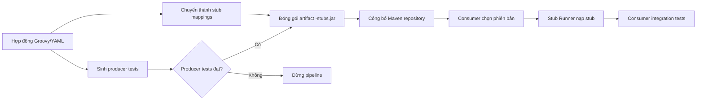

# Đóng gói, công bố và lấy stub theo phiên bản

## 1. Vì sao stub phải đi cùng phiên bản?

Trong **Spring Cloud Contract** (module `SPRING_CLOUD_CONTRACT`), producer và consumer dùng hợp đồng để thống nhất hành vi HTTP hoặc thông điệp trước khi tích hợp. Hợp đồng có thể viết bằng **Groovy DSL** hoặc **YAML DSL**. Công cụ dựa trên hợp đồng để sinh kiểm thử phía producer và sinh stub cho consumer chạy bằng **Stub Runner**. Nhờ đó, CI có thể phát hiện sớm những thay đổi API trái với hành vi đã công bố.

Viết hợp đồng mới chỉ là một nửa công việc. Consumer cần trả lời được ba câu hỏi: *Stub của dịch vụ nào? Stub ứng với phiên bản nào của producer? Lấy stub từ đâu?* Nếu không quản lý những thông tin này, một bài kiểm thử có thể chạy với stub mới nhất hôm nay nhưng thất bại vào ngày mai dù mã nguồn consumer không thay đổi.

Mục tiêu của bài học là xây dựng chuỗi thao tác có thể lặp lại:

1. Producer định nghĩa hợp đồng và sinh kiểm thử xác minh hành vi thực.
2. Build tạo **stub artifact**, thường là JAR có classifier `stubs`.
3. Pipeline công bố artifact lên Maven repository với tọa độ và phiên bản cụ thể.
4. Consumer khai báo phiên bản cần dùng; Stub Runner tải artifact và chạy máy chủ stub.
5. Hai pipeline sử dụng kết quả kiểm thử để quyết định có thể phát hành hoặc nâng phiên bản tích hợp hay không.

### 1.1. Sơ đồ vòng đời



Hợp đồng đóng vai trò nguồn mô tả hành vi chung, nhưng **stub không thay thế kiểm thử producer**: một stub có thể trả lời đúng JSON đã định nghĩa trong khi ứng dụng thật lại trả khác. Vì vậy, bước xác minh producer phải đi trước bước công bố artifact đáng tin cậy.

## 2. Phân biệt hợp đồng, stub và artifact

| Khái niệm | Vai trò | Được dùng bởi |
| --- | --- | --- |
| **Contract DSL** | Định nghĩa request/message và response/output mong đợi | Người thiết kế API, bộ sinh test và stub |
| **Generated producer test** | Gửi yêu cầu đến producer thật hoặc kiểm tra thông điệp được phát ra | Pipeline producer |
| **Stub mapping** | Mô tả cách một server giả lập khớp yêu cầu và trả đáp ứng, thường dùng WireMock cho HTTP | Stub Runner |
| **Stub artifact** | Gói chứa mapping và thông tin hợp đồng, có tọa độ và phiên bản truy xuất được | Maven repository, consumer |
| **Stub Runner** | Phân giải artifact, nạp mapping, khởi động stub HTTP hoặc cơ chế tương ứng | Kiểm thử consumer |

### 2.1. Tọa độ Maven của artifact

Giả sử producer có:

```text
groupId    = com.example
artifactId = orders-producer
version    = 1.4.2
```

Artifact ứng dụng thông thường có thể là:

```text
com.example:orders-producer:1.4.2
```

Artifact stub là một **artifact riêng với classifier `stubs`**, ví dụ:

```text
com.example:orders-producer:1.4.2:stubs
```

Trong kho Maven, file tương ứng thường có tên:

```text
orders-producer-1.4.2-stubs.jar
```

Một JAR stub do Spring Cloud Contract tạo thường chứa các hợp đồng và mapping dưới cấu trúc metadata gắn với `groupId`, `artifactId`, `version`, chẳng hạn:

```text
META-INF/
  com.example/
    orders-producer/
      1.4.2/
        contracts/
          get_order_success.yml
        mappings/
          get_order_success.json
```

Đây là cấu trúc minh họa; tên và vị trí file cụ thể phụ thuộc cấu hình plugin, DSL và phiên bản công cụ. Điều phải kiểm tra khi đóng gói là **JAR có mapping mong đợi và Stub Runner đọc được**. Chỉ thấy file `.jar` tồn tại chưa đủ để kết luận.

## 3. Chuẩn bị ví dụ producer và hợp đồng

Ví dụ xuyên suốt: producer `orders-producer` công bố `GET /api/orders/{id}`. Với đơn `ord-1001`, API trả `200` và body chứa `id`, `status`. Các giá trị này là **fixture được giả định cho bài học**; khi áp dụng, cần thay bằng dữ liệu có thể chuẩn bị và dọn dẹp trong kiểm thử của dự án.

Đặt hợp đồng YAML tại vị trí mặc định thường dùng trong dự án Maven:

```text
orders-producer/
  src/
    test/
      resources/
        contracts/
          get_order_success.yml
```

Nội dung hợp đồng:

```yaml
name: get_order_success
description: Trả thông tin đơn hàng đã tồn tại
request:
  method: GET
  url: /api/orders/ord-1001
response:
  status: 200
  headers:
    Content-Type: application/json
  body:
    id: ord-1001
    status: CREATED
```

Nếu producer đổi `status` thành một trường khác hoặc đổi HTTP status, producer test sinh từ hợp đồng này cần phát hiện sự không khớp. Consumer có thể dùng stub tương ứng để tập xử lý tình huống tìm thấy đơn mà không khởi động service thật.

Với producer thực tế, nên có hợp đồng bổ sung cho nhánh `404` của một đơn không tồn tại. Mỗi mapping cần có điều kiện request đủ cụ thể để Stub Runner phân biệt hai nhánh; không nên dùng một matcher URL quá rộng khiến request đáng lẽ trả `404` lại bị mapping `200` bắt trước.

## 4. Đóng gói stub từ producer

### 4.1. Cấu hình plugin phía producer

Một dự án **Maven** có thể sử dụng `spring-cloud-contract-maven-plugin` để sinh kiểm thử từ DSL và tạo artifact stub. Phần cấu hình rút gọn:

```xml
<build>
  <plugins>
    <plugin>
      <groupId>org.springframework.cloud</groupId>
      <artifactId>spring-cloud-contract-maven-plugin</artifactId>
      <extensions>true</extensions>
      <configuration>
        <baseClassForTests>
          com.example.orders.contract.ContractVerifierBase
        </baseClassForTests>
      </configuration>
    </plugin>
  </plugins>
</build>
```

Đây là **đoạn cấu hình minh họa**, chưa phải một `pom.xml` đầy đủ. Dự án còn cần plugin version, dependencies kiểm thử, Java/Spring Boot và Spring Cloud Contract tương thích. Nên quản lý phiên bản tập trung theo BOM hoặc `pluginManagement` tương ứng với hệ sinh thái đang dùng, tránh chọn phiên bản plugin tùy tiện.

`baseClassForTests` trỏ đến lớp nền mà test sinh ra kế thừa. Với endpoint HTTP, lớp nền phải khởi tạo ứng dụng hoặc controller dưới test, cấu hình cơ chế gửi request (ví dụ Rest Assured MockMvc), tạo fixture `ord-1001`, và cô lập trạng thái giữa các test. Nếu lớp nền không chuẩn bị dữ liệu mà hợp đồng mong đợi, producer test có thể thất bại dù DSL hợp lệ.

Với hợp đồng thông điệp, cần cấu hình cách kích hoạt input và quan sát output phù hợp với binder hoặc message broker của dự án. Không thể giả định cấu hình HTTP kiểm tra được message.

### 4.2. Build và xác minh kết quả

Trong dự án Maven có wrapper và plugin đã cấu hình đúng:

```bash
./mvnw -B clean verify
```

Tùy cấu hình lifecycle, build sẽ sinh và chạy producer test, chuyển đổi hợp đồng thành mapping, rồi đóng gói artifact stub ở các phase tương ứng. Nếu dự án dùng Gradle, các task như `generateContractTests`, `contractTest` và `verifierStubsJar` có vai trò tương tự; tên task và wiring phụ thuộc plugin, vì vậy cần xem cấu hình của build hiện tại.

Trước khi công bố artifact, cần kiểm tra:

- **Producer tests đạt**: endpoint hoặc message producer thật phù hợp với hợp đồng.
- **Stub artifact được tạo và gắn đúng classifier**: tên thường có hậu tố `-stubs.jar`.
- **Mapping không rỗng**: bên trong JAR có request/response hoặc cấu hình message phù hợp.
- **Phiên bản đúng**: JAR stub mang cùng `groupId`, `artifactId` và `version` với bản producer đang phát hành.
- **Không có dữ liệu nhạy cảm**: payload, URL, token, thông tin khách hàng thực hoặc credential không được đưa vào fixture hay artifact.

Ví dụ kiểm tra nội dung JAR trên hệ thống có JDK:

```bash
jar tf target/orders-producer-1.4.2-stubs.jar
```

Lệnh trên chỉ minh họa đường dẫn artifact. Nếu file không được tạo ở vị trí dự kiến, hãy kiểm tra packaging/plugin configuration trước khi tiếp tục công bố.

## 5. Công bố stub vào Maven repository

Một nơi lưu trữ Maven artifact (ví dụ Nexus, Artifactory hoặc repository Maven tương thích) giúp các consumer tải đúng stub mà không cần copy file trực tiếp giữa các repository mã nguồn.

Ví dụ producer có cấu hình phân phối:

```xml
<distributionManagement>
  <repository>
    <id>contracts-releases</id>
    <url>https://artifacts.example.org/repository/maven-releases</url>
  </repository>
  <snapshotRepository>
    <id>contracts-snapshots</id>
    <url>https://artifacts.example.org/repository/maven-snapshots</url>
  </snapshotRepository>
</distributionManagement>
```

Địa chỉ trên là ví dụ, không phải repository đang hoạt động. `id` phải khớp với cấu hình credentials ở Maven `settings.xml` của môi trường build hoặc trong cơ chế secrets của CI.

Khi producer đã có cấu hình đầy đủ:

```bash
./mvnw -B clean deploy
```

Trong một pipeline Maven chuẩn, phase `deploy` đi qua các phase kiểm thử và đóng gói trước khi tải artifact lên repository. Điều này chỉ bảo vệ được quy trình nếu không bỏ qua producer tests và plugin stub hoạt động đúng. Không nên dùng `-DskipTests` để công bố một bộ stub chưa được kiểm chứng.

Sau khi công bố, hãy xác minh trong repository có **đúng hai loại artifact cần thiết**, nếu dự án công bố ứng dụng và stub cùng phiên bản: artifact chính và artifact với classifier `stubs`. Kiểm tra `POM`, phiên bản `1.4.2`, classifier và kích thước artifact. Một lần publish chỉ được coi là thành công về mặt sử dụng khi consumer có thể thực sự resolve và nạp stub.

### 5.1. Đảm bảo phát hành có thể truy vết

Một quy trình hợp lý thường gắn bản phát hành với:

| Thành phần | Ví dụ | Tác dụng |
| --- | --- | --- |
| Git revision/tag | `v1.4.2` | Xác định nguồn của artifact |
| Producer artifact | `orders-producer:1.4.2` | Phiên bản triển khai |
| Stub artifact | `orders-producer:1.4.2:stubs` | Hành vi mô phỏng tương ứng |
| Build CI | `producer-build-184` | Truy vết producer tests và bước publish |
| Repository | `maven-releases` | Nơi consumer có thể tải artifact |

Với bản release, tránh ghi đè artifact đã phát hành cùng tọa độ: việc cùng tên và phiên bản nhưng khác nội dung phá vỡ khả năng chạy lại kiểm thử. Bản `SNAPSHOT` có thể thay đổi theo lần build nên phù hợp hơn cho thử nghiệm liên tục; nếu yêu cầu tái lập tuyệt đối, consumer CI nên dùng bản release cố định hoặc một artifact/bản build duy nhất được định danh rõ.

## 6. Consumer lấy stub theo phiên bản bằng Stub Runner

Spring Cloud Contract **Stub Runner** có thể tìm stub từ Maven repository và khởi chạy các stub HTTP cho consumer test. Thông thường, dự án consumer khai báo dependency kiểm thử `spring-cloud-starter-contract-stub-runner` với phiên bản phù hợp với Spring Boot và Spring Cloud Contract mà dự án sử dụng.

### 6.1. Hiểu chuỗi định danh stub

Ví dụ:

```text
com.example:orders-producer:1.4.2:stubs:8090
```

| Thành phần | Giá trị | Ý nghĩa |
| --- | --- | --- |
| `groupId` | `com.example` | Nhóm sở hữu artifact |
| `artifactId` | `orders-producer` | Tên producer |
| `version` | `1.4.2` | Phiên bản stub cần dùng |
| `classifier` | `stubs` | Chọn JAR stub thay vì JAR ứng dụng |
| `port` | `8090` | Cổng server stub trong bài kiểm thử |

**Phiên bản ở đây là phiên bản artifact producer**, không phải phiên bản thư viện Spring Cloud Contract. Cần phân biệt hai khái niệm này khi đọc lỗi phụ thuộc.

### 6.2. Ba chế độ lấy stub thường gặp

| `StubsMode` | Stub được lấy từ đâu? | Khi nào dùng? | Điểm cần lưu ý |
| --- | --- | --- | --- |
| `CLASSPATH` | Artifact đã nằm trên test classpath | Kiểm thử không cần truy cập repository lúc chạy | Phải cấu hình dependency/classpath chứa stub |
| `LOCAL` | Maven local repository của máy chạy test | Producer và consumer đang phát triển trên cùng máy hoặc đã cài artifact cục bộ | Cần chạy `mvn install` phía producer trước |
| `REMOTE` | Maven repository được cấu hình | CI, consumer độc lập hoặc nhiều nhóm cùng dùng stub đã công bố | Cần đúng repository URL, quyền tải và phiên bản |

Các chế độ trên ảnh hưởng **nơi phân giải artifact**; không tự thay đổi hợp đồng mà Stub Runner phục vụ.

### 6.3. Chạy consumer test với bản phát hành cố định

Giả sử consumer đã cấu hình client sử dụng base URL `orders.api.base-url`. Ví dụ test khái niệm sau dùng Stub Runner để khởi động producer giả lập tại cổng `8090`:

```java
import org.junit.jupiter.api.Test;
import org.springframework.beans.factory.annotation.Autowired;
import org.springframework.boot.test.context.SpringBootTest;
import org.springframework.cloud.contract.stubrunner.StubRunnerProperties;
import org.springframework.cloud.contract.stubrunner.spring.AutoConfigureStubRunner;

import static org.assertj.core.api.Assertions.assertThat;

@SpringBootTest(properties = {
    "orders.api.base-url=http://localhost:8090"
})
@AutoConfigureStubRunner(
    ids = "com.example:orders-producer:1.4.2:stubs:8090",
    stubsMode = StubRunnerProperties.StubsMode.REMOTE,
    repositoryRoot = "https://artifacts.example.org/repository/maven-releases"
)
class OrdersConsumerContractTest {

    @Autowired
    private OrdersGateway ordersGateway;

    @Test
    void readsOrderUsingVersionedStub() {
        OrderView order = ordersGateway.findOrder("ord-1001");

        assertThat(order.status()).isEqualTo("CREATED");
    }
}
```

`OrdersGateway` và `OrderView` là **các kiểu giả định thuộc ứng dụng consumer**: khi thực hành, thay bằng HTTP client/service thực tế. Lớp test chỉ thể hiện cách cấu hình Stub Runner và cách kiểm tra consumer xử lý response đã được stub mô phỏng. Ví dụ cũng giả định các dependency test, bean và cấu hình HTTP client đã có.

Với `REMOTE`, repositoryRoot phải là kho chứa artifact thực sự. Để dùng `LOCAL`, thay mode thành `StubsMode.LOCAL` và cài producer artifact vào local Maven repository trước:

```bash
./mvnw -B clean install
```

Lệnh trên chạy trong **dự án producer** đã cấu hình plugin. Sau đó mới chạy consumer test ở dự án consumer. Nếu consumer dùng `CLASSPATH`, phải khai báo JAR stub là dependency kiểm thử trong build; chỉ chuyển mode thành `CLASSPATH` khi không có artifact trên classpath sẽ dẫn đến lỗi tải stub.

Trong test chạy song song, cổng cố định `8090` có thể xung đột. Dự án nhiều suite nên để Stub Runner cấp cổng hoặc quản lý dải cổng và truyền URL của stub được khởi tạo cho client, thay vì mặc định mọi tiến trình đều được chiếm cùng cổng.

### 6.4. Vì sao nên cố định version?

Nếu consumer khai báo version động kiểu `+` hoặc một alias luôn trỏ về bản mới nhất, hôm nay bài kiểm thử có thể dùng `1.4.2`, ngày mai lại dùng `1.5.0`. Khi thất bại, rất khó biết lỗi đến từ commit consumer hay việc artifact bị đổi sau lần chạy trước.

Sử dụng phiên bản cụ thể như `1.4.2` giúp:

- Tái lập thất bại: cùng mã nguồn consumer, cùng artifact stub.
- Điều tra thay đổi tương thích: chủ động chạy ma trận `1.4.2` và `1.5.0` trước khi nâng phiên bản.
- Theo dõi phụ thuộc: biết consumer đang kiểm thử với hợp đồng của bản producer nào.
- Tránh tình huống CI tự đổi stub ngoài ý muốn.

Version động hoặc `SNAPSHOT` vẫn có thể hữu ích trong pipeline thăm dò tính tương thích với producer đang phát triển, nhưng nên tách khỏi kiểm thử chặn phát hành cần tính lặp lại cao.

## 7. Chiến lược phiên bản và thay đổi hợp đồng

Không có quy tắc nào đảm bảo chỉ cần tăng số phiên bản theo SemVer thì API sẽ tự tương thích. Tương thích phải được đánh giá theo những gì consumer thật sự phụ thuộc, bao gồm cả HTTP code, headers, payload, error code, event schema và ý nghĩa dữ liệu.

| Thay đổi producer | Ví dụ | Rủi ro đối với consumer | Cách xử lý |
| --- | --- | --- | --- |
| Sửa triển khai mà giữ nguyên hành vi | Tối ưu truy vấn đơn hàng | Thấp nếu tests vẫn đạt | Chạy lại producer tests và phát hành bản vá theo chính sách |
| Bổ sung trường tùy chọn | Thêm `currency` vào JSON | Có thể ảnh hưởng consumer deserialize rất nghiêm ngặt | Xác minh với consumer và cập nhật hợp đồng khi cần |
| Thêm endpoint độc lập | `GET /api/orders/{id}/events` | Thường không phá client cũ | Thêm hợp đồng cho endpoint mới |
| Đổi tên trường bắt buộc | `status` thành `state` | Consumer cũ có thể lỗi | Duy trì trường cũ trong giai đoạn chuyển tiếp hoặc phát hành API mới |
| Đổi HTTP status/error code | `404` thành `204` | Consumer xử lý nhánh khác | Thảo luận và kiểm tra toàn bộ consumer phụ thuộc |
| Đổi cấu trúc message | Bỏ `orderId` từ event | Consumer bất đồng bộ có thể không tương thích | Cân nhắc version schema/event hoặc chiến lược chuyển tiếp |

Một lộ trình nâng cấp an toàn:

1. Producer đề xuất hợp đồng mới với test tương ứng.
2. Xác định những consumer đang dùng nhánh bị thay đổi.
3. Trong giai đoạn chuyển tiếp, producer có thể hỗ trợ đồng thời hành vi cũ và mới nếu thiết kế cho phép.
4. Publish stub của **phiên bản mới** vào repository riêng theo tọa độ mới; không ghi đè stub đã công bố của phiên bản cũ.
5. Consumer chạy test với stub mới, chỉnh xử lý nếu cần, rồi chủ động nâng phiên bản `ids`.
6. Chỉ loại bỏ hành vi cũ theo chính sách tương thích và sau khi các consumer liên quan đã chuyển đổi.

Ví dụ: consumer A đang ghim `1.4.2`, consumer B đang thử `1.5.0`. Việc producer xuất bản stub `1.5.0` không làm test của A tự cập nhật. Đây là đặc tính mong muốn: thay đổi được đưa vào một cách có kiểm soát.

## 8. Tích hợp vào CI

### 8.1. Pipeline producer

Một pipeline producer có thể tổ chức như sau:

```text
Checkout đúng commit/tag
  -> Khôi phục dependency và kiểm tra định dạng hợp đồng
  -> Sinh producer tests
  -> Chạy producer tests + unit/integration tests
  -> Tạo stub JAR, kiểm tra mappings
  -> Publish artifact chính và -stubs.jar khi điều kiện đạt
  -> Ghi nhận artifact coordinate và build provenance
```

Với Maven, lệnh triển khai trong job phát hành thường là:

```bash
./mvnw -B --no-transfer-progress clean deploy
```

Lệnh chỉ thành công khi dự án, quyền deploy và plugin đã được cấu hình; không xem đây là file CI dùng được ngay cho mọi repository. CI cần credentials repository qua secrets, xác minh kết quả publish và không in thông tin xác thực ra log.

### 8.2. Pipeline consumer

Consumer có thể duy trì hai dạng kiểm thử:

1. **Kiểm thử chặn PR/release** dùng phiên bản stub cố định đã được lựa chọn, ví dụ `1.4.2`.
2. **Kiểm thử tương thích với bản producer sắp phát hành** dùng stub phiên bản ứng viên, ví dụ `1.5.0-rc1` nếu tổ chức có quy ước phát hành ứng viên như vậy.

Ở cả hai dạng, bài kiểm thử nên gọi mã consumer thật và kiểm tra hành vi của nó. Chẳng hạn, khi stub trả `404 ORDER_NOT_FOUND`, consumer có hiển thị đúng trạng thái không tồn tại không? Nếu chỉ gửi request rồi kiểm tra Stub Runner trả đúng một JSON đã được cố định, ta mới xác minh stub, chưa xác minh xử lý của ứng dụng consumer.

### 8.3. Tránh vòng phụ thuộc giữa publish và test

Một câu hỏi thường gặp: *Producer phải publish stub trước khi consumer test, nhưng producer lại muốn consumer test đạt trước khi release thì làm sao?*

Có thể tách:

- **Xác minh tại PR producer:** chạy producer tests trước; tạo artifact ứng viên ở môi trường tạm hoặc repository staging nếu cần thử với consumer.
- **Xác minh consumer:** chạy consumer tests với đúng artifact ứng viên đã build.
- **Phát hành chính thức:** chỉ promote hoặc publish bản release sau khi các bước phê duyệt và kiểm tra yêu cầu đã hoàn tất.

Phương án staging/promote phụ thuộc khả năng Maven repository và hạ tầng của nhóm. Điểm cốt lõi là consumer phải kiểm tra **chính artifact dự định phát hành**, không phải một artifact khác tình cờ có cùng chuỗi version.

## 9. Lỗi thường gặp và cách chẩn đoán

| Triệu chứng | Nguyên nhân thường gặp | Cách kiểm tra |
| --- | --- | --- |
| `Could not resolve artifact` / HTTP 404 | Sai `groupId`, `artifactId`, `version`, `classifier` hoặc repository URL | So sánh chuỗi `ids` với đường dẫn và metadata artifact trên repository |
| HTTP 401/403 khi tải JAR | Thiếu quyền đọc repository hoặc credential không khớp | Xác minh cấu hình Maven settings/secrets và quyền tài khoản CI |
| Stub Runner khởi động nhưng trả 404 cho request được mong đợi | JAR không chứa mapping, mapping khớp URL/method/header/body khác hoặc sai version | Liệt kê nội dung JAR, xem các mapping và request thực tế |
| Producer test thất bại dù stub có vẻ đúng | Producer thật đã lệch contract hoặc test fixture/setup sai | Đọc generated test và chuẩn bị dữ liệu trong base class |
| Consumer test chạy được cục bộ nhưng lỗi trên CI | Cục bộ đã `install` artifact vào `~/.m2`, CI không có artifact đó | Dùng `REMOTE` với repository truy cập được hoặc cài artifact trong job |
| Hai bài test tranh cùng một port | Nhiều Stub Runner cùng dùng cổng cố định | Cấp cổng động hoặc cấu hình port không trùng |
| Test thay đổi kết quả dù code không đổi | Dùng `SNAPSHOT` bị cập nhật hoặc version động | Khóa artifact version/build cụ thể cho CI cần tái lập |
| Có stub artifact nhưng consumer không thấy endpoint mong đợi | Contract không được plugin nhận diện hoặc đường dẫn mapping sai | Kiểm tra contracts directory, plugin lifecycle và file JAR |

Khi gặp lỗi, nên tách chẩn đoán thành ba tầng: **phân giải artifact** (có tải được JAR không?), **nạp mapping** (có đúng contract trong JAR không?), rồi **khớp request** (client có gửi đúng yêu cầu mà mapping mô tả không?). Cách này rút ngắn thời gian tìm nguyên nhân hơn việc lập tức sửa mã consumer.

## 10. Bài thực hành: nâng stub từ 1.4.2 lên 1.5.0

**Bối cảnh:** `orders-producer` phiên bản `1.4.2` đã có stub cho `GET /api/orders/ord-1001` trả `200`. Phiên bản `1.5.0` thêm trường tùy chọn `currency` trong response; consumer B muốn sử dụng trường mới trong khi consumer A chưa cập nhật.

### Yêu cầu

1. Thêm trường `currency: VND` vào hợp đồng phiên bản mới, xác định liệu consumer A có bộ giải mã JSON nghiêm ngặt hay không.
2. Chạy producer tests với hành vi của `1.5.0`. Nếu producer vẫn trả response thiếu `currency` theo hợp đồng mới, build phải thất bại trước publish.
3. Đóng gói và công bố `com.example:orders-producer:1.5.0:stubs`; giữ nguyên `1.4.2:stubs` đã phát hành.
4. Giữ consumer A ghim `1.4.2`; chuyển consumer B sang `1.5.0`, chạy Stub Runner và assert `currency` mà B cần.
5. Kiểm tra thất bại có chủ ý: đổi `ids` sang phiên bản không tồn tại, ví dụ `1.5.99`, và xác nhận CI báo lỗi phân giải artifact rõ ràng thay vì tự lùi về bản khác.
6. Viết ghi chú nâng cấp nêu tọa độ artifact, những trường thay đổi, các test đã chạy và kết quả của từng consumer.

### Tiêu chí hoàn thành

- Producer tạo được mapping và JAR stub cho đúng phiên bản đã xác minh.
- Stub `1.4.2` và `1.5.0` là hai artifact độc lập và truy xuất được.
- Consumer A và B chọn version một cách tường minh.
- CI thất bại nếu producer vi phạm hợp đồng hoặc consumer không xử lý được response theo stub đã chọn.
- Artifact công bố có thể truy vết về phiên bản mã nguồn và lần chạy build.

## 11. Checklist trước khi công bố và sử dụng stub

| Bên chịu trách nhiệm | Kiểm tra |
| --- | --- |
| Producer | Hợp đồng Groovy/YAML phản ánh hành vi được thống nhất với consumer |
| Producer | Generated tests chạy trên producer thật và đạt |
| Producer | Stub JAR chứa đúng mapping, không rỗng, không có bí mật |
| Release pipeline | Artifact chính và classifier `stubs` được gắn cùng version phù hợp |
| Release pipeline | Repository cung cấp artifact qua tọa độ ổn định; release không bị ghi đè |
| Consumer | `ids` khai báo đúng group/artifact/version/classifier và mode phù hợp |
| Consumer | Test gọi logic tích hợp thật của consumer bằng response từ stub |
| CI | Các job ghi lại version artifact, kết quả test và dừng khi có thay đổi không tương thích |

**Ghi nhớ:** chất lượng kiểm thử hợp đồng phụ thuộc vào cả nội dung DSL **và** khả năng phân phối đúng artifact đã được xác minh. Khi producer công bố stub theo phiên bản ổn định và consumer chủ động chọn phiên bản trong Stub Runner, hệ thống có thể phát hiện thay đổi API không tương thích sớm hơn, đồng thời giữ cho kết quả kiểm thử có thể tái lập và điều tra được.
