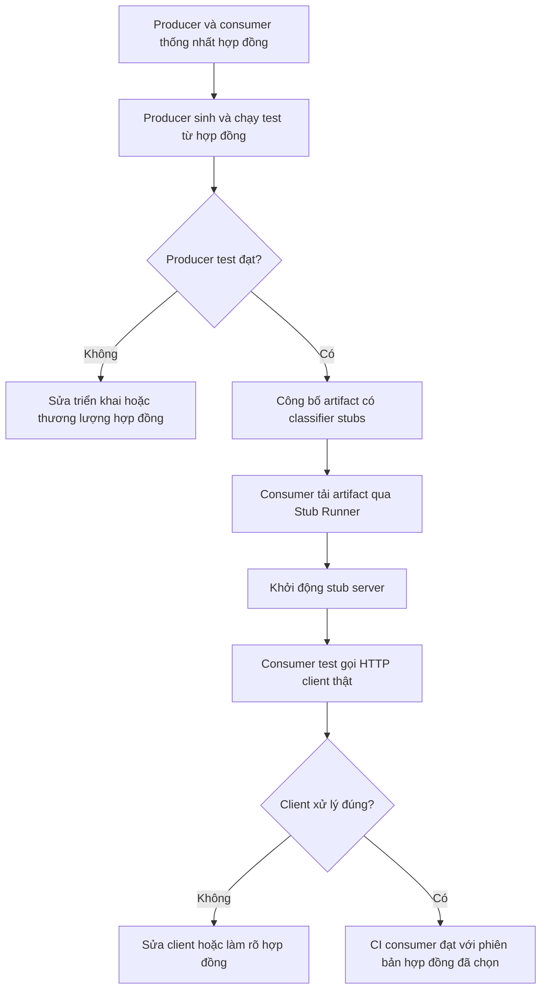
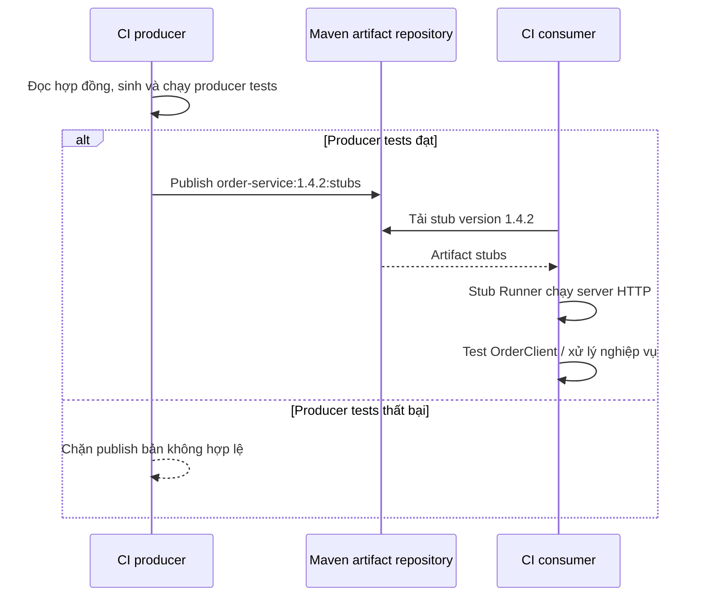

# Consumer kiểm thử mã gọi với stub đã công bố

Khi **consumer** gọi một API do dịch vụ khác cung cấp, unit test với một đối tượng giả lập trong cùng tiến trình thường chưa đủ để phát hiện sai phương thức HTTP, đường dẫn, header, cấu trúc JSON hoặc cách xử lý lỗi. Chờ khởi động toàn bộ hệ thống để kiểm thử lại chậm và dễ phụ thuộc môi trường. **Spring Cloud Contract** cho phép consumer chạy kiểm thử mã gọi của mình với **stub được producer phát hành**: một dịch vụ mô phỏng các tương tác đã được mô tả bằng hợp đồng Groovy/YAML DSL.

Bài này thuộc chương **Vòng đời hợp đồng**. Trọng tâm là giai đoạn *sau khi producer định nghĩa hợp đồng, sinh và xác minh test rồi công bố artifact stub*: consumer lấy đúng artifact đó, chạy **Stub Runner**, cấu hình HTTP client trỏ đến stub và khẳng định mã consumer xử lý phản hồi đúng. Đây là một phần của quy trình kiểm thử hợp đồng giữa producer và consumer, không phải cách tự động tạo mọi bài kiểm thử nghiệp vụ cho consumer.

Sau bài học, bạn cần thực hiện được bốn việc: xác định chính xác phiên bản stub đã công bố; kết nối client thật của consumer với stub trong test; phân biệt lỗi gọi API với lỗi tải/chạy stub; và đưa phép kiểm tra này vào CI để phát hiện thay đổi giao diện không tương thích trước khi triển khai.

## 1. Vị trí của consumer trong vòng đời hợp đồng

Giả sử **Order Service** cung cấp dữ liệu đơn hàng, còn **Billing Service** cần đọc trạng thái đơn để quyết định xuất hóa đơn. Hai nhóm thống nhất hành vi HTTP:

```http
GET /api/orders/42
Accept: application/json
```

```http
HTTP/1.1 200 OK
Content-Type: application/json

{"id":42,"status":"PAID"}
```

Hợp đồng mô tả tương tác này có thể được lưu trong dự án producer bằng Groovy hoặc YAML DSL. Khi producer chạy Spring Cloud Contract Verifier, công cụ có thể sinh **kiểm thử producer** để so hành vi triển khai với hợp đồng, đồng thời tạo **stub HTTP** (thường là các mapping của WireMock) mô phỏng phản hồi đó. Sau khi kiểm thử producer đạt, quy trình build nên phát hành artifact chứa stub đến kho dùng chung.



Ba phép kiểm tra có vai trò khác nhau:

| Thành phần | Câu hỏi được trả lời | Giới hạn |
| --- | --- | --- |
| **Hợp đồng** | Producer đã cam kết phương thức, URL, dữ liệu và phản hồi nào? | Một file hợp đồng chưa chứng minh mã producer thực hiện đúng. |
| **Generated producer test** | Producer thực thi những tình huống trong hợp đồng có đúng không? | Chỉ kiểm các trường hợp được mô tả và chạy trong test. |
| **Consumer test với stub** | HTTP client và luồng xử lý của consumer có tương tác đúng với hành vi đã công bố không? | Stub không chứng minh producer thật đang chạy đúng hay hệ thống triển khai thực tế hoạt động tốt. |

**Điểm dễ nhầm:** Spring Cloud Contract sinh kiểm thử xác minh producer và dữ liệu stub; **nhóm consumer vẫn viết các assert của bài kiểm thử consumer**. Stub Runner chịu trách nhiệm tìm và khởi động stub, không biết nghiệp vụ xuất hóa đơn để tự khẳng định kết quả thay nhóm Billing.

## 2. "Stub đã công bố" thực sự là gì?

Một artifact stub thường là file JAR xuất hiện trong Maven repository, gắn với artifact và version của producer, dùng classifier `stubs`. Ví dụ producer `order-service` phát hành phiên bản `1.4.2` với tọa độ:

```text
groupId    = com.acme
artifactId = order-service
version    = 1.4.2
classifier = stubs
```

Có thể hình dung artifact như `order-service-1.4.2-stubs.jar`. Với HTTP, bên trong thường chứa các mapping và tài nguyên phản hồi để WireMock có thể trả về những tình huống đã đặc tả. Consumer **không cần** khởi động mã nguồn Order Service; consumer cần đúng phiên bản stub và một bài test gọi mã HTTP client của mình.

**Published** có nghĩa artifact đã được đưa vào nơi consumer/CI được phép truy cập, chẳng hạn kho Maven nội bộ. Một file stub mới được tạo trên máy producer nhưng chưa tải lên kho chung chưa phải artifact sẵn dùng cho một pipeline consumer độc lập.

Spring Cloud Contract Stub Runner dùng tọa độ dạng phổ biến sau để biết cần lấy stub nào và chạy ở cổng nào:

```text
groupId:artifactId:version:classifier:port

com.acme:order-service:1.4.2:stubs:8089
```

Trong ví dụ, `1.4.2` là **phiên bản artifact**, `stubs` là **classifier**, còn `8089` là **cổng HTTP stub** mà test consumer sẽ gọi. Cổng không phải một phần của tọa độ Maven gốc; nó là phần cấu hình Stub Runner. Nên ghim một phiên bản xác định trong test và CI để mỗi lần chạy có thể truy lại cùng tập hợp kỳ vọng. Ký hiệu lấy phiên bản mới nhất như `+` có thể hữu ích khi thử nghiệm, nhưng dễ khiến build thay đổi kết quả mà mã consumer không đổi.

## 3. Chuẩn bị consumer trước khi viết test

Các bước dưới đây giả định consumer dùng **Spring Boot với JUnit 5**, gọi HTTP đồng bộ qua `RestClient` (có sẵn trong Spring Framework 6.1 / Spring Boot 3.2 trở lên). Nếu dự án dùng `WebClient`, `RestTemplate`, OpenFeign hoặc một HTTP client khác, nguyên tắc vẫn vậy: client thật của consumer phải nhận **base URL cấu hình được** để trong test trỏ về stub.

Trong ứng dụng consumer, thêm thư viện Stub Runner vào **test scope**. Ví dụ Maven:

```xml
<dependency>
    <groupId>org.springframework.cloud</groupId>
    <artifactId>spring-cloud-starter-contract-stub-runner</artifactId>
    <scope>test</scope>
</dependency>
```

Hoặc tương đương trong Gradle:

```groovy
dependencies {
    testImplementation 'org.springframework.cloud:spring-cloud-starter-contract-stub-runner'
}
```

Ví dụ không ghi cứng phiên bản dependency vì dự án cần chọn **Spring Cloud BOM tương thích với phiên bản Spring Boot** đang dùng. Cần sẵn có JUnit 5, AssertJ và thư viện HTTP client của ứng dụng; với dự án Spring Boot thông thường, chúng được khai báo qua các starter thích hợp.

Mã HTTP client phải dùng một thuộc tính có thể thay đổi theo môi trường, ví dụ:

```yaml
# application.yml của Billing Service
orders:
  base-url: https://orders.example.internal
```

Khi chạy kiểm thử, ta sẽ **ghi đè** `orders.base-url` thành `http://localhost:8089`. Việc client luôn lấy URL từ cấu hình giúp cùng một mã sản phẩm được kiểm chứng qua stub mà không cần sửa source hay tạo một client giả chỉ dành cho test.

## 4. Ví dụ đầy đủ: gọi mã client thật tới stub

### 4.1. Mã client của Billing Service

Ví dụ client dưới đây nhận `RestClient.Builder` từ Spring Boot, tạo HTTP GET và chuyển JSON thành một `record`. Thuộc tính `orders.base-url` sẽ quyết định lời gọi đi tới server thật hay stub.

```java
import org.springframework.beans.factory.annotation.Value;
import org.springframework.stereotype.Component;
import org.springframework.web.client.RestClient;

@Component
public class OrderClient {
    private final RestClient http;

    public OrderClient(RestClient.Builder builder,
                       @Value("${orders.base-url}") String baseUrl) {
        this.http = builder.baseUrl(baseUrl).build();
    }

    public OrderView getOrder(long id) {
        return http.get()
                .uri("/api/orders/{id}", id)
                .retrieve()
                .body(OrderView.class);
    }

    public record OrderView(Long id, String status) {}
}
```

Đây là mã consumer sẽ dùng khi chạy thật; vì vậy test đi qua cùng đường tạo request, chọn URL và giải mã phản hồi. Nếu client gõ nhầm endpoint hoặc ánh xạ JSON sai, bài test có cơ hội phát hiện sự cố ngay trên máy phát triển/CI.

### 4.2. Cấu hình Stub Runner và bài kiểm thử

Giả sử artifact `com.acme:order-service:1.4.2:stubs` đã được phát hành tại một Maven repository mà môi trường test có quyền đọc. Đoạn dưới minh họa một bài test JUnit 5:

```java
import org.junit.jupiter.api.Test;
import org.springframework.beans.factory.annotation.Autowired;
import org.springframework.boot.test.context.SpringBootTest;
import org.springframework.cloud.contract.stubrunner.spring.AutoConfigureStubRunner;
import org.springframework.cloud.contract.stubrunner.spring.StubRunnerProperties;

import static org.assertj.core.api.Assertions.assertThat;

@SpringBootTest(properties = "orders.base-url=http://localhost:8089")
@AutoConfigureStubRunner(
        ids = "com.acme:order-service:1.4.2:stubs:8089",
        stubsMode = StubRunnerProperties.StubsMode.REMOTE,
        repositoryRoot = "https://repo.example.org/maven/releases"
)
class OrderClientStubTest {

    @Autowired
    OrderClient orderClient;

    @Test
    void docDuocTrangThaiDaThanhToan() {
        OrderClient.OrderView order = orderClient.getOrder(42L);

        assertThat(order).isNotNull();
        assertThat(order.id()).isEqualTo(42L);
        assertThat(order.status()).isEqualTo("PAID");
    }
}
```

**Thay giá trị ví dụ bằng thông tin thật của dự án**: `com.acme`, `order-service`, version, repository URL và base URL của client. `repo.example.org` chỉ là địa chỉ minh họa; mã sẽ không tải được stub cho đến khi kho chứa artifact thực được cấu hình. Giả định ngữ cảnh Spring Boot có đăng ký `OrderClient` và `RestClient.Builder` như ở phần 4.1.

Cơ chế hoạt động khi chạy test:

1. Spring Boot khởi tạo ngữ cảnh kiểm thử với `orders.base-url=http://localhost:8089`.
2. `@AutoConfigureStubRunner` tìm artifact đã chỉ định từ Maven repository và khởi động HTTP stub server tại cổng `8089`.
3. Test gọi **`orderClient.getOrder(42L)`**, tức chính mã client của Billing, thay vì tự viết một lời gọi WireMock độc lập.
4. Stub khớp request theo mapping từ hợp đồng và trả JSON; client giải mã JSON rồi test kiểm tra `id` và `status`.
5. Nếu request không khớp hợp đồng, phản hồi sai định dạng hoặc client diễn giải dữ liệu sai, bài test có thể thất bại và chặn bản build consumer.

Điều kiện tiên quyết là artifact được công bố **thực sự có** mapping cho `GET /api/orders/42` trả về JSON đã nêu. Test không tạo ra mapping này; nó tiêu thụ stub producer đã phát hành.

**Về cổng cố định:** dùng `8089` giúp ví dụ dễ theo dõi, nhưng khi nhiều test/pipeline chạy trên cùng máy, cổng này có thể bị chiếm. Trong dự án lớn, có thể dùng cơ chế chọn cổng và lấy cổng từ Stub Runner để cấu hình client động; điều quan trọng là **URL client và cổng stub luôn đồng nhất**, tránh phụ thuộc vào một cổng dùng chung khi chạy song song.

## 5. Chọn nơi tải stub và chiến lược phiên bản

Stub Runner hỗ trợ các chế độ lấy artifact khác nhau. Cách dùng cần khớp nơi stub được lưu và cách CI có quyền truy cập.

| Chế độ | Tình huống thường gặp | Điều cần chuẩn bị |
| --- | --- | --- |
| `LOCAL` | Producer đã `install` artifact stub vào Maven local; developer cần thử nhanh trước khi publish. | Đúng artifact/version có mặt trong kho local của máy chạy test. |
| `REMOTE` | Consumer/CI tiêu thụ artifact **đã phát hành** từ kho Maven dùng chung. | Đúng địa chỉ repository, version, quyền đọc và kết nối mạng. |
| `CLASSPATH` | Stub đã được đưa vào classpath của môi trường kiểm thử theo cấu hình dự án. | Tài nguyên stub nằm trên classpath và được tổ chức đúng để Stub Runner tìm thấy. |

Với mục tiêu của bài này, **`REMOTE` là lựa chọn minh họa chính** vì nó kiểm tra đúng artifact producer đã công bố. `LOCAL` hữu ích cho vòng phát triển nhanh nhưng có thể che giấu việc quên publish: máy developer chạy được trong khi CI consumer không tìm thấy artifact.

Một chính sách phiên bản thực dụng gồm:

- **Ghim phiên bản** (`1.4.2`) trong test/CI ổn định; khi cần kiểm phiên bản producer mới, cập nhật có chủ đích và review tác động.
- **Giữ quan hệ giữa source, hợp đồng và artifact stubs**: version hoặc thông tin build phải cho phép truy lại hợp đồng nào đã sinh ra stub.
- **Không ghi đè artifact release bất biến**; nếu hợp đồng thay đổi, phát hành một phiên bản có thể phân biệt được. Với snapshot, phải tính đến cache và tính tái lập thấp hơn.
- **Bảo vệ thông tin truy cập repository** qua cơ chế cấu hình Maven/CI phù hợp, không hardcode username/token trong source hoặc tài liệu kiểm thử.

Artifact hợp lệ không có nghĩa tương thích với **mọi** consumer. Một contract được cập nhật để chỉ còn trường `state` có thể khiến producer test và consumer mới đều đạt, trong khi consumer cũ vẫn cần `status`. Để phát hiện breaking change, phải duy trì những hợp đồng còn hiệu lực hoặc chạy ma trận kiểm thử consumer đối với những phiên bản producer được hỗ trợ.

## 6. Test cần khẳng định điều gì để có giá trị?

Consumer test không nên chỉ kiểm `statusCode == 200` bằng một HTTP client tạm. Mục tiêu là **kiểm chứng logic có thật trong consumer** trên các tương tác quan trọng:

| Nội dung kiểm tra | Ví dụ với Billing | Lỗi có thể phát hiện |
| --- | --- | --- |
| Phương thức, đường dẫn, query, headers | `OrderClient` gửi `GET /api/orders/42` và `Accept` phù hợp khi hợp đồng yêu cầu. | Nhầm `POST`, thiếu prefix `/api`, thiếu header bắt buộc. |
| Giải mã và sử dụng JSON | Chuyển `id` thành `Long`, đọc `status == "PAID"`. | Đọc nhầm `state`, sai kiểu dữ liệu, mapper bỏ sót trường cần dùng. |
| Hành vi với lỗi nghiệp vụ | Với **stub đã định nghĩa rõ** phản hồi 404 và body lỗi, client chuyển thành lỗi miền như `OrderNotFound`. | Client nuốt lỗi, nhầm trạng thái hoặc không đọc mã lỗi. |
| Quy tắc nghiệp vụ phụ thuộc API | Khi nhận `PAID`, Billing cho phép tạo hóa đơn; khi nhận `PENDING`, không cho phép. | Client đọc đúng dữ liệu nhưng xử lý sai nhánh nghiệp vụ. |

Với trường hợp lỗi, cần công bố **hợp đồng và stub riêng cho request dẫn đến lỗi**. Nếu gọi một đường dẫn không có mapping, WireMock có thể trả HTTP 404 do **không khớp stub**, chứ không phải phản hồi 404 nghiệp vụ của producer. Vì vậy, test chỉ mong đợi `404` có thể **đạt giả**. Hãy so cả body/header/mã lỗi đặc thù đã được mô tả, hoặc kiểm tra request đã khớp đúng mapping, thay vì đánh đồng hai loại 404.

Mặt khác, một stub chỉ mô phỏng các tình huống được khai báo: nó không tự tái hiện mọi quy tắc xác thực, deadline, độ trễ mạng, bất thường hạ tầng hoặc dữ liệu ngoài hợp đồng. Cần bổ sung unit, integration hay end-to-end test tương ứng với rủi ro còn lại.

## 7. Khi test thất bại, xác định lỗi nằm ở đâu

Không phải mọi thất bại trong consumer test đều chứng tỏ producer phá hợp đồng. Hãy tách lỗi **chuẩn bị stub**, **khớp request** và **xử lý phản hồi**.

| Hiện tượng | Nguyên nhân cần kiểm tra trước | Cách xử lý |
| --- | --- | --- |
| Không tải được artifact (`404`, `401`, lỗi phân giải dependency). | Sai group/artifact/version/classifier; chưa publish; repository URL hoặc credential sai. | Kiểm tra artifact `stubs` thực sự tồn tại trong repo và quyền đọc của CI. |
| Stub Runner không khởi động hoặc cổng đã được dùng. | Port collision, mapping/resource đóng gói sai, cấu hình Stub Runner sai. | Kiểm log startup, thử cổng khác hoặc cấu hình cổng động. |
| Client bị `Connection refused` hoặc gọi vào server thật. | Base URL consumer không trỏ đến cổng stub đang lắng nghe. | Kiểm tra thuộc tính mà client thực sự đọc và cổng Stub Runner đang dùng. |
| Stub trả `404` khi đáng ra phải `200`. | Request không khớp method, path, query, header hoặc body trong mapping; cũng có thể thiếu hợp đồng. | So request được gửi với mapping của artifact đã tải; phân biệt 404 do không match và 404 nghiệp vụ. |
| Stub trả JSON đúng nhưng assert thất bại. | Consumer dùng DTO, mapper hoặc quy tắc xử lý sai. | Sửa mã consumer hoặc trao đổi lại kỳ vọng trong hợp đồng nếu mô tả chưa đúng. |
| Test xanh ở máy dev nhưng lỗi trên CI. | Dev đang dùng local stub/cache khác; CI không có credential; port hoặc version không đồng nhất. | Chạy cùng version, repository và chế độ stub, kiểm tra cách publish artifact. |

Nếu consumer cần hành vi mới mà artifact chưa mô tả, quy trình thích hợp là **đề xuất hợp đồng**, để producer chấp nhận/triển khai, chạy generated producer tests rồi publish stub phiên bản mới. Không sửa tay stub trong test consumer để "làm cho xanh" mà không đưa thay đổi trở lại nguồn hợp đồng, vì như vậy hai phía sẽ kiểm những đặc tả khác nhau.

## 8. Đưa consumer test vào CI/CD

Một pipeline phổ biến sẽ có hai luồng liên quan, có thể ở hai repository khác nhau:



Phần cấu hình cụ thể tùy hệ thống CI, nhưng cần thỏa các điều kiện sau:

1. **Producer test phải đạt trước khi publish stub được dùng làm mốc tin cậy.** Công cụ có thể tạo file stub trong quá trình build dù test chưa đạt; chính pipeline chịu trách nhiệm quyết định khi nào công bố artifact.
2. **Consumer test phải lấy được artifact thật** từ repository mà CI truy cập được, không vô tình chỉ dùng bản build local của một developer.
3. **Version trong consumer test phải xác định và có thể truy nguyên**. Khi kiểm tương thích với bản producer sắp phát hành, CI có thể chạy thêm bộ test với stub phiên bản ứng viên, bên cạnh baseline đang hỗ trợ.
4. **Kết quả test phải chặn thay đổi gây lỗi ở phía consumer**, và phải có log đủ để phân biệt tải stub lỗi, request không match hay assertion sai.
5. **Không gắn việc test xanh với kết luận tương thích ngược tuyệt đối**: khi hợp đồng cũ bị sửa/xóa, cần xem xét các consumer đang vận hành và chính sách nâng cấp.

Ví dụ có thể chạy nhóm kiểm thử JUnit này cùng bước `mvn test` hoặc task `test` của Gradle (tùy cấu hình discovery và profile kiểm thử). Nếu stub được publish từ pipeline khác, đảm bảo bước publish hoàn tất và artifact sẵn sàng trong repository trước khi consumer CI bắt đầu tải.

## 9. Bài thực hành có chủ đích

Trên một hệ thống thử nghiệm đã có producer và consumer, thực hành theo trình tự:

1. **Chuẩn bị hợp đồng** `GET /api/orders/42` trả `id=42`, `status=PAID`. Cho producer chạy generated tests và publish một artifact `stubs` với version cụ thể, ví dụ `1.4.2`.
2. **Tạo `OrderClient`** trong consumer lấy base URL từ cấu hình. Chạy `OrderClientStubTest` với Stub Runner tải artifact từ repository, kiểm tra `PAID` và `42`.
3. **Gây sai lệch phía consumer**: đổi URL client thành `/orders/42` hoặc ánh xạ `status` thành một trường không tồn tại; chạy test và ghi nhận lỗi.
4. **Sửa consumer**, chạy test lại và xác nhận đạt khi mã client khớp hợp đồng đã phát hành.
5. **Thử thay đổi producer**: giả sử producer muốn thay `status` bằng `state`. Giữ hợp đồng hiện hành rồi đổi mã producer để quan sát producer test thất bại. Sau đó đánh giá tác động trước khi xuất bản contract/stub mới; không xóa hợp đồng cũ chỉ để build đạt.
6. **Đưa test vào CI**, ghim phiên bản stub và kiểm tra log khi cố tình cấu hình một version không tồn tại để phân biệt lỗi repository với lỗi tích hợp mã gọi.

Kết quả mong đợi là bạn chỉ ra được **mã consumer nào thực sự được thực thi**, artifact/version nào cung cấp hành vi, cách kiểm thử thất bại khi consumer vi phạm giao diện và vì sao kiểm thử producer phải đi trước việc công bố stub đáng tin cậy.

## 10. Câu hỏi tự kiểm tra

- `com.acme:order-service:1.4.2:stubs:8089` có năm phần nào? Phần nào chỉ cổng chạy stub, không thuộc tọa độ Maven cơ bản?
- Tại sao phải gọi `OrderClient` thật của consumer trong test, thay vì chỉ gửi một request HTTP thử nghiệm trực tiếp tới stub?
- Vì sao test consumer đạt với stub vẫn có thể xảy ra khi producer thực triển khai sai hợp đồng?
- Khi nhận 404 từ WireMock, cần xác minh điều gì trước khi kết luận producer có nghiệp vụ "không tìm thấy đơn hàng"?
- Việc consumer tự sửa một stub JSON trong test để phù hợp với mã mới có thể tạo ra khoảng lệch nào giữa hai bên?
- Khi chuẩn bị nâng cấp producer, làm cách nào để giữ khả năng phát hiện rủi ro đối với consumer cũ còn đang vận hành?

**Ghi nhớ:** consumer kiểm thử **mã gọi thật của mình** bằng cách trỏ nó tới **stub được sinh từ hợp đồng và đã công bố theo phiên bản**. Stub Runner giúp tải và chạy stub; các assertion trong consumer test chứng minh consumer sử dụng đúng hành vi đã thỏa thuận. Chất lượng của phép kiểm tra phụ thuộc vào hợp đồng có bao phủ tình huống cần thiết, producer thực sự đã xác minh hợp đồng trước khi publish và CI duy trì đúng artifact/version cho các consumer còn được hỗ trợ.
